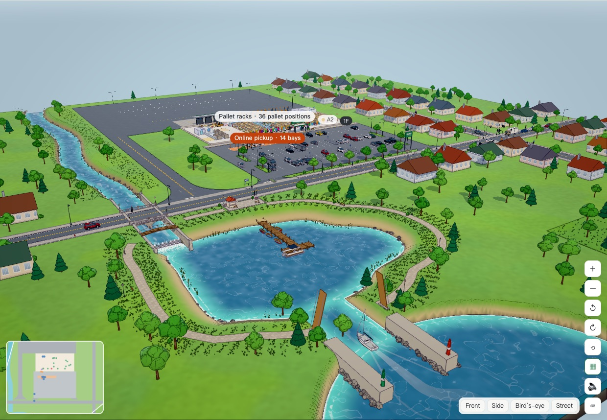
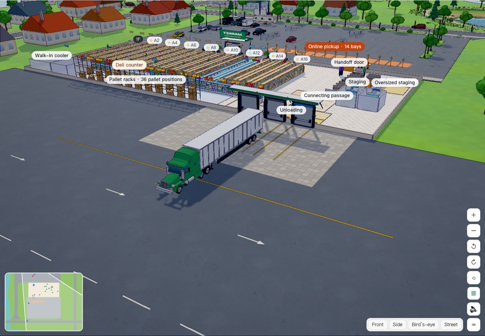

# Storewright

> A **digital twin** for **mid-size regional and independent grocers**. The 3D store **stays in sync** with live operations, **replays** any moment of the day and **forecasts** the next three hours; when equipment telemetry crosses a limit, an **alert** with its impact reaches the associates' phones. The twin's operations layer covers online-order fulfilment (**pick → stage → hand off**), **backroom inventory**, **shelf replenishment** and **staffing**, and every store gets its own **local, per-store AI** that explains each recommendation. Before changing layout, staffing or policies, a store tries them in the **planning twin**, a 2.5D / 3D simulation you can watch and steer like a management game. The whole system also runs **inside your browser** with no backend.

[Bilingual home](README.md) · [简体中文](README.zh-CN.md) · [Technical overview](docs/en/overview.md) · [Digital twin design (Chinese)](docs/14-digital-twin.md) · [Operation guide](docs/guide/operation-guide.en.md) · [Project report](docs/project/project-report.en.md) · [Documentation map](docs/README.md)

This project is based on public information, common industry practice and the author's own design. **It is not affiliated with any retailer or company.** All stores, products, customers and numbers are synthetic. Most design documents are in Chinese; [docs/en/overview.md](docs/en/overview.md) summarizes all of them in English.


## What it shows

| Question | What Storewright does | Result (simulation, synthetic data) |
|---|---|---|
| Is the 3D store a real twin, not just a picture? | Two-way automatic data flow: every scan, sale and sensor reading updates the twin; alerts, tasks and recommendations go back to the floor. The store can be rebuilt at any past moment from the event log and projected three hours ahead from its current state | A fault in a staging cooler becomes an alarm in about a minute, with the affected orders and totes, on the shift lead's phone and in the 3D twin (automated test) |
| Can one system run the whole online-order workflow? | Event-sourced operations core shared by the server, the associate PWA and the simulator; pick, stage, handoff, trips, backroom, replenishment | A test order goes through four devices end to end (automated browser test) |
| Does it beat a store with no dedicated system? | Weight- and crush-aware tote assignment, aisle-overlap batching, TSP routing, cold-chain limits, recorded staging, ETA-based prep | Overweight / crush-risk / chemical-mix totes 11–19% → **0**; fill +1.0 pt; average wait **−15%**; door dwell **−81%**; labor +4.9% |
| Can AI help without new hardware or a cloud bill? | Per-store models trained locally on the store's own simulated history, gated against simpler baselines before going live, every recommendation with reasons | With all AI on and the same total labor hours: average wait **−13%**, p90 wait **−23%**, late orders 2.41% → **0.69%** |
| Does it transfer to another industry? | Pluggable modules (made-to-order deli, returns, oversized "scan then print", parcel hub) and a home-improvement store template on the same core | Payoffs move: batching barely matters (≈1 tote per order), safety and AI staffing matter more (late orders ≈10% → ≈0) |
| Does it hold up in a big store? | Batched pushes serialized once for every device, lean device snapshots, static data cached on devices | 300-person store: 300 devices connect in **0.09 s**; at 50 commands a second every device sees each change within about **15 ms** |

No profile wins on every metric: a store picks its priorities and sees the trade-offs in simulation first.

## Current state

- **Digital twin** ([decision 0016](docs/decisions/0016-digital-twin.md), [docs/14](docs/14-digital-twin.md)):
  - **Live**: the 3D scene follows every scan, sale and reading: associates at their last scan, totes in staging slots, customers' cars in pickup bays, trucks at dock doors; twin health shows data freshness, sensor status and record accuracy;
  - **Replay**: the operations state is the event log applied in order, so dragging the timeline rebuilds any moment of the day exactly;
  - **Forecast**: a queue projection from the current state for the next three hours, calibrated on today's work, where you can try "one more picker" or "move a handoff associate to picking" and compare;
  - **Equipment and alerts**: temperatures of walk-in coolers and freezers, staging coolers and freezers and hot holding, dock doors and the entrance count; crossing a limit writes an alert into the event log with the affected orders, totes, cases and free slots to move to, sends it to the shift lead's phone for acknowledgement, and flashes the area in the 3D twin.
- **A game-style 3D world** ([decision 0017](docs/decisions/0017-stylized-world.md)): cel shading with outlines, a procedural sky, glowing lamps at night, and a diorama that ends at the neighbourhood with soil cross-sections on its edges; the store, roads and surroundings are modelled from scratch with procedural geometry and textures: a lake with a weir, a stone-walled canal under a two-arch stone bridge, a wooden pier with boats, detailed streets, trees and grass. Nothing is downloaded.
- **Realistic vehicles and driving** ([decision 0018](docs/decisions/0018-vehicles-and-yard.md)): cars, SUVs, pickups, vans, box trucks, sleeper-cab tractors with 53-foot trailers, motorhomes and towed campers, boat and utility trailers, plus rowboats, a runabout, a small sailboat, kayaks and a pontoon boat, all generic shapes built from public dimensions; bodies dip under braking and lean in turns; motorhomes and towing rigs park across several stalls, some drivers back in or pull through; trucks queue in the yard first come, first served, back in from the driver's side and loop out; forklifts split the work, take turns in a trailer and in a rack aisle, and go back to the charger.
- **Truck yard and surroundings** ([decision 0019](docs/decisions/0019-yard-access-deliveries-harbor.md)): 1–10 dock doors; the truck access can be on the left or right, a private drive or a side street, with configurable staging slots and trailer stalls, and semis turn on 15 m arcs; the lot has separate in and out lanes; deliveries follow the weekday, season and store size (DC reefer, line-haul and general-merchandise trucks, a dozen vendors, parcels); the lake has a channel to the sea and boats leave and return on a timetable; a school and a rail crossing can be switched on and delay arrivals; two-floor stores get a second-floor checkout, freight lift, unloading area and stockroom; the online-order room has its own cooler and freezer and a connecting passage to receiving, where overflow pallets go.
- **AI operations advice, student part-timers and boat traffic** ([decision 0020](docs/decisions/0020-students-boats-ai-advice.md)): an "AI advice" tab looks for problems in the planned day (deliveries and yard, backroom and restocking, online-order staging by temperature zone, checkout lanes and parking, exceptions and risks), checks other days to see whether they recur, and tries each actionable fix on the plan to estimate its effect; every suggestion says what to do, why, the expected effect and the confidence, and can be adopted (and undone), dismissed with a reason, or located in the scene; a daily plan, a shift handoff summary and an adopt-versus-not comparison sit alongside. Student part-timers work only after school on school days (at most 4 hours), at most 6 hours on weekends and in the summer, and no more than 20 hours a week. Boat traffic can be set to few, normal or many, with visiting boats, passing boats and anchored anglers that keep to their side of the channel and never collide.
- **Fulfilment** on associate phones: tote labels, cold-chain limits, staging slots, pickup bays, multi-order delivery trips. A wrong pickup code never locks entry; a delivery driver may cancel only outside the prep window, and the system re-dispatches the trip, returns pulled totes to staging and notifies customers ([decision 0014](docs/decisions/0014-handoff-rules-and-scale.md)).
- **Backroom and shelves**: receiving, put-away, counts, backroom retrieval, shelf-stock estimates and replenishment, with sensor and POS feeds; receiving, backroom and staging are split into editable areas with capacity, occupancy and alerts.
- **Planning twin (simulator)**: vehicles accelerate, brake, steer and signal; semi-trailers back into the dock with articulated kinematics; full-day simulation, policy comparison, saved scenarios and reports; a store generator and editor for shelves, areas, dock doors, pickup bays, floors, facilities and surroundings; a compact layout on phones.
- **Store AI**: demand forecasts, arrival-time correction, shelf availability and phantom stock, risk-based counts, substitutions, staffing plans and live dispatch, deli prep timing, return dispositions, load planning, and a local assistant that answers from store data only.
- **Store AI, second round: from predictions to a closed loop** ([decisions 0021–0024](docs/decisions/0021-store-ai-batch1.md), [roadmap](docs/15-store-ai-roadmap.md)):
  - **Look ahead, interrupt less**: an AI-driven forecast spots orders that will miss their slot, long customer waits and full cold staging early, tries fixes (move someone, start orders early, pick frozen later, tell customers) and sends the best one, with its expected effect, to the shift lead; a nudge hub merges alerts, waits for the right moment and caps non-urgent nudges per person per hour; pick-time model, out-of-stock pre-checks and restocking by stockout risk;
  - **People and equipment**: schedule generation (every hard rule satisfied) and absence cover (the colleague accepts the invitation), predictive maintenance for cold-chain units, pickers' "can't find" reports feeding shelf truth, on-the-way shelf checks, an opening brief, outcome tracking (kept-promise rates; modules that keep missing drop to show-only), and model health monitoring;
  - **Online orders**: automatic cold-chain walk splits and mid-pick handover, tote-factor learning, no-show risk, slot capacity with an acceptance trade-off curve, real substitution feedback, freezer-time and heavy-item safety nudges;
  - **On the floor and after closing**: a closing review (replays the day and splits late orders by cause) and a weekly report, recall handling, incident checklists, a food safety log, on-the-job tips with quizzes, receiving from delivery-note QR codes and GS1 case codes (lots and expiry dates), markdown and donation advice for short-dated lots, voice commands, and a "next up" task for everyone. Interfaces and evaluations for a local language model, speech and vision models are ready; the models are downloaded only with the author's consent.
- **On-duty team and reassignment** ([decision 0025](docs/decisions/0025-team-view-dispatch.md)): every device's top bar shows who is on duty in which role, what each person is doing and how much work waits in each role (roles with work but nobody on them are marked); shift leads move someone in two taps for 30 min, 1 h, 2 h or open-ended, and the store moves them back on time; the moved person's phone switches screens and says so. A step-by-step review of every workflow is in [16 Operation flows (Chinese)](docs/16-operation-flows.md).
- **Every friction point fixed, store settings** ([decision 0026](docs/decisions/0026-flow-fixes.md)): a store can require scanning (tap-instead-of-scan is refused and the server checks barcodes, locations and slots); scanning a tote on the board starts preparation, staff can check a customer in, the code can be verified before totes are pulled, replenishment picks a whole batch in one trip, quantities can be typed, notifications open the exact task, backroom recovery closes the loop, deli and oversized items join the handoff, AI suggestions are sorted by urgency with a second confirmation for actions that affect people, money or customers, schedule drafts are editable, recalls list the affected totes, and busy associates move after finishing their task. 25 of 26 proposals are in; voice recognition waits for a model download.
- **Modules and a second industry**: made-to-order deli, returns, oversized items and parcel hub can each be switched on; the same core runs a home-improvement store.
- **In-browser demo**: the store hub, including the twin service and an equipment simulation, runs in the browser; the showcase shows the console, two phones, the 3D digital twin and a full-day simulation; auto operations run a second, virtual track next to your own.
- **Your Store** ([decision 0013](docs/decisions/0013-phase8-plan.md)): build a twin of your own store from an empty lot. Floor size, industry, floors, staging, docks, pickup bays, hours and facilities generate a working store, and then everything can be edited; a pre-opening check flags missing areas, cold storage and capacity; run a full-day simulation or open a live sandbox on it. Stores are saved in the browser and can be copied, exported and imported.
- **Quality**: 383 unit and property tests; 83 end-to-end runs on Chromium, WebKit (Safari), Firefox, iPhone, Android and browsers without SharedWorker, including accessibility checks (names, contrast, keyboard); a 221-step walkthrough in 22 sections with screenshots.

<table>
<tr>
<td width="62%"></td>
<td></td>
</tr>
<tr>
<td>3D twin: equipment readings, an alarm, the replay · live · forecast timeline</td>
<td>A picker's phone: walks to claim</td>
</tr>
</table>





## Try it

**In the browser (no install):** build the static site and open the showcase page. The 3D digital twin, a demo console and two associate phones run side by side, all connected to an in-browser store hub (a SharedWorker running the same code as the server).

```bash
npm install
```

```bash
npm run build:site
```

```bash
npm run demo:site
```

Then open http://127.0.0.1:4177/. Create an order in the console and watch it get picked, staged and handed off on the phones while it appears in the twin. In the console's "Equipment and alerts", cause a fault and watch the alert reach the shift lead's phone; drag the timeline under the twin to replay the past or forecast the next hours. `?store=hardware` switches to the home-improvement store.

**With the real backend:**

```bash
npm run build:associate
```

```bash
npm run server
```

Open http://localhost:8787 (phones on the same Wi-Fi can open the computer's LAN address). `STORES=demo,hardware,large npm run server` also runs the home-improvement store and a 300-person large store.

**Planning twin only:** `npm run dev` → http://localhost:5173 (connect it to a backend in the "Digital twin" tab and it becomes the live twin).

| Command | Purpose |
|---|---|
| `npm run check` | Type checks + all unit and property tests (383) |
| `npm run e2e` | End-to-end tests (23: real backend, in-browser demo including real taps on the showcase phones, accessibility; run `npm run build:all` first; uses the installed Chrome) |
| `npm run e2e:browsers` | The same plus WebKit (Safari), Firefox, browsers without SharedWorker, iPhone and Android (75; run `npx playwright install webkit firefox` first) |
| `npm run loadtest -w @storewright/server` | Large-store capacity test: 300 staff, 300 devices, 1,200 orders a day, batched pushes at peak (~10 s; `DB=pglite` writes every command to a database) |
| `npm run walkthrough` | Full walkthrough: 22 sections step by step with screenshots, written to an illustrated report (`experiments/results/walkthrough/report.html`, ~10 min) |
| `npm run compare -- --template medium --reps 30 --profiles --ablation` | Baseline vs optimized with common random numbers, ablation, confidence intervals |
| `npm run ai-report` | AI benefit report: offline evaluation of every model family, AI on/off, trade-off curves, sensitivity (~25 s) |
| `npm run notices` | Regenerate the third-party notices (`THIRD_PARTY_NOTICES.md`) from the installed dependencies; run it after changing dependencies |
| `npm run industry-report` | Grocery vs home-improvement comparison: configuration, order shape, operations, AI, forecasting (~10 s) |

Requires Node.js 20+.

## Browser support

Recent Chrome, Edge, Safari (macOS and iOS) and Firefox, on desktop and phones, are tested automatically in CI. Browsers without SharedWorker (older Android browsers, some in-app browsers) fall back to one store hub per page: the showcase still works and data is still saved on the device; a notice explains when separate tabs cannot share the demo store.

## Architecture

```
apps/simulator   3D digital twin: live twin (sync, replay, forecast, equipment) and planning twin (React Three Fiber, simulation in a Web Worker, store editor)
apps/associate   Associate PWA (pick, stage, handoff, inventory, modules, AI, demo console) + in-browser demo
apps/server      Store hub (transport-agnostic, shared by Node and the browser): operations, twin service (telemetry, alerts, replay, equipment simulation), store AI + Fastify shell + capacity test
apps/sim-cli     Experiments and reports
packages/domain        Domain types, event log, rule engine, deterministic RNG
packages/store-config  Store configuration schema, generator, templates (incl. home improvement), areas and docks
packages/synth         Synthetic catalog, orders, demand history with hidden factors, arrivals, shelf truth
packages/algorithms    Tote assignment, batching, routing, cold chain, trips, replenishment, planogram
packages/sim-engine    Discrete-event simulation, policies, traffic, incidents, experiments, statistics
packages/ops           Operations core: command → events → state as pure functions; views; live client; device snapshots
packages/labels        QR, tote / case / slot / location labels (SVG + ZPL)
packages/ai            Recommendations with reasons, backtests, model registry with promotion gates, models
packages/twin          Sensor registry, telemetry, alert rules and impact, replay, forecast, twin health
```

Key design choices:

- **Event sourcing everywhere.** `decide(state, command)` is pure; events are applied in place on every client; the same core runs on the server, the phones and the 3D twin. That is also what makes replay exact: the store at time *t* is the events up to *t* applied in order.
- **Telemetry beside the event log.** Equipment readings are high-frequency and need no permanent record, so they live in a time series (latest value, an hour of raw readings, a day of minute buckets); only threshold crossings become operations events (`EquipmentAlertRaised`, `…Acknowledged`, `…Cleared`). Viewers subscribe to telemetry pushes; associate phones do not, which keeps the large-store capacity.
- **Local-first, per-store AI.** Each store's models are trained on the store's own configuration and (simulated, then real) history, compared with simpler baselines on the same data, and promoted only if they pass a gate. Recommendations carry factor-coded reasons, confidence and alternatives, and run in SHOW / CONFIRM / AUTO modes. A local assistant answers questions through read-only tools over store data, with an optional local LLM.
- **Simulation as the evaluation field.** Synthetic data contains factors the models cannot see (local events, demand shifts, customer preference types), so models cannot just "learn the generator".
- **One hub, two transports.** All server endpoints live in a transport-agnostic hub with injected storage and crypto. Fastify serves it over HTTP / WebSocket; the browser demo runs it in a SharedWorker (or one dedicated worker per page) with IndexedDB storage.

## Documentation

| Doc | Content |
|---|---|
| [Documentation map](docs/README.md) | Where to start for using, evaluating, developing or checking compliance |
| [Operation guide](docs/guide/operation-guide.en.md) | How to run it, sign in, work each role on the phone, use the simulator and twin; FAQ and glossary |
| [Purpose, results and outlook](docs/project/purpose-and-outlook.en.md) | Why it exists, the goals set at the start, what was achieved and not, and what comes next |
| [Project report](docs/project/project-report.en.md) | For reviewers and hiring managers: problem, role, solution, key decisions, results and evidence, challenges, lessons, a five-minute demo |
| [Technical overview (English)](docs/en/overview.md) | All design documents and results summarized in English |
| [01 Workflow design](docs/01-workflow-design.md) | Modules, state machines, entities, events, engineering constraints |
| [05 Evaluation & roadmap](docs/05-evaluation-and-roadmap.md) | Evaluation method and phased plan |
| [06 Phase 1 results](docs/06-phase1-results.md) | Calibration, main results, ablation, sensitivity |
| [07 Simulator](docs/07-simulator.md) | Features, architecture, performance, phone layout |
| [08 Live operations](docs/08-live-operations.md) | Associate app and realtime backend, pickup codes, driver cancellation, capacity |
| [09 Backroom & replenishment](docs/09-backroom-replenishment.md) | Receiving, put-away, counts, shelf estimates, sensing |
| [10 Store AI](docs/10-store-ai.md) | Local-first AI design, models, assistant, ethics |
| [11 AI results & model cards](docs/11-ai-results.md) | Offline evaluation, AI on/off, nine model cards |
| [12 Business modules & second industry](docs/12-business-modules.md) | Module framework, four modules, home-improvement template |
| [13 In-browser demo, E2E & deployment](docs/13-demo-and-deployment.md) | Store hub, SharedWorker and fallback, showcase, tests on every browser, accessibility, CI, hosting |
| [14 Digital twin](docs/14-digital-twin.md) | Definition and maturity levels, the four layers, live and planning twins, equipment telemetry and alerts, replay, forecast, twin health, interfaces, limits |
| [15 Store AI roadmap (Chinese)](docs/15-store-ai-roadmap.md) | The second round of in-store AI (all four batches done, see decisions 0021–0024): from single predictions to a closed loop, coverage map and gaps, a day in the store, about 40 proposals in eight areas, four batches, evaluation, open decisions, what not to do |
| [16 Operation flows (Chinese)](docs/16-operation-flows.md) | Every workflow step by step as built (what people tap and scan, what the system does, what other devices see), taps and scans per unit of work, friction points, and simplification proposals for the author to choose from |
| [Decision records](docs/decisions/) | 0001–0027 |

## Evidence level and limits

All results are **evidence level B** (simulation with synthetic data): useful for comparing methods under stated assumptions, not a claim about any real store. Assumptions, calibration, sensitivity analyses and known simplifications are listed in each document. Real devices (scanners, printers, sensors) are represented by interfaces, virtual devices and conformance tests.

## License

Storewright is the author's portfolio: it shows the ideas, practice and planning behind a complete store-workflow solution. Everything is in this repository, with no paid features, private modules or commercial services ([decision 0027](docs/decisions/0027-portfolio-license.md)).

Code (core, simulator, backend, associate app, AI) is under [AGPL-3.0](LICENSE) and documentation, pseudocode and reports under [CC BY 4.0](LICENSE-docs); use them as those licenses allow, without any warranty or support. The built-in store templates and the stores built in Your Store are synthetic demo data: they do not represent any real store and are not an operating plan for one.

The licenses do not grant the right to use the Storewright name or icon. Code contributions are not accepted for now; ideas and bug reports are welcome as issues (see [CONTRIBUTING.md](CONTRIBUTING.md)). Report security issues as described in [SECURITY.md](SECURITY.md). The compliance statement and self-check are in [COMPLIANCE.md](COMPLIANCE.md); the open-source packages used at run time and their license texts are in [THIRD_PARTY_NOTICES.md](THIRD_PARTY_NOTICES.md).
