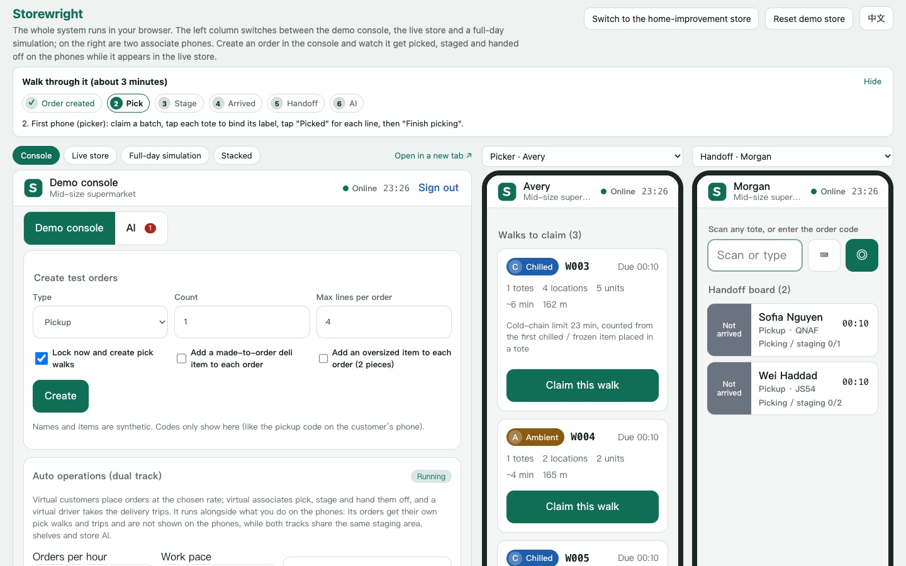
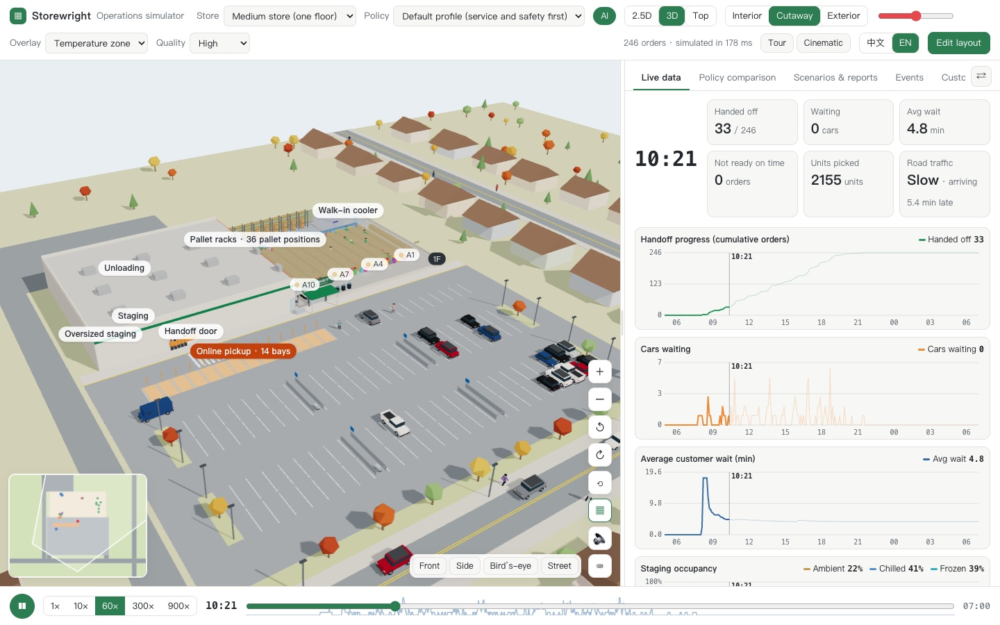
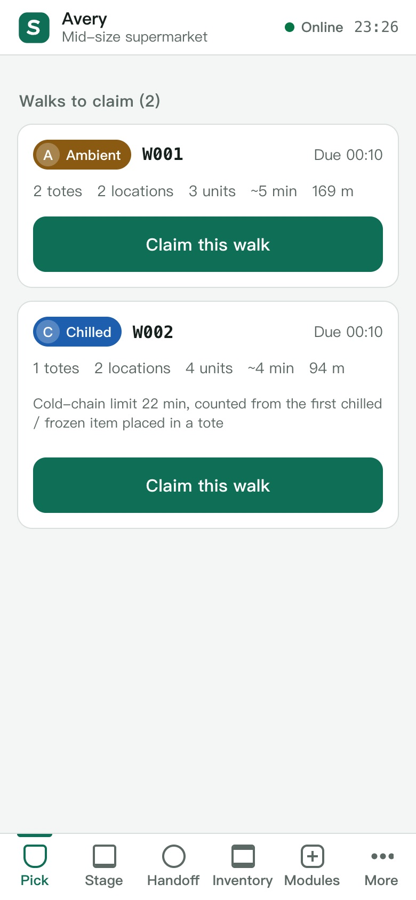

# Storewright

> An integrated store-operations system for **mid-size regional and independent grocers**: online-order fulfilment (**pick → stage → hand off**), **backroom inventory**, **shelf replenishment** and **staffing**, plus a **2.5D / 3D operations simulator** you can watch and steer like a management game. Every store gets its own **local, per-store AI** that explains each recommendation. The whole system also runs **inside your browser** with no backend.

[Bilingual home](README.md) · [简体中文](README.zh-CN.md) · [Technical overview](docs/en/overview.md)

This project is based on public information, common industry practice and the author's own design. **It is not affiliated with any retailer or company.** All stores, products, customers and numbers are synthetic. Most design documents are in Chinese; [docs/en/overview.md](docs/en/overview.md) summarizes all of them in English.



## What it shows

| Question | What Storewright does | Result (simulation, synthetic data) |
|---|---|---|
| Can one system run the whole online-order workflow? | Event-sourced operations core shared by the server, the associate PWA and the simulator; pick, stage, handoff, trips, backroom, replenishment | A test order goes through four devices end to end (automated browser test) |
| Does it beat a store with no dedicated system? | Weight- and crush-aware tote assignment, aisle-overlap batching, TSP routing, cold-chain limits, recorded staging, ETA-based prep | Overweight / crush-risk / chemical-mix totes 11–19% → **0**; fill +1.0 pt; average wait **−15%**; door dwell **−81%**; labor +4.9% |
| Can AI help without new hardware or a cloud bill? | Per-store models trained locally on the store's own simulated history, gated against simpler baselines before going live, every recommendation with reasons | With all AI on and the same total labor hours: average wait **−13%**, p90 wait **−23%**, late orders 2.41% → **0.69%** |
| Does it transfer to another industry? | Pluggable modules (made-to-order deli, returns, oversized "scan then print", parcel hub) and a home-improvement store template on the same core | Payoffs move: batching barely matters (≈1 tote per order), safety and AI staffing matter more (late orders ≈10% → ≈0) |
| Does it hold up in a big store? | Batched pushes serialized once for every device, lean device snapshots, static data cached on devices | 300-person store: 300 devices connect in **0.09 s**; at 50 commands a second every device sees each change within about **15 ms** |

No profile wins on every metric: a store picks its priorities and sees the trade-offs in simulation first.

## Current state (v1.0)

- **Fulfilment** on associate phones: tote labels, cold-chain limits, staging slots, pickup bays, multi-order delivery trips. A wrong pickup code never locks entry; a delivery driver may cancel only outside the prep window, and the system re-dispatches the trip, returns pulled totes to staging and notifies customers ([decision 0014](docs/decisions/0014-handoff-rules-and-scale.md)).
- **Backroom and shelves**: receiving, put-away, counts, backroom retrieval, shelf-stock estimates and replenishment, with sensor and POS feeds; receiving, backroom and staging are split into editable areas with capacity, occupancy and alerts.
- **Simulator**: vehicles accelerate, brake, steer and signal; semi-trailers back into the dock with articulated kinematics; full-day simulation, policy comparison, saved scenarios and reports; a store generator and editor for shelves, areas, dock doors, pickup bays, floors, facilities and surroundings; a compact layout on phones.
- **Store AI**: demand forecasts, arrival-time correction, shelf availability and phantom stock, risk-based counts, substitutions, staffing plans and live dispatch, deli prep timing, return dispositions, load planning, and a local assistant that answers from store data only.
- **Modules and a second industry**: made-to-order deli, returns, oversized items and parcel hub can each be switched on; the same core runs a home-improvement store.
- **In-browser demo**: the store hub runs in the browser; the showcase shows the console, two phones, the live store and a full-day simulation; auto operations run a second, virtual track next to your own.
- **Quality**: 218 unit and property tests; 51 end-to-end runs on Chromium, WebKit (Safari), Firefox, iPhone, Android and browsers without SharedWorker, including accessibility checks (names, contrast, keyboard); a 149-step walkthrough with screenshots.

The online version also has **Your Store**, a paid section where visitors build their own store from scratch and run it live; its code is not in this repository ([decision 0013](docs/decisions/0013-phase8-plan.md) §9).

<table>
<tr>
<td width="62%"></td>
<td></td>
</tr>
<tr>
<td>3D simulator: cutaway building, lot and live charts</td>
<td>A picker's phone: walks to claim</td>
</tr>
</table>

## Try it

**In the browser (no install):** build the static site and open the showcase page. The simulator, a demo console and two associate phones run side by side, all connected to an in-browser store hub (a SharedWorker running the same code as the server).

```bash
npm install
```

```bash
npm run build:site
```

```bash
npm run demo:site
```

Then open http://127.0.0.1:4177/. Create an order in the console and watch it get picked, staged and handed off on the phones while it appears in the simulator. `?store=hardware` switches to the home-improvement store.

**With the real backend:**

```bash
npm run build:associate
```

```bash
npm run server
```

Open http://localhost:8787 (phones on the same Wi-Fi can open the computer's LAN address). `STORES=demo,hardware,large npm run server` also runs the home-improvement store and a 300-person large store.

**Simulator only:** `npm run dev` → http://localhost:5173.

| Command | Purpose |
|---|---|
| `npm run check` | Type checks + all unit and property tests (218) |
| `npm run e2e` | End-to-end tests (15: real backend, in-browser demo, accessibility; run `npm run build:all` first; uses the installed Chrome) |
| `npm run e2e:browsers` | The same plus WebKit (Safari), Firefox, browsers without SharedWorker, iPhone and Android (51; run `npx playwright install webkit firefox` first) |
| `npm run loadtest -w @storewright/server` | Large-store capacity test: 300 staff, 300 devices, 1,200 orders a day, batched pushes at peak (~10 s; `DB=pglite` writes every command to a database) |
| `npm run walkthrough` | Full walkthrough: 15 sections step by step with screenshots, written to an illustrated report (`experiments/results/walkthrough/report.html`, ~6 min) |
| `npm run compare -- --template medium --reps 30 --profiles --ablation` | Baseline vs optimized with common random numbers, ablation, confidence intervals |
| `npm run ai-report` | AI benefit report: offline evaluation of every model family, AI on/off, trade-off curves, sensitivity (~25 s) |
| `npm run industry-report` | Grocery vs home-improvement comparison: configuration, order shape, operations, AI, forecasting (~10 s) |

Requires Node.js 20+.

## Browser support

Recent Chrome, Edge, Safari (macOS and iOS) and Firefox, on desktop and phones, are tested automatically in CI. Browsers without SharedWorker (older Android browsers, some in-app browsers) fall back to one store hub per page: the showcase still works and data is still saved on the device; a notice explains when separate tabs cannot share the demo store.

## Architecture

```
apps/simulator   2.5D / 3D simulator (React Three Fiber, simulation in a Web Worker), store editor, live view
apps/associate   Associate PWA (pick, stage, handoff, inventory, modules, AI, demo console) + in-browser demo
apps/server      Store hub (transport-agnostic, shared by Node and the browser) + Fastify shell + capacity test
apps/sim-cli     Experiments and reports
packages/domain        Domain types, event log, rule engine, deterministic RNG
packages/store-config  Store configuration schema, generator, templates (incl. home improvement), areas and docks
packages/synth         Synthetic catalog, orders, demand history with hidden factors, arrivals, shelf truth
packages/algorithms    Tote assignment, batching, routing, cold chain, trips, replenishment, planogram
packages/sim-engine    Discrete-event simulation, policies, traffic, incidents, experiments, statistics
packages/ops           Operations core: command → events → state as pure functions; views; live client; device snapshots
packages/labels        QR, tote / case / slot / location labels (SVG + ZPL)
packages/ai            Recommendations with reasons, backtests, model registry with promotion gates, models
```

Key design choices:

- **Event sourcing everywhere.** `decide(state, command)` is pure; events are applied in place on every client; the same core runs on the server, the phones and the simulator.
- **Local-first, per-store AI.** Each store's models are trained on the store's own configuration and (simulated, then real) history, compared with simpler baselines on the same data, and promoted only if they pass a gate. Recommendations carry factor-coded reasons, confidence and alternatives, and run in SHOW / CONFIRM / AUTO modes. A local assistant answers questions through read-only tools over store data, with an optional local LLM.
- **Simulation as the evaluation field.** Synthetic data contains factors the models cannot see (local events, demand shifts, customer preference types), so models cannot just "learn the generator".
- **One hub, two transports.** All server endpoints live in a transport-agnostic hub with injected storage and crypto. Fastify serves it over HTTP / WebSocket; the browser demo runs it in a SharedWorker (or one dedicated worker per page) with IndexedDB storage.

## Documentation

| Doc | Content |
|---|---|
| [Technical overview (English)](docs/en/overview.md) | All design documents and results summarized in English |
| [01 Workflow design](docs/01-workflow-design.md) | Modules, state machines, entities, events, engineering constraints |
| [05 Evaluation & roadmap](docs/05-evaluation-and-roadmap.md) | Evaluation method and phased plan |
| [06 Phase 1 results](docs/06-phase1-results.md) | Calibration, main results, ablation, sensitivity |
| [07 Simulator](docs/07-simulator.md) | Features, architecture, performance, phone layout |
| [08 Live operations](docs/08-live-operations.md) | Associate app and realtime backend, pickup codes, driver cancellation, capacity |
| [09 Backroom & replenishment](docs/09-backroom-replenishment.md) | Receiving, put-away, counts, shelf estimates, sensing |
| [10 Store AI](docs/10-store-ai.md) | Local-first AI design, models, assistant, ethics |
| [11 AI results & model cards](docs/11-ai-results.md) | Offline evaluation, AI on/off, nine model cards |
| [12 Business modules & second industry](docs/12-business-modules.md) | Module framework, four modules, home-improvement template |
| [13 In-browser demo, E2E & deployment](docs/13-demo-and-deployment.md) | Store hub, SharedWorker and fallback, showcase, tests on every browser, accessibility, CI, hosting |
| [Decision records](docs/decisions/) | 0001–0015 |

## Evidence level and limits

All results are **evidence level B** (simulation with synthetic data): useful for comparing methods under stated assumptions, not a claim about any real store. Assumptions, calibration, sensitivity analyses and known simplifications are listed in each document. Real devices (scanners, printers, sensors) are represented by interfaces, virtual devices and conformance tests.

## License

- Code (core, simulator, backend, associate app, AI): [AGPL-3.0](LICENSE), with a commercial license available.
- Documentation, pseudocode and reports: [CC BY 4.0](LICENSE-docs).

See [CONTRIBUTING.md](CONTRIBUTING.md) to contribute and [SECURITY.md](SECURITY.md) to report a security issue.
