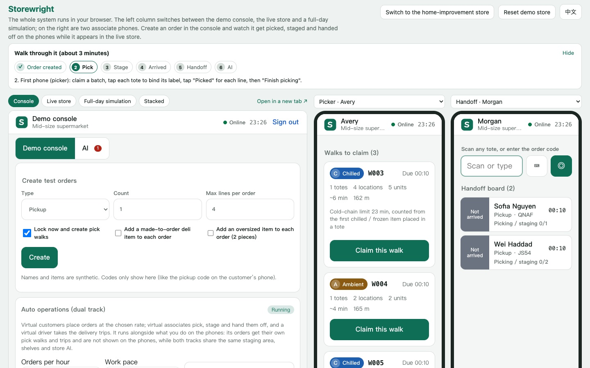

# Storewright

**A digital twin of a grocery store that runs in your browser: the 3D store follows live operations, replays any moment of the day and forecasts the next three hours, while associate phones run fulfilment, backroom work and per-store AI.**

**Status:** complete, v1.0 (Nov 2026). No new features are planned; issues are welcome.

<!-- DEMO VIDEO: put the GitHub video URL here.
     When the 60–90 s demo video is ready (MP4 or MOV, under 10 MB), open this file in GitHub's web editor and drag the
     video in. GitHub uploads it and inserts a URL like https://github.com/user-attachments/assets/<id>. Put that URL on
     its own line in place of this comment, with a blank line before and after it, and GitHub shows a video player.
     Keep the poster image below as the link to the live demo, or delete it. -->

**Live demo** (nothing to install): [front page](https://glacieerr.github.io/storewright/) · [showcase](https://glacieerr.github.io/storewright/app/showcase.html) · [store simulator](https://glacieerr.github.io/storewright/sim/) · [Your Store](https://glacieerr.github.io/storewright/sim/?yours) · [associate app](https://glacieerr.github.io/storewright/app/)

> Built from public information, common industry practice and the author's own design. **Not affiliated with any retailer or company.** All stores, products, customers and numbers are synthetic.

## What's in the repository

Part 1, Storewright, is the focus. Parts 2 and 3 (StoreX, StoreX Chain) are extensions.

| Part | What it is | Live demo |
|---|---|---|
| 1 · Storewright | Store digital twin: live, replay and forecast; associate phones; per-store AI; a planning twin for trying changes first | [showcase](https://glacieerr.github.io/storewright/app/showcase.html) |
| 2 · [StoreX](StoreX/README.en.md) | The store redesigned for 2030 and compared item by item with part 1 in simulation | [storex](https://glacieerr.github.io/storewright/storex/) |
| 3 · [StoreX Chain](StoreX-Chain/README.en.md) | The store's regional supply chain, from port, rail, air and highway to the shelf, with a duty assistant | [storex-chain](https://glacieerr.github.io/storewright/storex-chain/) · [one-minute tour](https://glacieerr.github.io/storewright/storex-chain/?tour=container&lang=en) |

## Three things worth a look

1. **The live twin, end to end.** Open the [showcase](https://glacieerr.github.io/storewright/app/showcase.html) and cause a fault under "Equipment and alerts" in the console: the alert, with the orders and totes it affects, reaches the shift lead's phone and the area flashes in the 3D twin. Drag the timeline under the twin back to replay the day, or forward to forecast the next three hours. ([How the twin works](docs/en/overview.md#1b-digital-twin))
2. **One event-sourced core everywhere.** `decide(state, command)` is a pure function, and the same operations core runs on the server, on every phone and inside the 3D twin. Replay is exact because the store at time *t* is the event log up to *t*, applied in order. In a 300-person store test at 50 commands a second, every device sees each change within about 15 ms. ([`packages/ops`](packages/ops/README.md) · [architecture](README.en.md#architecture))
3. **Results measured in simulation, with the limits written down.** Against a store with no dedicated system, on synthetic data: overweight, crush-risk and chemical-mix totes fall from 11–19% to 0, and the average customer wait drops 15%, for 4.9% more labor. This is evidence level B: simulation under stated assumptions, not a claim about any real store. ([What it shows](README.en.md#what-it-shows) · [Phase 1 results, in Chinese](docs/06-phase1-results.md))

## Evaluation: the duty assistant (part 3)

StoreX Chain's duty assistant answers an operations desk's questions from read-only tools and only proposes actions for a person to confirm. It is scored on the [Duty-Desk Bench](StoreX-Chain/docs/benchmark.en.md): four sets of 80 Chinese questions, each set written by a separately launched AI agent that saw a short brief but not the code or the training data. A question counts only when intent, tool, behaviour and safety are all right.

| All four right | Held-out set (set 4) | All 320 questions |
|---|---|---|
| Built-in assistant: rules + logistic regression + ask when unsure | **76.3%** (61/80) | 77.2% (247/320) |
| Keyword rules only (the same pipeline without the learned classifier) | 42.5% (34/80) | 48.4% (155/320) |

- **Why set 4 is the headline.** Sets 1–3 were studied during development, so the 320-question total is not a blind number. Set 4 was run once, on the version that added logistic regression and asking when unsure, with the scoring rules fixed beforehand; that first run is its official score. It has not been used to train, calibrate or tune anything, and a test checks that the assistant still gets exactly its first-run result on it.
- **Asking when unsure** did not raise the total (77.2% with or without it), but it turned 5 confident wrong answers into a question back (50 → 45 over the 320 questions; it never fired on set 4).
- Safety (nothing executed without confirmation, no proposal above the asker's limit) is 100% for every system. The questions were written by AI agents, so their wording is tidier than a real night shift's. [Every result and every missed question](StoreX-Chain/docs/benchmark.en.md).

## How I work with AI

I built Storewright with Claude Code, Anthropic's AI coding assistant ([compliance statement, section 8](COMPLIANCE.md#8-use-of-ai--ai-的使用)). We split the work like this.

**I:**

- frame the problem from public sources only;
- set the scope and the phases;
- write the acceptance criteria;
- make the trade-offs; part 1 has 27 [decision records](docs/decisions/);
- review the changes, in the running app and in the documents;
- run screenshot walkthroughs, which found defects to fix;
- decide when it is done.

For part 2 (StoreX), I left the design decisions to Claude.

**Claude Code:**

- writes almost all of the code and the tests;
- drafts the design documents and decision records from my notes and requests;
- lays out the options;
- runs the tests.

**Examples:**

<!-- CANDIDATE: pending the author's confirmation -->
<!-- Format: one or two sentences: the situation, what I asked for or turned down, and what changed as a result, with a link to the decision record or commit. Fill in only after the author confirms it happened; quote no private details from the session logs. -->
- *Example 1 (from the session logs; added once the author confirms it)*

<!-- CANDIDATE: pending the author's confirmation -->
- *Example 2 (from the session logs; added once the author confirms it)*

<!-- CANDIDATE: pending the author's confirmation -->
- *Example 3 (from the session logs; added once the author confirms it)*

<!-- CANDIDATE: pending the author's confirmation -->
<!-- Optional 4th example: delete this line and the one above if unused. -->

<!-- CANDIDATE: pending the author's confirmation -->
<!-- Optional 5th example: delete this line and the one above if unused. -->

**If I did it again:** a smaller scope; smaller commits, one feature each; and the core modules written by hand first.<!-- Link the by-hand practice repository here once it is public. -->

## Read more

- **Full guide:** [English](README.en.md) · [简体中文](README.zh-CN.md): every feature, results, commands, architecture and documents.
- [Project report](docs/project/project-report.en.md) (problem, role, decisions, evidence, lessons) · [Technical overview](docs/en/overview.md) · [Documentation map](docs/README.md)
- **Run it locally** (Node.js 22 or later): `npm install`, `npm run build:site`, `npm run demo:site`, then open http://127.0.0.1:4177/app/showcase.html. More commands are in the [full guide](README.en.md#try-it).

## License

Code: [AGPL-3.0](LICENSE). Documentation, pseudocode and reports: [CC BY 4.0](LICENSE-docs). The Unreal Engine plugin in part 3 is [MIT](StoreX-Chain/engines/ue5/LICENSE); per-file licenses are listed in [REUSE.toml](REUSE.toml). No warranty and no support. See also the [license notes](README.en.md#license), the [compliance statement](COMPLIANCE.md), the [third-party notices](THIRD_PARTY_NOTICES.md) and [how to cite](CITATION.cff).
