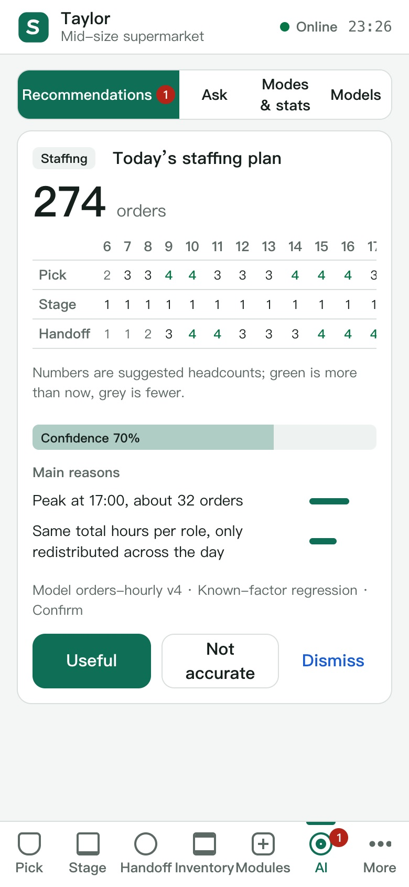

# Storewright

**A digital twin for grocery stores. The 3D store follows live operations as they happen, replays any moment of the day and forecasts the next three hours, and the same twin runs fulfilment, backroom work and AI on associate phones. It all runs in your browser.**

**面向超市的门店数字孪生。三维门店与现场作业实时同步，可以回放当天任意时刻、推演未来 3 小时；同一个孪生驱动员工手机上的履约、后仓作业和 AI。整个系统可以直接在浏览器里运行。**

**Try it online / 在线体验：** [Showcase / 展示页](https://glacieerr.github.io/storewright/) · [Store simulator / 门店模拟器](https://glacieerr.github.io/storewright/sim/) · [Your Store / 你的商店](https://glacieerr.github.io/storewright/sim/?yours) · [Associate app / 员工手机端](https://glacieerr.github.io/storewright/app/)

[Full English guide](README.en.md) · [完整中文说明](README.zh-CN.md) · [Technical overview (English)](docs/en/overview.md) · [数字孪生设计（中文）](docs/14-digital-twin.md)

[Operation guide · 操作指南](docs/guide/operation-guide.en.md) ([中文](docs/guide/operation-guide.zh-CN.md)) · [Project report · 项目报告](docs/project/project-report.en.md) ([中文](docs/project/project-report.zh-CN.md)) · [Purpose and outlook · 目的与展望](docs/project/purpose-and-outlook.en.md) ([中文](docs/project/purpose-and-outlook.zh-CN.md)) · [Documentation map · 文档导航](docs/README.md)


> This project is based on public information, common industry practice and the author's own design. **It is not affiliated with any retailer or company.** All stores, products, customers and numbers are synthetic.
>
> 本项目基于公开资料、行业通用做法和作者的独立构想设计。**本项目与任何零售商、企业无隶属关系。** 所有门店、商品、顾客和数字都是合成的。

## The twin · 孪生

| Layer · 层 | English | 中文 |
|---|---|---|
| Store · 现场 | People, orders, totes, cases, shelves, cold rooms, dock doors, vehicles, areas and bays | 人、订单、框、箱、货架、冷库、卸货门、车辆、区域和车位 |
| Data capture · 数据采集 | Every scan and action on associate phones, POS sales, shelf sensors, equipment telemetry (temperature, doors, entrance count), customer arrival times | 员工手机上的每次扫描和操作、POS 流水、货架传感器、设备遥测（温度、门、客流）、顾客到店时间 |
| Twin core · 孪生核心 | Store layout + event-sourced operations state + telemetry time series + AI predictions | 门店布局 + 事件溯源的作业状态 + 遥测时间序列 + AI 预测 |
| Use · 使用 | 3D twin, console, associate phones, local assistant | 三维孪生、控制台、员工手机、本地助手 |

Data flows both ways. Store → twin: every scan, sale and reading reaches the twin at once. Twin → store: AI recommendations, replenishment and count tasks and equipment alerts go straight to the right associate's phone. · 数据双向流动。现场 → 孪生：每次扫描、每条流水、每个读数即时进入孪生；孪生 → 现场：AI 建议、补货和盘点任务、设备告警直接推到对应员工的手机上。

| Past · 过去 | Present · 现在 | Future · 未来 |
|---|---|---|
| Replay the store at any moment of the day, rebuilt exactly from the event log · 按事件流精确重建当天任意时刻的门店 | Live sync with twin health: data freshness, sensor status, record accuracy · 实时同步，附孪生健康度：数据新鲜度、传感器状态、账实一致 | Forecast the next 3 hours from the current state, calibrated on today's work, and try staffing changes · 从当前状态推演未来 3 小时，用今天的作业数据校准，可以试调整人手 |

## What it does · 能做什么

| | English | 中文 |
|---|---|---|
| Live twin · 运营孪生 | The 3D scene shows associates where they last scanned, totes in staging slots, customers' cars in pickup bays, trucks at dock doors and equipment readings, all live; a timeline goes back (replay) and forward (forecast). | 三维场景实时显示员工最近扫描的位置、暂存格位里的框、取货车位上的顾客车辆、卸货门前的货车和设备读数；时间轴可以往回（回放）和往前（推演）。 |
| Equipment & alerts · 设备与告警 | Cold rooms, staging coolers and freezers, dock doors and the entrance report readings; when a limit is crossed, an alert with its impact (orders, totes, cases, free slots to move to) goes into the event log and to the shift lead's phone. | 冷库、暂存冷藏冷冻柜、卸货门和入口上报读数；越线时，带着影响分析（订单、框、箱、可转移的空格位）的告警写进事件流，推到带班负责人的手机上。 |
| Fulfilment · 履约 | Online orders flow through **pick → stage → hand off** on associate phones, with labels, cold-chain limits, staging slots, pickup bays and multi-order delivery trips. | 线上订单在员工手机上走完**拣货 → 暂存 → 交付**：标签、冷链时限、暂存格位、取货车位、多单配送行程。 |
| Backroom & shelves · 后仓与货架 | Receiving, put-away, cycle counts, backroom retrieval, shelf-stock estimates and replenishment tasks, with sensor and POS feeds. | 收货、上架、盘点、后仓补取、货架存量估算和补货任务，接入传感器和收银流水。 |
| Planning twin · 规划孪生 | A management-game-style 2.5D / 3D store for trying changes before making them: a full-day simulation with policy comparison and reports, and an editor where everything about the store can be changed. | 像模拟经营游戏一样的 2.5D / 3D 门店，改动之前先在这里试：全天仿真、方案对比与报告；门店的一切都可以在编辑器里改。 |
| Your Store · 你的商店 | Build a twin of your own store from an empty lot: floor size, industry, floors, staging, docks, pickup bays, hours and facilities generate a working store, and then everything can be edited; a pre-opening check flags missing areas, cold storage and capacity; run a full-day simulation or open a live sandbox on it. Stores are saved in the browser and can be copied, exported and imported ([decision 0013](docs/decisions/0013-phase8-plan.md)). | 从一块空地搭建自己门店的孪生：按占地、行业、楼层、暂存规模、卸货门、取货车位、营业时间和附属设施生成一家能运行的门店，然后全部可以编辑；开业检查指出缺少的区域、冷链存储和容量问题；可以跑全天仿真，也可以在这家门店上开实时沙盒。门店保存在浏览器里，可以复制、导出和导入（[决策记录 0013](docs/decisions/0013-phase8-plan.md)）。 |
| 3D world · 三维世界 | A game-style, cel-shaded diorama of the store and its neighbourhood: a harbour lake with a channel out to the sea, breakwaters and a lifting footbridge, boats leaving in the morning and coming back in the afternoon, a canal under a two-arch stone bridge, detailed streets, trees and grass; day and night, seasons and weather. Everything is generated in code, nothing is downloaded. | 游戏级的卡通风格门店与街区沙盘：通海的港池（出海水道、防波堤、人行开启桥），船只早上出港、下午回港，两孔石拱桥下的渠道，细致的街道、树木和草丛；昼夜、季节和天气变化。全部由代码生成，不下载任何素材。 |
| Vehicles & yard · 车辆与卸货场 | Realistic generic vehicles and boats built from public dimensions, with body roll and pitch; motorhomes and towing rigs park across several stalls; the lot has separate in and out lanes; deliveries follow the weekday, season and store size (DC trucks, a dozen vendors, parcels); the truck yard's access side, drive, staging slots and trailer stalls are configurable, semis turn on 15 m arcs, queue first come, first served and back in from the driver's side; forklifts take turns in trailers and rack aisles. | 按公开尺寸建的通用车辆和船，带车身俯仰和侧倾；房车和带拖车的车占几个车位；停车场进出分道；到货按星期、季节和门店规模排班（配送中心的车、十几家供应商直送、快递）；卸货场的进场道路、待命车位和甩挂车位可以设置，半挂车按 15 米圆弧转弯、先到先进地排队、从司机一侧倒车靠台；叉车在车厢和货架通道里轮流作业。 |
| Surroundings · 周边环境 | Choose the road style, plot, water (a harbour with a sea outlet, or none), road works, a school (drop-off and pick-up rushes with a crossing guard) and a rail crossing (trains close the gates); boat traffic can be few, normal or many (visiting, passing and anchored boats keep to their side of the channel); congestion, the school and the crossing delay customers, drivers and trucks. | 可以选道路风格、地块、水系（通海的港池或没有水面）、施工、学校（上学放学高峰，护导员拦车）和铁路道口（火车经过时栏杆放下）；船只可以选少、一般、多（访客船、经过的船、钓鱼船，水道里进出分道）；拥堵、学校和道口会推迟顾客、司机和货车的到店时间。 |
| Store AI · 门店 AI | Per-store models trained locally (demand, arrival times, shelf availability, counts, substitutions, staffing), promoted only after beating simpler baselines; every recommendation explains why. | 每家店在本机训练自己的模型（订单量、到店时间、可售概率、盘点、替代、排班），比简单方法好才上线；每条建议都说明理由。 |
| Store AI, second round · 门店 AI 第二轮 | From predictions to a closed loop on associate phones: early warnings with fixes tried in the forecast first, a nudge hub that interrupts less, schedules and absence cover, predictive maintenance, shelf truth from pickers' reports, slot capacity, a closing review that splits late orders by cause, recalls, incident checklists, a food safety log, short-dated markdowns and a "next up" task for everyone ([decisions 0021–0024](docs/decisions/0021-store-ai-batch1.md)). | 员工手机上从预测走向闭环：运营预警（处置办法先在推演里试过）、少打扰的建议中枢、排班与缺勤补位、预测性维护、拣货员帮助判断货架真相、时段产能、按原因分开迟到订单的打烊复盘、召回、突发状况清单、食品安全记录、临期降价、每个人的「下一步」（[决策记录 0021–0024](docs/decisions/0021-store-ai-batch1.md)）。 |
| Workflow fixes · 修复全部卡点 | Stores can require scanning (the server checks barcodes, locations and slots); 25 workflow simplifications from the flow review, from scan-to-start handoff to whole-batch replenishment, two-step confirmation for people/money/customer actions and queued reassignments ([decision 0026](docs/decisions/0026-flow-fixes.md)). | 门店可以「要求扫码」（服务端核对条码、货位、格位）；流程梳理的 25 条优化全部实施：扫框即开始准备、整批补货、涉及人钱顾客的动作两步确认、调人「做完这一单再去」等（[决策记录 0026](docs/decisions/0026-flow-fixes.md)）。 |
| On-duty team · 在岗人员与调配 | Every device shows who is on duty in which role, what each person is doing and how much work waits in each role; shift leads move someone in two taps for 30 min, 1 h or 2 h and the store moves them back on time ([decision 0025](docs/decisions/0025-team-view-dispatch.md)). | 所有设备都能看谁在岗、在哪个岗位、在做什么、各岗位排着多少活；带班负责人两下把人临时调走（30 分钟 / 1 小时 / 2 小时），到时间自动调回（[决策记录 0025](docs/decisions/0025-team-view-dispatch.md)）。 |
| AI advice · AI 运营建议 | In the planning twin, AI looks for problems in the day (deliveries and yard, backroom and restocking, staging by temperature zone, checkout lanes and parking, exceptions and risks), checks other days to see whether they recur and tries each fix on the plan first; every suggestion says what to do, why, the expected effect and the confidence, and can be adopted, undone or dismissed with a reason; with a daily plan, a shift handoff summary and an adopt-versus-not comparison. | 在规划孪生里，AI 找当天的问题（到货与卸货场、后仓与补货、各温区暂存、收银通道与停车场、异常与风险），换几天看会不会反复出现，先在方案上试一遍；每条写清做什么、为什么、预计效果、把握多大，可以采纳、撤销或带原因忽略；还有今日计划、交接班小结、采纳与不采纳对比。 |
| One core everywhere · 一套核心 | An event-sourced core shared by the server, the phones and the 3D twin; the same store hub runs on Node or inside the browser. | 事件溯源的作业核心，服务端、手机和三维孪生共用；同一个门店中枢既能跑在服务器上，也能跑在浏览器里。 |
| Scale · 容量 | Tested with a 300-person store: 300 devices connect in 0.09 s; at 50 commands a second, everyone sees each change within about 15 ms. | 按 300 人的大型店测试：300 台设备 0.09 秒连上；每秒 50 条操作时，所有设备约 15 毫秒内看到变化。 |

<table>
<tr>
<td width="62%"></td>
<td></td>
</tr>
<tr>
<td>3D twin: equipment readings, an alarm, the replay · live · forecast timeline · 三维孪生：设备读数、告警、回放 · 实时 · 推演时间轴</td>
<td>The lead's phone: alerts and recommendations with reasons · 带班负责人的手机：告警和带理由的建议</td>
</tr>
</table>


## Results (simulation, synthetic data) · 结果（仿真，合成数据）

| Question · 问题 | Result · 结果 |
|---|---|
| Better than a store with no dedicated system? · 比没有专门系统的门店好吗？ | Overweight / crush-risk / chemical-mix totes 11–19% → **0**; average wait **−15%**; time orders sit at the door **−81%**; labor +4.9% · 超重、压坏、混装框 11–19% → **0**；平均等待 **−15%**；订单在门口停留 **−81%**；工时 +4.9% |
| Does AI help with the same labor? · 工时不变，AI 有用吗？ | Average wait **−13%**, 90th-percentile wait **−23%**, late orders 2.41% → **0.69%** · 平均等待 **−13%**，90 分位等待 **−23%**，迟到订单 2.41% → **0.69%** |
| Does it transfer to another industry? · 能迁移到别的行业吗？ | Yes, as a home-improvement store; the payoff shifts from batching to safety and AI staffing · 能，迁到家居建材店；收益从分批转向安全和 AI 排班 |

Evidence level B: simulation under stated assumptions, not a claim about any real store. · 证据等级 B：在列明的假设下仿真得到，不代表任何真实门店。

## Quick start · 快速开始

Requires Node.js 20 or later. · 需要 Node.js 20 或更高版本。

```bash
npm install
```

```bash
npm run build:site
```

```bash
npm run demo:site
```

Open http://127.0.0.1:4177/ for the showcase: console, two phones, the 3D digital twin and a full-day simulation, all in the browser. In the console's "Equipment and alerts", cause a fault and watch the alert travel to the phones and the twin; drag the twin's timeline to replay or forecast. · 打开 http://127.0.0.1:4177/ 就是展示页：控制台、两部手机、三维数字孪生和全天仿真，全部在浏览器里运行。在控制台的「设备与告警」里制造一个故障，看告警怎样传到手机和孪生；拖动孪生的时间轴回放或推演。

| Command · 命令 | What it does · 作用 |
|---|---|
| `npm run dev` | Planning twin only · 只开规划孪生（http://localhost:5173） |
| `npm run server` | Real backend with the associate app · 真实后端和员工作业端（http://localhost:8787） |
| `npm run check` | Type checks + unit and property tests · 类型检查和单元、属性测试 |
| `npm run e2e:browsers` | End-to-end runs on Chromium, WebKit (Safari), Firefox, iPhone, Android and browsers without SharedWorker, plus accessibility checks · 端到端测试：Chromium、WebKit（Safari 内核）、Firefox、iPhone、安卓、不支持 SharedWorker 的浏览器，以及无障碍检查 |
| `npm run walkthrough` | Step-by-step walkthrough with screenshots · 逐步走查，带截图 |
| `npm run loadtest -w @storewright/server` | 300-person store capacity test · 300 人大型店容量测试 |

## Browser support · 浏览器支持

Recent Chrome, Edge, Safari (macOS and iOS) and Firefox, on desktop and phones, are tested automatically. Browsers without SharedWorker (older Android browsers, some in-app browsers) fall back to one hub per page: the showcase still works, and a notice explains that separate tabs don't share a store. · 自动测试覆盖较新的 Chrome、Edge、Safari（macOS 和 iOS）、Firefox，电脑和手机都包括。不支持 SharedWorker 的浏览器（较旧的安卓浏览器、部分 App 内置浏览器）每个页面用自己的中枢：展示页照常使用，多个标签页不共用门店时会有提示。

## Repository · 仓库

```
apps/simulator    3D digital twin (live, replay, forecast) and planning twin (simulation, store editor) · 三维数字孪生（实时、回放、推演）和规划孪生（仿真、门店编辑器）
apps/associate    Associate PWA, demo console, in-browser demo · 员工作业端、演示控制台、浏览器内演示
apps/server       Store hub (Node or browser): operations, twin service, store AI · 门店中枢（Node 或浏览器）：作业、孪生服务、门店 AI
apps/sim-cli      Experiments and reports · 实验与报告
packages/twin     Sensors, telemetry, alert rules, replay, forecast, twin health · 传感器、遥测、告警规则、回放、推演、孪生健康度
packages/*        domain, store-config, synth, algorithms, sim-engine, ops, labels, ai
docs/             Design docs, decision records, results (Chinese) + English overview · 设计文档、决策记录、结果，以及英文概览
e2e/              End-to-end tests and walkthrough (Playwright) · 端到端测试和走查
```

## License · 许可证

Storewright is the author's portfolio: it shows the ideas, practice and planning behind a complete store-workflow solution. Everything is in this repository, with no paid features, private modules or commercial services ([decision 0027](docs/decisions/0027-portfolio-license.md)). · Storewright 是作者的作品集，用来展示一整套门店工作流解决方案的构想、实践和规划能力。全部内容都在本仓库，没有付费功能、私有模块或商业服务（[决策记录 0027](docs/decisions/0027-portfolio-license.md)）。

- Code is under [AGPL-3.0](LICENSE) and documentation, pseudocode and reports under [CC BY 4.0](LICENSE-docs); use them as those licenses allow, without any warranty or support. · 代码使用 [AGPL-3.0](LICENSE)，文档、伪代码与报告使用 [CC BY 4.0](LICENSE-docs)，按许可证使用；不提供任何保证，也不提供技术支持。
- The built-in store templates and the stores built in Your Store are synthetic demo data: they do not represent any real store and are not an operating plan for one. · 内置门店模板和在「你的商店」里搭建的门店都是演示用的合成数据，不代表任何真实门店，不能当作门店的运营方案。
- The licenses do not grant the right to use the Storewright name or icon. · 许可证不授予使用 Storewright 名称和图标的权利。
- Code contributions are not accepted for now; ideas and bug reports are welcome as issues (see [CONTRIBUTING.md](CONTRIBUTING.md)). · 暂不接受代码贡献，欢迎用 issue 提建议和问题（见 [CONTRIBUTING.md](CONTRIBUTING.md)）。
- Compliance statement and third-party notices: [COMPLIANCE.md](COMPLIANCE.md), [THIRD_PARTY_NOTICES.md](THIRD_PARTY_NOTICES.md). · 合规声明与第三方组件声明：[COMPLIANCE.md](COMPLIANCE.md)、[THIRD_PARTY_NOTICES.md](THIRD_PARTY_NOTICES.md)。
