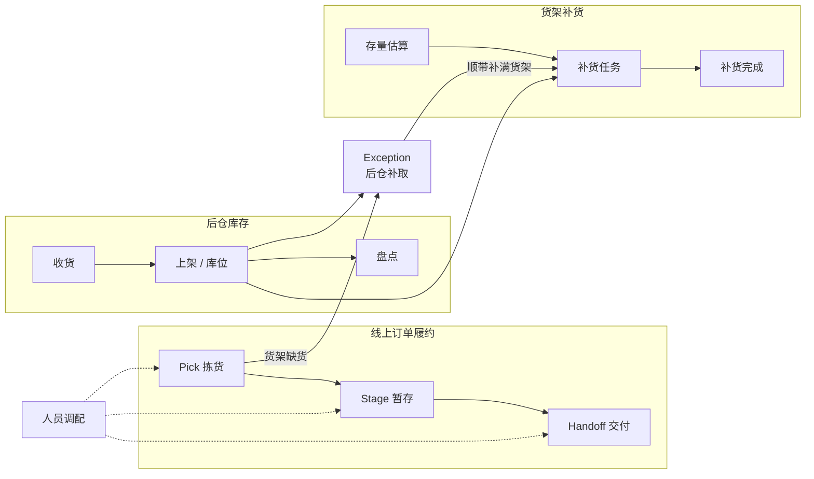

# Storewright

> 一套面向**中型区域连锁与独立超市**的门店一体化作业系统：**线上订单履约（拣货 / 暂存 / 交付）**、**后仓库存管理**、**货架补货**与**人员调配**，配套一个像模拟经营游戏一样可以实时查看和操作的 **2.5D / 3D 运营模拟器**，并把**门店定制化**作为核心能力。

**当前阶段：Phase 7 工程部分已完成**：整个系统可以在浏览器里运行，不需要后端——服务端的接口逻辑抽成了与传输方式无关的门店中枢，演示网页把它放进 SharedWorker，同一个网站打开的所有标签页实时同步；展示页同时显示运营模拟器、演示控制台和两部员工手机，带 6 步引导，数据保存在浏览器里，手机上用标签切换画面（见 [浏览器内演示、端到端测试与部署](docs/13-demo-and-deployment.md)）。退货的去向按食品安全和危险品规则硬性约束，AI 只在允许的去向里建议。9 个多浏览器端到端测试场景代替真机验收，持续集成与部署配置已写好；提交历史、部署与网站项目页等待作者确认。English: [README.en.md](README.en.md)。此前 **Phase 6（扩展业务与第二个行业）已完成**：熟食现做、退货、大件（先扫后打）、包裹中转四个模块可以在门店配置里单独开关，各带一个 AI 接入点（熟食开始时间、退货去向、大件装载规划、包裹格位）；同一套核心做了第二个行业——家居建材店，只改配置和数据，并记录改动与复用的部分。两个行业的对比显示回报来源不同：建材店每单约 1 框，分批和路线几乎不起作用，主要收益是安全（17.6% 的框超重 → 0）和门口停留，AI 排班在早高峰明显的建材店让迟到订单从约 10% 降到接近 0（仿真，见 [扩展业务模块与第二个行业](docs/12-business-modules.md)）。此前 **Phase 5（门店 AI，本地优先）已完成**：默认档位上打开全部 AI，总工时不变，平均等待 −13%、90 分位等待 −23%、迟到订单 2.41% → 0.69%（仿真，见 [AI 效益报告](docs/11-ai-results.md)）。（5e：一个命令生成全部离线评估、AI 开 / 关对比、取舍曲线与敏感性分析，附模型卡片；5d：店长和员工用一句话提问，9 个查询工具只用门店数据回答并给出出处，支持本地语言模型或规则 + 本地意图分类器，「如果……会怎样」一句话推演，门店经验库；5c：替代推荐的学习排序、总工时不变的排班建议、带固定名单的实时调度、仿真引擎与模拟器的 AI 开关；5b：订单量的已知因素回归、到店时间修正并自动应用到交付看板、可售概率与幽灵库存的「核对货架」闭环、按风险盘点；全部在本机训练，和更简单的版本比较后过上线门槛才上线）。5a：AI 建议写进事件流（理由、置信度、备选方案、员工的采纳 / 否决与原因）、只显示 / 需确认 / 自动执行三种模式与锁定、带隐藏因素的合成需求历史（仿真即评测场）、滚动回测与模型仓库（上线门槛、回滚）、启动时用本店配置做仿真预训练、每小时的订单量预测建议、员工端「AI」页；路线图已按 [决策记录 0010](docs/decisions/0010-roadmap-and-phase5-plan.md) 调整（AI 为第一重点、业务扩展为第二重点、整个产品公开）。此前 **Phase 4 已完成**（后仓库存、Exception、补货：收货与每箱标签、上架与盘点、后仓补取、货架存量估算与补货任务、传感器接入与仿真，模拟器中「货架空 → Exception → 补货任务 → 货架恢复」的闭环）。此前 **Phase 3 核心已完成**（员工作业端与实时后端：拣货、暂存、交付看板与配送行程的手机端，事件溯源后端与实时推送，取货框标签，模拟器「门店实况」）。此前 **Phase 2 已完成**（2.5D / 3D 运营模拟器与布局编辑器），并完成模拟器三轮升级：分屏实时数据与策略对比、实时生效的布局编辑（画通道、旋转、多选、复制粘贴、按楼层编辑）与拖拽摆放、门店生成器（两层与电梯扶梯、汽车服务中心、园艺中心、药房、营业时间与规模、后仓大小）、到货卡车与叉车把托盘放进库存仓库、方案对比与报告（保存方案、A / B 对比、连续多天模拟、经营账、HTML 报告导出）、建筑外观与半剖、镜头跟随与小地图、突发状况（小差错到火警、警情）、随机周边道路与交通（左转箭头、变道、路边行人、购物车回收）、一天之内变化的天气与季节、昼夜与阴影，以及一轮展示打磨（引导讲解、自动镜头巡游、中英文界面、按需加载）→ 下一步：作者确认后整理提交历史、部署演示站点、个人网站项目页。

本项目基于公开资料、行业通用做法和作者的独立构想设计。

**本项目与任何零售商、企业无隶属关系。**

---

## 第一轮仿真结果（中型店，30 次重复，合成数据）

| | 默认档位（服务与安全优先） | 效率优先档位 |
|---|---|---|
| 超重 / 压坏风险 / 化学品混装框 | 11–19% → **0** | → **0** |
| 订单满足率 | **+1.0 个百分点**（缺货行销售额 −52%） | **+1.0 个百分点** |
| 平均到店等待 | **−15%** | 无显著差异 |
| 订单在门口停留（冷链风险） | **−81%** | **−79%** |
| 作业总工时 | +4.9% | **+0.4%** |

没有一个档位在所有指标上都赢——门店按自己的优先级选择配置，并在上线前先在仿真中看到取舍。详见 [Phase 1 成果](docs/06-phase1-results.md)。

## 快速开始

需要 Node.js 20 或更高版本。

```bash
npm install
```

```bash
npm run check
```

```bash
npm run dev
```

```bash
npm run sim -- --template medium --policy optimized
```

```bash
npm run compare -- --template medium --reps 30 --profiles --ablation
```

```bash
npm run sensitivity -- --template medium --reps 10
```

| 命令 | 作用 |
|---|---|
| `npm run dev` | 启动运营模拟器（浏览器打开 http://localhost:5173） |
| `npm run build:sim` | 构建模拟器的纯静态文件（`apps/simulator/dist/`） |
| `npm run server` | 启动实时后端（http://localhost:8787 ，嵌入式数据库，不需要安装）；同时提供员工作业端 |
| `npm run build:associate` | 构建员工作业端（后端从根路径提供，手机在同一 Wi-Fi 下打开电脑的局域网地址） |
| `npm run associate` | 员工作业端开发服务器（http://localhost:5174） |
| `npm run check` | 类型检查 + 全部测试（200 个，含属性测试） |
| `npm run sim` | 仿真一天并打印指标；`--events 文件.json` 导出完整事件日志 |
| `npm run compare` | 基线与优化策略的公共随机数对比；`--profiles` 加入效率优先档位，`--ablation` 加入消融实验；报告写入 `experiments/results/` |
| `npm run sensitivity` | 敏感性分析：逐个调整假设参数 |
| `npm run ai-report` | AI 效益报告：五个模型族的离线评估、AI 开 / 关对比、到店时间的取舍曲线、效果大小的敏感性（约 25 秒） |
| `npm run industry-report` | 行业迁移报告：中型超市与家居建材店的配置、订单形态、运营仿真、AI 开 / 关、订单量预测与扩展模块模型（约 10 秒） |
| `STORES=demo,hardware npm run server` | 同时运行中型超市（`demo`）和家居建材店（`hardware`）两个演示门店 |
| `npm run build:site` | 组装浏览器内演示站点（`site/`，纯静态，可以放到任意静态托管）；`npm run demo:site` 本地预览 |
| `npm run e2e` | 多浏览器端到端测试（先 `npm run build:all`；本机用已安装的 Chrome） |
| `npm run walkthrough` | 全流程走查：11 个部分逐步操作并截图，生成图文报告（`experiments/results/walkthrough/report.html`，约 3 分钟） |

## 仓库结构

```
storewright/
├── apps/
│   ├── simulator/            运营模拟器：2.5D / 3D 场景、周边道路与车流、分屏数据、现场调度、门店生成与编辑、门店实况
│   ├── sim-cli/              命令行：仿真、对比实验、敏感性分析、报告
│   ├── server/               门店中枢（与传输无关，服务端和浏览器共用）+ Fastify 外壳：命令接口、事件存储、实时推送、排程、门店 AI 服务、本地助手
│   └── associate/            员工作业端 PWA：拣货、暂存、交付、库存、扩展模块、AI、演示控制台；浏览器内演示（SharedWorker 中枢、展示页、桥接页面）
├── packages/
│   ├── domain/               领域类型、事件日志、规则引擎、确定性随机数、标签工具
│   ├── store-config/         门店配置 schema、门店生成器与模板、附属设施、行走网络、暂存格位
│   ├── synth/                合成商品目录、订单流、带隐藏因素的需求历史、到店记录、货架真实存量、替代记录
│   ├── algorithms/           分箱、分批、路线、冷链时限、配送行程、补货规则、陈列表与后仓库位
│   ├── sim-engine/           离散事件仿真、策略、道路拥堵、突发状况、夜班补货、货架存量、汽车服务中心、药房、实验与统计
│   ├── ops/                  实时作业核心：命令 → 事件 → 状态的纯函数（履约、后仓库存、补货、扩展模块）、视图、实时客户端、浏览器内中枢的连接层
│   ├── labels/               标签：二维码、取货框标签、后仓箱标签（GS1 Digital Link + UPC-A）、格位与库位标签
│   └── ai/                   门店 AI：建议格式与理由、指标、回测、模型仓库与上线门槛、回归（GLM）、订单量 / 到店时间 / 可售概率 / 按风险盘点 / 替代推荐 / 排班与调度 / 出餐时间 / 退货去向 / 装载规划
├── e2e/                      多浏览器端到端测试（Playwright）与演示站点的静态服务
├── scripts/                  演示站点组装
├── .github/workflows/        持续集成；演示站点部署（手动触发）
├── docs/                     设计文档、决策记录、伪代码、结果
└── experiments/              实验输出目录（可重新生成，不纳入版本控制）
```

## 文档

| 文档 | 内容 |
|---|---|
| [01 · 工作流设计](docs/01-workflow-design.md) | 各模块的流程、状态机、实体模型、标签规范、事件清单、工程约束 |
| [02 · 可行性论证](docs/02-feasibility.md) | 技术、经济、运营、合规四个维度，附证据来源 |
| [03 · 问题清单与决议](docs/03-open-questions.md) | 109 个设计问题及答复 |
| [04 · 技术栈方案](docs/04-tech-stack.md) | 架构原则、分层选型、部署形态、定制化架构 |
| [05 · 效益评估与路线图](docs/05-evaluation-and-roadmap.md) | 评估方法与分阶段计划 |
| [06 · Phase 1 成果](docs/06-phase1-results.md) | 交付内容、校准、主要结果、消融、敏感性、局限 |
| [07 · 运营模拟器](docs/07-simulator.md) | 功能、架构、道路拥堵与天气模型、到货与仓储、经营账、性能、门店定制（实时编辑、生成器、周边环境、后仓与暂存仓、汽车服务中心）、方案与报告、导览与巡游、中英文界面、测试、尚未完成的部分 |
| [08 · 实时作业](docs/08-live-operations.md) | 员工作业端与实时后端：功能、架构、同步协议、接口、运行、测试与同步延迟、简化与尚未完成的部分 |
| [09 · 后仓库存、Exception 与补货](docs/09-backroom-replenishment.md) | 收货、上架、盘点、后仓补取、货架存量估算、补货任务、感知层与仿真、模拟器闭环、校准、简化与尚未完成的部分 |
| [10 · 门店 AI](docs/10-store-ai.md) | 本地优先、每店定制的 AI：建议记录与三种模式、仿真即评测场、回测与上线门槛、仿真预训练、基线结果、员工数据与伦理边界、简化与尚未完成的部分 |
| [11 · AI 效益报告与模型卡片](docs/11-ai-results.md) | 每个模型与对照的离线评估、运营上的 AI 开 / 关对比、取舍曲线、敏感性分析、九张模型卡片 |
| [12 · 扩展业务模块与第二个行业](docs/12-business-modules.md) | 模块框架、熟食现做 / 退货 / 大件 / 包裹中转的规则与 AI 接入点、家居建材模板改了什么与复用了什么、两个行业的对比结果 |
| [13 · 浏览器内演示、端到端测试与部署](docs/13-demo-and-deployment.md) | 门店中枢（同一份代码跑在服务端和浏览器里）、SharedWorker 与桥接页面、展示页、端到端测试场景、持续集成、静态站点与自托管部署 |
| [伪代码](docs/pseudocode/) | 分箱、分批与路线、一天的仿真 |
| [决策记录](docs/decisions/) | 0001 Phase 0 决议 · 0002 Phase 1 工程决策 · 0003 模拟器工程决策 · 0004 / 0005 / 0006 模拟器第二、三、四轮升级 · 0007 模拟器展示打磨 · 0008 Phase 3 计划与结果 · 0009 Phase 4 计划与结果 · 0010 路线图调整与 Phase 5 计划 · 0011 Phase 6 计划与结果 · 0012 Phase 7 浏览器内演示与部署准备 |
| [标签样本](docs/samples/labels.md) | 取货框、大件、后仓箱、行程标签 |
| [货架传感原型指南](docs/hardware/shelf-sensing-prototype.md) | 桌面级原型的物料、接线、固件设计与校准 |

## 三大区块



## 许可证

双许可（详见 [决策记录 0001](docs/decisions/0001-phase0-decisions.md) 第 2 节；2026-10-21 起按 [决策记录 0010](docs/decisions/0010-roadmap-and-phase5-plan.md) 整个产品公开）：

- 全部代码（核心、模拟器、后端、员工作业端、AI）：AGPL-3.0，另提供商业许可；
- 文档、伪代码与报告：CC BY 4.0。
