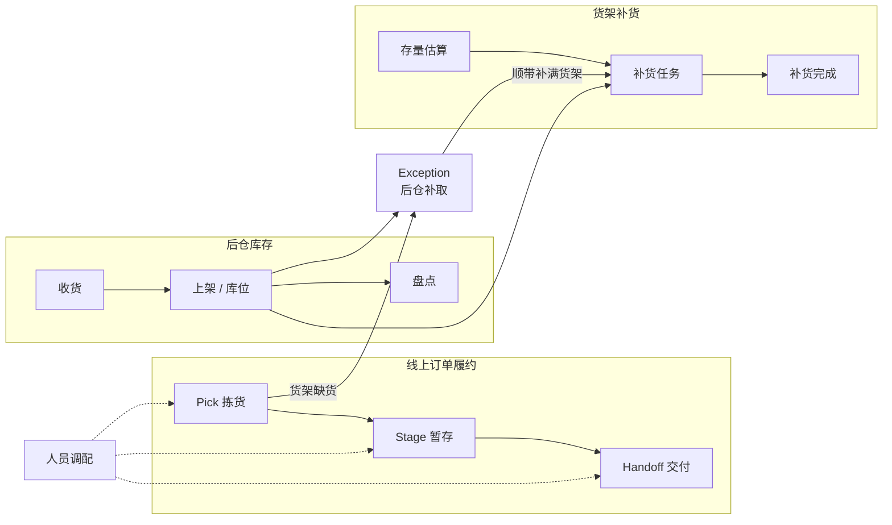

# Storewright

> 一套面向**中型区域连锁与独立超市**的门店一体化作业系统：**线上订单履约（拣货 / 暂存 / 交付）**、**后仓库存管理**、**货架补货**与**人员调配**，配套一个像模拟经营游戏一样可以实时查看和操作的 **2.5D / 3D 运营模拟器**，并把**门店定制化**作为核心能力。

**当前阶段：Phase 1 已完成**（领域核心、仿真引擎、第一轮效益对比）→ 下一步 Phase 2（模拟器与布局编辑器）。

本项目基于公开资料、行业通用做法和作者的独立构想设计。

**本项目与任何零售商、企业无隶属关系。**

---

## 第一轮仿真结果（中型店，30 次重复，合成数据）

| | 默认档位（服务与安全优先） | 效率优先档位 |
|---|---|---|
| 超重 / 压坏风险 / 化学品混装框 | 11–19% → **0** | → **0** |
| 订单满足率 | **+1.0 个百分点**（缺货行销售额 −52%） | **+1.0 个百分点** |
| 平均到店等待 | **−15%** | 无显著差异 |
| 订单在门口停留（冷链风险） | **−81%** | **−79%** |
| 作业总工时 | +4.9% | **+0.4%** |

没有一个档位在所有指标上都赢——门店按自己的优先级选择配置，并在上线前先在仿真中看到取舍。详见 [Phase 1 成果](docs/06-phase1-results.md)。

## 快速开始

需要 Node.js 20 或更高版本。

```bash
npm install
```

```bash
npm run check
```

```bash
npm run sim -- --template medium --policy optimized
```

```bash
npm run compare -- --template medium --reps 30 --profiles --ablation
```

```bash
npm run sensitivity -- --template medium --reps 10
```

| 命令 | 作用 |
|---|---|
| `npm run check` | 类型检查 + 全部测试（含属性测试） |
| `npm run sim` | 仿真一天并打印指标；`--events 文件.json` 导出完整事件日志 |
| `npm run compare` | 基线与优化策略的公共随机数对比；`--profiles` 加入效率优先档位，`--ablation` 加入消融实验；报告写入 `experiments/results/` |
| `npm run sensitivity` | 敏感性分析：逐个调整假设参数 |

## 仓库结构

```
storewright/
├── apps/
│   └── sim-cli/              命令行：仿真、对比实验、敏感性分析、报告
├── packages/
│   ├── domain/               领域类型、事件日志、规则引擎、确定性随机数、标签工具
│   ├── store-config/         门店配置 schema、三个模板、行走网络、暂存格位
│   ├── synth/                合成商品目录与订单流
│   ├── algorithms/           分箱、分批、路线、冷链时限、配送行程
│   └── sim-engine/           离散事件仿真、策略、实验与统计
├── docs/                     设计文档、决策记录、伪代码、结果
└── experiments/              实验输出目录（可重新生成，不纳入版本控制）
```

## 文档

| 文档 | 内容 |
|---|---|
| [01 · 工作流设计](docs/01-workflow-design.md) | 各模块的流程、状态机、实体模型、标签规范、事件清单、工程约束 |
| [02 · 可行性论证](docs/02-feasibility.md) | 技术、经济、运营、合规四个维度，附证据来源 |
| [03 · 问题清单与决议](docs/03-open-questions.md) | 109 个设计问题及答复 |
| [04 · 技术栈方案](docs/04-tech-stack.md) | 架构原则、分层选型、部署形态、定制化架构 |
| [05 · 效益评估与路线图](docs/05-evaluation-and-roadmap.md) | 评估方法与分阶段计划 |
| [06 · Phase 1 成果](docs/06-phase1-results.md) | 交付内容、校准、主要结果、消融、敏感性、局限 |
| [伪代码](docs/pseudocode/) | 分箱、分批与路线、一天的仿真 |
| [决策记录](docs/decisions/) | 0001 Phase 0 决议 · 0002 Phase 1 工程决策 |
| [标签样本](docs/samples/labels.md) | 取货框、大件、后仓箱、行程标签 |
| [货架传感原型指南](docs/hardware/shelf-sensing-prototype.md) | 桌面级原型的物料、接线、固件设计与校准 |

## 三大区块



## 许可证

开放核心 + 双许可（详见 [决策记录 0001](docs/decisions/0001-phase0-decisions.md) 第 2 节）：

- 核心代码与模拟器：AGPL-3.0，另提供商业许可；
- 文档、伪代码与报告：CC BY 4.0。
