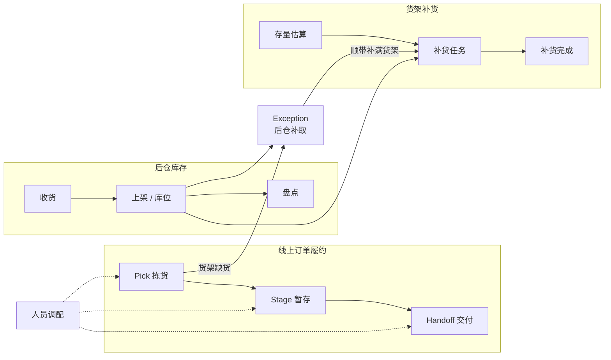

# Storewright

> 一套面向**中型区域连锁与独立超市**的门店一体化作业系统：**线上订单履约（拣货 / 暂存 / 交付）**、**后仓库存管理**、**货架补货**与**人员调配**，配套一个像模拟经营游戏一样可以实时查看和操作的 **2.5D / 3D 运营模拟器**，每家店都有自己的**本地 AI**，并把**门店定制化**作为核心能力。整个系统也可以**直接在浏览器里运行**，不需要后端。

[双语首页](README.md) · [English](README.en.md) · [英文技术概览](docs/en/overview.md)

本项目基于公开资料、行业通用做法和作者的独立构想设计。**本项目与任何零售商、企业无隶属关系。** 所有门店、商品、顾客和数字都是合成的。


## 现在能做什么（v1.0）

- **线上订单履约**：员工手机上走完拣货 → 暂存 → 交付；取货框标签、冷链时限、暂存格位、取货车位、多单配送行程；取货码输错不锁定，配送司机按规则取消接单后系统自动重新派单（[决策记录 0014](docs/decisions/0014-handoff-rules-and-scale.md)）。
- **后仓与货架**：收货、上架、盘点、后仓补取、货架存量估算与补货任务，接入传感器和收银流水；收货、后仓、暂存细分成可编辑的区域，每个区域有容量、占用和预警。
- **运营模拟器**：2.5D / 3D 门店，车辆有加减速、转向和车灯，半挂车铰接倒车靠台；全天仿真、策略对比、方案与报告；门店生成与编辑（货架、区域、卸货门、取货车位、楼层、附属设施、周边环境）；手机上也能完整操作。
- **门店 AI（本地优先）**：订单量预测、到店时间修正、可售概率与幽灵库存、按风险盘点、替代推荐、排班与实时调度、出餐时间、退货去向；每个模型和更简单的方法比较、过了上线门槛才上线，每条建议都说明理由；本地助手只用门店数据回答问题。
- **扩展模块与第二个行业**：熟食现做、退货、大件（先扫后打）、包裹中转四个模块可以单独开关；同一套核心迁移到家居建材店。
- **浏览器内演示**：门店中枢（与服务端同一份代码）跑在浏览器里，展示页同时显示控制台、两部手机、门店实况和全天仿真；双线并行（你的操作 + 虚拟员工的自动运营）。
- **容量**：按 300 人的大型店测试，300 台设备 0.09 秒连上，每秒 50 条操作时所有设备约 15 毫秒内看到变化。
- **质量**：218 个单元与属性测试；51 个端到端测试覆盖 Chromium、WebKit（Safari 内核）、Firefox、iPhone、安卓和不支持 SharedWorker 的浏览器，并检查无障碍（名称、对比度、键盘）；15 个部分、149 步的全流程走查。

在线版另有「你的商店」板块（访客从零搭建自己的门店并在线运营，付费功能），代码不在本仓库（[决策记录 0013](docs/decisions/0013-phase8-plan.md) §9）。

<table>
<tr>
<td width="62%"></td>
<td></td>
</tr>
<tr>
<td>3D 模拟器：半剖建筑、停车场、实时图表</td>
<td>带理由的 AI 建议</td>
</tr>
</table>

## 发展历程

| 阶段 | 内容 | 记录 |
|---|---|---|
| Phase 0–1 | 需求冻结、领域核心与离散事件仿真、第一轮对比实验 | [0001](docs/decisions/0001-phase0-decisions.md)、[0002](docs/decisions/0002-phase1-engineering.md)、[06 Phase 1 成果](docs/06-phase1-results.md) |
| Phase 2 | 2.5D / 3D 运营模拟器与布局编辑器，四轮升级和展示打磨 | [0003](docs/decisions/0003-simulator.md)–[0007](docs/decisions/0007-presentation-polish.md)、[07 运营模拟器](docs/07-simulator.md) |
| Phase 3 | 员工作业端与实时后端（拣货、暂存、交付、配送行程） | [0008](docs/decisions/0008-phase3-plan.md)、[08 实时作业](docs/08-live-operations.md) |
| Phase 4 | 后仓库存、后仓补取、补货与感知层 | [0009](docs/decisions/0009-phase4-plan.md)、[09 后仓与补货](docs/09-backroom-replenishment.md) |
| Phase 5 | 门店 AI（本地优先、每店定制）与效益报告 | [0010](docs/decisions/0010-roadmap-and-phase5-plan.md)、[10 门店 AI](docs/10-store-ai.md)、[11 AI 效益报告](docs/11-ai-results.md) |
| Phase 6 | 扩展业务模块与第二个行业 | [0011](docs/decisions/0011-phase6-plan.md)、[12 扩展模块](docs/12-business-modules.md) |
| Phase 7 | 浏览器内演示、端到端测试、全流程走查、部署配置 | [0012](docs/decisions/0012-phase7.md)、[13 演示与部署](docs/13-demo-and-deployment.md) |
| Phase 8 | 双线并行、车辆拟真、区域与车位、「你的商店」 | [0013](docs/decisions/0013-phase8-plan.md) |
| 交付规则与容量 | 取货码不限次数、司机取消接单、300 人大型店 | [0014](docs/decisions/0014-handoff-rules-and-scale.md) |
| v1.0 收尾 | 所有平台可用、演示更稳更轻、无障碍、双语文档 | [0015](docs/decisions/0015-v1-release.md) |

## 第一轮仿真结果（中型店，30 次重复，合成数据）

| | 默认档位（服务与安全优先） | 效率优先档位 |
|---|---|---|
| 超重 / 压坏风险 / 化学品混装框 | 11–19% → **0** | → **0** |
| 订单满足率 | **+1.0 个百分点**（缺货行销售额 −52%） | **+1.0 个百分点** |
| 平均到店等待 | **−15%** | 无显著差异 |
| 订单在门口停留（冷链风险） | **−81%** | **−79%** |
| 作业总工时 | +4.9% | **+0.4%** |

没有一个档位在所有指标上都赢——门店按自己的优先级选择配置，并在上线前先在仿真中看到取舍。详见 [Phase 1 成果](docs/06-phase1-results.md)。打开全部 AI、总工时不变时：平均等待 −13%、90 分位等待 −23%、迟到订单 2.41% → 0.69%（[AI 效益报告](docs/11-ai-results.md)）。

所有结果都是**证据等级 B**（合成数据上的仿真），用于在列明的假设下比较方法，不代表任何真实门店。

## 快速开始

需要 Node.js 20 或更高版本。

```bash
npm install
```

```bash
npm run build:site
```

```bash
npm run demo:site
```

打开 http://127.0.0.1:4177/ 就是展示页：在控制台下单，看它在手机上被拣货、暂存、交付，同时出现在门店实况里。`?store=hardware` 换成家居建材店。

| 命令 | 作用 |
|---|---|
| `npm run dev` | 启动运营模拟器（浏览器打开 http://localhost:5173） |
| `npm run build:sim` | 构建模拟器的纯静态文件（`apps/simulator/dist/`） |
| `npm run server` | 启动实时后端（http://localhost:8787 ，嵌入式数据库，不需要安装）；同时提供员工作业端 |
| `npm run build:associate` | 构建员工作业端（后端从根路径提供，手机在同一 Wi-Fi 下打开电脑的局域网地址） |
| `npm run associate` | 员工作业端开发服务器（http://localhost:5174） |
| `npm run check` | 类型检查 + 全部测试（218 个，含属性测试） |
| `npm run sim` | 仿真一天并打印指标；`--events 文件.json` 导出完整事件日志 |
| `npm run compare` | 基线与优化策略的公共随机数对比；`--profiles` 加入效率优先档位，`--ablation` 加入消融实验；报告写入 `experiments/results/` |
| `npm run sensitivity` | 敏感性分析：逐个调整假设参数 |
| `npm run ai-report` | AI 效益报告：五个模型族的离线评估、AI 开 / 关对比、到店时间的取舍曲线、效果大小的敏感性（约 25 秒） |
| `npm run industry-report` | 行业迁移报告：中型超市与家居建材店的配置、订单形态、运营仿真、AI 开 / 关、订单量预测与扩展模块模型（约 10 秒） |
| `STORES=demo,hardware,large npm run server` | 同时运行中型超市（`demo`）、家居建材店（`hardware`）和 300 人的大型店（`large`） |
| `npm run build:site` | 组装浏览器内演示站点（`site/`，纯静态，可以放到任意静态托管）；`npm run demo:site` 本地预览 |
| `npm run e2e` | 端到端测试（15 个：真实后端、浏览器内演示、无障碍；先 `npm run build:all`；本机用已安装的 Chrome） |
| `npm run e2e:browsers` | 同上，再加 WebKit（Safari 内核）、Firefox、不支持 SharedWorker 的浏览器、iPhone 和安卓手机（共 51 个；先 `npx playwright install webkit firefox`） |
| `npm run loadtest -w @storewright/server` | 大型店容量测试：300 名员工、300 台设备、一天 1200 张订单、高峰合批推送（约 10 秒；`DB=pglite` 时每条命令写数据库） |
| `npm run walkthrough` | 全流程走查：15 个部分逐步操作并截图，生成图文报告（`experiments/results/walkthrough/report.html`，约 6 分钟） |

## 浏览器支持

自动测试覆盖较新的 Chrome、Edge、Safari（macOS 和 iOS）、Firefox，电脑和手机都包括。不支持 SharedWorker 的浏览器（较旧的安卓浏览器、部分 App 内置浏览器）每个页面用自己的门店中枢：展示页照常使用，数据照常保存在本机；多个标签页不能共用同一家演示门店时，页面上会说明。

## 仓库结构

```
storewright/
├── apps/
│   ├── simulator/            运营模拟器：2.5D / 3D 场景、周边道路与车流、分屏数据、现场调度、门店生成与编辑、门店实况
│   ├── sim-cli/              命令行：仿真、对比实验、敏感性分析、报告
│   ├── server/               门店中枢（与传输无关，服务端和浏览器共用）+ Fastify 外壳：命令接口、事件存储、实时推送、排程、门店 AI 服务、本地助手、容量测试
│   └── associate/            员工作业端 PWA：拣货、暂存、交付、库存、扩展模块、AI、演示控制台；浏览器内演示（SharedWorker 中枢、展示页、桥接页面）
├── packages/
│   ├── domain/               领域类型、事件日志、规则引擎、确定性随机数、标签工具
│   ├── store-config/         门店配置 schema、门店生成器与模板、区域与卸货门、附属设施、行走网络、暂存格位
│   ├── synth/                合成商品目录、订单流、带隐藏因素的需求历史、到店记录、货架真实存量、替代记录
│   ├── algorithms/           分箱、分批、路线、冷链时限、配送行程、补货规则、陈列表与后仓库位
│   ├── sim-engine/           离散事件仿真、策略、道路拥堵、突发状况、夜班补货、货架存量、汽车服务中心、药房、实验与统计
│   ├── ops/                  实时作业核心：命令 → 事件 → 状态的纯函数（履约、后仓库存、补货、扩展模块）、视图、实时客户端、设备快照、浏览器内中枢的连接层
│   ├── labels/               标签：二维码、取货框标签、后仓箱标签（GS1 Digital Link + UPC-A）、格位与库位标签
│   └── ai/                   门店 AI：建议格式与理由、指标、回测、模型仓库与上线门槛、回归（GLM）与各个模型
├── e2e/                      端到端测试、无障碍检查、全流程走查（Playwright）与演示站点的静态服务
├── scripts/                  演示站点组装、走查报告
├── .github/workflows/        持续集成（含多浏览器测试）；演示站点部署（手动触发）
├── docs/                     设计文档、决策记录、伪代码、结果；docs/en/ 是英文概览
└── experiments/              实验输出目录（可重新生成，不纳入版本控制）
```

## 文档

| 文档 | 内容 |
|---|---|
| [英文技术概览](docs/en/overview.md) | 全部设计、架构和结果的英文摘要 |
| [01 · 工作流设计](docs/01-workflow-design.md) | 各模块的流程、状态机、实体模型、标签规范、事件清单、工程约束 |
| [02 · 可行性论证](docs/02-feasibility.md) | 技术、经济、运营、合规四个维度，附证据来源 |
| [03 · 问题清单与决议](docs/03-open-questions.md) | 109 个设计问题及答复 |
| [04 · 技术栈方案](docs/04-tech-stack.md) | 架构原则、分层选型、部署形态、定制化架构 |
| [05 · 效益评估与路线图](docs/05-evaluation-and-roadmap.md) | 评估方法与分阶段计划 |
| [06 · Phase 1 成果](docs/06-phase1-results.md) | 交付内容、校准、主要结果、消融、敏感性、局限 |
| [07 · 运营模拟器](docs/07-simulator.md) | 功能、架构、道路拥堵与天气模型、到货与仓储、经营账、性能、门店定制、方案与报告、导览与巡游、中英文界面、手机布局、测试、尚未完成的部分 |
| [08 · 实时作业](docs/08-live-operations.md) | 员工作业端与实时后端：功能、架构、同步协议、接口、运行、测试与同步延迟、取货码与司机取消、容量、简化与尚未完成的部分 |
| [09 · 后仓库存、Exception 与补货](docs/09-backroom-replenishment.md) | 收货、上架、盘点、后仓补取、货架存量估算、补货任务、感知层与仿真、模拟器闭环、校准、简化与尚未完成的部分 |
| [10 · 门店 AI](docs/10-store-ai.md) | 本地优先、每店定制的 AI：建议记录与三种模式、仿真即评测场、回测与上线门槛、仿真预训练、基线结果、员工数据与伦理边界、简化与尚未完成的部分 |
| [11 · AI 效益报告与模型卡片](docs/11-ai-results.md) | 每个模型与对照的离线评估、运营上的 AI 开 / 关对比、取舍曲线、敏感性分析、九张模型卡片 |
| [12 · 扩展业务模块与第二个行业](docs/12-business-modules.md) | 模块框架、熟食现做 / 退货 / 大件 / 包裹中转的规则与 AI 接入点、家居建材模板改了什么与复用了什么、两个行业的对比结果 |
| [13 · 浏览器内演示、端到端测试与部署](docs/13-demo-and-deployment.md) | 门店中枢（同一份代码跑在服务端和浏览器里）、SharedWorker 与退路、展示页、端到端测试场景与多浏览器、无障碍检查、持续集成、静态站点与自托管部署 |
| [伪代码](docs/pseudocode/) | 分箱、分批与路线、一天的仿真 |
| [决策记录](docs/decisions/) | 0001 Phase 0 决议 · 0002 Phase 1 工程决策 · 0003 模拟器工程决策 · 0004 / 0005 / 0006 模拟器第二、三、四轮升级 · 0007 模拟器展示打磨 · 0008 Phase 3 · 0009 Phase 4 · 0010 路线图调整与 Phase 5 · 0011 Phase 6 · 0012 Phase 7 · 0013 Phase 8 · 0014 交付规则调整与大型店容量 · 0015 v1.0 收尾 |
| [标签样本](docs/samples/labels/) | 取货框、大件、后仓箱、行程标签 |
| [货架传感原型指南](docs/hardware/shelf-sensing-prototype.md) | 桌面级原型的物料、接线、固件设计与校准 |

## 三大区块



## 许可证

双许可（详见 [决策记录 0001](docs/decisions/0001-phase0-decisions.md) 第 2 节；2026-10-21 起按 [决策记录 0010](docs/decisions/0010-roadmap-and-phase5-plan.md) 整个产品公开）：

- 全部代码（核心、模拟器、后端、员工作业端、AI）：[AGPL-3.0](LICENSE)，另提供商业许可；
- 文档、伪代码与报告：[CC BY 4.0](LICENSE-docs)。

参与贡献见 [CONTRIBUTING.md](CONTRIBUTING.md)；报告安全问题见 [SECURITY.md](SECURITY.md)。
