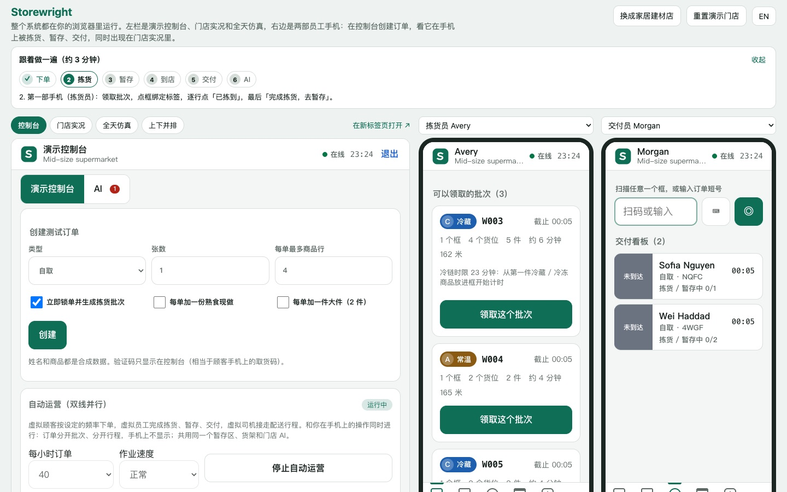
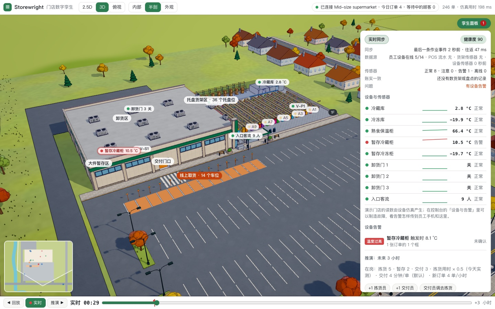
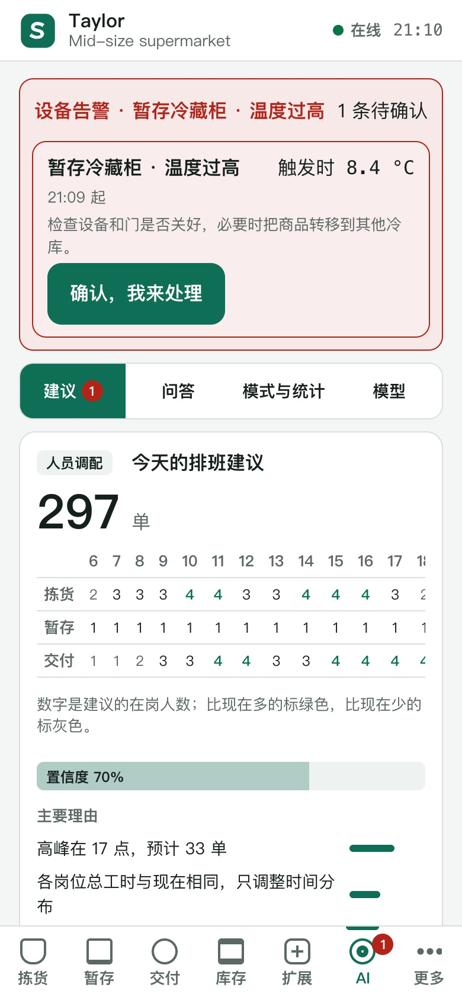
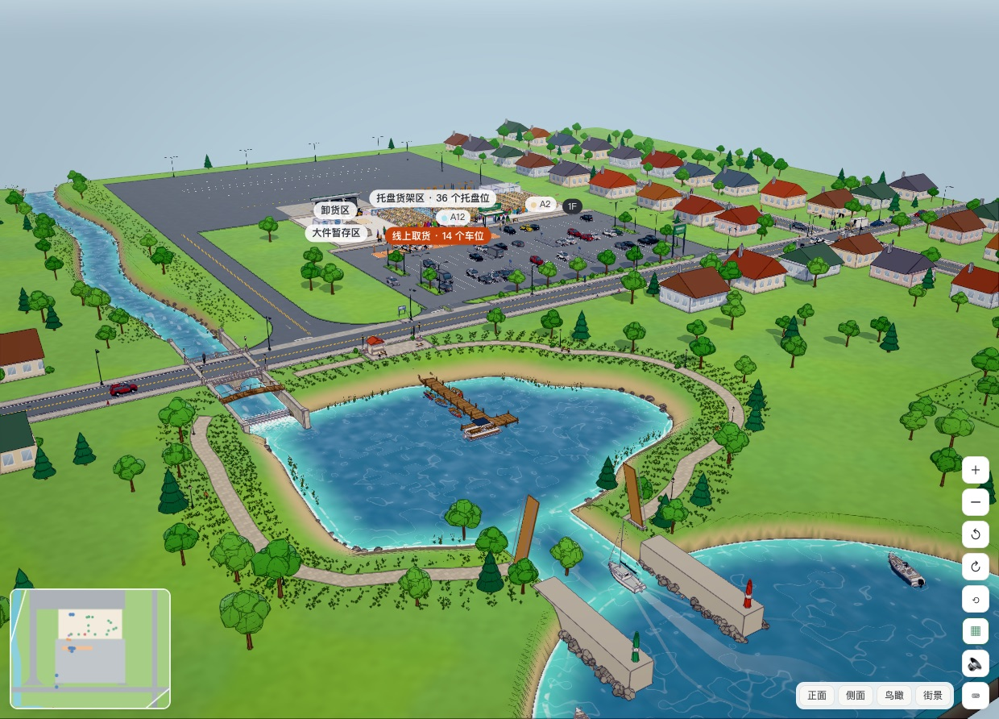
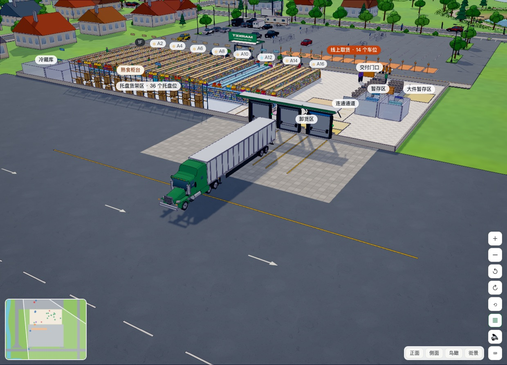
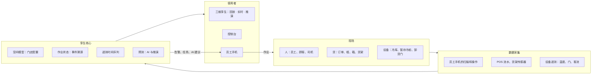
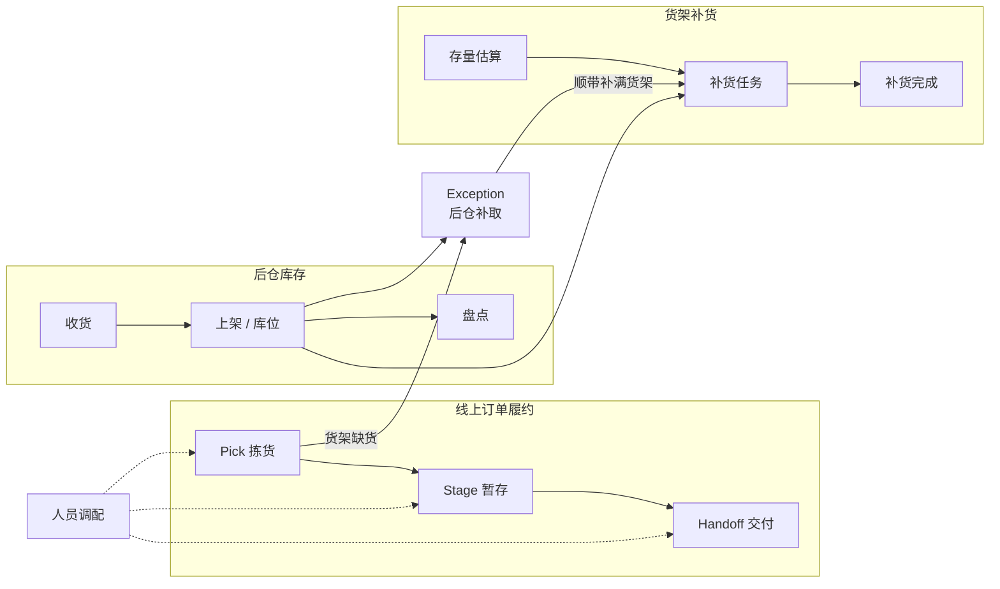

# Storewright

> 一套面向**中型区域连锁与独立超市**的**门店数字孪生**：三维门店与现场作业**实时同步**，可以**回放**当天任意时刻、**推演**未来 3 小时；设备遥测越线时，带着影响分析的**告警**推到员工手机上。孪生的作业层覆盖**线上订单履约（拣货 / 暂存 / 交付）**、**后仓库存管理**、**货架补货**与**人员调配**，每家店都有自己的**本地 AI**；改布局、排班、策略之前，先在**规划孪生**（像模拟经营游戏一样的 2.5D / 3D 仿真）里试。**门店定制化**是核心能力，整个系统也可以**直接在浏览器里运行**，不需要后端。

**[在线演示](https://glacieerr.github.io/storewright/)** · [双语首页](README.md) · [English](README.en.md) · [英文技术概览](docs/en/overview.md) · [数字孪生设计](docs/14-digital-twin.md) · [操作指南](docs/guide/operation-guide.zh-CN.md) · [项目报告](docs/project/project-report.zh-CN.md) · [文档导航](docs/README.md)

本项目基于公开资料、行业通用做法和作者的独立构想设计。**本项目与任何零售商、企业无隶属关系。** 所有门店、商品、顾客和数字都是合成的。



## 现在能做什么

- **门店数字孪生**（[决策记录 0016](docs/decisions/0016-digital-twin.md)、[14 数字孪生](docs/14-digital-twin.md)）：
  - **实时**：三维场景跟着每次扫描、每条流水、每个读数变化：员工在最近扫描的位置，框在暂存格位里，顾客的车在取货车位上，货车在卸货门前；孪生健康度显示数据是否新鲜、传感器是否正常、账实是否一致；
  - **回放**：作业状态是事件依次应用的结果，拖动时间轴就能精确回到当天任意时刻；
  - **推演**：从当前状态出发推演未来 3 小时（用今天的实际作业校准），可以试「加一名拣货员」「把交付员调去拣货」并和现状对比；
  - **设备与告警**：冷库、暂存冷藏冷冻柜、熟食保温柜的温度，卸货门，入口客流；越线时告警写进事件流，附受影响的订单、框、箱和可转移的空格位，推到带班负责人的手机上确认，三维孪生里对应区域闪红。
- **游戏级的三维世界**（[决策记录 0017](docs/decisions/0017-stylized-world.md)）：卡通渲染与描边、程序生成的天空、夜里亮起的路灯和灯笼；门店、道路和周边全部用程序生成的几何体和贴图重新建模：湖与跌水堰、石墙渠道上的两孔石拱桥、木栈桥码头和小船、细致的街道、树木和草丛。场景是只到周边一圈的沙盘，四边有土层断面。不下载任何素材。
- **拟真的载具与驾驶**（[决策记录 0018](docs/decisions/0018-vehicles-and-yard.md)）：轿车、SUV、皮卡、厢式车、厢式货车、长头卧铺牵引车与 53 英尺挂车、房车和拖挂式房车、船拖车、小平板拖车，以及划艇、快艇、小帆船、皮划艇、浮筒船，都是按公开尺寸建的通用外形；刹车点头、转弯外倾；房车和带拖车的车占几个车位，有人倒车入位、有人穿过对面空车位；货车在卸货场先到先进地排队，从司机一侧倒车靠台、绕场驶离；后仓叉车分工协作，一个车厢、一条货架通道同时只进一台，干完停回充电位。
- **卸货场与周边环境**（[决策记录 0019](docs/decisions/0019-yard-access-deliveries-harbor.md)）：卸货门 1–10 个；卸货场的进场道路可以在门店左侧或右侧、接主路或经支路，待命车位、甩挂车位可设，半挂车按 15 米圆弧转弯；停车场进出分道；到货按星期、季节和门店规模排班（配送中心冷藏车、长途车、百货车，十几家供应商直送，快递）；湖接上出海水道，船只早上出港、下午回港；可以打开学校和铁路道口，到店时间随之推后；二楼有收银区、货梯口的卸货区和补货区；线上订单区有冷藏库、冷冻库和通到收货区的连通通道，后仓放不下的托盘经通道送到溢流位。
- **线上订单履约**：员工手机上走完拣货 → 暂存 → 交付；取货框标签、冷链时限、暂存格位、取货车位、多单配送行程；取货码输错不锁定，配送司机按规则取消接单后系统自动重新派单（[决策记录 0014](docs/decisions/0014-handoff-rules-and-scale.md)）。
- **后仓与货架**：收货、上架、盘点、后仓补取、货架存量估算与补货任务，接入传感器和收银流水；收货、后仓、暂存细分成可编辑的区域，每个区域有容量、占用和预警。
- **规划孪生（模拟器）**：2.5D / 3D 门店，车辆有加减速、转向和车灯，半挂车铰接倒车靠台；全天仿真、策略对比、方案与报告；门店生成与编辑（货架、区域、卸货门、取货车位、楼层、附属设施、周边环境）；手机上也能完整操作。
- **门店 AI（本地优先）**：订单量预测、到店时间修正、可售概率与幽灵库存、按风险盘点、替代推荐、排班与实时调度、出餐时间、退货去向；每个模型和更简单的方法比较、过了上线门槛才上线，每条建议都说明理由；本地助手只用门店数据回答问题。
- **门店 AI 第二轮：从预测到闭环**（[决策记录 0021–0024](docs/decisions/0021-store-ai-batch1.md)、[15 路线图](docs/15-store-ai-roadmap.md)）：
  - **预判与少打扰**：AI 驱动的推演提前发现赶不上取货时段、顾客等太久、冷区快满，试跑调人 / 提前开始 / 冷冻晚拣 / 通知顾客，把最好的一条连同预计效果推给带班负责人；建议中枢合并提醒、看时机、每人每小时有预算；拣货时长模型、缺货预判、按缺货风险补货；
  - **人与设备**：排班生成（硬约束全部满足）与缺勤补位（邀请本人接受）、冷链设备的预测性维护、拣货员的「找不到」帮助判断货架真相、顺路核对、开店简报、效果追踪（说到做到率，连续不准自动降级）、运行监控；
  - **线上订单**：冷链批次自动拆分和拣货中转交、分框系数学习、未取订单的风险、时段产能和接单取舍曲线、替代品的真实标签、冷冻区和大件的安全提醒；
  - **现场与复盘**：打烊复盘（复刻一天，按原因分开迟到订单）和周报、召回处理、突发状况清单、食品安全记录、现场操作提示和小测验、送货单和箱上 GS1 码收货（批号、保质期）、临期降价和捐赠建议、语音命令、每个人的「下一步」；本地语言模型、语音、视觉模型的接口和评测都准备好，需要作者同意后下载。
- **在岗人员与调配**（[决策记录 0025](docs/decisions/0025-team-view-dispatch.md)）：每台设备的顶栏都能看谁在岗、在哪个岗位、在做什么、各岗位排着多少活（有活没人的岗位标红）；带班负责人两下把人临时调到别的岗位（30 分钟 / 1 小时 / 2 小时 / 不限时），到时间自动调回原岗位，被调的人手机自动切页并提示。所有操作流程的逐步梳理见 [16 · 操作流程](docs/16-operation-flows.md)。
- **修复全部卡点、门店设置**（[决策记录 0026](docs/decisions/0026-flow-fixes.md)）：门店可以「要求扫码」（点选代替扫码被拒绝，服务端核对条码、货位、格位）；扫框即开始准备、店员代签到、先核验再取框、整批补货、数量直接输入、提醒直达那一条、后仓补取闭环、熟食和大件接进交付、AI 建议按紧急程度排并对涉及人钱顾客的动作两步确认、排班草稿能改、召回列出框、调人「做完这一单再去」等 25 条优化全部实施，16 号文档按新流程重写。
- **扩展模块与第二个行业**：熟食现做、退货、大件（先扫后打）、包裹中转四个模块可以单独开关；同一套核心迁移到家居建材店。
- **浏览器内演示**：门店中枢（与服务端同一份代码，含孪生服务和设备仿真）跑在浏览器里，展示页同时显示控制台、两部手机、三维数字孪生和全天仿真；双线并行（你的操作 + 虚拟员工的自动运营）。
- **容量**：按 300 人的大型店测试，300 台设备 0.09 秒连上，每秒 50 条操作时所有设备约 15 毫秒内看到变化。
- **你的商店**（[决策记录 0013](docs/decisions/0013-phase8-plan.md)）：从一块空地搭建自己门店的孪生。按占地、行业、楼层、暂存规模、卸货门、取货车位、营业时间和附属设施生成一家能运行的门店，然后全部可以编辑；开业检查指出缺少的区域、冷链存储和容量问题；可以跑全天仿真，也可以在这家门店上开实时沙盒。门店保存在浏览器里，可以复制、导出和导入。
- **质量**：383 个单元与属性测试；83 个端到端测试覆盖 Chromium、WebKit（Safari 内核）、Firefox、iPhone、安卓和不支持 SharedWorker 的浏览器，并检查无障碍（名称、对比度、键盘）；22 个部分、221 步的全流程走查。

<table>
<tr>
<td width="62%"></td>
<td></td>
</tr>
<tr>
<td>三维孪生：设备读数、告警、回放 · 实时 · 推演时间轴</td>
<td>带班负责人的手机：告警和带理由的建议</td>
</tr>
</table>





## 发展历程

| 阶段 | 内容 | 记录 |
|---|---|---|
| Phase 0–1 | 需求冻结、领域核心与离散事件仿真、第一轮对比实验 | [0001](docs/decisions/0001-phase0-decisions.md)、[0002](docs/decisions/0002-phase1-engineering.md)、[06 Phase 1 成果](docs/06-phase1-results.md) |
| Phase 2 | 2.5D / 3D 运营模拟器与布局编辑器，四轮升级和展示打磨 | [0003](docs/decisions/0003-simulator.md)–[0007](docs/decisions/0007-presentation-polish.md)、[07 运营模拟器](docs/07-simulator.md) |
| Phase 3 | 员工作业端与实时后端（拣货、暂存、交付、配送行程） | [0008](docs/decisions/0008-phase3-plan.md)、[08 实时作业](docs/08-live-operations.md) |
| Phase 4 | 后仓库存、后仓补取、补货与感知层 | [0009](docs/decisions/0009-phase4-plan.md)、[09 后仓与补货](docs/09-backroom-replenishment.md) |
| Phase 5 | 门店 AI（本地优先、每店定制）与效益报告 | [0010](docs/decisions/0010-roadmap-and-phase5-plan.md)、[10 门店 AI](docs/10-store-ai.md)、[11 AI 效益报告](docs/11-ai-results.md) |
| Phase 6 | 扩展业务模块与第二个行业 | [0011](docs/decisions/0011-phase6-plan.md)、[12 扩展模块](docs/12-business-modules.md) |
| Phase 7 | 浏览器内演示、端到端测试、全流程走查、部署配置 | [0012](docs/decisions/0012-phase7.md)、[13 演示与部署](docs/13-demo-and-deployment.md) |
| Phase 8 | 双线并行、车辆拟真、区域与车位、「你的商店」 | [0013](docs/decisions/0013-phase8-plan.md) |
| 交付规则与容量 | 取货码不限次数、司机取消接单、300 人大型店 | [0014](docs/decisions/0014-handoff-rules-and-scale.md) |
| v1.0 收尾 | 所有平台可用、演示更稳更轻、无障碍、双语文档 | [0015](docs/decisions/0015-v1-release.md) |
| Phase 9 · 数字孪生 | 整体转向门店数字孪生：设备遥测与告警闭环、回放、推演、孪生健康度 | [0016](docs/decisions/0016-digital-twin.md)、[14 数字孪生](docs/14-digital-twin.md) |
| Phase 10 · 画面与建模 | 游戏级的卡通画面（描边、天空、泛光）；重新建模门店、道路与周边：湖、跌水、渠道、石拱桥、栈桥码头、树木与草丛 | [0017](docs/decisions/0017-stylized-world.md)、[07 模拟器](docs/07-simulator.md) |
| Phase 11 · 载具、停车与卸货场 | 按公开外形重新建模车辆与船，驾驶姿态；长车停车、倒车入位、穿过停；卸货场排队、从司机一侧倒车靠台；后仓叉车协同；人物简化成轮廓 | [0018](docs/decisions/0018-vehicles-and-yard.md)、[07 模拟器](docs/07-simulator.md) |
| Phase 12 · 卸货场与周边环境 | 卸货门、卸货场与进场道路可定制（15 米圆弧转弯）；停车场进出分道；按星期和季节排班的到货；出海口与船只进出港；沙盘场景；学校、铁路道口；二楼收银区与货梯；线上订单区的连通通道与冷库 | [0019](docs/decisions/0019-yard-access-deliveries-harbor.md)、[07 模拟器](docs/07-simulator.md) |
| Phase 13 · AI 运营建议 | 「AI 建议」：到货与卸货场、后仓与补货、线上订单暂存、前场、异常与风险，每条写清做什么、为什么、预计效果、把握多大，可以采纳、忽略、定位；今日计划、交接班小结、采纳与不采纳对比；学生兼职工；船只多少 | [0020](docs/decisions/0020-students-boats-ai-advice.md)、[07 模拟器](docs/07-simulator.md) |
| Phase 14–17 · 门店 AI 第二轮 | 实时预判与少打扰 → 人与设备 → 线上订单深化 → 语言、复盘与看图：运营预警与建议中枢、排班与补位、预测性维护、货架真相、时段产能、未取订单、打烊复盘、召回、突发状况、食品安全记录、临期、「下一步」 | [0021](docs/decisions/0021-store-ai-batch1.md)–[0024](docs/decisions/0024-store-ai-batch4.md)、[15 路线图](docs/15-store-ai-roadmap.md) |
| Phase 18 · 在岗人员与调配 | 所有设备看在岗人员和各岗位排着的活；带班负责人临时调人，到时间自动调回；所有操作流程的梳理与优化方案 | [0025](docs/decisions/0025-team-view-dispatch.md)、[16 操作流程](docs/16-operation-flows.md) |
| Phase 19 · 修复全部卡点 | 门店设置（要求扫码、交付准备何时开始）；16 号文档的 25 条优化方案全部实施，流程文档按新流程重写 | [0026](docs/decisions/0026-flow-fixes.md)、[16 操作流程](docs/16-operation-flows.md) |

## 第一轮仿真结果（中型店，30 次重复，合成数据）

| | 默认档位（服务与安全优先） | 效率优先档位 |
|---|---|---|
| 超重 / 压坏风险 / 化学品混装框 | 11–19% → **0** | → **0** |
| 订单满足率 | **+1.0 个百分点**（缺货行销售额 −52%） | **+1.0 个百分点** |
| 平均到店等待 | **−15%** | 无显著差异 |
| 订单在门口停留（冷链风险） | **−81%** | **−79%** |
| 作业总工时 | +4.9% | **+0.4%** |

没有一个档位在所有指标上都赢——门店按自己的优先级选择配置，并在上线前先在仿真中看到取舍。详见 [Phase 1 成果](docs/06-phase1-results.md)。打开全部 AI、总工时不变时：平均等待 −13%、90 分位等待 −23%、迟到订单 2.41% → 0.69%（[AI 效益报告](docs/11-ai-results.md)）。

所有结果都是**证据等级 B**（合成数据上的仿真），用于在列明的假设下比较方法，不代表任何真实门店。

## 快速开始

不想安装的话，直接打开[在线演示](https://glacieerr.github.io/storewright/)，和下面在本机构建的展示页相同。在本机运行需要 Node.js 20 或更高版本。

```bash
npm install
```

```bash
npm run build:site
```

```bash
npm run demo:site
```

打开 http://127.0.0.1:4177/ 就是展示页：在控制台下单，看它在手机上被拣货、暂存、交付，同时出现在三维数字孪生里；在控制台的「设备与告警」里制造一个故障，看告警怎样传到手机和孪生；拖动孪生底部的时间轴回放过去、推演未来。`?store=hardware` 换成家居建材店。

| 命令 | 作用 |
|---|---|
| `npm run dev` | 启动规划孪生（模拟器，浏览器打开 http://localhost:5173）；连上后端后是运营孪生 |
| `npm run build:sim` | 构建模拟器的纯静态文件（`apps/simulator/dist/`） |
| `npm run server` | 启动实时后端（http://localhost:8787 ，嵌入式数据库，不需要安装）；同时提供员工作业端 |
| `npm run build:associate` | 构建员工作业端（后端从根路径提供，手机在同一 Wi-Fi 下打开电脑的局域网地址） |
| `npm run associate` | 员工作业端开发服务器（http://localhost:5174） |
| `npm run check` | 类型检查 + 全部测试（383 个，含属性测试） |
| `npm run sim` | 仿真一天并打印指标；`--events 文件.json` 导出完整事件日志 |
| `npm run compare` | 基线与优化策略的公共随机数对比；`--profiles` 加入效率优先档位，`--ablation` 加入消融实验；报告写入 `experiments/results/` |
| `npm run sensitivity` | 敏感性分析：逐个调整假设参数 |
| `npm run ai-report` | AI 效益报告：五个模型族的离线评估、AI 开 / 关对比、到店时间的取舍曲线、效果大小的敏感性（约 25 秒） |
| `npm run notices` | 根据已安装的依赖重新生成第三方组件声明（`THIRD_PARTY_NOTICES.md`），改了依赖以后运行 |
| `npm run industry-report` | 行业迁移报告：中型超市与家居建材店的配置、订单形态、运营仿真、AI 开 / 关、订单量预测与扩展模块模型（约 10 秒） |
| `STORES=demo,hardware,large npm run server` | 同时运行中型超市（`demo`）、家居建材店（`hardware`）和 300 人的大型店（`large`） |
| `npm run build:site` | 组装浏览器内演示站点（`site/`，纯静态，可以放到任意静态托管）；`npm run demo:site` 本地预览 |
| `npm run e2e` | 端到端测试（23 个：真实后端、浏览器内演示（含展示页里两部手机的真实点击）、无障碍；先 `npm run build:all`；本机用已安装的 Chrome） |
| `npm run e2e:browsers` | 同上，再加 WebKit（Safari 内核）、Firefox、不支持 SharedWorker 的浏览器、iPhone 和安卓手机（共 83 个；先 `npx playwright install webkit firefox`） |
| `npm run loadtest -w @storewright/server` | 大型店容量测试：300 名员工、300 台设备、一天 1200 张订单、高峰合批推送（约 10 秒；`DB=pglite` 时每条命令写数据库） |
| `npm run walkthrough` | 全流程走查：22 个部分逐步操作并截图，生成图文报告（`experiments/results/walkthrough/report.html`，约 10 分钟） |

## 浏览器支持

自动测试覆盖较新的 Chrome、Edge、Safari（macOS 和 iOS）、Firefox，电脑和手机都包括。不支持 SharedWorker 的浏览器（较旧的安卓浏览器、部分 App 内置浏览器）每个页面用自己的门店中枢：展示页照常使用，数据照常保存在本机；多个标签页不能共用同一家演示门店时，页面上会说明。

## 仓库结构

```
storewright/
├── apps/
│   ├── simulator/            三维数字孪生：运营孪生（实时、回放、推演、设备与告警）和规划孪生（2.5D / 3D 仿真、周边道路与车流、分屏数据、现场调度、门店生成与编辑）
│   ├── sim-cli/              命令行：仿真、对比实验、敏感性分析、报告
│   ├── server/               门店中枢（与传输无关，服务端和浏览器共用）+ Fastify 外壳：命令接口、事件存储、实时推送、排程、孪生服务（遥测、告警、回放、设备仿真）、门店 AI 服务、本地助手、容量测试
│   └── associate/            员工作业端 PWA：拣货、暂存、交付、库存、扩展模块、AI、演示控制台；浏览器内演示（SharedWorker 中枢、展示页、桥接页面）
├── packages/
│   ├── domain/               领域类型、事件日志、规则引擎、确定性随机数、标签工具
│   ├── store-config/         门店配置 schema、门店生成器与模板、区域与卸货门、附属设施、行走网络、暂存格位
│   ├── synth/                合成商品目录、订单流、带隐藏因素的需求历史、到店记录、货架真实存量、替代记录
│   ├── algorithms/           分箱、分批、路线、冷链时限、配送行程、补货规则、陈列表与后仓库位
│   ├── sim-engine/           离散事件仿真、策略、道路拥堵、突发状况、夜班补货、货架存量、汽车服务中心、药房、实验与统计
│   ├── ops/                  实时作业核心：命令 → 事件 → 状态的纯函数（履约、后仓库存、补货、扩展模块）、视图、实时客户端、设备快照、浏览器内中枢的连接层
│   ├── labels/               标签：二维码、取货框标签、后仓箱标签（GS1 Digital Link + UPC-A）、格位与库位标签
│   ├── ai/                   门店 AI：建议格式与理由、指标、回测、模型仓库与上线门槛、回归（GLM）与各个模型
│   └── twin/                 数字孪生：传感器清单、遥测、告警规则与影响分析、回放、推演、孪生健康度
├── e2e/                      端到端测试、无障碍检查、全流程走查（Playwright）与演示站点的静态服务
├── scripts/                  演示站点组装、走查报告
├── .github/workflows/        持续集成（含多浏览器测试）；演示站点部署（手动触发）
├── docs/                     设计文档、决策记录、伪代码、结果；docs/en/ 是英文概览
└── experiments/              实验输出目录（可重新生成，不纳入版本控制）
```

## 文档

| 文档 | 内容 |
|---|---|
| [文档导航](docs/README.md) | 按想做的事找文档：使用、评估、开发、合规 |
| [操作指南](docs/guide/operation-guide.zh-CN.md) | 怎么运行、怎么登录，每个岗位在手机上怎么操作，模拟器和孪生怎么用，常见问题和术语 |
| [项目目的、达成的目标与未来展望](docs/project/purpose-and-outlook.zh-CN.md) | 为什么做、开始时定的目标、做到了什么、没做到什么、以后做什么 |
| [项目报告](docs/project/project-report.zh-CN.md) | 给评审和招聘方看的项目报告：问题、角色、方案、关键决策、成果与证据、难点、收获、五分钟演示路线 |
| [英文技术概览](docs/en/overview.md) | 全部设计、架构和结果的英文摘要 |
| [01 · 工作流设计](docs/01-workflow-design.md) | 各模块的流程、状态机、实体模型、标签规范、事件清单、工程约束 |
| [02 · 可行性论证](docs/02-feasibility.md) | 技术、经济、运营、合规四个维度，附证据来源 |
| [03 · 问题清单与决议](docs/03-open-questions.md) | 109 个设计问题及答复 |
| [04 · 技术栈方案](docs/04-tech-stack.md) | 架构原则、分层选型、部署形态、定制化架构 |
| [05 · 效益评估与路线图](docs/05-evaluation-and-roadmap.md) | 评估方法与分阶段计划 |
| [06 · Phase 1 成果](docs/06-phase1-results.md) | 交付内容、校准、主要结果、消融、敏感性、局限 |
| [07 · 运营模拟器](docs/07-simulator.md) | 功能、架构、道路拥堵与天气模型、到货与仓储、经营账、性能、门店定制、方案与报告、导览与巡游、中英文界面、手机布局、测试、尚未完成的部分 |
| [08 · 实时作业](docs/08-live-operations.md) | 员工作业端与实时后端：功能、架构、同步协议、接口、运行、测试与同步延迟、取货码与司机取消、容量、简化与尚未完成的部分 |
| [09 · 后仓库存、Exception 与补货](docs/09-backroom-replenishment.md) | 收货、上架、盘点、后仓补取、货架存量估算、补货任务、感知层与仿真、模拟器闭环、校准、简化与尚未完成的部分 |
| [10 · 门店 AI](docs/10-store-ai.md) | 本地优先、每店定制的 AI：建议记录与三种模式、仿真即评测场、回测与上线门槛、仿真预训练、基线结果、员工数据与伦理边界、简化与尚未完成的部分 |
| [11 · AI 效益报告与模型卡片](docs/11-ai-results.md) | 每个模型与对照的离线评估（含第二轮的拣货时长、货架真相、排班、未取订单、产能、临期、召回）、运营上的 AI 开 / 关对比、取舍曲线、敏感性分析、十三张模型卡片 |
| [12 · 扩展业务模块与第二个行业](docs/12-business-modules.md) | 模块框架、熟食现做 / 退货 / 大件 / 包裹中转的规则与 AI 接入点、家居建材模板改了什么与复用了什么、两个行业的对比结果 |
| [13 · 浏览器内演示、端到端测试与部署](docs/13-demo-and-deployment.md) | 门店中枢（同一份代码跑在服务端和浏览器里）、SharedWorker 与退路、展示页、端到端测试场景与多浏览器、无障碍检查、持续集成、静态站点与自托管部署 |
| [14 · 数字孪生](docs/14-digital-twin.md) | 孪生的定义与分级、四层结构、两个孪生、设备遥测与告警闭环、回放、推演、孪生健康度、接口、局限 |
| [15 · 门店 AI 路线图](docs/15-store-ai-roadmap.md) | 门店端 AI 第二轮的方案（四批已完成，见决策记录 0021–0024）：思考（看得准、想得远、少打扰、先试再说）、覆盖图与空白、门店的一天、八个方向约 40 项方案、优先级与四批、评测方法、需要决定的事、不建议做的事 |
| [16 · 操作流程梳理与优化方案](docs/16-operation-flows.md) | 按现在的代码逐个岗位梳理每条流程的操作步骤（按什么、扫什么、系统做什么、别的设备看到什么）、每单位工作的点按和扫码次数、卡点，以及供作者选择的优化方案 |
| [伪代码](docs/pseudocode/) | 分箱、分批与路线、一天的仿真 |
| [决策记录](docs/decisions/) | 0001 Phase 0 决议 · 0002 Phase 1 工程决策 · 0003 模拟器工程决策 · 0004 / 0005 / 0006 模拟器第二、三、四轮升级 · 0007 模拟器展示打磨 · 0008 Phase 3 · 0009 Phase 4 · 0010 路线图调整与 Phase 5 · 0011 Phase 6 · 0012 Phase 7 · 0013 Phase 8 · 0014 交付规则调整与大型店容量 · 0015 v1.0 收尾 · 0016 数字孪生 · 0017 卡通画面与周边建模 · 0018 载具、停车、卸货场与叉车协同 · 0019 卸货场与进场道路、到货排班、出海口、二楼与线上订单区 · 0020 学生兼职工、船只多少与 AI 运营建议 · 0021 门店 AI 第一批：实时预判与少打扰 · 0022 第二批：人与设备 · 0023 第三批：线上订单深化 · 0024 第四批：语言、复盘与看图，以及收尾 · 0025 在岗人员与调配 · 0026 修复全部卡点、门店设置 · 0027 作品集定位、完全公开与许可证 |
| [标签样本](docs/samples/labels/) | 取货框、大件、后仓箱、行程标签 |
| [货架传感原型指南](docs/hardware/shelf-sensing-prototype.md) | 桌面级原型的物料、接线、固件设计与校准 |

## 数字孪生的结构



## 作业层的三大区块



## 许可证

Storewright 是作者的作品集，用来展示一整套门店工作流解决方案的构想、实践和规划能力。全部内容都在本仓库，没有付费功能、私有模块或商业服务（[决策记录 0027](docs/decisions/0027-portfolio-license.md)）。

全部代码（核心、模拟器、后端、员工作业端、AI）使用 [AGPL-3.0](LICENSE)，文档、伪代码与报告使用 [CC BY 4.0](LICENSE-docs)，按许可证使用，不提供任何保证，也不提供技术支持。内置门店模板和在「你的商店」里搭建的门店都是演示用的合成数据，不代表任何真实门店，不能当作门店的运营方案。

许可证不授予使用 Storewright 名称和图标的权利。暂不接受代码贡献，欢迎用 issue 提建议和问题。

贡献方式见 [CONTRIBUTING.md](CONTRIBUTING.md)；报告安全问题见 [SECURITY.md](SECURITY.md)；合规声明与自查记录见 [COMPLIANCE.md](COMPLIANCE.md)；运行时用到的第三方开源组件和许可文本见 [THIRD_PARTY_NOTICES.md](THIRD_PARTY_NOTICES.md)。
