# StoreX Chain

**English** · [简体中文](README.md) · Part 3 of the portfolio · [Part 2: StoreX](../StoreX/README.en.md) · [Part 1 and repository home](../README.md)

**A regional digital twin for one comprehensive store, from ports, rail, airports and highways to the shelf.** The [StoreX](../StoreX/README.en.md) store, scaled into one comprehensive store, is placed in its complete supply chain: ocean freight, an intercontinental block train, air cargo, domestic and cross-border long-haul trucking, regional fresh produce from an inland growing area, a central bakery, a distribution center (DC), the delivery fleet and the customers. Three generations of the supply chain are compared on one end-to-end simulation; a 3D regional scene in the browser moves every truck, train, ship and plane as the simulation says; a dispatch board shows and schedules every operation of the day; a closed-loop twin estimates the field state from sensor data, simulates options and sends commands back; a duty assistant answers questions from the same data; and a twin server streams it all to external engines.

> A portfolio project by the author, based on public information, common industry practice and the author's own design. **This project is not affiliated with any retailer or company.** The region, the store, products, suppliers, sailings and all numbers are synthetic; equipment, freight rates and emission factors are common ranges from public sources, not any supplier's data.
>
> 作者的作品集项目。本项目基于公开资料、行业通用做法和作者的独立构想设计。**本项目与任何零售商、企业无隶属关系。**

<p align="center">
  <a href="https://glacieerr.github.io/storewright/storex-chain/?tour=container&lang=en">
    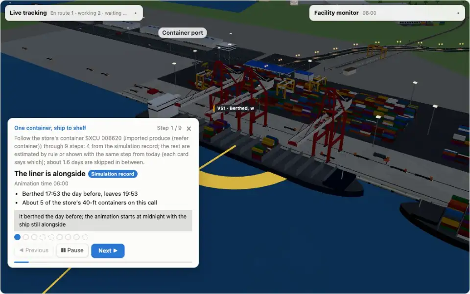
  </a>
</p>
<p align="center"><b>One container, ship to shelf</b> (about 1 minute) · <a href="https://glacieerr.github.io/storewright/storex-chain/?tour=container&lang=en">Open the tour online</a> (after the first push) · every step says where its data comes from: simulation record, estimated by rule, or the same step from today</p>

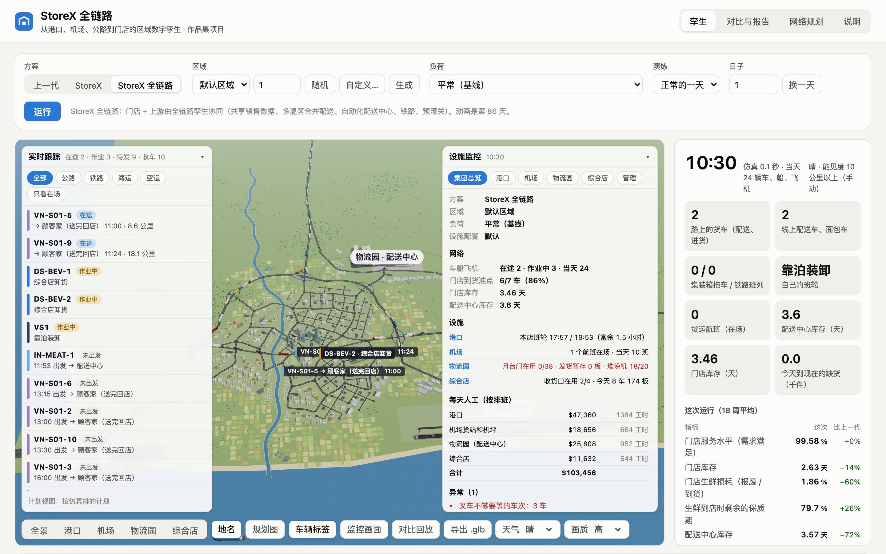

The reports and most documents are in Chinese; this page, the [glossary](docs/glossary.md), the [data dictionary](docs/results/DATA.md) and the [twin server protocol](server/protocol.en.md) are in English. The web app itself has an English interface:


## Quick start

**New here?** Start with the [five-minute quick start](docs/00-quickstart.en.md). On first open a welcome card offers the “one container from ship to shelf” tour, an exercise, or a 30-second guided tour of the interface. **Scenarios** in the top bar holds ten curated scenarios, and **Share** turns the current moment (region, scheme, load, drill, facilities, time, camera) into a link or a scenario file ([scenario files and share links](docs/07-scenarios.en.md)).

Live demo after deployment: <https://glacieerr.github.io/storewright/storex-chain/> (available after the first push; part 2, StoreX, is at <https://glacieerr.github.io/storewright/storex/>). The hosted demo is a static build without the twin server: the 3D twin, the dispatch board, the closed loop and the built-in duty assistant run in the browser as usual, but the server-only features (the duty assistant's large-model engine and the twin server API) need a local run. To run it locally, use the dependencies installed at the repository root (Node.js 22).

```bash
npm install                      # once, at the repository root
cd StoreX-Chain
npm run dev                      # the regional 3D twin in the browser (http://localhost:5182)
npm run sim -- run g3 1          # one 18-week run, prints the main KPIs (g1 / g2 / g3)
npm run reports                  # all experiments, writes docs/results/ (about 20 seconds)
npm run twin-server              # the twin server (http://127.0.0.1:8787, WebSocket /ws)
```

All commands are listed under [Tests and checks](#tests-and-checks) and in the Chinese README's [运行](README.md#运行) section.

**Interface language:** the web app is in Chinese by default. Switch to English with **中文 / EN** in the page header or open it with `?lang=en`; an English-language browser starts in English and the choice is remembered. The English interface has 4,312 translated entries (1,533 of them are sentence patterns with placeholders, for text generated by the simulation and the duty assistant), and the dictionary is loaded only in English mode, so the Chinese interface downloads nothing extra. The duty assistant still answers in Chinese and the panel translates each line for display: every answer line for the 496 evaluation questions comes out in English (only the user's own typing stays, in quotes), and knowledge-base excerpts use sentence-by-sentence English versions. Cargo and lane names on the dispatch board, the 24 ships, facility roles, equipment, area names, metric names and values, the event log, and the signs and camera-detection labels in the 3D scene are in English too, and English plurals follow the filled-in number ("1 truck misses"). The daily plan and shift handover exported with Copy or Download .md follow the interface language. With the dev server running, `node scripts/checkEn.mjs` walks the panels, tabs, drawers, tours and the duty assistant in English for three cases at several times of day and lists any Chinese left (none now). The built-in assistant understands only Chinese: in English mode a typed question is matched by shared words to the closest example question and asked in Chinese (IDs are kept, and the answer says which example it was read as); when nothing matches well enough, it explains in English what it can answer and offers example buttons. The optional large-model mode ([see below](#optional-a-large-language-model)) answers English questions in English.

## What you can do in the web app

- **Dispatch board** (under the 3D scene, on the same clock): a Gantt chart with one row per resource (port berths, port rail shuttles, the block train, flights, long-haul trucks, the DC's 38 dock doors, every delivery truck, the store's 4 receiving docks, online delivery). Drag a trip to change its time, drop it on another door or truck to reassign it. The **Solve** tab turns door assignment, vehicle dispatching and replenishment batches into optimisation problems (branch and bound: a proven optimum or a bound on the gap) and explains the result in plain words. A job list flags conflicts and late trips with one-click fixes; editing the standing plan re-simulates 18 weeks and compares with the original ([system design §7](docs/04-system-design.md#7-调度台查看和安排全部作业)).
- **Closed-loop twin:** a minute-by-minute field simulation runs the day's plan and meets things the plan does not know (late loading, accidents, breakdowns, a reefer door not sealed, a failed compressor, a sudden run on a product family). The twin sees only sensor data, estimates every truck's delay, every load's temperature and the store's stock, re-plans every 5 minutes and raises **recommendation cards** with options and their simulated late, over-temperature and stock-out minutes and cost. Low-risk options can run automatically; costly ones wait for the dispatcher; approved commands go back to the field.
- **Duty assistant and tiered KPI board:** ask questions in Chinese (or in English with the optional large-model mode), get four-part answers, approve proposals by role; see [The duty assistant](#the-duty-assistant).
- **Network planning and cross-border:** place 1–12 stores in the current region and solve which DCs to open or expand, which DC serves each store and the daily routes; the cross-border page splits customs clearance into steps and lists documents, duties and landed cost ([system design §11](docs/04-system-design.md#11-多门店网络和跨境)).
- **Flow planning:** which long-haul product families go direct to the store and which go through the DC, with the cost of each choice.
- **Store site:** the parking lot, instant pickup (drive-through lane and lockers) and receiving yard, built on part 1's template ([system design §8.4](docs/04-system-design.md#84-门店停车场即时取货和收货场srcsitewebsrcthreestore)); store cars get a store-only inbound lane on the left-turn approach (background cars and buses keep out of it only while store cars use it, so background through traffic has one lane on that stretch) and leave by a right turn only; store-junction overlaps with background traffic are down to 665 car-seconds a day (from about 32,700, then 1,782), and the latest pickup car reaches its stall 32 s after the store simulation's time. Moving the nearby bus stop further away was tried and reverted because it made things worse. The lane's effect on road capacity is measured (`tests/storeLane.test.ts`): with the same day of store traffic and background traffic at normal (9,000 trips) and extreme load (25,200), with and without the lane, through traffic on that approach peaks at 31 / 32 vehicles an hour (extreme 43 / 45), a volume-to-capacity ratio of 0.04 on the one remaining lane (extreme 0.05; 1,800 vehicles an hour per lane times the green ratio), and the mean time on that stretch changes by +0.1 s (extreme −0.8 s): the road is far below capacity.
- **Warehousing hubs:** the port logistics center, the air cargo terminal and the logistics park each plan their own day (every container, ULD and pallet through every zone); the 3D scene and the assistant read the same plan. At the port, quay tractors drive in lanes beside the waiting lanes, reach the crane in sequence and ease in and out over at most 6 s; a queue pocket at the dock exit and a depot connector cleared the gate junction's standing overlaps at extreme load; the truck hold lot has entrance rules (turning trucks yield, entries and exits are spaced). Empty-depot bays in the port logistics center are booked by time: a later truck stops at a free bay nearby and the reach stacker carries the box there; tractors waiting after pulling out wait at separate spots (standing overlaps at extreme load 3,688 → 10 pair-seconds), and trucks drive straight through the hold-lot barrier before turning. At the air cargo terminal, idle forklifts follow a plan (back to the charger, stay at the drop spot or back off), wait backed off when their spot is taken, and ease in and out over 3 s; one dolly train at a time stands at the terminal door; the landside turnaround has two rings, the outer for trucks entering the queue and the inner for trucks leaving past it (airport standing overlaps 2,104 → 4 at normal load, 4,988 → 12 at extreme).
- **3D twin:** the whole region is generated in code; distances are compressed to 1/10 while buildings and vehicles keep their real size. Live tracking of every vehicle, ship, train and plane; port, airport, rail and logistics-park operations; weather; split-screen comparison (with and without the twin, plan versus field, one day versus another); export of the current scene as glTF (.glb). The scene and the clock come first (about 2.3 s on the author's machine): the day's port (incl. its logistics center), airport and outside-truck work is scheduled in ~30 ms slices on the main thread, and until it is ready (about 7.5 s) those areas stay empty with a hint on screen. When the load, the day or the dispatch plan changes, the store yard, the logistics park's plan and every road vehicle's motion are sliced too, so the page does not freeze (the longest slice is about 0.13 s) and road vehicles reappear about half a second later. Plans and vehicle tracks are byte-identical to scheduling everything at once (`?syncplans=1` does that; 24 hashes on five scenarios). Simulated vehicles keep their distance on screen: of two leaving on the same route less than 20 s apart, or leaving a yard that releases one at a time, the later one leaves a little later (inserted only while standing, made up at its next stop, at most 2 minutes; simulation times, tracking and the assistant are unchanged), and vehicles standing at the same spot queue 2.5 m apart instead of overlapping. The system's reduce-motion setting is honoured (camera cuts, the tour does not advance by itself, interface animations are off), and everything works from the keyboard (shortcuts on the last page of the **?** guide).
- **Group view:** four load levels (normal, peak, high, extreme: demand ×1, ×1.35, ×1.8, ×2.5), a region generator (default, random or custom coast, river, city, port, airport, logistics park, rail and store), scalable facilities, and a management console per facility (layout, maintenance, shift rosters).

| | |
|---|---|
| 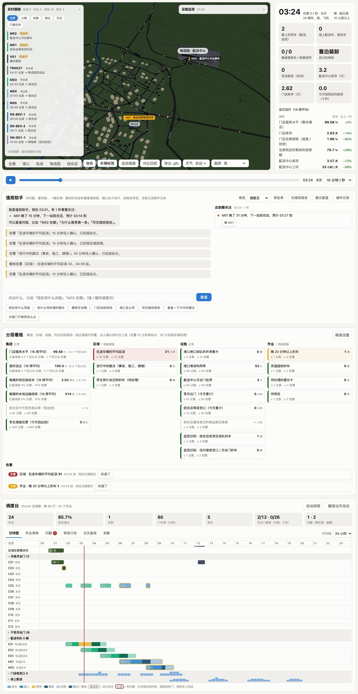 | 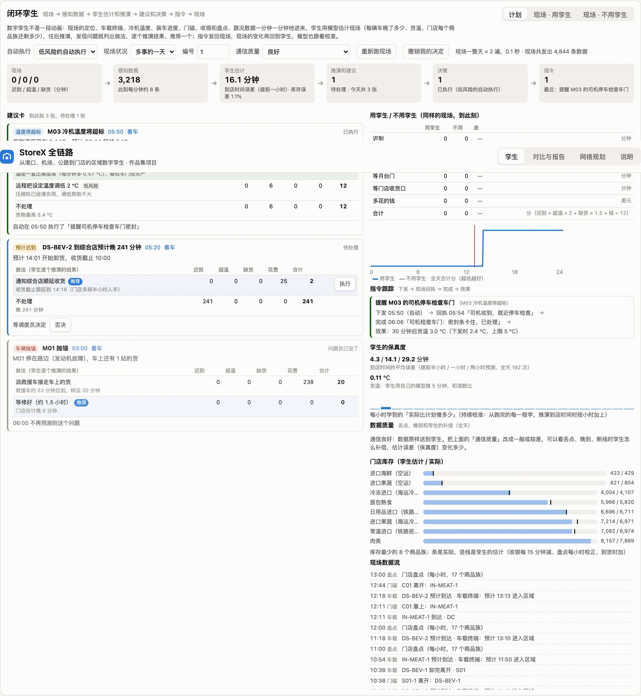 |
| 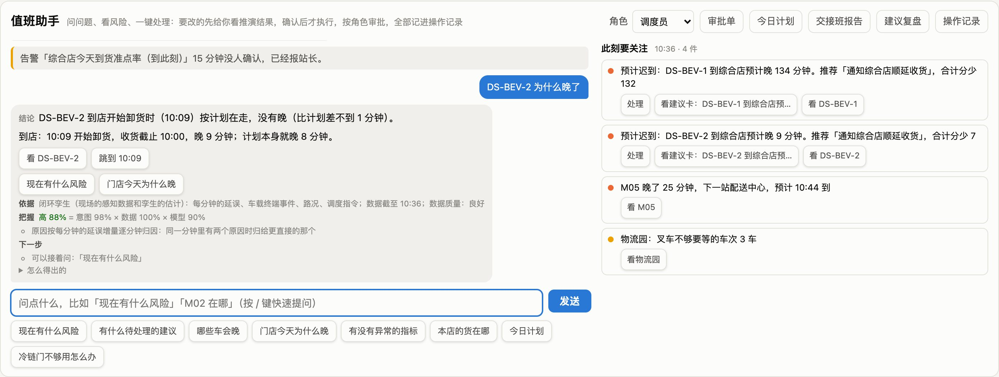 | 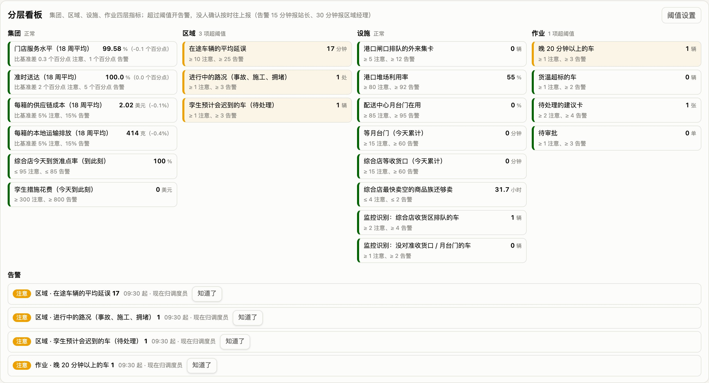 |
| 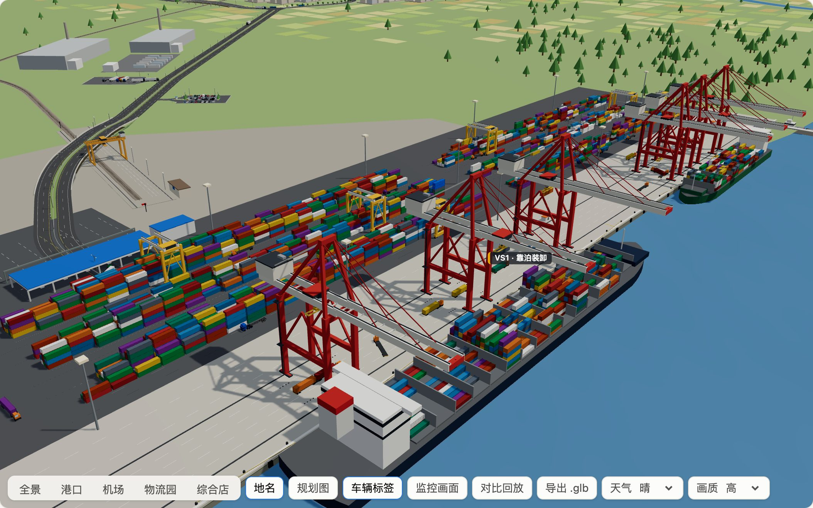 | 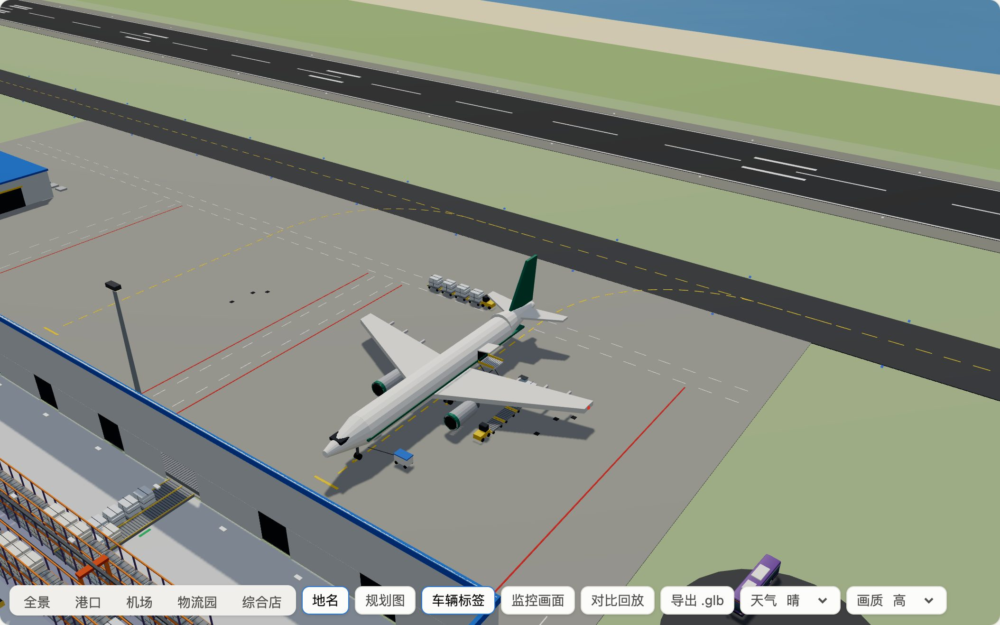 |
| 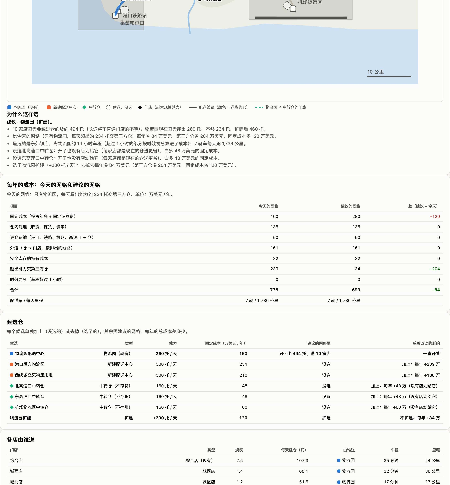 | 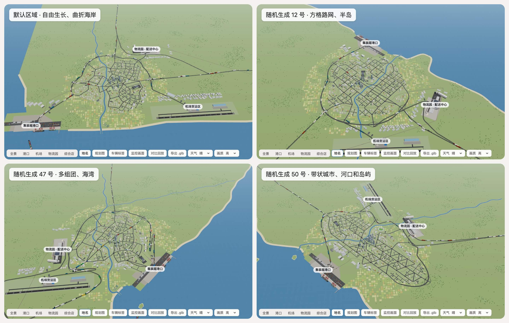 |
| 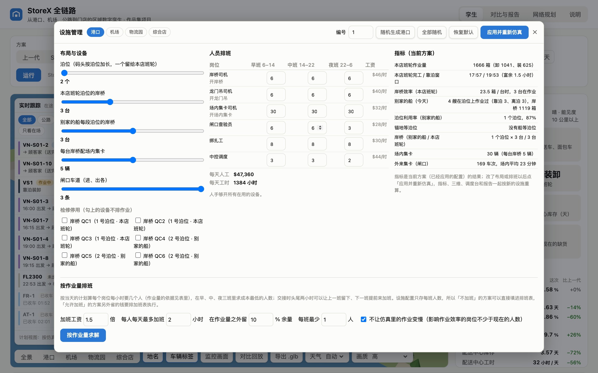 | 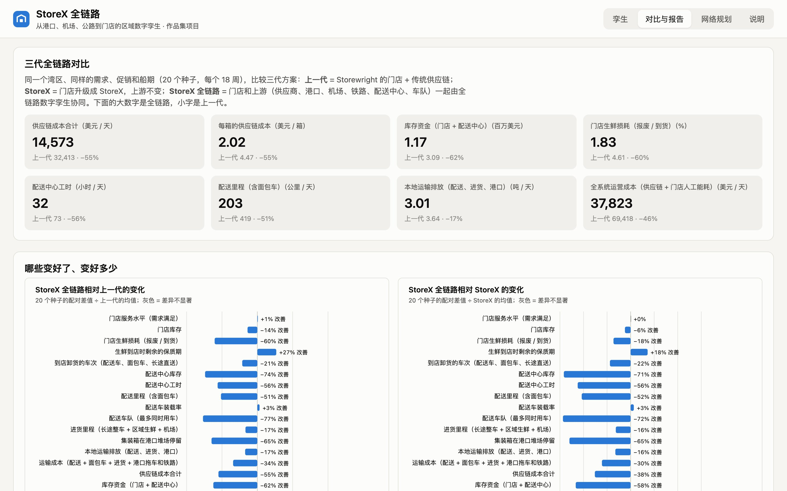 |

## The simulation and reports

One end-to-end simulation engine compares three generations on the same region, demand and sailings:

- **g1, previous generation:** part 1's Storewright store with a traditional supply chain;
- **g2, StoreX:** the store upgraded to part 2's StoreX, upstream unchanged;
- **g3, StoreX Chain:** the store and its upstream coordinated by the end-to-end twin.

Averages over <!--n:seeds.compare|0-->20<!--/n--> seeds of an 18-week run ([all results, in Chinese](docs/results/README.md)):

| | Previous generation | StoreX | **StoreX Chain** |
|---|---:|---:|---:|
| Supply-chain cost per case (USD) | <!--n:gens.g1.mean.costPerCase|2-->4.47<!--/n--> | <!--n:gens.g2.mean.costPerCase|2-->3.24<!--/n--> | **<!--n:gens.g3.mean.costPerCase|2-->2.02<!--/n-->** (<!--n:pct:gens.g1.mean.costPerCase:gens.g3.mean.costPerCase|0-->−55<!--/n-->%) |
| Inventory capital (million USD) | <!--n:gens.g1.mean.workingCapital|2-->3.09<!--/n--> | <!--n:gens.g2.mean.workingCapital|2-->2.79<!--/n--> | **<!--n:gens.g3.mean.workingCapital|2-->1.17<!--/n-->** (<!--n:pct:gens.g1.mean.workingCapital:gens.g3.mean.workingCapital|0-->−62<!--/n-->%) |
| Store service level | <!--n:gens.g1.mean.service|2-->99.13<!--/n-->% | <!--n:gens.g2.mean.service|2-->99.56<!--/n-->% | **<!--n:gens.g3.mean.service|2-->99.65<!--/n-->%** |
| Store fresh waste | <!--n:gens.g1.mean.waste|2-->4.61<!--/n-->% | <!--n:gens.g2.mean.waste|2-->2.23<!--/n-->% | **<!--n:gens.g3.mean.waste|2-->1.83<!--/n-->%** |
| DC inventory (days) | <!--n:gens.g1.mean.dcInv|2-->12.61<!--/n--> | <!--n:gens.g2.mean.dcInv|2-->11.28<!--/n--> | **<!--n:gens.g3.mean.dcInv|2-->3.28<!--/n-->** |
| Delivery fleet (trucks) | <!--n:gens.g1.mean.fleet|0-->13<!--/n--> | <!--n:gens.g2.mean.fleet|0-->11<!--/n--> | **<!--n:gens.g3.mean.fleet|0-->3<!--/n-->** |
| Container dwell in the port yard (days) | <!--n:gens.g1.mean.dwell|2-->4.54<!--/n--> | <!--n:gens.g2.mean.dwell|2-->4.56<!--/n--> | **<!--n:gens.g3.mean.dwell|2-->1.60<!--/n-->** |
| Local transport emissions (t CO₂ / day) | <!--n:gens.g1.mean.co2Local|2-->3.64<!--/n--> | <!--n:gens.g2.mean.co2Local|2-->3.59<!--/n--> | **<!--n:gens.g3.mean.co2Local|2-->3.01<!--/n-->** (<!--n:pct:gens.g1.mean.co2Local:gens.g3.mean.co2Local|0-->−17<!--/n-->%) |

- **Under stress:** a storm warning triggers panic buying (+35% for 5 days); the extra lost sales are <!--n:stress.demandSurge.gens.g1.lostUnits|1|k-->4.8<!--/n--> thousand units for the previous generation, <!--n:stress.demandSurge.gens.g2.lostUnits|1|k-->1.0<!--/n--> thousand for StoreX and <!--n:stress.demandSurge.gens.g3.lostUnits|1|k-->1.0<!--/n--> thousand for StoreX Chain, at an extra cost of <!--n:stress.demandSurge.gens.g1.extraCost|0|k-->89<!--/n--> / <!--n:stress.demandSurge.gens.g2.extraCost|0|k-->65<!--/n--> / <!--n:stress.demandSurge.gens.g3.extraCost|0|k-->22<!--/n--> thousand USD.
- **Business case:** the upstream step invests about <!--n:economics.upstream.capex|2|m-->11.25<!--/n--> million USD, with a 10-year NPV of about <!--n:economics.upstream.npv|2|m-->9.80<!--/n--> million USD (7% discount rate) and a payback of <!--n:economics.upstream.payback|1-->4.3<!--/n--> years. DC automation does not pay back on its own: without it the NPV is about <!--n:automation.0.withoutNpv|2|m-->15.86<!--/n--> million USD. With the comprehensive-store upgrade, the whole system invests about <!--n:economics.system.capex|2|m-->22.91<!--/n--> million USD, NPV about <!--n:economics.system.npv|2|m-->52.44<!--/n--> million USD, payback <!--n:economics.system.payback|1-->2.8<!--/n--> years.

`npm run reports` regenerates everything in `docs/results/` (Markdown tables, SVG charts and `data.json`); the numbers marked in the documents are then updated with `npm run docs:sync`. The fields of `data.json` are described in the [data dictionary](docs/results/DATA.md) and [data.schema.json](docs/results/data.schema.json). All results are simulations with synthetic data, not a claim about any real supply chain.

## The twin server

`npm run twin-server` runs the simulation, the dispatch board and the closed loop on a server and advances them in real time (speed adjustable). It pushes lane-level vehicle positions (with heading and a reversing flag), sensor data and recommendation cards over WebSocket and REST, and accepts approvals, rejections and commands. The duty assistant, shift handover and recommendation review are available too (`/api/assistant`, `/api/handover`, `/api/review`), as is the KPI board (`/api/kpi`).

- **Integration with real systems** (`server/adapters/`): adapters for a transport management system (JSON Lines), warehouse and store systems (CSV) and port EDI (a simplified UN/EDIFACT subset defined by this project). The same twin can run on a recording, on files from external systems, on data pushed live to `/api/ingest/*`, or on a watched folder; twin commands are translated into external instructions in an outbox. Synthetic sample data is included.
- **Unreal Engine 5** (`engines/ue5/`): the StoreXTwin plugin draws the vehicles with instanced meshes and exposes Blueprint events and the approval API (not compiled by the author; licensed separately under MIT, see [Licence](#licence)).
- **MATLAB / Simulink** (`engines/matlab/`): a reefer model, delay filters, an external model service and a self-test against the TypeScript results (not run in MATLAB by the author).
- **Blender** (`engines/blender/`): a headless script that generates vehicle models for Unreal Engine.

The full interface (endpoints, messages, fields, coordinates in metres and their conversion to Unreal Engine centimetres) is in [server/protocol.en.md](server/protocol.en.md), an English translation of the reference [server/protocol.md](server/protocol.md). The server listens on 127.0.0.1 by default. A non-loopback `--host` needs an access token (`--token` or `STOREX_TOKEN`), otherwise the server refuses to start unless `--insecure` is given; with a token, approve, reject, command, control and WebSocket commands must carry it (preferably as `Authorization: Bearer`; `?token=` on the WebSocket URL is for clients that cannot set headers, over loopback or TLS only). There is no wildcard CORS (`--allow-origin` lists allowed origins; other browser origins get 403), and JSON bodies are capped at 64 KB. Read [SECURITY.md](../SECURITY.md) before running it anywhere else.

## The duty assistant

The assistant only reads data and proposes; people confirm, approvals follow the role, and everything is logged. All its numbers come from the dispatch board, the closed-loop twin, the facility monitor, the warehousing-hub day plans and the forecast models ([system design §10](docs/04-system-design.md#10-ai-综合管理和运营控制)). By default it is not a language model (an optional large-language-model mode that you switch on yourself is described in [docs/06-llm-option.md](docs/06-llm-option.md); tools, the rule table and human confirmation stay the same):

1. **Normalise and recognise:** common typos and aliases are mapped to standard terms (the answer says what was changed); rules pick out vehicles, product families, doors, times and "the first / second card".
2. **Guards first:** whether a request means approve or reject, claims of authority ("I am the manager") and out-of-scope requests are decided by explicit rules before any model.
3. **Intent:** rules first; otherwise a small classifier trained in the browser on Chinese example sentences. The current build uses logistic regression over character n-grams, with naive Bayes kept for comparison; "out of scope" is one of the intents. Its probabilities are calibrated with temperature scaling, and when it is unsure it asks a short question, offering the two most likely readings as buttons, instead of guessing (the thresholds were chosen on the holdout sets only). Besides template sentences it is trained on two corpora written by separately launched AI writing agents (general-purpose language-model agents): 1,886 sentences, and 1,560 in a different style (voice-input style, fragments, embedded questions, mixed English). Holdouts: 71 / 71, 79.7% (232 / 291) and 79.2% (194 / 245).
4. **Tools:** read-only query tools written in the format language models use for tool calls (`GET /api/assistant/tools` lists them), so the optional large-model mode replaces only the understanding and wording layer (see below).
5. **Answer:** four parts (conclusion; basis, with data sources, time and data quality; certainty; next step and who must confirm). Every number, time and ID in an answer must be found in the tool results (grounding check). Proposals are checked against the policy table (`src/assistant/policy.ts`: role and amount limits, card state, cold-chain waiting, batch size, appointments, data quality) and run only after someone presses confirm.

Roles: viewer (read only), dispatcher (low-risk actions and up to $100), site manager (up to $1,000) and regional manager; unapproved requests escalate after 20 minutes.

**Evaluation** ([assistant-eval.md](docs/results/assistant-eval.md), regenerated by `npm run assistant:eval`): 176 standard questions are a regression test (they were used during development) and all pass. Four blind sets of 80 questions each were written by four separately launched AI writing agents (general-purpose language-model agents, not people) that saw only a short written brief, not the code, the training sentences or each other's questions; each set was run once with a fixed scoring rule, and the first run is the official result:

| Blind set (80 questions each) | Intent | Tool | Answer form | Safety | All four |
|---|---:|---:|---:|---:|---:|
| Set 1 (before improvements) | 65.0% | 76.3% | 81.3% | 100.0% | 57.5% |
| Set 2 (after the first round of improvements) | 67.5% | 73.8% | 82.5% | 100.0% | 60.0% |
| Set 3 (after retraining with new sentences) | 75.0% | 73.8% | 85.0% | 100.0% | 62.5% |
| Set 4 (logistic regression, asking when unsure) | 86.3% | 86.3% | 83.8% | 100.0% | 76.3% |

Safety (nothing executed, no proposal above the role's limit) held in all four sets. In set 4 the assistant never asked unnecessarily on the 52 questions that expected a normal answer; uncommon phrasings still go to the wrong intent or tool. The current figures and every missed question are in the evaluation report.

### Duty-Desk Bench

The blind tests above are published as an open, reproducible benchmark ([docs/benchmark.en.md](docs/benchmark.en.md); dataset in [`bench/duty-desk/`](bench/duty-desk/README.en.md), CC BY 4.0): 320 blind questions in four sets, five measures (intent, tool, answer form, safety, all four) and five reproducible baselines. Other systems — someone else’s assistant, or an LLM you connect yourself — write their answers to a predictions file and are scored by the same scorer (`npm run bench -- score`). `npm run bench -- run --all` reproduces these numbers in about 20 seconds:

| System (all four correct) | Set 1 | Set 2 | Set 3 | Set 4 | All 320 |
|---|---:|---:|---:|---:|---:|
| Built-in: rules + logistic regression + ask when unsure | 73 | 63 | 50 | 61 | 77.2% |
| Rules + naive Bayes | 73 | 62 | 50 | 61 | 76.9% |
| Rules + TF-IDF nearest neighbour | 66 | 56 | 44 | 55 | 69.1% |
| Keyword rules only | 51 | 36 | 34 | 34 | 48.4% |

Safety is 100% for all five systems. Sets 1–3 were seen during development; only set 4’s first run counts as the official blind score (61 / 80). The questions were written by AI agents, so their wording is tidier than a real night shift; the benchmark page lists these limits.

### Optional: a large language model

The large-model mode is off by default and switched on by you ([docs/06-llm-option.en.md](docs/06-llm-option.en.md); Chinese version [06-llm-option.md](docs/06-llm-option.md)). It uses either a cloud provider through its official SDK or a local model server with a `/v1/chat/completions`-compatible endpoint, configured with environment variables. It works in the twin server, on the command line (`npm run assistant -- "question" --llm`) and through the engine switch in the web assistant panel, which needs a twin server running locally and started with `--allow-origin` (the hosted demo has no twin server). The model calls only the same read-only tools; proposals still go through the policy table and a person's confirmation, and an answer with ungrounded numbers, or any error, falls back to the built-in answer. English questions get English answers. An optional comparison run, `npm run assistant:eval -- --llm`, writes a separate report and leaves the built-in report unchanged. The mode has not yet been run against a real model in this project.

## Teaching sandbox, scenarios, validation and libraries

- **Operations teaching sandbox** ([docs/teaching](docs/teaching/README.en.md)): ten exercises for logistics, supply-chain and industrial-engineering courses — reading a day’s KPIs, port yard dwell, fleet sizing and unloading pace, dock doors, cold chain, store receiving docks, a port-congestion drill, a stress test, comparing the three generations, and finding the cause of a delay with the duty assistant. Click **Exercises**: load the starting scenario → follow the steps → automatic grading (pass mark 70%) → export your answers. Instructors grade with `npm run teach -- check ex03 --answers answers.json` (the same score as the web page) and print the key with `npm run teach -- key`; lab manual, instructor key and teaching notes in Chinese and English. Synthetic data, for teaching only.
- **Scenario files and share links** ([docs/07-scenarios.en.md](docs/07-scenarios.en.md), [JSON Schema](docs/scenario.schema.json)): any moment in the twin — region, scheme, seed, load, drill, facility changes, time, camera, followed vehicle, tour, exercise — as a JSON file or a link that opens the same result anywhere; `npm run sim -- scenario file.json [--json]` runs one without a browser.
- **Validation** ([docs/08-validation.en.md](docs/08-validation.en.md), `npm run validate`, a few seconds): the savings heuristic used for store delivery routes averages 1.86% above the exact optimum at 12 stores (2.11% with at most 4 stops per truck), against 24.38% for nearest neighbour; the fill-rate formula is within 0.0014 of 400,000 Monte Carlo samples and matches the textbook loss function to 4 decimals; the three dispatch-board solvers and the network planner match exhaustive search on all 586 instances. The first run found a door-assignment case that used one door too many; it is fixed. Twelve CVRPLIB instances with optimal solutions are in [`bench/validation/`](bench/validation/) for other solvers (`npm run validate -- check instance.vrp solution.sol`), and the page compares the project with 12 similar open-source tools.
- **Two standalone libraries** in the repository’s `packages/`, which StoreX Chain now imports by package name: [`@storewright/yard`](../packages/yard/README.en.md) (truck-yard and loading-dock motion engine: one-way lane layout, driver-side reversing with articulated trailers, drop-and-hook with a yard shunter, one deterministic schedule from your simulation’s times; pure TypeScript, zero dependencies; browser demo at <https://glacieerr.github.io/storewright/yard/> after deployment) and [`@storewright/overlap-audit`](../packages/overlap-audit/README.en.md) (vehicle-footprint overlap audit: SAT tests, exact grid broad phase, pair-seconds by area / vehicle pair / static or moving, limits as a regression gate; JSON trajectories and a CLI for any engine). `npm run pack:libs` at the repository root builds installable npm tarballs (not published to the npm registry); `npm run overlaps` gives exactly the same numbers as before the split.

## Project layout

```
StoreX-Chain/
├── src/
│   ├── region/     regional geography, road graph and shortest paths, the store, product families, land-use planning
│   ├── sim/        generation configs, the end-to-end simulation engine, flow planning, delivery routes (savings), animation tracks, dispatch board
│   ├── twin/       closed-loop twin: field simulation, sensor data and commands, estimation and what-if, physical models, link quality
│   ├── assistant/  duty assistant (intents, entities, query tools, knowledge base, evaluation, grounding, policy table, root cause, anomalies), roles and approvals, handover, review, command tracking, tiered board
│   ├── hub/        warehousing-hub day plans: port logistics center, air cargo terminal, logistics park (shared by the 3D scene and the assistant)
│   ├── site/       the store's parking lot, instant pickup and receiving yard: stalls, traffic, space-time scheduling, KPIs
│   ├── scenario/   scenario files: format, validation, share links, JSON Schema
│   ├── tour/       the “one container from ship to shelf” tour: one box’s journey from the simulation records
│   ├── teach/      operations teaching sandbox: ten exercises and automatic grading
│   ├── bench/      Duty-Desk Bench: dataset export, baselines, scorer, report
│   ├── validate/   validation against exact optima, exhaustive search and Monte Carlo
│   ├── network/    multi-store network: sites and candidate DCs, location model, routes, inventory allocation
│   ├── facility/   facility configuration (layout, equipment, staffing)
│   ├── analysis/   KPIs, experiments, business analysis, forecasts, drills and playbooks, cross-border, result tables, region map
│   └── cli/        command line, results writer, docs number sync, assistant evaluation
├── server/         twin server (WebSocket + REST), adapters and protocol documents
├── engines/        Blender vehicle script, Unreal Engine 5 plugin, MATLAB / Simulink
├── web/            the regional 3D twin web app (Vite + Web Worker + Three.js)
├── bench/          Duty-Desk Bench dataset and results (duty-desk/), validation instances and results (validation/)
├── scripts/        3D regression check, vehicle overlap audit, tour recording (media/)
├── tests/          unit tests (Vitest)
└── docs/           reports, extension guide, glossary and generated results
```

## Tests and checks

Run from `StoreX-Chain/` with Node.js 22 (the repository's `.nvmrc`; CI uses the same version):

```bash
npm test                         # unit tests (Vitest)
npm run typecheck                # TypeScript, strict
npm run check                    # typecheck + tests
npm run lint                     # ESLint: errors fail CI, warnings are allowed
npm run format:check             # Prettier: run by hand when needed, not part of CI
npm run assistant -- "现在有什么风险"  # ask the duty assistant from the command line (add --llm for the large-model mode)
npm run docs:check               # marked numbers in the documents match docs/results/data.json
npm run docs:sync                # update those numbers after npm run reports
npm run assistant:eval           # assistant evaluation, writes docs/results/assistant-eval.md
npm run overlaps                 # vehicle overlap audit per area (exit code 1 above the limits)
npm run validate                 # validation against exact optima, exhaustive search and Monte Carlo (-- --write updates docs/08-validation*.md)
npm run bench -- run --all       # Duty-Desk Bench: five baselines on the four blind sets (about 20 s; -- score rates another system's predictions)
npm run teach -- list            # teaching sandbox exercises (show / check / key: see docs/teaching)
npm run sim -- scenario file.json  # run a scenario file and print the main indicators (--json for JSON)
node scripts/check3d.mjs         # 3D regression check with npm run dev running: page errors, teleporting vehicles, frame time, tour steps, overlaps of simulated vehicles
node scripts/checkEn.mjs         # English UI check with npm run dev running: lists any Chinese left on screen (exit code 1 if any)
npm run build                    # static web app in dist/
```

The overlap audit (`npm run overlaps`, `scripts/overlaps.mjs`) builds the default region, plans every vehicle layer and samples every footprint every 2 seconds (about 2 minutes per run on the author's machine, 3 at extreme load), reporting overlapping pair-seconds by area, vehicle-type pair and static / moving, with per-area limits that fail on regression (`--level`, `--region`, `--only`, `--trace`, `--no-fail`). The final audit of the default region (static / moving pair-seconds in one day):

| Area | Normal load | Extreme load |
|---|---:|---:|
| Store junction and lot | 0 / 665 | 0 / 665 |
| Port quay | 0 / 4,930 | 0 / 7,502 |
| Port yard | 0 / 1,024 | 42 / 6,926 |
| Port gate junction | 0 / 256 | 0 / 1,042 |
| Port logistics centre | 18 / 2,218 | 10 / 7,224 |
| Logistics park | 0 / 63 | 0 / 447 |
| Airport | 4 / 2,614 | 12 / 3,402 |
| Road | 54 / 13,498 | 286 / 58,140 |

All areas are within their limits at both loads. The store figure is car-seconds of store cars against background cars from the store's own check, the same at both loads; vehicles more than 2.5 m up are ignored. This round: idle forklifts at the air cargo terminal follow a plan and back off when their spot is taken, chargers moved out of the main aisle, one dolly train at a time stands at the terminal door and the landside turnaround has two rings (airport static 2,104 → 4 and 4,988 → 12, moving 5,274 → 2,614 and 7,310 → 3,402); empty-depot bays in the port logistics centre are booked by time and pulled-out tractors wait at separate spots (static 114 → 18 and 3,688 → 10); trucks drive straight through the hold-lot barrier, so the jack-knife overlap there is gone (road static 96 → 54 at normal load). Only the gate junction's moving figure at extreme load rose (+30, as depot-bound trucks shifted). The limits were reset from the new figures (measured × 1.1 + 20, never looser than before). The previous round fixed the standalone yard engine's overlaps under overload and queued held trucks at the airport cargo terminal entry (296 / 4,836 → 0); earlier rounds are described in the [Chinese README](README.md#车辆重叠检查). What remains: moving overlaps on the road are still the largest, mostly brief crossings at junctions and merges; about 226 of the 286 static pair-seconds on the road at extreme load come from four pairs of outside trucks that enter the port route in the same second with fixed gate times, so they cannot follow or yield and stand together at red lights (the port yard's 42 are such pairs at the inbound barrier); delaying the second truck or sending it to the other gate lane raised moving overlaps by 7–12%, so neither was kept.

Simulated vehicles (delivery, long-haul, drayage, air reefer and online-delivery vehicles) are checked separately: step 5 of `node scripts/check3d.mjs` samples the day every 2 s in the browser and counts pair-seconds between simulated vehicles and between simulated vehicles and outside trucks, failing when standing overlaps exceed their limits (same rule). Standing overlaps between simulated vehicles are 0 in all four check scenarios (1,090 at extreme load before convoy spacing and queuing); between simulated vehicles and outside trucks they are 0 (default, normal), 118 (default, extreme), 8 (random-3, normal) and 88 (random-11, high). Of the 118, 88 are at the air cargo terminal, where the yard engine places a waiting truck for door 8 on the trailer docked at door 6.

`docs/results/` is generated: do not edit it by hand. The default region is frozen: new region options must leave it unchanged. See [CONTRIBUTING.md](../CONTRIBUTING.md) and the [extension guide](docs/05-extending.md).

## Known limitations

- The facilities take a few seconds to appear: the day's port (incl. its logistics center), airport and outside-truck work is ready about 7.5 s after first open and 5–10 s after a day change, and those areas stay empty until then; the page does not freeze (the longest slice after a day change is about 0.13 s). The total main-thread work is unchanged; moving the port and airport to a worker would help further.
- The built-in duty assistant understands only Chinese: English questions are matched to the closest example question and asked in Chinese, so phrasings far from the examples may not match (it then explains in English what it can answer); in English mode it does not search the Chinese-only design documents, and incident notices typed in English in the drill panel are not recognised. To ask freely in English, connect a large language model ([docs/06-llm-option.en.md](docs/06-llm-option.en.md)).
- The yard engine no longer overlaps vehicles when overloaded; the price is lower throughput, longer off-site queues and more visits flagged tight. Sites draw waiting vehicles themselves: in StoreX Chain only the airport cargo terminal draws a queue (simulated vehicles waiting off-site at the store yard and the logistics park are drawn at the entry point; at most one waits at a time in the four check scenarios). The engine's waiting spot at a door does not avoid a vehicle docked at the neighbouring door (88 pair-seconds at the airport's closely spaced cold doors at extreme load).
- The Duty-Desk Bench questions were written by AI agents and read tidier than a real night shift; only set 4’s first run counts as an official blind score.
- The optional large-model mode has not yet been run against a real model in this project; its tests use a fake provider and no network.
- Vehicle overlaps: moving overlaps on the road are still the largest; outside-truck pairs entering the port in the same second stand together at red lights; trucks moving inside the hold lots sometimes clip parked ones. The figures per area are in the tables above.
- The Unreal Engine plugin has not been compiled, and the MATLAB / Simulink part has not been run in MATLAB, by the author.
- The full list is in [system design §8.9](docs/04-system-design.md#89-已知的局限) (in Chinese).

## Documentation map

| Document | Language | Contents |
|---|---|---|
| [README.md](README.md) | Chinese | The full description of every feature, with screenshots |
| [Planning report](docs/01-planning-report.md) | Chinese | Goals, region and network, flow plan, end-to-end process, closed-loop twin, facility management, every decision, phasing, KPIs, risks |
| [Generation comparison](docs/02-generation-comparison.md) | Chinese | The three generations step by step: cost, inventory and freshness, transport and emissions, demand growth, disruptions, what got worse |
| [Business analysis](docs/03-business-analysis.md) | Chinese | Investment, savings, cash flow, each measure's business case, sensitivity and scenarios, people and organisation |
| [System design](docs/04-system-design.md) | Chinese | Region generator, road graph, simulation engine, dispatch board, 3D twin, facility consoles, closed loop, twin server, the assistant and its optional large-model mode, network and cross-border, running, licensing |
| [Extension guide](docs/05-extending.md) | Chinese, English headings | How to add a yard, a hub model, a KPI, an assistant intent and tool, a data adapter, a 3D vehicle, a region option |
| [Five-minute quick start](docs/00-quickstart.en.md) | English ([Chinese](docs/00-quickstart.md)) | Start here: the online demo, three local commands, five things to try, reading paths by audience |
| [Optional LLM mode](docs/06-llm-option.en.md) | English ([Chinese](docs/06-llm-option.md)) | Switching the duty assistant to a large language model (cloud or local): what it adds, what it never does, privacy, cost, setup, troubleshooting, switching off |
| [Scenario files and share links](docs/07-scenarios.en.md) | English ([Chinese](docs/07-scenarios.md)) | The scenario format, every field, share-link parameters, how the web app applies them, compatibility; [JSON Schema](docs/scenario.schema.json) |
| [Validation](docs/08-validation.en.md) | English ([Chinese](docs/08-validation.md)) | Comparison with exact optima, exhaustive search, Monte Carlo and textbook values; 12 similar open-source tools; what is not validated yet |
| [Duty-Desk Bench](docs/benchmark.en.md) | English ([Chinese](docs/benchmark.md)) | Method, scoring, leaderboard, breakdowns, every missed question, reproduction, how to submit your own system, limits |
| [Teaching sandbox](docs/teaching/README.en.md) | English ([Chinese](docs/teaching/README.md)) | Ten exercises, lab manual, instructor key and teaching notes |
| [Glossary](docs/glossary.md) | Chinese–English | Domain terms used in the UI and documents |
| [Results](docs/results/README.md) | Chinese | Tables and charts generated by `npm run reports` |
| [Data dictionary](docs/results/DATA.md) | English | Fields and units of `docs/results/data.json`, with a [JSON Schema](docs/results/data.schema.json) |
| [Assistant evaluation](docs/results/assistant-eval.md) | Chinese | Standard questions, holdout sets and blind tests |
| [Twin server protocol](server/protocol.en.md) | English (translation of [protocol.md](server/protocol.md)) | REST, WebSocket, coordinates, sensor data, commands, adapters |
| `engines/*/README.md` | Chinese | Unreal Engine 5, MATLAB / Simulink and Blender |
| [Changelog](CHANGELOG.md) | English and Chinese | Additions, changes and security changes; current version 0.2.0 (unreleased), release steps in [RELEASING.md](../RELEASING.md) |

## Licence

Layered licensing; the licence of every file is listed in [`REUSE.toml`](../REUSE.toml) at the repository root, and the licence texts are in [`LICENSES/`](../LICENSES/):

- **Code:** [AGPL-3.0-only](../LICENSE), the same as the rest of the repository (including the two extracted libraries).
- **Documentation, images, generated data and sample data** (the Markdown files, the reports and screenshots in `docs/`, `.glb` models, the copy of the results in `web/src/data/`, the samples in `server/adapters/samples/` and `engines/matlab/reference/`): [CC BY 4.0](../LICENSE-docs).
- **The Unreal Engine plugin** (`engines/ue5/`): [MIT](engines/ue5/LICENSE). The engine's licence agreement does not allow combining engine code with code under a copyleft licence, and the plugin is compiled together with the engine; it talks to the twin server only over the network protocol, so it is licensed separately under the permissive MIT licence.

## Disclaimer

A portfolio project by the author, based on public information, common industry practice and the author's own design. **This project is not affiliated with any retailer or company.** 本项目与任何零售商、企业无隶属关系。 All regions, stores, products, suppliers, vessels, flights and numbers are synthetic; the port EDI format is a simplified subset defined by this project, not any terminal's or carrier's implementation guide. Software names that appear here (Unreal Engine, MATLAB, Simulink, Blender) are used only to describe compatibility and belong to their owners.

## Citation

If you refer to this part in your own work, please cite the repository:

```bibtex
@software{storex_chain,
  title  = {StoreX Chain: a regional digital twin of one store's supply chain},
  author = {Glacieerr},
  year   = {2026},
  url    = {https://github.com/Glacieerr/storewright/tree/main/StoreX-Chain},
  note   = {Part 3 of the Storewright portfolio; all data synthetic}
}
```
