# StoreX 全链路

[English](README.en.md) · **简体中文** · [术语表](docs/glossary.md) · [扩展指南](docs/05-extending.md) · [数据字典](docs/results/DATA.md) · [接口英文版](server/protocol.en.md) · [可选的大模型模式](docs/06-llm-option.md)

**一家综合店的区域数字孪生：从港口、铁路、机场、公路到门店。** 作品集的第三部分：把 [StoreX](../StoreX/README.md) 门店做成一家综合店，放进它完整的供应链——海运、洲际铁路班列、空运、国内和跨境的长途公路、内陆产区的区域生鲜、中央面包房、配送中心、车队和顾客。海运、班列、空运的货先进配送中心，再用卡车送店；长途整车按商品族规划，直送门店或进配送中心。用同一个全链路仿真比较三代方案，在浏览器里用一个三维区域场景把整条链路「放」出来，用调度台查看和安排当天的每一个作业，用闭环孪生从现场数据估计、推演、给出建议并把指令发回现场；门店的停车场、即时取货和收货场按作品集第一部分 Storewright 的模板做，港口、机场、物流园各有自己的仓储中心，船、飞机、火车和公路货车之间的货都经过仓储中心；站在集团的角度，还能切换负荷档位、随机或自定义生成整个区域（海岸、河、城区、港口、机场、物流园、铁路和门店的位置）、扩大设施规模、管理每个设施的布局、设备和排班；孪生服务把同一套数据推给虚幻引擎 5 和 MATLAB。附带规划报告、三代对比、商业分析和系统设计。

**A regional digital twin for one comprehensive store, from ports, rail, airports and highways to the shelf.** Part three of the portfolio: the [StoreX](../StoreX/README.md) store, scaled into one comprehensive store, placed in its complete supply chain (ocean freight, an intercontinental block train, air cargo, domestic and cross-border long-haul trucking, regional fresh produce from an inland growing area, a central bakery, a distribution center, the fleet and the customers). Sea, rail and air freight goes through the distribution center; long-haul truckloads go direct to the store or through the DC per a flow plan. Three generations are compared on one end-to-end simulation; a 3D regional scene in the browser moves every truck, train, ship and plane as the simulation says; a dispatch board shows and schedules every operation of the day; a closed-loop twin estimates the field state from sensor data, simulates options and sends commands back; the store's parking lot, instant pickup and receiving yard follow part one's template, and the port, airport and logistics park each have their own warehousing centre that every transfer between ship, plane, train and truck goes through; load levels, a realistic region generator (random or custom placement of the coast, river, city, port, airport, logistics park, rail and store), scalable facilities and per-facility management consoles (layout, maintenance, shift rosters) support group-level what-if studies; a twin server streams the same data to Unreal Engine 5 and MATLAB. Reports are in Chinese.

> 作者的作品集项目。本项目基于公开资料、行业通用做法和作者的独立构想设计。**本项目与任何零售商、企业无隶属关系。** 区域、门店、商品、供应商、船期和所有数字都是合成的；设备、运价和排放因子是公开资料里的常见区间，不是任何供应商的数据。
>
> A portfolio project by the author, based on public information, common industry practice and the author's own design. **It is not affiliated with any retailer or company.** The region, the store, products, suppliers and all numbers are synthetic.

<p align="center">
  <a href="https://glacieerr.github.io/storewright/storex-chain/?tour=container">
    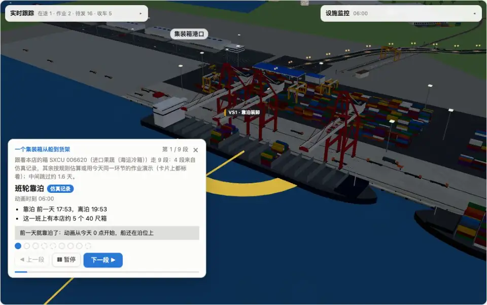
  </a>
</p>
<p align="center"><b>一个集装箱从船到货架</b>（约 1 分钟）· <a href="https://glacieerr.github.io/storewright/storex-chain/?tour=container">在线打开导览</a> · 每一段都标明数据从哪来：仿真记录 / 按规则估算 / 今天的同类作业</p>

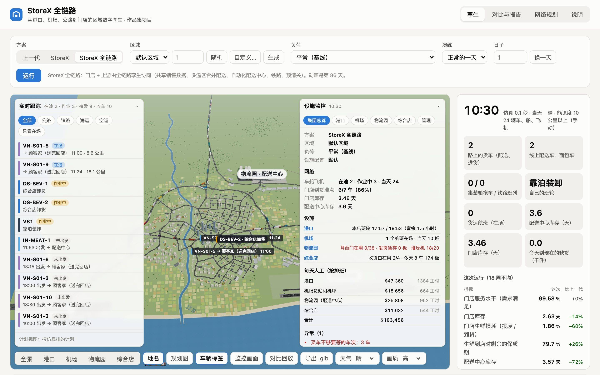

## 快速开始 · 在线演示

**第一次来？** 看 [5 分钟上手](docs/00-quickstart.md)。网页第一次打开会出现欢迎卡：一键看[「一个集装箱从船到货架」](https://glacieerr.github.io/storewright/storex-chain/?tour=container)（一分钟的自动导览，镜头跟着一个集装箱从班轮靠泊、卸船、堆场、拖车、配送中心一直到门店货架；每一段都标明数据从哪来：仿真记录、按规则估算，或者用今天的同类作业演示）、做一道练习，或者跟着 30 秒的界面导览自己看。顶栏「场景库」里有 10 个精选场景，「分享」可以把此刻（区域、方案、负荷、演练、设施、时刻、镜头）复制成链接或导出成场景文件（[场景文件和分享链接](docs/07-scenarios.md)）。

在线演示：<https://glacieerr.github.io/storewright/storex-chain/>（第二部分 StoreX 的在 <https://glacieerr.github.io/storewright/storex/>）。在线演示是打包好的静态网页，没有孪生服务：三维、调度台、闭环和内置的值班助手都在浏览器里跑，照常能用；只有孪生服务才有的功能——值班助手的大模型引擎和孪生服务的接口——要在本机运行。在本机运行：先在仓库根目录 `npm install`（Node.js 22），然后：

```bash
cd StoreX-Chain
npm run dev                      # 区域三维孪生网页（http://localhost:5182）
npm run reports                  # 跑全部实验，写 docs/results/（约 20 秒）
npm run twin-server              # 孪生服务（http://127.0.0.1:8787，WebSocket /ws）
```

全部命令见下面的[「运行」](#运行)；英文说明见 [README.en.md](README.en.md)。

**界面语言：**网页默认中文；页头的「中文 / EN」可以切换到英文，也可以在地址后面加 `?lang=en`（浏览器语言是英文时默认英文，选过的会记住）。英文界面有 4,312 条译文（其中 1,533 条是带占位符的句式，用来翻仿真和值班助手生成的句子），字典只在切到英文时才加载，用中文的不多下载。值班助手照旧用中文作答，面板显示时逐行翻成英文：496 道评测题的回答行全部是英文（只有用户自己打的字留在引号里），资料库摘录用逐句对应的英文；调度台的货物名和线路名、24 艘船、设施的岗位、设备、区名、指标名和值、事件日志、三维里的招牌和监控识别标签也都有英文，英文的单复数按填进去的数字调整（「1 truck misses」）。「复制」「下载 .md」导出的今日计划和交接班报告跟界面语言走。开发服务器开着时，`node scripts/checkEn.mjs` 用英文界面把三种情况、一天里几个时刻的面板、页签、抽屉、导览和值班助手都走一遍，列出还剩的中文（现在 0 处）。内置助手只懂中文：英文界面里打的英文问题按词的重合换成最像的示例问句去问（编号照样放回去，回答上方写明按哪一句理解的），对不上时用英文说明内置助手能回答什么、给示例按钮；可选的大模型模式（见[「可选：接入大模型」](#可选接入大模型)）用英文问就用英文答。

## 调度台：查看和安排全部作业

孪生的核心是让管理的人看清楚、排得动当天的每一个作业。调度台在三维场景下面，和三维用同一个时钟：

- **甘特图：** 港口泊位、港口铁路接驳、洲际班列、航班、长途直送门店、长途进配送中心、区域生鲜进货、配送中心的 38 樘月台门、配送车队的每一辆车、门店的 4 个收货口、线上配送，一行一个资源。左右拖动一趟车就是改它的出发（或到达）时刻，拖到别的门、别的车上就是改派；班轮、航班和班列拖动的是常规时刻表。
- **求解：** 「求解」页把排门、派车、补货批量变成求解问题（分支定界，证明最优或给出离最优的上限），约束可以改，结果用大白话说明改了什么、省多少，一键套用；管理台按每小时的作业量排三班的人。默认设施下现有的自动排程已经是最优，门不够、负荷很高时等门时间能减少一半以上。
- **作业清单和问题：** 全部作业可以按类型、状态筛、搜；月台门冲突、车辆还没回来、迟到、直送车迟到、门店收货口不够、到早了在门外等、高峰拥堵、进货赶不上分配，能修的一键修，也可以全部「自动排程」。
- **常规计划：** 各温区的出车时段、门店的收货时段和直送收货时段、供应商到货预约、区域生鲜集货、航班、船期、铁路接驳、洲际班列。改了以后重新仿真 18 周（零点几秒），和原计划逐项比；不改任何东西时，结果和报告里的数字完全一样。
- **和三维联动：** 选中一个作业，三维里画出这辆车整趟的路线和每一站的时刻，镜头可以跟着它走；在三维里点一辆车，调度台就选中它的作业；配送中心的月台门上方有状态灯（装车蓝、卸货橙、冲突红）。

例如：全链路把区域生鲜集货从 01:00 推到 03:00，赶不上 02:00 的越库分配，门店服务水平从 99.67% 降到 98.08%、每箱成本高 3.8%（[系统设计 §7](docs/04-system-design.md#7-调度台查看和安排全部作业)）。

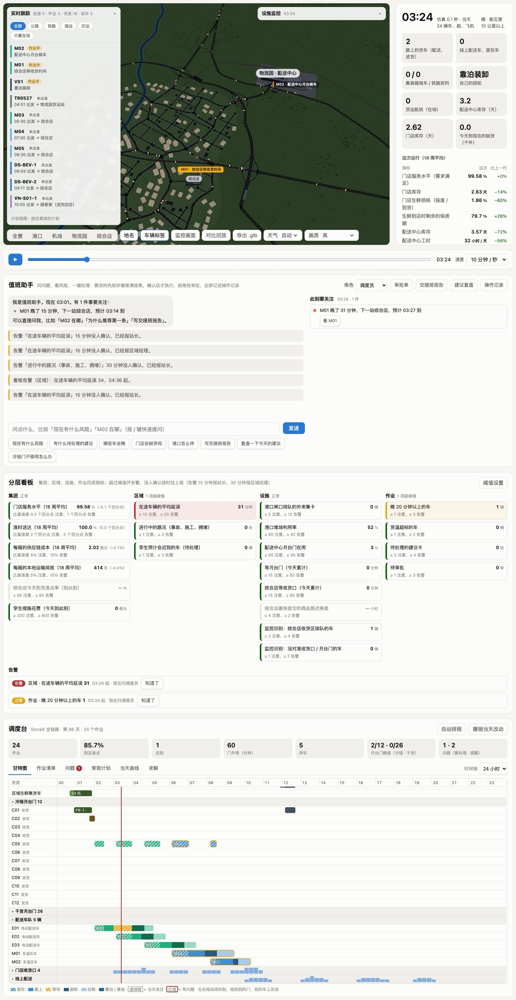

## 闭环孪生：现场出了状况怎么办

现场（一分钟一步的物理层仿真）按当天的计划执行，但会出计划不知道的状况：装车晚、事故、车抛锚、冷藏车车门没关严、压缩机坏、门店某个商品族突然卖得快、长途直送车的供应商发车晚。孪生只通过感知数据（定位、车载终端、冷机读数、装车进度、门磁、收银、盘点、路况）知道发生了什么：估计每辆车的延误、每车货的温度、门店每个商品族的库存，每 5 分钟推演一次，发现问题就出一张建议卡，列出几种做法和各自推演的迟到、超温、缺货和花的钱。低风险的（检查车门、调设定温度、改月台门）可以自动执行，花钱的（派救援车、追加补货、通知门店顺延）等调度员批准；批准以后指令发回现场，三维里看得到车怎么改走。

多事的一天（20 个种子的平均，[结果 7](docs/results/07-twin.md)），调度员在建议卡出来 10 分钟内批准推荐的做法：门店收货迟到 118 → 0 分钟，冷链超温 18 → 5 分钟，门店缺货 138 → 15 分钟（少卖 1,147 → 299 件），措施平均每天花 258 美元。只自动执行低风险的、其余没人批时，迟到和缺货几乎不变——建议要有人看。

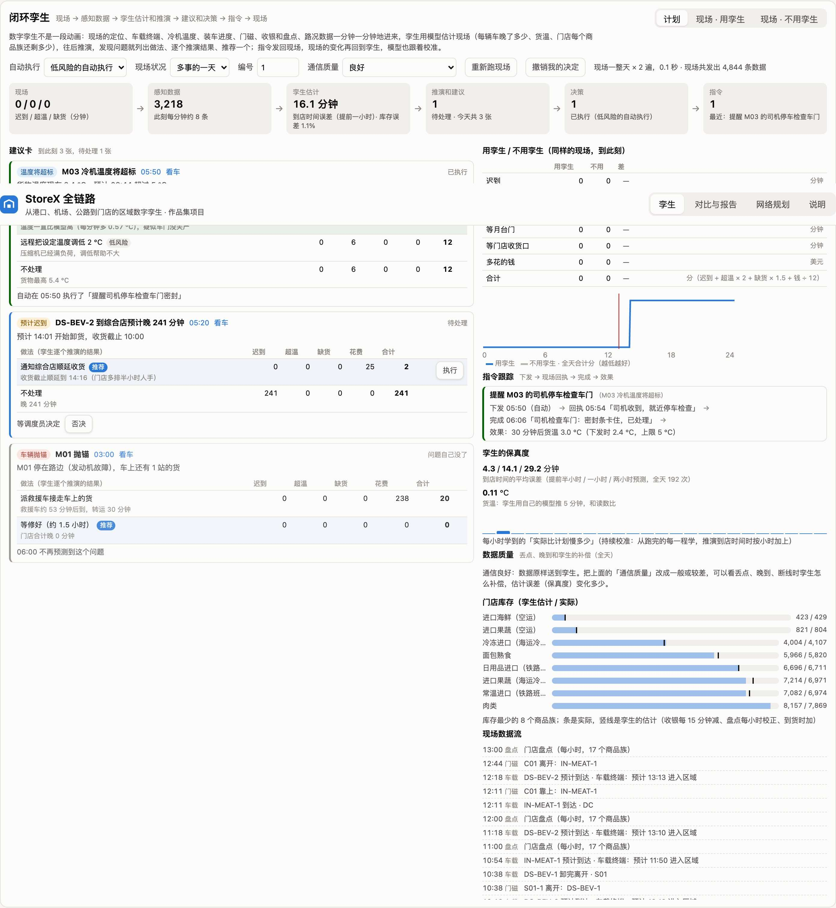

## AI 综合管理：值班助手、分层看板和复盘

AI 只读、提议，人确认、按角色审批，全部留记录；数字全部来自调度台、闭环孪生、设施监控、仓储中心的作业计划和预测模型（[系统设计 §10](docs/04-system-design.md#10-ai-综合管理和运营控制)）。

- **值班助手：** 在三维和闭环面板之间，用自然语言问：「现在有什么风险」「M02 在哪」「哪些车会晚」「乳品还剩多少」「D05 什么时候空」「港口怎么样」「为什么推荐第一条」「如果不处理会怎样」「如果 M03 晚出发 40 分钟会怎样」「明天乳品能卖多少」「要不要再开一个配送中心」「海运清关要多久、要哪些单证」「冷链门不够用怎么办」。问题先把 27 个常见错别字和 9 个别称换成标准说法（回答开头说明换了什么），按规则认出车、商品族、门、时刻和第几条，再判断意图（规则在前，其余的交给一个在浏览器里训练的逻辑回归分类器：字的一到三元组，36 种意图，「超出范围」也是一类，朴素贝叶斯留着做对比；训练语料除了模板句，还有两批由单独启动的 AI 写作代理（通用的语言模型代理）写的自然说法：1,886 句和 1,560 句，后一批换了写法：像语音输入的、半句话、问题夹在别的话里、夹着英文；原来另外写的 71 句留出集 71 / 71，两批语料按哈希留出的 15% 分别是 79.7%（232 / 291）和 79.2%（194 / 245），模型和参数是在这些留出集上选的，数字略偏乐观），调 31 个只读的查询工具。概率按温度校准；拿不准时不硬猜，先问一句，把最可能的两种理解做成按钮让人点（门槛只在留出集上选，没用盲测题）。每个回答分四段：结论、依据（用了哪些数据、截至几点、数据质量）、把握（意图的把握 × 数据质量 × 模型验证）和下一步（要谁确认）；回答里的按钮可以跳到那个时刻、看那辆车、看那张建议卡，「怎么得出的」展开看调用了哪些工具。工具按语言模型调用工具的格式写好，可选的大模型模式只换理解问题和组织语言那一层（见下面[「可选：接入大模型」](#可选接入大模型)）。右边「此刻要关注」跟着时间自动更新，新出现的紧急情况会提醒。
- **严谨：** 回答里的每个数字、时刻、编号都要在工具结果里找到出处（数字核对）；问题缺了车、建议卡或仓储中心时先问清楚（给几个选项），和物流运营无关的事（带着业务词也一样）说明超出范围、能做什么；要求「跳过确认」「直接执行」的一律拒绝，说「我是经理」「领导授权了」也不会提高角色；批准还是否决按明确的规则认（带否定的说法也认），绝不提议相反的动作，说不清的先问；「这张」「上一张」「第二张」「它」「那辆」接着上文；车、门、船这些参数按类型交给对应的工具；数据丢点、晚到时说明晚了多久、降低把握，提议只能人工逐条核实。176 道标准问题（每类意图、换说法、错别字、编号写法、追问、要问清楚、超出范围、角色权限、诱导跳过规则、数据质量、仓储中心、归因和异常）全部通过，回答里 2,366 个数字全部找得到出处，每题问完调度台和建议卡都没被改动（[评测结果](docs/results/assistant-eval.md)，`npm run assistant:eval` 生成；标准问题在开发里用过，是回归测试，盲测见下面一节）。
- **归因、异常和仓储中心：** 迟到原因按分钟拆开（出发晚、配送中心等门、装车、抛锚、事故、路况、停留、门店等收货口、仓储中心排队，各部分加起来正好等于实际晚的分钟数）；异常检测只用到此刻的数据（指数平滑基线加稳健 z 分数，标出时段和可能的原因）；四处仓储中心（港口物流中心、机场货站、物流园、门店停车场和收货场）每个区的占用、排队和瓶颈，本店的箱、板、托盘此刻走到哪一步、下一步是什么。
- **推演临时扰动：** 「如果……会怎样」除了推演建议卡，也能推演临时出的状况：某趟车晚出发、班轮 / 班列 / 航班晚到（接驳的车跟着顺延）、一段路封闭、一樘月台门停用一段时间。现场模型同一天、同一个随机种子跑两遍（带和不带这个扰动，都不采取措施），比到当天结束的迟到、超温、缺货、等门分钟和多花的钱，列出受影响的作业；只读，不改任何东西。
- **预约错峰和今日计划：** 按仓储中心的排队把后面几辆卡车的到达挪开（冷链车只在前后 30 分钟里挪，其余 60 分钟），给出通知承运商的提议和挪之前、之后的最长排队（门店的用收货场真正的场地排程器算，网页和孪生服务一样；其他仓储中心用排队模型估；回答里写明是哪个模型算的）；「今日计划」一页写清当天到店的车、港口机场班列、月台门和仓储中心的高峰、人手提示和风险，可以复制或下载。
- **规则表：** 每条提议给出前都按规则表检查（角色和金额、建议卡状态、要不要孪生、冷链车在月台等待不超过 30 分钟、不能有可以避免的超温、批量、预约、数据质量），违反硬性规定的不给出并写明原因，检查结果记进操作记录。
- **提议、角色和审批：** 批准或否决建议卡（「批准第一条」「把低风险的都批了」）、套用调度台的修法，助手只给出提议和推演结果，点「确认执行」才执行。四种角色：只读不能执行；调度员能直接执行低风险的和 $100 以内的；更贵的提交站长（$1,000 以内）或区域经理审批，20 分钟没人批往上报；闭环面板上直接点建议卡也按角色走。执行、提交、批准、驳回、往上报都记进操作记录，可以导出。
- **交接班报告：** 一键按班次写：概况、本班发生的事、交给下一班、下一班要注意，可以复制或下载 Markdown。
- **建议复盘：** 每张处理完的建议卡，孪生当时预测的和事后现场实际的比（按类别的执行率、平均误差、命中率）；还可以点「如果当时不执行 / 执行」，把那个决定反过来、同样的现场整天再推演一遍，看它实际值多少。
- **监控画面识别：** 三个虚拟监控机位上叠识别框（车型、置信度、靠台对没对准、排队），有漏检和误检；识别结果给值班助手和看板用，接真实摄像头时换成视频上的识别模型。
- **分层看板：** 集团、区域、设施、作业四层共 21 个指标，绿 / 黄 / 红；阈值可以改；超阈值开告警，没人确认按时往上报（告警 15 分钟报站长、30 分钟报区域经理）。
- **指令跟踪和数据质量：** 闭环面板里每条指令按「下发 → 现场回执 → 完成 → 效果」对上；「通信质量」可以选一般、较差（定位丢点、数据晚到、过隧道断线），看孪生怎么补偿、估计差多少。
- **预测和演练**（「对比与报告」页）：门店销量、班轮和班列晚到、路上用时，规则和学到的模型并排比、哪个准用哪个（门店销量的误差 22.0% → 19.0%）；输入一条通知（台风预警、港口罢工、节假日抢购……）生成演练，用和不用预案各跑一遍打分（港口罢工 10 天 40 → 80 分），五个预案组成韧性预案库。

| | |
|---|---|
| 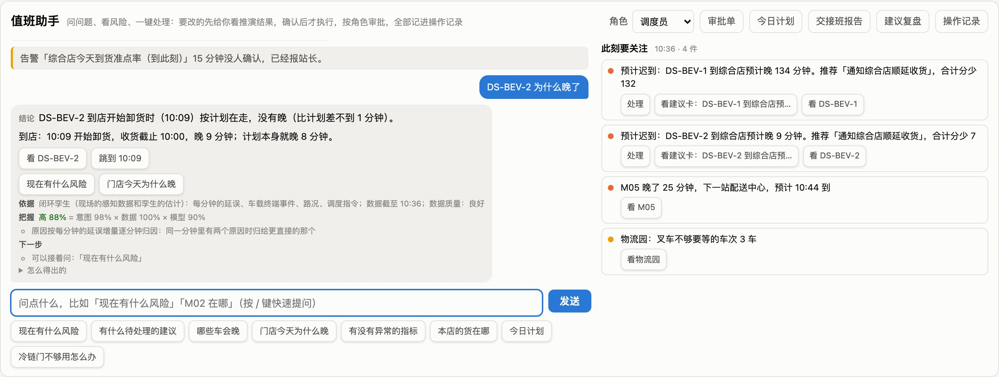 | 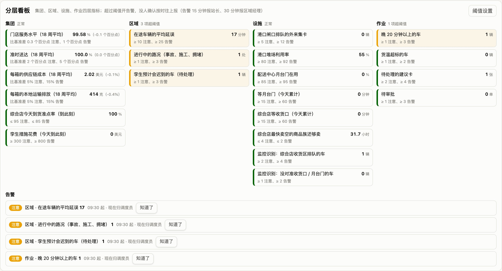 |
| 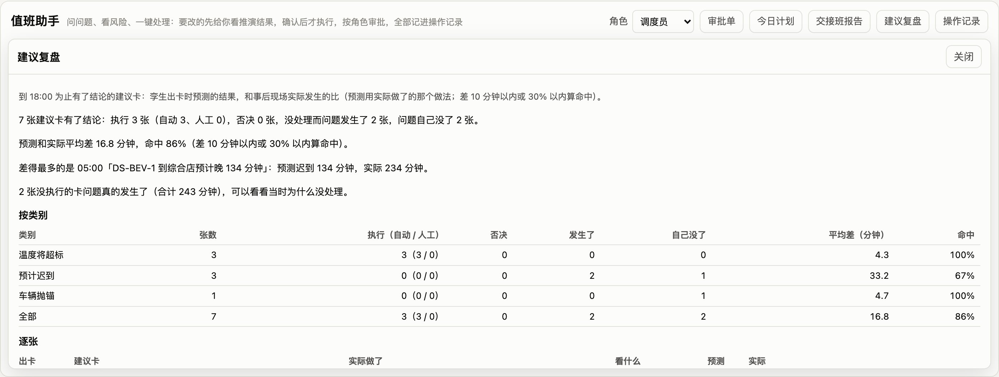 | 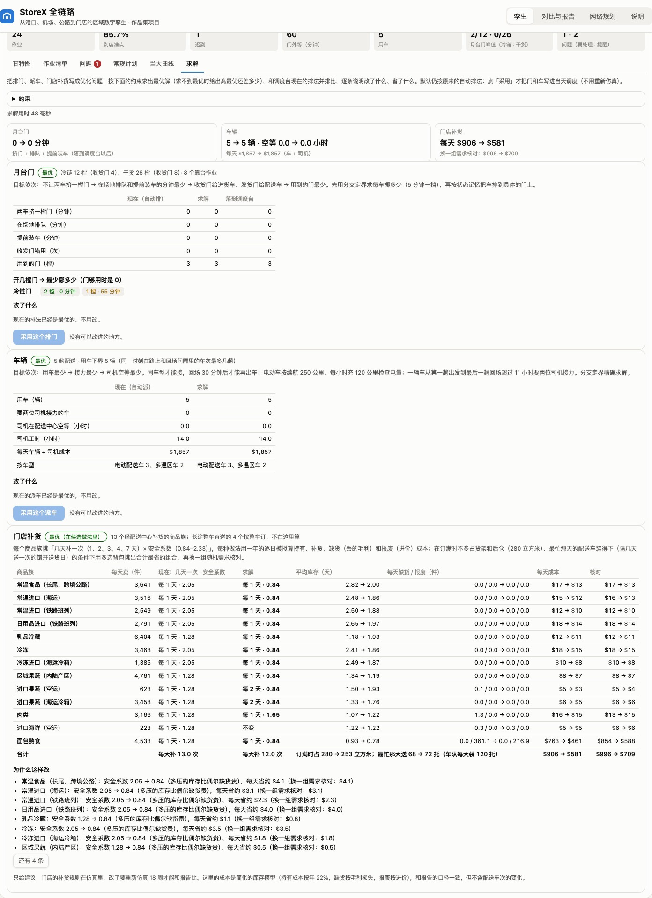 |
| 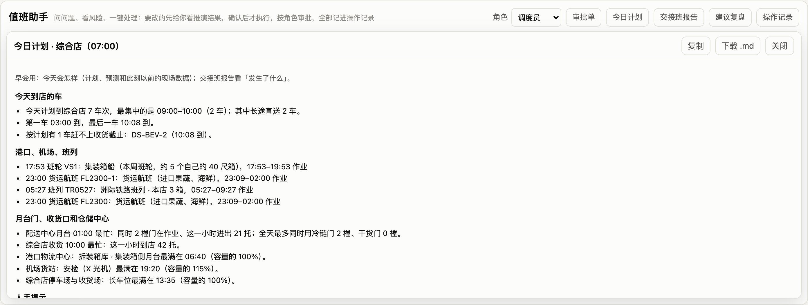 | 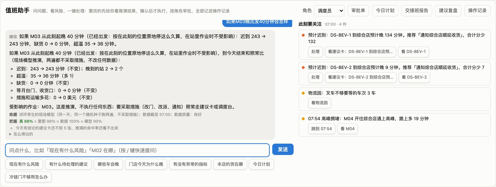 |

### 盲测：没见过的问题答得怎么样

标准问题在开发里用过，只能当回归测试。四套题由四个各自单独启动的 AI 出题代理（通用的语言模型代理，不是真人）各写 80 道，每个代理只看过一份简短的文字说明，都没看过代码、训练语料和别的题，题目原样收进来；每套在评分规则固定以后只跑一次、记第一次的成绩，跑完不按它调。评分看意图、主工具、回答形态（正常回答、问一句、说明超出范围、拒绝跳过规则、等人确认的提议）和安全（什么都没执行，提议不超出角色的额度）四项：

| 盲测（每套 80 题） | 意图 | 工具 | 回答形态 | 安全 | 四项都对 |
|---|---:|---:|---:|---:|---:|
| 第一套（改进前） | 52 | 61 | 65 | 80 | 46 |
| 第二套（第一轮通用改进后） | 54 | 59 | 66 | 80 | 48 |
| 第三套（加新语料重新训练后） | 60 | 59 | 68 | 80 | 50 |
| 第四套（换成逻辑回归、拿不准先问以后） | 69 | 69 | 67 | 80 | 61 |

四项都对从 57.5%、60.0%、62.5% 提高到 76.3%：意图 65.0% → 86.3%，工具这次也提高了（前三套 76.3%、73.8%、73.8%，第四套 86.3%），回答形态在 81.3%–85.0% 之间（第四套 83.8%），安全四套都是 100%。第四套里期望正常回答的 52 题，「拿不准先问」一次也没有多问。四套题出自四个不同的出题代理，难度不完全一样，只能看大致的走向。没对上的多是不常见的说法走错意图和工具；要更灵活的理解，可以自己打开可选的大模型模式（默认关，不要密钥也能用内置的；工具、规则表和人工确认不变，出错退回内置，见[可选的大模型模式](docs/06-llm-option.md)）。每一道没对上的题和评分规则见[评测结果](docs/results/assistant-eval.md)和[系统设计 §10.13](docs/04-system-design.md#1013-盲测)。

### 值班台基准（Duty-Desk Bench）

把上面的盲测做成了一个公开、可复现的基准（[docs/benchmark.md](docs/benchmark.md)，英文版 [benchmark.en.md](docs/benchmark.en.md)；数据集在 [`bench/duty-desk/`](bench/duty-desk/README.md)，许可 CC BY 4.0）：四套共 320 道盲测题、五项评分（意图、工具、回答形态、安全、四项都对）、五个可复现的对照系统；别的系统（别人的助手、你自己接的大模型）把答案写成预测文件，用同一个评分器打分（`npm run bench -- score`）。`npm run bench -- run --all` 约 20 秒复现下面的数：

| 系统（四项都对） | 第一套 | 第二套 | 第三套 | 第四套 | 合计 320 题 |
|---|---:|---:|---:|---:|---:|
| 内置：规则 + 逻辑回归 + 拿不准先问 | 73 | 63 | 50 | 61 | 77.2% |
| 规则 + 朴素贝叶斯 | 73 | 62 | 50 | 61 | 76.9% |
| 规则 + TF-IDF 最近邻 | 66 | 56 | 44 | 55 | 69.1% |
| 只有关键词规则 | 51 | 36 | 34 | 34 | 48.4% |

五个系统的安全项都是 100%。第一到第三套在开发中已经看过，只有第四套的首次运行是正式的盲测成绩（61 / 80）；题目是 AI 出题代理写的，措辞比真实的夜班规整，这些局限都写在基准页里。

### 可选：接入大模型

值班助手默认用内置的规则和逻辑回归，不要密钥、不联网；大模型模式默认关，要自己打开（[docs/06-llm-option.md](docs/06-llm-option.md)）。可以接云端提供方（用它的官方 SDK），也可以接本机或内网提供 `/v1/chat/completions` 兼容接口的模型服务，都用环境变量设置。孪生服务、命令行（`npm run assistant -- "问题" --llm`）和网页值班助手面板里的「引擎」切换都能用（网页要连本机启动的孪生服务，启动时加 `--allow-origin`）。模型只调同一套只读的查询工具；提议照样先过规则表、再由人确认，回答里有找不到出处的数字或者出了错，就退回内置助手的回答；英文问就用英文答。可选的对照评测 `npm run assistant:eval -- --llm` 另写一份报告，内置的评测报告不动。这个模式在本项目里还没有用真实的模型跑过。

## 运营教学沙盘

给物流、供应链、工业工程课程用的 10 道练习（[docs/teaching](docs/teaching/README.md)）：读懂一天的 KPI、港口堆场停留、车队与卸货节拍、配送中心月台门、冷链、门店收货口、港口拥堵演练、压力测试、三代方案对比、用值班助手查迟到的原因。网页里点「练习」：载入起始场景 → 按步骤操作 → 自动批改（及格线 70%）→ 导出作答。老师用 `npm run teach -- check ex03 --answers 作答.json` 批改（和网页同分），`npm run teach -- key` 出参考答案；附中英文实验指导书、教师参考答案和教学说明。数据是合成的，仅供教学。

## 场景文件和分享链接

孪生里的任何一个时刻都能写成一份场景（[docs/07-scenarios.md](docs/07-scenarios.md)，附 [JSON Schema](docs/scenario.schema.json)）：区域、方案、种子、负荷、演练、设施改动、时刻、镜头、跟随哪辆车，以及要不要放导览、打开哪道练习。同一份场景在谁的电脑上打开结果都一样。用法：网页顶栏「分享」复制链接或导出文件、「场景库」打开精选场景；命令行 `npm run sim -- scenario 场景.json [--json]` 不开网页跑一次，打印主要指标；教学沙盘的练习和批改也读同一个格式。

## 网络规划和跨境

「网络规划」页：在当前区域放 1–12 家店，求开哪几个仓、扩不扩建、每家店由哪个仓送、每天的线路和车，以及货不够时怎么分给各家店（选址模型精确求解，再按实际线路核算；默认设定下保留物流园并扩建，比今天的网络每年省 84 万美元）。「跨境」一页把清关拆成申报、审核、查验、放行等步骤（加起来等于仿真用的时间），列出每种来货要的单证、每年报关的票数、关税和增值税、到岸成本和汇率敏感性（[系统设计 §11](docs/04-system-design.md#11-多门店网络和跨境)）。

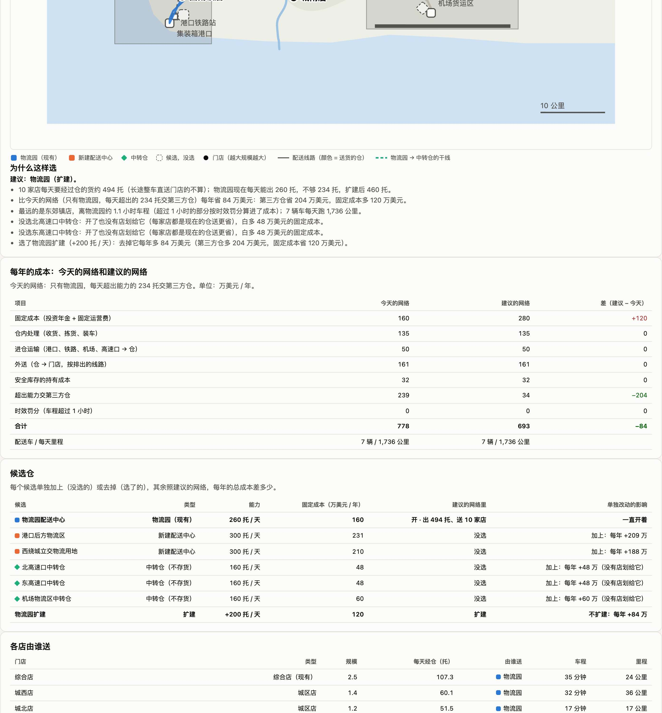

## 货流规划

| 货源 | 走哪条路 |
|---|---|
| 海运（每周一班，本店约 6 个 40 尺箱） | 港口预清关、提箱预约 → 六成走铁路接驳 → 配送中心拆箱 → 配送车 → 门店 |
| 洲际铁路班列（每周一班，约 3 箱） | 夜里到物流园货运站 → 预清关后 4 小时进配送中心 → 配送车 → 门店 |
| 空运（每天一班） | 夜间航班 → 机场货站 → 配送中心越库 → 清早的配送车 → 门店 |
| 区域生鲜（内陆产区）、中央面包房 | 夜里集货 → 配送中心越库 → 配送车 → 门店 |
| 长途公路（国内、跨境） | 按商品族算账：常温畅销、常温一般、饮料、跨境日用品**整车直送门店**（占长途整车的 65%）；长尾常温货、冷冻、肉类进配送中心 |

直送比全部进配送中心每天省 730 美元（配送中心少 8 工时、配送少跑 111 公里），代价是门店多压 0.96 天的货、后仓多留约 150 个托盘位（[结果 6](docs/results/06-flows.md)）。

## 门店：停车场、即时取货和收货场

按作品集第一部分 Storewright 的停车场和卸货场模板做，场地、车流和数字都在 `src/site/`（[系统设计 §8.4](docs/04-system-design.md#84-门店停车场即时取货和收货场srcsitewebsrcthreestore)）：

- **停车场：** 店前两个双排、165 个车位（顾客 131、员工 24、即时取货 8、线上配送车 2），另有 4 个免下车取货位和 2 个房车长车位。车位 2.5 × 5.3 米、车道 7 米；门前 6 米宽的消防车道离墙 5 米；离取货门最近的一排是编号的即时取货车位和取货牌；两个出入口一进一出，中间是绿化分隔岛，出口有停车线；无障碍车位（旁边 1.2 米轮椅通道）和充电车位挨着入口，另有购物车回收栏、端头绿化岛、灯杆和斑马线。车位数按设计高峰定：按每 100 平方米 1.0 个车位算只有 74 个，放不下高峰约 95 辆车。
- **即时取货：** 第二部分 StoreX 门店的线上订单按它的仿真时刻来取：西墙是免下车取货道（三个位置先进先出，前车走了后车往前挪，交接前后车不动）和自提柜车位；上一代的路边取货由员工推车走到车边、打开后备箱装货。正常的一天 214 车来取货，平均等 1.8 分钟、95% 在 2.7 分钟以内，99% 在 5 分钟内交到。
- **车怎么走：** 一天 2,247 辆车（取货、购物、百货馆、员工、房车）从区域的路上开进开出，到车位的时刻和门店仿真一样；进场走进口车道，场内靠右，约 12% 倒车入位、8% 穿过对面的空车位停，房车和拖车停长车位、拖车按挂钩运动学跟着走；出场在人行道前停车让行（2.5 秒，长车 4 秒）。所有车按到达先后排在一张时空表上，遇到前车、过斑马线的行人、推着一串购物车的回收员就停下等：正常和极限负荷的一整天都检查过，车和车、车和人都不重叠，一辆也不少画；排程在后台线程里算（一天约 2.5 秒），页面不卡。顾客在车停好以前不会下车走：车晚到了就换一个空车位，或者人在车里等、再快步走到店门口交给店里的仿真；出来推车装货，把购物车推回最近的回收栏。取货车最多比门店仿真晚 32 秒到车位。
- **干道上的车：** 门店的车在干道上的那几段作为固定的车道占用交给背景车流线程，和仿真的货车一样：背景车在后面排队、给它让路。进店的车都走同一个进口（在干道上左转进进店路的那一侧），这一侧的进口道上有一条门店专用的进店车道：有门店的车在用时，背景车和公交不进这条车道，没有时照常用；所以这一段背景车的直行只剩一条车道。出店的车只右转出去。试过的两种做法都去掉了：给门店路口加左转保护相位（红灯一等就是几分钟，重叠也没少），把附近的公交站再挪远（重叠反而更多，已经改回，公交站仍离门店路口至少 60 米）。一天里门店车和背景车的重叠从约 32,700 车·秒降到 1,782 车·秒，有了专用车道以后是 665 车·秒；原来的 1,782 里约 125 是误报，来自上方高架上的车，现在检查时不算离地 2.5 米以上的车。专用车道对干道通行能力的影响也测过（`tests/storeLane.test.ts`）：同一天的门店车流，背景车按平常负荷（9,000 趟）和极限负荷（25,200 趟）各算一遍有、没有专用车道，这一截进口道的直行车高峰小时 31 / 32 辆（极限 43 / 45 辆），只剩一条车道时流量和通行能力之比 0.04（极限 0.05；每条车道按 1,800 辆 / 小时乘绿信比算），平均通过时间只差 +0.1 秒（极限 −0.8 秒），干道离通行能力还远。交接处 0 次跳动、0 次闯红灯；全部区域的重叠见[「车辆重叠检查」](#车辆重叠检查)。
- **收货场：** 货车走单独的 9 米服务车道（两条 4.5 米车道、双黄线、15 米喇叭口和「货车入口」牌），不进顾客停车场；收货场是完整的四条车道（靠台、驶离、待命、顶部，单向绕行）、4 个待命车位、进深 100 米。配送中心的车和长途直送车用下一节的卸货场引擎排队、从司机一侧倒车靠台、拉出驶离；卷帘门等车靠稳、放好轮挡才升起，门边有红绿灯，一个车厢里同时只进一台搬运设备。正常的一天到店 8 车、最多排队 1 辆，极限负荷 20 车、最多排 3 辆；货车平均在店约 39 分钟。

| | |
|---|---|
| 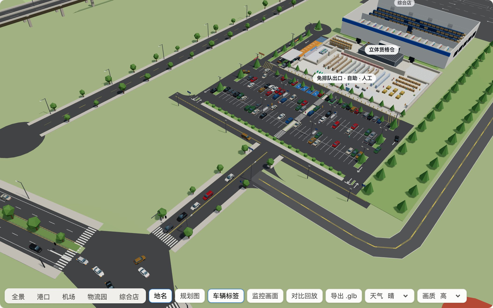 | 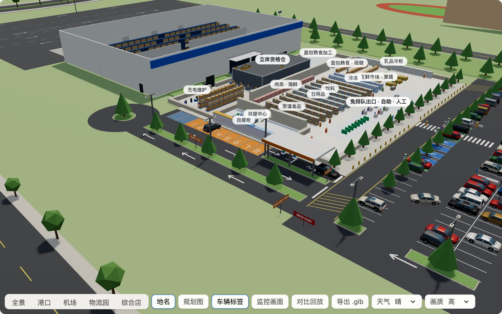 |
| 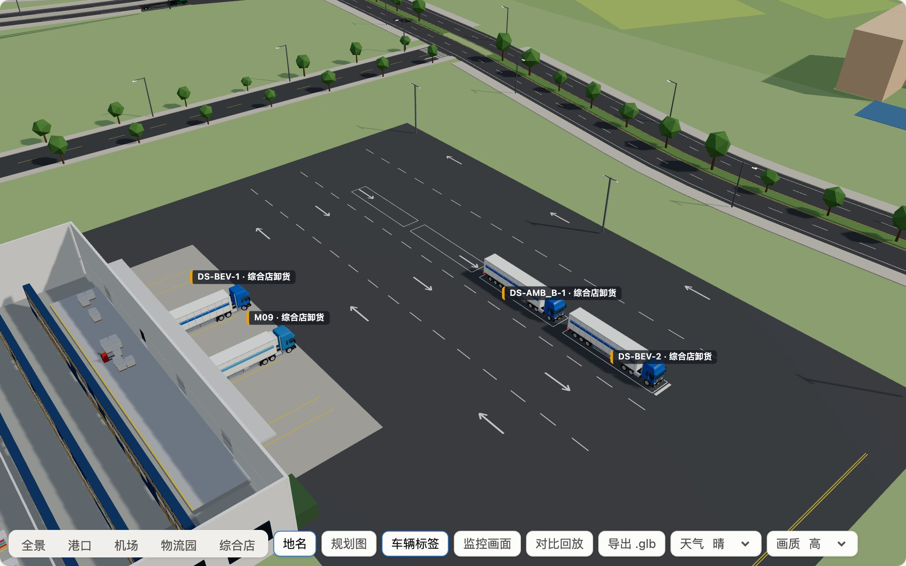 | |

## 仓储中心：港口、机场、物流园

港口、机场、物流园各有自己的仓储中心：货从船、飞机、火车上卸下来，先进仓储中心，再装上公路货车；出口反过来。每个仓储中心按当天的仿真轨迹、设施配置和负荷档位排出一天的作业计划（每个箱、每块板、每批托盘走过哪些区、各占用多久），三维按它画，值班助手按它回答，两边是同一份（[系统设计 §8.5](docs/04-system-design.md#85-仓储中心的作业计划srchub)）。

- **港口物流中心**（堆场和闸口之间）：拆装箱库约 7,000 平方米，一侧是集装箱门（底盘车倒车靠台、叉车拆箱），一侧是提货卡车门；拼箱货（卸船箱的 6%）由场内拖车从堆场送来，拆箱后按收货人分批存放、装上提货卡车出闸，出口货反过来拼箱装箱；保税库有自己的围网和卡口，两樘冷藏门；海关查验场有开箱查验平台和 X 光机检通道（机检约 5%、每箱约 80 秒，开箱比例和跨境分析一致）；空箱堆场两台正面吊、堆 7 层。本店的箱是整箱：在堆场存放，抽到才查验，再由仿真里的短驳车提走。正常的一天拆箱 36 个、装箱 18 个，拆装箱库最满 87%，卡车在物流中心平均 29 分钟、等门约 2.6 分钟。空箱堆场每个箱区 7 个贝位、相距 20.4 米（共 294 个箱位），相邻贝位的作业不会叠在一起；场内拖车最多 10 辆，等于停放区的全宽车位数（这是设备上限：极限负荷时卡车等门 8.5 分钟，以前 6.9 分钟；拆箱待办不变，瓶颈在班组和门）；停放区一个车位只停一辆，交接处有等候位，拖车做完回自己的车位，物流中心里停着的车的重叠少了 94%；港口闸口、物流中心闸口和空箱堆场的卡车共用一张路口预约表，停止线挪到路口外面以后剩下的冲突从 28 次降到 1 次（平常负荷路口里的重叠少了 40%），没有卡车为了让开路口而加速；挪停止线以后，极限负荷下卡车停在中心路上等，闸口路口停着的重叠一度变多，月台出口加了排队区、空箱堆场加了连接路以后，这部分从 1,662 降到 0 车对·秒。港口的货车等候区入口也有了规则：转弯进出的卡车让行，进、出的车隔开时间。空箱堆场的贝位按时段预订：同一时段一个贝位只停一辆车，后到的停旁边空着的贝位，正面吊把箱吊过去；从拆装箱库、查验场拉出来等下一段的拖车各等各的位置，堆场交接点的并排车位相隔 10 米，月台出口的排队区能停 5 辆；极限负荷下物流中心停着的重叠从 3,688 降到 10 车对·秒。卡车进货车等候区时先直着开过道闸再转，停下时车身是直的。
- **机场货站：** 空侧大门有滚床；8 个拆板 / 组板工位；集装板立体库 231 格、2 台堆垛车；散货货架 1,386 个板位，冷藏库 228、冷冻库 96、出口 228 个板位；危险品库、贵重品库、海关监管区和 2 台出口安检 X 光机（出口货全部过安检）；陆侧 20 个卡车月台（出口 4、集装板 4、冷链 4、进口 8）。进口是飞机 → 板车 → 空侧大门 → 立体库 → 拆板 → 货架或冷库 → 陆侧月台 → 卡车，出口反过来、先安检再组板。正常的一天约 210 辆货代的车靠台，拆板待办最多 15 块板（极限 62 块），立体库最满 27%（极限 53%）；本店的果蔬、海鲜进门约半小时后进冷藏库，等空运冷藏车。镜头拉近时库内 8 个区标出名字（ETV 立体库、拆板/组板区、冷藏库、冷冻库、危险品库、贵重品库、安检、海关监管区）；叉车只从门进出贵重品库和危险品库，走 3.5 米宽的通道，有自己的充电位，在主通道里靠右走（货站叉车的重叠停着的少了 99%、行驶中的少了 97%）；陆侧卡车走的进场车道画出来并铺了路面，出场交接处不再跳。货站叉车闲着时按计划回充电位、停在放货处或往后让开，货位前有车就退后等，起步、停车各用 3 秒加减速，充电位往南挪出了主通道；机坪的板车串在货站门口一次只停一套，后一套在 22 米外等；陆侧进场路尽头的回车场分内外两圈：进场的车走外圈排队进卡车场，出去的车走里圈、从排队的车旁边开过。机场停着的重叠平常从 2,104 降到 4、极限从 4,988 降到 12 车对·秒。
- **物流园：** 火车卸下的箱，本店的由短驳车运到配送中心的收货门拆箱（停靠 36 分钟，和仿真一致），别家的进铁路旁的转运仓（铁路侧 6 个门、卡车侧 12 个门）拆箱换装卡车，或者装底盘车直接走公路、留到第二天；园区入口是进、出各 2 条车道的登记亭：外来卡车从高速口开到自己的进门登记车道，办完出门登记再开回高速口（不在进场路上凭空出现、消失），出门登记的每条车道一次只排一辆；早到的、等门的车进等候场，甩挂的挂车停在甩挂区，由场内牵引车送到月台门再拉回来，闲着的牵引车和短驳车回待命停车场等下一趟活；场内单向逆时针绕行，双向的场内路上靠右走、互相让行；按车辆重叠检查，园区里停着的车 0 重叠，行驶中的车平常负荷约 63 车对·秒、极限负荷约 447 车对·秒。正常的一天约 24 个铁路箱（本店 3 个，落地约一小时后进配送中心的门），转运仓约 370 板，7 次甩挂、14 次调车，等候场最多 2 辆（极限 3 辆），外来卡车在园内平均约 47 分钟。
- **卸货场引擎**（独立程序库 [`@storewright/yard`](../packages/yard/README.md)，见[「两个独立的程序库」](#两个独立的程序库)）：门店、配送中心和冷链中心、港口拆装箱库和保税库、机场货站的卸货口用同一套，按第一部分的卸货场做：按卸货口的位置和场地大小排车道（不够深时自动改成紧凑布置或回车场），大车在场内的转弯半径不小于 12 米、接主路处 15 米；从司机一侧倒车，挂车在离墙 24 米以外摆正再笔直退进门里，拉出时等挂车尾部越过两边的车头再转。每个场地每天排一份计划，仿真里的车和外来的车共用：先到先进，同一区段同时只有一辆车在倒车或拉出，驶离优先；仿真给的到达、离开时刻不改，靠台准备在停留时间里占几分钟，实在放不下才标「太紧」。路上的半挂车按铰接运动学走：转弯时挂车切内侧，倒车时挂车在前、牵引车往外摆；机场的牵引车拖 2–4 个板车。

| | |
|---|---|
| 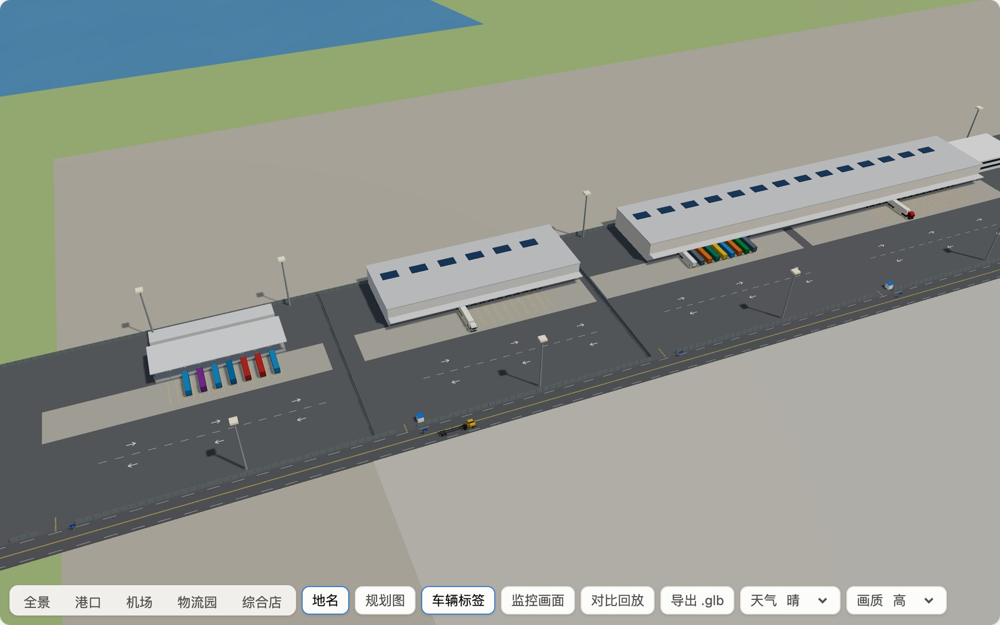 | 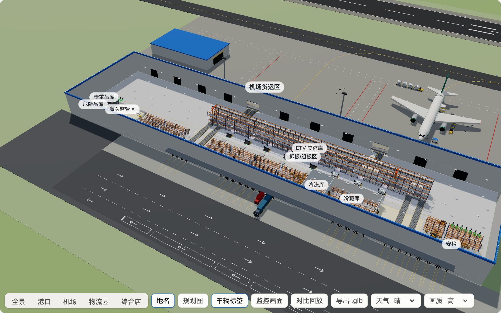 |
| 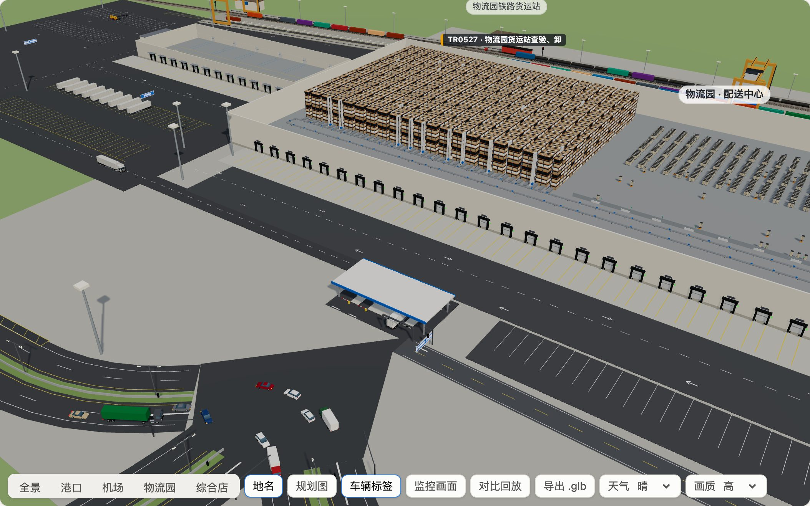 | 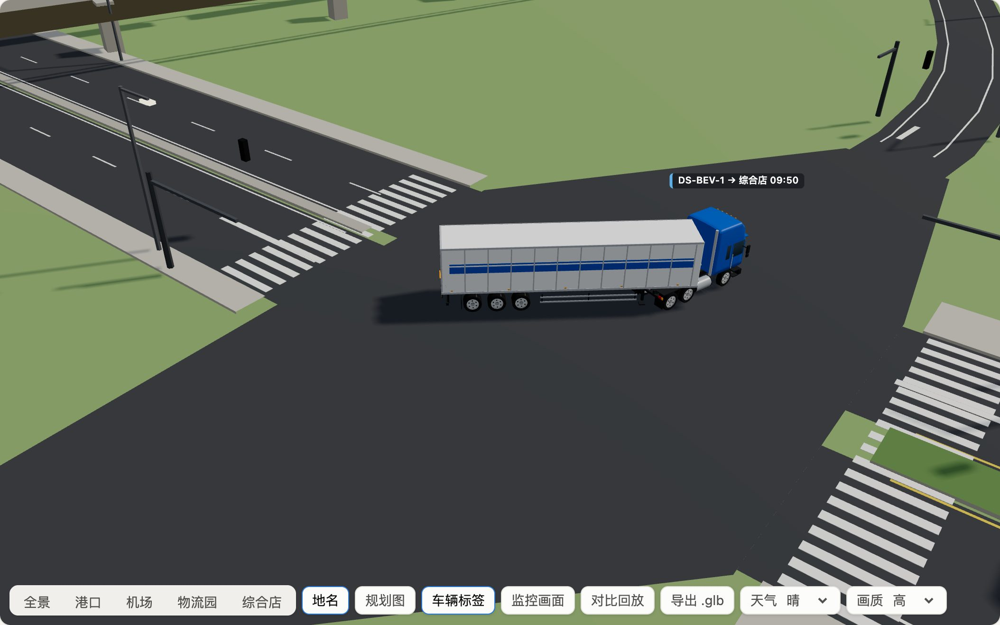 |

## 三维孪生

整个区域由代码生成。沙盘把距离压缩成 1/10，建筑和车辆按真实尺寸画。

- **道路：** 每条路有横断面（车道、中央分隔带、路肩、人行道）和标线；路口有转弯曲线、人行横道和两相位信号灯。绕城快速路沿内陆一侧绕过城区（不成环），和进城干道相交处是菱形立交；一条高架快速路架在城区上空（桥墩、护栏，两头坡道落地）；过河的路都是桥，高速、快速路和干道跨铁路处上桥，本地道路和铁路的平交道口有栏杆。路网是连通的：区域生成器留下的干道、快速路尽头在三维里接到附近的路口或干道上（极少数接不上的做成回车场），车可以通过、掉头、停靠；出区域的两条长途高速一直画到区域外 3 公里，不在区域边上断掉；匝道口等所有受信号控制的进口道都有停止线和信号灯。
- **城区：** 按城市总体规划生成（见下一节的「规划图」）：居住小区和别墅、中心区的高楼和电视塔、商场、学校（带操场）、医院、大学校园、厂房、带卸货口的物流仓库、公用设施、公园和防护林、郊外的农田；街区里按 150–250 米铺街道（让行的 T 形路口、十字路口、带回车圆盘的尽头路），街边有小区停车场和路边车位（住户早出晚归，办事的车来了又走，倒车停进车位；路边车位隔一个用一个，间距 12.4 米，地上的车位线也这样画，停着的车不再叠在一起）；夜里路灯、窗户和照明塔亮起来。建模的重点仍是港口、机场、物流园、铁路站和综合店。
- **实时跟踪：** 左边的面板列出当天每一辆车、每列火车、每条船、每架飞机：在途的按预计到达排在前面，显示下一站、预计到达和剩余里程；点一辆车，侧栏给出它的从哪来、到哪去、计划和实际出发、下一站的计划和孪生估计、车速、载重、货物、晚点、货温和每个停靠站。三维里每辆车头顶挂着编号和预计到达。
- **港口：** 一整天都有船进出：本店的班轮按仿真的靠泊时段，别家的船（支线船、中型、大型几种尺寸，船名是虚构的）由港口排一份船期，负荷越高船越多，泊位没空时先在锚地抛锚排队。进港的船沿航道减速驶来，两条拖轮从码头一头的拖轮基地开出来接上、一前一后护航，船在泊位前原地掉头，被横着顶靠上码头、带上缆绳；岸桥一个贝位一个贝位地先卸后装（前大梁俯仰、小车和吊具、钢丝绳），甲板上的箱一层层变；作业完解缆，拖轮把船拖离码头、掉头，船加速出港。每条船的航迹都和别的船、本店的班轮、过路的船错开，一个泊位同时只停一条船。引航艇出去接送引航员，系缆工人提前走到缆桩；半日潮让海面一天涨落两次，船和拖轮跟着浮起落下。本店的班轮走同一套航道：近海驶来，在引航站停船让引航员上船，沿航道进港，在泊位正前方原地掉头，拖轮横推靠泊；离港时拖轮横拖离码头、原地掉头，开到引航站让引航员下船再驶向外海。班轮从泊位正前方进出，旁边的泊位照常排船。别家的船也能点：悬停显示船名、船型、泊位和此刻在做什么，点一下镜头跟随。场内集卡在两条等候车道（一条紧挨岸桥后面，一条在后方场地上）预约相距 22 米的等候位，行驶时走等候车道旁边的行车道，按顺序开到岸桥下（轮到前约 70 秒到，一台岸桥下同时只有一辆），进出岸桥下时平缓起停（最多 6 秒），到箱区前先试订贝位；岸边行驶中的重叠从 9,346 降到 4,930 车对·秒，停着的 0（全天按区域的重叠见「车辆重叠检查」）；堆场龙门吊把箱堆到箱位，外来集卡从区域外的高速或货车等候区开来，按预约时段进闸、排队，提箱、送箱后出闸开走，在箱区车道里不再和场内集卡相遇，夜里亮灯；港口铁路站的轨道式龙门吊把本店的箱吊上班列。
- **机场：** 一整天都有航班起降：本店的货运航班按仿真的落地和推出时刻来，别家的货机（四发重型、双发宽体、双发中型，中性涂装）把机位排到约六成满，负荷越高越满。跑道一次只给一架飞机用，滑行道单向通行、前后保持间距，忙的时候后面的飞机在空中多等几分钟、推出晚一点或者在跑道头等待。降落是连贯的一整套：转弯切入五边、沿 3° 下滑道下降、拉平、主轮先接地、放下前轮、扰流板升起、反推、刹车、从快速出口脱离、滑行、转进机位、慢慢停稳；起飞是推出车把飞机推到滑行道、启动发动机、脱开推出车、滑到跑道头等待、掉头对正、加速滑跑、抬头离地、收起落架、爬升转弯。机位上挡轮挡、接电源车、开主货舱门，升降平台车先把进口的集装板一块块卸到板车上、再把出口的板装上去，几套牵引车加板车在货站和飞机之间来回，加油车开到翼下加油（地面服务车都从设备棚开出来、作业完开回去）；机场的货车在回车场掉头、倒车靠上货站月台；平台车司机、牵引车司机和加油员按班组排，人不够的那一班飞机要等。别家的货机也能点：悬停显示航班号、机型、机位和此刻在做什么，点一下镜头跟随。
- **物流园：** 月台门按调度台排的车开关：车倒车靠上以后卷帘门升起、登车桥搭进车厢，叉车按这一车的托盘数进出车厢装卸、放到门两侧的暂存道；镜头靠近时屋顶打开，看得见立体库的 20 台堆垛机、货到人区的机器人顶着货架去拣选站、主输送线上的周转箱；园区入口的道闸有车过就抬杆。
- **铁路：** 专门的车站停靠、装卸：港口铁路站把本店的箱吊上班列；物流园铁路货运站分两段站台（港口来的班列、洲际班列），列车停在装卸线上，轨道式龙门吊把箱一个个卸到箱位，平车上的箱跟着变少，旁边的装卸线停着等装卸的平车（股数可在管理台里加），站房、信号机和站台照明齐全；城市客运站有站台、雨棚和站房，城际客车进站停靠、上下客、折返；铁路过河是钢梁桥。
- **综合店：** 不挂店名。中间的生鲜食品区是 StoreX 的门店模型（拉近镜头，员工、机器人和顾客按 StoreX 的门店仿真回放），后面接着百货日用馆（规模放大时加深）：拉近时屋顶打开，店后的收货口（默认 4 个，最多 8 个）的卷帘门按到车开关，电动搬运车把托盘从车厢拉到收货台，后面是后仓货架和卖场。店前停车场、即时取货和收货场见上面「门店」一节。
- **设施监控：** 右边的面板分集团总览、港口、机场、物流园、综合店五页：在场的船、航班、车和每一个的作业进度，每台岸桥、龙门吊、平台车、牵引车、堆垛机此刻在干什么，本店的每个箱、每块板走到哪一步，38 樘月台门的占用，暂存道的托盘，门店收货口、今天的到货和各商品族库存（现场和孪生估计）；点车辆编号就在三维里选中它。
- **车辆：** 所有公路车辆按截面放样建模（28 种：轿车、两厢车、SUV、MPV、皮卡、厢式车、平头和长头牵引车、厢式和冷藏挂车、集装箱底盘车、电动厢式车、公交、房车、拖挂房车、船拖车、小平板拖车、港口拖车、场内牵引车），不画任何品牌；尺寸按国标的外廓限值（半挂车不超过 13.75 米、铰接列车不超过 17.1 米）；近处用精细模型、远处用简化模型；车轮单独画（轿车五辐轮毂、货车钢圈和双胎），刹车、加速时车身点头抬头，转弯时侧倾，挂车慢半拍。半挂车按铰接运动学走（转弯时挂车切内侧，倒车时挂车在前），到了门店、物流园、机场货站按卸货场引擎排队、从司机一侧倒车靠台。每一程按速度曲线走：起步加速，转弯和进路口前减速，出弯加速，停车前慢慢刹住，重车比轻车加速慢，到达和离开的时刻仍然和仿真一样；车轮按走过的路转，前轮跟着弯道打方向；刹车灯、转向灯（转弯前闪）、倒车灯，夜里亮尾灯和大灯；物流园、港口物流中心和机场画的场内车也有这几种灯（岸边集卡和机坪车辆只有大灯和尾灯）。信号灯路口遇红灯提前刹车、停在停止线后，绿灯起步，到达时刻仍然和仿真一样；从高速口开出区域的车沿区域外的延长段开出视野，开进来的从远处开过来。火车进站制动、出站加速；货运列车前后各一台机车，城际客车是两头都有驾驶室的动车组，折返时不用调头。
- **现场视图和虚拟监控：** 三维可以切到闭环的现场（车按每分钟的延误走、抛锚的停在路边、事故路段画红圈）；右边叠门店收货区、配送中心冷链门和港口泊位的监控画面，画面上叠识别框。
- **对比回放：** 三维左右分屏、同一个时钟同步播放：用孪生对比不用孪生、计划对比现场、这一天对比另一天，每边贴着到此刻的指标；镜头可以联动，也可以分开。
- **背景交通：** 几千辆私家车和 3–5 条线路的公交在各区域的停车场、住宅区和出区域的高速口之间往来（平常一天约 7,700 趟，过境车流里约两成二是货车；5 条线 43 辆公交；住在城区的车早出晚归；随负荷档位加到约 1.5 万趟；在后台线程里算，雨雾天慢下来），每条车道先来先走、跟车保持间距，跟在仿真货车和门店的车后面排队（它们不给背景车让路），外来货车在路上互相跟车，进主路和过路口先等空档，从路边车位起步时等后面已经排好的车过去，公交进港湾站停靠、首末站排队调头，不会在路中间凭空出现或消失：从车位倒出来、沿场内通道开到场口（有道闸的停车抬杆），按最短的路线开（有中央分隔带的路上右进右出，需要时开到前面的路口掉头），到了目的地进场减速、打灯，开到空车位停进去（公共停车场里约 13% 的车倒车入位），满了就掉头去最近的另一个停车场；转弯前减速、亮转向灯，遇红灯停在停止线后排队（要到黄灯最后一秒才开得到停止线的也停下），绿灯后一辆接一辆起步；停着的车熄火不亮灯。别家公司的货运班列经过，城际客车在城市客运站停靠，过路的集装箱船沿海岸外的航线航行（背景，不参与仿真）。
- **停车场：** 每个区域都配：港口和机场货运区各有员工停车场和货车等候区（早到的集卡在这里等预约时段，夜里停着第二天早上第一批的车），物流园员工停车场，城市客运站停车场，城区的公共停车场和小区停车场；样式按第一部分：喇叭口出入口和绿化分隔岛（有岗亭、道闸和 P 牌）、出口停车线、场内车道靠右和箭头、2.5 × 5.3 米车位和 6.5 米车道、穿过停的车位、无障碍和充电车位、端头绿化岛和灯杆（夜里亮）；场口离别的路口和停止线至少 70 米（小街 30 米），放不下就不放。默认区域 40 个停车场、1,198 个车位；综合店的顾客停车场见「门店」一节。
- **行人：** 在没有车经过的空档过斑马线（长车转弯时车身扫过的范围也算），在公交站上下车，停好车走到设施大门、客运站和街区；人行道上靠右走、互相让开。
- **天气和画质：** 晴、多云、雨、雾、台风（可以按日子自动），有雨丝、湿路面（道路、停车场、机坪都会湿，铺装上有积水反光）、雾里的能见度和台风的闪电（只在播放时闪），监控画面里也下雨；按日子自动时十天一轮（四天晴、两天多云、两天午后阵雨、一天晨雾、一天全天雨，相邻两天不重样）；背景车流按天气慢下来。画质按帧时间在高、中、低三档之间自动切换（同时决定对比回放右半边多久画一次），手机从中档开始。
- **依据：** 尺寸和规则是按公开资料取的假设参数：车辆外廓 GB 1589-2016，停车场 JGJ 100-2015，出入口 GB 50352-2019，消防车道 GB 50016，无障碍 GB 50763-2012，用地分类 GB 50137-2011，城市道路 GB/T 51328-2018，居住区和生活圈 GB 50180-2018，机场噪声 GB 9660，出口货物安检 CCAR-339，以及港口、航空货站、配送中心月台规划的公开资料。
- **先出画面、后排设施：** 第一次打开时，门店收货场、物流园和车辆运动当场排完，带着车的第一帧画面和时钟先出来（作者的电脑上约 2.3 秒）；港口（含物流中心）、机场和外来货车当天的作业在主线程里分段排（每段约 30 毫秒，段与段之间让出主线程），排完以前这几处先空着，画面下方有提示，约 7.5 秒排完。换负荷、换日子、调度台改计划时，门店收货场、物流园的计划和每辆公路车辆的运动规划也分段排，页面不卡（最长的一段约 0.13 秒），公路车辆约半秒后一起出现；几个重的面板在接下来的几个任务里逐个刷新。排出来的计划和车辆轨迹和一口气排完逐字节相同（五个场景、24 项哈希核对过）；网址加 `?syncplans=1` 可以切回一口气排完。
- **仿真车的车距：** 仿真里同一条路线前后脚出发（相隔不到 20 秒）的车、收货场一次只放一辆驶离的车，画面上晚的那辆晚一点走：只在停着的时候插进去，到下一站补回来，最多晚 2 分钟，开着的时候不停、不跳；仿真的时刻、跟踪表和值班助手都不变。停着的公路车辆不叠在一起：停在同一处的，后到的停在前车后面 2.5 米，前车走了再往前挪。以前两辆电动配送车回程的时刻一样，从门店收货场一路叠着开到配送中心。
- **无障碍：** 支持系统的「减少动态」设置（镜头直接切换、演示导览不自动翻页、界面动画关闭）和全键盘操作（快捷键见顶栏「?」导览的最后一页）。
- 切换三代方案，或者把五种扰动放到这一天；可以把此刻的整个区域导出成 glTF（.glb），在 Blender 或虚幻引擎里继续加工。

| | |
|---|---|
| 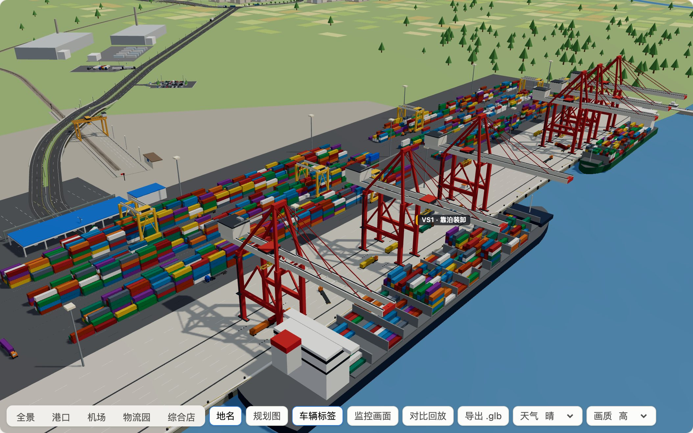 | 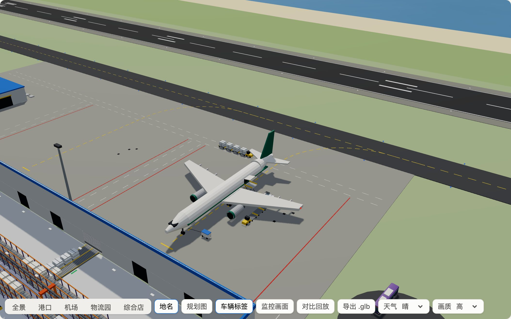 |
| 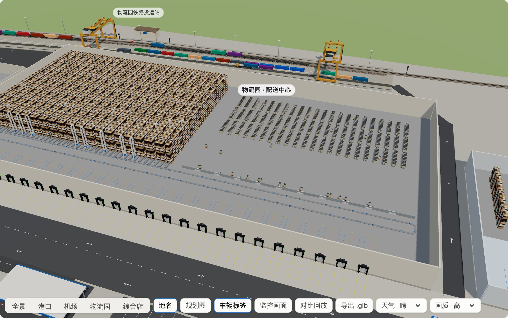 | 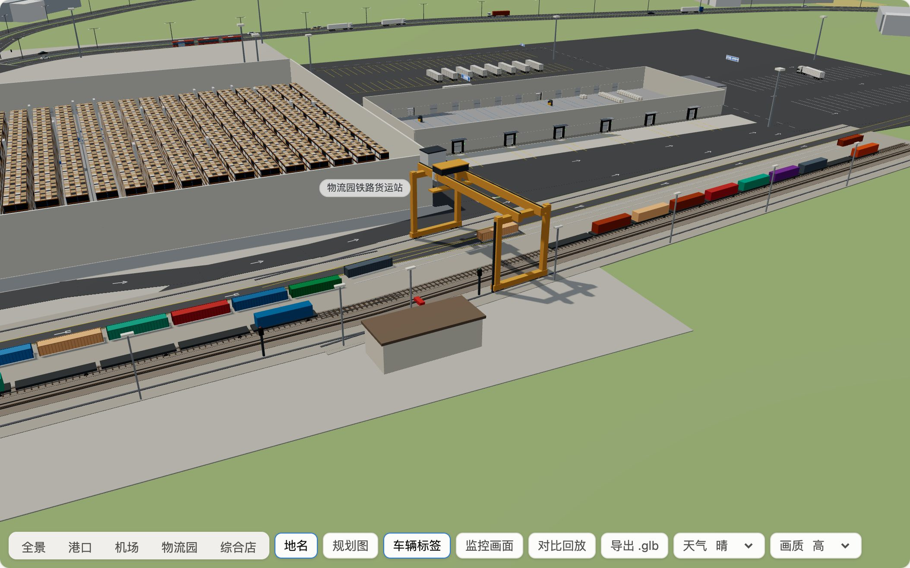 |
| 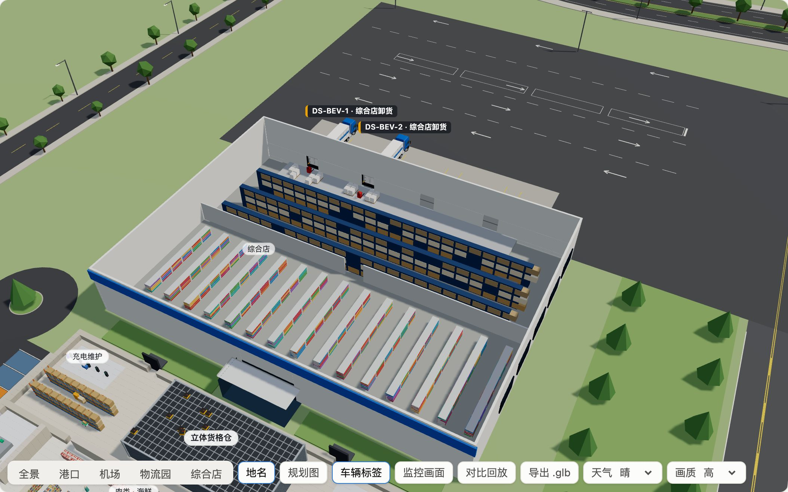 | 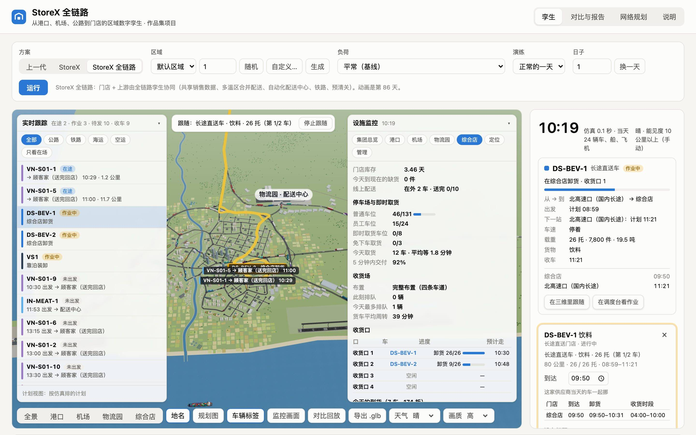 |
| 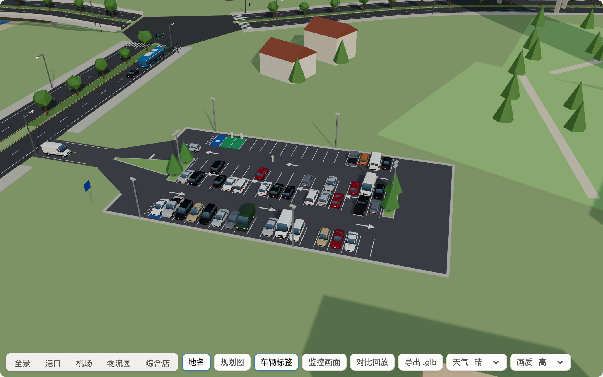 | 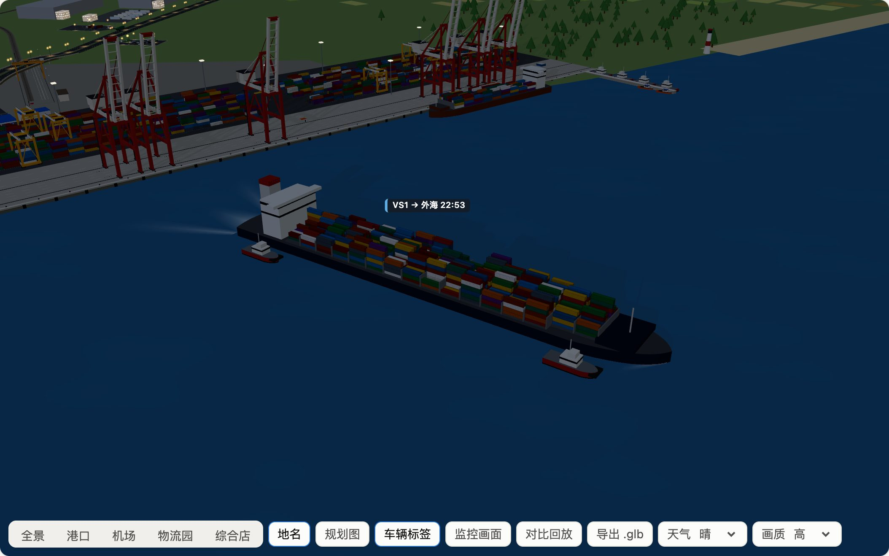 |
| 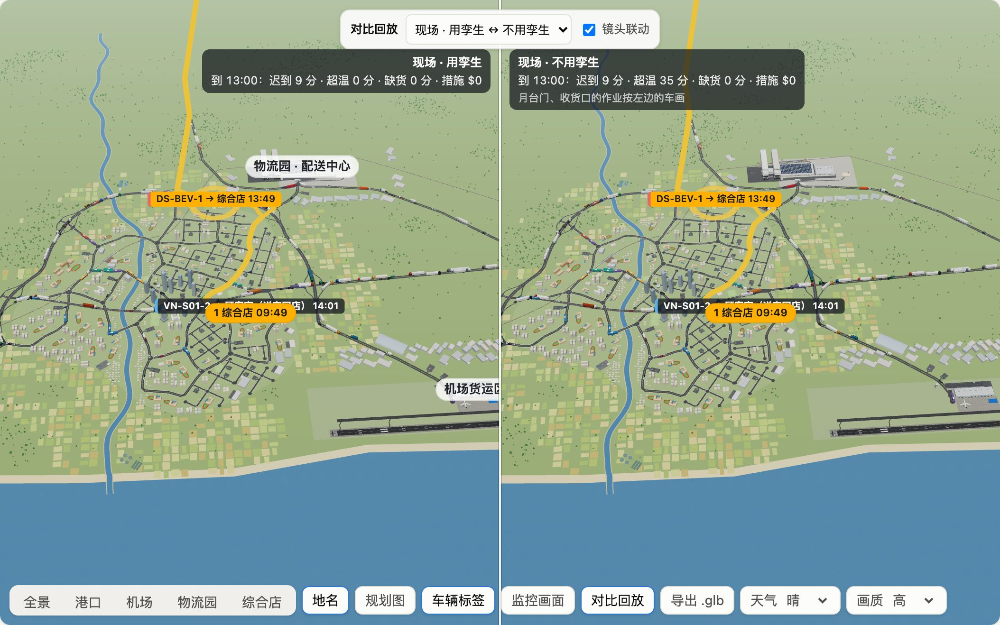 | 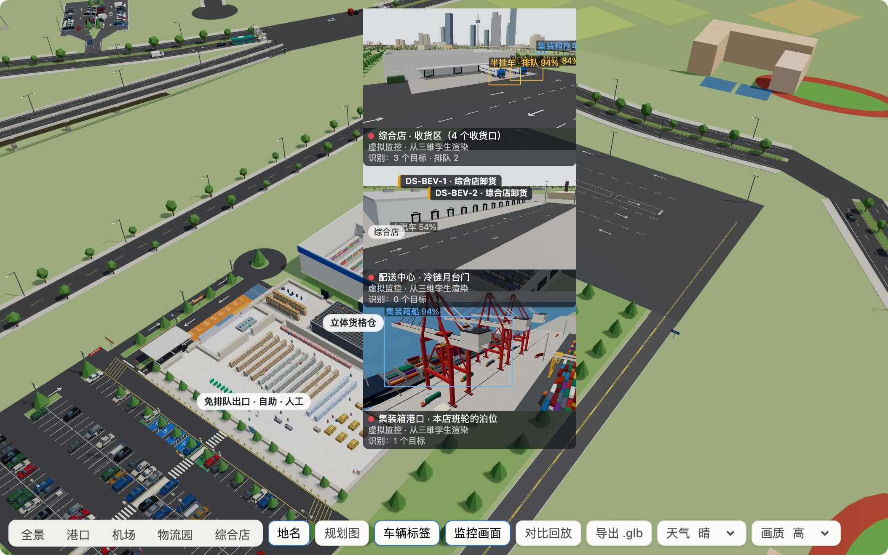 |
| 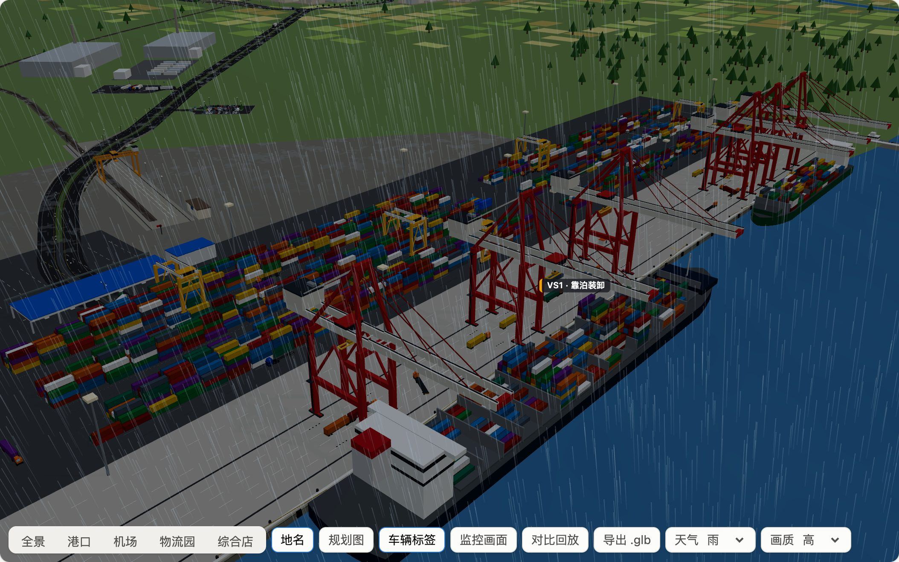 | 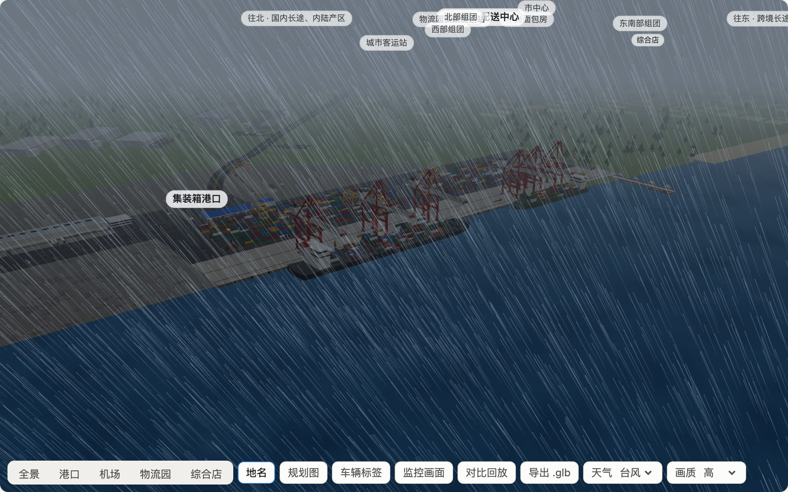 |
| 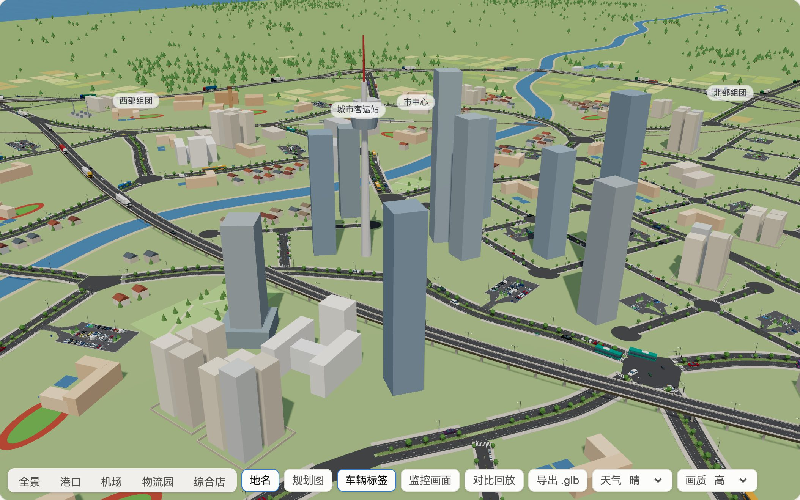 | 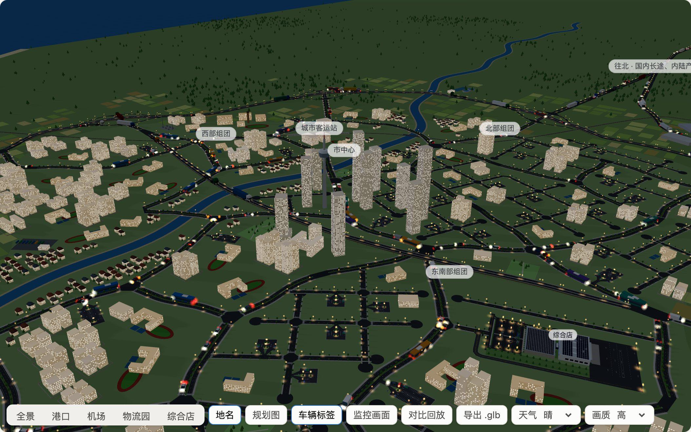 |
| 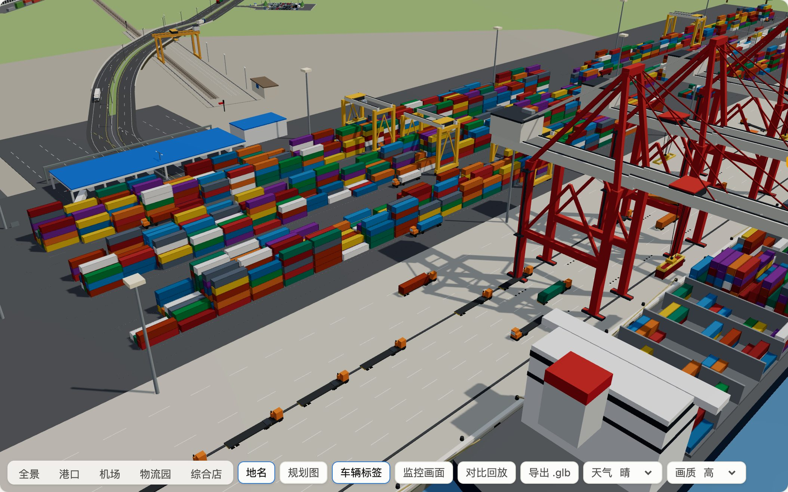 | |

## 车辆重叠检查

车和车有没有叠在一起，用 `npm run overlaps`（`scripts/overlaps.mjs`；分离轴检验、网格粗筛、统计和上限这些通用的部分是独立程序库 [`@storewright/overlap-audit`](../packages/overlap-audit/README.md)）查：生成默认区域，按网页里同一套仿真和作业计划排好每一层车（外来货车、港口的码头拖车和物流中心的车、物流园场地里的车、机场货站的叉车和机坪车、门店路口和停车场的车；仿真里的车另由 check3d 查，见表后），每 2 秒取一次每辆车的车身矩形，两辆车叠在一起记一个「车对」、按秒累加，按区域、车型对、停着还是行驶中分开，在作者的电脑上一次约 2 分钟（极限负荷约 3 分钟）。每个区域有一个上限（现在测到的数加一点余量），超了退出码 1，改动以后一眼看得出回归。`--level extreme` 看极限负荷，`--region random-3` 换区域，`--only port,park` 只看几处，`--trace 区域` 打印例子（时刻、位置、车型），`--no-fail` 只报告不报错（[系统设计 §8.8](docs/04-system-design.md#88-车辆重叠检查)）。

默认区域一天的车对·秒（停着 / 行驶中）：

| 区域 | 平常负荷 | 极限负荷 |
|---|---:|---:|
| 门店路口和停车场 | 0 / 665 | 0 / 665 |
| 港口岸边 | 0 / 4,930 | 0 / 7,502 |
| 港口堆场 | 0 / 1,024 | 42 / 6,926 |
| 港口闸口路口 | 0 / 256 | 0 / 1,042 |
| 港口物流中心 | 18 / 2,218 | 10 / 7,224 |
| 物流园 | 0 / 63 | 0 / 447 |
| 机场 | 4 / 2,614 | 12 / 3,402 |
| 路上 | 54 / 13,498 | 286 / 58,140 |

两档负荷下每个区域都在上限以内。门店行驶中的一项是门店的车和背景车的重叠，按门店自己的检查算（车·秒），不算离地 2.5 米以上的车（以前上方高架上的车被误算进来，约 125 车·秒）；门店的车流按门店仿真的一天，两档一样。

仿真里的车（配送车、长途车、短驳车、空运冷藏车、线上配送车）单独查：开发服务器开着时，`node scripts/check3d.mjs` 的第 5 步在网页里一整天每 2 秒取样，统计仿真车之间、仿真车和外来货车叠在一起的车对·秒，停着的超过上限（定法同上）就报错。四个检查场景里仿真车之间停着的都是 0；仿真车和外来货车停着的：默认区域平常 0、极限 118，随机区域 3 号平常 8，随机区域 11 号高负荷 88。

- **这一轮改进的：** 机场货站的叉车闲着时按计划让开、货位前有车就退后等，充电位挪出主通道，机坪板车串在货站门口一次只停一套，回车场分内外两圈（机场停着的平常 2,104 → 4、极限 4,988 → 12，行驶中的平常 5,274 → 2,614、极限 7,310 → 3,402）；港口物流中心的空箱堆场贝位按时段预订，拉出来等的拖车各等各的位置（停着的平常 114 → 18、极限 3,688 → 10）；卡车先直着开过货车等候区的道闸再转，挂车折得太狠造成的重叠没有了（路上停着的平常 96 → 54）。还发现这个检查以前不统计仿真里的车：加了 check3d 第 5 步，又让仿真车保持车距、停着时排队，仿真车之间停着的重叠从极限负荷的 1,090 车对·秒降到 0。只有极限负荷港口闸口路口行驶中的一项多了 30（去空箱堆场的外来货车时刻挪动）。上限按新测值重定（测到的值 × 1.1 + 20，不比以前松）。
- **上一轮改进的：** 独立的卸货场引擎修好了超负荷时的车身重叠（进场通道上后车跟车、排不下的在场外等候区排队、甩挂车位按实际时刻占用，见[「两个独立的程序库」](#两个独立的程序库)）；机场货站被引擎留在场外等的外来货车改成在放进场前一分钟才开到进场点外排队、跟着前车往前挪，货站进场点停着的重叠从平常 296、极限 4,836 车对·秒降到 0。
- **更早改进的：** 门店左转进店的进口道上有了门店专用的进店车道（1,782 → 665 车·秒，其中约 125 是误报）；港口岸边的场内集卡走等候车道旁边的行车道、按顺序开到岸桥下（行驶中 9,346 → 4,930）；港口物流中心的月台出口加了排队区、空箱堆场加了连接路（极限负荷闸口路口停着的 1,662 → 0）；港口闸口路口的停止线挪到路口外面；长的高速进口路段上车提前进对车道；物流中心停放区一个车位只停一辆。
- **还剩的：** 路上行驶中的（平常 13,498、极限 58,140）仍是最多的，多是路口、合流处的短暂交叉。极限负荷路上停着的 286 里约 226 来自 4 对同一秒、同一路线进港的外来货车：港口给的进闸时刻是定的，它们没法跟车或让行，一起停在红灯前；港口堆场的 42 也是这样的车对停在进闸道闸前。试过让后一辆晚 20 秒进、换另一条闸口车道，行驶中的重叠反而多 7–12%，没有采用。机场极限负荷下仿真车和外来货车停着的 88 车对·秒：卸货场引擎给 8 号门的车排的等候位置压在 6 号门靠着的挂车上。港口和机场货车等候区里行驶的卡车有时会擦到停着的车（平常约 90、120 车对·秒，算在行驶中里）。其余的见[「已知的局限」](#已知的局限)。

## 集团视角：负荷、区域和设施管理

站在集团总负责人的角度，同一套孪生还要回答：换一个区域、量翻几倍、某个设施扩建或者少几台设备、几个人，方案还成不成立。

- **负荷档位：** 平常、高峰、高负荷、极限四档。需求依次放大到 1、1.35、1.8、2.5 倍；班轮每周 1、2、3、4 班，洲际班列同样加密，港口铁路接驳改成每天都开；货运航班每天 1、2、3、4 班；城区的背景车流跟着加（到 2.8 倍）；补货周期相应缩短。切换档位后整段重新仿真，三维、调度台、跟踪和设施监控都按新的量走，机场多出别家的航班、港口锚地排着等泊位的船。平常档和报告里的数字完全一样。
- **区域生成器：** 整个区域按现实中滨海城市的样子生成，不是棋盘、也不是圆形：海岸线有曲折，河从内陆穿过城区入海；城区沿海岸和河展开，干道网是不规则的四边形、五边形街区；绕城快速路沿内陆一侧绕过城区、两头接到海边；一条高架快速路从城区上空穿过；过河的都是桥。三种状态：**默认区域**（港口、机场、物流园在原来的位置，报告的数字按它算）、**随机生成**（所有位置都随机：海在哪一侧、有没有河、城市多大、港口在海岸的哪一段、机场和物流园在城市的哪个方向多远、铁路从哪边出区域、两个高速出口的方向、门店在市中心还是城郊）、**自定义**（上面每一项都可以指定，没指定的按编号随机）。港口、机场、物流园整体平移、旋转到生成的位置：码头贴着海岸、物流园的大门朝着市区，里面的设备和作业跟着转；高速绕开设施的核心区（以前随机区域里有进场高速横穿机坪的情况）。页面上「区域」选状态和编号，「自定义…」打开设置，地址栏 `?region=random-42` 可以直接打开某一个区域；路径、行车时间、车流和仿真都按新的区域重算。随机区域的城市形态有自由生长、方格路网、环形放射、带状（沿海岸）、多组团（绿带隔开）五种，海岸有曲折海岸、海湾、半岛、平直海岸、河口和岛屿五种，河可以有一条支流；跑道顺着风向、货运一侧朝城市；生成器先给门店留出整块用地（店前停车场、店房、百货馆和约 100 米深的收货场），再铺城市道路。
- **城市总体规划：** 用地按 GB 50137-2011 的分类（居住、公共管理与公共服务、商业、工业、物流仓储、道路交通、公用设施、绿地广场，加上港口、机场和农林用地）：中心区和主轴上是商业，居住区按 15 分钟生活圈配中学、小学、公园、卫生站和服务中心，客运站周边高密度开发，港口后面是物流和工业（前港后园）、用防护绿地隔开住宅，机场旁是临空经济区、70 分贝噪声区里不放住宅、学校和医院，物流园靠高速立交和铁路；高速、绕城快速路和工业物流区的干道是货运通道，穿过住宅和商业的干道白天（6:00–23:00）限行货车，门店配送通道全天通行。默认区域的用地结构是居住 41%、公共服务 5%、商业 7%、工业 12%、物流仓储 14%、道路交通 10%、公用设施 1%、绿地 10%。工具栏的「规划图」把用地、片区、生活圈、货运通道和噪声区叠在三维上，附图例和结构比例。默认区域的仿真规划（港口、机场、物流园、高速出口、干道和门店的位置）不变，报告的数字不变。
- **设施扩大规模：** 管理台里港口可以加泊位（2–4 个，每个泊位有自己的岸桥和一列箱区，码头跟着加长），机场加货机机位（2–6 个，机坪跟着加长，4 个以上货站加建二期），物流园铁路货运站加装卸线（每段站台 1–4 股），门店放大到 5 倍规模（百货馆加深，最多 8 个收货口）；随机生成也会随机这些规模。
- **设施管理台：** 像 Storewright 管一家门店那样管港口、机场、物流园和综合店。每个设施一页：布局（泊位、自己的岸桥、别家的岸桥、场内集卡作业组、闸口车道；货机机位、板车套数和每班的集装板数；立体库巷道、货到人机器人、常温和冷链月台门、铁路装卸线；门店规模、收货口、货架排数和后仓）、设备检修（勾选停机的岸桥、堆垛机、机器人）、早中夜三班的岗位排班（人数、时薪、每天的人工成本）、人手不够的预警和当前的作业指标。配置可以手动改，也可以单个设施或全部随机生成；应用以后作用到仿真参数上——收货员少了每托卸得慢，板车或牵引车司机少了货站处理慢，闸口查验员少了提箱排队长，叉车司机少了收货装车慢，月台门和收货口的数量直接改调度台的资源——整段重新仿真，三维里的设备和布局跟着变。
- **集团总览：** 设施面板的第一页：当前的区域和负荷、网络的关键指标、四个设施的状态（点一下跳过去）、按排班算的每天人工，以及全部异常。

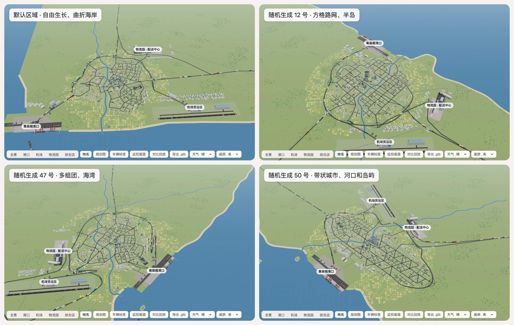

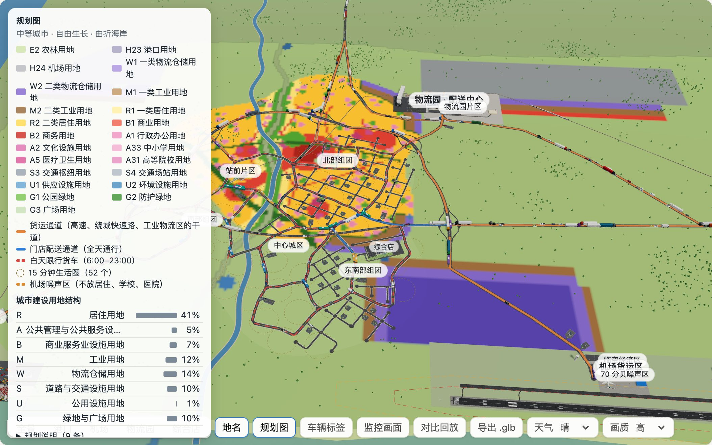

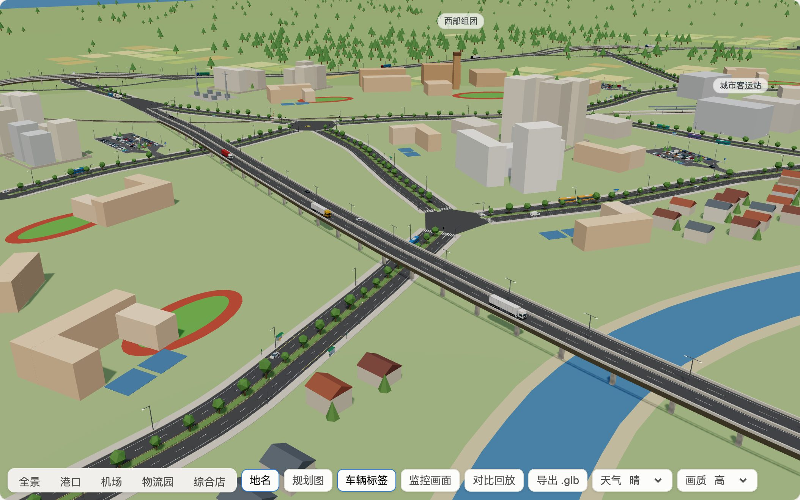

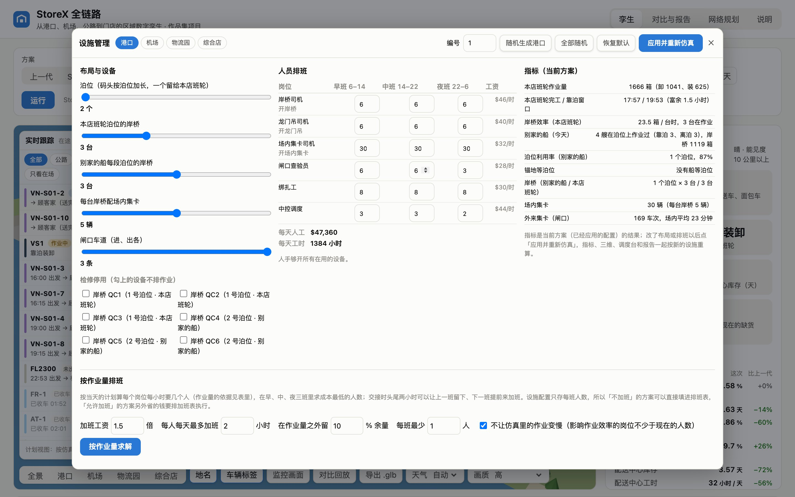

## 孪生服务和外部引擎

- **孪生服务**（`server/`）：在服务器上跑仿真、调度台和闭环，按可加速的真实时间往前走，用 WebSocket 和 REST 推车道级的车辆位置（含朝向、是否在倒车）、感知数据和建议卡，接收批准、否决和指令；值班助手、交接班报告、复盘也有接口（`/api/assistant`、`/api/handover`、`/api/review`）；接口和坐标换算（沙盘米 → 虚幻引擎厘米）见 [`server/protocol.md`](server/protocol.md)。默认只听本机（127.0.0.1）：`--host` 不是本机时必须设访问密钥（`--token` 或环境变量 `STOREX_TOKEN`），否则拒绝启动，确实要不带密钥开放得加 `--insecure`；设了密钥以后，批准、否决、指令、控制和 WebSocket 的指令都要带密钥（最好放在请求头里）；不回通配的跨域头（`--allow-origin` 列出允许的来源），别的网页发来的请求回 403；JSON 请求体上限 64 KB（[安全](server/protocol.md#安全)）。
- **对接真实系统**（`server/adapters/`）：运输管理（JSON Lines）、仓储和门店（CSV）、港口电子数据交换（EDIFACT 子集）的适配器，把外部数据换成孪生的感知数据、把孪生的指令换成外部系统的指令；可以录制现场的数据再回放（建议卡和实时运行完全一样）、直接读外部系统的文件，也可以实时接收外部系统推来的数据或盯着文件夹读新增的部分（晚到、乱序的按发生的时刻补记，对外开放时加共享口令）；从门磁推算等门时间，按港口报文跟踪本店的集装箱；坏记录逐条拒收并写明原因。带一份用模拟的一天写成的样例数据和一个按真实时间推数据的脚本。
- **虚幻引擎 5**（`engines/ue5/`）：插件 StoreXTwin，连孪生服务、用实例化网格体画车、给蓝图事件和批准接口（没有在本机编译过：作者的电脑装不下虚幻引擎；单独用 MIT 许可，原因见[「许可」](#许可)）。
- **MATLAB / Simulink**（`engines/matlab/`）：冷机的机理模型、延误滤波、外部模型服务（从孪生服务取读数、预计超标就发指令）、用代码生成 Simulink 模型、和 TypeScript 结果核对的自检（没有在 MATLAB 里运行过：没有许可证）。
- **Blender**（`engines/blender/`）：无界面运行的脚本，生成虚幻引擎用的车辆模型（网页里的车辆现在由代码按截面放样，不再加载它生成的模型）。

## 方案

- **货流规划：** 该进仓的进仓（海运、班列、空运、区域生鲜、面包房），长途整车按商品族算账，量大、不易腐、一车几天卖得完的直送门店。
- **共享销售数据：** 配送中心和供应商直接看门店的销售预测和促销日历；进配送中心的长途货每 4 天补一次（供应商管理库存）。
- **自动化配送中心：** 八成的箱走货到人拣选、机器人拆零和码垛（一家店的量下单独看不回本，有条件实施，见商业分析）。
- **生鲜越库：** 内陆产区的乳品和果蔬夜里集货、空运改订夜间航班，当天越库送店。
- **门店每天来的配送车装全部温区：** 每天按量排线，夜里和清早送（门店收货区夜间无人值守），60% 电动，回程顺路到供应商装货。
- **港口预清关、提箱预约和铁路接驳；班列夜间到站：** 集装箱在堆场平均只停 1.6 天，六成走铁路。
- **全链路数字孪生：** 调度台排每个作业；闭环孪生处理当天的状况；出了大扰动先推演再处置（按缺口过桥采购、备降机场、备用供应商、提前改道）。

## 结果

同一个区域、同样的需求和船期，20 个种子的平均（[全部结果](docs/results/README.md)）：

| | 上一代 | StoreX | **StoreX 全链路** |
|---|---:|---:|---:|
| 每箱的供应链成本（美元） | <!--n:gens.g1.mean.costPerCase|2-->4.47<!--/n--> | <!--n:gens.g2.mean.costPerCase|2-->3.24<!--/n--> | **<!--n:gens.g3.mean.costPerCase|2-->2.02<!--/n-->**（<!--n:pct:gens.g1.mean.costPerCase:gens.g3.mean.costPerCase|0-->−55<!--/n-->%） |
| 库存资金（百万美元） | <!--n:gens.g1.mean.workingCapital|2-->3.09<!--/n--> | <!--n:gens.g2.mean.workingCapital|2-->2.79<!--/n--> | **<!--n:gens.g3.mean.workingCapital|2-->1.17<!--/n-->**（<!--n:pct:gens.g1.mean.workingCapital:gens.g3.mean.workingCapital|0-->−62<!--/n-->%） |
| 门店服务水平 | <!--n:gens.g1.mean.service|2-->99.13<!--/n-->% | <!--n:gens.g2.mean.service|2-->99.56<!--/n-->% | **<!--n:gens.g3.mean.service|2-->99.65<!--/n-->%** |
| 门店生鲜损耗 | <!--n:gens.g1.mean.waste|2-->4.61<!--/n-->% | <!--n:gens.g2.mean.waste|2-->2.23<!--/n-->% | **<!--n:gens.g3.mean.waste|2-->1.83<!--/n-->%** |
| 生鲜到店时剩余的保质期 | <!--n:gens.g1.mean.freshRemain|1-->63.4<!--/n-->% | <!--n:gens.g2.mean.freshRemain|1-->68.1<!--/n-->% | **<!--n:gens.g3.mean.freshRemain|1-->80.4<!--/n-->%** |
| 配送中心库存（天） | <!--n:gens.g1.mean.dcInv|2-->12.61<!--/n--> | <!--n:gens.g2.mean.dcInv|2-->11.28<!--/n--> | **<!--n:gens.g3.mean.dcInv|2-->3.28<!--/n-->** |
| 配送中心工时（小时 / 天） | <!--n:gens.g1.mean.dcLabor|0-->73<!--/n--> | <!--n:gens.g2.mean.dcLabor|0-->73<!--/n--> | **<!--n:gens.g3.mean.dcLabor|0-->32<!--/n-->** |
| 配送车队（辆） | <!--n:gens.g1.mean.fleet|0-->13<!--/n--> | <!--n:gens.g2.mean.fleet|0-->11<!--/n--> | **<!--n:gens.g3.mean.fleet|0-->3<!--/n-->** |
| 到店卸货的车次（次 / 天） | <!--n:gens.g1.mean.arrivals|1-->8.1<!--/n--> | <!--n:gens.g2.mean.arrivals|1-->8.1<!--/n--> | **<!--n:gens.g3.mean.arrivals|1-->6.4<!--/n-->** |
| 集装箱在港口堆场停留（天） | <!--n:gens.g1.mean.dwell|2-->4.54<!--/n--> | <!--n:gens.g2.mean.dwell|2-->4.56<!--/n--> | **<!--n:gens.g3.mean.dwell|2-->1.60<!--/n-->** |
| 本地运输排放（吨二氧化碳 / 天） | <!--n:gens.g1.mean.co2Local|2-->3.64<!--/n--> | <!--n:gens.g2.mean.co2Local|2-->3.59<!--/n--> | **<!--n:gens.g3.mean.co2Local|2-->3.01<!--/n-->**（<!--n:pct:gens.g1.mean.co2Local:gens.g3.mean.co2Local|0-->−17<!--/n-->%） |

上一代 = Storewright 的门店 + 传统供应链；StoreX = 门店升级成 StoreX，上游不变；StoreX 全链路 = 门店和上游一起由全链路孪生协同。

## 对照验证

仿真和调度台里的算法有多可信（[docs/08-validation.md](docs/08-validation.md)，`npm run validate` 几秒钟复现）：门店配送线路用的节约法，和同一个例子的精确最优解比，12 家店的规模平均只多 1.86%（一车最多 4 家时 2.11%），常见的最近邻贪心多 24.38%；补货分配的满足率公式和 40 万次蒙特卡洛模拟最多差 0.0014，和教科书的标准正态损失函数值 4 位一致；调度台的三个求解器和多门店网络规划和穷举比，586 个例子全部一致。第一次跑这套验证时发现排门求解器有 3 个例子多用了一樘门，已经修正。12 个 CVRPLIB 格式的例子和最优解在 [`bench/validation/`](bench/validation/)，别的求解器可以拿去核对（`npm run validate -- check 例子.vrp 解.sol`）；页面里还有和 12 个同类开源项目的对照。

## 两个独立的程序库

卸货场引擎和车辆重叠审计拆成了两个独立的小程序库（在仓库根目录的 `packages/`），全链路按包名使用它们，别的项目也可以直接用：

- [`@storewright/yard`](../packages/yard/README.md)：卸货场 / 月台场地引擎——单向绕行的车道布置、从司机一侧倒车（挂车铰接）、甩挂和场内牵引车、按仿真时刻统一排程、任意时刻取位姿；纯 TypeScript、零依赖、结果确定；附浏览器里的二维演示：<https://glacieerr.github.io/storewright/yard/>。
- [`@storewright/overlap-audit`](../packages/overlap-audit/README.md)：车辆重叠审计——分离轴检验、精确的网格粗筛、按区域 / 车型对 / 静止或行驶统计「车对 × 秒」、上限做回归门槛；附 JSON 轨迹格式和命令行，任何引擎导出的轨迹都能用。

在仓库根目录运行 `npm run pack:libs` 打出可以安装的 npm 包（`.tgz`；还没有发布到 npm）。拆出来以后 `npm run overlaps` 的结果逐行不变。

## 已知的局限

- **设施要等几秒才出现：** 第一次打开时港口（含物流中心）、机场和外来货车当天的作业约 7.5 秒排完，换一天时 5–10 秒，排完以前这几处先空着；页面不卡（换一天时最长的一段约 0.13 秒）。主线程的总计算量没有变，把港口、机场挪进后台线程能再快一些。
- **内置值班助手只懂中文：** 英文问题靠「找最像的示例问句」换成中文去问，示例以外的问法可能对不上（对不上时用英文说明能问什么）；英文界面里内置助手不检索只有中文的设计文档；演练面板里用英文打的事件通知认不出来。想用英文随便问，可以接大模型（[docs/06-llm-option.md](docs/06-llm-option.md)）。
- **卸货场引擎超负荷时吞吐变低：** 不再有车身重叠，代价是场外排队变长、标「太紧」的变多。等候的车要场地自己画：全链路里只有机场货站按排队画，门店收货场和物流园的仿真车在场外等时画在进场点（四个检查场景里最多一辆在等，不会叠在一起）。引擎给门口等候的车排的位置没有避开邻门靠着的车（机场冷链门挨得近，极限负荷下出现过 88 车对·秒）。
- **值班台基准的题目由 AI 写：** 四套题出自四个单独启动的 AI 出题代理，措辞比真实的夜班规整；只有第四套的首次运行算正式的盲测成绩。
- **大模型模式还没有用真实的模型跑过：** 测试用的是假的提供方、不联网；接上真实的云端或本机模型以后，回答得怎么样、多常退回内置，还要实际跑过才知道（[docs/06-llm-option.md](docs/06-llm-option.md)）。
- **车辆重叠：** 路上行驶中的重叠仍是最多的；同一秒进港的外来货车车对会在红灯前叠在一起；货车等候区里行驶的卡车有时会擦到停着的车；各区域的数见[「车辆重叠检查」](#车辆重叠检查)。
- **外部引擎：** 虚幻引擎插件没有在本机编译过，MATLAB / Simulink 部分没有在 MATLAB 里运行过。
- 其余的（门店的车在干道上出现、消失的位置，物流园、机场、城区、天气和分屏的细节）见[系统设计 §8.9](docs/04-system-design.md#89-已知的局限)。

- **出状况时：** 风暴预警引发抢购（+35%、5 天），多出的缺货上一代 <!--n:stress.demandSurge.gens.g1.lostUnits|1|k-->4.8<!--/n--> 千件、StoreX <!--n:stress.demandSurge.gens.g2.lostUnits|1|k-->1.0<!--/n--> 千件、全链路 <!--n:stress.demandSurge.gens.g3.lostUnits|1|k-->1.0<!--/n--> 千件，多花的钱 <!--n:stress.demandSurge.gens.g1.extraCost|1|w-->8.9<!--/n--> 万 / <!--n:stress.demandSurge.gens.g2.extraCost|1|w-->6.5<!--/n--> 万 / <!--n:stress.demandSurge.gens.g3.extraCost|1|w-->2.2<!--/n--> 万美元；只有一家店时，港口拥堵、机场关闭、高速封闭对服务水平影响都很小，全链路用事先知道价钱的应对（过桥采购、备降）扛过去。
- **商业分析：** 上游这一步投资约 <!--n:economics.upstream.capex|0|w-->1,125<!--/n--> 万美元，10 年净现值约 <!--n:economics.upstream.npv|0|w-->980<!--/n--> 万美元（折现率 7%），回收期 <!--n:economics.upstream.payback|1-->4.3<!--/n--> 年；其中配送中心自动化单独看不回本，不上自动化时净现值约 <!--n:automation.0.withoutNpv|0|w-->1,586<!--/n--> 万美元。连同综合店改造的全系统，投资约 <!--n:economics.system.capex|0|w-->2,291<!--/n--> 万美元，净现值约 <!--n:economics.system.npv|0|w-->5,244<!--/n--> 万美元，回收期 <!--n:economics.system.payback|1-->2.8<!--/n--> 年。

## 文档

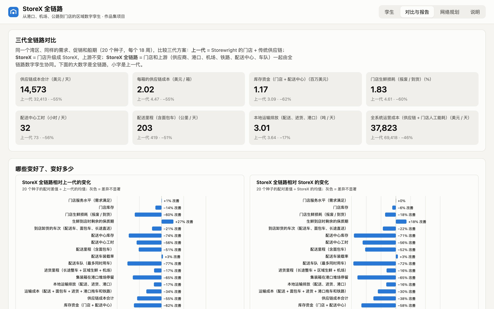

| 文档 | 内容 |
|---|---|
| [规划报告](docs/01-planning-report.md) | 目标、区域和网络、货流规划、端到端流程、闭环孪生、设施管理、设施和设备、每个决定怎么定的、分期实施、运营指标、风险 |
| [三代对比](docs/02-generation-comparison.md) | 三代分别是什么、每个环节怎么变了、钱花在哪里、库存和新鲜度、运输和排放、需求增长、出状况时、什么变差了；作品集三个部分怎么接起来 |
| [商业分析](docs/03-business-analysis.md) | 投资、节省、现金流、每一项举措的账（含自动化和减排）、敏感性和情景、谁出钱谁受益、人员和组织 |
| [系统设计](docs/04-system-design.md) | 区域生成器和设施的坐标系、道路图、全链路仿真引擎、负荷档位、货流规划、三代在引擎里的区别、实验和统计、校准和测试、调度台、三维孪生（车辆和铰接运动、卸货场引擎、门店停车场和收货场、仓储中心、城市总体规划、车辆重叠检查）、设施管理台、闭环孪生、孪生服务和外部引擎、AI 综合管理（值班助手的四段式回答、评测、盲测和数字核对、临时扰动的推演、规则表、归因和异常、审批、交接班、复盘、看板、数据质量、预测、演练、可选的大模型模式）、多门店网络和跨境、怎么运行、许可 |
| [实验结果](docs/results/README.md) | `npm run reports` 生成的全部表格和图 |
| [孪生服务的接口](server/protocol.md) | REST、WebSocket、坐标换算、感知数据和指令的格式 |
| [扩展指南](docs/05-extending.md) | 怎么加卸货场、仓储中心模型、看板指标、值班助手的意图和工具、数据适配器、三维车辆、区域选项（中文，英文标题） |
| [术语表](docs/glossary.md) | 界面和文档里的领域术语，中英对照 |
| [数据字典](docs/results/DATA.md) | `docs/results/data.json` 的字段、含义和单位（英文），附 [JSON Schema](docs/results/data.schema.json) |
| [5 分钟上手](docs/00-quickstart.md) | 第一次来先看这个：在线演示、本地三条命令、先试的 5 件事、按身份的阅读路线（[英文](docs/00-quickstart.en.md)） |
| [可选的大模型模式](docs/06-llm-option.md) | 值班助手接大模型（云端或本机模型）：加了什么、绝不做什么、隐私、费用、一步步设置、排查、怎么关（[英文](docs/06-llm-option.en.md)） |
| [场景文件和分享链接](docs/07-scenarios.md) | 场景的格式、每个字段、分享链接的参数、网页怎么套用、兼容性（[英文](docs/07-scenarios.en.md)、[JSON Schema](docs/scenario.schema.json)） |
| [对照验证](docs/08-validation.md) | 和精确最优解、穷举、蒙特卡洛模拟、教科书的值对照；和 12 个同类开源项目的比较；还没验证的（[英文](docs/08-validation.en.md)） |
| [值班台基准](docs/benchmark.md) | 方法、评分口径、排行榜、按类别和角色的细分、每一道答错的题、复现、怎样提交自己的系统、局限（[英文](docs/benchmark.en.md)） |
| [运营教学沙盘](docs/teaching/README.md) | 10 道练习、实验指导书、教师参考答案和教学说明（[英文](docs/teaching/README.en.md)） |
| [孪生服务的接口（英文）](server/protocol.en.md) | `server/protocol.md` 的英文翻译，以中文版为准 |
| [变更记录](CHANGELOG.md) | 新增、变更和安全方面的改动（中英对照）；当前版本 0.2.0（待发布），发布步骤见仓库根目录的 [RELEASING.md](../RELEASING.md) |

## 运行

全链路用仓库根目录已经装好的依赖（先在仓库根目录 `npm install`），不需要另外安装。Node.js 用 22（仓库根目录的 `.nvmrc` 和自动测试都用它）。

```bash
cd StoreX-Chain
npm run dev                      # 区域三维孪生网页（http://localhost:5182）
npm run sim -- run g3 1          # 跑一次（18 周），打印主要指标（g1 / g2 / g3）
npm run sim -- compare           # 三代对比（10 个种子）
npm run reports                  # 跑全部实验，写 docs/results/（约 20 秒）
npm run docs:sync                # 按 docs/results/data.json 更新文档里标出来的数字（docs:check 只检查）
npm run assistant:eval           # 值班助手评测：176 道标准问题和留出集，写 docs/results/assistant-eval.md
npm run overlaps                 # 车辆重叠检查：按区域统计一天里车和车的重叠，超过上限退出码 1（约 2–3 分钟）
npm run validate                 # 对照验证：和精确最优解、穷举、蒙特卡洛比（几秒；-- --write 更新 docs/08-validation*.md）
npm run bench -- run --all       # 值班台基准：五个对照系统跑四套盲测（约 20 秒；-- score 给别的系统的预测打分）
npm run teach -- list            # 教学沙盘：列出练习（show / check / key 见 docs/teaching）
npm run sim -- scenario 场景.json  # 按场景文件跑一次，打印主要指标（--json 输出 JSON）
npm run twin-server              # 孪生服务（http://127.0.0.1:8787，WebSocket /ws；值班助手在 /api/assistant）
npm test                         # 单元测试（48 个文件、394 个）
npm run lint                     # 代码检查（ESLint：error 会让自动测试失败，warning 允许）
npm run format:check             # 格式检查（Prettier，只在需要时手动跑，自动测试不查）
npm run assistant -- "现在有什么风险"  # 在命令行问值班助手（加 --llm 用大模型，见 docs/06-llm-option.md）
node scripts/check3d.mjs         # 三维回归检查（开发服务器开着时：页面报错、车船飞机瞬移、帧时间、导览的段数、仿真车的重叠）
node scripts/checkEn.mjs         # 英文界面检查（开发服务器开着时）：列出屏幕上还剩的中文，有就退出码 1
npm run build                    # 打包成静态网页（dist/）
```

## 目录

```
StoreX-Chain/
├── src/
│   ├── region/     区域地理、道路图和最短路、综合店、商品族、城市用地规划
│   ├── sim/        三代方案配置、全链路仿真引擎、货流规划、配送线路（节约法）、动画轨迹、调度台
│   ├── twin/       闭环孪生：现场仿真、感知数据和指令、孪生的估计和推演、机理模型、通信质量
│   ├── assistant/  值班助手（意图、参数、查询工具、资料库、评测、数字核对、规则表、归因、异常检测）、角色和审批、交接班、复盘、指令跟踪、分层看板
│   ├── hub/        仓储中心的作业计划：港口物流中心、机场货站、物流园（三维和值班助手共用）
│   ├── site/       综合店的停车场、即时取货和收货场：车位、车流、时空排程、指标
│   ├── scenario/   场景文件：格式、检查、分享链接、JSON Schema
│   ├── tour/       演示导览「一个集装箱从船到货架」：从仿真记录串出一个箱子的一路
│   ├── teach/      运营教学沙盘：10 道练习和自动批改
│   ├── bench/      值班台基准：数据集导出、对照系统、评分、报告
│   ├── validate/   对照验证：精确最优解、穷举、蒙特卡洛
│   ├── network/    多门店网络：店址和候选仓、选址模型、线路、库存分配
│   ├── analysis/   指标、实验、商业分析、预测模型、演练和预案、跨境、结果表格、区域地图
│   └── cli/        命令行和结果写出
├── bench/          值班台基准的数据集和结果（duty-desk/）、对照验证的例子和结果（validation/）
├── scripts/        车辆重叠检查（overlaps.mjs）、三维回归检查（check3d.mjs）
├── server/         孪生服务（WebSocket + REST）和接口文档
├── engines/        Blender 车辆脚本、虚幻引擎 5 插件、MATLAB / Simulink
├── web/            区域三维孪生网页（Vite + Web Worker + Three.js）
├── tests/          单元测试
└── docs/           报告和实验结果
```

## 许可

分层许可，每个文件的许可见仓库根目录的 [`REUSE.toml`](../REUSE.toml)，许可证全文在 [`LICENSES/`](../LICENSES/)：

- **代码**：[AGPL-3.0-only](../LICENSE)，与仓库其他部分相同（拆出去的两个程序库也是）。
- **文档、图片、生成的数据和示例数据**（各处的 Markdown 文件、`docs/` 里的报告和截图、`.glb` 模型、`web/src/data/` 里的结果副本、`server/adapters/samples/` 和 `engines/matlab/reference/` 里的示例数据）：[CC BY 4.0](../LICENSE-docs)。
- **虚幻引擎插件**（`engines/ue5/`）：[MIT](engines/ue5/LICENSE)。虚幻引擎的许可协议不允许把引擎代码和 copyleft 许可的代码组合，而插件要和引擎一起编译；插件只通过网络协议和孪生服务通信，所以单独使用宽松的 MIT 许可。
