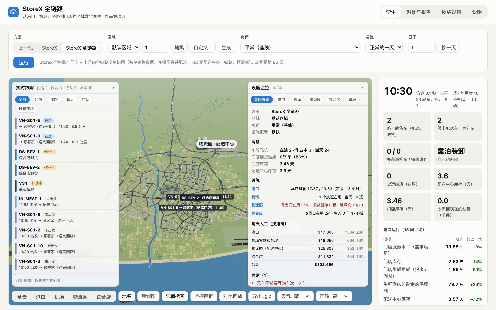
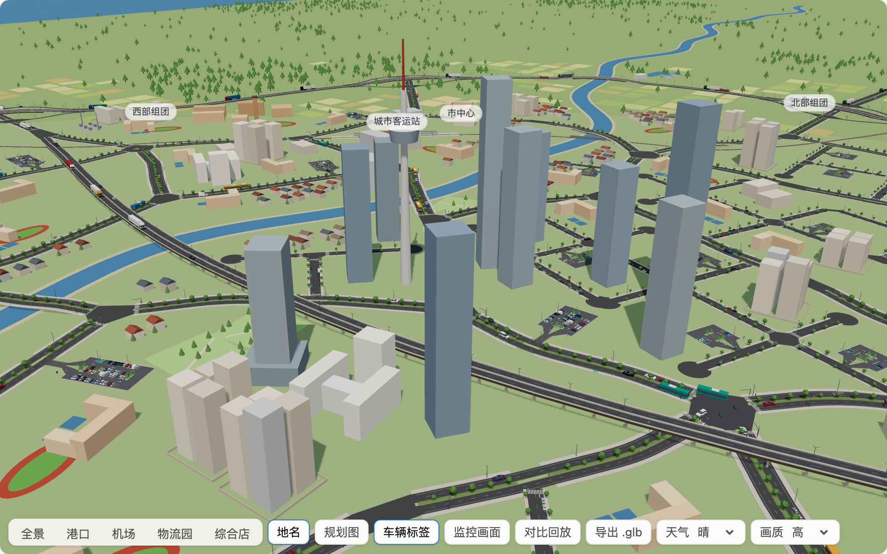

# StoreX 全链路规划报告：一家综合店的区域数字孪生——从港口、铁路、机场、公路到门店

> 作者的作品集项目，第三部分。第一部分 Storewright 是员工用手机作业 + AI 的门店；第二部分 StoreX 是面向 2030 年、员工和机器人分工的门店；本报告把范围从店里扩大到这家店的整条供应链：区域里只有一家综合店，货从海运、洲际铁路班列、空运、长途公路（国内和跨境）、内陆产区的区域生鲜和中央面包房来。所有决定都先在全链路数字孪生里试过，数字来自 770 次 18 周的仿真和 160 次一整天的闭环现场仿真（[实验结果](results/README.md)）。
>
> 配套文档：[三代对比](02-generation-comparison.md) · [商业分析](03-business-analysis.md) · [系统设计](04-system-design.md) · 区域三维孪生网页（`npm run dev`）
>
> 本项目基于公开资料、行业通用做法和作者的独立构想设计。**本项目与任何零售商、企业无隶属关系。** 区域、门店、商品、供应商、船期和所有数字都是合成的；设备、运价和排放因子是公开资料里的常见区间，不是任何供应商的数据。

## 摘要

**问题。** StoreX 把一家店店里的人工和损耗降了下来，但门店只是链条的最后一段：门店的库存、生鲜的新鲜度、到店的车次，大半是上游决定的。传统供应链里，配送中心只看得到门店的订单（看不到真实销售），按温区分开派车、跑固定线路，人工拣货；长途公路来的整车不管量多大，都先进配送中心再出来；集装箱在港口平均停 4.5 天，全部用拖车运；生鲜从内陆产区和机场到店要多等一天。结果是配送中心要囤约 12.6 天的货，生鲜到店时只剩 63% 的保质期。门店升级成 StoreX 以后，门店自己的损耗减半，但上游这些问题一个都没有变。

**方案。** StoreX 全链路让门店和上游在同一个数字孪生里协同：

- **货流规划：** 海运、铁路班列、空运的货都先进配送中心拆箱、分拣，再用卡车送店；长途公路来的整车按商品族算账，常温畅销、常温一般、饮料和跨境日用品 4 个商品族整车直送门店（占长途整车的 65%），长尾常温货、冷冻和肉类进配送中心；
- **共享销售数据：** 配送中心和供应商直接看门店的销售预测和促销日历，不再从门店的订单里猜；进配送中心的长途货每 4 天补一次（供应商管理库存）；
- **自动化配送中心：** 八成的箱由货到人拣选、机器人拆零和码垛处理（有条件实施，见下）；
- **生鲜越库：** 内陆产区的乳品和果蔬夜里集货、空运改订夜间航班，凌晨到配送中心、当天越库送店；
- **门店每天来的配送车装全部温区：** 常温、冷藏、冷冻和面包装一辆多温区车，每天按量重新排线，夜里和清早送（门店收货区夜间无人值守），60% 是电动卡车，回程顺路到供应商装货；
- **港口预清关、提箱预约和铁路接驳：** 集装箱在堆场平均只停 1.6 天，六成走铁路到物流园；洲际班列改夜里到站、预清关后 4 小时进配送中心；
- **全链路数字孪生：** 调度台把当天的每一个作业（泊位、班列、航班、进货、38 樘月台门、每辆车、门店的 4 个收货口）排在一张甘特图上，可以拖动改排、重新仿真；闭环孪生从现场的感知数据估计每辆车、每车冷机和门店每个商品族的状态，推演问题，给出带推演结果的建议卡，批准后把指令发回现场。

**结果**（同一个区域、同样的需求和船期，20 个种子的平均，[结果 1](results/01-generations.md)）：

| | 上一代 | StoreX | **StoreX 全链路** | 全链路 vs 上一代 |
|---|---:|---:|---:|---:|
| 供应链成本（美元 / 天） | 32,413 | 23,493 | **14,573** | −55% |
| 每箱的供应链成本（美元） | 4.47 | 3.24 | **2.02** | −55% |
| 库存资金（门店 + 配送中心，百万美元） | 3.09 | 2.79 | **1.17** | −62% |
| 门店服务水平 | 99.13% | 99.56% | **99.65%** | +0.5 个百分点 |
| 门店生鲜损耗（报废 / 到货） | 4.61% | 2.23% | **1.83%** | −60% |
| 生鲜到店时剩余的保质期 | 63.4% | 68.1% | **80.4%** | +17.0 个百分点 |
| 配送中心库存（天） | 12.61 | 11.28 | **3.28** | −74% |
| 配送中心工时（小时 / 天） | 73 | 73 | **32** | −56% |
| 配送里程（公里 / 天） | 419 | 423 | **203** | −51% |
| 配送车队（辆） | 13 | 11 | **3** | −77% |
| 到店卸货的车次（次 / 天，含长途直送） | 8.1 | 8.1 | **6.4** | −21% |
| 集装箱在港口堆场停留（天） | 4.54 | 4.56 | **1.60** | −65% |
| 本地运输排放（吨二氧化碳 / 天） | 3.64 | 3.59 | **3.01** | −17% |

加上门店（StoreX 报告的门店人工和能耗，按规模折算），全系统每天的运营成本从上一代的 6.94 万美元降到 3.78 万美元（−46%）；其中上游这一步（StoreX → 全链路）每天省 8,920 美元（−19%）。

**闭环孪生**（[结果 7](results/07-twin.md)）：同一天的现场跑 20 个种子。多事的一天（抛锚、冷机故障、事故、门店某个商品族突然卖得快、长途直送车发车晚 3–5 小时），调度员在建议卡出来 10 分钟内批准孪生推荐的做法：门店收货迟到从 118 分钟降到 0，冷链超温从 18 分钟降到 5，门店缺货从 138 分钟降到 15（少卖从 1,147 件降到 299 件），措施平均每天花 258 美元。孪生提前 15–45 分钟预测到店时间的平均误差约 2–3 分钟。

**投资和回报**（[商业分析](03-business-analysis.md)）：上游这一步投资约 1,125 万美元（配送中心自动化 600 万、全链路孪生平台 250 万、越库区和冷库 80 万、充电站 50 万、铁路专用线分摊 50 万、门店收货区 25 万、培训和切换 70 万），库存减少一次性释放约 164 万美元，2030 年每年毛节省约 375 万美元；10 年净现值约 980 万美元（折现率 7%），内部收益率 21.3%，回收期 4.3 年。保守情景（投资取高值、2030 年需求只增 10%、时薪低、维护和订阅取高值、爬坡慢）净现值约 −402 万美元、回收期 9.5 年。配送中心自动化单独看不回本：一家店的量（配送中心每天拣约 4,300 箱）撑不起 600 万美元的设备，增量净现值约 −606 万美元，不上自动化时上游这一步的净现值约 1,586 万美元。连同综合店改造成 StoreX 的全系统，投资约 2,291 万美元，10 年净现值约 5,244 万美元，回收期 2.8 年。

**建议。** 分三期实施：先做不需要大设备的部分（孪生平台和调度台、共享销售数据、货流规划和长途整车直送、多温区合并配送和动态排线、回程顺带、港口预清关和提箱预约），它们单独就能省下全链路一大半的运输和库存成本；第二期建生鲜越库区、充电站和铁路接驳；第三期的配送中心自动化是有条件的——按一家店的量不划算，等配送中心的量上来（例如以后给更多门店供货）、或者招工难到人工成本明显上涨时再定，也可以只上自动收货和码垛这类小投资。每一期上线前先让孪生影子运行（只预测、出建议，不发指令）一个季度，用真实数据重新校准本报告的参数。

## 1. 目标和约束

### 1.1 2030 年的供应链要做到什么

| 目标 | 怎么衡量 | 全链路的结果 |
|---|---|---|
| 门店不缺货 | 门店服务水平（需求满足的比例）≥ 99.5% | 99.65% |
| 生鲜更新鲜、少报废 | 到店剩余保质期 ≥ 80%，门店损耗 ≤ 2% | 80.4%、1.83% |
| 库存少、资金占用少 | 门店 ≤ 3 天、配送中心 ≤ 4 天 | 2.64 天、3.28 天 |
| 每箱成本低 | 供应链成本 ≤ 2.2 美元 / 箱 | 2.02 美元 |
| 少排放 | 本地运输排放比上一代减少 ≥ 15% | −17% |
| 扛得住扰动 | 五种演练里，扰动带来的最差一天服务水平下降 ≤ 1 个百分点 | 最大 0.3 个百分点（需求突增） |
| 需求增长不加人 | 需求 +24%（2030 年）时，配送中心工时增长 ≤ 15% | +9%（32 → 35 小时） |
| 每个作业看得见、排得动 | 当天全部作业在一张调度台上；现场出状况，孪生提前给出可执行、带推演结果的建议 | 调度台（[系统设计 §7](04-system-design.md#7-调度台查看和安排全部作业)）、闭环孪生（[结果 7](results/07-twin.md)） |

### 1.2 设计原则

1. **每个作业都看得见、排得动。** 这是孪生的核心：港口泊位、班列、航班、进货、月台门、每辆车、门店的收货口都在同一张调度台上，冲突和迟到先暴露、再修；现场的状况通过感知数据回到孪生，孪生推演以后给出做法，人批准、指令发回现场。
2. **一份需求，全链路共用。** 门店、配送中心、供应商看同一份销售预测和促销日历；任何一级都不从下一级的订单里「猜」需求，牛鞭效应从源头消失。
3. **该进仓的进仓，该直送的直送。** 集装箱、班列箱、航空板必须拆开分拣，进配送中心；长途整车按商品族算账，量大、不易腐、一车几天卖得完的直送门店，其余进配送中心拼车。
4. **货少停、多流动。** 能越库的不入库，能当天送的不隔夜；集装箱少在堆场停，生鲜少在配送中心等。每少停一天，就少一天的库存和一天的保质期。
5. **车装满、少跑空。** 多温区合并让一辆车装满门店一天的多个温区；每天按量重新排线；回程顺路带供应商的货。
6. **先推演，再处置。** 船晚了、机场关了、路封了、供应商停了、车抛锚了、冷机坏了，孪生先算缺口和代价，再决定买多少、绕哪条路、派不派车。
7. **每个决定都有数字。** 设备买多少、补货多频、哪些货直送，全部用扫描实验来定（同一组种子，只改一项）。

### 1.3 约束

- 区域和设施的布置由作者设计（虚构的滨海都市圈）。区域里只有一家综合型大店，规模约为 StoreX 门店的 2.5 倍（每天约 8 万件、7 千多箱）；一个物流园给它供货。
- 门店的店内流程沿用 StoreX；本报告只改门店的订货和收货，以及门店以上的所有环节。
- 只用公开资料里的设备性能、价格、运价和排放因子；不假设任何未商用的技术（例如无人驾驶卡车）。
- 港口、机场、铁路是公共设施：方案只改自己能控制的部分（预清关、预约、选择铁路、订哪班航班和班列时刻），不假设港口自己提速。
- 门店后仓的托盘位有限：长途整车直送让门店常温货最多的时候多出约 150 托，后仓按这个量留位；冷冻库最贵，冷冻货不直送（见 §3）。

## 2. 区域和网络

| 设施 | 位置和规模 |
|---|---|
| **综合店** | 位置由区域生成器给出：默认区域里在市中心以东约 6 公里的一个街区中间，用一段本地道路接到干道。生鲜、食品、日用、饮料、冷冻、烘焙都卖；中间的生鲜食品区就是 StoreX 报告里的门店模型，后面用玻璃连廊接着百货日用馆，馆后一排 4 个收货口（配送中心的车和长途直送车共用） |
| **物流园** | 东北，离市中心约 17 公里，一条高速接到绕城快速路的立交：配送中心（常温 + 冷链，屋顶光伏）、铁路货运站（站台、装卸线和龙门吊）、中央面包房、电动卡车充电站、车场 |
| **集装箱港口** | 西南海岸：码头（2 个泊位，一个停本店的班轮）、岸桥、堆场、闸口、铁路专用线和港口铁路站；每周一班班轮，本店约 6 个 40 尺箱 |
| **洲际铁路班列** | 每周一班，从东边来（在途约 16 天），停在物流园的铁路货运站查验、卸箱，本店约 3 个 40 尺箱 |
| **机场货运区** | 东南，跑道、货运机坪和货站；进口果蔬和海鲜每天一班货运航班 |
| **区域生鲜** | 国内长途的高速出口（默认区域在北面）外 70–95 公里的内陆产区，乳品和果蔬每天夜里由集货车拉进来 |
| **长途公路** | 国内长途的高速出口外 120–300 公里是国内供应商（常温食品、饮料、冷冻、肉类）；跨境长途的高速出口（默认区域在东面）外 1,100–1,400 公里是跨境（洲际）公路来的供应商（长尾常温货、日用品），过境清关约 2 天 |
| **道路** | 绕城快速路沿内陆一侧绕过城区、两头接到海边（不成环，默认区域 5 个立交）；高速通往港口、机场、物流园和两个长途出口；城区的干道网是大小不一的街区，跟着海岸和河走，过河的路都是桥，一条高架快速路从城区上空穿过；市区道路早晚高峰慢 50–60% |
| **铁路** | 港口站 → 沿城区外缘（城市客运站停靠城际客运列车）→ 物流园货运站 → 往东接洲际线；港口到物流园的接驳每周一、三、五各一班 |

整个区域由区域生成器生成：默认区域就是上表的布局，报告的数字都按它算；网页上还可以随机生成或自定义一个区域，海在哪一侧、有没有河、城市多大、港口在海岸的哪一段、机场和物流园在城市的哪个方向、铁路和两个长途出口朝哪边、门店在市中心还是城郊，全部跟着变（[系统设计 §3](04-system-design.md#3-区域和网络)）。

**货从哪里来**（按件数）：长途公路 51.3%（其中跨境 10.7%）、区域生鲜 22%、海运进口 13.4%、铁路班列 6.3%、中央面包房 6%、空运进口 1%。17 个商品族，每个族只有一种货源，见[系统设计 §3](04-system-design.md#3-区域和网络)。

## 3. 货流规划

### 3.1 每类货走哪条路

| 货源 | 全链路的路径 | 为什么 |
|---|---|---|
| 海运（常温、冷冻、果蔬冷箱） | 班轮 → 港口（预清关、提箱预约）→ 六成走铁路接驳、四成用拖车 → 配送中心拆箱、上架 → 配送车 → 门店 | 一个 40 尺箱是一种货，门店没有拆箱的场地，也收不了一整箱的单一商品 |
| 洲际铁路班列（常温、日用品） | 班列夜里到物流园货运站 → 预清关后 4 小时进配送中心 → 配送车 → 门店 | 同上 |
| 空运（果蔬、海鲜） | 夜间航班 → 机场货站 → 冷藏车 → 配送中心越库 → 清早的配送车 → 门店 | 量小、保质期最短，要和别的生鲜拼车当天送 |
| 区域生鲜、中央面包房 | 夜里集货 → 配送中心越库 → 配送车 → 门店 | 量小、每天都要送 |
| 长途公路（国内、跨境） | **按商品族二选一：整车直送门店收货口，或者进配送中心** | 见 §3.2 |

按件数，全链路里 34% 的货由长途整车直送门店；其余 66% 经配送中心。上一代和 StoreX 的长途整车全部进配送中心。

### 3.2 长途整车：直送门店还是进配送中心

两条路各有代价：

- **进配送中心：** 整车到配送中心卸车、上架，按门店的订单拣货，和别的货拼成每天的配送车；门店每天收一点，库存少。花的是配送中心的工时、送店那一段，以及配送中心按补货周期多放的库存。
- **直送门店：** 门店的库存降到订货点就向供应商订一整车（满载），平均隔几天来一车，排在清早 4–10 点的收货时段里；省掉配送中心的工时和送店那一段，但门店一次收一整车，店里多压几天的货，收货口也占得久。一整车按每个单品组的缺口分装（缺得多的多装），不按固定比例。

规划按规则先排除，再比每天的成本（[结果 6](results/06-flows.md)）：不是易腐品（保质期 20 天以上）；不是长尾商品（单品多、每个单品量小，来自很多家小供应商，凑不满整车）；一车的量门店放得下（常温不超过 4 天的量，冷冻不超过 3 天）。

| 商品族 | 每天（托） | 一车是几天的量 | 进配送中心（美元 / 天） | 直送（美元 / 天） | 决定 |
|---|---:|---:|---:|---:|---|
| 常温食品（畅销） | 15.8 | 1.6 | 544 | 314 | **直送门店** |
| 常温食品（一般） | 10.9 | 2.4 | 415 | 256 | **直送门店** |
| 饮料 | 20.6 | 1.3 | 565 | 295 | **直送门店** |
| 日用品（跨境公路） | 6.6 | 3.9 | 776 | 629 | **直送门店** |
| 常温食品（长尾，跨境公路） | 7.9 | 3.3 | 1,141 | 938 | 进配送中心（长尾） |
| 冷冻 | 6.4 | 4.0 | 297 | 202 | 进配送中心（一车是 4 天的量，冷冻库放不下） |
| 肉类 | 7.2 | 3.6 | 274 | 151 | 进配送中心（易腐，要每天小批量送） |

跨境公路的两类货两种去处都有：日用品量够、一车 3.9 天卖完，直送；长尾常温货进配送中心拼车。

**仿真里的结果**（10 个种子，[结果 2](results/02-sweeps.md)）：按规划直送比全部进配送中心每天省 730 美元——配送中心少 8 工时、配送少跑 111 公里；代价是门店多压 0.96 天的库存、常温货最多的时候多 151 托。门店服务水平不降（99.63%，全部进配送中心是 99.62%）。「不易腐的全部直送」（再加长尾和冷冻）账面上还能再省 205 美元 / 天，但仿真按「一家供应商一整车」算：长尾商品实际来自很多家小供应商，直送会变成很多趟零担、门店收货次数成倍增加；冷冻整车要在冷冻库多放约 25 托。这两样仿真没有算进成本，规划按规则排除。

### 3.3 门店收货口

4 个收货口由调度台统一排：配送中心的多温区车按动态线路的到店时刻占口，长途直送车排在清早 4–10 点；同一时段车多了，调度台报「门店收货口不够」，可以把直送车挪到别的时段。门店每天到店卸货的车次从上一代的 8.1 次降到 6.4 次（面包车并进多温区车，长途直送少了配送中心那一趟）。

## 4. 端到端流程

### 4.1 需求和预测

- 门店的销售按小时进入孪生；门店的预测用自己的历史销售、星期几、天气和促销日历（预测误差约 8%，上一代约 25%）。
- **同一份预测往上游传：** 配送中心不再从门店的订单里做指数平滑，而是直接用门店的预测，算未来「检查周期 + 提前期」里的需求；供应商看到同样的数字。上一代的配送中心看到的是门店的订单——门店缺货时会反复下单，订单虚高，配送中心跟着多订，等货到了又积压。
- 需求突增（例如风暴预警引发的抢购）半天内写进门店和配送中心的预测；上一代要 2 天。

### 4.2 门店补货

- 门店每天都收货（上一代常温隔天、冷冻每周两次），走配送中心的货门店只备一天多；直送的货按订货点订整车。门店库存从 3.07 天降到 2.64 天（全部进配送中心时是 1.68 天，直送多压的 0.96 天是省下配送中心工时和送店那一段的代价）。
- **安全库存分品类：** 生鲜的安全系数低一些（1.28，报废贵），常温的高一些（2.05，缺货贵）。和全部用 1.65 相比，每天少花约 308 美元（主要是生鲜报废），服务水平低 0.05 个百分点（[扫描](results/02-sweeps.md)）。
- 生鲜动态降价、按批次管理保质期（沿用 StoreX）。
- **夜间收货：** 多温区车夜里和清早出车，凌晨到店的车卸到无人值守的收货区（分温区的收货柜和冷库门禁），早班员工上岗后再上架。

### 4.3 配送中心

- **分配：** 每天 2 点（等夜里到的生鲜）按门店的订单分配；生鲜先进先出，剩余保质期不到三成的不再往门店发。
- **补货：** 定期检查、补到目标量；安全库存同时考虑需求的波动和提前期的波动（船期、堆场停留、铁路班次、班列、供应商）。易腐品只把到期前发得完的库存算数；海运冷箱的果蔬（提前期约 6 周、到配送中心后只能放十几天）每周按预测订一周的量，缺口分三周补齐，压住长链条的牛鞭效应。
- **自动化：** 八成的箱由货到人拣选、机器人拆零和码垛处理，两成人工（异形、超重、易碎）；自动收货和装车辅助让收货、装车效率提高约三到五成。配送中心工时从每天 73 小时降到 32 小时（其中约 8 小时是直送让配送中心少处理的货），每工时处理的箱数从 99 箱升到 135 箱——一家店的配送中心小，固定的值班、维护和监控工时占了不少。
- **库存：** 配送中心库存从 12.61 天降到 3.28 天，主要来自共享销售数据（配送中心不再为门店订单的虚高备货）、直送的货不进配送中心、港口提速。

### 4.4 城市配送

| | 上一代 | 全链路 |
|---|---|---|
| 怎么装车 | 按温区分车：冷藏、冷冻早上送，常温下午送；面包房自己用小货车直送 | 一辆多温区车装全部温区和面包 |
| 线路 | 每个温区、每个星期几一套固定线路 | 每天按当天的量重新排线（节约法） |
| 出车时段 | 4–9 点、12–18 点 | 夜里和清早（避开早高峰，夜里路快 15%） |
| 车型 | 柴油半挂 | 60% 电动卡车（优先给短线路）、40% 柴油 |
| 回程 | 空车回物流园 | 35% 的车顺路到供应商装货 |
| 结果 | 每天 5.8 车次 + 2.3 车次面包车，装载率 85.8%，419 公里，13 辆车 | 每天 4.2 车次，装载率 88.5%，203 公里，3 辆车（56% 的里程是电动车） |

准时送达两代都是 100%（只有一家店，收货时段宽）。

### 4.5 长途公路（国内和跨境）

- **直送门店：** 4 个商品族整车直送，每天约 2.1 车；长途公路从下单到到货从 2.65 天缩到 1.71 天（直送少了配送中心这一站）。
- **进配送中心的长途货（长尾常温货、冷冻）：供应商管理库存。** 供应商看到配送中心的库存和门店的销售预测，每 4 天补一次（上一代每周一次）。一家店的长尾货、冷冻货量不大，补得太勤一车装不满：扫描里每 2 天比每 4 天每天多花约 200 美元；每 7 天和每 4 天的总成本差不多（差 27 美元，在误差以内），每 7 天车装得更满、每天少排 0.15 吨，但配送中心多压 0.3 天的货。选每 4 天是为了周转快；减排优先时可以改回每周。
- **回程顺带：** 自己的配送车送完门店后绕到供应商出口装货回来：长途整车从每天 3.9 车降到 3.3 车，进货里程从 3,529 公里降到 2,886 公里，每天少排放 0.44 吨二氧化碳。
- **备用供应商：** 每个大类预先认证一家备用供应商，主供应商停产时孪生半天内把订单切过去。
- **车载终端：** 长途车进区域之前 4 小时开始、每小时报一次预计进区域的时刻；供应商发车晚了，孪生在车进区域之前就知道，通知门店顺延收货（[结果 7](results/07-twin.md)）。

### 4.6 区域生鲜和中央面包房

- 内陆产区的集货车改在夜里跑（经国内长途的高速口进区域），凌晨到冷链中心，和门店的订单一起越库，当天早上到店；上一代早上 4:30 到、入库、第二天送店。
- 面包房按当天的门店订单生产，面包装进多温区车，不再自己派小货车。
- 生鲜到店时剩余的保质期从 63.4% 升到 80.4%（越库这一项单独就是 71.3% → 80.2%）：顾客买到的更新鲜，门店的报废也少。

### 4.7 海运

- 每周一班班轮，下单后约 38 天到港；孪生跟踪船期，晚到时提前知道。
- **预清关和提箱预约：** 单证在船到港前办好，提箱时段提前预约；集装箱在堆场平均停 1.6 天（上一代 4.5 天，超过 3 天免费期要付滞箱费）。海运的下单到进配送中心从 45.4 天缩到 43.0 天，滞箱费从每天 118 美元降到几乎为零。
- **铁路接驳：** 约六成的箱走港口专用线到物流园的货运站，其余用拖车；一家店每周只有约 6 个箱，和全用拖车的花费差不多，每天少排约 0.05 吨二氧化碳，代价是等班次多半天。

### 4.8 洲际铁路班列

- 每周一班，从洲际线（默认区域在东边）开进物流园货运站，本店约 3 个箱（常温进口、日用品进口），在途约 16 天。
- 全链路把班列改到夜里到站（3 点），单证提前办好，查验、卸箱 4 小时后进配送中心，赶上当天的分配；上一代上午到站、查验 12 小时。下单到进配送中心从 21.4 天缩到 20.6 天。
- 班列在调度台上有自己的泳道；拖动它就是改常规时刻（每周哪天、几点到站），改了以后重新仿真。

### 4.9 空运

- 改订夜间到港的货运航班（23 点落地），预清关后 2.5 小时出货站，凌晨越库送店；上一代清早落地、货站处理 8 小时、第二天送店。空运的下单到进配送中心从 1.62 天缩到 1.12 天。
- 空运进口的果蔬和海鲜保质期最短（7–9 天），快这半天，门店的损耗就从 13.7% 降到 3.9%（空运果蔬）。

### 4.10 全链路数字孪生

| 功能 | 做什么 |
|---|---|
| 实时状态 | 门店、配送中心、在途车辆（含区域外的长途车）、港口堆场里自己的箱、班列、航班的位置和库存 |
| 预测和计划 | 门店需求预测、补货计划、货流规划（直送清单）、每天的配送线路、车辆和司机排班、提箱和班列计划 |
| 调度台 | 当天的全部作业排在一张甘特图上：泊位、班列、航班、长途直送、进货、38 樘月台门、每一辆配送车、门店的 4 个收货口；检查门、收货口和车的冲突、迟到、赶不上分配，能修的一键修；改当天的作业或常规时刻表后重新仿真，和原计划比（[系统设计 §7](04-system-design.md#7-调度台查看和安排全部作业)） |
| 闭环孪生 | 现场的感知数据（定位、车载终端、冷机读数、装车进度、门磁、收银、盘点、路况）→ 孪生估计每辆车的延误、每车货的温度、门店每个商品族的库存 → 推演到店时间、货温、什么时候卖空 → 建议卡（几种做法和各自的推演结果）→ 自动执行低风险的、其余等调度员批准 → 指令发回现场（§4.11） |
| 推演和预案 | 「如果这班船晚 6 天」「如果高速封一天」：算缺口、代价和几种应对的结果；过桥采购、备降机场、备用供应商、改道按推演的结果生成建议，计划员确认后执行 |
| 三维视图 | 本项目的网页：整个区域的三维场景（车道级的道路、立交、桥和高架，轻量的城区，精细的车辆和港口、机场、铁路站、物流园、门店收货区的作业设备）；车船飞机按仿真或闭环现场移动，起步、转弯、刹车、靠泊都有真实的动作，港口有别家的船进出港、拖轮协助靠离泊，机场全天有航班起降；实时跟踪每辆车的位置和预计到达，设施监控看每个设施的设备和作业进度，和调度台、闭环面板联动；虚拟监控画面看门店收货区、配送中心冷链门和港口泊位 |
| 设施管理 | 港口、机场、物流园和综合店各有一个管理台：布局（岸桥和堆场、机位和地面设备、立体库巷道和月台门、收货口和货架）、设备检修、早中夜三班的人员排班、关键指标和预警；配置可以手动改，也可以随机生成，改完作用到仿真参数上（例如收货员少了每托卸得慢、板车少了货站处理慢），重新仿真看影响；集团总览一屏看全部设施和在途车辆 |
| 负荷和区域 | 平常、高峰、高负荷、极限四档负荷（需求、班轮、班列、航班和城区背景车流一起加）；区域生成器随机或按自定义生成整个区域（海、河、城区、道路、铁路，港口、机场、物流园、出口和门店的位置）；港口的泊位、机场的机位、铁路货运站的装卸线和门店的规模都能放大。用来检验方案换一个区域、量翻几倍以后还成不成立。本报告的数字都是平常负荷、默认区域和默认设施配置下的结果 |
| 外部引擎 | 孪生服务（WebSocket + REST）把车道级的车辆位置、感知数据和建议卡推给虚幻引擎 5（高画质渲染、像素流送）和 MATLAB / Simulink（冷机机理模型、延误滤波、外部模型服务）；车辆模型由 Blender 脚本生成（[系统设计 §9](04-system-design.md#9-闭环孪生和外部引擎)） |

### 4.11 闭环孪生：现场出了状况怎么办

计划之外的状况每天都有：装车晚、路上出事故、车抛锚、冷藏车车门没关严、压缩机坏了、门店某个商品族突然卖得快、长途直送车的供应商发车晚。孪生每 5 分钟推演一次，发现问题就出一张建议卡：

| 建议卡 | 做法（推演出迟到、超温、缺货的分钟和多花的钱，推荐合计最低的） |
|---|---|
| 预计迟到 | 通知门店顺延收货；不处理 |
| 温度将超标 | 提醒司机停车检查车门（低风险，可自动）；远程把设定温度调低 2 °C（低风险）；派冷藏车把货接走；不处理 |
| 车辆抛锚 | 派救援车接走车上的货；等修好 |
| 月台门要等 | 改到空闲的月台门（低风险）；等这樘门 |
| 门店将缺货 | 配送中心追加一趟小车补货；把长途进配送中心的车改直送门店；不处理 |

20 个种子、两种现场状况、四种做法的对比（[结果 7](results/07-twin.md)）：

| 多事的一天（每天平均） | 门店收货迟到（分钟） | 冷链超温（分钟） | 门店缺货（分钟） | 少卖（件） | 措施花的钱 |
|---|---:|---:|---:|---:|---:|
| 不用孪生 | 118 | 18 | 138 | 1,147 | $0 |
| 只自动执行低风险的（其余没人批） | 118 | 5 | 138 | 1,147 | $0 |
| 低风险的自动执行 + 调度员 10 分钟内批准 | 0 | 5 | 15 | 299 | $258 |
| 全部自动执行 | 0 | 5 | 9 | 218 | $289 |

两点读法：低风险的措施（检查车门、调设定温度）自动做就挡住了大部分超温；迟到和缺货要花钱的措施（通知门店、追加补货、派救援车），没人批就等于没有——建议要有人看。剩下的超温多发生在门店卸货的最后几分钟，孪生能做的对已经靠上收货口的车没有用。

### 4.12 扰动和应急

五种演练，每种都和同一种子、没有扰动的那次比（10 个种子，[结果 4](results/04-stress.md)）：

| 演练 | 上一代 | StoreX | 全链路 |
|---|---|---|---|
| 港口拥堵：班轮晚到 6 天，10 天堆场停留翻倍 | 不多缺货（配送中心库存厚） | 多缺货 0.1 千件 | **不多缺货**；按缺口过桥采购 642 美元 |
| 机场关闭 2 天 | 空运生鲜不受影响（库存厚） | 空运生鲜最差一天低 1.2 个百分点 | **不受影响**（改降备降机场，卡车运回，5,040 美元） |
| 物流园进城的高速封闭 1 天 | 影响很小 | 影响很小 | 影响很小（提前改道） |
| 常温畅销品的主供应商停产 7 天 | 不多缺货（配送中心有 12 天的货） | 不多缺货 | **不多缺货**（这类货直送、配送中心没有库存；门店多订整车，半天切到备用供应商） |
| 风暴预警引发抢购：+35%，5 天 | 多缺货 4.8 千件，最差一天低 1.5 个百分点，多花 8.9 万美元 | 1.0 千件，0.3 个百分点，6.5 万美元 | **1.0 千件，0.3 个百分点，2.2 万美元** |

只有一家店时，大部分扰动对服务水平的影响都很小；上一代靠厚库存扛，全链路靠推演和预案扛，代价是事先知道价钱的应对（过桥采购、备降）。供应商停产这一项要说清楚：直送让畅销常温货不在配送中心放库存，没有缓冲——全链路能扛住，是因为孪生半天内发现、把订单切到预先认证的备用供应商，门店按订货点多订整车；没有备用供应商时，直送的商品族会比走配送中心的先断货。需求突增时全链路和 StoreX 多出的缺货差不多（都约 1.0 千件），但多花的钱少得多。

## 5. 设施和设备

| 项目 | 规模 | 怎么定的 |
|---|---|---|
| 配送中心自动化 | 八成的箱（约 3,400 箱 / 天）走货到人拣选、机器人拆零和码垛；自动收货 | 扫描：0 → 80% 每天省约 400 美元的人工（46 → 32 工时）；投资 600 万美元、每年维护约 24 万，按基准假设单独看不回本，是有条件的决策（[商业分析](03-business-analysis.md)） |
| 生鲜越库区和冷库扩容 | 冷链中心加越库区、冷链门封 | 越库让区域生鲜不入库：到店剩余保质期 +8.9 个百分点，每天省约 270 美元 |
| 多温区车 | 3 辆（三温区挂车），2 辆电动 | 车队按最多同时在用的车数定 |
| 充电站 | 约 4 个快充位，电网扩容 | 电动车夜里在物流园充电；一家店的 3 辆车减排有限（见商业分析的减排账） |
| 铁路专用线 | 物流园货运站接入、装卸设备（按本店的量分摊） | 港口接驳和洲际班列共用 |
| 门店收货区 | 4 个收货口，分温区收货柜 + 冷库门禁，夜间无人值守；后仓按直送多留约 150 个常温托盘位 | 夜间配送和长途直送的前提 |
| 全链路孪生平台 | 控制塔、调度台、闭环孪生、供应商管理库存平台、港口 / 班列 / 机场货运系统对接、车辆遥测（含长途车的车载终端）、冷机远程监控 | 共享销售数据、货流规划、预清关和预约、闭环处置、扰动应对都靠它 |

## 6. 方案怎么定的

每次只改一项，其余保持全链路的选用值（10 个种子，[结果 2](results/02-sweeps.md)）。下表是每一项单独值多少（从「不做」换成选用值）：

| 举措 | 不做 → 选用 | 供应链成本（美元 / 天） | 本地排放（吨 / 天） | 说明 |
|---|---|---:|---:|---|
| 长途整车直送门店 | 全部进配送中心 → 按货流规划（4 个商品族直送） | −730 | +0.04 | 省配送中心工时和送店那一段；门店多压 0.96 天的货 |
| 多温区合并配送 + 动态线路 | 按温区分开、固定线路 → 合并、每天排线 | −695 | −0.02 | 门店库存也少，库存资金少约 61 万美元 |
| 回程顺带供应商的货 | 0% → 35% | −555 | −0.44 | 减排最多；35% 是供应商分布允许的比例 |
| 配送中心自动化 | 0% → 80% | −399 | 0 | 只是人工；投资和维护大，单独看不回本 |
| 港口预清关和提箱预约 | 4.5 天 → 1.6 天 | −225 | +0.01 | 滞箱费、在途库存和海运生鲜的新鲜度 |
| 门店安全库存分品类 | 全部 1.65 → 常温 2.05、生鲜 1.28 | −308 | 0 | 服务水平低 0.05 个百分点 |
| 生鲜越库 | 第二天送 → 当天送 | −271 | 0 | 主要价值是更新鲜（+8.9 个百分点） |
| 进配送中心的长途货补货频率 | 每 7 天 → 每 4 天 | +27 | +0.15 | 在误差以内；配送中心少压 0.3 天的货，每周补的车更满 |
| 港口集装箱走铁路 | 0% → 60% | +13 | −0.05 | 一家店每周只有约 6 个箱 |
| 电动配送车 | 0% → 60% | +7 | −0.06 | 按 2030 年的价格成本基本持平（略高）；只有 3 辆车，减排很少 |

几项之间有交互（例如合并配送以后车少了，回程顺带的车也少了），加起来不等于全链路相对 StoreX 的总差（每天约 8,920 美元）。剩下的大头来自共享销售数据：它没有单独的开关，因为它同时改变了门店的预测、配送中心的预测和补货——配送中心的库存、门店和配送中心的报废都因此大幅下降（生鲜报废和打折从 StoreX 的每天 6,018 美元降到 2,029 美元）。

## 7. 分期实施

| 期 | 时间 | 内容 | 投资 | 主要收益 |
|---|---|---|---:|---|
| 一期 | 2026 上半年 | 孪生平台、调度台和闭环孪生（先影子运行）、共享销售数据和供应商管理库存、货流规划和长途整车直送、多温区合并配送和动态线路（先租三温区挂车）、回程顺带、港口预清关和提箱预约、门店收货区、培训 | 约 305 万美元 | 运输、库存、报废、滞箱费 |
| 二期 | 2026 下半年 | 生鲜越库区和冷库扩容、夜间集货和夜间航班、班列夜间到站、充电站和电动卡车、铁路接驳 | 约 180 万美元 | 新鲜度、减排 |
| 三期（有条件） | 一、二期验证以后 | 配送中心自动化（分区切换，保留人工线做后备）、切换期间的双轨运行；可以先只上自动收货和码垛 | 约 640 万美元 | 人工；扛需求增长、减少对招工的依赖 |

每一期上线前，孪生先影子运行一个季度：用真实的销售、船期、路况和车辆数据重新校准参数，对比孪生的预测和实际的结果，建议卡先只给调度员看，偏差在可接受的范围内再让低风险的措施自动执行。

## 8. 运营指标

控制塔每天看的指标（目标值是全链路仿真的结果，留一点余量）：

| 指标 | 目标 | 预警 |
|---|---|---|
| 门店服务水平 | ≥ 99.5% | 连续 2 天 < 99% |
| 门店 / 配送中心库存 | ≤ 3.0 天 / ≤ 4.0 天 | 超过目标 20% |
| 生鲜到店剩余保质期 | ≥ 78% | < 75% |
| 门店生鲜损耗 | ≤ 2.0% | > 2.5% |
| 配送车装载率 | ≥ 85% | < 80% |
| 准时送达 | ≥ 99% | < 97% |
| 集装箱堆场停留 | ≤ 2 天 | 任何一个箱 > 3 天（开始收滞箱费） |
| 门店收货口 | 同一时段排得开 | 调度台报「门店收货口不够」 |
| 孪生的到店预测 | 提前 1 小时平均误差 ≤ 10 分钟 | > 15 分钟（重新校准） |
| 建议卡 | 10 分钟内处理 | 过期（没处理、问题真的发生了） |
| 本地运输排放 | ≤ 450 克二氧化碳 / 箱 | > 490 克 |

## 9. 风险和应对

| 风险 | 影响 | 应对 |
|---|---|---|
| 直送商品的供应商断供 | 直送的货配送中心没有库存，门店会短货 | 每个直送商品族预先认证备用供应商；孪生盯直送车的车载终端和供应商的发货，断供半天内切换；必要时临时改回进配送中心 |
| 门店收货口和后仓排不开 | 直送车在门外等、后仓堆满 | 调度台按 4 个收货口排时段；直送整车按缺口分装；后仓按规划多留托盘位；冷冻货不直送 |
| 配送中心自动化停机 | 一天几千箱拣不出来 | 分区设计，单个区停机不影响其他区；保留两成人工线和临时加班的预案；孪生推演停机时长、提前调整配送顺序 |
| 供应商不愿共享数据或参与回程顺带 | 供应商管理库存和回程顺带的收益打折 | 先从量大的几家供应商做起，按节省的运费分成；合同里写清数据的用途 |
| 港口、船公司或班列的数据接口不稳定 | 到达时间不准，过桥采购买多或买少 | 多个数据源交叉验证；推演时用保守的到达时间 |
| 夜间收货的安全 | 收货区被盗、温控失效 | 门禁、监控、温度传感器和异常报警 |
| 孪生的建议出错或没人看 | 全链路库存少，出错或延误的后果放大 | 低风险的措施才自动执行，花钱的要人批；建议卡带推演结果和理由；影子运行期间验证；建议卡过期计入考核 |
| 网络安全 | 控制塔被攻击、指令被篡改 | 分级权限、关键操作人工确认、孪生服务只在内网、离线预案 |

## 10. 方法和局限

- **仿真：** 按小时推进 18 周（前 10 周预热），1 家综合店、17 个商品族、每族 4 个单品组；门店、配送中心、城市配送、长途公路（直送和进仓）、区域生鲜、面包房、海运、洲际班列和空运都在同一个引擎里。三代方案用同一组种子（同样的需求、促销和船期），比较配对差值的 95% 置信区间。闭环孪生另用一套一分钟一步的现场仿真（车辆按计划时钟走，现场的状况计划不知道），见[系统设计](04-system-design.md)。
- **校准：** 门店的件数、品类结构、到店曲线、生鲜损耗和人工能耗和 StoreX 报告一致；配送中心的效率、车速、运价、排放因子取公开资料的常见区间。
- **没有算进去的：** 税和补贴、融资；供应商自己的成本和利润；门店后仓托盘位的成本（仿真报告了门店各温区最多放多少托，但不算钱）；长尾商品来自多家供应商时直送的零担成本；司机工时法规的细节；集装箱回空和堆场设备调度；顾客因为生鲜更新鲜、缺货更少而多买的部分；碳价；闭环孪生减少的缺货和超温没有算进商业分析。
- **区域和数字都是合成的。** 本报告的价值在于方法和相对比较（同一个区域、同样的需求下三代方案差多少、每个决定值多少），不是某个真实城市的预测。
