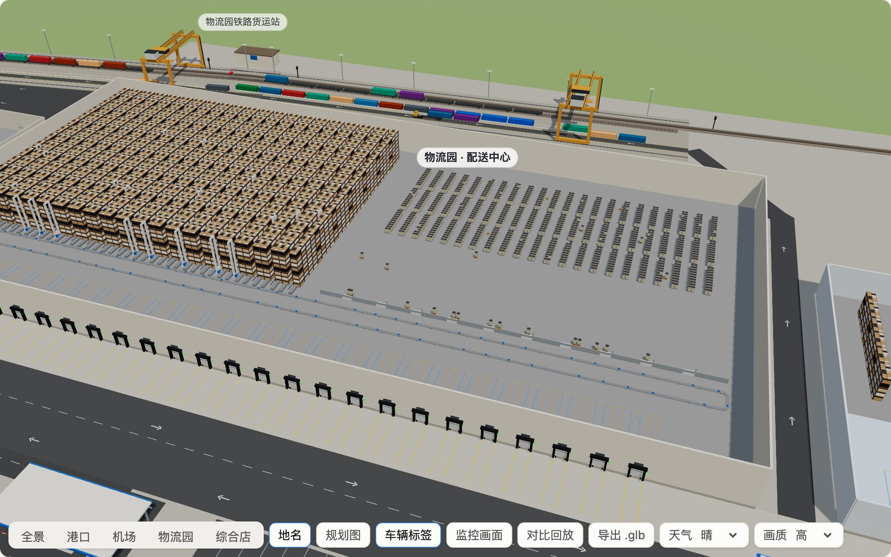

# StoreX 全链路：三代对比

> 作者的作品集项目。本文把三代方案放在同一个区域、同样的需求、促销和船期下逐项比较：**上一代**（Storewright 的门店 + 传统供应链）、**StoreX**（门店升级成 StoreX，上游不变）、**StoreX 全链路**（门店和上游一起由全链路数字孪生协同）。区域里只有一家门店——一家综合店（不挂店名），规模约为 StoreX 门店的 2.5 倍，店后 4 个收货口；货从海运、洲际铁路班列、空运、长途公路（北边国内、东边跨境）、内陆产区的区域生鲜和中央面包房来。第 11 节说明作品集的三个部分（Storewright、StoreX、StoreX 全链路）怎么接起来。数字来自[实验结果](results/README.md)：三代各 20 个种子、每个 18 周；扫描、需求增长和演练各 10 个种子；闭环孪生 20 个种子、每个一天的现场。
>
> 配套文档：[规划报告](01-planning-report.md) · [商业分析](03-business-analysis.md) · [系统设计](04-system-design.md)
>
> 本项目基于公开资料、行业通用做法和作者的独立构想设计。**本项目与任何零售商、企业无隶属关系。** 区域、门店、商品、供应商、船期和所有数字都是合成的。

## 1. 一句话

Storewright 让门店里的每个人在对的时间做对的事；StoreX 让机器做门店里重复的搬运；StoreX 全链路让门店和上游看同一份需求，货少停、车装满，该直送的整车直送门店。同样的区域和需求下，每箱的供应链成本从 <!--n:gens.g1.mean.costPerCase|2-->4.47<!--/n--> 美元降到 <!--n:gens.g3.mean.costPerCase|2-->2.02<!--/n--> 美元（<!--n:pct:gens.g1.mean.costPerCase:gens.g3.mean.costPerCase|0-->−55<!--/n-->%），库存资金少六成多（<!--n:pct:gens.g1.mean.workingCapital:gens.g3.mean.workingCapital|0-->−62<!--/n-->%），门店的生鲜损耗少六成（−60%），门店服务水平不降反升（99.13% → 99.65%）。

## 2. 三代分别是什么

| | 上一代 | StoreX | StoreX 全链路 |
|---|---|---|---|
| 门店 | Storewright：员工用手机作业 + AI | StoreX：人和机器人分工（货格仓、补货机器人、免排队出口） | StoreX |
| 门店订货和收货 | 预测误差约 25%，促销只考虑一半；冷藏每天、常温隔天、冷冻每周两次收货 | 预测误差约 12%，动态降价；收货同上一代 | 预测误差约 8%；每个温区每天收货；安全库存分品类；直送的商品族降到订货点就订整车 |
| 配送中心看到的需求 | 门店的订单 | 门店的订单 | 共享的门店销售预测 + 促销日历 |
| 配送中心作业 | 人工拣货 | 同上一代 | 八成的箱由自动化系统拣（货到人拣选、机器人拆零和码垛） |
| 长途公路整车（国内、跨境） | 全部进配送中心 | 同上一代 | 按货流规划：饮料、常温食品（畅销、一般）、跨境日用品 4 个商品族整车直送门店（占长途整车的 65%），长尾常温货、冷冻和肉类进配送中心 |
| 进配送中心的长途货 | 每 7 天补一次 | 同上一代 | 每 4 天补一次（供应商管理库存），有预先认证的备用供应商 |
| 城市配送 | 按温区分车、固定线路，面包房自己直送 | 同上一代 | 多温区车装全部温区，每天排线，夜里和清早送；60% 电动，35% 由配送车回程顺带供应商的货 |
| 区域生鲜和空运生鲜 | 早上到、入库、第二天送店 | 同上一代 | 夜里到、当天越库送店 |
| 海运 | 堆场平均停 4.5 天，全部拖车 | 同上一代 | 预清关和提箱预约，平均停 1.6 天，六成走铁路接驳到物流园 |
| 洲际铁路班列 | 上午到物流园的铁路货运站，再查验、卸箱 | 同上一代 | 改夜里到站，预清关 |
| 出了状况 | 发现得晚，没有预案 | 门店反应快一些，上游同上一代 | 孪生推演缺口，按预案处置；当天的现场由闭环孪生盯着 |

StoreX 和上一代的上游完全一样，所以「上一代 → StoreX」的差别只来自门店（门店订得更准、报废少，配送中心的库存和进口的量也跟着少了一些）；「StoreX → 全链路」的差别来自上游、货流（长途整车直送）和门店订货收货方式的改变。

## 3. 每个环节怎么变了

| 环节 | 上一代 → 全链路 | 关键数字（上一代 → StoreX → 全链路） |
|---|---|---|
| 门店库存 | 常温隔天、冷冻每周两次收货要多备货 → 每天收货；但直送的商品族一次收整车 | <!--n:gens.g1.mean.storeInv|2-->3.07<!--/n--> → <!--n:gens.g2.mean.storeInv|2-->2.81<!--/n--> → <!--n:gens.g3.mean.storeInv|2-->2.64<!--/n--> 天 |
| 门店到配送中心的信息 | 配送中心从门店的订单里猜需求 → 直接看门店的销售预测 | 配送中心库存 <!--n:gens.g1.mean.dcInv|2-->12.61<!--/n--> → <!--n:gens.g2.mean.dcInv|2-->11.28<!--/n--> → <!--n:gens.g3.mean.dcInv|2-->3.28<!--/n--> 天 |
| 配送中心作业 | 人工拣货 → 八成自动化；直送的货不进配送中心 | 工时 <!--n:gens.g1.mean.dcLabor|0-->73<!--/n--> → <!--n:gens.g2.mean.dcLabor|0-->73<!--/n--> → <!--n:gens.g3.mean.dcLabor|0-->32<!--/n--> 小时 / 天；每工时处理 <!--n:gens.g1.mean.casesPerHour|0-->99<!--/n--> → <!--n:gens.g2.mean.casesPerHour|0-->99<!--/n--> → <!--n:gens.g3.mean.casesPerHour|0-->135<!--/n--> 箱 |
| 长途公路整车 | 全部进配送中心 → 4 个商品族整车直送门店，其余进配送中心；一部分由配送车回程顺带 | 长途整车 <!--n:gens.g1.mean.inboundLoads|1-->4.1<!--/n--> → <!--n:gens.g2.mean.inboundLoads|1-->4.1<!--/n--> → <!--n:gens.g3.mean.inboundLoads|1-->3.3<!--/n--> 车 / 天（全链路 <!--n:gens.g3.mean.directShare|0-->65<!--/n-->% 直送）；下单到到货 <!--n:gens.g1.mean.domLead|2-->2.65<!--/n--> → <!--n:gens.g2.mean.domLead|2-->2.62<!--/n--> → <!--n:gens.g3.mean.domLead|2-->1.71<!--/n--> 天 |
| 城市配送 | 按温区分车、固定线路、面包车 → 多温区合并、每天排线 | 配送里程 <!--n:gens.g1.mean.outKm|0-->419<!--/n--> → <!--n:gens.g2.mean.outKm|0-->423<!--/n--> → <!--n:gens.g3.mean.outKm|0-->203<!--/n--> 公里 / 天；车队 <!--n:gens.g1.mean.fleet|0-->13<!--/n--> → <!--n:gens.g2.mean.fleet|0-->11<!--/n--> → <!--n:gens.g3.mean.fleet|0-->3<!--/n--> 辆 |
| 到店 | 一天几拨车（冷藏、常温、冷冻、面包）→ 每天约 4 趟多温区车，加上每个直送商品族每 1.3–3.9 天一车 | 到店卸货 <!--n:gens.g1.mean.arrivals|1-->8.1<!--/n--> → <!--n:gens.g2.mean.arrivals|1-->8.1<!--/n--> → <!--n:gens.g3.mean.arrivals|1-->6.4<!--/n--> 次 / 天；准时送达三代都是 100% |
| 生鲜 | 区域生鲜和空运的货多等一天 → 当天越库 | 到店剩余保质期 <!--n:gens.g1.mean.freshRemain|1-->63.4<!--/n-->% → <!--n:gens.g2.mean.freshRemain|1-->68.1<!--/n-->% → <!--n:gens.g3.mean.freshRemain|1-->80.4<!--/n-->% |
| 海运 | 到港后再清关、等提箱，全部拖车 → 预清关、预约、六成走铁路 | 堆场停留 <!--n:gens.g1.mean.dwell|2-->4.54<!--/n--> → <!--n:gens.g2.mean.dwell|2-->4.56<!--/n--> → <!--n:gens.g3.mean.dwell|2-->1.60<!--/n--> 天；滞箱费 <!--n:gens.g1.mean.demurrage|0-->118<!--/n--> → <!--n:gens.g2.mean.demurrage|0-->117<!--/n--> → <!--n:gens.g3.mean.demurrage|0-->1<!--/n--> 美元 / 天 |
| 洲际铁路班列 | 上午到站再查验、卸箱 → 夜里到站、预清关 | 下单到进配送中心 <!--n:gens.g1.mean.railLead|1-->21.4<!--/n--> → <!--n:gens.g2.mean.railLead|1-->21.4<!--/n--> → <!--n:gens.g3.mean.railLead|1-->20.6<!--/n--> 天 |
| 空运 | 清早落地、第二天送 → 夜航、凌晨越库 | 下单到进配送中心 <!--n:gens.g1.mean.airLead|2-->1.62<!--/n--> → <!--n:gens.g2.mean.airLead|2-->1.62<!--/n--> → <!--n:gens.g3.mean.airLead|2-->1.12<!--/n--> 天 |
| 出了状况（几周） | 没有预案 → 孪生推演、按预案处置 | 需求突增时多出的缺货 <!--n:stress.demandSurge.gens.g1.lostUnits|1|k-->4.8<!--/n--> → <!--n:stress.demandSurge.gens.g2.lostUnits|1|k-->1.0<!--/n--> → <!--n:stress.demandSurge.gens.g3.lostUnits|1|k-->1.0<!--/n--> 千件（第 9 节） |
| 当天的现场 | 现场自己处理 → 闭环孪生出建议卡、调度员批准 | 全链路多事的一天，不用孪生 → 调度员批准：门店缺货 138 → 15 分钟，少卖 1,147 → 299 件（第 9 节） |

**长途整车：直送门店还是进配送中心**（[结果 6](results/06-flows.md)）。海运、铁路班列和空运的货必须先进配送中心拆箱、分拣，再和别的货拼成按温区的配送车；区域生鲜和面包房的货量小、每天要送，也走配送中心越库。只有长途公路的整车——北边国内 120–300 公里、东边跨境 1,100–1,400 公里——有两条路可走。货流规划给每个商品族算两条路每天的账，再按规则排除不合适直送的（易腐的、长尾的、一车门店放不下的：常温超过 4 天的量、冷冻超过 3 天）：

| 商品族 | 一车是几天的量 | 进配送中心 / 直送（美元 / 天） | 决定 |
|---|---:|---:|---|
| 饮料 | 1.3 | 565 / 295 | **直送门店** |
| 常温食品（畅销） | 1.6 | 544 / 314 | **直送门店** |
| 常温食品（一般） | 2.4 | 415 / 256 | **直送门店** |
| 日用品（跨境公路） | 3.9 | 776 / 629 | **直送门店** |
| 常温食品（长尾，跨境公路） | 3.3 | 1,141 / 938 | 进配送中心：单品多、每个量小，来自很多家小供应商，凑不满整车 |
| 冷冻 | 4.0 | 297 / 202 | 进配送中心：一车是 4 天的量，门店冷冻库放不下 |
| 肉类 | 3.6 | 274 / 151 | 进配送中心：易腐（保质期 9 天），要每天小批量送 |

放进仿真（其余不变，10 个种子），按规划直送比全部进配送中心每天省 730 美元：配送中心少 8 工时，配送少跑 111 公里，到店卸货也略少（6.5 → 6.3 次 / 天）。代价在门店：一次收整车，门店多压 0.96 天的货（1.68 → 2.64 天），常温货最多的时候多 151 托（268 → 419 托），后仓要留出这些托盘位。被规则排除的三个商品族账面上也是直送便宜；把其中不易腐的长尾常温和冷冻也直送，仿真里还能再省 205 美元 / 天，但仿真按「一家供应商一整车」算——长尾商品实际凑不满车，直送会变成很多趟零担；冷冻货最多的时候要多放 25 托，冷冻库的托盘位最贵。上一代和 StoreX 的长途整车全部进配送中心。

## 4. 数字对比

20 个种子的平均（判断看同一种子的配对差值，95% 置信区间不含 0 才算改善或变差；[完整表格和置信区间](results/01-generations.md)）：

| 指标 | 上一代 | StoreX | StoreX 全链路 | 全链路 vs 上一代 | 全链路 vs StoreX |
|---|---:|---:|---:|---|---|
| 门店服务水平（需求满足） | 99.13% | 99.56% | 99.65% | +0.5 个百分点，改善 | 无显著差异 |
| 收市时卖空的商品位 | 3.01% | 1.40% | 1.43% | −53%，改善 | 无显著差异 |
| 门店库存（天） | 3.07 | 2.81 | 2.64 | −14% | −6% |
| 门店生鲜损耗（报废 / 到货） | 4.61% | 2.23% | 1.83% | −60% | −18% |
| 生鲜到店时剩余的保质期 | 63.4% | 68.1% | 80.4% | +17.0 个百分点 | +12.3 个百分点 |
| 到店卸货的车次（含长途直送，次 / 天） | 8.1 | 8.1 | 6.4 | −21% | −22% |
| 门店常温货最多的时候（货架 + 后仓，托） | 409 | 387 | 419 | +2%，**变差** | +8%，**变差** |
| 门店冷藏货最多的时候（托） | 93 | 81 | 71 | −24% | −13% |
| 门店冷冻货最多的时候（托） | 46 | 45 | 28 | −38% | −36% |
| 配送中心库存（天） | 12.61 | 11.28 | 3.28 | −74% | −71% |
| 配送中心订单满足率 | 99.63% | 99.62% | 99.95% | 无显著差异 | 无显著差异 |
| 配送中心工时（小时 / 天） | 73 | 73 | 32 | −56% | −56% |
| 配送里程（含面包车，公里 / 天） | 419 | 423 | 203 | −51% | −52% |
| 配送车队（辆） | 13 | 11 | 3 | −77% | −72% |
| 长途整车（车 / 天） | 4.1 | 4.1 | 3.3 | −19% | −18% |
| 进货里程（公里 / 天） | 3,494 | 3,449 | 2,907 | −17% | −16% |
| 集装箱堆场停留（天） | 4.54 | 4.56 | 1.60 | −65% | −65% |
| 供应链成本（美元 / 天） | 32,413 | 23,493 | 14,573 | −55% | −38% |
| 每箱的供应链成本（美元） | 4.47 | 3.24 | 2.02 | −55% | −38% |
| 库存资金（门店 + 配送中心，百万美元） | 3.09 | 2.79 | 1.17 | −62% | −58% |
| 本地运输排放（吨 / 天） | 3.64 | 3.59 | 3.01 | −17% | −16% |
| 远洋、班列和航空排放（吨 / 天，按自己的货分摊） | 5.1 | 4.5 | 3.7 | −28% | −18% |
| 全系统运营成本（供应链 + 门店人工能耗，美元 / 天） | 69,418 | 46,743 | 37,823 | −46% | −19% |

## 5. 钱花在哪里

每天的供应链成本，按项目分（美元 / 天）：

| 项目 | 上一代 | StoreX | StoreX 全链路 | 全链路比上一代省 |
|---|---:|---:|---:|---:|
| 门店配送（含面包车） | 2,675 | 2,348 | 1,114 | 1,561 |
| 进货运输（含长途直送） | 3,690 | 3,642 | 3,191 | 499 |
| 港口拖车、铁路和滞箱费 | 430 | 430 | 161 | 270 |
| 海运、班列、空运运费 | 6,344 | 6,030 | 5,406 | 938 |
| 配送中心人工 | 2,052 | 2,051 | 899 | 1,153 |
| 库存持有 | 2,923 | 2,738 | 1,538 | 1,385 |
| 生鲜报废和打折 | 13,818 | 6,018 | 2,029 | 11,789 |
| 缺货流失的毛利 | 481 | 237 | 235 | 246 |
| **合计** | **32,413** | **23,493** | **14,573** | **17,840** |

- **门店升级（上一代 → StoreX）每天省 8,920 美元**，几乎全在门店：生鲜报废和打折少 7,800（StoreX 的预测、动态降价和更少的陈列损耗），配送少 327（车队从 13 辆降到 11 辆），运费少 314（报废少了，进口的量也少了），缺货流失的毛利少 244，库存持有少 185。配送中心人工和港口一分没变——上游还是同一套做法。
- **上游协同（StoreX → 全链路）每天再省 8,920 美元**：生鲜报废和打折少 3,989（配送中心直接看销售预测、不再为订单的波动囤货，越库让生鲜更新鲜），配送少 1,234（多温区合并、每天排线，三成多的货直送门店），库存持有少 1,200，配送中心人工少 1,152，运费少 624，进货少 451（回程顺带），港口少 269；缺货流失的毛利基本不变（每天 237 → 235 美元）。
- **生鲜报废和打折是最大的一项**（上一代每天 13,818 美元，占供应链成本的四成多；报废按各商品族自己的进价算），也是三代差得最多的一项。上一代最弱的一环是海运冷箱的果蔬：链条最长，配送中心的订单满足率只有 95.1%，门店服务水平 98.1%，门店损耗还有 6.2%——一边缺货、一边报废；全链路是 100%、99.7% 和 3.3%。

## 6. 库存和新鲜度

- **门店库存**从 3.07 天降到 2.64 天。门店要备到下一次到货：上一代常温隔天、冷冻每周两次，全链路每个温区每天都到。但直送的四个商品族一次来整车（一车是 1.3–3.9 天的量），门店要把它放下：长途整车全部进配送中心时，全链路的门店只要 1.68 天（第 3 节）。StoreX 只靠预测准一点，降到 2.81 天。
- **配送中心库存**从 12.61 天降到 3.28 天。StoreX 也少了一成（11.28 天）：门店订得更准，配送中心看到的订单波动小一些。大头在全链路：配送中心直接看销售预测，不再为门店订单的波动备货；进配送中心的长途货每 4 天补一次（上一代每 7 天）；港口停留缩短；直送的四个商品族根本不进配送中心。
- **库存资金**从 309 万美元降到 117 万美元，少约 192 万美元（商业分析按需求增长实验的结果算成约 194 万美元，在头两年一次性算进现金流；每年的节省里只算资金成本以外的持有成本，不重复计算，[结果 5](results/05-economics.md)）。
- **门店的托盘位：** 冷藏和冷冻货最多的时候都少了（冷藏 93 → 81 → 71 托，冷冻 46 → 45 → 28 托）；常温货最多的时候全链路是 419 托，比 StoreX 的 387 托多 8%，比上一代的 409 托也多 2%——直送一次来整车，后仓要多留位（第 10 节）。
- **新鲜度：** 生鲜到店时剩余的保质期从 63.4% 升到 80.4%；只看越库（区域生鲜和空运的生鲜当天送店），就从 71.3% 升到 80.2%（[扫描](results/02-sweeps.md)）。按商品族看门店损耗：空运海鲜 16.3% → 3.0% → 1.5%，空运果蔬 13.7% → 4.1% → 3.9%，面包熟食 7.1% → 1.6% → 1.3%，区域果蔬 6.7% → 4.2% → 3.4%，海运冷箱果蔬 6.2% → 4.1% → 3.3%，肉类 3.2% → 1.5% → 1.2%。门店的损耗率大部分在 StoreX 那一步就降下来了（门店的预测和降价）；全链路再降的一段来自更新鲜的到货、更准的预测和生鲜更低的安全系数。

## 7. 运输和排放

| | 上一代 | StoreX | StoreX 全链路 |
|---|---:|---:|---:|
| 门店配送车次（不含面包车，车 / 天） | 5.8 | 5.8 | 4.2 |
| 面包房直送小货车（车 / 天） | 2.3 | 2.3 | 0 |
| 长途整车（不含回程顺带，车 / 天） | 4.1 | 4.1 | 3.3 |
| 长途整车直送门店的比例 | 0 | 0 | 65% |
| 到店卸货的车次（次 / 天） | 8.1 | 8.1 | 6.4 |
| 配送车装载率 | 85.8% | 85.6% | 88.5% |
| 配送里程（含面包车，公里 / 天） | 419 | 423 | 203 |
| 电动车承担的配送里程 | 0 | 0 | 56% |
| 进货里程（长途整车 + 区域生鲜 + 机场，公里 / 天） | 3,494 | 3,449 | 2,907 |
| 走铁路的集装箱 | 0 | 0 | 58% |
| 本地运输排放（吨 / 天） | 3.64 | 3.59 | 3.01 |
| 每箱的本地运输排放（克） | 502 | 495 | 416 |

- **配送车次少了 28%**（5.8 → 4.2 车 / 天），到店卸货少了 21%（8.1 → 6.4 次 / 天，含长途直送车）：主要因为按件数 34% 的货由长途整车直送门店，不再占配送中心的车；面包车也并进了多温区车。配送里程减半（419 → 203 公里 / 天），车队从 13 辆降到 3 辆。
- **直送还是进配送中心**（第 3 节）：按规划直送比全部进配送中心，配送每天少跑 111 公里，本地排放基本持平（+0.04 吨 / 天）。
- **本地运输排放少 17%**（3.64 → 3.01 吨 / 天）。单项看（[扫描](results/02-sweeps.md)）：回程顺带每天少 0.44 吨，是最大的一项；电动车少 0.06 吨，铁路少 0.05 吨，多温区合并少 0.02 吨；进配送中心的长途货改成每 4 天补一次（上一代每 7 天）反而多 0.15 吨（第 10 节）。
- **远洋、班列和航空排放**（按自己货物的重量分摊）每天 3.7 吨，比本地运输还多；这部分全链路只能靠少报废、少进口来减（5.1 → 4.5 → 3.7 吨 / 天）。

## 8. 需求增长时

综合店的需求从现在的 80% 到 160%（StoreX 报告里线上订单翻倍时，门店的总件数约 +24%，所以 2030 年约 124%），三代都按需求自动排班、派车、订货；全链路的直送清单不变（10 个种子，[结果 3](results/03-capacity.md)）：

| 需求 | 门店服务水平（%） | 配送中心工时（小时 / 天） | 配送车队（辆） | 每箱的供应链成本（美元） |
|---|---|---|---|---|
| 80% | 99.19 / 99.55 / 99.62 | 62 / 62 / 30 | 11 / 9 / 3 | 4.59 / 3.34 / 2.09 |
| 100% | 99.08 / 99.50 / 99.63 | 73 / 73 / 32 | 13 / 11 / 3 | 4.50 / 3.25 / 2.01 |
| 124%（2030 年） | 99.08 / 99.51 / 99.63 | 87 / 87 / 35 | 15 / 12 / 3 | 4.43 / 3.18 / 1.96 |
| 140% | 99.10 / 99.52 / 99.63 | 96 / 96 / 37 | 17 / 13 / 4 | 4.43 / 3.14 / 1.93 |
| 160% | 99.11 / 99.51 / 99.63 | 108 / 107 / 39 | 19 / 15 / 4 | 4.39 / 3.13 / 1.91 |

（每格依次是上一代 / StoreX / 全链路。）

需求涨六成，上一代的配送中心要多 35 小时 / 天的工时（73 → 108），全链路只多 7 小时（32 → 39）；车队上一代多 6 辆，全链路多 1 辆。到 2030 年（124%），全链路的配送中心工时只涨 9%（32 → 35 小时）。门店服务水平三代都不随量变化，全链路在每个需求水平都是 99.62–99.63%。每箱成本三代都随量下降（固定成本摊薄），全链路从 2.01 降到 1.91 美元，始终比上一代低约 2.5 美元。需求涨了，直送一车的间隔变短，全链路的门店库存反而略降（2.64 → 2.50 天）。

## 9. 出状况时

五种演练，每种都和同一种子、没有扰动的那次逐日比，看扰动开始后 3 周（10 个种子，[结果 4](results/04-stress.md)）：

| 演练 | 多出的缺货（千件）上一代 / StoreX / 全链路 | 最差一天比平常低（个百分点） | 全链路怎么应对、花了多少 |
|---|---|---|---|
| 港口拥堵（班轮晚到 6 天，之后 10 天堆场停留翻倍） | 0 / 0.1 / 0 | 0 / 0.2 / 0 | 向国内分销商过桥采购 6 天的进口商品（贵 15%），642 美元 |
| 机场关闭 2 天 | 0 / 0 / 0 | 0 / 0 / 0；空运生鲜 0 / 1.2 / 0 | 改降备降机场、卡车运回，5,040 美元 |
| 高速封闭 1 天（物流园进城） | 0 / 0 / 0 | 0 / 0 / 0 | 所有车提前改道，应对不花钱 |
| 主供应商停产 7 天（常温畅销品，占件数 13%） | 0 / 0 / 0 | 0 / 0 / 0 | 订单立即转给预先认证的备用供应商，不多花钱 |
| 需求突增 +35%、5 天 | 4.8 / 1.0 / 1.0 | 1.5 / 0.3 / 0.3；空运生鲜 3.4 / 0.7 / 1.1 | 孪生更早把突增写进预测，应对不花钱 |

- **一家店的量上，大多数扰动几乎碰不到货架。** 港口拥堵、机场关闭、高速封闭、供应商停产这四种，三代在之后 3 周里多出的缺货都不超过 0.1 千件，最差一天最多低 0.2 个百分点。上一代和 StoreX 的配送中心平时压着 11–13 天的货，这些扰动在库存里就消化掉了。
- **全链路的库存最少，靠预案守住：** 港口拥堵时孪生发现班轮延误，按缺口过桥采购，花 642 美元（连同其他各项的变化，合计多花 1,488 美元）；机场关闭时改降备降机场、卡车运回，花 5,040 美元。两次都一件没多缺。但上一代不花这笔钱，在这两次演练里也几乎没多缺货——一家店的量上，这些预案更像保险：花的钱事先知道，换来的是不用赌库存够不够。StoreX 两头都不占：门店的库存少了、上游又没有预案，港口拥堵时最差一天低 0.2 个百分点，机场关闭时空运生鲜最差一天低 1.2 个百分点。
- **供应商停产时，全链路也没有多缺货**（多花的钱合计 −99 美元，基本没变）。停产的常温畅销品在全链路里由长途整车直送门店，中间没有配送中心的库存；孪生半天内发现停产、把订单转给备用供应商，门店的库存降到订货点以下时一次订够几整车，补回订货点以上。上一代和 StoreX 的这类货进配送中心，靠配送中心的库存挡住，也几乎没多缺。
- **需求突增是唯一真正碰到货架的一项：** 全部商品 +35%、持续 5 天，上一代多缺 4.8 千件，最差一天低 1.5 个百分点，空运生鲜最差一天低 3.4 个百分点。StoreX 和全链路都只多缺 1 千件上下，两者差不多（都是 1.0 千件）——全链路的门店和配送中心的库存都更薄（第 6 节），头几天能垫的货少，但它更早把突增写进预测。按整个计入期算，突增让三代分别多花 89,218、65,456 和 21,717 美元（含多卖出去的那些货的运输和作业）。

### 当天的现场：闭环孪生

上面的演练是几周的尺度；一天之内的状况更小、更快：装车晚、事故、抛锚、冷机坏、门店某个商品族突然卖得快、长途直送车发车晚。[结果 7](results/07-twin.md) 把全链路某一天的计划放进「现场」一分钟一分钟地跑（20 个种子）。孪生只通过感知数据（定位、车载终端事件、冷机读数、装车进度、门磁、收银、盘点、路况，一天约 4.8–4.9 千条）知道发生了什么，每 5 分钟推演一次每辆车的到店时间和货温、门店每个商品族什么时候卖空，发现问题就出一张建议卡，列出几种做法和各自推演的结果。

多事的一天（三成的配送车装车晚、5 处事故、抛锚的是装生鲜最多的那辆车、一定有一台冷机压缩机坏、某个商品族突然卖到 3 倍、长途直送车晚 3–5 小时），每天平均：

| 做法 | 门店收货迟到（分钟） | 冷链超温（分钟） | 门店缺货（分钟） | 少卖（件） | 措施花的钱（美元 / 天） |
|---|---:|---:|---:|---:|---:|
| 不用孪生（现场自己处理） | 118 | 18 | 138 | 1,147 | 0 |
| 只自动执行低风险的，其余建议卡没人批 | 118 | 5 | 138 | 1,147 | 0 |
| 低风险的自动执行，调度员 10 分钟内批准推荐的做法 | 0 | 5 | 15 | 299 | 258 |
| 全部自动执行（上限） | 0 | 5 | 9 | 218 | 289 |

- **调度员 10 分钟内批准推荐的做法：** 门店收货迟到 118 → 0 分钟，冷链超温 18 → 5 分钟，门店缺货 138 → 15 分钟，少卖 1,147 → 299 件，措施平均每天花 258 美元；调度员每天只要批约 3 张卡（3.4 张）。平常的一天：迟到 48 → 0 分钟，超温 16 → 3 分钟，缺货 10 → 0 分钟，每天 49 美元。
- **建议要有人批。** 只自动执行低风险的那一组（提醒司机检查车门、调低冷机设定温度、改到空闲的月台门）挡住了大部分超温，但迟到和缺货和不用孪生一样——派救援车、配送中心追加补货、通知门店顺延收货这些花钱或牵涉别人的做法，没人批就不会发生。全部自动执行是上限，不是建议的用法。
- **估计得准：** 提前 15–45 分钟预测到店时间，平均误差 2.4 分钟（多事的一天 3.3 分钟）；提前 1.5–3 小时，误差在半小时以内（24.5–28.5 分钟）。
- **还没做到的：** 剩下的超温多发生在门店卸货的最后几分钟，孪生现在的指令管不到已经靠上收货口的车，要靠门店先卸冷藏货、加人手快卸。

## 10. 什么变差了、什么没变

- **门店后仓要多留托盘位。** 长途整车直送让门店一次收整车：全链路门店常温货最多的时候是 419 托，比 StoreX 多 8%、比上一代多 2%（都是变差）；和全部进配送中心相比多 151 托（第 3 节）。冷藏、冷冻货最多的时候反而少了（71、28 托，StoreX 是 81、45 托）。冷冻不直送也是这个原因：冷冻货一车是 4 天的量，直送的话冷冻货最多的时候要多 25 托，冷冻库的托盘位最贵。
- **库存更薄，需求突增时多缺的和 StoreX 差不多**（都约 1.0 千件，第 9 节）。直送的商品族中间没有配送中心的库存，出事时靠孪生及时转单、门店一次补几整车：供应商停产演练里这样没有多缺货，但前提是孪生半天内发现、备用供应商接得上。如果某个直送商品族的供应商不稳，可以把它改回进配送中心，代价是少省这一族的钱（常温畅销品每天 230 美元）。
- **品类之间换了位置。** 收市时卖空的商品位和缺货流失的毛利，全链路和 StoreX 没有显著差异（1.43% vs 1.40%，缺货流失的毛利每天 235 vs 237 美元），但生鲜的安全系数降低了（z = 1.28）、常温提高了（z = 2.05）：肉类的服务水平 98.9% → 98.2%，乳品 99.8% → 99.5%，面包熟食 98.8% → 98.5%，直送的四个常温商品族都到了 100%。这是有意的取舍：和全部商品用 z = 1.65 相比，分品类每天省 308 美元（生鲜报废和打折少 333 美元），服务水平低 0.05 个百分点（[扫描](results/02-sweeps.md#门店的安全库存)）。哪个品类不能接受，可以单独调高它的安全系数。
- **门店服务水平和配送中心满足率**和 StoreX 没有显著差异。全链路的价值不在「更不缺货」，而在「同样不缺货，库存、报废、人工和运输少很多」。
- **配送中心自动化在一家店的量上不回本。** 八成自动化每天只少约 14 工时、省约 400 美元人工，撑不起 600 万美元的设备：增量净现值约 −606 万美元，投资取低值、时薪 34 美元、2030 年需求 +40% 也是约 −281 万美元；不上自动化，上游这一步的 10 年净现值反而从约 980 万美元升到约 1,586 万美元（[结果 5](results/05-economics.md)）。本文的全链路仍按含自动化的方案比较；不上自动化时，全链路每天多约 14 工时、多约 400 美元，排放、服务水平和库存都不变（[扫描](results/02-sweeps.md)）。
- **有几项在这个量上几乎不起作用：** 配送车队一共 3 辆，60% 电动只让本地排放每天少 0.06 吨（成本每天反而多约 7 美元）；港口集装箱六成走铁路不省钱（每天多约 13 美元），只少 0.05 吨，还让海运下单到进配送中心多 0.7 天（等接驳班列）。减排的大头是回程顺带（每天 −0.44 吨）。
- **补货频率是个取舍：** 进配送中心的长途货每 4 天补一次还是每 7 天，成本差在波动范围内（每 4 天每天多 27 美元）；每 4 天配送中心少压 0.3 天的货，每 7 天每天少排 0.15 吨。现在选的是每 4 天。
- **出状况时多花钱：** 机场关闭时备降机场的卡车花 5,040 美元，港口拥堵时过桥采购花 642 美元；上一代不花这笔钱，在这两次演练里也几乎没多缺货（第 9 节）。
- **远洋、班列和航空排放**比本地运输还多（全链路每天 3.7 vs 3.0 吨），全链路只能靠少报废、少进口来减。
- **准时送达**三代都是 100%，看不出差别；一天之内的迟到要看闭环孪生（第 9 节）。

## 11. 作品集的三个部分怎么接起来

| | 第一部分 Storewright | 第二部分 StoreX | 第三部分 StoreX 全链路 |
|---|---|---|---|
| 范围 | 一家门店的现场作业 | 一家面向 2030 年的门店 | 一家综合店的整条供应链：港口、洲际铁路班列、机场、长途公路（国内、跨境）、区域生鲜集货、物流园和配送中心、门店 |
| 数字孪生是什么 | 运营孪生：三维门店和现场作业实时同步，回放当天、推演未来 3 小时，驱动员工手机上的任务和 AI | 规划孪生：全天的离散事件仿真，员工、机器人、顾客和货车逐秒移动 | 区域孪生：18 周按小时推进的全链路仿真、当天作业的调度台和闭环孪生（感知数据 → 估计 → 建议卡 → 指令发回现场），加上整个区域的三维场景 |
| 回答的问题 | 现在店里发生了什么、下一步该做什么 | 2030 年的门店怎么布置、人和机器人怎么分工、设备买多少 | 货从哪里来、走哪条路（直送门店还是进配送中心）、在哪里停、钱花在哪里、出了状况怎么办 |
| 时间尺度 | 秒到小时 | 一天 | 18 周；闭环孪生是一天，按分钟 |
| 三维场景 | 门店和周边街区的沙盘 | 门店（1 格 = 1 米），员工和机器人 | 整个区域（1 公里画成 100 米），车、火车、船、飞机；综合店的生鲜食品区放 StoreX 的门店模型和它的仿真 |
| 关键结果 | 线上订单每单约 30 分钟工时、按时备好（StoreX 报告里的上一代基线） | 全店工时 −38%、生鲜损耗 −51%（相对 Storewright 流程） | 供应链成本 −55%、库存资金 −62%（相对上一代的全链路）；多事的一天，闭环孪生让门店缺货 138 → 15 分钟 |

三个部分是一层一层往外扩的：

- **第三部分的「上一代」门店就是 Storewright 优化后的门店，「StoreX」门店就是第二部分的门店。** 综合店的规模约为 StoreX 门店的 2.5 倍，中间的生鲜食品区就是 StoreX 报告里的门店模型；门店的品类结构、到店曲线和生鲜损耗沿用 StoreX 报告，全系统对比里的门店人工和能耗用 StoreX 报告的结果按规模折算（上一代每天 37,005 美元，StoreX 23,250 美元）。
- **全链路给 StoreX 门店补上了它自己做不到的部分：** StoreX 能把门店的损耗和人工降下来，但门店收货的频率、到店的车次、生鲜到店时的新鲜度、配送中心看到什么需求、长途整车直送还是进配送中心，都由上游决定。只升级门店时，生鲜到店只剩 68% 的保质期，配送中心还压着 11 天的货；门店库存少了，上游的扰动也更容易传到货架上（港口拥堵和机场关闭时 StoreX 有小幅缺货，上一代和全链路几乎没有，第 9 节）。
- **同一套方法：** 三个部分都用合成数据、同一个门店的布局和品类、配对的仿真比较；第二、三部分共用随机数、统计、经济分析、报告的图和门店仿真，区域三维场景里综合店的生鲜食品区就是第二部分的门店模型，店里的人和机器人用第二部分的仿真回放。

## 12. 上一代的校准

- **门店：** 上一代门店的预测误差、促销考虑程度、陈列量和报废规则按 Storewright 优化后流程的水平设定；门店的生鲜损耗（上一代 4.6%、StoreX 2.2%）和 StoreX 报告里的水平（5.75%、2.83%）在同一个量级——StoreX 报告按单个商品逐日统计，这里按商品族，口径不完全一样。
- **配送中心和运输：** 「看门店订单补货、人工拣货、按温区分车、固定线路、面包房直送、长途整车全部进配送中心、到港后再清关、全部拖车」是传统做法的常见形态，参数取公开资料的常见区间（例如人工拣货每工时约 150 箱、堆场停留 4–5 天；算上收货、装车和固定工时，上一代的配送中心每工时处理约 99 箱）。
- **公平性：** 三代用同一个引擎、同一组种子；易腐品「只算到期前卖得掉的库存、一次最多订到期前卖得掉的量」这两条采购常识三代都有，上一代没有被故意做差（[系统设计](04-system-design.md)「校准和可信度」一节的模型修正例子）。长途整车直送只在全链路里用，上一代和 StoreX 按传统做法全部进配送中心；直送单独值多少见第 3 节（每天 730 美元，StoreX → 全链路每天一共省 8,920 美元）。
