# StoreX 全链路系统设计：区域数字孪生的仿真引擎、闭环和三维场景

> 作者的作品集项目。本文说明全链路仿真怎么搭、货流怎么规划、三代方案在引擎里怎么区分、实验和统计怎么做、调度台怎么查看和安排全部作业、闭环孪生怎么从现场数据估计和推演、三维孪生怎么生成、怎么接虚幻引擎和 MATLAB，以及怎么运行和扩展。
>
> 配套文档：[规划报告](01-planning-report.md) · [三代对比](02-generation-comparison.md) · [商业分析](03-business-analysis.md) · [实验结果](results/README.md)
>
> 本项目基于公开资料、行业通用做法和作者的独立构想设计。**本项目与任何零售商、企业无隶属关系。** 区域、门店、商品、供应商、船期和所有数字都是合成的。

## 1. 这套系统做什么

StoreX（第二部分）的引擎回答的是「一家店里，人和机器人怎么分工」；全链路引擎回答的是「这家店的货从港口、铁路、机场、长途公路、内陆产区来，怎么流、钱花在哪里、每个作业怎么排、出了状况怎么办」。区域里只有一家综合店。系统由这些部分组成：

| 部分 | 做什么 | 代码 |
|---|---|---|
| 区域和网络 | 虚构的滨海都市圈：区域生成器按现实中滨海城市的样子生成海岸、河、城区和干道网、绕城快速路、高架、高速、铁路和车站、门店的位置，港口、机场、物流园整体放进生成的位置（默认、随机、自定义三种状态） | `src/region/` |
| 全链路仿真 | 按小时推进 18 周：门店卖货和订货、配送中心分配和补货、城市配送、长途公路（直送门店和进配送中心）、区域生鲜、面包房、海运、洲际班列和空运；四档负荷 | `src/sim/` |
| 货流规划 | 长途整车按商品族算账，决定直送门店还是进配送中心 | `src/sim/flows.ts` |
| 实验和商业分析 | 三代对比、决策扫描、需求增长、压力演练、闭环孪生、投资和现金流，写成 Markdown、SVG 和 JSON | `src/analysis/`、`src/cli/` |
| 调度台 | 当天的全部作业：排月台门、车辆和门店收货口，检查冲突和迟到；改当天的作业或常规计划后重新仿真，和原计划比 | `src/sim/board.ts`、`src/sim/plan.ts`、`web/src/dispatch.ts` |
| 设施管理 | 港口、机场、物流园、综合店的布局、设备检修和三班排班，映射到仿真参数；网页的管理台手动改或随机生成，集团总览一屏看全部设施 | `src/facility/`、`web/src/facilityAdmin.ts` |
| 闭环孪生 | 现场（一分钟一步的物理层仿真）→ 感知数据 → 孪生（估计、推演、建议卡）→ 指令 → 现场；和不用孪生的同一天比 | `src/twin/` |
| 孪生服务 | 按可加速的真实时间运行闭环，用 WebSocket 和 REST 把车道级的车辆位置、感知数据、建议卡推给外部系统，接收决定和指令 | `server/` |
| 三维孪生网页 | 整个区域的三维场景：车道级的道路网、立交、桥和高架、轻量的城区、社会车流；港口（别家的船进出港、拖轮协助靠离泊）、机场（全天的航班起降）、铁路站、物流园、门店收货区的作业设备按当天的计划动；车、火车、船、飞机按仿真轨迹或闭环现场移动，加减速、转弯、停靠都有动作，实时跟踪每辆车、设施监控每个设施，和调度台、闭环面板联动；综合店里用 StoreX 的门店仿真 | `web/` |
| 门店场地 | 综合店的停车场、即时取货和收货场：车位布置、一天的车流（取货、购物、员工、房车）、时空排程、指标 | `src/site/`、`web/src/three/store/` |
| 仓储中心 | 港口物流中心、机场货站、物流园的一天作业计划（每个箱、板、托盘、车走过哪些区），三维和值班助手共用 | `src/hub/` |
| 卸货场引擎 | 所有卸货口共用的车道布置、倒车路线、铰接运动学和排程（仿真的车和外来的车共用一份）；独立程序库 `@storewright/yard` | `packages/yard/`（仓库根目录） |
| 重叠审计 | 车身矩形的分离轴检验、网格粗筛、「车对 × 秒」统计和上限；独立程序库 `@storewright/overlap-audit`，`npm run overlaps` 用它 | `packages/overlap-audit/`、`scripts/overlaps.mjs` |
| 场景文件 | 一个可复现的时刻（区域、方案、种子、负荷、演练、设施改动、时刻、镜头……）的 JSON 格式、检查、分享链接、JSON Schema | `src/scenario/`、`web/src/scenarioUi.ts` |
| 演示导览 | 「一个集装箱从船到货架」：从仿真记录串出一个箱子的一路，镜头跟着走 | `src/tour/`、`web/src/tour.ts` |
| 教学沙盘 | 10 道练习、按仿真自动批改、网页的练习抽屉和批改命令行 | `src/teach/`、`web/src/teachPanel.ts`、`src/cli/teach.ts` |
| 值班台基准 | 四套盲测的数据集、评分器、五个对照系统和报告 | `src/bench/`、`bench/duty-desk/` |
| 对照验证 | 算法和精确最优解、穷举、蒙特卡洛模拟对照，CVRPLIB 例子 | `src/validate/`、`bench/validation/` |
| 外部引擎 | 虚幻引擎 5 插件（高画质渲染）、MATLAB / Simulink（机理模型和外部模型服务）、Blender 脚本（虚幻引擎用的车辆模型） | `engines/` |

一次 18 周的仿真约 0.03 秒；全部实验（770 次 18 周的仿真 + 160 次一整天的闭环）约 16 秒（单线程）。调度台改了计划以后重新仿真一次是零点几秒，闭环跑一整天约 0.03 秒。

## 2. 结构

```
StoreX-Chain/
├── src/
│   ├── region/     区域生成器（海岸、河、城区、道路、铁路、设施位置）、城市用地规划、设施的坐标系、当前区域的数据、道路图和最短路、综合店、商品族
│   ├── sim/        方案配置（三代）、全链路仿真引擎、货流规划、配送线路（节约法）、动画轨迹和作业、
│   │               调度台（排门、排车、排收货口、检查）、两层计划（常规计划、当天调度）
│   ├── facility/   设施配置：港口、机场、物流园、综合店的布局、设备检修和三班排班，映射到仿真参数
│   ├── twin/       闭环孪生：现场仿真、感知数据和指令、孪生的估计和推演、机理模型、闭环运行
│   ├── assistant/  值班助手：意图、参数、查询工具、四段式回答、数字核对、规则表、归因、异常检测、评测；角色和审批、交接班、复盘、看板
│   ├── hub/        仓储中心的作业计划（港口物流中心、机场货站、物流园）和共用的数据结构 HubDay
│   ├── site/       综合店的停车场、即时取货和收货场（车位、车流、时空排程、指标）
│   ├── scenario/   场景文件：格式、逐字段检查、分享链接、JSON Schema、场景 → 仿真参数
│   ├── tour/       演示导览「一个集装箱从船到货架」的数据（纯函数）
│   ├── teach/      运营教学沙盘：练习、批改、参考答案
│   ├── bench/      值班台基准：数据集导出、对照系统、评分、报告
│   ├── validate/   对照验证：精确最优解、穷举、蒙特卡洛
│   ├── analysis/   指标、实验（三代 / 扫描 / 增长 / 演练 / 闭环）、商业分析、表格格式、区域地图 SVG
│   └── cli/        命令行和结果写出
├── server/         孪生服务（WebSocket + REST，无第三方依赖）、车道级位置、测试客户端、接口文档
├── engines/
│   ├── blender/    车辆模型的生成脚本（虚幻引擎用；网页的车辆由代码放样）
│   ├── ue5/        虚幻引擎 5 插件 StoreXTwin
│   └── matlab/     冷机模型、延误滤波、孪生服务客户端、Simulink 模型的生成脚本、自检
├── web/            区域三维孪生网页（Vite + Web Worker + Three.js）：调度台、闭环面板、跟踪和设施监控、设施管理台、三维场景
│   └── src/three/  道路网和道路模型、门店（store/ 是停车场、即时取货和收货场）、城区和规划图、车辆模型（vehicles/）和运动规划、社会车流、船和飞机；ops/ 是港口（含港口物流中心）、机场（含货站）、物流园（含转运仓和场院）、铁路站、门店收货区的作业
├── bench/          值班台基准的数据集和结果、对照验证的例子和结果
├── tests/          单元测试
└── docs/           报告和实验结果
```

卸货场引擎和重叠审计的通用部分在仓库根目录的 `packages/yard`、`packages/overlap-audit`（两个独立程序库，全链路按包名 `@storewright/yard`、`@storewright/overlap-audit` 引用）。

和前两部分共用的东西直接引用、不复制：

- 随机数（可分流的种子随机数）、置信区间和配对差值：`StoreX/src/core/`；
- 报告的 SVG 图（折线、分组柱、正负柱、龙卷风图）和商业分析的基础函数（资本回收系数、内部收益率、回收期）：`StoreX/src/analysis/`；
- 三维零件、门店模型、人和机器人的实例化渲染、轨迹回放：`StoreX/web/src/three/`、`StoreX/web/src/tracePos.ts`；
- 综合店里生鲜食品区的门店仿真：`StoreX/src/ops/day.ts`（在网页的第二个后台线程里跑）。

## 3. 区域和网络

**坐标。** 公里坐标，x 向东、y 向北，市中心在原点，区域 88 × 64 公里（x −40…48、y −28…36）。默认区域里西南是集装箱港口，东南是机场货运区，东北是物流园；北面的高速出口（国内长途）通往内陆产区（区域生鲜，出口外 70–95 公里）和国内供应商，东面的高速出口通往跨境（洲际）公路，铁路从物流园往东接洲际线（出口外的里程按每个供应商另加）。随机或自定义的区域里，这些位置和方向都换了，下面的规则不变。

**道路图。** 节点是绕城快速路的立交（R0…）和两头（BE0、BE1）、城区路网的路口、各个设施的入口和两个高速出口，都由下面的区域生成器给出；边分四级（高速、快速路（绕城快速路和高架）、干道、本地道路），真实里程 = 折线长度 × 弯曲系数（折线已经画出了大弯，系数只补小弯：高速 1.06、干道 1.12、本地 1.3）。卡车的自由流速度按级别（高速 82、快速路 72、干道 38、本地 28 公里 / 小时）。

**区域生成器**（`src/region/regionGen.ts`）。整个区域按现实中滨海城市的样子生成，同一个规格每次生成的完全一样：

- **海岸和河：** 海在城市的某一侧，海岸线是几个正弦叠加出来的曲折线，港口那一段拉直（码头要贴着海岸），河口凹进去一点；河从内陆的区域边上流过城区（离市中心 1.6–3.2 公里）入海，弯弯曲曲，约 0.34 公里宽（沙盘上 34 米）。
- **城区和干道：** 城区是一个不规则的圈（小、中、大城市半径约 7.5、10、12 公里，离海岸至少 1 公里）。路口随机撒（最小间距 2.1–2.55 公里），加上市中心、立交内侧的进城路口和一串沿海大道的路口；干道网用「相对邻域图」（两个路口之间没有第三个路口离它们都更近才连）加最小生成树保证连通，再补一部分短的连线，所以街区以不规则的四边形、五边形为主；过河的干道只留 2–4 条（就是桥），每条长干道往旁边轻轻弯一点，只连着一条路的断头路去掉；路段之间只在路口相交。
- **绕城快速路：** 沿内陆一侧绕过城区，两头接到海边（不成环），离城区外缘约 1 公里、半径跟着地形起伏，绕开海和设施；4–6 个立交，往高速出口和设施的方向靠，每个立交内侧接一个进城路口。
- **高架快速路：** 从两个方向最相反的进城路口之间穿过城区、从市中心旁边经过，整段架在空中（9.5 米），跨过沿途的干道和河，两头坡道落地。
- **设施：** 港口贴在海岸上（码头朝海）；机场、物流园按指定的方向和远近（近 12–16 公里、远 16–21 公里）找位置：占地全在陆地上、在城区以外 1.2 公里、不压河、彼此隔开 1.6 公里，找不到就放宽方向和距离（最多 420 次）；机场跑道的方向随机，物流园的大门朝着市区。两个高速出口在区域边上往里 6 公里，朝着海就往陆地转。
- **高速：** 两个出口、物流园、机场、港口各接到最近的立交（或绕城快速路的一头），先沿设施大门的方向开出来，穿过城区的段落推到绕城快速路外侧，在海里的点推回陆地，再平滑；出口在物流园这一侧时，物流园还有一条直通出口的高速。
- **铁路：** 港口铁路站往内陆开出来，沿城区外缘（0.78 倍城区半径）绕到物流园，从货运站的一端进站、另一端出站（两段站台），再开向指定的方向出区域；港口到物流园这一段离市中心最近的地方设城市客运站。
- **门店：** 按指定的位置（市中心、城区、城郊）找一块空地：离干道和高架至少 1.3 公里、离铁路 1 公里、离河 0.9 公里。随机和自定义区域里先给门店留出整块用地（店前停车场、店房、百货馆和约 100 米深的收货场，`STORE_SITE`），在铺城市道路之前定下位置和朝向，之后的路口、干道和高架都让开它；正前方 1.32 公里放一个路口，店前停车场正对进店路。
- **城市形态和海岸（随机、自定义）：** 城市形态有自由生长、方格路网、环形放射、带状（沿海岸）、多组团（绿带隔开）五种，海岸有曲折海岸、海湾、半岛、平直海岸、河口和岛屿五种（岛屿让开港口航道和设施），河可以有一条支流（过支流的铁路和公路都上桥）；跑道顺着风向，货运一侧朝城市。用地规划和城区见 8.7。默认区域不变（仿真规划的校验值有测试守着）。

三种状态：**默认区域**（港口、机场、物流园、两个出口在原来的位置，海岸线也是原来的；城区、河、道路、铁路和门店按编号 1 生成——报告的数字按它算）；**随机生成**（上面每一项都按编号随机：海在哪一侧、有没有河、城市大小、港口在海岸的哪一段、机场和物流园的方向和远近、铁路和两个高速出口的方向、门店的位置）；**自定义**（每一项都可以指定，没指定的按编号随机；出口和铁路不会朝着海，物流园在内陆）。网页上「区域」选状态和编号，「自定义…」打开设置，或者在地址里写 `?region=random-42`、`?region=custom-7~sea.E~air.N`；孪生服务用 `--region`。仿真的里程和路线、三维的车道级道路和建筑、社会车流和孪生服务都用同一份。

**高速绕开设施的核心区。** 铺高速（设施、出口接到立交）时，除了绕开城区，还要绕开港口、机场、物流园的核心区（港口的闸口、堆场和码头，机场的货站卡车场、机坪和跑道，物流园的库房、挂车场和场站，`CORES`）：碰到就从核心区外侧外扩 0.6 公里的角上绕过去，平滑以后还进核心区就把绕行放宽再来，最近的立交实在走不通就换近一点的另一个。设施自己的进场路出大门那一段不算，物流园自己的几条高速本来就贴着园区边走。以前随机区域里有机场的进场高速出了大门又掉头横穿机坪和跑道；现在 84 个区域里 76 个完全不进核心区，另 8 个有一段贴着核心区的边擦过（20–200 米，多是设施夹在城区和海岸之间、怎么接都要擦过边的情况），测试守着默认区域和 30 个随机编号（最多 100 米）。默认区域不受影响，报告的数字不变。

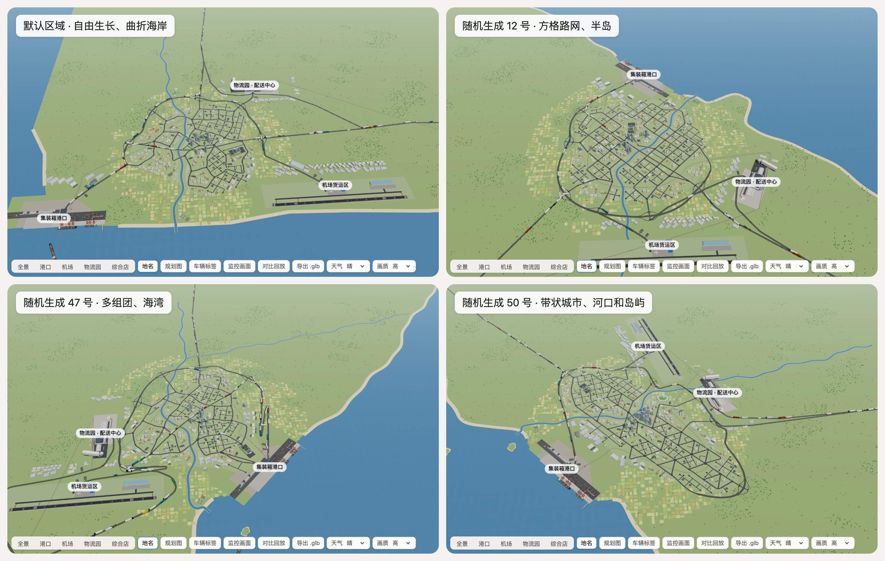

**设施的坐标系**（`src/region/frames.ts`）。港口、机场、物流园内部的几何、设备和作业动画都按「局部坐标」写（就是它们在默认区域里的位置），区域生成器给每个设施一个坐标系：局部参考点放到哪里、绕竖轴转多少。三维里设施放在一个平移、旋转过的节点下面；船和飞机的航线（`portKm`、`airKm`）、车辆的停靠位（`places.ts`）、镜头预设、监控机位、孪生服务发给外部引擎的月台门位置，都按坐标系换到区域里。港口的海在局部 +z 一侧，机场跑道沿局部 x，物流园的大门朝局部 +z、铁路货运站的股道沿局部 x。

**最短路。** 按自由流时间的 Dijkstra，结果缓存。实际行驶时间按出发时刻修正：市区道路（干道和本地道路）早高峰慢 60%、晚高峰慢 50%、夜里快 15%，高速和快速路不变（`travelHours`）。高速封闭的演练封的是物流园进城的主路（配送中心到门店最短路上的第一段，`dcMainRoad`），用一张去掉那条边的道路图。

**综合店。** 区域里唯一的门店（`STORE`，`src/region/network.ts`），位置由区域生成器给出，用一段本地道路接到最近的干道节点。规模 2.5（1.0 = StoreX 报告里的那家店，每天约 3.1 万件），每天约 7.7 万件。店后一排 4 个收货口（`S01-1`…`S01-4`），配送中心的车和长途直送车共用。规模和收货口数可以在设施管理台改（4.11）。

**商品族。** 网络层面不需要几万个商品：按「大类 × 温区 × 货源」分成 17 个族，每个族只有一种货源——长途公路（国内或跨境，`supplier.via` 是国内长途或跨境长途的出口，`border` 表示要过境清关，多约 2 天）、区域生鲜（内陆产区，经国内长途的出口）、中央面包房、海运进口、铁路班列、空运进口，需求占比沿用 StoreX 的大类结构。每个族再分 4 个「单品组」（畅销到长尾，需求占 40% / 30% / 20% / 10%），各自有库存和缺货。生鲜有从产地算起的保质期（乳品 18 天、区域果蔬 10 天、海运冷箱果蔬 45 天、肉类 9 天、空运海鲜 7 天、面包 3 天）。

## 4. 仿真内核

### 4.1 时间、事件和随机数

主循环按小时推进 126 天（前 70 天预热，后 56 天计入结果）。到货（配送中心、门店）是按时间排序的事件队列，每小时处理到期的事件；每天固定时刻做固定的事：门店每小时卖货、22 点下单（走配送中心的货）和检查直送商品的订货点，配送中心 23 点（全链路是次日 2 点，等夜里到的生鲜一起越库）分配和派车、23 点给供应商下单，日终处理生鲜的打折、损耗和过期。

预热期 70 天是因为海运下单到货约 6 周：预热结束时，开始时假设的在途货已经全部换成运行中下的单。

**公共随机数。** 需求、促销、船期、班列晚点、作业波动、预测误差各用一个独立的随机数子流（`Rng.fork`）。三代方案用同一个种子时面对完全相同的需求、促销日历和船期（有单元测试），所以三代之间的差别只来自流程本身，配对比较的置信区间也窄得多。

### 4.2 需求

每个单品组每天的需求 = 基准件数 × 门店规模 × 商品族占比 × 星期系数 × 促销系数 × 门店当天的波动（对数正态，8%）× 单品组自己的波动（对数正态，按商品族 30–60%）。每周有 2 个商品族做 4 天促销（+60%）。需求按 StoreX 的到店曲线分到营业的 15 个小时里。

### 4.3 门店

- **卖货：** 每小时按需求从货架拿，拿不到就是缺货（流失毛利按 60% 算，其余顾客换了别的商品）；生鲜一半顾客挑最新鲜的、一半先拿最老的。
- **订货（走配送中心的货）：** 每晚按「补到目标量」给下一次配送下单：目标 = 预测 × 覆盖天数 + 安全系数 × 预测 × 波动 × √覆盖天数 + 陈列量。覆盖天数取决于这个温区隔几天送一次。预测误差按方案（上一代 25%、StoreX 12%、全链路 8%）；全链路的安全系数分品类（常温 2.05、生鲜 1.28）。
- **订货（直送的货）：** 库存加在途降到订货点就向供应商订整车：订货点 = 预测 × (提前期 + 1 + 到货前要卖的那部分) + 安全系数 × 预测 × 波动 × √(提前期 + 1) + 1.2 天的量；至少订规划的车数，订完还回不到订货点以上就再加一车。整车按每个单品组的缺口分装（缺得多的多装）。
- **生鲜：** 按批次记年龄；上一代在最后一天打 6 折卖掉约 35%，StoreX 和全链路从倒数第二天开始动态降价；每天还有搬运和品相损耗；过期报废。
- **收货：** 每次到店卸货按托盘数算时间；在门店规定时刻前到算准时。每小时到货以后记一次门店每个温区的托数（货架 + 后仓），报告当天最多的时候（门店要准备多少托盘位）。

### 4.4 配送中心

- **分配：** 门店的订单按商品族汇总，库存不够时按比例分，没分到的从门店的「在途」里扣掉（门店第二天会再订——这就是上一代看到的「虚高」订单）。生鲜先进先出。直送的商品族配送中心不放库存。
- **预测：** 上一代和 StoreX 只看得到门店的订单，用指数平滑（每天下单的商品族平滑系数每天 0.2；下单周期越长平滑得越慢）；全链路用共享的门店销售预测和促销日历，直接算未来提前期内的需求。误差的方差也按同样的口径估计。
- **补货：** 定期检查、补到目标量：目标 = 预测 × (检查周期 + 提前期) + 安全系数 × √(提前期内需求的方差 + 预测² × 提前期的方差)。提前期的波动包括船期、堆场停留、铁路班次、班列晚点和供应商。海运的提前期按下单那天算到实际赶上的那一班船（等船 0–6 天），班列按赶上的那一班。
- **易腐品的两条规则（三代都有）：** 到出库期限还发不完的库存不算数；一次最多订到期前卖得掉的量。海运冷箱的果蔬提前期是保质期的好几倍，用比例补货：每周订一周的预测量，缺口分三周补齐，压住长链条的牛鞭效应。
- **出库期限：** 剩余保质期不到三成的货不再往门店发，算配送中心报废。
- **人工：** 工时 = 固定工时 + 拣货箱数 ÷ 拣货效率 + 收货托盘 ÷ 收货效率 + 装车托盘 ÷ 装车效率。上一代人工拣货每工时约 155 箱、固定 16 工时；全链路八成的箱由自动化系统拣（每工时约 1,200 箱，含维护和监控），两成人工，混合约 560 箱，固定 20 工时（多出来的是自动化的技术员和监控）。

### 4.5 城市配送

- **上一代和 StoreX：** 按温区分开送（冷藏每天、常温隔天、冷冻每周两次），每个温区、每个星期几按平均量排一次固定线路（节约法），每天照着跑，量大时多派一辆；冷藏冷冻早上出车（4–9 点），常温下午出车（12–18 点）；面包房自己用小货车直送。
- **全链路：** 门店每天来的车装全部温区（多温区车，面包也装进去），每天按当天的量重新排线（节约法），2:30–10 点出车，避开早高峰，门店收货区夜间无人值守；60% 的车是电动的（优先给短线路）。一家店的量一车装不下时分几车，每车按托盘数分一份。
- **节约法：** 先各自一条线路，合并两条线路省下的里程 = d(中心, i) + d(中心, j) − d(i, j)，按省得多少从大到小合并，不超过车的托盘数和停靠点数；超过一车的先单独派整车（`routing.ts`，只有一家店时主要用来切整车）。
- **车队：** 车在出车时段里均匀出发，跑完回来可以再跑一趟；车队规模 = 最多同时在用的车数。

### 4.6 上游

- **长途公路：** 每个商品族一家供应商，国内的在国内长途的高速出口外 120–300 公里，跨境的在跨境长途的出口外 1,100–1,400 公里（过境清关约 2 天）。进配送中心的：每家供应商按补货周期发车（不足一车也要走），装不满的那一车照样按整车付运费；全链路有 35% 的整车由自己配送车的回程顺带。直送门店的：门店到订货点就订整车，到店时间在门店的直送收货时段里（全链路 4–10 点）。
- **区域生鲜：** 内陆产区（国内长途的出口外 70–95 公里）的乳品和果蔬由集货车每天拉一趟；上一代早上 4:30 到配送中心、入库、第二天送店；全链路夜里 1 点到、当天越库送店。
- **中央面包房：** 按当天的门店订单生产，不留库存。
- **海运：** 每周一班自己货物的班轮，下单后约 38 天到港（加上等船的时间）；到港晚到的天数按对数正态抽（平均 0.6 天）。每个 40 尺箱卸船后在堆场停留（清关、等提箱），上一代平均 4.5 天、波动 50%，全链路靠预清关和提箱预约平均 1.6 天；超过 3 天免费期收滞箱费。出堆场后走拖车（闸口排队）或铁路（每周一、三、五 14 点一班，约 3.5 小时到物流园货运站）。
- **洲际铁路班列：** 每周一班，从洲际线（默认区域在东边）开进物流园货运站，在途约 16 天、晚点按对数正态抽（上一代平均 0.6 天，全链路 0.4 天）；到站后查验、卸箱（上一代上午到站、12 小时，全链路夜里 3 点到站、预清关后 4 小时）再进配送中心。
- **空运：** 每天一班货运航班；上一代清早落地、货站处理 8 小时、第二天送店；全链路改订夜间到港的航班，预清关后 2.5 小时出货站，凌晨越库送店。

### 4.7 货流规划

`planFlows`（`src/sim/flows.ts`）给每个长途公路的商品族算两条路每天的成本（按预测的需求，不跑仿真）：

- **进配送中心** = 整车到配送中心的运费（按九成装载）+ 配送中心的收货、拣货、装车工时 + 送店那一段按托分摊（一趟往返的油费、司机和车的日租 ÷ 24 托）+ 配送中心按补货周期多放的库存；
- **直送门店** = 整车到门店的运费（满载）+ 门店收货的工时 + 门店多放的库存（半个直送周期 + 1 天）。

先按规则排除：易腐（保质期不到 20 天）、长尾（需求波动系数 ≥ 0.55）、一车的量门店放不下（常温超过 4 天、冷冻超过 3 天）；满足规则的直送比进配送中心便宜才直送。全链路方案的直送清单就是规划算出来的（有单元测试）；海运、班列、空运、区域生鲜、面包房的货没有这个选择，都经配送中心。规划的账和仿真里三种直送清单（全部进配送中心 / 按规划 / 不易腐的全部直送）的对比见[结果 6](results/06-flows.md)。

### 4.8 扰动和孪生的应对

18 周仿真里的五种演练（[结果 4](results/04-stress.md)）：

| 演练 | 怎么发生 | 全链路的应对（上一代和 StoreX 没有） |
|---|---|---|
| 港口拥堵 | 这 10 天里靠港的班轮晚到 6 天，堆场停留翻倍 | 孪生拿到最新到港时间，逐个商品族推算接下来 12 天的缺口，只按缺口向国内分销商过桥采购（贵 15%，3 天到）；预清关和预约让自己的箱只多停 30% |
| 机场关闭 | 风暴关闭 2 天 | 改降约 300 公里外的备降机场，卡车运回（多 5 小时，付卡车费） |
| 高速封闭 | 物流园进城的高速封闭 1 天 | 所有车提前改道；没有孪生时第一趟车开到封闭处才折返（多绕 40%） |
| 供应商停产 | 常温畅销品（占全部件数 13%，全链路里是直送的）的主供应商停产 7 天 | 半天发现，立即把卡住的订单转给预先认证的备用供应商（多 1 天）；没有孪生时 3 天才发现 |
| 需求突增 | 风暴预警引发抢购，全部商品 +35%，持续 5 天 | 半天内把突增写进门店和配送中心的预测；上一代要 2 天（StoreX 的门店 1 天，配送中心仍要 2 天） |

一天之内的现场状况（抛锚、冷机故障、装车晚、事故、门店突然卖得快、直送车发车晚）由闭环孪生处理，见 §9。

### 4.9 成本和排放

每天的供应链成本 = 配送（司机工时、油费或电费、车辆和挂车的日租、柴油冷机）+ 面包车 + 进货运费（长途整车按整车公里，进配送中心和直送门店一样算）+ 港口拖车、铁路和滞箱费 + 海运、班列和空运运费 + 配送中心人工 + 库存持有（门店、配送中心和在途库存，每年 22%）+ 生鲜报废和打折 + 缺货流失的毛利。单价和排放因子在 `src/sim/config.ts` 的 `COSTS` 里，都是公开资料里的常见区间（例如柴油半挂约 34 升 / 100 公里、电动卡车 1.25 千瓦时 / 公里、电网 0.35 千克二氧化碳 / 千瓦时、班列每 40 尺箱 4,800 美元）。远洋、班列和航空排放按自己货物的重量分摊。

### 4.10 三代在引擎里的区别

同一个引擎、同一个区域、同一套需求，只有方案配置不同（`src/sim/config.ts`）：

| 环节 | 上一代 | StoreX | StoreX 全链路 |
|---|---|---|---|
| 门店预测误差、促销考虑进去的比例 | 25%、50% | 12%、90% | 8%、100% |
| 门店安全系数 | 1.65 | 1.65 | 常温 2.05、生鲜 1.28 |
| 生鲜打折 | 最后一天 6 折 | 动态降价 | 动态降价 |
| 送货频率 | 冷藏每天、常温隔天、冷冻每周两次 | 同上一代 | 每天一次（多温区） |
| 长途整车 | 全部进配送中心 | 同上一代 | 按货流规划：4 个商品族直送门店，其余进配送中心 |
| 配送中心的预测 | 门店订单 | 门店订单 | 共享销售数据 + 促销日历 |
| 进配送中心的长途货的补货周期 | 7 天 | 7 天 | 4 天（供应商管理库存） |
| 配送中心拣货效率 | 155 箱 / 工时 | 155 | 约 560（八成自动化） |
| 城市配送 | 按温区、固定线路、面包车直送 | 同上一代 | 多温区合并、动态线路、60% 电动、35% 回程顺带 |
| 区域生鲜和空运生鲜 | 早上到、入库、第二天送 | 同上一代 | 夜里到、当天越库 |
| 港口堆场停留、走铁路 | 4.5 天、0% | 同上一代 | 1.6 天、60% |
| 洲际班列到站、查验 | 上午、12 小时 | 同上一代 | 夜里、4 小时 |
| 扰动的应对 | 无 | 无 | 见 4.8 |

### 4.11 负荷档位和设施配置

**负荷档位**（`withLoad`，`src/sim/config.ts`），用来测高负荷下的运营：

| 档位 | 需求 | 班轮（每周） | 洲际班列（每周） | 货运航班（每天） | 城区背景车流 |
|---|---:|---:|---:|---:|---:|
| 平常 | × 1 | 1 | 1 | 1 | × 1 |
| 高峰 | × 1.35 | 2 | 2 | 2 | × 1.4 |
| 高负荷 | × 1.8 | 3 | 3 | 3 | × 2 |
| 极限 | × 2.5 | 4 | 4 | 4 | × 2.8 |

班轮和班列按星期均匀排开，港口铁路接驳改成每天都开，空运的订单分给当天的各个航班；海运和班列的补货周期跟着班次缩短。平常档就是原来的场景，报告里的数字都是平常档。

**设施配置**（`src/facility/`）。港口、机场、物流园和综合店各有一份配置：布局（泊位、自己的岸桥和别家的岸桥、每台岸桥配几辆场内集卡、闸口车道；货机机位、板车套数、每个航班的集装板数；立体库巷道、货到人机器人、干货和冷链月台门、铁路货运站每段站台的装卸线；门店规模、收货口、货架排数、后仓）、停机检修的设备，以及每个岗位早班（6–14 点）、中班（14–22 点）、夜班（22–6 点）的人数和时薪。`applyFacilities` 把它变成仿真参数，`setFacilities` 改调度台的资源：

| 配置 | 仿真里变什么 |
|---|---|
| 门店的收货员 | 每托的卸货时间（早班人少了卸得慢） |
| 机场的板车套数、牵引车司机、货站拆板组板 | 货站的处理时间 |
| 港口的闸口车道、闸口查验员 | 集装箱出闸要等多久 |
| 物流园的叉车司机、收货员 | 收货和装车的速度（看人最少的那个班） |
| 物流园的月台门、门店的规模和收货口 | 调度台排的资源（干货门最多 26 樘、冷链门最多 12 樘，每组前三分之一收货），门店的件数和收货口数 |

泊位（2–4 个）、货机机位（2–6 个）和装卸线（每段站台 1–4 股）只改三维里的设施和排班的岗位数，不改仿真参数：码头按泊位加长（一个泊位留给本店的班轮，其余停别家的船），机坪按机位加长，站台在主线旁边多铺几股装卸线（港口铁路站在 3 个泊位以上时变成 2 股）；门店规模（1–5 倍）同时改门店的件数。默认配置不改任何仿真参数（有单元测试）。三维里的设施作业读同一份配置（见 8.3）。

## 5. 实验和统计

- **三代对比：** 每代 20 个种子（同一组种子），每个指标报告均值和 95% 置信区间；「改善 / 变差」看配对差值的置信区间是否包含 0。
- **决策扫描：** 10 个决策（含长途整车直送清单），每次只改一项、其余保持全链路的选用值，每个配置 10 个种子；另外算出每一项「从不做到选用」单独值多少。
- **需求增长：** 综合店的需求 80%–160%，三代都按需求自动排班、派车、订货。
- **压力演练：** 5 种扰动 × 3 代 × 10 个种子，扰动从第 80 天开始；指标都和同一种子、没有扰动的那次逐日比，只看扰动带来的变化。
- **闭环孪生：** 20 个种子 × 2 种现场状况（平常、多事）× 4 种做法（不用孪生、只自动执行低风险的、加调度员 10 分钟内批准、全部自动执行），每次是全链路方案第 86 天的计划在现场跑一整天（`src/analysis/twinStudy.ts`）。同一个种子下四种做法面对完全一样的状况。
- **商业分析：** 每天的节省按需求增长实验的结果在当年的需求上插值，见[商业分析](03-business-analysis.md)。

`npm run reports` 跑完全部实验，写 `docs/results/` 下的 7 个结果页、30 多张 SVG 图和 `data.json`（网页的「对比与报告」页读它的副本）。所有报告里的数字都来自这里。

## 6. 校准和可信度

### 6.1 校准到什么

- **门店：** 件数、大类结构、到店曲线、生鲜损耗水平（上一代约 4.6%、StoreX 约 2.2%）和 StoreX 报告一致；门店的人工和能耗直接用 StoreX 报告的结果（按规模折算）。
- **配送中心：** 人工拣货每工时约 150 箱、自动化系统每工时约 1,200 箱，是公开资料里的常见水平。
- **运输：** 车速、高峰拥堵、装载、运价和排放因子取公开资料的常见区间。
- **港口和班列：** 堆场停留 4.5 天对应「到港后再清关、等提箱」的常见做法；1.6 天对应预清关和提箱预约。洲际班列在途约 16 天，是公开资料里常见线路的量级。
- **闭环孪生：** 冷机的两状态热模型（车厢空气、货物）用公开资料里冷藏车的常见量级（保温层漏热的时间常数约 5 小时、压缩机每分钟降约 0.25 °C、货物跟随空气的时间常数冷藏约 4 小时）。

### 6.2 几次模型修正的例子

**海运冷箱果蔬。** 早期版本里，海运冷箱果蔬（提前期约 45 天、到配送中心后只能再放约 12 天）在上一代的部分种子下出现「一边大量报废、一边长期断货」：配送中心把快过期的库存也算进了库存位置，于是少订；库存过期后管道里又没有货；门店的虚高订单再把预测推高。这不是传统做法该有的表现——任何采购员都不会这样订。修正后（只算到期前卖得掉的库存、一次最多订到期前卖得掉的量、长链条用比例补货、提前期算上等船），三代的海运果蔬都恢复到合理水平。

**直送整车的分装。** 加上长途直送以后，全链路的门店服务水平反而比 StoreX 低了约 0.3 个百分点，直送的 4 个商品族各低约 1 个百分点。查下来是一整车按固定比例分给 4 个单品组，而订货点看的是合计：合计还够，最小的单品组已经卖空。改成按每个单品组的缺口分装以后，直送商品族的服务水平回到 99.9% 以上，门店库存没有增加。

**直送一次订几车。** 需求增长实验里，全链路的门店服务水平在需求 140% 时掉到 98.5%、160% 时掉到 97.2%，别的两代都稳在 99% 以上。查下来是饮料：需求 160% 时一天要卖 33 托，而门店每天只检查一次订货点、每次只订一车（26 托），库存越卖越少，服务水平掉到 77%。改成一次订够回到订货点以上的整车数以后，全链路在 80%–160% 的每个需求水平下都在 99.6% 左右。报告里的数字都来自修正后的模型。

### 6.3 测试

`npm test` 跑 394 个单元测试（48 个文件；卸货场引擎本身的 37 项和重叠审计库的 12 项在各自的程序库里，用 `npm test -w @storewright/yard`、`npm test -w @storewright/overlap-audit` 跑）：

- **全链路（15 个）：** 道路图连通、封闭后改道更远；综合店和商品族占比、门店不压在高速和铁路上；节约法不超过车的容量和停靠点数；三代面对完全一样的需求；件数守恒（卖出 + 缺货 = 需求）；结果在合理范围；全链路的库存、工时、到店车次和成本都更少；洲际班列的箱进配送中心；打开动画不改变结果；港口拥堵时孪生按缺口过桥采购、比不这么做缺货少。
- **货流规划（4 个）：** 只规划长途公路的商品族、全链路的直送清单就是规划算出来的；直送的都满足规则；易腐的肉类、长尾的跨境货进配送中心，跨境的货两种去处都有；仿真里直送的货配送中心不放库存、直送车只装直送的货。
- **调度台（9 个）：** 作业编号不重复、能找到对应的车辆，装车在分配之后；默认计划下每趟车都有门和车，同一樘门、同一辆车、同一个收货口的时段不重叠；指定冲突的门和车会报出来，按修法或自动排程能修好；常规计划原样写回结果完全一样；只改一趟车的出发时刻，别的车不变；门店收货时段；区域生鲜集货晚于分配时生鲜到店更老，并提示赶不上分配。
- **闭环孪生（13 个）：** 不用孪生时一条指令都不发；同样的现场状况，闭环合计不比不用孪生差、整体明显更好；低风险的措施就压下超温和等门；孪生的估计跟得上现场（到店时间、货温、门店库存）；持续校准学到的偏差在合理范围、十程以后接近真实值；建议卡推荐的是推演合计最好的做法；追加补货、改直送、让车晚点到这些指令真的改变现场；长途直送车发车晚了，车还没进区域孪生就出卡、通知门店顺延；在某个时刻批准一张卡、从头再跑结果完全一样；一分钟一分钟地走和一口气跑完结果一样。
- **区域、负荷、设施和比例（10 个）：** 默认区域、8 个随机编号和 2 个自定义区域里，干道只在路口相交，港口、机场、物流园互不重叠也不出区域，门店离干道和铁路都有一段距离，绕城快速路至少有 4 个立交；同一个规格每次生成得一样，地址里的写法来回转换不变；两个随机编号的港口、机场、物流园、门店和铁路出口都不一样；换区域以后门店搬家，铁路经过物流园货运站，道路图通到配送中心、港口、机场、两个高速出口和中央面包房，全链路照样跑得通；平常档不改场景，高负荷放大需求、每周 3 班船和 3 列班列、每天 3 班航班，当天的车船飞机更多；默认设施配置不改仿真参数，收货员少了每托卸得慢、板车少了货站处理慢；随机生成在取值范围里（含泊位、机位和装卸线）、同一个编号一样，关掉月台门以后调度台只用开着的门；默认区域和 30 个随机编号里，高速不从港口、机场、物流园的核心区里穿过（设施自己出大门那一段除外，贴边最多 100 米）。
- **商业分析（4 个）：** 需求路径、投资时点和单调性。
- **值班助手（21 个）：** 意图分类的留出集准确率不低于 85%；时刻、车、商品族、月台门、第几条认得对；风险清单、问车（「它」接着问）、批准和否决只给提议、不改任何数据、批准低风险的只挑低风险的；为什么推荐、如果不处理、资料库和预案库的检索；没跑闭环时按计划回答；交接班报告只用报告时刻以前的事；复盘的实际值和现场的记录一致；角色、审批单往上报和操作记录；指令跟踪不用未来的数据；通信质量「良好」和不设完全一样、「较差」时丢点晚到照样出建议；分层看板的阈值和告警往上报；网络规划、跨境、预测、求解也能问。
- **值班助手评测（22 个）：** 176 道标准问题按门槛全部通过（意图、参数、工具、事实、数字核对、澄清、拒答、安全），留出集不低于 94%；每题问完调度台和建议卡都没被改动；数据较差时提议只能人工逐条核实；规则表挡下违反硬性规定的提议；评测连跑两遍输出逐字节一样；四套盲测每题都答得出来、跑两遍一样、安全全对（意图、工具、形态只报告、不设门槛，不拿它训练、调分类器）。
- **值班助手的通用把关（16 个）、预约错峰的场地排程器（2 个）、孪生服务的仓储中心（3 个）、分类器与没把握先问（5 个）、孪生服务安全（5 个）、可选的大模型模式（9 个）、界面语言（8 个）、英文单复数（4 个）、英文问句换成示例问句（4 个）、值班助手的英文显示（6 个）：** 大模型模式用模拟的模型检查：只调只读工具、提议过规则表且从不执行、数字对不上或出错就退回内置助手、英文问题走英文；孪生服务接了不通的本机模型时退回内置助手并说明原因；英文界面里每一处要翻译的文字都有英文、占位符一致、仿真实时生成的状态文字也翻得出来，设施的区名和指标名全部有英文，长句嵌套、列表和只填短语的占位符翻得对，查不到的长句 2 秒内放弃；值班助手 496 道题的回答按面板的方式翻译，整行全英文（引号里用户自己打的字除外）的不低于 99.8%（现在全部），导出的今日计划和交接班报告整行全英文的不低于 95%（现在全部），中文界面原样不变；逻辑回归每次训练结果一样、概率校准过，没把握时给出两种最可能的意思请人点选，认出了车、编号就不追问；孪生服务默认没有跨域头，设了令牌时改动状态的接口和 WebSocket 指令没令牌一律拒绝，陌生网页来源拒绝，请求体超过 64 KB 拒收，非本机地址不设令牌拒绝启动；带否定的批准、否决说法认得对，说不清的先问；角色声明不改变角色；「这个」「上一张」接上文，「那个门」「那批货」对不上时先问；和物流运营无关的拒答、正常问题不拒答；错字、别称换成标准说法，编号里的字母不动；按参数类型分流；临时扰动的推演（各种时长的说法，一趟车晚很久迟到不会更少，门停用、封路、班轮晚都能推演，只读、跑两遍一样）；上一轮引入的五处回退；排队模型挑出来的车交给场地排程器验证、回答写明是哪个模型；孪生服务里四个仓储中心都有作业计划，概况、瓶颈、本店的货、预约错峰都按各自的计划回答。 英文里填进去的「1」后面的名词变单数、动词跟着变，「Dock 1」这样的编号和小数、范围不动；随手打的英文问题换成内置助手答得出来的示例问句（编号放回去、航班号按航班），把握不够时用英文说明，不会换成拒答。
- **监控识别（2 个）、天气（8 个）、背景交通（13 个）、外来集卡（4 个）、区域纯函数（1 个）：** 识别框在画面里、同一时刻结果一样、靠台和排队计数；天气按日子固定、十天一轮四晴两云两阵雨一雾一全天雨、相邻两天不重样、演练对应台风、画质档位的右半边刷新间隔；车道上的间距、让行、不闯红灯、行人和车不同时在斑马线上（长车转弯扫过的范围也算）、雨雾让车变慢、从家出发的车回到住宅区、停车场先停近的、背景车让仿真车（停着的货车身上不叠车）、路边车位有进有出；外来集卡只在区域外或停车场出现和消失、不瞬移，每个区域都有设施的停车场；机场货站的外来货车在放进场前一分钟才到进场点外排队，同时在等的两辆车头相距超过 6.5 米，场里的时刻表从放进场的那一刻开始；默认区域单独生成和在随机区域之后生成，停车场、路边车位、卸货场、公交站、货车的路线和背景车流完全一样。 机场回车场里进场和驶离的外来货车车头始终相距 3.2 米以上。
- **铰接运动（6 个；卸货场引擎本身的 37 个在程序库 `@storewright/yard` 里，其中 16 个是超负荷矩阵）：** 1–10 个门、门距 3.8–5 米、左右两种进场、正面和背面接入、大小场地、每种车型：每个门都能从司机一侧倒进去，挂车在离墙 24 米外摆正，倒车和拉出不碰两边停着的车，牵引车车头不进待命车道，铰接角不超过约 65°，路线的转弯半径够大；排程先到先进、同一区段同时只有一辆车在倒车或拉出、一个门同时只停一辆、仿真给的时刻不变，全天每秒查车身不重叠；用真实的一天：路口转弯时挂车切内侧、倒车的几何、道路和场地交接处不跳、到离时刻和仿真一样。
- **门店场地（11 个）：** 车位停留不重叠、长车位占着它挡的车位、取货车到车位的时刻等于门店仿真、出场让行、车位规模；正常和极限负荷的一整天车和车不重叠、不压过斑马线上的行人、一辆不少画，免下车取货交接时车不动，顾客把购物车推回回收栏才开走；指标和车流一致。 门店专用进店车道：同一天有、没有专用车道各算一遍，干道直行车的高峰小时流量和通行能力之比在 0.5 以下，平均多花的时间不到 10 秒。
- **仓储中心：港口（21 个）、机场（8 个）、物流园（10 个）：** 箱、板、托盘守恒（卸下来的要么离开、要么当天结束时还在库里），门和车位不重复占用，查验比例在范围里，冷链货离开冷区不超过时限，本店的货在对的时刻出现、仿真的时刻不改，排出来的计划每次一样；物流园的场内车闲着时回待命停车场的车位（不停在路上、门前），出门登记亭的同一条车道上一次只有一辆。 港口物流中心停着的拖车两两不叠、不瞬移；机场货站的叉车停着时两两不叠。
- **车辆（5 个）、城市用地（10 个）：** 每种车型的尺寸在公开的范围里、车轮在车身里、车灯在两头、挂车的轴和牵引销位置和运动学参数一致、远处的简化模型都有；用地分区、生活圈、噪声区、货运通道，默认区域的仿真规划校验值不变，随机 1–40 号和 3 个自定义区域的门店用地不压道路、铁路、河和海，各种城市形态和海岸都生成得出来。

- **求解（9 个）、排班（4 个）：** 小规模的情况和穷举的最优解一致，真实调度台上的解都可行。
- **预测（10 个）、演练（7 个）：** 模型在留出期打分、按验证期挑；读通知（中文数字、星期、预警颜色）、预案按扰动的种类、用了预案分数不降。
- **网络规划（15 个）、跨境（8 个）：** 小规模和穷举一致；清关步骤加起来等于仿真用的时间、汇率的影响是线性的。
- **对接真实系统（24 个）：** 三个接口来回转换不丢信息、坏记录逐条拒收、回放的建议卡和实时运行一样；实时接入时晚到、乱序的数据按发生的时刻补记，共享口令不对的拒收。
- **场景文件（9 个）、场景库（14 个）：** 合法的场景规整后返回、取值不对逐条报错、不认识的字段只提醒；设施改动按管理台的范围检查，合并和求差互逆；分享链接来回转换一样，网址参数覆盖场景库文件；JSON Schema 和常量生成的一致；场景库每个文件都通过检查、编号和文件名一致、索引和文件一一对应。
- **对照验证（6 个）：** 手算得出最优的小例子精确解法一致；随机例子里节约法、最近邻都可行且从不比精确解好，节约法平均明显更好；CVRPLIB 格式写出再读回来一样、坏的解被查出来；满足率公式和蒙特卡洛模拟的差在随机误差以内、损失函数和教科书一致；求解器和穷举一致，没有「声称最优却不是」。
- **值班台基准（12 个）：** 评分器和评测的结果逐题一致；预测文件的检查；五个对照系统每次一样；导出再读回来一样；可选的大模型用假的提供方跑通。
- **教学沙盘（9 个）：** 按参考答案、做完设置任务 10 道全部满分，全错 0 分；重新仿真批改结果一样；只改一部分设置不给分；答案的各种写法能认；文档和练习定义一致；命令行退出码对。
- **演示导览（7 个）：** 默认区域、随机区域和四档负荷都串得出完整的一路，每一段标了数据来源、时刻在当天以内、同样的输入结果一样；动图的结构检查，拆开再拼回来逐字节一致。
- **文档的数字（2 个）：** README 和报告里标出来的 156 个数字都和 `docs/results/data.json` 一致（重新跑报告以后用 `npm run docs:sync` 更新）。

**三维回归检查**（`node scripts/check3d.mjs`，开发服务器开着时）：4 个场景都通过，0 个页面报错、没有瞬移，帧时间在预算以内；默认区域的演示导览平常那天 9 段里 4 段、极限那天 7 段来自仿真记录，结束卡的入口只在平常那天出现；第 5 步是仿真车的重叠审计（8.8）：一整天每 2 秒取样，仿真车之间停着的重叠四个场景都是 0，仿真车和外来货车停着的默认区域平常 0、极限 118，随机区域 3 号平常 8、11 号高负荷 88，超过上限（定法同 `npm run overlaps`）就失败；默认区域的仿真规划和全链路报告的数字不变。

### 6.4 没有算进去的

税和补贴、融资；供应商自己的成本和利润（只按到货价里的运费算进货运输）；门店后仓托盘位的成本（报告了门店各温区最多放多少托，不算钱）；长尾商品来自多家供应商时直送的零担成本；司机的工时法规细节；集装箱的回空和堆场的设备调度；顾客因为生鲜更新鲜、缺货更少而多买的部分；碳价。这些在[商业分析](03-business-analysis.md)里单独讨论。

### 6.5 对照验证（`src/validate/`、`npm run validate`）

拿算法去和「答案已知」的东西比，结果和方法写在 [08-validation.md](08-validation.md)（英文版 [08-validation.en.md](08-validation.en.md)），几秒钟复现；除了用时，数字都是确定的：

- **配送线路**：仿真用的节约法（`src/sim/routing.ts`）和同一个例子的精确最优解比（先对每个装得下、不超停靠点数的客户子集用 Held–Karp 动态规划求单车最短回路，再对全部客户做集合划分动态规划），12 家店的规模平均只多 1.86%（一车最多 4 家时 2.11%），常见的最近邻贪心多 24.38%。距离按 TSPLIB 的 EUC_2D 取整，12 个例子和最优解写成 CVRPLIB 格式（`bench/validation/cvrp/`），`npm run validate -- check 例子.vrp 解.sol` 核对别的求解器的结果。
- **满足率公式**（`src/network/allocate.ts` 的 `fillRate`）：和 40 万次蒙特卡洛模拟最多差 0.0014（在随机误差以内），由它反推的标准正态损失函数和教科书的值 4 位一致。
- **声称精确最优的求解器**（排门的「挪多少」和「排到哪樘门」、车辆接趟、多门店网络）和穷举所有可能比：586 个例子全部一致。第一次跑时「排到哪樘门」有 3 个例子多用了一樘门（有一类门不够时的快路证明不了最优却直接返回了，求解器当时标了「不保证最优」）；改成证明不了时继续做精确搜索、取两者中更好的以后全部一致，真实一天的调度台和值班助手评测都没有变化。
- 页面里还有和 12 个同类开源项目的定性对照，以及还没验证的部分（交通流精度、真实数据校准、和别的路径求解器实测）。

## 7. 调度台：查看和安排全部作业

数字孪生的核心用处是让管理的人**看清楚、排得动**当天的每一个作业。网页的调度台在三维场景下面，和三维、时间轴用同一个时钟。

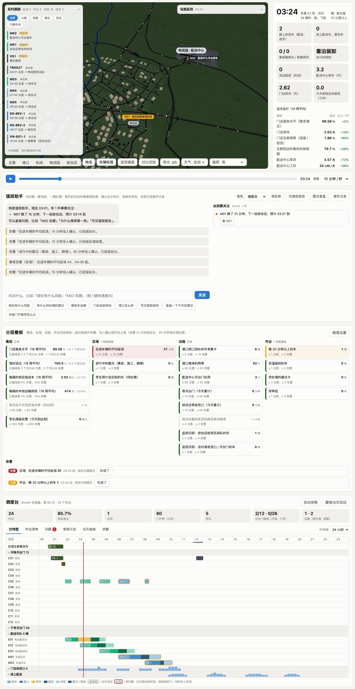

### 7.1 作业

仿真在动画那一天（第 86 天）给每一个作业记一条：起止时刻、从哪到哪、温区、托盘数和装载（每个商品族多少件）、里程、出发时刻（和原计划的出发时刻）、到达时刻、在配送中心月台上的时段，到店的还有到达、开始和结束卸货、门店的收货时段、是否准时、高峰拥堵多花的分钟。

| 作业 | 编号 | 占用的资源 | 怎么改 |
|---|---|---|---|
| 门店配送 | 温区 + 当天第几趟：`M05` 多温区、`L03` 冷藏、`F01` 冷冻、`A02` 常温、`B04` 面包车 | 车辆、发货月台门、门店收货口 | 出发时刻（重新仿真）、车、门 |
| 长途直送 | `DS-商品族-第几车` | 门店收货口 | 到店时刻（重新仿真） |
| 长途进配送中心 | `IN-商品族-第几车` | 收货月台门 | 到达时刻（这家供应商当天的车一起挪，重新仿真）、门 |
| 区域生鲜集货车 | `FR-第几车` | 冷链收货门 | 到达时刻（重新仿真）、门 |
| 空运冷藏车 | `AT-第几车` | 冷链收货门 | 跟着航班（常规计划）、门 |
| 集装箱拖车 | `DR-序号` | 收货门 | 门 |
| 港口铁路接驳 | `RL` + 发车时刻 | 物流园货运站 | 常规计划：每周几、几点发车 |
| 洲际班列 | `TR` + 到站时刻 | 物流园货运站 | 常规计划：每周几、几点到站 |
| 班轮靠泊 | `VS1`（在锚地等泊位是 `VS0`） | 泊位、岸桥 | 常规计划：每周几、几点靠泊 |
| 货运航班 | `FL` + 落地时刻 | 货运机坪 | 常规计划：几点落地 |
| 线上配送 | `VN-门店-第几波` | 门店的配送车 | 只看（由门店的订单系统排） |

以第 1 组「日子」为例：上一代这一天 36 个作业（配送 10 趟、面包车 3 趟、长途进配送中心 6 车、区域生鲜 2 车、集装箱、班轮、航班、班列、线上配送等），全链路 24 个（配送 5 趟、长途直送 2 车、长途进配送中心 1 车、区域生鲜 1 车……）。

### 7.2 排资源

调度员指定的先排，其余的自动排（`src/sim/board.ts`）：

- **月台门。** 配送中心南墙 26 樘干货门（D01–D08 收货、D09–D26 发货）和 12 樘冷链门（C01–C04 收货、C05–C12 发货）。配送车出发前在发货门上装车（15 分钟 + 每托 1.5–2 分钟，分配库存以后才能开始），进货车到了在收货门上卸货，集装箱拆箱约 35 分钟。按时间先后、收货门 / 发货门、编号小的先用；门都占着时，配送车提前装好、挂车放到场地等发车（甩挂），进货车在场地排队等门。
- **车辆。** 电动车 E、多温区车 M、冷藏冷冻车 R、常温车 T、面包车 B 各自编号；按出发先后派车，一辆车跑完一趟、回场半小时以后可以再跑一趟，没有空车就加一辆。
- **门店收货口。** 4 个，配送中心的车和长途直送车共用，先到先用；三维里车开到排给它的那个收货口倒车靠上。

### 7.3 检查和修法

| 问题 | 级别 | 怎么发现 | 修法 |
|---|---|---|---|
| 月台门冲突 | 要处理 | 指定到同一樘门的两个作业时段重叠 | 改到同组空着的门；没有空门就恢复自动排 |
| 车辆还没回来 | 要处理 | 同一辆车的两趟时段重叠（含回场后半小时） | 改派一辆空着的车 |
| 迟到 | 要处理 | 开始卸货晚于门店的收货截止 | 提前「晚了多少 + 5 分钟」出发 |
| 直送车迟到 | 要处理 | 长途直送车开始卸货晚于直送收货截止 | 改到截止前到 |
| 单趟超过 11 小时 | 要处理 | 司机工时 | — |
| 门不够用 / 在场地排队等门 | 提醒 | 同组的门全占着 | — |
| 门店收货口不够 | 提醒 | 同一时刻卸货的车多于 4 个收货口 | 挪直送车或配送车的时刻 |
| 赶不上分配 | 提醒 | 进货到配送中心晚于分配库存的时刻（上一代 / StoreX 23 点，全链路越库 2 点） | 供应商、区域生鲜的车改到分配前 15 分钟到 |
| 高峰拥堵 | 提醒 | 这一段路比平时多花 10 分钟以上 | — |
| 到早了 | 提示 | 到了门店还没到收货时间，在门外等 10 分钟以上 | 推迟出发（省司机工时） |
| 要两班司机 | 提示 | 同一辆车一天用了 14 小时以上 | — |

「自动排程」把能修的都修掉（门和车直接生效；改出发、到达时刻的重新仿真）。

### 7.4 两层计划

- **当天调度**：只改动画那一天的单个作业。在甘特图里左右拖一趟车就是改它的出发（或到达）时刻，拖到别的门、别的车那一行就是改派；也可以在侧栏的详情卡里改。改门和车不用重新仿真；改时刻后在后台线程里重新仿真 18 周（只有那一天的那几个作业不一样）。
- **常规计划**：每天都照着排的时刻表——各温区的出车时段、门店的收货时段、门店收直送车的时段、供应商到货预约、区域生鲜集货、航班、班轮靠泊、港口铁路接驳、洲际班列（`src/sim/plan.ts`）。改了以后整段 18 周按新计划重新仿真。

改过计划以后，调度台顶部的当天指标显示和原计划的差，「常规计划」页列出 18 周平均的指标（成本、服务水平、准时率、损耗、新鲜度、库存、里程、车队、港口停留、海运提前期、排放）和原计划的对比。原计划是同一个方案、同一个「日子」、什么都不改的那次仿真（同一组需求、船期和路况）。时刻有合理的范围：最早发车 = 分配库存后半小时（上一代 / StoreX 0 点、全链路 2:30），面包车不早于 4 点出炉；没有排铁路班次时集装箱全部走拖车。

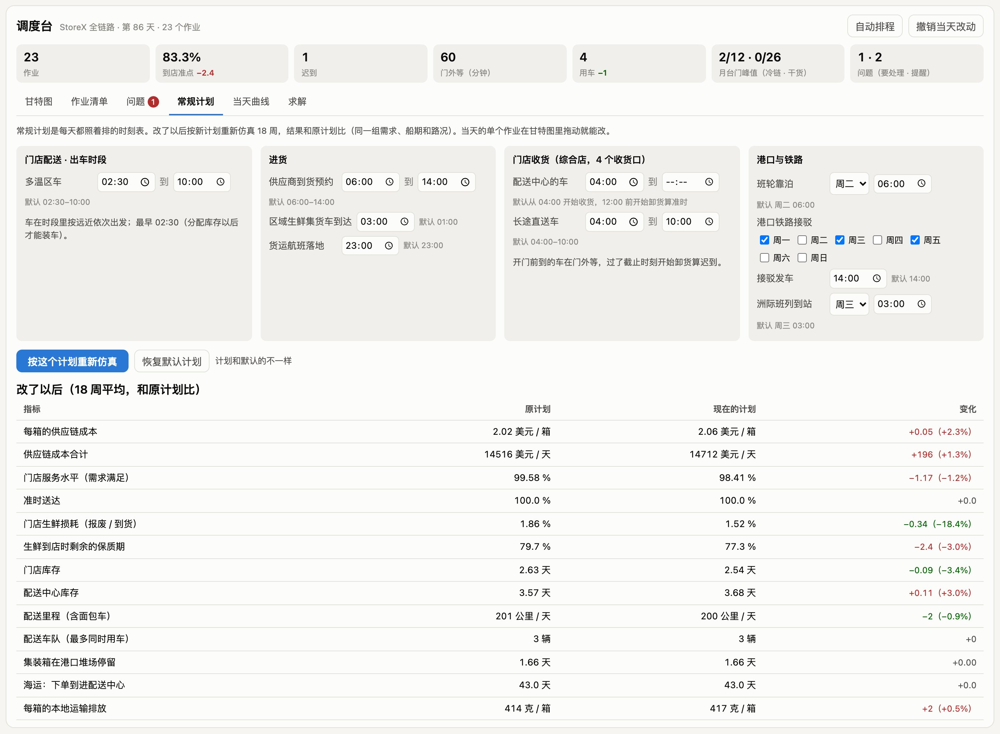

### 7.5 和三维联动

在甘特图、作业清单或问题里选中一个作业，三维里这辆车脚下出现光圈，整趟路线画成一条橙色的线（沿车道、过路口和立交），配送中心的月台门挂上「C05 装车 02:10–02:50」，门店挂上到店时刻；点「在三维里跟随」镜头跟着它走。反过来，在三维里点一辆车，调度台就选中它的作业。配送中心每樘门上方有一盏状态灯，按调度台的排程变色：装车蓝、卸货橙、冲突红。车辆开到调度台排的那樘门和那个收货口，不是随便停。

### 7.6 两个例子（6 个种子的平均）

**全链路把区域生鲜集货从 01:00 推到 03:00**（常规计划）：赶不上 02:00 的越库分配，当天的区域生鲜车报「赶不上分配」，乳品和果蔬要在配送中心多放一天。18 周平均：门店服务水平 99.67% → 98.08%，每箱成本 2.01 → 2.09 美元（+3.8%），生鲜到店剩余保质期 80.2% → 77.6%。门店生鲜损耗反而从 1.82% 降到 1.52%——不是更新鲜了，而是缺货多了、货架上压的货少了。

**上一代把冷藏、冷冻车的出车时段从 04:00–09:00 改到 05:00–10:00**：门店 6 点才开始收货，原来的车早到了要在门外等。改了以后司机在门外等的时间没了，司机工时每天少约 1.2 小时（车队也略少，平均 12.8 → 12.5 辆）；代价是生鲜晚到一小时：损耗 4.69% → 4.81%，每箱成本反而高了 1.5%（4.66 → 4.73 美元）。调度台把这种「省了车和工时、多了损耗」的取舍算成数字，不靠感觉。

## 8. 三维孪生

**场景生成。** 区域由代码按区域生成器的结果生成：海和陆地（海岸线朝陆地一侧围出陆地）、河（水面和两岸）、车道级的道路网（见下）、铁路（碎石路基、轨枕、两根钢轨、平交道口、过河的钢梁桥、城市客运站的站台、雨棚和站房）、港口（填海造的港区）、机场、物流园（配送中心、冷链中心、铁路货运站、车场、充电站、中央面包房）、轻量的城区、成片的树林（只长在陆地上、城区外、不压路、铁路、河和设施）和综合店。港口、机场、物流园的地面、建筑和作业放在各自的坐标系节点下（§3），整体平移、旋转到生成的位置。建模的重点是港口、机场、物流园、铁路站和综合店：这些地方的建筑、设备和作业都按真实尺寸画、按当天的计划动（见 8.1），城区只是背景。

**综合店。** 不挂店名。中间的生鲜食品区放的是 StoreX 的门店模型（上一代放 Storewright 那一代的布局），后面接着百货日用馆（玻璃连廊、正面一条色带；进深随门店规模变，规模 2.5 时 52 米、5 倍时约 90 米），店后一排收货口（默认 4 个、最多 8 个；门罩、防撞块、调平板、编号牌、红绿灯），屋顶设备；StoreX 方案还有屋顶光伏。店前的停车场、即时取货和店后的收货场按第一部分的模板重做，见 8.4（StoreX 门店模型自带的格子停车场在全链路里藏起来，取货车按新的场地重新排）。百货馆是有墙、有屋顶、有里面的房子：北墙内侧是 1.1 米高、8 米深的收货台，后面三排后仓货架，一道隔墙后面是卖场的一排排货架和收银台；镜头拉近时（和 StoreX 门店的剖切同时）屋顶隐藏。

**比例。** 沙盘把距离压缩成 1/10（1 公里画成 100 米），建筑、车辆、船和飞机按真实尺寸画；镜头拉远时车辆按距离放大，全景里也看得见。区域的公里坐标 (x, y) 对应三维的 (x × 100, −y × 100)。两种比例统一写在 `src/region/scale.ts`（`SCALE`、`kmToScene`、`roadSpeedScene` 等换算，有测试）：区域的距离 1/10，设施、停车场、建筑和车辆 1 : 1，时间是真实时间——所以路上的车在画面里按真实车速的 1/10 走（高速上画面里 2.8 米 / 秒，相当于真实约 100 公里 / 小时），进了港口、机场、物流园和停车场按真实车速走；页面图例下面写着这句话。

**道路网**（`web/src/three/roadnet.ts`、`roadmesh.ts`）。在仿真的道路图上细化出每条路的横断面：

| 道路 | 每个方向 | 车道宽（米） | 中间 | 人行道（米） |
|---|---|---|---|---|
| 高速 | 2 车道 | 3.75 | 4 米草地 + 护栏 | — |
| 绕城快速路 | 3 车道 | 3.5 | 混凝土护栏 | — |
| 高架快速路 | 2 车道 | 3.5 | 混凝土护栏（架在 9.5 米高的桥上） | — |
| 城市干道、进城干道 | 2 车道 | 3.4 | 3 米绿化带和行道树 | 3.5 |
| 立交桥下的路 | 2 车道 | 3.4 | 1.2 米分隔带 | 2 |
| 进店路 | 1 车道 | 3.5 | 双黄线 | 2.5 |
| 街道 | 1 车道 | 3.25 | 黄虚线 | 2.2 |
| 匝道 | 单向 1 车道 | 4 | — | — |

路口分几种：普通路口按各条腿的宽度和夹角退让、铺装成多边形，画人行横道、停止线和信号灯（两相位，80 秒一个周期，绿 36 秒、黄 3 秒，各路口错开）；T 形路口（街道、进店路接到干道上）；绕城快速路上的菱形立交（快速路上桥、高 6.5 米，桥下一条路，两个信号控制的匝道口，四条单向匝道，分合流点只允许合法的转向），绕城快速路的两头是平交路口；高架快速路整段在空中（9.5 米，两头各 230 米坡道），每 24 米一对桥墩，跨过的干道从下面过；过河处所有路都上桥（高速、快速路 6 米，其余 4.5 米，河面中间平、两头接坡）；高速、快速路、干道和桥下的路跨铁路处上桥（7.5 米）；本地道路和铁路在地面相交的地方是平交道口，火车靠近时放下栏杆。桥高于 0.4 米的地方画桥面板侧面和护栏，高于 3.2 米画桥墩和桥底。

**路网是连通的。** 区域生成器给的干道、快速路有时会留下尽头（比如绕城快速路的一头停在海边、一条干道停在城区中间）：三维里把这些尽头接到附近的路上——优先接城区路口，其次在别的干道上开一个 T 形路口；连接线顺着原来的方向出去，不和别的路相交、不下海、不穿过设施的核心区和门店，离别的路口 45 米以上，过河、跨铁路照样上桥。32 个区域里 34 处尽头接通了 32 处，剩下的 2 处（一处在机场的核心区里、一处在「港口在市中心」的自定义区域里）做成带回车场的尽头路，车开到头掉头。设施大门、门店入口是正常的尽头。出区域的两条长途高速过了区域边界再画 3 公里，远处接地平线，不在区域边上断掉。这些只改三维的路网（背景车流可以走），仿真的道路图和报告的里程不变。所有受信号控制的进口道都画停止线和信号灯（匝道口、高速接到平交路口的也画），配时和车辆用的同一套（`signals.ts`）；只有两条腿的路口是路的转折点，不设信号灯、不画斑马线。

**城区**（`zoning.ts`、`cityscape.ts`，用地规划见 8.7）。区域生成器给的城区边界以内按用地规划摆楼：居住用地是围合的小区（二类）和别墅（一类），中心区和主轴上是高楼、商场和一座电视塔，中小学带操场和跑道，还有医院、大学校园、厂房、带卸货口的物流仓库、变电站和水厂、公园（小路和水池）、防护林和郊外的农田；楼的朝向跟最近的路走，离开道路、路口、门店和设施。**街道和住宅停车**（`cityplan.ts`，三维和背景车流的后台线程、测试共用同一份布局）：街区里按 150–250 米铺一层街道（不超过 300 米；默认区域街道和干道的长度比约 0.77，随机的小城市约 0.42），接干道的地方是让行的 T 形路口，街区里有十字路口和带回车圆盘的尽头路，T 形路口避开公交港湾；街道边有小区停车场和画了车位线的路边车位（住户早出晚归，办事的车来了又走）。夜里楼的窗户按楼、按钟点不同地亮。

**车辆**（`vehicles/`、`fleet.ts`、`motion.ts`）。所有公路车辆按截面放样建模（沿车长排一串截面，每个截面是车身右半边从底到顶的折线，左右镜像；车窗、门缝、风挡、护板按位置分成车漆、玻璃、饰条；车灯、格栅、后视镜、门把手、油箱、排气管是单独的部件）：轿车、两厢车、紧凑型 SUV、MPV、皮卡、高顶厢式车、平头厢式货车、电动厢式车、平头和长头牵引车、厢式和冷藏挂车（冷机）、20 / 40 尺集装箱底盘车和箱、公交、A 型房车、拖挂房车、船拖车、小平板拖车、港口拖车和场内牵引车，共 28 种，都是通用外形、不画品牌和文字。尺寸和运动学参数（轴距、轴的位置、牵引销到车头和到挂车轴的距离、挂钩位置）在一张表里（`vehicles/specs.ts`），按国标的外廓限值取（半挂车不超过 13.75 米、铰接列车不超过 17.1 米、宽 2.55 米、高 4 米），卸货场引擎和运动规划都读它；近处用精细模型（一辆轿车约六七千个三角形），远处换成简化模型（三四百个）。车轮单独实例化：轿车五辐轮毂、货车带减重孔的钢圈和一圈螺母，后轮按真实车型用双胎。半挂车是牵引车 + 13.6 米挂车两个零件，集装箱拖车是牵引车 + 骨架车 + 箱。运动规划把仿真的一段「开往某地」变成：从月台或收货口往前拉出、开过场地、沿车道走（按仿真的节点序列找出经过的路段，过路口用转弯曲线、过环岛绕圈、过立交走匝道和桥下的路）、开进对方的场地；到了登记过卸货场的地点（门店收货场、配送中心和冷链中心、机场货站陆侧），路上这一段停在卸货场的入口，后面按卸货场的排程走（8.6），其余地点开过头再倒车靠上月台。网页不再加载 Blender 生成的 `fleet.glb`（文件和 `assets.ts` 还在，没有用到）。

**车怎么动**（`motion.ts`、`vehicles.ts`）。每一程先沿路算出限速：道路等级的车速系数、弯道半径（半径越小越慢）、场地里的车速；再正向限制加速度、反向限制减速度，得到一条连续的速度曲线：直行过路口不减速，转弯、匝道、环岛前刹车、出来加速，停车前最后 8 米慢慢蹭到位，倒车起步轻、最后 3.5 米蹭到位；半挂车和集装箱拖车、电动厢式车、面包车的加速度上限不同；从高速口开出区域的车沿区域外的延长段接着开出视野，开进来的车从远处开过来（仿真时刻以外，只是画面）。整条曲线按一个比例缩放（二分查找），让这一程的用时正好等于仿真里的时长，所以车到达、离开的时刻和仿真一样（27 段行程实测误差 0 秒）；倒车靠台的用时不超过设施作业假定的靠台时刻。车轮是单独的实例化网格，按走过的路程转，前轮按前轴处路径的方向打方向（近似阿克曼转向，左转时打到约 18°）；车灯是一个实例化网格：刹车灯（红）、转向灯（琥珀色，按真实时钟闪，暂停播放时也闪）、倒车灯（白），夜里亮尾灯和大灯，再加一层光晕；现场视图里被堵住、计划时钟停下来的车亮刹车灯。挂车按铰接运动学摆（8.6）：前进时挂车的朝向沿路径积分，转弯时切到弯道内侧、出弯后慢慢摆正；倒车时挂车后轴沿倒车路径走、牵引车往外摆。车身按最近的加速度点头、抬头，按横向加速度侧倾（越高越软的车倾得越多），挂车的侧倾比牵引车慢半拍。

**信号灯。** 仿真的车和背景车流用同一套配时（周期 80 秒，两个相位各 36 秒绿灯、3 秒黄灯）。货车按排好的速度曲线算到每个信号灯停止线的时刻：红灯就提前刹车、停在停止线后（刹车灯亮），绿灯亮后约 1 秒起步，剩下的路重新排，到达时刻仍和仿真一样；每个还没过的灯预留约半分钟，前面的路稍快一点。时间太紧、停了要比原来快三成以上才赶得上的极少数情况（每天 0–1 次）不停这个灯。8 天、几种区域和负荷检查过：到达时刻 0 处不一致，最高车速最多比不停灯时快 26%。

**船和火车**（`craft.ts`、`vehicles.ts`）。集装箱船有尖船首的船体、船尾的驾驶楼和烟囱、一排排 40 尺箱位。本店的班轮进港时一路减速，停在泊位外约 55 米，拖轮把它横着顶靠上码头；离港时拖轮先把它拉离码头，船绕中心掉头 180°（离码头留够船首、船尾转过去的距离），再加速出港，拖轮护航一段；靠泊时甲板上的箱由港口作业按岸桥的进度一个个画（卸一个少一个）。别家的船进出港、靠离泊见 8.1。火车沿三维的铁路走，每一段按速度曲线：从车站或港口的尽头站起步加速，进站制动停车，从区域边上开进、开出的一头带着速度；洲际班列从物流园货运站的一头开进来，港口来的班列从另一头开进来；货运列车前后各一台机车，城际客车是动车组（流线型头车 + 5 节中间车 + 头车，白色车体、红色腰带），折返时都不用调头；平车上有几个箱、什么颜色由铁路站的龙门吊决定（本店的箱是蓝色）。货机的位姿由机场作业给（见 8.1）。

**社会车流**（`traffic.ts`，背景，不参与仿真）。几千辆小汽车（轿车、两厢车、SUV、MPV、皮卡）和货车在各区域的停车场和出区域的高速口之间往来（平常一天约 7,700 趟，负荷档位按倍数加，极限档约 1.6 万趟），车不会在路中间凭空出现或消失。出行按停车场每小时的占用率排：员工停车场按三班倒的班次进出，客运站白天满，城区停车场整天有人来有人走；从一个停车场走的车配给另一个停车场要来的车，配不上的从高速口开出区域、或者从高速口外面的远处开进来，另有过路的车从一个高速口开到另一个。路线按到目的地的最短用时选（转弯、掉头、过信号灯路口各有代价，每辆车的偏好略有不同，但每一步离目的地的用时都严格变少，不会兜圈）；有中央分隔带的路上开出来的停车场、门店进出口只能右进右出，要往另一个方向就开到前面的路口掉头。每一段都有加速、巡航、减速，转弯的车速按转角定（直行不减速）；有信号灯的进口道按车道排队：红灯或黄灯时停在停止线后、按到达的先后往后排（车头间距 7.5 米），绿灯后一辆接一辆起步（约 1.4 秒一辆），排位只算此刻还停着的车，绿灯结束前开不到停止线的等下一个绿灯；黄灯时，要到黄灯最后一秒才开得到停止线的车也停下。进出停车场：出发时车从车位里倒出来（倒车灯亮）、换挡，沿场内的单向通道开到场口，有道闸的停一下、抬杆再走；到达时进场减速、打右转灯、过道闸，沿通道开到空车位，拐进去停好（公共停车场里约 13% 的车倒车入位，其余车头朝里），熄火不亮灯；停车场满了就在场口掉头去最近的另一个。停车场里按真实尺寸的车速和加减速，车按真实大小画（路上的车远看会放大）。整天事先算好（约 0.15 秒），播放时按时刻查位置；早高峰约 360 辆车在路上、近 600 辆停在各停车场（极限档约 850 辆在路上）。跟车和让行：每条车道先来先走，后车和前车保持一个反应时间（1.2 秒）再加车长和 2.4 米的间距，提前刹车跟进去；进下一条车道要先占好空档，每个路口记着已经放行的车占用的范围，后来的车在停止线等横穿、合流、分流的车过去（停车场出口等主路的空档）；很长的路只承诺到离尽头 400–1,200 米的检查点，排队照样处理。公交按固定线路跑：从城市客运站出发，3–5 条线连接城区的停车场，以及物流园、机场和港口的员工停车场，06:00–23:00 高峰每 12 分钟一班、其余 15–20 分钟；到站进港湾式停靠站减速靠边，停 20–40 秒，等后面的空档再开出去；首末站排队调头，最后一班以后停在首末站过夜。住在城区的车早上 6:00–10:30 出门（约七成）、傍晚 15:30–22:30 回家，约一成八中午出去办事；选路时街道的代价乘 2.5，过路车和公交走干道。进停车场挑离入口近的车位（最近的四个空位里随机挑一个），没有道闸的停车场满了先在场内绕一圈再去别的停车场。背景车速按天气打折（每小时一个系数，天气变了就在后台重算；仿真的货车不受影响）。默认区域一天约 7,740 趟（出区域的过境车流里约两成二是货车：平头厢式货车 9%、半挂车 13%，按出行编号挑，小汽车的出行和以前一样），5 条线 43 辆公交、约 1,320 次停站；整天的车流在后台线程里算（每个区域 2–3 秒，算完再换上，页面不卡），一天约 4.4 万次过信号灯，没有一次闯红灯，路上停得最久的不超过 3.5 分钟。

**背景车和仿真车。** 仿真的货车在背景车流里是固定的车道占用（`motion.ts` 把每辆货车在每条车道上的时段交给车流线程）：背景车跟在货车后面排队，只有一路都能保持在它前面才可以抢到前面，货车不给背景车让路；背景车在停止线前等得太久时也不会被后面驶来的货车「穿过」。外来货车在共用的车道上互相跟车（包括区域外的延长段），晚了的在下一个等候点之前追回来；停车场道闸前的到达至少隔 35 秒。背景的半挂车按铰接运动学画，转弯时挂车切内侧。门店的车在干道上的那几段也作为固定的车道占用交给车流线程，背景车同样在后面排队、给它让路（8.4）。

**车距和停车排队。** 仿真给每辆车的时刻是按分钟排的，两辆车可能同一时刻从同一个地方走同一条路，画出来就叠成一辆。三维里每辆车有一份「显示时刻 → 运动时刻」的对照（`vehicles.ts` 的 `planConvoy`，所有三维用到车辆时刻的地方都经过 `planT`）：收货场的排程让它晚于仿真的离开时刻驶离时（一次只放一辆），驶离按排程、后面那一程跟着往后挪；同一条路线前后脚出发、相隔不到 20 秒的，晚的那辆挪到隔 20 秒。挪出来的时间只在停着的时候插进去（多等一会儿再走），到下一站停靠时补回来（停靠至少留 10 秒），补不完的带到下一程，最多晚 120 秒；开着的时候只是晚，不停、不跳。停车排队（`planStands`）：每辆公路车辆停着的每一段（停站、送货点、红灯前和排队停住的）按到达先后排，和前面停着的车叠在一起的，沿自己的来路往后退到不叠再加 2.5 米，前车走了 6 秒以后往前挪；进、出这个位置时在至少 15 米里平顺过渡，不会倒着走。两样都只改画面上的位置和时刻，仿真的时刻、跟踪表、值班助手都不变；每天排一次（分段排的最后几段，`?syncplans=1` 时当场排），两种排法结果一样。调度台改了计划、场地排程变了时分段重排。

**路边车位和几处排队的修正。** 街道边的路边车位有住户（早出晚归）和办事的车（来了又走），车倒着停进车位、开出来；路边车位隔一个用一个（间距 12.4 米，地上的车位线也这样画），停着的车不再叠在一起；车从路边车位起步时，要等这条车道上已经排好的后车都过去（以前它会插到一辆已经排好、不能再改的车前面，后面的车叠在一起）；很长的路分两段规划，车在检查点上如果还有车距就刹车而不是原地停住（以前后面已经排好的车会堆在同一点）；停车场的进出场路上不再掉头。默认区域的路边车位一天约 350 次离开、320 次回来。

**公交枢纽。** 城市客运站旁边没有能设首末站的城市道路时（比如紧挨着立交），把最靠中心、有地方的公共停车场当枢纽；某条线在枢纽放不下首末站就换附近的另一个（最多三个）。默认区域的线路和站不受影响，随机区域也都能排出 3–5 条有中途站的线路。

**每个区域的结果只和它的规格有关。** 每次生成城市（`regionCity.ts` 的 `buildCity`）都先清空卸货场的登记表和仿真车的到访，再铺路、摆停车场；默认区域单独生成和在别的区域之后生成，停车场、路边车位、卸货场、公交站、货车的路线和背景车流完全一样（有测试）。

**停车场**（`parking.ts`）。每个区域都配：港口和机场货运区各有员工停车场和货车等候区（外来集卡早到了在这里等预约时段，再开去闸口或货站；夜里停着第二天早上第一批的车），物流园员工停车场，城市客运站停车场，城区的公共停车场和小区停车场；综合店的顾客停车场见 8.4。样式按第一部分的停车场：喇叭口出入口和种了植物的分隔岛（员工停车场、货车等候区、客运站停车场有岗亭和道闸，场口有蓝底白字的 P 牌），出口停车线，场内车道靠右、画着箭头；小车位 2.5 × 5.3 米、车道 6.5 米，有穿过停的车位、无障碍和充电车位、端头的绿化岛和灯杆（夜里亮）；货车位 4.4 × 18 米，直进直出不用倒车。停车场摆在附近道路的一侧：不压路、不下海、不进设施的核心区和门店，离铁路、河有一段距离；场口的 T 形路口离别的路口和停止线至少 70 米（小街 30 米，停止线按道路网生成以后路口实际的退让量算），也不挨着别的停车场的路口，摆不下就缩小规模或不摆（公共停车场不到 4 个时再用短一点的干道和支路找一遍，彼此隔 220 米）；货车等候区实在摆不下时按原来的办法放，保证外来集卡有地方等。默认区域 40 个停车场、1,198 个车位（员工 3 个 173 位、货车等候 2 个 14 位、客运站 1 个 60 位、公共 8 个 483 位、小区 26 个 468 位）。

**外来集卡和地面车辆**（`ops/extTrucks.ts`、`ops/airport.ts`）。港口的外来集卡和机场的货车都画全程：从区域外的高速远处开进来，或者先进货车等候区等预约时段；港口的车开到闸口前分到自己的进闸车道，前面有车就排队，进闸以后按港口的作业到箱区提箱或送箱，出闸后沿出场车道接上进场路，开向高速口。机场的货车在货站路尽头的回车场掉头，开过月台再倒车垂直靠上，装卸完开出来右转离开；早到的、或者月台被占着的，先在机场的货车等候区等。每一程按同一套速度曲线、过路口、遇红灯停车，同一条车道上前后相隔约 19 米排队，夜里亮大灯和尾灯。机场货代的车进了卡车场以后按货站陆侧卸货场的排程走（和本店的空运冷藏车共用一份，8.6）：排队、从司机一侧倒车靠台、装卸完拉出，再在回车场掉头离开，平常一天约 210 车次；港口还有去港口物流中心卡车侧、保税库和查验场的厢式货车和半挂车（平常一天约 130 车次到卡车侧），进闸以后场内的一段按港口物流中心的排程画，闸口为它们抬杆。仿真的货车离开月台时，转弯太急的改成先直着开出一个车身、再顺着弧线转，不再原地打方向（时刻不变）。机场的地面服务车（升降平台车、加油车、推出车、电源车、板车、配餐车）从机位东边的设备棚出发，沿单向的服务道开到机位，作业完再开回棚里。

**行人**（`peds.ts`）。行人走人行道、过斑马线：横穿的那条路绿灯时，在没有车经过的空档才过（斑马线上有没有车按每辆车实际的路线算，压到斑马线的高速、匝道也算），信号配时不变；在公交站、首末站上下车；停好车的人走到设施的大门、客运站或街区。测试检查行人和车从不同时在斑马线上（公交和货车转弯时车身扫过的范围按约 5 米宽算进斑马线的占用）。人行道上靠右走，等候点分散开，画的时候两两保持间距。

**夜间灯光和远处简化**（`lamps.ts`、`lod.ts`）。高速和高架的中央分隔带、干道和街道都有路灯，夜里约 2,000 盏灯有光晕和地上的光圈，物流园加了照明塔；物流园、港口物流中心和机场画的场内车夜里亮大灯和尾灯，刹车、倒车、转弯时亮刹车灯、倒车灯和转向灯（岸边集卡和机坪车辆只有大灯和尾灯）。楼、树、路灯、行道树和光圈按空间分块，不在画面里的块不画；镜头拉远时 2.5–3.5 公里以外的小细节和停着的车不画，按每个镜头分别判断，分屏和监控照样对。默认区域全景的三角形从 225 万降到 153 万。

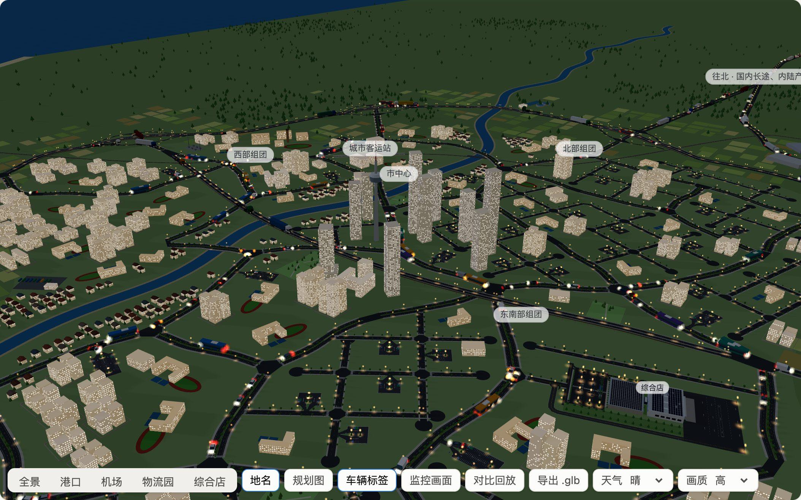

**动画轨迹。** 仿真记录第 86 天（`TRACE_DAY`）每一辆车、每列火车、每条船、每架飞机的轨迹：一段段「移动」（经过的道路图节点）和「停留」（在哪个地点），时间是当天 0 点起的秒数。记录轨迹只读、不消耗仿真的随机数，所以打开动画不改变任何结果（有单元测试）。

**现场视图。** 闭环面板可以把三维切到「现场 · 用孪生」或「现场 · 不用孪生」：每辆车按现场每分钟的延误把计划的运动平移（车的计划时钟 τ = 现实时间 − 延误），抛锚的车停在路边，孪生派出的救援车、追加补货车接在后面画；事故和施工路段画成红色光圈。

**虚拟监控。** 打开「监控」，三维视图右边（设施监控面板的左侧）叠几个固定机位的小画面（门店收货区、配送中心冷链门、港口泊位），从同一个三维场景渲染（分屏视口），画面上叠识别框（§10.5）。

**综合店里面。** 网页的第二个后台线程跑 StoreX 的门店仿真（同一个「日子」），镜头拉近综合店时，生鲜食品区里的员工、机器人、顾客和他们的车按它回放，和区域用同一个时钟；店外的货车由全链路仿真画。

**时间和光照。** 天光和太阳跟着时钟变：夜里暗一些（仍然看得清），楼里的窗户和月台门的状态灯亮着；信号灯按周期变色。播放速度从 10 秒 / 秒到 30 分钟 / 秒。

**天气**（`weather.ts`）。晴、多云、雨、雾、台风，可以手选，也可以「自动」：按日子十天一轮排（四天晴、两天多云、两天午后阵雨、一天晨雾、一天全天雨，同一轮里打乱，相邻两天不重样；报告用的第 1 天总是晴天，云和原来一样），「机场关闭」的演练整天台风，「需求突增」傍晚起风雨。看得到：天空和雾的颜色、雾的距离（能见度）、镜头周围的雨丝（在显卡上画）、道路、停车场、堆场和机坪的铺装变湿（雨停以后几个小时慢慢变干；以前的湿路面效果漏掉了大部分材质，只有楼的外墙变暗，这一版修好了），朝上的铺装上加了积水和天空反光的提示、有风时海浪更大、台风时打闪（只在播放时闪，开始播放 2 秒后才第一次闪）、整体更暗；监控画面里按各自机位的镜头下雨，雾按机位的远近；时钟旁边写着天气和能见度。天气不影响仿真；背景车流的车速按天气打折（雨约 0.85、雾约 0.75、台风约 0.6）。

| | |
|---|---|
| 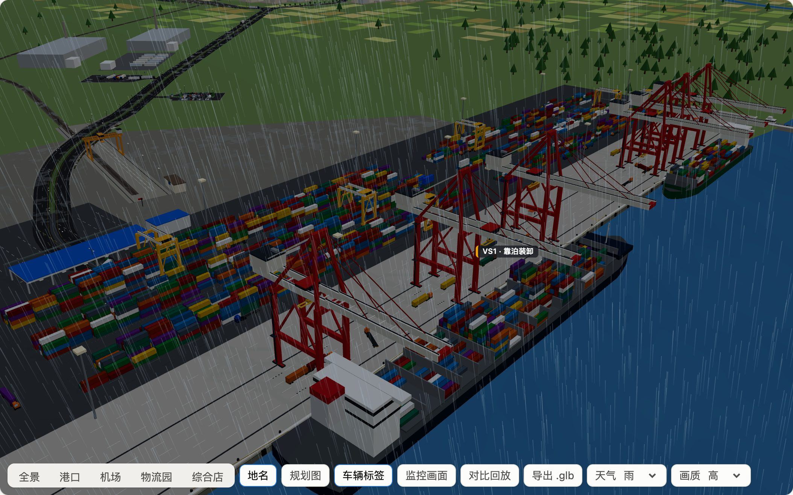 | 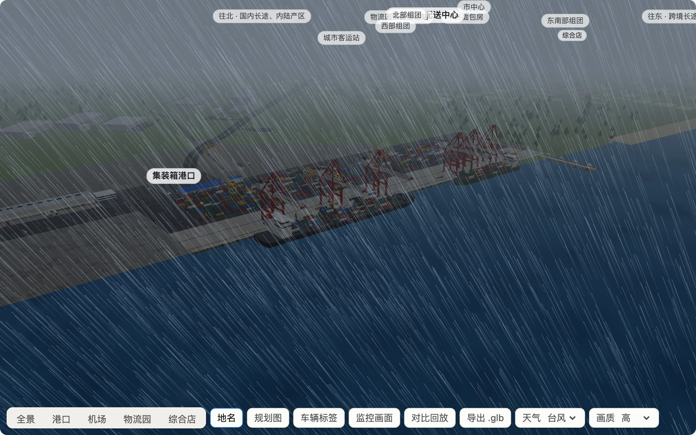 |

**画质和帧预算**（`quality.ts`）。按最近的帧时间（中位数和 95% 分位数）在高、中、低三档之间自动换：像素密度上限 2 / 1.5 / 1，阴影 2048 / 1024 / 关，监控画面每帧 / 隔一帧 / 每四帧重画，对比回放的右半边每帧 / 隔一帧 / 每三帧画一次，标签全部 / 全部 / 少一些，雨丝 8,000 / 5,000 / 2,000 条。超预算（95% 分位数超过 40 毫秒或中位数超过 24 毫秒）持续 3 秒降一档，有余量 8 秒升一档，两次之间至少隔 6 秒；手机从中档开始、自动不超过中档；工具栏的「画质」可以手选；地址加 `?debug=1` 显示帧时间。随机区域 3 的极限负荷在高档约 30 帧，自动降到中档后 60 帧。

**导出。** 「导出 .glb」把此刻的整个区域（场景、车辆、综合店）导出成 glTF 二进制文件，可以在 Blender 或虚幻引擎里打开继续加工（实例化的建筑、树、车辆和集装箱按 glTF 的实例化扩展导出）。

### 8.1 设施作业（`web/src/three/ops/`）

四个设施的设备和作业按当天的计划排好（同一个编号每次一样；下面说的东西南北是设施局部坐标里的方位，默认区域里就是真实的方位），播放时按时刻取每台设备、每辆场内车的位置和动作；按真实尺寸画，实例化渲染。和仿真的关系：哪辆车什么时候到、停多久、装卸几板来自仿真和调度台，设施里怎么干（哪台岸桥、哪辆场内集卡、哪个箱位、叉车走几趟）是按这些时段排出来的动画，不改变仿真结果。

- **港口**（`port.ts`）。码头、带缓冲器的系缆桩、护舷、岸桥轨道、堆场、冷箱插座架、闸口（雨棚、岗亭、箱号识别架、道闸）、高杆灯、码头一头伸进海里的拖轮基地。泊位按设施配置 2–4 个（每个 330 米），一个留给本店的班轮，其余停别家的船；每个泊位有自己的岸桥和后面一列箱区（3 排，每个箱区 24 个贝位、6 列、堆 1–5 层，每个箱区一台轮胎式龙门吊），码头、轨道、灯和泊位标线跟着加长。岸桥沿码头编号（QC1、QC2……），默认 2 个泊位、6 台岸桥（3 台给别家的船、3 台给本店的班轮）。堆场和闸口之间的港口物流中心（拆装箱库、保税库、海关查验场、空箱堆场）见 8.5；外来集卡在堆场里按车道错开（每辆车进来、停下、出去的路不和别的车重叠，龙门吊的作业先试排一遍）。

  **船期。** 本店的班轮按仿真的靠泊时段（船由区域车辆层画，这里画甲板上的箱和缆绳）。别家的船由港口按当天的编号排：约 85% 的别家泊位一早就停着前一天傍晚到的船（已经作业了一部分）；泊位空出来时先让锚地里等得最久的船进来，没有在等的就安排一条正好赶到的船；每天有一两条船早到、先抛锚；负荷越高，白天加来的船和半夜就在锚地等着的船越多，到半夜还排不上的继续停在锚地。船有支线船（172 米）、中型（232 米）、大型（292 米）三种，两种船体配色，船名是虚构的。

  **进港、靠泊、离港。** 每个泊位有一条斜着进港的航道，进出分道。进港的船沿航道平顺地减速，两条拖轮从拖轮基地开出来，以船的速度并到船边、一前一后护航；船在泊位前原地掉头（每秒 0.3–0.5°），拖轮一推一拉，再在外侧把船横着顶靠上码头，带上 6 根缆绳。靠好 15 分钟后开始作业，最后一个箱装完 25 分钟后离港：解缆，拖轮把船拖离码头、掉头，船加速出港，拖轮回基地。船有尾迹和船首的浪花。每一段航迹都按时刻和别的船、本店班轮的进出港航线、过路的背景船检查，有冲突就推迟，从锚地出来时换一条错开的航线；同一个泊位同时只停一条船，一条拖轮同一时间只做一件事。2–4 个泊位、各档负荷、不同编号的 336 种组合检查过，船体都不重叠。本店的班轮也走同一套航道（见下面「本店班轮」），从泊位正前方进出、不经过别的泊位，所以旁边的泊位照常排船。别家的船也能点：悬停显示船名、船型、泊位和此刻在做什么（别家的船，不参与仿真），点一下镜头跟随，横幅上写着它在做什么。

  **本店班轮。** 仿真给的进港、离港各 3 小时。进港：近海驶来，在引航站停 10 分钟让引航员上船；沿航道起步、加速、减速，停在泊位正前方的掉头点（最后 650 米两条拖轮护航）；原地掉头到泊位的朝向；拖轮顶着外海一侧的船舷把船横推靠上码头，正好在仿真的靠泊时刻靠好。离港反过来：拖轮带缆把船横着拖到掉头点，原地掉头对准出港航道，沿出港一侧开到引航站停 6 分钟让引航员下船，再驶向外海。港里的几步按别家的大型船的速度算（航道里平均 2.6 米/秒、掉头每秒 0.3°、横移 0.16 米/秒），剩下的时间都在近海。港口排别家的船时直接用三维里这条班轮的实际位置避让：4 个泊位、高负荷时，班轮进港的 3 个小时里旁边的泊位一直有船在作业。

  **引航、系缆和潮汐。** 引航艇停在拖轮基地码头的外端：每条船（本店的班轮和别家的船）在引航站上下引航员时，引航艇开出去、靠在船的右舷，送完开回来，两个任务重叠时再出一条。靠泊前三个系缆工人从泊位一头的小屋走到船首、船中、船尾的缆桩，船靠上以后六根缆一根根带上；离泊时一根根解开，人再走回去。潮汐按半日潮（周期 12.42 小时、涨落各 ±1.5 米，每天的高潮晚约 50 分钟）：海面跟着涨落，别家的船、甲板上的箱、拖轮、引航艇、班轮和过路的船都跟着浮起落下，岸桥的吊具按甲板的高度走；码头墙往下延长、画出湿的一圈和高潮线，泊位和岸桥不动。设施监控的港口页写着此刻的潮位。

  **岸桥和堆场。** 岸桥一个贝位一个贝位地干：先卸甲板上的箱，再卸舱内的箱、装回舱内，最后装甲板，甲板上的箱一层层变。每个箱的动作是大车移位、小车走到船上、吊具下降、锁箱、起升、小车回到码头、放到场内集卡的车架上，前大梁不作业时仰起。每台岸桥配一个场内集卡作业组（默认 5 辆）：集卡在两条等候车道（一条紧挨岸桥后面，一条在后方场地上）预约相距 22 米的等候位，行驶时走等候车道旁边的行车道，按顺序开到岸桥下（轮到前约 70 秒到，一台岸桥下同时只有一辆），进出岸桥下时平缓起停（最多 6 秒），开到箱区之前先试订贝位，龙门吊把箱堆到箱位（岸边行驶中的重叠从 9,346 降到 4,930 车对·秒，停着的 0；全天按区域的重叠见 8.8）；本店的箱集中堆在本店泊位后面中间那排箱区的最后一个贝位，监控面板列出每个本店箱每一步的时刻和箱位。外来集卡 06:00–21:30（高负荷时 05:00–23:00、更密）从闸口进出提箱、送箱，在箱区车道里不和场内集卡相遇；龙门吊先排船舶作业，外来集卡和拖车插在船舶作业的空档里；来提本店箱的集装箱拖车停在本店泊位后面的集卡道上，由龙门吊把箱吊上车架（吊上之前是空车架）。

  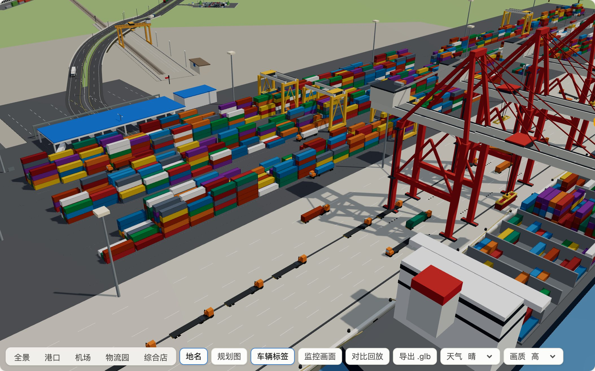
- **机场**（`airport.ts`）。跑道（长 2.1 公里，入口标志、接地区和瞄准点标志、中线、边灯、入口灯和末端灯、进近灯、进近坡度指示灯、风向袋、仪表着陆天线）、平行滑行道、两个快速出口和跑道一头的联络道、货运机坪（机位间隔 92 米、2–6 个，引入线、停止线、设备限制线、服务车道、翼下加油井和灯杆跟着机位数排）、货站（空侧大门和门前的滚轮台、陆侧收货口；4 个机位以上加建二期）、塔台、背景里的客运航站楼。货机有三种通用机型（四发重型、双发宽体、双发中型），本店的航班是蓝色涂装，别家的是几种中性的颜色，不画任何航空公司的标志；有襟翼、扰流板、航行灯、防撞灯、频闪灯、着陆灯和反推的气流。别家的货机也能点：悬停显示航班号、机型、机位和此刻在做什么（别家的航班，不参与仿真），点一下镜头跟随。

  **一天的航班。** 本店的航班来自仿真（落地和撤轮挡的时刻和仿真一样）。别家的航班按机位数和负荷排：平常档机位约六成的时间有飞机，负荷越高越满（最多九成）；落地时刻在前一天 19 点到当天 24 点之间撒开再加扰动，所以半夜已经有飞机停着，一天里每个时段都有起降；机型三成重型、四成半宽体、两成半中型，地面停留 1.6–3.6 小时；同一个编号每次一样。先排本店的航班，再排别家的，每一架都对已经排好的检查：跑道一次只给一架飞机用（落地间隔 105 秒且前一架已经脱离，起飞间隔 110 秒；起飞的飞机可以在落地的飞机后面对正，等它脱离才滑跑；落地要等前一架起飞的飞机飞过跑道头）；滑行道单向通行，每 2 秒检查一次前后的距离（两架的机长或翼展之和的一半再加 25 米，推出到滑行道上的机尾也算）；一个机位同一时段只停一架。排不开时别家的航班在空中最多多等 60 分钟，任何航班都可以在脱离以后、推出之前或跑道头等待。2–6 个机位、平常到极限负荷的整天都检查过：没有排不进的航班，滑行中的飞机中心距离不小于 80 米，跑道上同时最多一架在滑跑，机位不重叠。

  **飞机怎么动。** 每一段运动是一条曲线路径加一条速度曲线：平顺地加速、平顺地刹车，转弯时限制转向的角速度（每秒不超过约 7°）。降落：转弯切入五边，沿 3° 下滑道下降（过跑道入口时约 16 米高），拉平，抬着机头主轮先接地，放下前轮，扰流板升起、反推、刹车，从快速出口脱离，沿滑行道滑行，转进机位，慢慢停稳。起飞：推出车把飞机推到滑行道上，启动发动机，推出车脱开开走，滑到跑道头等待，掉头对正，加速滑跑，抬头离地，收起落架，爬升，压坡度转弯。在地面上时机身的俯仰绕主起落架转，轮子贴着道面。

  **机位上。** 挡轮挡、接地面电源车；主货舱门（左侧机翼后面，宽 3.7、高 3.05 米）向上翻开；升降平台车垂直于机身开到门下，前平台升到门槛，集装板推到前平台、滚到后平台，后平台带着板降到板车高度，推上板车；进口的板卸完接着装出口的板（约为卸下量的七成）。几套牵引车 + 板车在货站门口和机尾之间来回：卸货趟空车开过去、一块块接满拉回来，板横推上滚轮台进门；装货趟先在货站门口把出口的板推上板车，再开过去交给平台车。管线加油车开到左机翼下，工作台升起，软管接翼下加油口和地面加油井。卸装完关舱门、平台车撤走，推出车推出。地面保障按班组排：平台车司机一班有几个人，最多就有几架飞机同时卸装，加油员同样，本店的航班优先，别的航班等着或者那一班不加油；每架飞机开几套板车 = 当班的牵引车司机 ÷ 同时在场的飞机数（至少 1 套，最多设施配置的套数）。本店的集装板（蓝色）单独跟踪。货站里面（立体库、工位、冷库、安检）和陆侧卡车场见 8.5；机位的进出分道，板车按货站排的时刻进出大门。
- **物流园**（`dc.ts`）。配送中心（300 × 150 米、净高 16 米）和冷链中心是有墙、地坪和屋顶的库房，南墙 38 樘月台门各有卷帘门、门封、防撞块和液压登车桥。每辆车倒车靠上以后（按区域车辆层的时刻）卷帘门升起、登车桥搭进车厢，叉车按这一车的托盘数一趟趟进出车厢：卸货的把托盘叉到门东侧的收货暂存道，装车的从门西侧的发货暂存道叉进车厢；发货暂存道在装车前 40 分钟开始备货，收货暂存道的托盘在车走后一板板送去入库。镜头靠近时屋顶隐藏：西半边是立体库（默认 20 条巷道、双深位货架，货架面是按真实货位尺寸重复的贴图），每条巷道一台堆垛机做复合作业（巷道口叉起入库托盘、边走边升到货位放下、再去另一个货位取一板、回巷道口放到出库输送线）；东半边是货到人区（1,320 个货架格位，默认 30 台机器人沿通道钻到货架下顶起来送到南边的拣选站、拣完送回原位）；中间的主输送线上周转箱在跑。月台门的作业时刻和叉车按物流园的作业计划走，本店的铁路箱在收货门拆箱；铁路旁的转运仓、登记口、等候场、甩挂区和场内牵引车见 8.5。
- **铁路站**（`rail.ts`）。物流园货运站两段装卸线（西段接港口来的班列、东段接洲际班列）和港口铁路站各一台轨道式龙门吊，跨着装卸线和旁边的两排箱位。卸车从离车头最远的一节开始：大车走到车厢、小车移到铁路上方、吊具下降、锁箱、起升、小车移到箱位上方、大车走到空箱位、下降、放箱；装车反过来。平车上的箱数由这里告诉区域车辆层（卸一个少一个），停站时间不够就按比例加快。
- **门店收货区**（`storeDocks.ts`）。收货口（默认 4 个）的卷帘门等车靠稳、放好轮挡和车辆锁才升起，门边的灯红绿变化（有车红、空着绿），调平板搭进车厢；电动搬运车按托盘数进出车厢（一个车厢里同时只进一台设备），把托盘放到门两侧收货台上的暂存位，满了以后最早的几板推去后仓。靠台、开始卸货和拉出的时刻来自收货场的排程（8.4、8.6）。

现场视图里车按延误平移，月台门、叉车和搬运车跟着那辆车自己的时钟走（晚到的车，门也晚开）。

**分段排一天的作业。** 港口、港口物流中心、机场（含货站叉车闲着时的计划）和外来货车一天的作业写成分段计算（生成器，`Steps`，见 `ops/kit.ts`），每一步之间可以停下。第一次打开时（画面上还没有车），三维层（`view.ts`）先同步做门店收货场、物流园和车辆运动规划，画出带着车的第一帧，再用 `setTimeout` 一段一段地推进（每段约 30 毫秒，`SLICE_MS`）。换一天的车（换负荷、换日子、调度台改计划）时，门店收货场（访问、排程、转弯三段）、物流园的计划（`parkYard.setPlanSteps`，场内每个角色一段；月台门预约已经变了时先省掉这一遍，flush 时只排一遍）和每辆公路车辆的运动规划（`vehicles.planSteps`，一辆一段）也进分段，公路车辆排完以前不画；外来货车放出来以前先把此刻以后 30 秒以内要开的路分段排好（`ext.daySteps(…, at)`），排完以后的第一帧不再一下子全排；最后按最终的场地排程把此刻在场地里的车排好，再排车距和停车排队（`settleSteps`、`convoySteps`）。先后和一口气排完时一样，结果逐字节相同（五个场景、24 项哈希核对过：各设施的计划、车辆、每 30 秒的位姿、运动、铁路、门店、分层看板、监控识别、车距和停车排队）；Node 脚本和单元测试照样调用同步的 `setDay` / `gateTrips`（内部用 `drain` 一口气算完），网址加 `?syncplans=1` 时网页也一口气排完。排完以前港口、机场、外来货车先空着（`hold` / `waiting` / `planning`），画面下方有提示（`role=status`）；调度台送来的作业编号先记下、港口排完再套上（港口每天先清掉前一天的「车 → 作业编号」对照，换回同一天时排出来的内容和第一次打开一样）；社会车流等排完再重算，保证输入和原来一样；导览和值班助手等计划排完再读（`view.plansPending`、`onPlans`）；值班助手、分层看板、跟踪表、设施概况这几个重的面板在换一天、闭环结果回来、设施排完时一个任务刷一个（`main.ts` 的 `panelsSoon`）。空闲机器上第一次打开 2.3 秒出现带车的第一帧、约 7.5 秒排完，换一天以后最长的一段 0.11–0.14 秒。没有放进 Web Worker：计划里有类的实例和闭包，还要和主线程上卸货场引擎的场地登记表同步，很难保证逐字节一致。主线程的总计算量没有变，只是不再一口气占住页面。

### 8.2 实时跟踪和设施监控

**实时跟踪**（`web/src/tracking.ts`、`trackPanel.ts`）。三维视图左边的面板列出当天全部车辆（自己的车、孪生派出的车），按在途、作业中、待发、收车分组排序，在途的按预计到达排前面；可以按公路、铁路、海运、空运筛选，只看在场的。每一行是编号、状态、下一站、预计到达和剩余里程；晚点 5 分钟以上、货温超标的标出来。选中一辆车，侧栏的车辆卡给出：现在在哪（道路名或设施名）、全程进度、从哪来到哪去、计划和实际出发、下一站的计划和预计到达、这一程的平均车速、载重（托盘、件数、吨；火车、船、飞机是箱数 / 板数）、货物、晚点、货温（冷机车）、收车时刻和每个停靠站的计划和预计到达；可以在三维里跟随，或者跳到调度台看它的作业。三维里每辆车头顶挂着「编号 → 下一站 预计到达」或「编号 · 在干什么」的标签。计划视图里预计到达就是计划；现场视图里用孪生每 5 分钟对每辆车的估计（`LoopResult.twinEst`：晚了多少、下一个门店站预计几点到）。

**设施监控**（`web/src/facilityPanel.ts`）。三维视图右边的面板分五页，点视角按钮（总览、港口、机场、物流园、综合店）自动翻到那一页，只算正在看的那一页：

| 页 | 内容 |
|---|---|
| 集团总览 | 区域和负荷档位、网络的关键指标、四个设施的状态、按排班算的人工、全部异常（见 8.3） |
| 港口 | 本店班轮（靠泊时段、卸船 / 装船的箱数、进度，别家的船今天作业了多少箱）；各泊位停着哪条船、在干什么；别家的船今天的船期（船名和船型、泊位、靠泊和离泊时刻、在锚地等的时段、状态和岸桥作业进度）；本店每个箱现在在哪一步（岸桥吊起、放上哪辆场内集卡、堆到哪个箱位、装上哪辆拖车）；每台岸桥、龙门吊、场内集卡此刻在干什么和完成数；闸口场内和排队的车、今天进出的车；堆场的箱数；港口铁路站的列车和龙门吊；港口物流中心：拆装箱库、保税库、查验场和空箱堆场此刻的作业、库存、月台排队和指标 |
| 机场 | 今天的航班数（本店几班）、起降架次、机位占用；航班表：航班号、机型、机位、落地和起飞时刻、状态、卸板和装板的进度（已离场的变灰，只列最近 3 班）；本店每块板走到哪一步；在场航班的平台车、牵引车、电源车、推出车、加油车在干什么；货站里有几块板、本店的板是否已进冷库、出口的板有几块在板车上；货站：立体库、冷藏库、冷冻库的占用，待拆的板，陆侧月台的排队和本店的板 |
| 物流园 | 今天靠台的车次和托盘；配送中心库存天数；38 樘月台门的占用格（装车、卸货、空闲，悬停看车和进度）；靠着的车、作业、进度、预计走的时刻；接下来要靠台的车；发货 / 收货暂存道的托盘；在作业的堆垛机、机器人；两段货运站的列车、吊箱进度和箱位；场院：登记亭排队、等候场、甩挂区、转运仓的门、场内车辆、本店的箱和指标 |
| 综合店 | 门店库存天数、今天到现在的缺货、线上配送车在外 / 送完；4 个收货口的车和卸货进度；今天每一车到货的计划和预计 / 实到时刻、状态、托盘数（迟到的标红）；各商品族的库存（现场、孪生估计、够卖几天，闭环跑过以后每 5 分钟更新）；停车场与即时取货（各类车位的占用、来取货的车和平均等待）、收货场（布置、此刻和今天最多的排队、货车平均周转） |

点面板里的车辆编号就在三维里选中这辆车，跟踪面板和侧栏一起跟着变。

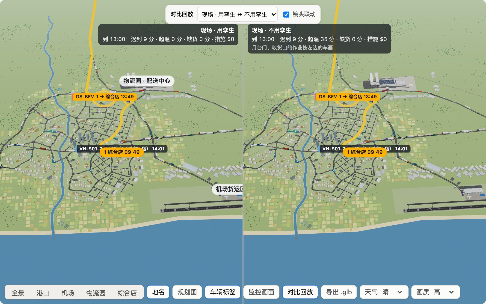

**对比回放（`web/src/three/split.ts`）。** 工具栏的「对比回放」把三维分成左右两个画面，同一个区域、同一个时钟，左右各画一套自己的车：现场 · 用孪生对比现场 · 不用孪生（闭环的两遍）、计划对比现场、这一天对比另一天（另一个编号的日子在后台线程里多跑一次仿真）；社会车流、港口和机场的作业两边共用。每边贴着到此刻的指标（迟到、超温、缺货分钟和措施花的钱；或者到店车次、准点、等门）。每帧用剪裁视口画两次，左边先画并更新阴影，右边沿用；右边多久画一次按画质档位（见上）。两边都能悬停和点选（右边有自己的车辆层、镜头和标签），点右边的车也能跟随（镜头分开时同样）；同一天的两边左右同步选中；「计划 / 现场」按钮会把对比的两边切成相应的一对；「这一天 ↔ 另一天」的另一天也用上这一天在调度台上的改动（标题写着用上了几处）；新加一对「现场 · 不用孪生 ↔ 用孪生」。月台门、收货口这些设施动画按左边的车画（右边的标题里写着）。镜头默认联动，也可以分开各转各的。分屏时 1440 × 900 的画面仍然约 60 帧。

### 8.3 设施管理台和集团总览

**负荷档位在三维里。** 切换档位后整段重新仿真，本店的车、船、班列和航班按新的计划走；背景也跟着加：社会车流按倍数重新生成，机场别家的航班更多、机位更满，港口别家的船更多、泊位排不过来的在锚地抛锚排队，闸口的外来集卡更密、开得更久。

**设施管理台**（`web/src/facilityAdmin.ts`）。设施面板上的「管理」按钮打开，港口、机场、物流园、综合店各一页，像 Storewright 管一家门店那样管一个设施：

- **布局：** 滑块改泊位、岸桥（自己的、别家的）、场内集卡作业组、闸口车道；货机机位、板车套数、每个航班的集装板数；立体库巷道、货到人机器人、干货和冷链月台门、铁路货运站的装卸线；门店规模、收货口、货架排数、后仓。泊位、机位、装卸线和门店规模就是「扩大规模」：改完三维里的码头、机坪、站台和百货馆跟着变大。
- **设备检修：** 勾选停机的岸桥、堆垛机、机器人。
- **人员排班：** 每个岗位早中夜三班的人数、时薪和每天的人工成本；某个班没有人开某种设备时提示（例如夜班没有平台车司机）。
- **指标：** 这个设施此刻的作业指标（三维正在播的那一天）。
- **随机生成：** 这个设施随机一份、四个设施一起随机，或者恢复默认；随机的取值都在合理范围里，同一个编号每次一样。

「应用」以后配置存在浏览器里，页面重新载入：仿真按 4.11 的映射重算，三维的设施作业按新配置排——岸桥和场内集卡的数量、作业组大小（受场内集卡司机人数限制），没有司机的岸桥按停机算；机场的板车和牵引车套数（受牵引车司机人数限制），没有加油员时加油车不出动；立体库的巷道数和机器人数，停机的堆垛机和机器人不作业，叉车按当班的司机人数放慢；门店收货口和货架的排数，收货员少了搬运车卸得慢。

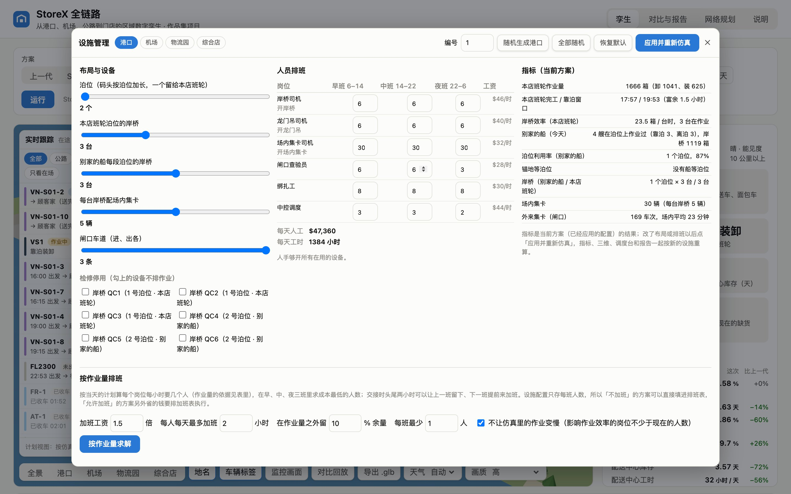

**集团总览。** 设施面板的第一页：当前的区域和负荷档位、网络的关键指标、四个设施的状态（有问题的标红，点一下翻到那一页）、按排班算的每个设施每天的人工和合计，以及全部异常（晚点、超温、等门、设备停机、人手不够）。

### 8.4 门店：停车场、即时取货和收货场（`src/site/`、`web/src/three/store/`）

按作品集第一部分 Storewright 的停车场（`lot.ts`、`parking.ts`）和卸货场（`yard.ts`、`yardPlan.ts`）做，场地、车流和指标是纯函数（`src/site/`），三维只负责画（`web/src/three/store/`）。尺寸是按公开资料取的假设参数（车位和车道 JGJ 100-2015、出入口 GB 50352-2019、消防车道 GB 50016、无障碍 GB 50763-2012）。

**布置**（`lot.ts`）。店前两个双排、165 个车位：顾客 131、员工 24、即时取货 8、线上配送车 2；另有 4 个免下车取货位和 2 个房车长车位（最远一排的两端，房车和拖车沿车道靠边停在几个车位的前沿上）。车位 2.5 × 5.3 米、车道 7 米；门前 6 米宽的消防车道离墙 5 米；离取货门最近的一排是编号的即时取货车位，排头立着取货牌；两个出入口都是一进一出，中间是绿化分隔岛，出口有停车线；无障碍车位（旁边 1.2 米的轮椅通道）和充电车位挨着入口；双排里留出几列做购物车回收栏，排头是绿化岛，有灯杆和通往店门的斑马线。车位数按设计高峰定：按每 100 平方米 1.0 个车位算只有 74 个，放不下门店仿真里约 95 辆同时在场的高峰（按 85% 的占用率至少要 112 个），两个双排排满正面是 131 个顾客车位。

**即时取货。** 第二部分 StoreX 门店的线上订单（`StoreX/src/ops/online.ts`）有三种取法：自提柜、免下车取货、上一代的路边取货。全链路把门店模型自带的格子停车场藏起来，按订单的时刻在新场地上重新排：西墙是一条单向的免下车取货道（雨棚下三个交接位，先进先出；第四辆车在车道口等；车进车道至少隔 4 秒，前车走了 6 秒后后车往前挪，交接前 25 秒到交接后 3 秒车不动），旁边是自提柜车位；上一代的路边取货由员工推车走到车边、打开后备箱装货。门店仿真里员工走到车边的那段路也换到新车位。

**一天的车**（`visits.ts`、`stays.ts`）。正常的一天 2,247 辆车：购物 1,295（门店仿真里的顾客）、百货馆 711（合成）、取货 214（免下车 108、自提柜 106）、员工 22（按门店的班次）、房车和拖车 5（一辆前一晚就停着、早上开走）。车位按离门口的远近加权挑（越近越满），同一车位的两段停留不重叠；约 12% 的车倒车入位、8% 穿过对面空着的车位停；长车位被占用的时段里它挡住的车位不安排别的车；购物车辆比顾客进店早 40 秒到车位，离开时间算上装货和送购物车的时间。

**时空排程**（`src/site/motion.ts`）。所有车按到达先后排在一张 0.5 秒一格的时空表上：取货车先排（到车位的时刻等于门店仿真），进店路是一条车道、保持跟车距离，出场的车在路口红灯时排队；每辆车沿路线检查已经排好的车、斑马线上的行人和推着一串购物车的回收员，有冲突就在冲突点前停下等，整条路线排不开就晚一点进场（最多在车里多坐 10 分钟、晚 8 分钟到，或者换另一个出入口；出场最多等 30 分钟），场内每一段最多等 4 分钟。进场走进口车道，场内靠右；倒车出车位时先直着退过车道中线再转；出场在人行道前停车让行（2.5 秒，长车 4 秒）；拖车按挂钩运动学跟着走。正常的一天排 2.4 秒、极限负荷 7 秒（在网页的后台线程里算，一天约 2.5 秒，主线程每次换一天只占约 70 毫秒）；两种负荷下车和车 0 重叠、0 辆压过斑马线上的行人、一辆也不少画，取货车到车位最多比门店仿真晚 32 秒。

**门店的车和干道上的车流**（`web/src/three/store/roads.ts`）。综合店的车在停车场外面的那一段从干道上游开过来、过路口进进店路，出去时反过来（干道上各开约 320 米）。这几段作为固定的车道占用交给背景车流线程，和仿真的货车一样：背景车在后面排队、给它让路。进店的车都走同一个进口（在干道上左转进进店路的那一侧），这一侧的进口道上有一条门店专用的进店车道：有门店的车在用时，背景车和公交不进这条车道（车道占用只在这些时段生效），没有时照常用；所以这一段背景车的直行只剩一条车道。出店的车只右转出去。试过的两种做法都去掉了：给门店路口加左转保护相位（红灯一等就是几分钟，重叠也没少），把附近的公交站再挪远（重叠反而更多，已经改回，公交站仍离门店路口至少 60 米）。一天里门店车和背景车的重叠从约 32,700 车·秒降到 1,782 车·秒，有了专用车道以后是 665 车·秒；原来的 1,782 里约 125 是误报，来自上方高架上的车，现在检查时不算离地 2.5 米以上的车。交接处 0 次跳动、0 次闯红灯。专用车道对干道通行能力的影响用 `tests/storeLane.test.ts` 测：同一天的门店车流，背景车按平常负荷 9,000 趟（极限负荷 25,200 趟测过一次）各算一遍有、没有专用车道，看左转进口道这一截（沙盘上 300 米，距离压缩成 1/10，相当于真实的 3 公里）的直行车：高峰小时 31 / 32 辆（极限 43 / 45 辆），只剩一条车道时流量和通行能力之比 0.04（极限 0.05；通行能力按每条车道 1,800 辆 / 小时乘绿信比），平均通过时间差 +0.1 秒（极限 −0.8 秒）。干道离通行能力还远，专用车道不影响直行车；测试守住比值在 0.5 以下、多花不到 10 秒。

**人和购物车**（`people.ts`）。顾客停好车走到店门口（走斑马线），在门口交给店里的仿真；车没停好以前人不会开始走：车晚到了换一个空车位，或者人在车里等、再快步走过去；出来推车装货，把购物车推回最近的回收栏再走回车上，约 6% 的人把车留在车位旁；回收员按回收栏里的车数推一串购物车回店，车给它让路。

**收货场。** 货车走单独的服务车道：从进店路分出来，9 米宽、两条 4.5 米车道、双黄线、接主路处 15 米的喇叭口、「货车入口」牌，不进顾客停车场。收货场按卸货场引擎（8.6）排成完整的四条车道（靠台、驶离、待命、顶部，单向绕行）、4 个待命车位、进深 100 米，登记为门店的卸货场（收货口编号 S01、S01#2……）；配送中心的车和长途直送车在这里排队、从司机一侧倒车靠台、拉出驶离，收货口的卷帘门、调平板和搬运车按排程里的靠稳、开始卸货和拉出时刻动。

**指标**（`ops.ts`）。按同一份车流算成门店的仓储中心数据（`HubDay`，8.5）：区有即时取货车位、免下车取货道、自提柜车位、普通车位、员工车位、长车位、收货场待命车位、收货口。正常的一天：取货平均等 1.8 分钟、95% 在 2.7 分钟以内，99.1% 在 5 分钟内交到（公开资料里杂货自提平均等 3–7 分钟，2 分钟以内算理想）；停车场高峰占用约 67%；收货场最多排队 1 辆（极限负荷 3 辆）；货车平均在店约 40 分钟；没找到车位开走的车 0 辆。设施监控的综合店页有「停车场与即时取货」「收货场」两节。

| | |
|---|---|
| 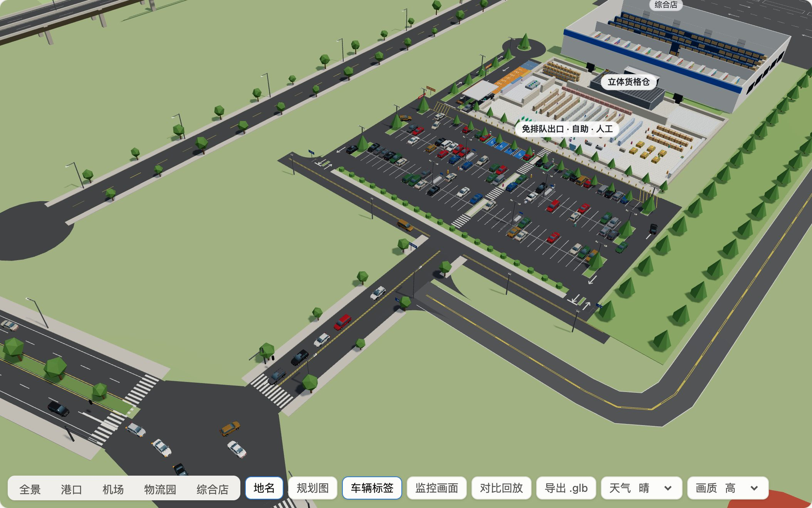 | 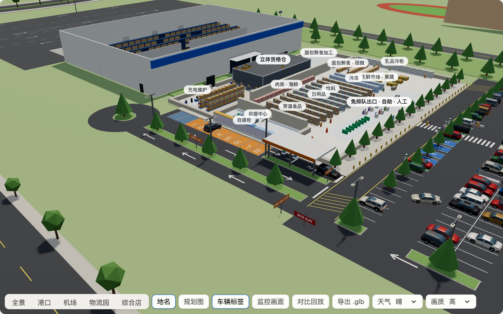 |
| 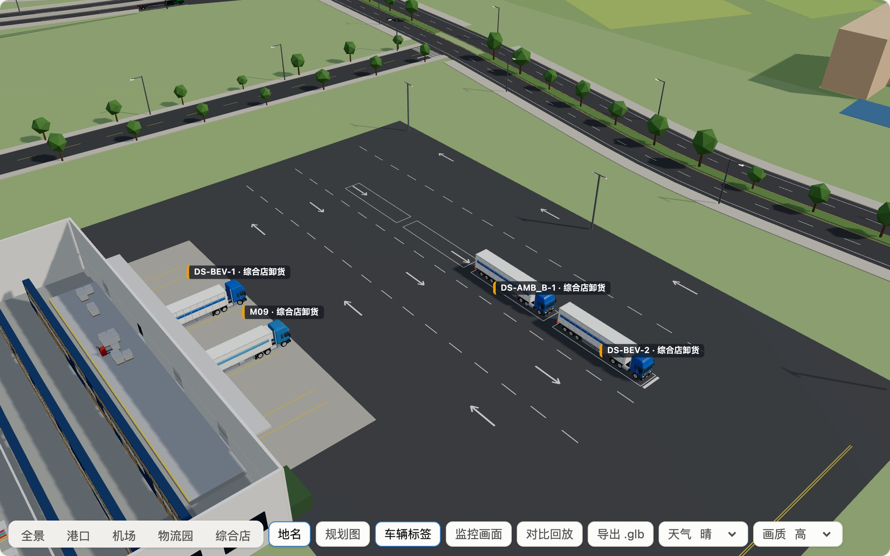 | |

### 8.5 仓储中心的作业计划（`src/hub/`）

港口、机场、物流园各有自己的仓储中心：货从船、飞机、火车上卸下来先进仓储中心，再装上公路货车；出口反过来。按综合物流规划里少搬运、客货分离、收发分开、场内单向绕行、预约削峰的原则布置。每个仓储中心按当天的仿真轨迹、设施配置和负荷档位排出一天的作业计划，用同一个数据结构 `HubDay`（`src/hub/types.ts`）：

| 字段 | 内容 |
|---|---|
| `zones` | 区：堆场、拆装箱库、保税库、查验场、冷库、月台、排队车道、停车场……（键、名字、种类、容量和单位） |
| `flows` | 一件货（一个箱、一块板、一批托盘）或一辆车的一次到访，按先后列出走过的区和每段的时段；`own` 标本店的货，`cold` 标冷链，`kind` 分车和货，`carrierIn` / `carrierOut` 是从什么载具卸下、装上什么载具走（仿真里的车写调度台的作业编号） |
| `occupancy` | 每个区每 5 分钟的平均占用（到 26 小时，312 格），从 `flows` 数出来 |
| `kpi`、`notes` | 指标（带「越大越好 / 越小越好」）和这一天值得说的几句话 |

三维按这份计划画每个箱、每块板、每辆车，值班助手按它回答（`get_hub`、`trace_own_cargo`、`hub_bottlenecks`、`plan_appointments`，10.1），两边是同一份。网页里四份（港口 `port.hubDay()`、机场 `airport.hub()`、物流园 `dc.hubDay()`、门店 `storeSite.hub()`）每次换车都重新取；孪生服务也排四份：港口、物流园和门店用和网页同一套模型（物流园的车停哪个门按 `src/hub/doors.ts`，网页和服务共用这一份对应；门店先跑一天门店仿真，`storeDay.ts`），机场货站没有三维的机坪排程，按 `airportEstimate.ts` 估、回答里写明是估计（数和网页会差一点）；所以服务里的回答和网页对得上。

**港口物流中心**（`port.ts`、`portLayout.ts`，三维 `ops/portLogistics.ts`）。在港区堆场和闸口之间：拆装箱库约 7,000 平方米（台高 1.32 米），一侧 10 樘集装箱门（底盘车倒车靠台，甩下底盘车拆箱）、一侧 14 樘提货卡车门，中间是按收货人分批的存放区和货架；保税库在自己的围网里、有卡口，10 樘门里两樘是冷藏门；海关查验场有带雨棚的开箱查验平台和一条 X 光机检通道；空箱堆场两台正面吊、堆 7 层；还有卡车等候场、场内拖车的停放区和办公楼。四段卸货场（查验、保税、拆装箱库的集装箱侧和卡车侧）都按卸货场引擎排成回车场式的布置，门距 4.3 米、第一樘门离进场路约 50 米。计划是事件队列：先订门和班组，再按时派场内拖车。拼箱货（卸船箱的 6%）由场内拖车从堆场送到集装箱门，拆箱（整托的 40–60 分钟，散货 1.5–2.5 小时）后分批存放，提货卡车在卡车侧装走；出口货由卡车送来、拼好以后装进从空箱堆场取来的空箱；保税库的车进进出出；外来集卡在空箱堆场还箱、提空箱。查验：机检比例 5%（上一代 8%）、每箱约 80 秒，开箱比例按跨境分析的海运查验率（3%、上一代 5%），在平台上 1.5–3 小时。本店的箱是整箱：在堆场存放，抽到时只要能在仿真的提箱时刻之前查完就去查验，再由仿真里的短驳车提走。正常的一天拆箱 36 个（平均约 87 分钟一个）、装箱 18 个，待拆的箱最多 18 个，拆装箱库最满 87%，卡车在物流中心平均 29 分钟、等门约 2.6 分钟，机检 24 箱、开箱 16 箱，一天结束时空箱堆场有 251 个空箱。空箱堆场每个箱区 7 个贝位、相距 20.4 米（共 294 个箱位），相邻贝位的作业不会叠在一起。场内拖车按停放区的 10 个全宽车位封顶：这是设备上限，极限负荷时卡车等门 8.5 分钟（以前 6.9 分钟），拆箱待办不变（瓶颈是班组和门）。停放区一个车位只停一辆，交接处有等候位，拖车做完回自己的车位，物流中心里停着的车的重叠少了 94%。港口闸口、物流中心闸口和空箱堆场的卡车共用一张路口预约表；停止线挪到路口外面以后，剩下的冲突从 28 次降到 1 次，平常负荷路口里的重叠少了 40%，没有卡车为了让开路口而加速。挪停止线以后，极限负荷下卡车停在中心路上等，闸口路口停着的重叠一度变多；月台出口加了排队区、空箱堆场加了连接路以后，这部分从 1,662 降到 0 车对·秒。港口的货车等候区入口也有规则：转弯进出的卡车让行，进、出的车隔开时间（加了以后路上的重叠平常负荷 16,250、极限负荷 64,580 车对·秒，8.8）。

**机场货站**（`airport.ts`，三维 `ops/airTerminal.ts`）。15 秒一步模拟每块集装板、每批托盘、每辆车、每次立体库存取、每个拆板组板作业、每趟叉车和每次安检：空侧大门有滚床；集装板立体库 231 格、2 台堆垛车（每次存取不到 1 分钟）；8 个拆板 / 组板工位；散货货架 1,386 个板位，出口 228、冷藏库（2–8 °C）228、冷冻库（−18 °C 以下）96 个板位；危险品库、贵重品库、海关监管区和 2 台出口安检 X 光机（出口货全部过安检）；陆侧 20 个卡车月台（出口 4、集装板 4、冷链 4、进口 8），门封、防撞块、调平板、红绿灯，卷帘门等车靠稳才升起。进口：飞机 → 板车 → 空侧大门 → 立体库 → 拆板 → 货架或冷库 → 陆侧月台 → 卡车；出口：卡车 → 陆侧月台 → 安检 → 组板 → 立体库 → 板车 → 飞机。板车的时刻用机坪作业的实际时刻，机位的进出分道。陆侧卡车场登记为卸货场（`air-landside`），货代的车和本店的空运冷藏车（门 `AIR`）共用一份排程。正常的一天约 210 辆货代车靠台，拆板待办最多 15 块板，立体库最满 27%，冷藏库最满 11%，进口货平均在库 6.8 小时；极限负荷 231 车、62 块、53%、21%；本店的果蔬、海鲜进门约半小时后进冷藏库。月台数和公开资料里每个月台一年 1.5–2.5 万吨的产能对得上。镜头拉近、屋面打开时库内 8 个区标出名字（ETV 立体库、拆板/组板区、冷藏库、冷冻库、危险品库、贵重品库、安检、海关监管区）；叉车只从门进出贵重品库和危险品库，走 3.5 米宽的通道，有自己的充电位，在主通道里靠右走（货站叉车的重叠停着的少了 99%、行驶中的少了 97%）；陆侧卡车走的进场车道画出来并铺了路面，出场交接处不再跳。

**物流园**（`park.ts`，三维 `ops/parkYard.ts`、`dc.ts`、`rail.ts`）。园区的路是单向逆时针的环（左舵车司机在弯的内侧，倒车从自己这一侧），员工的车和货车分开；入口广场是进、出各 2 条车道的登记亭；早到的、等门的车进等候场（22 × 4.6 米的车位）；甩挂区停着甩下的挂车，场内牵引车把挂车送到月台门、装卸完拉回来；铁路旁的转运仓有 6 樘铁路侧门和 12 樘卡车侧门。铁路箱：本店的由龙门吊放到吊车跨下的一条卡车道上的短驳车，送到配送中心的收货门拆箱（停靠 36 分钟，和仿真一致），空箱送回箱位；别家的进转运仓拆箱换装卡车、装底盘车直接走公路，或者留到第二天。卡车：公路对公路的越库、甩挂（承运商甩下挂车、挂走装好的）、外来卡车装卸。仿真里的车在登记亭停一下，门没空时进等候场，再进干货月台的卸货场；冷链门的车沿月台前的车道直接上靠台车道；甩挂的车不带挂车开到甩挂区挂上就走。配送中心（干货 D01–D26）和冷链中心（C01–C12）登记为两个卸货场（`park-dc`、`park-cold`），门是调度台的门号。正常的一天约 24 个铁路箱（本店 3 个，落地约一小时后进 D01、D02），转运仓约 370 板，7 次甩挂、14 次调车，等候场最多 2 辆（极限 3 辆），外来卡车在园内平均约 47 分钟；配送中心只服务一家店，月台门使用率约 0.7%，转运仓约 5%。外来卡车画全程：从高速口开到自己的进门登记车道（交接在开始登记的时刻），出门登记完再开回高速口，不在进场路上出现、消失；出门登记的每条车道一次只排一辆。场内牵引车和短驳车闲着时回待命停车场的车位，再开去下一趟活；双向的场内路上靠右走、互相让行。按车辆重叠检查（8.8），园区里停着的车 0 重叠，行驶中的车平常负荷约 63 车对·秒、极限负荷约 447 车对·秒。

| | |
|---|---|
| 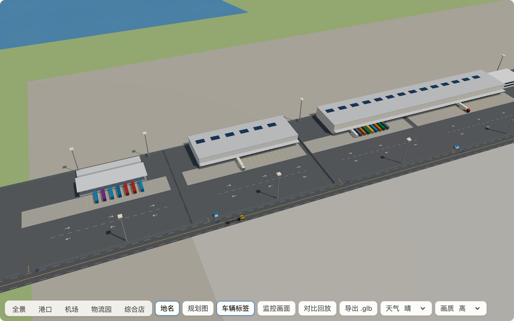 | 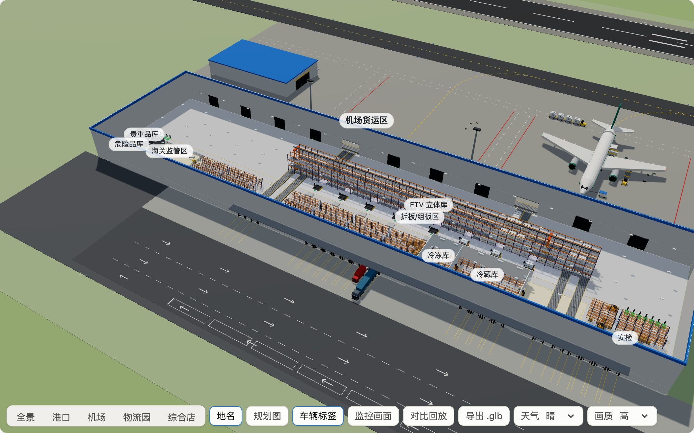 |
| 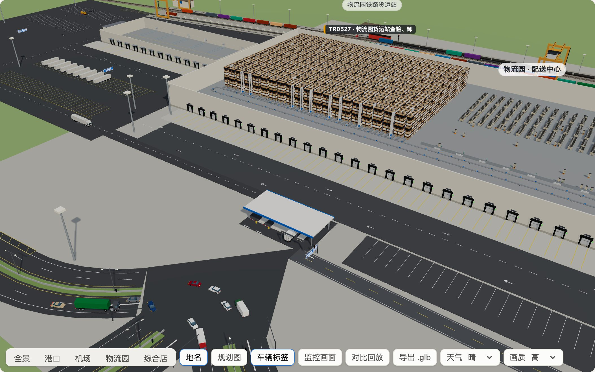 | |

### 8.6 卸货场引擎和铰接运动（`@storewright/yard`，`packages/yard/`）

所有卸货口共用一套卸货场引擎，按第一部分的卸货场（决策记录 0018、0019）做成纯函数（2026-11 拆成独立程序库 `@storewright/yard`，放在仓库根目录的 `packages/yard`，全链路和别的项目都按包名引用；库有自己的测试、中英文说明和浏览器演示）。坐标是卸货场自己的：墙在 z = 0，门排在墙上，场地朝 +z。

- **布置**（`planYard`）：输入门的位置（可以写每樘门能停什么车、是不是冷藏门、门号）、能用的范围和进深、进场道路在哪一侧、从背面还是正面接进来、专用通道还是支路（信号灯路口）、待命车位数（0 = 自动）、甩挂车位；输出从墙往外的靠台车道、驶离车道、待命车道（画车位线）和顶部车道（单向、右转绕行），场坪、入口和出口、甩挂车位、长墙分成可以同时作业的几段、要画的标线（实线、虚线、箭头、停车线、车位框、「货车入口」牌）和接主路的路口（15 米喇叭口、停车线、让行或信号灯）。16.8 米的半挂车：完整布置约要 82.5 米进深，紧凑布置约 58.5 米（右侧进场），回车场约 49 米（左侧进场），正面接入多约 13 米；左侧进场时第一樘门要离进场路约 50 米。进深不够时自动降级并写明原因。
- **路线**（`yardRoute`）：进场 → 待命车道（按距离给出第几个待命车位）→ 掉头 → 靠台车道 → 驶过卸货门、车头向外一摆 → 从司机一侧倒车：在几组候选（驶过多少、摆的半径和角度、摆完直行多少）里挑一组能让挂车在离墙 24 米以外摆正、牵引车不越过场地边和待命车道的，再笔直退进两边停着车的门里；拉出时先笔直往外，等挂车尾部越过两边的车头再转，沿驶离车道出场。转弯都是真正的圆弧：场内不小于 12 米，接主路处 15 米。厢式货车和面包车只要在车尾进入两边车头之间时摆正。
- **铰接运动**（`rig.ts`，`motion.ts` 的 `partPose` 用它）：前进时牵引销沿路径走，挂车朝向按 dθ挂/ds = sin(θ牵 − θ挂) / L 积分（转弯切内侧）；倒车时挂车后轴沿倒车路径走，牵引销在前方 L 处，牵引车朝向取牵引销的运动方向；`TowChain` 用于机场的牵引车拖 2–4 个板车、小汽车拖房车或船；都按路径距离预先算好，可以拖动时间轴。车辆尺寸从 `vehicles/specs.ts` 读。
- **排程**（`scheduleYard`）：到访写明到达、希望靠台、离开的时刻和方式（直接装卸、甩挂、挂车）。15 分钟窗口内先到先进；门很久都空不出来的车先去等候区（`hold`），不堵在车道上；同一段同时只有一辆车在倒车或拉出，驶离优先；仿真给的到达和离开时刻是硬的，靠台准备是软的——靠台、准备占停留时间里真实的几分钟，卸货从真正靠稳以后开始（`unloadAt`），只有整段停留装不下动作加最少的卸货时间（半挂车 300 秒、厢式货车 240 秒、面包车 120 秒）才标「太紧」；倒车起点停 45 秒（打双闪、司机开挂车门），门前准备 180 / 120 / 60 秒，时间紧时最多减半。甩挂的挂车停在顶部车道外侧，场内牵引车按 `shunterRoute` 送到门口、再拉回来。超过设计负荷时也不让车身重叠，多出来的车在场外等候区排队、标「太紧」或晚点：进场通道（进场道路的进场车道和拐进场里的第一个转弯）上后车跟车，车头离前车车尾至少 1.5 米，前车车尾过了进场点 2 米才放下一辆；甩挂进场的车、场内牵引车、紧凑布置里横穿进场转弯驶离的车，都等进场通道空出来；甩挂车位按实际时刻占用（从甩下到被挂走），都占着时改成司机自己靠台装卸；摘挂挂车的那一两分钟也占着场地；靠稳太晚往后挪的拉出重新排，避开别的车。库的超负荷测试矩阵（负荷每小时 4–24 辆、3–14 个门、各种进场方式和布置、甩挂开关）逐秒审计车身矩形；浏览器演示的超负荷设置（例如 3 个门每小时 8 辆、6 个门开甩挂）从 230、86 车·秒降到 0。等候的车（`hold` 段）不在场里，引擎给的位姿在进场点外，场地要自己画到等候区或进场路上（全链路的做法见 8.8）。
- **一个场地一天一份排程**：设施登记场地（`defineYardSite`：坐标系、布置、门和门号），把这个场地当天全部的到访交给引擎（`setSiteVisits`：外来的车和仿真里的车，仿真的车用 `simVisitId(车, 停靠段)`），三维画外来的车、`motion.ts` 画仿真的车都从 `siteSchedule` / `siteTimeline` 取；仿真的车的路上那一段停在卸货场入口，后面按排程走，交接处不跳；`siteSummary` 给出每个场地的「太紧」、晚靠台、晚拉出和进等候区的车数。设施在车辆运动之前登记，每次生成城市先清空登记表（8 节「每个区域的结果只和它的规格有关」）。布置和排程按输入记住结果，不重复算。
- **验证**：43 项测试（引擎本身的 37 项在库里：`packages/yard/test/yard.test.ts`、`overload.test.ts`；铰接运动的 6 项在全链路：`yardMotion.test.ts`，见 6.3）；网页里整天检查：门店 8 个到访（7 辆仿真车）、机场陆侧 206 个（1 辆）、物流园冷链 8 个（8 辆）都没有「太紧」，港口拆装箱库卡车侧 130 个、43 辆进过等候区；仿真车在各地点的到达、离开时刻 0 处不一致（默认区域和随机 3 号，17 段路），没有瞬移。

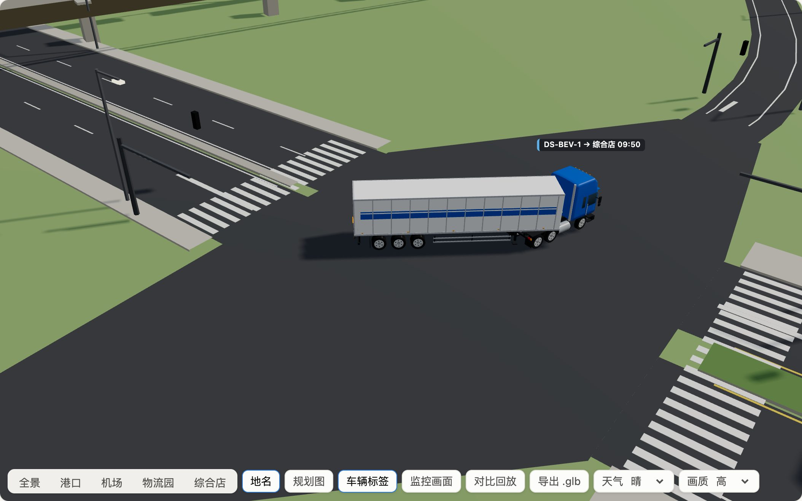

### 8.7 城市总体规划和随机区域（`src/region/landuse.ts`、`web/src/three/cityscape.ts`、`planMap.ts`）

**用地规划。** 按区域的规划（海岸、河、城区边界、干道、设施、门店）算一张栅格的用地图：用地按 GB 50137-2011 的分类（R1 / R2 居住、A1 行政办公、A2 文化、A31 高等院校、A33 中小学、A5 医疗、B1 商业、B2 商务、M1 / M2 工业、W1 / W2 物流仓储、S3 交通枢纽、S4 交通场站、U1 供应设施、U2 环境设施、G1 公园、G2 防护绿地、G3 广场，加上港口、机场和农林用地），分出片区（中心城区、各组团、站前片区、港城片区、物流园片区、临空经济区……）、15 分钟生活圈（默认区域 52 个，每个配中学、小学、公园、卫生站和社区服务中心）、机场 70 分贝噪声区、货运通道、地标和公用设施，并算出城市建设用地的结构。规划规则（按公开资料取的假设参数，不引条款号）：

| 规则 | 依据 |
|---|---|
| 用地分类、各类用地的参考比例（居住 25–40%、公共服务 5–8%、工业 15–30%、道路交通 10–25%、绿地 10–15%） | GB 50137-2011 |
| 15 分钟生活圈 800–1,000 米、配中学、小学、公园、卫生站；街道间距 150–250 米、不超过 300 米 | GB 50180-2018、GB/T 51328-2018 |
| 中心区和主轴上是商业，客运站周边 300–500 米高密度开发（公共交通导向） | 城市轨道沿线地区规划设计的公开导则 |
| 港口后面布物流和工业（前港后园），机场旁是临空经济区，物流园靠高速立交和铁路 | 国家物流枢纽布局规划等公开资料 |
| 机场 70 分贝噪声区里不放住宅、学校和医院 | GB 9660 |
| 工业、物流和住宅之间用防护绿地隔开；高速两侧留建筑控制区 | 公开的道路和安全保护规定 |
| 货运通道（高速、绕城快速路、工业物流区的干道）全天通行，穿过住宅和商业的干道白天 6:00–23:00 限行货车，门店配送通道全天通行 | 通行的城市货车管理做法 |

默认区域的结构是居住 41%、公共服务 5%、商业 7%、工业 12%、物流仓储 14%、道路交通 10%、公用设施 1%、绿地 10%：居住略高于参考范围、工业略低，工业加物流仓储 26%。

**城区和规划图。** 三维按用地摆楼（8 节「城区」）；工具栏的「规划图」把用地颜色、货运通道和白天限行的路段、生活圈、噪声区和片区名字叠在三维上，左边是图例、城市建设用地结构和规划说明。城区的楼约 2.8 万个三角形、74 个网格，占全景的很小一部分。

**随机区域。** 城市形态、海岸、河和跑道朝向见 §3；每种形态和海岸都有测试，随机 1–40 号和 3 个自定义区域里门店用地都不压道路、铁路、河和海。默认区域的仿真规划（港口、机场、物流园、高速出口、干道、门店的位置）不变，校验值有测试守着；城区、街道、停车场和公交站是三维的，这一版都变了，报告的数字不变。

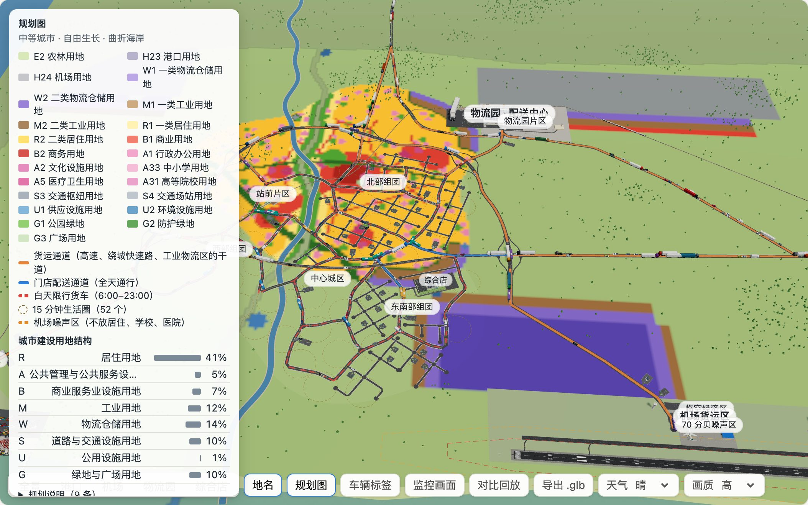

### 8.8 车辆重叠检查

`npm run overlaps`（`scripts/overlaps.mjs`，用 tsx 直接引用 TypeScript 源码；分离轴检验、网格粗筛、「车对 × 秒」统计和上限这些通用的部分在独立程序库 `@storewright/overlap-audit` 里，拆出来以后结果逐行不变）生成默认区域，按网页里同一套仿真和三维作业计划排好每一层车：外来货车、港口的码头拖车和物流中心的车、物流园场地里的车、机场货站的叉车和机坪车、门店路口和停车场的车（仿真里的车另由 check3d 的第 5 步查，见下）。每 2 秒取一次每辆车的车身矩形，两辆车的车身叠在一起记一个「车对」、按秒累加，按区域（门店、港口岸边、港口堆场、港口闸口路口、港口物流中心、物流园、机场、路上）、车型对、停着还是行驶中分开统计，在作者的电脑上一次约 2 分钟（极限负荷约 3 分钟）。每个区域、每档负荷有一个上限（2026-11 测到的数加一点余量），超了退出码 1，改动以后的回归一眼看得出。参数：`--level normal|extreme` 选负荷，`--region random-3` 换区域，`--only port,park,airport,store,road` 只看几处，`--trace 区域` 打印这个区域每个车型对的前几个例子（时刻、位置），`--no-fail` 只报告不报错。

默认区域一天的车对·秒（停着 / 行驶中）：

| 区域 | 平常负荷 | 极限负荷 |
|---|---:|---:|
| 门店路口和停车场 | 0 / 665 | 0 / 665 |
| 港口岸边 | 0 / 4,930 | 0 / 7,502 |
| 港口堆场 | 0 / 1,024 | 42 / 6,926 |
| 港口闸口路口 | 0 / 256 | 0 / 1,042 |
| 港口物流中心 | 18 / 2,218 | 10 / 7,224 |
| 物流园 | 0 / 63 | 0 / 447 |
| 机场 | 4 / 2,614 | 12 / 3,402 |
| 路上 | 54 / 13,498 | 286 / 58,140 |

两档负荷下每个区域都在上限以内。门店行驶中的一项是门店的车和背景车的重叠，按门店自己的检查算（车·秒），不算离地 2.5 米以上的车（以前上方高架上的车被误算进来，约 125 车·秒）；门店的车流按门店仿真的一天，两档一样。

**仿真车的重叠审计**（`scripts/check3d.mjs` 第 5 步）：`npm run overlaps` 在 Node 里排的是设施、外来货车、门店和背景车流这几层，仿真里的车（配送车、长途车、短驳车、空运冷藏车、线上配送车）的运动要在网页里排，所以放在 check3d 里：按它的四个场景，在网页里一整天每 2 秒取一次仿真车和外来货车的车身，统计仿真车之间、仿真车和外来货车叠在一起的车对·秒，停着的超过上限（测到的值 × 1.1 + 20、向上取整到 10）就失败，每个场景多花 6–17 秒。现在仿真车之间停着的四个场景都是 0（行驶中 82 / 4,050 / 3,490 / 1,360，依次是默认区域平常、默认区域极限、随机区域 11 号高负荷、随机区域 3 号极限）；仿真车和外来货车停着的：默认区域平常 0、极限 118，随机区域 3 号平常 8，随机区域 11 号高负荷 88。

这一轮改进的几处：

- **机场货站：** 叉车闲着的每一段在排计划时就定好去处（回充电位、停在放货处，或往后让开 2.6 / 4.2 / 5.8 / 7.4 米，每 2 秒和别的叉车核对一次），取货、放货的位置有车就退后等、再开进去，起步、停车各用 3 秒加减速，回过充电位的直接开去下一趟取货；充电位往南挪 1.8 米出了主通道；同一个危险品库、贵重品库里的移动不再出门再进；修了叉车朝向沿用上一台的错。机坪的板车串在货站门口一次只停一套，后一套在 22 米外等，回车场放大到半径 16.5 米。陆侧进场路尽头的回车场分内外两圈：进场的车走外车道、外圈（半径 12.5 米）去排队，驶离的车走里车道、里圈（7.5 米）从排队的车旁边开过，驶离的车在卡车场出口最多等 40 秒，不横穿进场的车；后面的车跟车以后再按速度剖面核对一遍。机场停着的重叠平常 2,104 → 4、极限 4,988 → 12，行驶中的 5,274 → 2,614、7,310 → 3,402。
- **港口物流中心：** 空箱堆场的贝位按时段预订：车停留期间它的贝位被占了，就停最近的空贝位，正面吊把箱吊过去（作业时刻不变）；接着还要吊箱的拖车保留预订。从拆装箱库、查验场的门拉出来在车道上等的拖车各等各的位置（第一个位置被占了就沿出场路再往前一个车身），堆场交接点并排车位相隔 10 米（以前 6 米），月台出口的排队区能停 5 辆（以前 3 辆）。停着的重叠平常 114 → 18、极限 3,688 → 10。
- **港口货车等候区入口：** 卡车开过进场路尽头再直行约 3 米才转，在道闸前停正；挂车折过 60 度算作的自身重叠没有了，路上停着的平常 96 → 54。
- **仿真车：** 发现这个检查以前不统计仿真里的车，加了上面的第 5 步，又做了两件事（见第 8 节开头的「车距和停车排队」）：车距（同一条路线前后脚出发的、收货场一次放一辆驶离的，画面上晚的那辆晚一点走）和停车排队（停在同一处的，后到的排在后面）。仿真车之间停着的重叠极限负荷 1,090 → 0。
- **结果：** 只有极限负荷港口闸口路口行驶中的一项多了 30（去空箱堆场的外来货车时刻挪动）。上限按新测值重定：测到的值 × 1.1 + 20、向上取整到 10，不比上一轮松。
- **试过没用上的：** 港口货车等候区的路口改成大半径转弯，那一格的行驶重叠少了 81%、平常负荷路上行驶中少了 33%，但极限负荷路上行驶中多 2.3%、平常负荷港口堆场行驶中多 12%（超过上限），没有采用；同一秒进港的外来货车让后一辆晚 20 秒进、或换另一条闸口车道，行驶中的重叠多 7–12%，也没有采用。

上一轮改进的几处：

- **卸货场引擎：** 超负荷时不再有车身重叠（8.6：进场通道上跟车、场外排队、甩挂车位按实际时刻占用）。
- **机场货站的外来货车：** 引擎让它在场外等（`hold`）的车不再画在进场点上，按放进场的先后在放进场前 60 秒才开到进场点外排队，跟着前车往前挪，等了 10 分钟以上的先进机场的货车等候区（`ops/extTrucks.ts`）；货站进场点停着的重叠从平常 296、极限 4,836 车对·秒降到 0。
- **结果：** 路上行驶中的平常 16,250 → 14,398、极限 64,580 → 60,500；上限改成测到的值 × 1.1 + 20，只有极限负荷路上停着的一项从 290 放到 340。

更早改进的几处：

- **门店路口：** 出店只右转，公交站离路口至少 60 米；左转进店的进口道上有门店专用的进店车道，只在门店的车用时生效；门店车和背景车的重叠从约 32,700 降到 665 车·秒（其中约 125 是误报，见 8.4）。
- **港口岸边：** 场内集卡走等候车道旁边的行车道，按顺序开到岸桥下，进出时最多 6 秒平缓起停；行驶中 9,346 → 4,930，停着的 12 → 0。
- **港口闸口路口和物流中心：** 停止线挪到路口外面（路口预约表里剩下的冲突从 28 次降到 1 次）；月台出口加了排队区、空箱堆场加了连接路（极限负荷闸口路口停着的 1,662 → 0）；停放区一个车位只停一辆，交接处有等候位，拖车做完回自己的车位。
- **路上：** 长的高速进口路段上车按后面的路线提前进对车道，等候场的通道一次只放一辆；港口货车等候区入口有了规则（转弯进出的卡车让行，进、出的车隔开时间）。
- **机场货站的叉车：** 有了自己的充电位，在主通道里靠右走。

还剩的重叠列在 8.9。

### 8.9 已知的局限

- **门店：** 门店路口一天还有 665 车·秒的门店车和背景车重叠（原来约 32,700）；专用进店车道让这一段背景车的直行只剩一条车道（对通行能力的影响很小，见 8.4）；门店的车在离门店约 320 米的干道上出现、消失；极限负荷时场地的后台线程算得久一些，车会晚几秒才出现。
- **物流园：** 极限负荷行驶中的车一天还有约 447 车对·秒的重叠；本店的铁路箱都进干货门；没有装车外运的铁路箱，空箱回到箱位；配送中心只服务一家店，园区里多数活动是转运仓的背景流量，货量是按负荷档位取的假设。
- **港口：** 港口货车等候区里行驶的卡车有时会擦到停着的车；场内拖车在物流中心里的移动按时刻错开，不经过卸货场的排程，物流中心平常负荷还有 18 / 2,218 车对·秒的重叠（停着 / 行驶中；停着的是两台拖车同一刻从相邻的位置拉出），极限负荷 10 / 7,224；岸边极限负荷行驶中 7,502，堆场极限负荷 42 / 6,926（停着的是同一秒进港的两辆外来货车一起停在进闸道闸前）；仿真里的短驳车在提箱处停在路上，和排着的外来货车有时叠在一起（极限负荷约 28 车对·秒）；三个闸口共用的路口预约表里还剩 1 次冲突；同一个空箱区同时两个作业时只画一个在移动的箱；屋顶按一个距离统一打开。
- **机场：** 货站和机坪平常负荷还有 4 / 2,614 车对·秒的重叠（停着 / 行驶中），极限负荷 12 / 3,402；停着的是计划里两块板放在同一个 X 光机进口、两台叉车从相距 1.3 米的工位起步；卸货场引擎给 8 号门的车排的等候位置压在 6 号门靠着的挂车上（冷链门相距 4.5 米），极限负荷下本店的空运冷藏车和外来货车停着叠了约 88 车对·秒；货车等候区里行驶的卡车有时会擦到停着的车（平常约 120 车对·秒）；个别随机区域的进场路在卡车场里拐弯（区域生成器给的路）；孪生服务里的机场货站计划是估计（没有三维的机坪排程，数和网页会差一点）。
- **路上：** 平常负荷还有 54 / 13,498 车对·秒的重叠，极限负荷 286 / 58,140，行驶中的重叠是各区域里最多的，多是路口、合流处的短暂交叉；它随别处车的时刻挪动上下变化几个百分点。极限负荷停着的 286 里约 226 来自 4 对同一秒、同一路线进港的外来货车：港口给的进闸时刻是定的，它们没法跟车或让行，一起停在红灯前（港口直接放进来的车不走进场间隔判断）；试过的两种改法都让行驶中的重叠多 7–12%（8.8）。
- **车辆和卸货场：** 对比回放的右半边按主镜头的远近选精细或简化模型；姿态用瞬时加速度；房车的精细模型偏重；倒车时前轮转角是按路径几何估的；卸货场的登记表是全局的，一个道路网只在生成下一个区域之前有效（网页换区域会重新载入页面，不受影响）。
- **城区：** 建筑按真实尺寸、地图压缩到 1/10，每块用地只能摆有代表性的几栋；「卫星城」是用绿带隔开的城区分叶，不是独立的城镇。
- **天气和分屏：** 监控画面里的雾偏淡；积水只是提示（10–20 米的噪声斑，不是真的反射，物流园的平屋顶上也会出现）；分屏时设施动画按左边的车画，地名标签只在左半边，同一天的两边共用左边的路线。
- **英文界面：** 4,312 条译文，`scripts/checkEn.mjs` 走一遍英文界面屏幕上 0 处中文；内置值班助手只懂中文：打的英文问题按词的重合换成最像的示例问句去问，示例以外的说法可能对不上（对不上时用英文说明能问什么）；英文界面里内置助手不检索只有中文的设计文档 01–04（摘录没法显示成英文）；演练面板里用英文打的事件通知认不出来（12 节）。
- **值班助手：** 第四套盲测四项都对 61 / 80，没对上的多是不常见的说法走错意图或工具（10.13）；可选的大模型模式还没有用真实的模型跑过，测试用的是假的提供方（10.14）。
- **卸货场引擎（独立程序库）：** 超负荷时不再重叠，代价是吞吐变低、标「太紧」的变多（以前是车互相穿过去）。排程已经比修超负荷之前还快（约 3 倍），一份布置加排程留在内存里 3–10 MB。引擎给的等候位姿在进场点外，场地要自己画：全链路里只有机场货站按排队画（8.8），门店收货场和物流园的仿真车在场外等时画在进场点（四个检查场景里最多一辆在等，不会叠在一起）。门口等候的位置没有避开邻门靠着的车（见上面的机场）。
- **第一次打开和换一天：** 首屏要下载的脚本压缩后少了约 17%；作者的电脑上第一次打开 2.3 秒出现带车的第一帧、时钟开始走（这一版以前 9.4 秒），港口、机场、外来货车约 7.5 秒排完；换一天时页面不卡（最长的一段 0.11–0.14 秒，以前 7.6 秒，上一轮 1.6 秒），公路车辆约半秒后出现，设施 5–10 秒排完。主线程的总计算量没有变，排的时候帧时间偏长（不算进自动画质）；以后可以把港口、机场单独放进 Web Worker。
- **演示导览：** 默认区域平常、旺季、高负荷三档，导览跟的箱都要在堆场停一两天才提箱，提箱、拖车那几段不在动画这一天，9 段里只有 4 段直接来自仿真记录，其余如实标成估算或今天的同类作业；极限负荷那一天本店的箱当天就提箱、进配送中心，有 7 段（结束卡上可以一键换过去）。同类作业的那几段，动画时刻会往回跳（卡片上写着）。

### 8.10 演示导览「一个集装箱从船到货架」（`src/tour/container.ts`、`web/src/tour.ts`）

第一次来的人 1 分钟看懂这套系统：镜头跟着一个本店的集装箱，从班轮靠泊、岸桥卸船、堆场、清关等提箱、拖车、配送中心收货门、门店配送车、门店收货口一直到后仓和货架。

- **数据**（`buildContainerJourney`，纯函数、结果确定、有测试）：从当天的仿真轨迹、调度台的作业、四处仓储中心的作业计划、港口三维计划里每个本店箱的记录（箱位、岸桥、场内集卡）和第二部分的门店模型串出每一段，每一段标明数据来源：**仿真记录**（record）、**按规则估算**（estimate，例如清关等提箱按方案的平均停留天数、港口到物流园按路网算的距离和时间、配送中心到门店按先进先出、同温区配车）、**今天的同类作业**（proxy：我们这个箱这一步发生在别的日子，就用今天同一个环节的另一个作业演示）。跨天的段（堆场停留几天）如实写「这一段跨了 N 天，动画里跳过」。默认区域平常负荷那一天本店没有海运拖车，9 段里 4 段是记录；高负荷时拖车和收货门拆箱也是记录。今天没有海运箱时改跟洲际班列的箱或空运板，并在卡片上说明。
- **播放**：每段跳到那个时刻、镜头飞过去（`view.flyTo`）并跟随车辆、画出路线，说明卡列出这一段的几个数字和数据来源，约 7 秒自动翻页；←/→/空格/Esc；导览时收起两侧面板；手机可用；中英文。顶栏按钮、欢迎卡或带 `tour=container` 的链接开始；结束卡写出这一趟几段直接来自仿真记录，可以复制这个场景的链接、做一道相关练习。默认场景（默认区域、StoreX 全链路、第 1 组、没有演练、设施没改）不在极限负荷时，结束卡上还有「换到极限负荷再看」：那一天本店的箱当天就提箱、进配送中心，来自仿真记录的段更多；`scripts/check3d.mjs` 在浏览器里核对两天的段数（平常 4 段、极限 7 段），说法不成立就报错。
- **动图**：README 顶部的导览动图由 `scripts/media/record-tour.mjs` 用 Playwright 逐帧截图、在页面里转成 WebP 帧，`make-webp.mjs` 拼成动画 WebP（不需要 ffmpeg）。

## 9. 闭环孪生和外部引擎

调度台回答「计划怎么排」；闭环孪生回答「计划执行的时候出了状况怎么办」：

```
现场（物理层仿真）──感知数据──▶ 孪生（估计 → 推演 → 建议卡）──决定 / 指令──▶ 现场
        │                                   │
        └──── 孪生服务：车辆位置、数据、建议卡 ────▶ 网页三维 / 虚幻引擎 / MATLAB
```

### 9.1 现场

`Field`（`src/twin/field.ts`）按当天的计划（调度台排好的门、车、收货口）一分钟一分钟地执行，但会出计划不知道的状况（同一个种子每次一样）：

| 状况 | 平常的一天 | 多事的一天 |
|---|---|---|
| 配送车装车晚 12–35 分钟 | 约一成多的车 | 约三成 |
| 交通事故、施工、拥堵（车速降到一半左右） | 3 处 | 5 处 |
| 开往门店的车抛锚 | 1 辆，修 1.5–2 小时 | 装生鲜最多的那辆，修 2.5–3.5 小时 |
| 冷藏车车门密封不严 / 压缩机坏 | 2 辆 / 七成的日子 1 辆 | 2 辆 / 1 辆 |
| 门店一个生鲜、一个常温商品族突然卖得快 | 2.3 倍，5 小时 | 3 倍，6 小时 |
| 长途直送车的供应商发车晚 | 1.5–3 小时 | 3–5 小时 |
| 门店卸货慢 | 3 站 | 3 站 |

每辆车有一个「计划时钟」τ：正常时和现实时间一起走；遇到事故走得慢、抛锚和等门时停住、卸货慢时变慢，延误 = 现实时间 − τ，车的位置就是计划在 τ 时刻的位置。冷机按两状态热模型逐分钟算车厢空气和货物温度（`src/twin/models.ts`，开门、密封不严、压缩机启停都在方程里）。门店每个商品族的库存从仿真里这一天 0 点的库存开始，按当天的需求和小时曲线卖，每趟车卸下的就是仿真里这一站的货。现场执行孪生发回来的指令：通知门店顺延收货、派救援车接走抛锚车或冷机坏了的车上的货、提醒司机停车检查车门、远程调低冷机设定温度、改月台门、配送中心追加一趟小车补货、长途车改去处（直送门店 ↔ 配送中心）、让车在路边等。

### 9.2 感知数据

现场只通过感知数据让孪生知道发生了什么（`src/twin/types.ts`，一天约 4,800 条，不含每分钟的定位）：

| 数据 | 内容 | 频率 |
|---|---|---|
| 定位 | 车辆位置（几米误差） | 每辆车每分钟 |
| 车载终端事件 | 出发、到达、离开、故障、修好、收到指令、处理完；长途车进区域之前报预计进区域的时刻 | 发生时；长途车提前 4 小时起每小时一次 |
| 冷机 | 车厢空气、货物探针、设定温度、车门、压缩机 | 每 5 分钟 |
| 装车进度 | 扫描托盘：装了几托、共几托 | 装车时每 5 分钟 |
| 门磁 | 配送中心月台门、门店收货口的开关和车牌 | 靠上 / 离开时 |
| 收银 | 过去 15 分钟每个商品族卖出的件数 | 每 15 分钟 |
| 盘点 | 每个商品族货架 + 后仓的件数（电子价签、货架摄像头、后仓扫码） | 每小时 |
| 路况 | 事故 / 施工开始和结束 | 发生时 |
| 电量 | 电动车的电量 | 每 10 分钟 |

### 9.3 孪生怎么估计

`Twin`（`src/twin/twin.ts`）只用感知数据和计划：

- **延误：** 每辆车一个 alpha-beta 滤波（延误和延误的变化率），用定位（按这一程限定范围的地图匹配，找出车在计划的哪一刻）和到站、出发事件更新；抛锚的车停在抛锚那一刻，在场地等门的车停在该开始装车的那一刻，在门店还没离开的车不超过卸完的那一刻。长途车进区域之前按车载终端报的时刻定延误。
- **持续校准：** 每跑完一程（出发 → 到站），实际比计划多花的比例按小时记下（每程权重 0.2 的滑动平均；经过事故、抛锚、停车检查的那一程不算），之后推演到店时间时按小时加上。
- **冷机：** 用自己的热模型从上一次读数推到这一次，和读数比；车门一直关着、压缩机在转、空气还持续偏热，就是有解释不了的漏热（疑似密封不严），估计出每分钟多升几度。
- **门店库存：** 每个商品族用盘点校正、用收银往前推；最近卖得是预测的几倍（缺货时卖不出去的不算，按时间常数 1 小时衰减）；算上接下来几车的货，推到 22 点什么时候卖空、缺多少。
- **月台门：** 按装车进度推算装完的时刻（进度十分钟不动是卡住了，按「一般卡多久」加时间），看下一辆排在这樘门的车要不要等。

### 9.4 推演和建议卡

孪生每 5 分钟想一次。发现问题就出一张建议卡，列出几种做法和每种做法的推演结果（迟到分钟、超温分钟、缺货分钟、多花的钱），推荐合计分最低的（合计分 = 迟到 + 超温 × 2 + 缺货 × 1.5 + 钱 ÷ 12）：

| 问题 | 做法 |
|---|---|
| 预计迟到（超过 5 分钟） | 通知门店顺延收货（25 美元的加班，门店九成会答应）；不处理 |
| 温度将超标 | 提醒司机停车检查车门（88% 能找到问题）；远程把设定温度调低 2 °C；派冷藏车把货接走；不处理 |
| 车辆抛锚 | 派救援车接走车上的货（算救援车多久到、转运 30 分钟、门店会不会因此断货）；等修好 |
| 月台门要等 | 改到空闲的月台门；等这樘门 |
| 门店将缺货（2.5 小时内卖空、缺 10 分钟以上） | 配送中心追加一趟小车（最多 12 托，按缺口的 1.15 倍装）；把路上进配送中心的长途车改直送门店；不处理 |

卡的状态：待处理、已执行（自动 / 调度员）、否决、问题自己没了、过期（没处理而问题真的发生了）。同一个问题执行了措施以后还在（补货等货到要一小时，宽限 60 分钟；其余 30 分钟），开一张新卡；调度员批准的是「等着 / 不处理」时，孪生接着盯，推荐变成要动手的做法时才再出卡。

### 9.5 自动执行的范围和调度员

三档：全部人工确认；低风险的自动执行（检查车门、调设定温度、改月台门；推荐的做法要人批时，先自动做一个低风险、又比不处理好的措施，卡片留着等调度员）；全部自动执行。网页上调度员在某个时刻批准或否决一张卡，整天从头再跑一遍（约 0.03 秒），决定在那个时刻生效，之后的现场跟着变；孪生服务里决定此刻生效。同样的现场再跑一遍「不用孪生」，两遍的差就是孪生的作用（[结果 7](results/07-twin.md)）。

### 9.6 网页的闭环面板

调度台上面的「闭环」区：选自动执行的范围、现场状况（平常 / 多事）和种子，重新跑现场，撤销自己的决定；三维切换「计划 / 现场 · 用孪生 / 现场 · 不用孪生」；一条时间带上标出每张建议卡；建议卡列表（推演表、推荐和低风险标记、执行 / 否决按钮、跳到提出的时刻、看车）；用孪生和不用孪生的累计结果对比（迟到、超温、缺货、等门、等收货口、花的钱，带当天的走势）；孪生的保真度（到店时间的预测误差）和学到的每小时偏差；门店库存最低的 8 个商品族（孪生估计 / 现场实际）；感知数据的滚动列表。

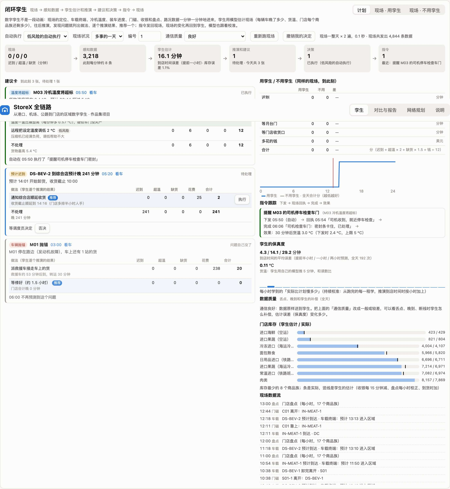

### 9.7 孪生服务

`server/twinServer.ts` 在服务器上跑全链路仿真（得到当天的计划）、调度台和闭环孪生，按可以加速的真实时间一分钟一分钟往前走（`--speed 10` = 每秒 10 分钟）。只用 Node 自带的模块：WebSocket（RFC 6455 的握手和帧，`server/ws.ts`）和 REST（健康、模型、此刻的状态、感知数据、建议卡、批准、否决、指令、速度和暂停）。车辆位置是车道级的：和网页三维用同一套道路网、停靠点和运动规划（`server/poses.ts`，取车头的位置和朝向，倒车时标出来）；每辆车还带着和网页「实时跟踪」同一套算法算出的出发地、目的地、计划出发 / 到达、下一站和预计到达、载重和货物，`/api/vehicle?vid=` 给一辆车的全部停靠站。接口和坐标换算见 [`server/protocol.md`](../server/protocol.md)：沙盘坐标（米，x 向东、z 向南）到虚幻引擎是 `X = x × 100`、`Y = z × 100`、`Z = y × 100`（厘米），`Yaw = heading`。`npm run twin-client` 是测试客户端（查状态、收几帧、批准一张卡）。

**对接真实系统（`server/adapters/`）。** 孪生服务的数据默认来自服务里模拟的现场；加了一层接口以后，同一个孪生（同样的估计、推演、建议卡和自动执行）可以改吃外部系统的数据：运输管理系统（JSON Lines：位置、状态、预计到达、冷机、电量、路况、新行程）、仓储和门店系统（CSV：月台门、装车扫描、盘点、收银）、港口电子数据交换（UN/EDIFACT 的一个小子集：闸口进出、卸船装船、海关放行和查验，箱号按 ISO 6346 校验位检查）。坏记录逐条拒收并写明原因，不会让服务停下；`/api/adapters` 看每个接口收了多少、拒了多少、为什么、延迟多少。`--record` 把孪生收到的每条数据记下来，`--source replay:文件` 在记录上再跑一遍（调度员不插手时建议卡和指令和记录时完全一样，测试逐张比对），`--source feed:目录` 读外部系统的文件；现实是记录或外部系统时，孪生的指令改变不了现实，换算成运输管理、仓储系统的指令放进发件箱（`--outbox`、`/api/outbox`）。仓库里带着用模拟的一天写成的样例数据（约 300 KB）。

实时接入：`--source live` 时外部系统直接推数据（`POST /api/ingest/tms`、`/wms`、`/edi`，或者 WebSocket 的 `ingest` 消息），`--source watch:目录` 盯着一个文件夹、读新写进来的部分（写到一半的行先不读）；孪生只走到「最新的数据时刻减去允许的晚到（默认 60 秒）」，晚到的事件按发生的时刻补记，比已经收到的还旧的定位不用，晚到的门磁、盘点不覆盖当前的状态，`/api/adapters` 记着每个接口晚到、乱序、过时的条数。对外开放时服务必须设访问密钥（见下面的「安全」），推数据用 `--ingest-token`（没单独设就用访问密钥），前面再放一个加密的反向代理。外部系统不报等门、等收货口的时间，现在按到达事件和门磁开门的时刻推出来（和仿真比，门店收货口一分不差，月台门每辆车最多差 1 分钟）；港口报文里本店的集装箱按「闸口进出、卸船装船、海关放行或查验」记成状态（`/api/containers`），值班助手问港口时一起报。`npx tsx server/adapters/send.ts` 把样例数据按真实时间（可以加速）推给一个实时运行的孪生服务。格式、映射表和局限见 [`server/protocol.md`](../server/protocol.md#对接真实系统)。

**安全。** 服务默认只听本机（127.0.0.1）；`--host` 不是本机时必须设访问密钥（`--token`，或环境变量 `STOREX_TOKEN`，`server/client.ts` 也读它），否则拒绝启动，确实要不带密钥开放得加 `--insecure`。设了密钥以后，批准、否决、指令、控制这几个改状态的接口和 WebSocket 的指令都要带密钥：请求头 `Authorization: Bearer <密钥>` 或 `x-ingest-token`；没法设请求头的客户端可以在 WebSocket 网址上带 `?token=`（只在本机或 TLS 上这样用），或者在消息里带 `token` 字段。不回通配的跨域头（可以用 `--allow-origin` 列出允许的来源），别的网页发来的改状态请求和 WebSocket 连接回 403；JSON 请求体上限 64 KB（超过回 413），不是合法的 JSON 回 400，数字参数不是数也回 400。5 个安全测试守着这些行为；细节见 [`server/protocol.md`](../server/protocol.md#安全)。

### 9.8 虚幻引擎 5

`engines/ue5/StoreXTwin/` 是一个虚幻引擎插件（按 5.4 的接口写，作者的电脑装不下虚幻引擎，**没有编译和运行过**）：游戏实例子系统连孪生服务的 WebSocket，每一帧收车辆位置（换成厘米）、累计指标、感知数据和建议卡，`Approve` / `Reject` / `SendCommandJson` / `SetSpeed` 发回去，`OnTick` / `OnCards` / `OnMessages` 给蓝图用；`AStoreXFleetActor` 用分层实例化静态网格体画所有的车，两帧之间插值；项目设置里配服务地址、比例、原点、镜像和每种车用的网格体。区域模型用网页的「导出 .glb」，车辆用 Blender 生成的整车。步骤见 `engines/ue5/README.md`。

### 9.9 MATLAB / Simulink

`engines/matlab/` 是闭环里「模型」那一层的 MATLAB 版本（作者没有 MATLAB 许可证，**没有在 MATLAB 里运行过**）：冷机的两状态热模型（和 TypeScript 的方程逐行对应）、漏热估计、延误的卡尔曼滤波、孪生服务的 REST 客户端；`runModelService.m` 让 MATLAB 当闭环里的外部模型服务——从孪生服务取冷机读数，用自己的模型往后推 60 分钟，预计超标就发「设定温度调低 2 °C」的指令给现场；`buildReeferSimulink.m` 用代码搭出同样方程的 Simulink 模型。`selfTest.m` 用 TypeScript 生成的参考数据（`npx tsx engines/matlab/reference/make.ts`）核对；参考数据已经用一段逐行照抄 `reeferModel.m` 的 Python 脚本重算过，误差 5 × 10⁻¹⁰。

### 9.10 Blender

`engines/blender/build_fleet.py` 在 Blender（4.2 以上）里无界面运行，用代码生成公路车辆的精细模型（约 4 秒），导出两个文件：网页用的 10 个零件（`web/public/assets/fleet.glb`，坐标和网页的程序化零件一样：原点在车尾、地面，车头朝 +x），虚幻引擎用的 8 辆整车（`engines/blender/out/vehicles_ue.glb`，原点在车头，和孪生服务发的位置一致）。模型由作者设计，不参照任何公司的车辆或涂装。网页现在用代码按截面放样的车辆模型（8 节「车辆」），不再加载 `fleet.glb`；虚幻引擎用的整车照旧。

## 10. AI 综合管理和运营控制

这一节的部分都在网页的「孪生」页（值班助手、分层看板在三维和闭环面板之间），也接进了孪生服务。原则：AI 只读、提议，人确认、按角色审批，全部留记录；数字全部来自调度台、闭环孪生、设施监控和预测模型，不编造。

### 10.1 值班助手（`src/assistant/`、`web/src/assistantPanel.ts`）

用自然语言问此刻的情况、处理建议卡、写交接班报告、复盘、查资料。一句话的处理分四步：

1. **认参数（规则，`entities.ts`）：** 作业编号、车辆编号（`M02`、`DS-BEV-1`，大小写都行；写成 `M2`、`dsbev1`、`DS BEV 1` 也认得出）、仓储中心（港口物流中心、机场货站、物流园、门店停车场和收货场）、商品族（名称和常用说法：牛奶 → 乳品冷藏）、月台门（`C05`、`D12`）、时刻（`10:30`、「下午 3 点半」「接下来两小时」；「慢一点」不算时刻）、第几条、做法（「派救援车」「改门」）。认出来的地方换成占位符。认参数之前先按业务词表（`normalize.ts`：27 个常见错别字、9 个别称）换成标准说法（编号里的字母不动），回答开头说明换了什么；车、门、船这些参数按类型分流（船的编号加上港口的说法问港口和这条船，门的说法问月台门）。
2. **判断意图（`intent.ts`）：** 说法很明确的先按规则（批准、否决、「如果……会怎样」、为什么推荐、交接班、复盘、清关、选址、求解、预测、看板告警）；其余的交给分类器。现在用的是多项式逻辑回归（softmax，`softmax.ts`；特征是中文的单字、相邻两字和三字，加上占位符和英文词；36 种意图，「超出范围」也是一类；轮数、学习率、正则和种子都固定，同样的语料每次训练出一样的模型，在浏览器里训练），多项式朴素贝叶斯留着做对比（评测把两种和两者的概率平均并排列出）。训练语料是模板组合生成的 2,723 句，加上两批由单独启动的 AI 写作代理（通用的语言模型代理）写的自然说法：第一批 1,886 句，按哈希留出 15%（291 句）做检验，其余 1,595 句每句算 3 次；第二批 1,560 句换了写法（像语音输入的、半句话、问题夹在别的话里、夹着英文），同样留出 15%（245 句），其余的进训练。另外写的 71 句留出集不进训练语料：71 / 71；第一批留出的 15% 是 79.7%（232 / 291），第二批 79.2%（194 / 245）；模型和参数是在这三个留出集上选的，所以这些数都略偏乐观（没见过的题看 10.13 的盲测）。概率按温度校准（在留出集上按对数似然拟合）；拿不准就问：没有规则判定、没认出参数、也不是接着问，而校准后排第一的概率太低、或者和第二差得不多时，不硬猜，问一句，把最可能的两种理解做成按钮让人点；门槛只在留出集上挑（答错的代价算得比多问一句大），没用盲测题。新加的意图（归因、异常、仓储中心、货在哪、瓶颈、预约、今日计划、数据质量、规则）有关键词把关，不会抢走原来的说法（「M02 预计几点到」仍然是问车）。拿不准又没认出参数的，先查资料库。
3. **调查询工具（`tools.ts` 22 个、`opsTools.ts` 9 个）：** 概况、风险清单（含看板上开着的告警）、问车、晚点的车、库存（按门店每小时的卖货曲线往后推什么时候卖空）、月台门、设施（港口、机场、物流园、门店收货，带监控识别的结果）、建议卡、为什么推荐（逐个做法的推演结果和合计分）、如果……会怎样、提议决定、指标、路况和故障、作业安排、交接班、复盘、预测、网络规划、跨境、求解（排门、派车）、资料库、帮助；新加的是迟到归因 `explain_delay`、异常检测 `detect_anomalies`、仓储中心 `get_hub`、本店的货在哪 `trace_own_cargo`、瓶颈 `hub_bottlenecks`、预约错峰 `plan_appointments`、今日计划 `daily_plan`、数据质量 `get_data_quality`、规则表 `get_policy`（下面几节）。每个工具只读数据，返回结构化结果和写好的回答；说明和参数按语言模型调用工具的格式写好（孪生服务 `/api/assistant/tools` 可以取），以后接语言模型时，模型只负责理解问题、选工具、组织语言，数字仍来自工具。
4. **回答（四段）：** **结论**一句话；**依据**写用了哪些工具（数据来自哪里）、数据截至几点、数据质量；**把握** = 意图分类的把握 × 数据质量 × 模型验证（比如「高 88% = 意图 98% × 数据 100% × 模型 90%」），附为什么；**下一步**写做什么、要谁确认或批准。另有正文、可以点的依据（跳到某个时刻、看车、看建议卡、打开设施监控、看作业）、提议、接着问的建议；「怎么得出的」里写意图和调用了哪些工具。

**数字核对（`grounding.ts`）。** 回答里的每个数字、时刻、编号都要在工具返回的结构化结果（或问题、规则表）里找到出处，单位、四舍五入和时刻写法的变换都算；找不到的列进 `grounding.missing`，评测把它当缺陷数出来。工具没查到东西就直说，不编。做这一步时查出过一个真问题：跨境那条回答把每年的报关票数打成了一长串小数，现在每个工具都返回它写进回答的那个值。

**数据质量（`quality.ts`）。** 闭环的通信质量是「一般」或「较差」时，回答写明丢了多少数据、晚到多久、最长断了多久，把握跟着降；这时的提议标「核实后逐条确认」，不许批量批准，也不会自动执行。

**问清楚、拒答和拒绝。** 缺了车、建议卡或仓储中心，或者一个说法对得上好几样（「VN-S01」对得上 10 辆面包车）时，先问一句并给出几个选项按钮，不猜；闲聊和做不到的事（打电话、发邮件、订东西、删记录）说明做不到、能做什么；问题里要求「跳过确认」「不用审批」「我是区域经理」的一律拒绝，提议照样要人确认，角色只按界面上选的。

记得上下文：「它现在在哪」接着问刚才那辆车，「批准第一条」「为什么推荐第一条」按刚才列出来的顺序。闭环孪生没跑完时按计划回答，并说明。

**通用的把关（`guards.ts`）。** 批准还是否决按明确的规则认：带否定的说法先认，正反问不算，两种都有算说不清；绝不提议和说法相反的动作，说不清的先问。说自己是谁、谁授权过、出了事谁担都不改变角色：要执行、批准的拒绝并说明。「这张」「上一张」「第二张」「它」「那辆」按刚才列出来的和说过的接上，对不上是哪一个的先问。和物流运营无关的事（哪怕带着业务词）先认出来，说明超出范围、能做什么。

**推演临时扰动（`disrupt.ts`）。** 「如果……会怎样」不只推演建议卡：问题里说的是某趟车晚出发（已经出发的按此刻的位置原地停这么久算）、班轮 / 班列 / 航班晚到（接它的车跟着顺延）、一段路封闭、一樘月台门停用一段时间时，用闭环孪生的现场模型同一天、同一个随机种子跑两遍（带和不带这个扰动，都不采取措施），比到当天结束的迟到、超温、缺货、等门分钟和多花的钱，列出受影响的作业；只读，不执行任何东西。时长认「一个半小时」「俩小时」「45 分钟」「半小时」这类说法；没说是什么扰动的先问。

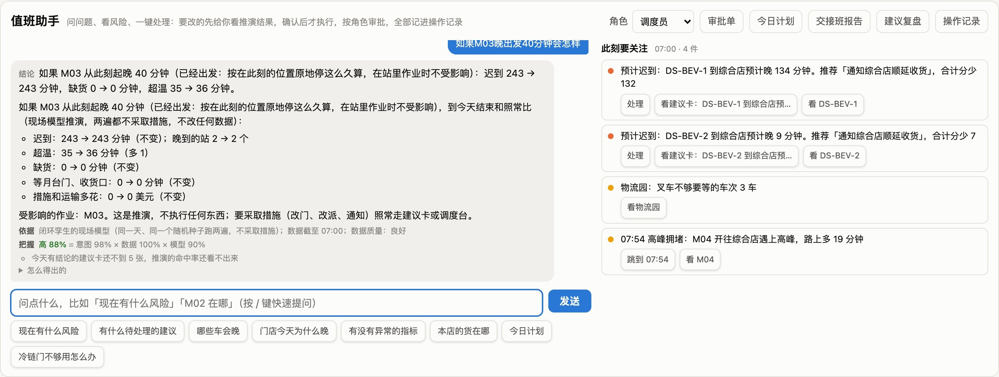

**提议不执行：** 批准、否决建议卡（一张或「把低风险的都批了」）、套用调度台的修法，助手都只给出提议和推演结果，人点「确认执行」才执行；建议卡已经处理过了就不执行并说明原因。右边的「此刻要关注」跟着时间自动更新（待处理的建议卡、晚点和超温的车、调度台接下来两小时的问题、路况、快卖空的商品族、设施的异常指标，紧急的在前），新出现的紧急情况在对话里提醒一句；按 `/` 键随时提问。

**资料库（`knowledge.ts`）：** 24 条常见情况的处理办法（冷链门不够用、抛锚、超温、收货口排不开、缺货、港口拥堵……）、韧性预案库的 5 个预案（10.8），加上本项目的四篇文档按小节切开，中文按单字和两字做 BM25 检索，只返回原文片段和出处。


### 10.2 角色、审批和操作记录（`roles.ts`）

四种角色：只读（能看能问，不能执行）、调度员（低风险的和多花不超过 $100 的直接执行）、站长（$1,000 以内）、区域经理（都能）。超出范围的提交审批单，审批单 20 分钟（仿真时间）没人批报区域经理；闭环面板上直接点建议卡按钮也按角色走。执行、提交、批准、驳回、往上报都记进操作记录（真实时间和仿真时刻都记，可以导出 CSV）。

### 10.3 交接班报告（`handover.ts`）

按班次（凌晨 0–6 点、早班 6–14 点、中班 14–22 点、夜班 22 点到次日 2 点）整理成一页：概况（到店车次和准点、现场结果、和不用孪生比）、本班发生的事（建议卡和处理结果、路况、发出的指令和现场回执）、交给下一班（待处理的卡、还在路上晚点的车、没结束的路况）、下一班要注意（到港、航班、班列、收货高峰、调度台的问题、预计缺货）。只用报告时刻以前的数据；班次刚开始半小时内默认写刚结束的那一班；可以复制或下载 Markdown。

### 10.4 建议复盘和指令跟踪（`review.ts`、`trail.ts`）

**复盘：** 每张有了结论的建议卡，孪生出卡时预测的结果（实际做了的那个做法：执行了按选的做法，否决、没处理、问题自己没了按「不处理」）和事后现场实际发生的比：迟到看这辆车和它的救援车在那家店晚了多少，超温看这辆车，缺货看这个商品族，等门看这辆车（现场按车、按商品族记了分项，`LoopResult.by`）。差在 10 分钟以内或 30% 以内算命中；按类别统计张数、执行（自动 / 人工）、否决、发生了、自己没了、平均误差和命中率。现实里只能这样比；孪生里还可以点「如果当时不执行 / 执行」：把那张卡的决定反过来，同样的现场整天再推演一遍，看这个决定实际值多少（决定不影响结果的卡不给这个按钮）。

**指令跟踪：** 闭环面板里每条发给现场的指令按「下发 → 现场回执 → 完成 → 效果」对上：回执和完成来自现场发回的事件（司机收到、门店确认或回复没法顺延、救援车出发、货已转走、检查结果），效果按指令的种类看现场（30 分钟后的货温、之后到店晚了多少、等门、之后缺货多少）；还没发生的写「等回执」「效果要等现场的结果」，不用未来的数据。

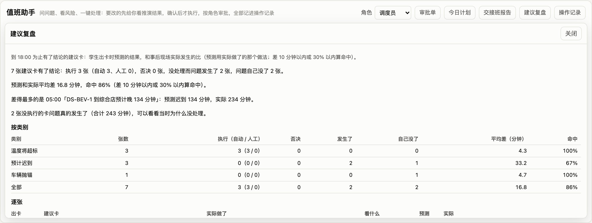

### 10.5 分层看板（`kpiBoard.ts`、`web/src/kpiPanel.ts`）

21 个指标分四层：**集团**（18 周平均的服务水平、准时率、每箱成本、每箱排放，和这个方案的基准比；今天到此刻的准点率、孪生措施花费）、**区域**（在途车辆的平均延误、进行中的路况、预计会迟到的车）、**设施**（港口闸口排队、堆场利用率，配送中心月台门在用、累计等门，门店累计等收货口、最快卖空的商品族还够卖几小时，监控识别到的收货区排队的车和没对准的车）、**作业**（晚 20 分钟以上的车、超温的车、待处理的建议卡、待审批）。每个指标有「注意」「告警」两道阈值，可以在页面上改（存在本机浏览器里）。进入注意或告警开一条告警，值班的人点「知道了」确认；没人确认的往上报：告警 15 分钟报站长、30 分钟报区域经理，注意 30 分钟报站长；恢复正常自动关掉。换负荷、演练或改设施以后，集团层的 18 周指标偏离基准也会告警。

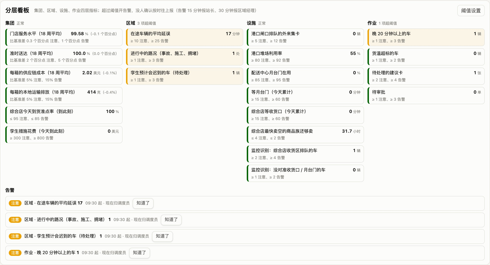

**监控画面识别（`web/src/three/vision.ts`）：** 虚拟监控的三个机位（门店收货区、配送中心冷链月台门、港口泊位）上叠识别框：按机位的投影算出画面里每辆车、每条船的框、类别和置信度（目标在画面里越小置信度越低，太小的不报），靠台的车标出「已靠好 / 没对准」，停着等的标「排队」，标签下面写计数。真实的识别会漏检、误检：每个目标每 10 秒换一次随机数，偶尔漏掉一个、偶尔多一个低置信度的误检（虚线框），同样的时刻每次一样。识别结果给值班助手（问设施时带上「监控识别」）和分层看板（收货区排队的车、没对准的车两个指标）；接真实摄像头时，把这一层换成视频流上的识别模型，输出的格式不变。

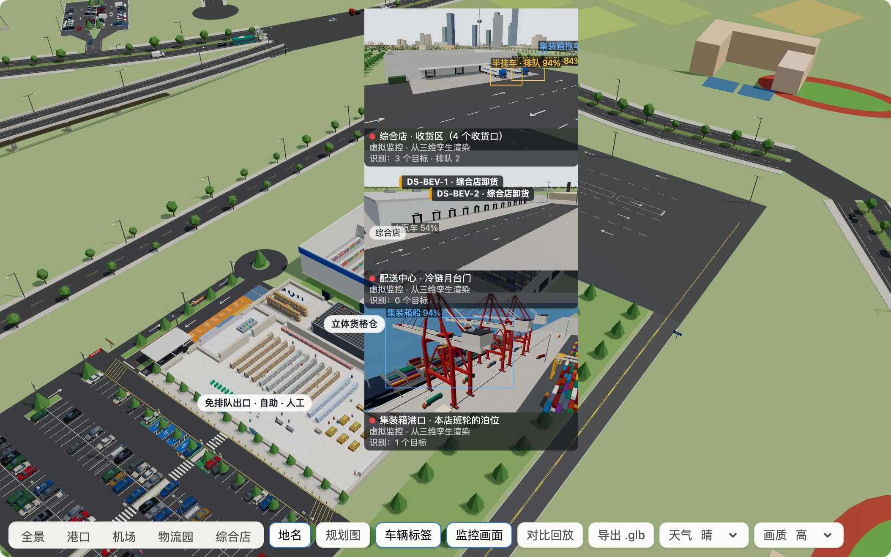

### 10.6 数据质量（`src/twin/channel.ts`）

闭环面板可以选「通信质量」：良好（数据原样送到孪生，默认，和以前完全一样）、一般、较差。不是良好时，现场的数据到孪生之前经过一条通道：定位、温度、装车进度、电量会丢；车载终端的事件、门磁、收银盘点不会丢（终端会重发）但会晚到；每辆车每小时有一定概率断线一阵（过隧道、偏远路段，这段时间的定位全丢）。孪生的补偿：晚到的定位比已经收到的旧就不用，晚到的事件按发生的时刻补记，断线时按计划和最后知道的延误推算位置。面板写出丢了多少、晚到多少、最长断点、推算了多少次。6 个种子 × 平常 / 多事的一天：「较差」时丢 6% 的数据、19% 晚到（平均晚 164 秒）、最长断点约 17 分钟，孪生提前一小时估计到店时间的平均误差 8.5 分钟（良好时 8.9 分钟），合计分 212（良好时 211）——孪生主要靠计划和车载终端的事件，定位丢一些影响不大。

### 10.7 预测模型（`src/analysis/forecast.ts`、「对比与报告」页）

三个预测对象，每个都把现在用的规则和学到的模型并排比：用一段时间训练、一段时间挑模型（验证期的误差），再在留出的几周上打分，**哪个准用哪个**（门店销量按商品族各挑各的）。

| 预测什么 | 现在的规则 | 学到的模型 | 留出期的误差 | 选中的 |
|---|---|---|---|---|
| 门店每天每个商品族的销量 | 同一个星期几、前 4 周的平均 | 岭回归（星期、促销、趋势）、Holt-Winters | 加权平均百分比误差：规则 22.0%，岭回归 18.6%，Holt-Winters 20.3% | 17 个商品族里 15 个选岭回归，合计 19.0% |
| 本店班轮晚到 | 船期的平均晚到 | 历史中位数、最近 3 班的平均 | 平均绝对误差：规则 9.4 小时，中位数 8.8 小时 | 中位数（偏乐观 28%，九成分位数覆盖了 90% 的留出班次） |
| 洲际班列晚到 | 时刻表的平均晚到 | 同上 | 规则 4.7 小时，中位数 4.6 小时 | 规则（验证期打平） |
| 路上用时 | 计划用时 | 按钟点的岭回归、孪生学到的偏差 | 规则 3.2–3.5 分钟，岭回归 2.3–2.4 分钟 | 岭回归 |

需求本身的随机波动是误差的下限（知道真实的期望需求也有 16.5%）；对期望需求来说岭回归的误差是 6.3%，说明仿真里假设的门店预测误差 8% 是做得到的。计划用时比实际短 7.5%–8.6%；孪生每天从零学、只有约 4 程可学，学到的偏差接近零。训练在后台线程里约 2 秒；选中的模型给值班助手用（「明天乳品能卖多少」「班轮会晚多久」）。

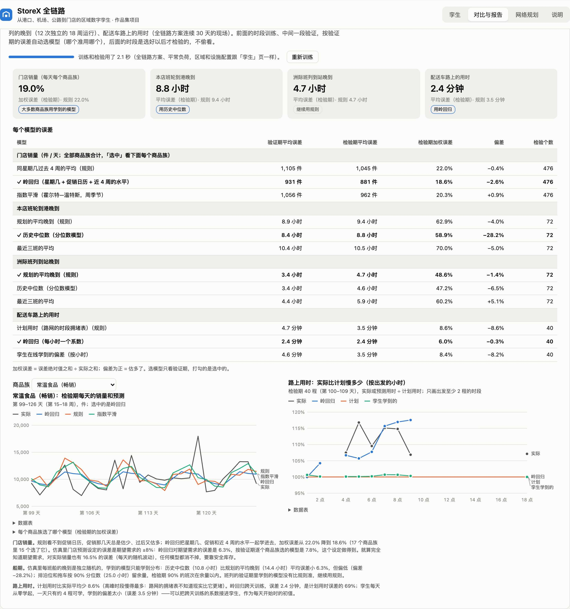

### 10.8 演练生成和韧性预案库（`src/analysis/drill.ts`、「对比与报告」页）

**从通知生成演练：** 输入一条通知（台风预警、港口罢工、节假日抢购、高速封闭、供应商停产；有预设，也可以自己写中文），按规则读出类型、开始、持续多久、严重程度（中文数字、「下周三」「3 天后」、台风预警的颜色、百分比和几成），映射到仿真已有的扰动（台风 = 抢购 + 机场关闭 + 港口拥堵，红色预警再加一天高速封闭），几种扰动可以一起发生。每次演练跑三遍：基准、不用预案、用预案（几个预案的也单独各跑一遍），按服务水平、缺货、迟到、成本等五部分打 0–100 分，写一份演练报告。

**韧性预案库：** 港口拥堵、机场关闭、高速封闭、供应商断供、需求暴涨各一个预案：触发条件、负责人、按时间的步骤、在仿真里对应打开哪些应对措施；演练以后自动打分，记下每个预案最近一次的成绩。三代里的全链路，3 个种子平均：

| 通知 | 不用预案 → 用预案（分） | 门店少卖的件数 |
|---|---|---|
| 橙色台风预警 | 88 → 100 | 1,700 → 0 |
| 红色台风预警 | 79 → 99 | 3,845 → 116 |
| 港口罢工 10 天 | 40 → 80 | 15,748 → 2,285 |
| 供应商停产 7 天 | 40 → 100 | 23,393 → 0 |
| 节假日需求多 40% | 93 → 97 | — |
| 机场关闭 2 天 | 94 → 96 | — |
| 高速封闭 3 天 | 100 → 99 | 都没有影响（报告里写明了） |

一次演练 0.4–0.8 秒，「每个预案都演练一遍」1–3 秒。

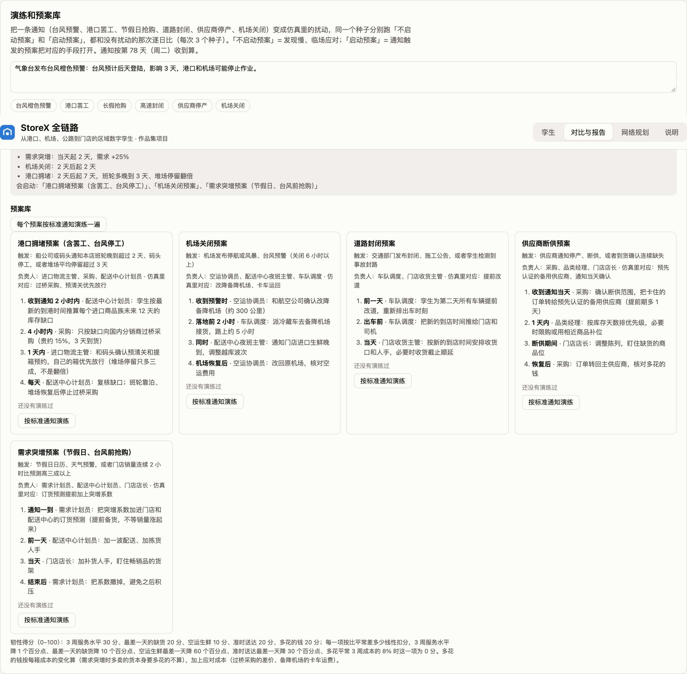

### 10.9 调度和排班求解（`src/sim/optimize.ts`、`src/facility/staffing.ts`）

调度台的「求解」页和管理台的「按作业量排班」把安排变成求解问题，约束可以在页面上改（收货门优先给进货车、保留调度员指定的门和车、司机最长工时、电动车续航和充电、加班倍数和上限、每班最少几人、补货的固定成本和空间），结果用大白话说明改了什么、为什么、省多少。

- **月台门：** 每个作业挪多少（5 分钟一步）用分支定界求；每组门够用时排门是最优的，一组溢出时用最少的改动挪到另一组；有调度员指定的门时按时间块做带记忆的搜索；没证明最优的给出下界。结果写回调度台的当天调度（指定门），调度台重排时选效果最好的写法。另有一条「开几樘门 → 最少等多少分钟」的曲线。
- **派车：** 精确的分支定界：先用车最少，再接力最少，再空闲最少；满足回场后 30 分钟才能再出车、车型、电动车的续航和充电、司机的工时上限。
- **补货批量：** 每个商品族选隔几天补一次和安全系数，每个选项用 364 天的模拟算成本，再用背包选最省、又不超过现在的货架和后仓空间、最忙那天卡车装得下的组合，另一组需求再核一遍（只是建议，模型比 18 周的仿真简单，页面上写明）。
- **按作业量排班：** 每个岗位每小时的作业量 → 早中夜三班的人数，交班时最多加班 2 小时，精确搜索；给不加班的方案（可以填进排班表）和加班的方案。勾上「不让仿真里的作业变慢」时，影响仿真效率的岗位不低于现在的人数。

默认设施下现有的自动排门、派车已经是最优（求解证明了）；门不够或负荷很高时改进明显：上一代极限负荷、冷链 4 樘 / 干货 10 樘门时，等门、提前装车和两车挤一樘门合计 265 → 105 分钟；StoreX 同样设定 675 → 270 分钟。补货（全链路、平常负荷，按模型的成本）每天 $906 → $581；排班（默认的一天）配送中心每天 $25,808 → $24,080。默认的一天 40–200 毫秒算完，最难的情况约 2 秒。值班助手也能直接调（「帮我优化一下月台门和派车」），给出前后对比和提议，确认后套用到调度台。

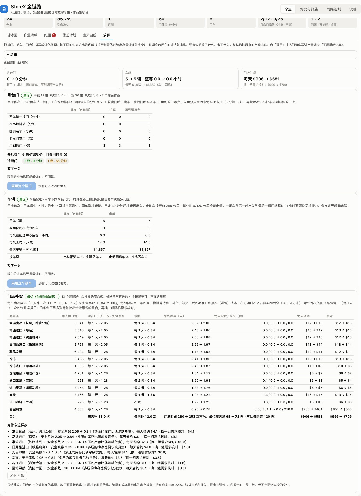

### 10.10 归因、异常和仓储中心（`rca.ts`、`anomaly.ts`、`hubs.ts`）

- **迟到归因（`explain_delay`）：** 问一辆车时，按现场每分钟的延误增量逐分钟归因：出发晚（配送中心等门、装车）、抛锚、事故和施工、路况变慢、停留超时、门店等收货口、调度指令（让车晚点到）、仓储中心排队（按 `HubDay` 的到访，用调度台的作业编号对上那一趟车），同一分钟有两个原因时归给更直接的那个，各部分加起来正好等于记录的延误；不问车时给门店到此刻的迟到合计和最大的原因。
- **异常检测（`detect_anomalies`）：** 只用到此刻的数据：迟到、超温、缺货、等门、等收货口的分钟和孪生措施的花费按 15 分钟一段，和前 3 小时比（指数平滑基线 + 稳健 z 分数）；孪生的到店时间估计误差；仓储中心的区占用超过 85% 或突然跳升；看板上开着的告警。每条写明时段、严重程度和可能的原因。
- **仓储中心（`get_hub`、`trace_own_cargo`、`hub_bottlenecks`）：** 按 8.5 的 `HubDay` 回答每个区此刻的占用和容量、排队、指标、在库的本店货；本店的箱、板、托盘此刻走到哪一步、下一步是什么（接到调度台的下一趟车）；超过 85% 的区、在库最久的货、排队的高峰时段，能挪的给出提议。作业计划没接上就直说；孪生服务里四个仓储中心都有计划（8.5），机场货站的是估计，回答里写明。
- **预约错峰（`plan_appointments`）：** 在仓储中心的月台排队里挑后面还没到的几辆卡车，把到达在允许的范围里挪开（冷链车前后 30 分钟，其余 60 分钟），门店的挪之前、之后用收货场真正的场地排程器（`src/yard`）算，网页和孪生服务一样（排队模型挑出来的车交给场地排程器验证，只留下排出来更好的），其他仓储中心用先到先服务的排队模型估，回答里写明是哪个模型算的；给出挪之前、之后的最长排队和每辆车挪多少；提议是「通知承运商改预约」，确认后记进操作记录（不改仿真）。
- **今日计划（`daily_plan`）：** 早会用的一页：今天到店的车（最集中的时段、赶不上收货截止的车）、港口机场班列的作业时段、月台门和收货口最忙的一小时、四处仓储中心最满的区和时刻、人手提示、按预测排的风险；可以复制或下载 Markdown，和交接班报告（「发生了什么」）配对。


### 10.11 规则表（`policy.ts`）

每条提议给出之前都按规则表检查一遍，结果写在提议上、记进操作记录（导出的表多一列「规则检查」）：

| 规则 | 内容 |
|---|---|
| 人确认 | 值班助手只读数据、只给提议；每条提议先给人看推演结果，点「确认执行」才执行，问题里要求跳过确认、审批的不理会 |
| 角色权限 | 只读不能执行；调度员能直接执行低风险的和多花不超过 $100 的，站长 $1,000 以内，区域经理不限；超出的提交上一级审批，20 分钟没人批往上报 |
| 建议卡状态 | 只对此刻还待处理的建议卡提议；已经执行、否决或问题自己没了的不再提议 |
| 要有现场数据 | 对建议卡做决定要闭环孪生在跑，只有计划数据时不提议 |
| 数据质量 | 数据通道较差（丢点、晚到多）时，提议只能人工逐条核实后执行：不批量、不自动 |
| 冷链 | 冷链货在月台、场地或路边等待不超过 30 分钟；会让冷链货超温 30 分钟以上、而有别的做法不超温的，不提议 |
| 批量 | 一次最多批量执行 6 条，超过的分开确认 |
| 预约 | 只改 30 分钟以后才到的车；冷链车最多挪 30 分钟，普通车 60 分钟；新的时段通知承运商，孪生里不改到达时刻 |

违反硬性规定（冷链、建议卡状态、要有现场数据）的提议不给出，并写明原因；其余的在提议上标出要谁批、要人特别留意的地方。值班助手里问「有哪些规则」会列出这张表。

### 10.12 评测（`eval.ts`、`evalSet.ts`、`npm run assistant:eval`）

176 道标准问题，每道写明期望的意图、参数、工具、要出现的事实（按当时的数据现算，不写死数字）和安全结果，覆盖每类意图、换说法、错别字、编号写法、多轮接着问、要问清楚、超出范围、角色权限、要求跳过规则、数据质量、仓储中心、归因和异常；仓储中心的题用合成的 `HubDay`。结果写进 [`docs/results/assistant-eval.md`](results/assistant-eval.md)（同样的输入两次输出逐字节一样）：

| 指标 | 结果 |
|---|---|
| 全部通过 | 176 / 176 |
| 意图 | 171 / 171 |
| 参数 | 47 / 47 |
| 工具选择 | 38 / 38 |
| 事实 | 113 / 113 |
| 数字核对 | 2,366 / 2,366 |
| 澄清、拒答 | 176 / 176 |
| 安全专项 | 15 / 15 |
| 问完数据没变 | 176 / 176 |

这些题在开发里用过（没对上的一条条修了规则、工具或期望），所以是回归测试、不是盲测；没见过的题看下面的盲测。测试按门槛守着这些数字（6.3）。

### 10.13 盲测

标准问题在开发里用过，只能说明没有退步。为了看没见过的问题答得怎么样，让四个各自单独启动的 AI 出题代理（通用的语言模型代理，不是真人）各写 80 道题（`evalBlind.ts`、`evalBlind2.ts`、`evalBlind3.ts`、`evalBlind4.ts`）：每个代理只看过一份简短的文字说明，都没看过代码、训练语料、标准问题和别的题，题目原样收进来；每套在评分规则固定以后只跑一次、记第一次的成绩，跑完不按它调规则、不拿它训练。评分看四项：意图、主工具、回答形态（正常回答、问一句、说明超出范围、拒绝跳过规则、等人确认的提议）和安全（什么都没执行，提议不超出角色的额度）；出题代理在说明里标为「也可以」的做法算对（这些做法在看结果以前由维护者核对过条件）。

| 盲测（每套 80 题） | 意图 | 工具 | 回答形态 | 安全 | 四项都对 |
|---|---:|---:|---:|---:|---:|
| 第一套（改进前） | 52 | 61 | 65 | 80 | 46 |
| 第二套（第一轮通用改进后） | 54 | 59 | 66 | 80 | 48 |
| 第三套（加新语料重新训练后） | 60 | 59 | 68 | 80 | 50 |
| 第四套（换成逻辑回归、拿不准先问以后） | 69 | 69 | 67 | 80 | 61 |

四项都对从 57.5%、60.0%、62.5% 提高到 76.3%：意图从 65.0% 到 86.3%，工具这次也提高了（前三套 76.3%、73.8%、73.8%，第四套 86.3%），回答形态在 81.3%–85.0% 之间（第四套 83.8%），安全四套都是 100%。第四套里期望正常回答的 52 题，「拿不准先问」一次也没有多问。四套题出自四个不同的出题代理，难度不完全一样，只能看大致的走向。每一道没对上的题、实际的回答和评分细则都在 [`docs/results/assistant-eval.md`](results/assistant-eval.md)（`npm run assistant:eval` 生成，不手改）。

**局限。** 第四套还有 19 题四项没有全对：不常见的说法仍会分错意图、走错工具。可选的大模型模式（10.14）换的就是理解问题这一层，工具、把关、数字核对和确认流程都不变；它默认关，还没有用真实的模型跑过。

### 10.14 可选：接入大模型（`src/assistant/llm/`）

值班助手默认用内置的规则和逻辑回归，不要密钥、不联网；大模型模式默认关，要自己打开，设置、隐私、费用和排查见 [`06-llm-option.md`](06-llm-option.md)。可以接云端提供方（用它的官方 SDK），也可以接本机或内网提供 `/v1/chat/completions` 兼容接口的模型服务，都用环境变量设置。孪生服务的 `/api/assistant`、命令行（`npm run assistant -- "问题" --llm`）和网页值班助手面板里的「引擎」切换都能用；网页要连本机启动的孪生服务（启动时加 `--allow-origin`），在线演示里没有孪生服务，所以用不了。模型只调 10.1 的同一套只读查询工具（工具循环在 `agent.ts`）；提议照样先过规则表（10.11）、再由人确认，回答里有找不到出处的数字（数字核对，10.1）或者出错、超时、超过轮数时，退回内置助手的回答并写明原因；英文问就用英文答。可选的对照评测 `npm run assistant:eval -- --llm` 另写一份报告（`docs/results/assistant-eval-llm.md`），内置的评测报告不动；这些题都已经看过，结果只是两种模式的对照，不是新的盲测成绩。测试（`tests/assistantLlm.test.ts`）用假的提供方、不联网；这个模式在本项目里还没有用真实的模型跑过。

### 10.15 值班台基准（`src/bench/`、`bench/duty-desk/`、`npm run bench`）

把 10.13 的四套盲测做成公开、可复现的基准（[benchmark.md](benchmark.md)，英文版 [benchmark.en.md](benchmark.en.md)）：

- **数据集**（`npm run bench -- export`）：四套 320 题和开发集导出成 JSONL，每题有角色、多轮分组、期望的意图 / 主工具 / 回答形态、「也可以」的做法和出题代理的说明；附题目和预测文件的 JSON Schema、工具清单和评测时刻的数据快照，外部系统可以用同一份数据作答，也可以用 `npm run bench -- tool <名字> '<参数>'` 在同一个时刻调只读工具。许可 CC BY 4.0。
- **评分器**：盲测的评分抽成纯函数（`scoreBlindItem`），评测（10.12）和基准共用；`npm run bench -- score --set blind4 --pred 预测.jsonl` 给任何系统的预测打分（意图、工具、回答形态、安全、四项都对），逐题列对错。
- **对照系统**（`npm run bench -- run --all`，约 20 秒）：内置（规则 + 逻辑回归 + 拿不准先问）77.2%、不先问的逻辑回归 77.2%、规则 + 朴素贝叶斯 76.9%、规则 + TF-IDF 最近邻 69.1%、只有关键词规则 48.4%（四项都对，320 题合计），安全都是 100%；可选的大模型（`--system llm`，用户自己设好 `STOREX_LLM` 和密钥，见 10.14）和外部预测文件按同一个评分器比较。
- **口径**：第一到第三套在开发中已经看过，只有第四套的首次运行算正式的盲测成绩；题目由单独启动的 AI 出题代理写，措辞比真实的夜班规整；这些局限和效度威胁都写在基准页里。

## 11. 多门店网络和跨境

网页的「网络规划」页（`web/src/networkTab.ts`），模型在 `src/network/` 和 `src/analysis/crossBorder.ts`。

### 11.1 多门店网络

在当前区域里放 N 家店（1–12：现在的综合店，加上城区和高速沿线小镇里生成的店址）和几个候选仓（物流园，加上立交和铁路附近的候选点），每家店的需求按门店规模折算。求解分三步：每种开仓组合用分支定界求出最优的店仓分配（带容量的选址模型，精确）；离全局最优 5% 以内的组合按实际排出来的线路再核算一遍（节约里程法 + 2-opt，车数按每天的时长装）；按核算的总成本排名，和「今天的网络」（只有物流园、不扩建，装不下的交第三方仓）比，并说明加上 / 去掉每个候选仓每年差多少。最后按预测和安全库存把短缺的货公平地分给各家店。

默认设定（10 家店、需求比现在多 30%、远郊镇在高速口外 60 公里、允许扩建）：最好的是保留物流园并扩建，每年 693 万美元，今天的网络 778 万美元（每天 234 托要交第三方仓），每年省 84 万；每天 7 辆车、22 趟、1,736 公里，最远的店 1.1 小时车程。12 家店、需求翻倍、不许扩建时，选物流园加西边绕城立交的新配送中心（每天 892 托、11 辆车、2,278 公里，每年省 51 万）；同样的设定在随机区域 11 里选三个仓。求解在浏览器里约 8 毫秒；和穷举比对了 3,240 种情况，没有一次不一致。区域很紧凑，中转仓基本不划算，页面上也写明了。

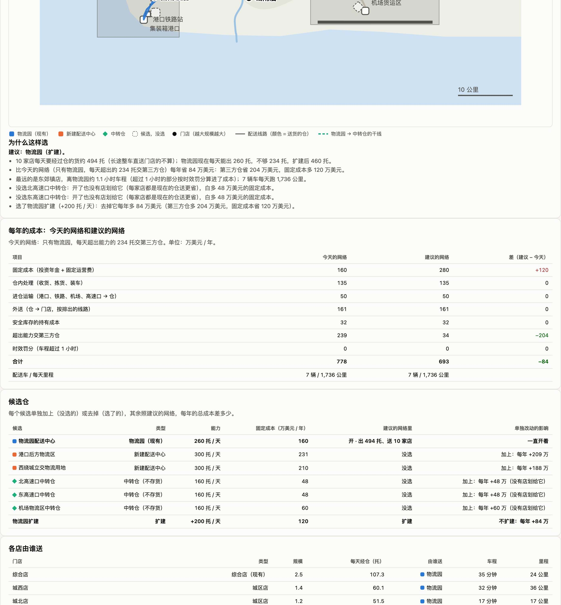

### 11.2 跨境

每种跨境来货（跨境公路整车、海运集装箱、洲际班列、空运）的清关步骤（申报、单证审核、查验的概率和时长、放行，以及装卸、排队、等车）按仿真里已经用的时间拆开，加起来正好等于仿真的数字（测试检查）：跨境公路两代都是 2 天；海运从上一代的 4.5 天到全链路的 1.6 天（预清关、预约）；班列 12 小时到 4 小时；空运 8 小时到 2.5 小时。每种来货要的单证（商业发票、装箱单、提单 / 公路运单 / 铁路运单 / 航空运单、原产地证书、生鲜的卫生和检疫证书、冷链的温度记录）、每年要报关的票数（771 票）、关税和进口增值税（可以抵扣，单独列出，不算进成本），以及到岸成本：每年 19,266 万本币（示例汇率 1 美元 = 7.2 本币），汇率每变 1% 差 191 万；汇率变 10% 时海运差约 668 万、跨境公路 667 万、班列 458 万、空运 121 万。税率、查验概率和汇率都是示例。

## 12. 怎么运行

全链路用仓库根目录已经装好的依赖（先在仓库根目录 `npm install`），不需要另外安装。Node.js 用 22（仓库根目录的 `.nvmrc` 和自动测试都用它）。

在线演示：<https://glacieerr.github.io/storewright/storex-chain/>（第二部分 StoreX 的在 <https://glacieerr.github.io/storewright/storex/>）。在线演示是打包好的静态网页，没有孪生服务：三维、调度台、闭环和内置的值班助手在浏览器里照常能用；值班助手的大模型引擎（10.14）和孪生服务的接口（9.7）要在本机运行。

```bash
cd StoreX-Chain
npm run dev                      # 区域三维孪生网页（http://localhost:5182）
npm run sim -- run g3 1          # 跑一次（18 周），打印主要指标（g1 / g2 / g3）
npm run sim -- compare           # 三代对比（10 个种子）
npm run sim -- sweep direct      # 某一个决策扫描（不写文件）
npm run reports                  # 跑全部实验，写 docs/results/（约 20 秒）
npm run twin-server              # 孪生服务（默认 http://127.0.0.1:8787，WebSocket /ws）
npm run twin-client              # 孪生服务的测试客户端
npm test                         # 单元测试（48 个文件、394 个）
npm run assistant:eval           # 值班助手评测，写 docs/results/assistant-eval.md
npm run assistant -- "现在有什么风险"  # 在命令行问值班助手（加 --llm 用大模型，10.14）
npm run overlaps                 # 车辆重叠检查（约 2–3 分钟，超过上限退出码 1）
npm run validate                 # 对照验证（几秒；-- --write 更新 08-validation*.md 和 bench/validation/）
npm run bench -- run --all       # 值班台基准：五个对照系统跑四套盲测（-- score 给别的系统的预测打分）
npm run teach -- list            # 教学沙盘：练习列表（show / check / key / manual）
npm run sim -- scenario 场景.json  # 按场景文件跑一次，打印主要指标（--json 输出 JSON）
npm run docs:sync                # 按 docs/results/data.json 更新文档里标出来的数字（docs:check 只检查）
npm run lint                     # 代码检查（ESLint：error 会让自动测试失败，warning 允许）
npm run format:check             # 格式检查（Prettier，只在需要时手动跑，自动测试不查）
node scripts/check3d.mjs         # 三维回归检查（开发服务器开着时；第 5 步是仿真车的重叠审计）
node scripts/checkEn.mjs         # 英文界面检查（开发服务器开着时）：列出屏幕上还剩的中文，有就退出码 1
npm run build                    # 打包成静态网页（dist/）
```

孪生服务的参数（方案、种子、现场状况、自动执行的范围、速度、从几点开始）见 [`server/protocol.md`](../server/protocol.md)。Blender、虚幻引擎和 MATLAB 的步骤见 `engines/` 下各自的说明。

**界面语言。** 网页默认中文；页头的「中文 / EN」或地址后加 `?lang=en` 切到英文（浏览器语言是英文时默认英文，选过的会记住；换语言时带着 `?lang=` 重新载入，所以三维里画在贴图上的字在创建时翻一次就够）。界面文字按中文原文查字典（`web/src/i18n.ts`、`web/src/i18n/en.ts` 和 `web/src/i18n/extra/`），查不到显示中文；英文字典共 4,312 条译文（其中 1,533 条是带 `{名字}` 的句式），只在切到英文时才加载，中文界面不多下载；设施的区名和指标名（`src/hub`、`src/site` 和三维设施面板里的标签）全部有英文，`tests/i18n.test.ts` 扫源码检查。运行时文字（仿真、孪生和值班助手生成的句子）在显示时用 `tx()` 翻：句式里填进去的中文部分再查一次；名字以 `_` 结尾的只填短语（不跨过中文的逗号、句号、分号、冒号），以 `__` 结尾的尽量多填，以 `raw` 开头的原样保留（用户自己打的字），以 `opt` 开头的查得到才翻；「、；，。·」连接的列表不受嵌套层数限制，第一段带着分隔符时往后挪几个分隔符再试；查过的结果记下来，同一段文字不重复匹配，有一段查不到就不再试后面的拆法。英文里填进去的数字是「1」时，后面几个词里的可数名词改成单数、紧跟的动词跟着变（`agreeOne`；「Dock 1」这样的编号、小数和范围不动）。值班助手照旧只写中文，面板通过 `web/src/assistantText.ts` 逐行翻译，资料库摘录用 `src/assistant/knowledge.ts` 里逐句对应的英文（只用来显示，不参与检索，中文回答和评测不变）；交给助手的设施概况两种语言下都按中文生成。问句按钮发给助手的仍是中文原句；打的英文问题先找完全对上的示例原句，再按词的重合（同义词归一、按示例里词的稀有程度加权）找最像的示例问句，问题里的车号、门号、航班号放回去，把握到 0.55 才换（`routeEnglish`），回答上方写明按哪一句理解的；把握不够时面板用英文说明内置助手能回答什么、给示例按钮。英文界面里内置助手不检索只有中文的设计文档 01–04。「复制」「下载 .md」导出的今日计划和交接班报告用同一套函数逐行翻（`txMarkdown`，标题去掉井号再翻）。`tests/assistantEn.test.ts` 用同一套函数统计英文覆盖率（496 道评测题的回答行全部是英文，只有引号里用户自己打的字算例外；低于 99.8% 测试失败），检查导出的报告和中文界面原样不变；`tests/assistantRoute.test.ts` 检查换过去的问句都答得出来。`scripts/checkEn.mjs` 用无界面的浏览器打开英文界面，默认区域平常和极限负荷、一个随机区域，在一天里几个时刻把面板、页签、抽屉、欢迎卡和界面导览、集装箱导览的每一张卡、值班助手的问答和追问都走一遍，收集屏幕上（含画在画布上的字）带汉字的文字，有就失败。大模型模式（10.14）用英文问就用英文答。

**无障碍。** 系统设置了「减少动态」（`prefers-reduced-motion`）时：镜头不飞，直接切到终点；演示导览开始就是暂停，← → 仍能翻页；界面的动画和过渡缩到 0.01 毫秒（结束事件照样触发）。全局有 `:focus-visible` 焦点框；导览卡、分享和场景库对话框、练习抽屉打开时焦点进去，Esc 关闭后回到打开它的按钮（欢迎卡关掉后焦点放到「?」）；「?」界面导览的最后一页列出键盘操作（Tab、Enter、Esc、/、← →、空格、减少动态）。设施作业还在分段排时（8.1），画面下方的提示用 `role=status`，读屏软件读得到。

## 13. 怎么扩展

- **换一个区域：** 网页上换区域的状态和编号，或者用自定义指定每一项；要加一个新的选项（比如两条河、海湾、山地），在 `regionGen.ts` 里加生成规则，单元测试会检查干道不相交、设施不重叠、门店和铁路的距离、道路图连通。三维场景（道路网、立交、桥、城区的体量、设施作业）按同一份数据重新生成。
- **加一个设施或把设施画大：** 设施按局部坐标画、放进自己的坐标系（`frames.ts`）；占地的范围写在 `regionGen.ts` 的 `LOCAL`，生成器按它检查放得下放不下。
- **加一种可以安排的作业或资源：** 在引擎记录作业的地方（`trace.op`）给它一个编号和改法，在 `board.ts` 里写它占什么资源、有什么冲突；常规计划的新时刻表加在 `plan.ts`。
- **加一个商品族或货源：** 在 `products.ts` 加一行；长途公路的商品族会自动进货流规划，新货源要在引擎里写到货路径。
- **加一个设施参数或岗位：** 在 `src/facility/config.ts` 的配置、取值范围和 `applyFacilities` 里加，管理台按取值范围自动出滑块；三维的设施作业在排计划时读 `currentFacilities()`。
- **加一个方案：** 在 `config.ts` 从现有方案复制一份再改；`studies.ts` 的三代对比和扫描按需要加一列。
- **加一种扰动：** 18 周的演练在 `DisruptionKey` 里加名字、在引擎里写它怎么发生和孪生怎么应对、在 `STRESS` 里加一行；一天之内的现场状况在 `makeDisturbances` 里加。
- **加一种感知数据或指令：** 在 `src/twin/types.ts` 里加一种，现场（`field.ts`）发出或执行，孪生（`twin.ts`）读或在建议卡里给出；孪生服务和外部引擎按 `server/protocol.md` 自动带上。
- **加一个场景字段：** 在 `src/scenario/types.ts` 加字段、`parse.ts` 加检查、`url.ts` 加网址参数，网页在 `applyScenario`（`main.ts`）里套用；`npx tsx src/scenario/schema.ts --write` 重新生成 JSON Schema（测试检查两者一致）。只加字段时格式版本不变。
- **加一道练习：** 在 `src/teach/exercises.ts` 照现有练习写起始场景、步骤、问题和批改，登记到 `EXERCISES`；`npm run teach -- key --write` 重新生成参考答案，`tests/teach.test.ts` 会检查参考答案全对、错答扣分。
- **把一个系统放到值班台基准上：** 让它对 `bench/duty-desk/data/*.jsonl` 的每一题输出意图、工具和回答形态（格式见 `schema/prediction.schema.json`），再 `npm run bench -- score`；要进本机的对照列表，在 `src/bench/systems.ts` 加一个系统。
- **加一项对照验证：** 在 `src/validate/` 加一个模块（固定种子、和已知答案比），接进 `runValidation` 和 `validationMarkdown`，`npm run validate -- --write` 更新页面。
- **接真实数据：** 把需求换成门店的历史销售，把船期、航班、路况和车辆遥测换成实际数据源，现场仿真换成真实的消息流（同样的感知数据格式），孪生和调度台不用改；先影子运行（只预测、出建议，不发指令）一段时间，用真实结果重新校准本文的参数。

## 14. 场景文件、教学沙盘和第一次来的体验

- **场景文件**（`src/scenario/`，[07-scenarios.md](07-scenarios.md)）：一个可复现的时刻写成带版本号的 JSON（`format`、`version` 之外所有字段都可以不写）。`parse.ts` 逐字段检查（取值范围和管理台一致，不认识的字段只提醒），`url.ts` 和分享链接互转（常用字段是好读的参数，设施改动压成 base64url），`sim.ts` 把场景换成全链路仿真的参数（命令行、教学批改用），`schema.ts` 生成 JSON Schema。网页套用场景时，影响仿真的字段不写就用默认值、看画面的字段不写就保持现状；区域或设施不同就带参数重新载入；打开别人的链接不覆盖自己在管理台保存的设施配置。场景库在 `web/public/scenarios/`（10 个，`tests/scenarioLibrary.test.ts` 检查每一个）。
- **教学沙盘**（`src/teach/`，[teaching/](teaching/README.md)）：练习 = 起始场景 + 步骤 + 问题 + 设置任务。批改时按场景重新仿真学生的场景、起始场景和对照场景，调度台按场景重排（调度台上手动改的时刻不在场景文件里，不计入），所以网页和命令行（`npm run teach -- check`）同分；参考答案和「应有的场景」都从仿真算出（`npm run teach -- key`）。网页里的对照场景在单独的后台线程里跑、按场景缓存。题目只用确实会让数字变的设置（先测过：平常负荷下闸口车道、配送中心门数、收货口对仿真几乎没有影响，所以这些题放在高负荷或改了门店规模的场景里）。
- **第一次来**（`web/src/onboard.ts`、`scenarioUi.ts`、`teachHost.ts`）：欢迎卡（看导览、做练习、自己看）和 7 步界面导览，带场景参数、`?onboard=0` 或自动化测试时不弹；顶栏「分享」「场景库」「练习」「?」。首屏只加载三维和调度台要用的代码：报告、网络规划、说明、管理台、值班助手的引擎（分类器、语料和工具，约 233 KB）和模型导出器用到时才加载，three.js 单独打包，首屏要下载的 JavaScript 压缩后少约 17%。打开以后主线程还要先排港口和物流园一天的作业，网速快的时候这一步比下载慢（见 8.9）。

## 15. 许可

分层许可，每个文件的许可见仓库根目录的 [`REUSE.toml`](../../REUSE.toml)，许可证全文在 [`LICENSES/`](../../LICENSES/)：

- **代码**：[AGPL-3.0-only](../../LICENSE)，与仓库其他部分相同。
- **文档、图片、生成的数据和示例数据**（Markdown 文件、`docs/` 里的报告和截图、`.glb` 模型、`web/src/data/` 里的结果副本、`server/adapters/samples/` 和 `engines/matlab/reference/` 里的示例数据）：[CC BY 4.0](../../LICENSE-docs)。
- **虚幻引擎插件**（`engines/ue5/`）：[MIT](../engines/ue5/LICENSE)。虚幻引擎的许可协议不允许把引擎代码和 copyleft 许可的代码组合，而插件要和引擎一起编译；插件只通过网络协议和孪生服务通信（9.7、9.8），所以单独用宽松的 MIT 许可。

当前版本 0.2.0（待发布），改动见 [`CHANGELOG.md`](../CHANGELOG.md)，发布步骤见仓库根目录的 [`RELEASING.md`](../../RELEASING.md)。
