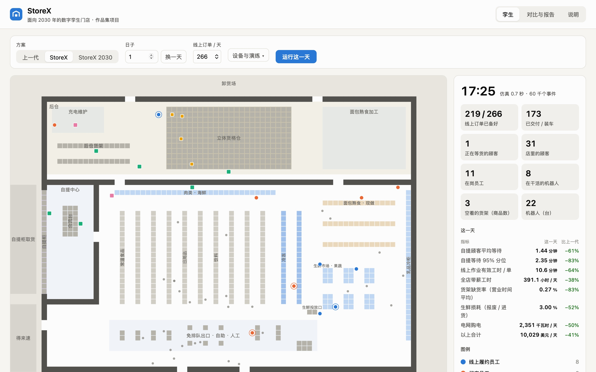

# StoreX

**English** · [简体中文](README.md) · Part 2 of the portfolio · [Part 3: StoreX Chain](../StoreX-Chain/README.en.md) · [Part 1 and repository home](../README.md)

**A digital-twin grocery store for 2030.** The end-to-end process of a mid-size supermarket, from an online order to the hand-off to the customer, together with the store layout and the split of work between people and robots, is redesigned from scratch and compared item by item with the previous generation ([Storewright](../README.md)) on the same discrete-event simulation engine. It comes with a store simulator that runs in the browser (a 2D top view and a 3D twin), plus a planning report, a generation comparison and a business analysis (in Chinese). Part 3, [StoreX Chain](../StoreX-Chain/README.en.md), places the store in its complete supply chain.

> A portfolio project by the author, based on public information, common industry practice and the author's own design. **This project is not affiliated with any retailer or company.** All stores, products, customers and numbers are synthetic; equipment performance and prices are common ranges from public sources, not any supplier's data.
>
> 作者的作品集项目。本项目基于公开资料、行业通用做法和作者的独立构想设计。**本项目与任何零售商、企业无隶属关系。**



## Quick start

Live demo after deployment: <https://glacieerr.github.io/storewright/storex/> (available after the first push). To run it locally, use the dependencies installed at the repository root (Node.js 22 or later).

```bash
npm install                      # once, at the repository root
cd StoreX
npm run dev                      # the store simulator in the browser (http://localhost:5180)
npm run sim -- day storex 1      # one simulated day, prints the main KPIs (gen1 / storex / storex2030 / gen1-2030)
npm run sim -- compare           # the two generations compared (10 seeds)
npm run reports                  # all experiments, writes docs/results/ (about 2 minutes)
```

## What you can do in the web app

- **Run a day:** on the twin page, pick the generation (previous generation, StoreX or StoreX 2030), the day, the order volume and the equipment, then run the day. The simulation runs in a Web Worker, and the same day of the previous generation runs in the background for comparison.
- **Watch the store from above:** a 2D canvas top view replays every associate (dots) and robot (squares), coloured by task; hover to see who it is and what they are doing; drag the timeline to any moment.
- **Switch to the 3D twin** (top right): the same simulation track on the same clock. The store, the automated tote store, the pickup centre and the parking lot are generated in code at real size, with preset views (overview, tote store, pickup centre, sales floor, exit) and an exterior or cutaway mode. The current scene can be exported as glTF (.glb) for further work in tools such as Blender.
- **Follow the day:** the side panel shows current orders, waiting customers, associates on shift, working robots and empty shelves, the day's results against the same day of the previous generation, and events.
- **Compare and reports:** a second page reads the results generated by `npm run reports` (generation comparison, where the hours go, the tote store's business case, capacity, sweeps, stress drills and business analysis).

## The design

- An automated **tote store** in the backroom: robots bring totes with about 3,600 packaged products to pick stations, where a picker spends a few seconds per order line.
- **Fresh pickers** push smart carts through the sales floor for fresh, frozen and bulky items, merging with the tote store's items via conveyors.
- **Locker-loading robots** put orders into temperature-zoned pickup lockers, and **tote shuttles** bring orders to the drive-through pickup window.
- **Smart shelves and an inventory robot** find empty shelves, and **replenishment robots** bring cases to the shelf.
- At the exit, **walk-out lanes and vision-assisted self-checkout**; on the roof, **solar power and storage**; for fresh food, **AI ordering and dynamic markdowns**.
- One **multi-skilled store associate** role covers replenishment, pickup exceptions, age checks, delivery loading and exit help.
- The store's **digital twin** forecasts the workload, builds the roster and assigns tasks; when the tote store stops, the store **degrades** to picking from the sales floor.

Every equipment count was chosen with sweep experiments (same days, one change at a time): 12 tote-store robots at opening and 20 in 2030; 3 replenishment robots (1 is worse than none); no robot arms at the pick stations (the labour they save does not pay for them).

## The simulation and reports

Same orders, customers and products, averaged over 10 days ([all results, in Chinese](docs/results/README.md)):

| | Previous gen · 266 orders / day | StoreX | Previous gen · 532 orders / day (2030) | StoreX 2030 |
|---|---:|---:|---:|---:|
| Paid hours, whole store (hours / day) | 631.5 | **392.4** (−38%) | 809.9 | **454.9** (−44%) |
| Online work (minutes / order) | 29.9 | **10.8** | 29.3 | **10.5** |
| Pickup customer average wait (minutes) | 4.28 | **1.49** | 4.57 | **1.52** |
| Pickup wait, 95th percentile (minutes) | 15.62 | **2.49** | 19.30 | **2.51** |
| Shelf out-of-stock rate | 1.63% | **0.31%** | 1.77% | **0.36%** |
| Fresh waste | 5.75% | **2.83%** | 5.77% | **2.83%** |
| Grid electricity (kWh / day) | 4,728 | **2,371** | 4,721 | **2,417** |
| Robots | 0 | 22 | 0 | 31 |

- **25% more orders at once:** the previous generation delivers 69.5% on time with a 29-minute average wait; StoreX 92.9% on time with a 2.1-minute wait.
- **Tote store down for 2 hours:** degrading to sales-floor picking keeps 97.3% on time (61.5% without degrading).
- **Business case:** about 5.87 million USD of investment, a 10-year NPV of about 13.16 million USD (7% discount rate) and a 3.1-year payback; in the conservative scenario the NPV is about 0.57 million USD with an 8.7-year payback. The tote store alone breaks even at about 285 orders a day.

`npm run reports` regenerates `docs/results/` (Markdown tables, SVG charts and `data.json`); do not edit it by hand. All results are simulations with synthetic data, not a claim about any real store.

| Document (Chinese) | Contents |
|---|---|
| [Planning report](docs/01-planning-report.md) | Goals, store layout, end-to-end process, people and robots, how the equipment was sized, phasing, risks, KPIs |
| [Generation comparison](docs/02-generation-comparison.md) | How each step changed, numbers side by side, where the hours go, customer experience, order growth, disruptions, the tote store's contribution |
| [Business analysis](docs/03-business-analysis.md) | Investment, savings, cash flow, NPV and payback, the tote store's business case, sensitivity and scenarios, people, chain roll-out |
| [System design](docs/04-system-design.md) | The simulation engine, the two generations in the engine, the models, calibration and tests, the web simulator, how to extend |
| [Results](docs/results/README.md) | All tables and charts generated by `npm run reports` |

## Project layout

```
StoreX/
├── src/
│   ├── core/       random numbers, discrete-event kernel, statistics
│   ├── world/      store layout, shortest paths, products, demand, scenario configs
│   ├── ops/        associates and robots, rosters, online orders, tote store, shelves, checkout, receiving, fresh, energy
│   ├── analysis/   KPIs, experiments, business analysis, result tables and charts
│   └── cli/        command line
├── web/            the store simulator (Vite + Web Worker; 2D canvas, 3D Three.js)
├── tests/          unit tests (Vitest)
└── docs/           reports and generated results
```

## Tests and checks

Run from `StoreX/`:

```bash
npm test                         # unit tests (Vitest)
npm run typecheck                # TypeScript, strict
npm run check                    # typecheck + tests
npm run lint                     # ESLint: errors fail CI, warnings are allowed
npm run build                    # static web app in dist/
```

How to add a parameter, a sweep or a KPI is described in [system design §8](docs/04-system-design.md#8-怎么扩展) (Chinese). See also [CONTRIBUTING.md](../CONTRIBUTING.md).

## Licence

Layered licensing; the licence of every file is listed in [`REUSE.toml`](../REUSE.toml) at the repository root, and the licence texts are in [`LICENSES/`](../LICENSES/):

- **Code:** [AGPL-3.0-only](../LICENSE), the same as the rest of the repository.
- **Documentation, images and generated data** (the Markdown files, the reports and screenshots in `docs/`, the copy of the results in `web/src/data/`): [CC BY 4.0](../LICENSE-docs).

## Disclaimer

A portfolio project by the author, based on public information, common industry practice and the author's own design. **This project is not affiliated with any retailer or company.** 本项目与任何零售商、企业无隶属关系。 All stores, products, customers and numbers are synthetic. Software names that appear here (such as Blender) are used only to describe compatibility and belong to their owners.

## Citation

If you refer to this part in your own work, please cite the repository:

```bibtex
@software{storex,
  title  = {StoreX: a digital-twin grocery store for 2030},
  author = {Glacieerr},
  year   = {2026},
  url    = {https://github.com/Glacieerr/storewright/tree/main/StoreX},
  note   = {Part 2 of the Storewright portfolio; all data synthetic}
}
```
