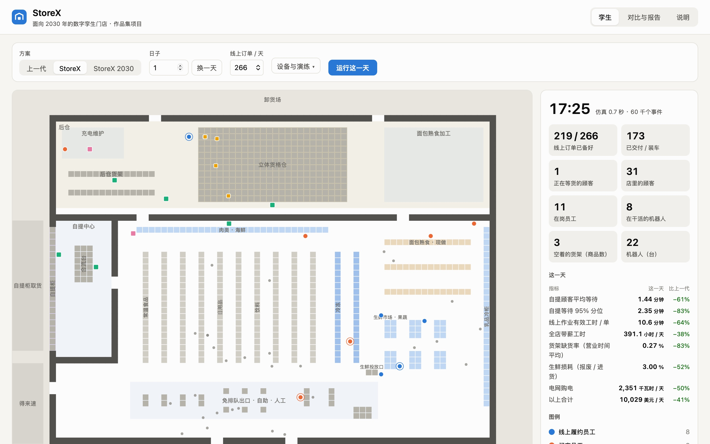

# StoreX

[English](README.en.md) · **简体中文**

**面向 2030 年的数字孪生门店。** 一家中型超市从线上下单到交到顾客手里的整套流程、门店布置、员工和机器人的分工，全部重新设计，并用同一个离散事件仿真引擎和上一代流程（[Storewright](../README.md)）逐项对比。附带一个能直接在浏览器里运行的门店模拟器（二维俯视图和三维孪生两种视图），以及规划报告、与上一代的对比和商业分析。第三部分 [StoreX 全链路](../StoreX-Chain/README.md) 把这家门店放进完整的供应链：港口、机场、物流园和配送中心（模拟的仍是这一家店；「网络规划」页可以规划 1–12 家店）。

**A digital-twin grocery store for 2030.** The end-to-end process, store layout and the split of work between people and robots, redesigned from scratch and compared item by item with the previous generation ([Storewright](../README.md)) on the same discrete-event simulation engine. It comes with a store simulator that runs in the browser, plus a planning report, a generation comparison and a business analysis (in Chinese).

> 作者的作品集项目。本项目基于公开资料、行业通用做法和作者的独立构想设计。**本项目与任何零售商、企业无隶属关系。** 门店、商品、顾客和所有数字都是合成的；设备性能和价格是公开资料里的常见区间，不是任何供应商的数据。
>
> A portfolio project by the author, based on public information, common industry practice and the author's own design. **It is not affiliated with any retailer or company.** All stores, products, customers and numbers are synthetic.



模拟器右上角可以切到**三维孪生**：同一份仿真轨迹、同一个时钟，门店、货格仓、自提中心和停车场都按真实尺寸由代码生成，有几个预设视角和「外观 / 剖面」切换，还可以把此刻的门店导出成 glTF（.glb），用 Blender 等软件继续加工。

## 快速开始 · 在线演示

在线演示：<https://glacieerr.github.io/storewright/storex/>。在本机运行：先在仓库根目录 `npm install`（Node.js 22 或更高），然后：

```bash
cd StoreX
npm run dev                      # 网页模拟器（http://localhost:5180）
npm run reports                  # 跑全部实验，写 docs/results/（约 2 分钟）
```

全部命令见下面的[「运行」](#运行)；英文说明见 [README.en.md](README.en.md)。

## 方案

- 后仓的**立体货格仓**：约 3,600 种包装商品的线上订单由机器人把货箱送到站台，站台拣货员每行几秒钟；
- **生鲜拣选员**推智能推车在卖场拣生鲜、冷冻和大件，经输送线和货格仓的商品合流；
- **装柜机器人**把订单放进分温区自提柜，**送框小车**把订单送到免下车取货车窗；
- **智能货架 + 盘点机器人**发现缺货，**补货机器人**把箱子送到货架前；
- 出口是**免排队通道 + 视觉辅助自助结账**；屋顶**光伏 + 储能**；生鲜 **AI 订货 + 动态降价**；
- 一个**多技能的门店作业员**岗位同时负责补货、自提异常、年龄核验、配送装车和出口协助；
- 门店的**数字孪生**预测工作量、排班、派任务；货格仓停机时**降级**到卖场拣货。

设备数量全部用扫描实验来定（同一组日子，只改一项）：货格机器人开业 12 台、2030 年 20 台；补货机器人 3 台（1 台反而比不用还差）；站台不上机械臂（省的人工抵不上价格）。

## 结果

同样的订单、顾客和商品，10 个日子的平均（[全部结果](docs/results/README.md)）：

| | 上一代 · 266 单 / 天 | StoreX | 上一代 · 532 单 / 天（2030 年） | StoreX 2030 |
|---|---:|---:|---:|---:|
| 全店带薪工时（小时 / 天） | 631.5 | **392.4**（−38%） | 809.9 | **454.9**（−44%） |
| 线上作业工时（分钟 / 单） | 29.9 | **10.8** | 29.3 | **10.5** |
| 自提顾客平均等待（分钟） | 4.28 | **1.49** | 4.57 | **1.52** |
| 自提等待 95% 分位（分钟） | 15.62 | **2.49** | 19.30 | **2.51** |
| 货架缺货率 | 1.63% | **0.31%** | 1.77% | **0.36%** |
| 生鲜损耗 | 5.75% | **2.83%** | 5.77% | **2.83%** |
| 电网购电（千瓦时 / 天） | 4,728 | **2,371** | 4,721 | **2,417** |
| 机器人（台） | 0 | 22 | 0 | 31 |

- **订单突然多 25% 时：** 上一代按时率 69.5%、平均等待 29 分钟；StoreX 按时率 92.9%、等待 2.1 分钟。
- **货格仓停机 2 小时：** 降级到卖场拣，按时率 97.3%（不降级只有 61.5%）。
- **商业分析：** 改造投资约 587 万美元，10 年净现值约 1,316 万美元（折现率 7%），回收期 3.1 年；保守情景净现值约 57 万美元、回收期 8.7 年。货格仓本身的盈亏平衡点约 285 单 / 天。

## 文档

| 文档 | 内容 |
|---|---|
| [规划报告](docs/01-planning-report.md) | 目标、门店布置、端到端流程、员工和机器人、设备怎么定、分期实施、风险、运营指标 |
| [与上一代对比](docs/02-generation-comparison.md) | 每个环节怎么变了、数字对比、工时去向、顾客感受、订单增长、出状况时、货格仓贡献了多少 |
| [商业分析](docs/03-business-analysis.md) | 投资、节省、现金流、净现值和回收期、货格仓的账、敏感性和情景、人员、连锁推广 |
| [系统设计](docs/04-system-design.md) | 仿真引擎的结构、两代在引擎里的区别、各个模型、校准和测试、网页模拟器 |
| [实验结果](docs/results/README.md) | `npm run reports` 生成的全部表格和图 |

## 运行

StoreX 用仓库根目录已经装好的依赖（先在仓库根目录 `npm install`），不需要另外安装。

```bash
cd StoreX
npm run dev                      # 网页模拟器（http://localhost:5180）
npm run sim -- day storex 1      # 跑一天，打印主要指标（gen1 / storex / storex2030 / gen1-2030）
npm run sim -- compare           # 两代对比（10 个种子）
npm run reports                  # 跑全部实验，写 docs/results/（约 2 分钟）
npm test                         # 单元测试
npm run lint                     # 代码检查（ESLint：error 会让自动测试失败，warning 允许）
npm run build                    # 打包成静态网页（dist/）
```

## 目录

```
StoreX/
├── src/
│   ├── core/       随机数、离散事件内核、统计
│   ├── world/      门店布局、最短路、商品、需求、方案配置
│   ├── ops/        员工和机器人、排班、线上订单、货格仓、货架、结账、收货、生鲜、能耗
│   ├── analysis/   指标、实验、商业分析、结果表格和图
│   └── cli/        命令行
├── web/            网页模拟器（Vite + Web Worker；二维 canvas、三维 Three.js）
├── tests/          单元测试
└── docs/           报告和实验结果
```

## 许可

分层许可，每个文件的许可见仓库根目录的 [`REUSE.toml`](../REUSE.toml)，许可证全文在 [`LICENSES/`](../LICENSES/)：

- **代码**：[AGPL-3.0-only](../LICENSE)，与仓库其他部分相同。
- **文档、图片和生成的数据**（各处的 Markdown 文件、`docs/` 里的报告和截图、`web/src/data/` 里的结果副本）：[CC BY 4.0](../LICENSE-docs)。
