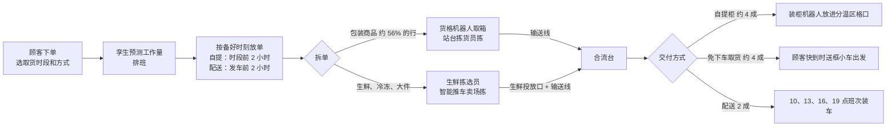
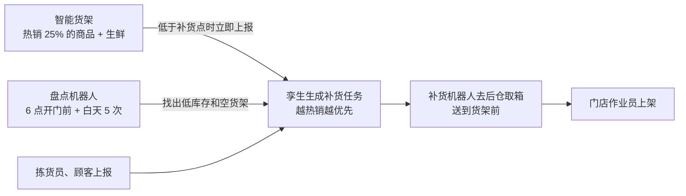

# StoreX 规划报告：面向 2030 年的数字孪生门店

> 作者的作品集项目。本报告规划一家面向 2030 年的中型超市：门店怎么布置、从线上下单到交到顾客手里的整套流程、员工和机器人怎么分工、设备买多少、分几期上线、怎么应对故障。所有决定都先在数字孪生里试过，数字来自 419 个仿真日（[实验结果](results/README.md)）。
>
> 配套文档：[与上一代的对比](02-generation-comparison.md) · [商业分析](03-business-analysis.md) · [系统设计](04-system-design.md) · 网页模拟器（`npm run dev`）
>
> 本项目基于公开资料、行业通用做法和作者的独立构想设计。**本项目与任何零售商、企业无隶属关系。** 门店、商品、顾客和所有数字都是合成的；设备性能和价格是公开资料里的常见区间，不是任何供应商的数据。

## 摘要

**问题。** 上一代流程（Storewright：员工用手机作业 + AI）已经把一家中型超市的线上订单做到了每单约 30 分钟工时、按时备好，但几乎所有搬运都还靠人：拣货员每天推车走约 48 公里，交付员在暂存间和路边之间来回，补货员自己去后仓取箱。到 2030 年线上订单预计翻倍（266 → 532 单 / 天），上一代的人手要从每天约 630 小时涨到约 810 小时，而招人只会越来越难。

**方案。** StoreX 让机器做重复的搬运，人做判断和服务：

- 后仓建一个**立体货格仓**，约 3,600 种包装商品的线上订单由机器人把货箱送到站台，站台拣货员每行只要几秒；
- 生鲜、冷冻和大件由**生鲜拣选员**推智能推车在卖场拣，经输送线和货格仓的商品合流；
- 订单由**装柜机器人**放进分温区自提柜，或者由**送框小车**送到免下车取货车窗；
- **智能货架 + 盘点机器人**发现缺货，**补货机器人**把箱子送到货架前；
- 出口是**免排队通道 + 视觉辅助自助结账**；屋顶**光伏 + 储能**；
- 一个**多技能的门店作业员**岗位同时负责补货、自提异常、年龄核验、配送装车和出口协助；
- 门店的**数字孪生**每天预测工作量、排班、派任务，出了状况先在孪生里推演，再决定怎么处置。

**结果**（同样的订单和顾客，10 个日子的平均，[结果 1](results/01-comparison.md)）：

| | 上一代 · 266 单 | StoreX · 266 单 | 上一代 · 532 单 | StoreX 2030 · 532 单 |
|---|---:|---:|---:|---:|
| 全店带薪工时（小时 / 天） | 631.5 | **392.4**（−38%） | 809.9 | **454.9**（−44%） |
| 线上作业工时（分钟 / 单） | 29.9 | **10.8** | 29.3 | **10.5** |
| 自提顾客平均等待（分钟） | 4.28 | **1.49** | 4.57 | **1.52** |
| 自提等待 95% 分位（分钟） | 15.62 | **2.49** | 19.30 | **2.51** |
| 货架缺货率（营业时间平均） | 1.63% | **0.31%** | 1.77% | **0.36%** |
| 生鲜损耗（报废 / 进货） | 5.75% | **2.83%** | 5.77% | **2.83%** |
| 电网购电（千瓦时 / 天） | 4,728 | **2,371** | 4,721 | **2,417** |
| 机器人（台） | 0 | 22 | 0 | 31 |
| 员工 : 机器人（按 8 小时折算的人数） | — | 2.2 : 1 | — | 1.8 : 1 |

**投资和回报**（[商业分析](03-business-analysis.md)）：改造投资约 587 万美元（开业时 560 万，2028、2030 年再加设备），2030 年起每年净节省约 300 万美元；10 年净现值 1,316 万美元（折现率 7%），回收期 3.1 年。保守情景（投资取高值、2030 年只有 400 单、时薪 19 美元等）净现值 57 万美元、回收期 8.7 年，仍然不亏。

**建议。** 按本报告的方案改造，设备跟着订单量分期加：货格机器人开业 12 台、2028 年 16 台、2030 年 20 台；送框小车 2028 年从 2 台加到 3 台。改造前先让门店的数字孪生影子运行（只预测、不派任务）一个季度，用真实数据重新校准本报告的参数。

## 1. 目标和约束

### 1.1 2030 年的门店要做到什么

| 目标 | 衡量方法 | StoreX 的目标值 |
|---|---|---|
| 线上订单翻倍时不加人 | 532 单 / 天时的全店带薪工时 | 不超过上一代现在的 630 小时（实际约 455） |
| 顾客几乎不用等 | 自提等待的 95% 分位 | 3 分钟以内 |
| 货架永远有货 | 营业时间的平均缺货率 | 0.5% 以内 |
| 少浪费 | 生鲜损耗 | 3.5% 以内 |
| 更低碳 | 电网购电 | 减半 |
| 出了状况也能交货 | 货格仓停机 2 小时时的按时率 | 95% 以上 |

### 1.2 设计原则

1. **机器做重复的搬运，人做判断和服务。** 人走路、取箱、等顾客的时间都交给机器；人留在需要判断（生鲜挑选、异常处理、年龄核验）和面对顾客的地方。
2. **每台设备都要有证据。** 设备数量用扫描实验定：同一组日子，只改这一项，看指标怎么变（[结果 2](results/02-sweeps.md)）。实验说没用的就不买（例如站台机械臂）。
3. **先在孪生里试。** 排班、补货、处置故障都先在门店的数字孪生里推演。
4. **任何自动化坏了都有人工后备。** 货格仓整体停机时，线上的包装商品改在卖场货架上拣（降级模式，[结果 4](results/04-stress.md)）。
5. **跟着订单量分期投资。** 货格仓的结构一次建好，机器人、自提柜格口和送框小车按订单量加。

### 1.3 约束

- 同一个建筑外壳（71 × 56 米）、同样的停车场和卸货场，改造期间照常营业；
- 同样的商品范围（约 8,000 种）、同样的需求（订单量、到店顾客、取货时段都和上一代一样）；
- 不依赖还没成熟的技术：用到的每一类设备（立体货格仓、自提柜、补货 / 盘点 / 洗地机器人、电子价签、视觉结账、光伏储能）今天都已经有商用产品，2030 年只是更便宜、更可靠。

## 2. 门店布置

| 区域 | 位置和大小 | 作用 | 和上一代比 |
|---|---|---|---|
| 立体货格仓 | 后仓中间，24 × 12 米 | 约 3,600 种包装商品（常温、冷藏）的线上库存；机器人在货格顶上跑 | 新增；占用原后仓货架的大部分空间 |
| 拣货站台 + 拆箱站 | 货格仓西侧，3 个拣货站台 + 1 个拆箱站 | 机器人把货箱送到站台，人拣；进货拆箱放进货箱 | 新增 |
| 自提中心 | 西墙，9 × 22 米 | 合流台、装柜机器人、分温区自提柜（柜内装、柜外取） | 取代上一代的线上暂存间 |
| 自提柜取货道、免下车取货车道 | 西墙外 | 顾客在柜外取货；免下车取货由送框小车送到车窗 | 取代路边车位 |
| 卖场货架 | 中间 10 排，通道加宽 | 机器人和员工、顾客共用；热销商品装智能货架 | 上一代 13 排 |
| 生鲜区 | 东侧，扩大 | 果蔬、肉类海鲜、面包熟食；生鲜投放口（拣好的生鲜框经输送线去合流台） | 扩大；新增投放口 |
| 充电维护区 | 后仓西北角 | 补货、盘点、洗地机器人充电和维护 | 新增 |
| 出口 | 南墙 | 2 条免排队通道、6 台视觉辅助自助结账、2 条人工通道 | 上一代 6 条人工通道 + 6 台自助机 |

布置的几个考虑：

- **货格仓放在后仓**而不是卖场：不占卖场面积，也离收货门近（进货拆箱路线最短）。
- **自提中心放在西墙**：合流台离货格仓站台和生鲜投放口都近；顾客在建筑外侧取货，不进卖场、不占停车场的路边车位。
- **货架少而宽**：补货机器人和员工、顾客共用通道，宽通道减少互相让路。

## 3. 端到端流程

### 3.1 线上订单

| 步骤 | 谁来做 | 关键设定 | 为什么这样 |
|---|---|---|---|
| 放单 | 孪生 | 按「要备好的时刻」放：自提单是取货时段开始，配送单是发车时刻 | 配送单按发车时刻倒排，车走之前一定拣完 |
| 包装商品 | 货格机器人 + 站台拣货员 | 每行一次取箱（往返平均 90 秒）；站台每行 4 秒 + 每件 2.5 秒；站台前两格缓冲 | 人不走路，每小时能拣数百行 |
| 生鲜、冷冻、大件 | 生鲜拣选员 | 智能推车提示路线和货位，每个拣货点约 28 秒（上一代 52 秒）；同温区订单拼车 | 生鲜要人挑；冷冻和大件不适合进货格仓 |
| 地面缺货 | 门店作业员 | 后仓有 RFID，直接知道在哪个托盘（找一次约 1 分钟，基本不白跑） | 上一代靠库存记录找，三分之一会白跑 |
| 合流 | 输送线 + 合流台 | 货格仓的框和生鲜框在合流台按订单汇总；约 3% 的订单要人处理（替代确认、破损） | 一个点汇总，自提柜和免下车取货都从这里取 |

### 3.2 交付

| 方式 | 流程 | 人参与的地方 |
|---|---|---|
| 自提柜 | 装柜机器人按温区（常温、冷藏、冷冻）把框放进格口，顾客到了扫码自己取；格口不够时排队等空格口 | 无（顾客取货有问题时门店作业员协助） |
| 免下车取货 | 顾客发出「我在路上」（或手机定位估算）后，送框小车提前约 4 分钟出发，顾客到窗口时框已经在窗边 | 订单里有酒类等年龄限制商品时，门店作业员核验身份 |
| 配送 | 10、13、16、19 点四班车；门店作业员从合流台取框装车 | 装车 |

上一代的交付是：交付员在暂存间里按订单取框、核验，推到路边车位，再装进顾客的车。框离开冷藏环境约 3 分钟；StoreX 的自提柜一直分温区保存，免下车取货的框在窗边等不到 2 分钟（[结果 1](results/01-comparison.md)）。

### 3.3 到店顾客和结账

- **免排队通道（2 条）：** 约 45% 的顾客注册了免排队出口（刷脸或应用），拿了就走；视觉系统和智能货架记录拿走的商品。酒类大多由数字身份自动核验，约两成需要店员看一眼。
- **视觉辅助自助结账（6 台）：** 摄像头辅助识别，需要人帮忙的比例从约 10% 降到约 4%。
- **人工通道（2 条）：** 给大篮子和不想用自助的顾客。
- 结账平均等待 0.20 分钟（上一代 0.38），95% 分位 1.26 分钟（上一代 2.32）。即使只有 25% 的顾客注册免排队出口，95% 分位也只有 1.33 分钟（[结果 2](results/02-sweeps.md)）。

### 3.4 货架和补货

- **发现缺货：** 上一代靠补货员每天巡店 3 次和上报，从缺货到补回平均 217 分钟；StoreX 平均 110 分钟，缺货次数从每天约 340 次降到约 40 次。
- **补货：** 员工自己去后仓取箱每趟要多花约 130 秒；补货机器人把箱子送到货架前以后，员工只剩上架。
- **夜班：** 白天没补回来的量由夜班补满；StoreX 的夜班工时从 139 小时降到 103 小时（白天补得更及时，加上自动托盘车卸货、孪生生成的夜班任务单）。
- **开门前：** 有约 1.5% 的商品开门时货架是空的（库存记录显示有货，其实没有）。盘点机器人 6 点先巡一遍，开门前补上。

### 3.5 收货和拆箱入格

- 每天 1 辆配送中心大车（5 点，20 托）、1 辆生鲜车（7:30，8 托）、8 家供应商直送。
- 自动托盘车卸车；收货门的 RFID 和视觉核对数量，收货员只处理差异。货车平均停留从 24.5 分钟降到 16.6 分钟。
- 进货里属于货格仓的商品由站台拣货员在拆箱站拆箱，放进机器人送来的空货箱（排在拣货后面，用拣货的空档做）。

### 3.6 生鲜

- **订货：** AI 按门店、商品、天气预测需求（误差 ±15%，上一代 ±28%），订货量按损耗和缺货的代价平衡，陈列量也少放一些。
- **动态降价：** 电子价签从过期前两天开始按剩余保质期逐步降价（上一代是最后一天统一打折）。
- 结果：生鲜损耗从 5.75% 降到 2.83%，果蔬、面包熟食降得最多。AI 预测失灵时（误差退回上一代水平）损耗回升到 4.35%（[结果 4](results/04-stress.md)），所以预测模型要持续监控。

### 3.7 能源

| 措施 | 效果 |
|---|---|
| 冷柜全部加门、二氧化碳跨临界制冷 + 热回收、AI 控制除霜 | 制冷负荷约 −30% |
| LED 照明按日光调光、夜里只留安全照明 | 照明约 −30% |
| 空调按客流调节，回收制冷余热 | 空调约 −25% |
| 屋顶光伏 250 千瓦峰值 | 晴天每天约 1,100 千瓦时 |
| 储能 500 千瓦时：白天充、16–21 点峰时放 | 峰时最大购电从 251 千瓦降到 174 千瓦 |

用电从每天 4,728 千瓦时降到 3,526 千瓦时（机器人每天只多用约 70 千瓦时），电网购电减半，碳排放每天少约 825 千克。

### 3.8 门店的数字孪生

孪生是 StoreX 的「大脑」：

| 时间 | 孪生做什么 |
|---|---|
| 前一天 | 预测明天每小时的订单、到店客流、补货和收货的工作量，排班（每个岗位每小时几个人）；生成夜班任务单 |
| 当天 | 实时接收订单、货架传感器、机器人和设备的状态；给员工和机器人派任务（按本报告第 4.3 节的优先级）；预测接下来几小时会不会来不及 |
| 出状况时 | 先在孪生里推演几种处置（例如降级到卖场拣、从收银调一个人来拣），选影响最小的，推到负责人手机上 |
| 收工后 | 复盘：哪些订单晚了、为什么；用当天的数据校准预测模型 |

这份报告用的仿真引擎就是这个孪生的规划版本（[系统设计](04-system-design.md)）。

### 3.9 降级和应急

| 状况 | 处置 | 仿真结果（2030 年订单量，[结果 4](results/04-stress.md)） |
|---|---|---|
| 货格仓整体停机 2 小时（15–17 点） | 孪生立即把还没取箱的行改到卖场拣（货架上也有这些商品），生鲜拣选员和门店作业员一起拣 | 按时率 97.3%（不降级只有 61.5%，还有约 5% 的订单拖到打烊做不完） |
| 订单比预测多 25% | 机器人有余量；孪生把补货往后排，先保证订单 | 按时率 92.9%，等待 2.1 分钟（上一代按时率 69.5%，等待 29 分钟） |
| 机器人老出故障（平均 100 小时坏一次，修 60 分钟） | 2030 年的 20 台货格机器人比最低需要多 2 台 | 看不出影响（95% 分位 2.53 分钟 vs 2.46） |
| AI 预测失灵 | 排班有最低在岗人数兜底；生鲜改回人工订货 | 等待不受影响；生鲜损耗回升到 4.35% |

## 4. 员工和机器人

### 4.1 岗位

| 岗位 | 做什么 | 每天带薪工时（266 单） | 2030 年（532 单） |
|---|---|---:|---:|
| 站台拣货员 | 在货格仓站台拣货；空档拆箱入格 | 合计 78（站台 + 生鲜拣选） | 合计 133 |
| 生鲜拣选员 | 用智能推车拣生鲜、冷冻、大件 | | |
| 门店作业员 | 补货上架、自提异常、年龄核验、配送装车、出口协助 | 46 | 52 |
| 收货员 | 只处理收货差异 | 8 | 8 |
| 收银员 | 2 条人工通道 | 19 | 18 |
| 机器人值班员 | 每班 1 人（5–14 点、14–23 点）：货箱卡滞、机器人救援、日常保养 | 19 | 19 |
| 夜班 | 白天没补回来的量 | 103 | 104 |
| 固定岗位 | 生鲜加工、服务台、管理 | 120 | 120 |
| **合计** | | **392** | **455** |

上一代同样的订单量分别是 632 小时和 810 小时（[结果 1](results/01-comparison.md)）。

**一个岗位多种技能**是省人的关键之一：上一代的补货员、交付员、出口服务员各排各的班，各有各的空档；StoreX 的门店作业员由孪生按优先级派活，同一个人上午补货、中午处理自提异常、傍晚帮出口核验，最低在岗人数从三个岗位各 1 人变成一个岗位 2–3 人。

### 4.2 机器人

| 机器人 | 开业 | 2030 年 | 做什么 | 怎么定的（[结果 2](results/02-sweeps.md)） |
|---|---:|---:|---|---|
| 货格机器人 | 12 | 20 | 在货格顶上取箱送到站台 | 266 单时 10 台就够，买 12 台留增长余量；532 单时 18 台是最低（16 台按时率 98.4%），20 台多 2 台扛故障 |
| 拣货站台 | 3 + 1 拆箱站 | 同左 | | 2 个站台就不是瓶颈（站台数从 2 到 4 结果一样）；第 3 个是备份，也方便以后换机械臂 |
| 补货机器人 | 3 | 3 | 把箱子送到货架前 | 1 台反而比不用还差（排队等机器人，缺货率 1.35%）；3 台之后再加没有改善 |
| 盘点机器人 | 1 | 1 | 6 点开门前 + 白天 5 次巡货架 | 在智能货架之上，缺货率再降 0.05 个百分点，省下员工巡店每天约 2 小时；主要价值还在价签和陈列核对 |
| 智能货架 | 热销 25% + 生鲜 | 同左 | 低于补货点时立即上报 | 25% 把缺货率从 0.45% 降到 0.32%；加到 50% 只再降 0.02 个百分点 |
| 送框小车 | 2 | 3（2028 年加） | 免下车取货：把框送到车窗 | 订单增长后的第一个瓶颈：330 单时 2 台的自提等待 95% 分位 3.6 分钟，3 台 2.4 分钟；532 单时 1 台的免下车取货等待 12 分钟，3 台 1.6 分钟 |
| 装柜机器人 | 1 | 1 | 把订单框放进自提柜 | 利用率低，但只有 1 台可用；故障时由门店作业员手工装柜 |
| 自提柜格口 | 132 | 156 | 分温区存放订单 | 532 单时 125 个格口要排队等空格口（最多 14 单），156 个最多 8 单，再多改善很小 |
| 洗地机器人 | 2 | 2 | 夜间整场洗地、白天局部清洁 | 替代夜间人工洗地约 3 小时 / 晚 |
| 自动托盘车 | 1 | 1 | 卸车、托盘搬运 | 货车停留 −32% |
| 免排队通道 | 2 | 2 | 注册顾客拿了就走 | 0 条时结账 95% 分位 2.8 分钟，2 条 1.1 分钟，4 条 1.0 分钟 |

**没有买的：** 站台机械臂。532 单时它每天省约 9 小时人工（每年约 7 万美元），而每个站台的机械臂按公开资料要数十万美元，回收期太长；等价格降下来或订单量更大时再考虑（站台留了位置）。

### 4.3 谁先做什么

孪生派任务时按这个顺序（数字越小越先做）：

1. 订单异常（顾客在等的订单最先）；
2. 配送装车（车要按时走）；
3. 免下车取货的年龄核验（顾客在窗口）；
4. 停机降级时的卖场拣货；
5. 后仓补取（拣货员在等）；
6. 补货（越热销越优先）；
7. 拣货（按要备好的时刻）；
8. 洗地、巡检。

这个顺序是调出来的：最早的版本里年龄核验排在补货后面，傍晚补货多的时候有顾客在免下车取货窗口等了很久，孪生的仿真把这个问题找了出来。

### 4.4 员工 : 机器人

开业时 49 个全职折算人数、22 台机器人（2.2 : 1）；2030 年 57 人、31 台（1.8 : 1）。机器人主要替掉的是走路、取箱和等待；人的工作往两头走：一头是生鲜、服务和异常处理，另一头是机器人值班和数据（每班一名机器人值班员）。

## 5. 分期实施

| 时间 | 做什么 | 触发条件 / 检查点 |
|---|---|---|
| 2026 年上半年 | 门店数字孪生影子运行：接入 POS、订单、员工手机，只预测、不派任务；用真实数据重新校准作业时间和需求 | 预测误差稳定在 ±10% 以内 |
| 2026 年下半年 | 分区改造（照常营业）：后仓建货格仓和站台；西墙自提中心和免下车取货；冷柜加门、光伏储能；电子价签和智能货架；培训 | 每个区域改完先在孪生里演练再启用 |
| 2027 年 | 开业运营：12 台货格机器人、3 台补货机器人、132 个自提柜格口、2 台送框小车；第一年按稳态节省的约 60% 计 | 每周看第 6 节的指标 |
| 2028 年 | 先加第 3 台送框小车，再把货格机器人加到 16 台 | 订单超过约 300 单 / 天时加送框小车（免下车取货是第一个瓶颈）；超过约 360 单时加机器人（400 单时 12 台的按时率掉到 98.7%）；或者傍晚自提等待的 95% 分位超过 3 分钟 |
| 2030 年 | 货格机器人加到 20 台；自提柜加到 156 个格口 | 订单量接近 500 单 / 天 |
| 2030 年以后 | 2030 年的设备能撑到约 660 单 / 天（[结果 3](results/03-capacity.md)）；再多要继续加机器人，或者考虑站台机械臂 | 每年用孪生重做一遍扫描实验 |

## 6. 运营指标

| 指标 | 目标 | 本方案的仿真值（266 / 532 单） |
|---|---|---|
| 自提等待 95% 分位 | ≤ 3 分钟 | 2.49 / 2.51 分钟 |
| 按时备好 | ≥ 98% | 100% / 100% |
| 订单满足率（含替代） | ≥ 99.5% | 99.87% / 99.86% |
| 货架缺货率 | ≤ 0.5% | 0.31% / 0.36% |
| 生鲜损耗 | ≤ 3.5% | 2.83% / 2.83% |
| 全店带薪工时 | ≤ 400 / 470 小时 | 392 / 455 小时 |
| 货格机器人利用率（5–21 点） | 60–80%，超过 80% 就加机器人 | 58% / 78% |
| 机器人故障 | 每天 ≤ 1 次 | 约 0.2 次 |
| 电网购电 | ≤ 2,500 千瓦时 / 天 | 2,371 / 2,417 |

## 7. 风险和应对

| 风险 | 影响 | 应对 |
|---|---|---|
| 货格仓整体停机（断电、软件故障） | 包装商品的线上订单停摆 | 降级到卖场拣（仿真按时率 97%）；货格仓接不间断电源；软件双机热备；每季度在孪生里演练一次 |
| 订单增长比预期慢 | 货格仓的投资回收变慢（盈亏平衡约 285 单 / 天） | 机器人分期买；订单到不了 330 单就推迟 2028 年的加购；货格仓以外的技术在任何订单量下都划算 |
| 顾客不愿意用免排队出口 / 自提柜 | 结账和交付省人变少 | 注册比例只有 25% 时结账仍然够用；自提柜不受欢迎的顾客改走免下车取货 |
| 员工转岗 | 原来的拣货员、交付员要学新技能 | 从改造前半年开始培训；减少的岗位主要靠自然流失（零售业一线员工流动率高），不裁员 |
| 机器人维护跟不上 | 故障多、修得慢 | 每班一名机器人值班员；关键备件放在门店；维护合同写明响应时间；2030 年货格机器人多配 2 台 |
| AI 预测变差 | 排班不准、生鲜损耗回升 | 排班有最低在岗人数兜底；每天收工后自动比对预测和实际，偏差大时报警 |
| 数据和隐私 | 免排队出口用到刷脸 / 视觉 | 刷脸只对主动注册的顾客；视觉系统只记录商品，不存人像；数据留在门店服务器 |
| 设备价格比预期高 | 投资增加 | 投资取高值时净现值仍有 912 万美元（[商业分析](03-business-analysis.md)） |

## 8. 方法和局限

- 所有结果来自同一个离散事件仿真引擎：同一组日子（种子）下两代面对完全相同的订单、顾客和商品，配对比较，给出 95% 置信区间（[系统设计](04-system-design.md)）。
- 上一代按 Storewright 优化后流程的测量结果校准（每单约 30 分钟线上工时、拣货约 67 件 / 小时、满足率约 99.6%）。
- 本方案的设备参数取公开资料里偏保守的值；最影响结论的几个参数（货格机器人的取箱速度、机器人可靠性、注册免排队的比例、订单量）都做了扫描或压力演练。
- 没有算的：防损、员工流失和招聘成本、顾客因为体验变好而多下的单、节假日和极端天气、建筑本身的改造细节、税和补贴。这些在 [商业分析](03-business-analysis.md) 里单独讨论。
