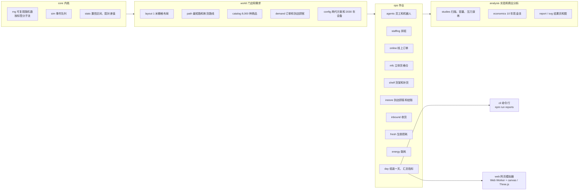
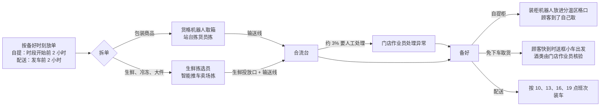

# StoreX 系统设计：数字孪生门店的仿真引擎

> 本文说明 StoreX 的仿真引擎和网页模拟器是怎么搭的、两代流程在同一个引擎里有哪些不同、模型怎么校准、能信到什么程度。规划和结论见 [规划报告](01-planning-report.md)，数字来源见 [实验结果](results/README.md)。
>
> 本项目与任何零售商、企业无隶属关系；门店、商品、顾客和所有数字都是合成的。

## 1. 这套系统做什么

StoreX 把一家中型超市的一整天放进计算机：门店布局、商品、线上订单和到店顾客、员工和机器人、货架库存、收货、生鲜、能耗，全部按秒推进。同一个引擎跑两代流程，所以两代之间的差别只来自流程本身，不来自数据或算法的不同。

它有三个用途：

| 用途 | 做法 | 在哪里 |
|---|---|---|
| 规划 | 只改一项设备或人手，其余不变，看指标怎么变（扫描实验） | [结果 2](results/02-sweeps.md) |
| 对比 | 同一组日子、同样的订单和顾客，上一代和 StoreX 各跑一遍，配对比较 | [结果 1](results/01-comparison.md) |
| 演练 | 让货格仓停机、订单突然多 25%、机器人老出故障，看系统怎么扛 | [结果 4](results/04-stress.md)、网页模拟器 |

## 2. 结构



| 目录 | 内容 |
|---|---|
| `src/core` | 随机数（xoshiro128\*\*，`fork(标签)` 得到独立子流）、离散事件内核（二叉堆，同一时刻按加入顺序）、统计（t 分布置信区间、配对差值、时间加权平均） |
| `src/world` | 1 米一格的门店栅格（两代用同一个建筑外壳和停车场）、八方向最短路（Dial 桶队列，距离表缓存）、商品目录、需求生成、方案配置 |
| `src/ops` | 员工和机器人的任务池、排班、线上订单全流程、货格仓、货架补货、到店顾客和结账、收货、生鲜多日库存模型、能耗、动画轨迹 |
| `src/analysis` | 指标定义、配对实验、扫描 / 容量 / 压力演练、商业分析、结果表格和 SVG 图 |
| `src/cli` | 命令行：跑一天、两代对比、扫描、容量、压力演练、生成全部结果 |
| `web` | 网页模拟器：仿真在 Web Worker 里跑，canvas 画门店俯视图、Three.js 画三维孪生，报告页读 `results.json` |
| `tests` | 单元测试：内核、布局连通性、公共随机数、守恒和记账、校准、2030 年、停机降级、商业分析 |

## 3. 仿真内核

### 3.1 时间、事件和随机数

- 时间单位是秒，从当天 0 点算起；仿真到 24 点结束。事件按时间先后执行，同一时刻按加入顺序，结果完全可复现。
- 每个随机来源用 `fork(标签)` 得到独立子流：`catalog`（商品）、`demand`（订单）、`shoppers`（到店顾客）、`ops`（作业时间波动、故障）、`forecast`（排班预测误差）、`fresh`（生鲜）。**需求只用需求子流生成**，所以同一个种子下两代面对完全一样的订单、顾客和商品目录（公共随机数）。单元测试逐单核对这一点。

### 3.2 员工和机器人

员工和机器人都是「任务池」里的成员。任务是一串步骤：走到某处（按最短路和步速算时间）、原地作业若干秒（时长可以在执行时才决定）、等某个时刻、等某件事发生、调用一个函数。成员空闲时从队列里取优先级最小的任务。

| 优先级（数字小的先做） | 任务 |
|---|---|
| 时刻 / 60 − 20000 | 订单异常（替代确认、破损更换） |
| 时刻 / 60 − 15000 | 配送装车 |
| 时刻 / 60 − 10000 | 免下车取货年龄核验、上一代的路边交付 |
| 时刻 / 60 − 5000 | 停机降级时门店作业员在卖场拣货 |
| −1 | 地面缺货时去后仓补取 |
| 1–10 | 补货（越热销越优先） |
| 时刻 / 60 | 拣货（按要备好的时刻排） |
| 50、100 | 洗地、巡检 |

员工按排班每小时上下岗，手上的活做完才下班；机器人一直在岗，按「平均无故障时间 / 平均修复时间」随机坏、修好再回来。

### 3.3 排班

两代用同一个排班方法：按预测的每小时工作量（分钟）÷ 目标利用率 85% 得到每个岗位要几个人，再取不低于最低在岗人数；带薪工时再乘 1.08（最短班次带来的零头），加上夜班上架和固定岗位（生鲜加工、服务台、管理）。预测有误差（上一代 ±15%，本方案的 AI 预测 ±7%），所以排班和实际工作量不完全吻合，事件仿真里会体现出忙闲。

### 3.4 一张线上订单



上一代的同一张订单：拣货员推车在卖场里按温区拣 → 送到线上暂存间 → 顾客发出「我在路上」后交付员提前准备 → 顾客到达后取框、核验、推到路边车位装车。

### 3.5 两代在引擎里的区别

| 环节 | 上一代（Storewright 优化后） | StoreX |
|---|---|---|
| 布局 | 后仓货架 + 线上暂存间 + 路边车位；中间 13 排货架 | 后仓里的立体货格仓（24 × 12 米）；西墙自提中心（自提柜 + 合流台）和免下车取货车道；中间 10 排宽通道货架 |
| 线上拣货 | 全部在卖场推车拣（每个拣货点 52 秒，校准值） | 约 3,600 种包装商品在货格仓站台拣（每行 4 秒 + 每件 2.5 秒）；生鲜、冷冻、大件用智能推车拣（每个拣货点 28 秒） |
| 交付 | 交付员取框、核验、装车；路边车位 | 自提柜（装柜机器人）、免下车取货（送框小车）；人只处理异常和年龄核验 |
| 发现缺货 | 补货员每天巡店 3 次；拣货员和顾客上报 | 智能货架（热销 25% 的商品 + 生鲜）实时报；盘点机器人每天 6 次（含 6 点开门前） |
| 补货 | 员工自己去后仓取箱（每趟多约 130 秒） | 补货机器人把箱子送到货架前，员工只上架 |
| 后仓补取 | 靠库存记录找，找到率 65%，每次 3–7 分钟 | RFID，找到率 95%，每次约 1 分钟 |
| 收货 | 收货员卸车、点数 | 自动托盘车卸车，RFID / 视觉核对，收货员只看异常 |
| 结账 | 6 条人工通道 + 6 台自助机 | 2 条免排队通道 + 6 台视觉辅助自助结账 + 2 条人工通道 |
| 岗位 | 拣货员、交付员、补货员、收货员、收银员、出口服务员 | 站台拣货员（兼拆箱）、生鲜拣选员、门店作业员（补货 + 自提服务 + 出口协助）、收货员、收银员、机器人值班员 |
| 生鲜订货 | 预测误差 ±28%，为了「看起来满」多放 | AI 预测 ±15%，电子价签按剩余保质期逐步降价 |
| 能源 | 开放式冷柜、常规照明 | 冷柜加门、二氧化碳制冷 + 热回收、LED 调光、250 千瓦峰值光伏、500 千瓦时储能 |

## 4. 各个模型

| 模型 | 做法 |
|---|---|
| 商品 | 8,000 种，8 个大类；类内需求按齐普夫—曼德博分布（头部不会太夸张）；热销品的陈列位置打散在整个类别区域；货架容量按「地面日销量 × 1.6 天」定 |
| 需求 | 266 单 / 天（平均 18.8 行、28.3 件，与上一代的测量一致）、1800 位到店顾客；取货时段傍晚最多；20% 是配送；85% 的自提顾客提前 5–15 分钟告知 |
| 货架 | 开门时的库存（大部分九成多满，一部分偏低，1.5% 空着但系统不知道）；顾客和拣货员拿走商品；低于补货点后只有「被发现」才生成补货任务；顾客遇到空货架时 40% 换别的，其余算流失 |
| 货格仓 | 每行订单一次取箱（一次往返的时长按对数正态分布，平均 90 秒）；站台两格缓冲；拆箱入格排在拣货后面；每趟按平均无故障时间判断故障；整体停机时把还没派机器人的行交给卖场拣（降级） |
| 卖场拣货 | 同温区的订单按备好时刻装车（每车 6–8 框）；路线用最近邻起步 + 2-opt；拿的是和到店顾客共用的货架库存；缺货时去后仓补取，补不到的一半替代 |
| 框数 | 按体积和重量（每框不超过 15.9 公斤），日化和食品分开装 |
| 到店顾客 | 购物时间按件数；结账方式按篮子大小和是否注册免排队；自助结账约 10%（上一代）/ 4%（本方案）要人帮忙 |
| 生鲜 | 每个大类单独做 70 天的库存仿真：按「预测 + 安全量 + 陈列量」订货，一半顾客挑最新鲜的、其余先进先出，按大类的日损耗率报废，临期打折；校准到公开资料里的常见损耗（果蔬约 10%、面包熟食约 10%、肉类约 5%、乳品约 2%） |
| 能耗 | 每小时的制冷、空调、照明、IT、机器人负荷；秋季晴天的光伏曲线；储能白天充、峰时（16–21 点）放；电价平时 0.14、峰时 0.24 美元 / 度，需量电费每月 15 美元 / 千瓦 |

## 5. 校准和可信度

### 5.1 上一代对齐到 Storewright

上一代的作业时间按 Storewright 优化后流程的测量结果校准（同一个合成门店规模：266 单、5,009 行、7,537 件）：

| 指标 | Storewright 的结果 | 本引擎的上一代（10 个种子） |
|---|---|---|
| 线上作业工时 / 单 | 约 30 分钟 | 29.9 分钟 |
| 拣货效率（含暂存） | 约 66–68 件 / 小时 | 约 67 件 / 小时 |
| 订单满足率 | 约 99% | 99.6% |
| 框离开暂存间到交付 | 约 3 分钟 | 3.3 分钟 |
| 按时备好 | 约 90–93% | 约 100% |

按时率不同：本引擎按发车时刻放配送单、拣货岗位排到最后一个取货时段结束，现在的订单量下两代都基本按时，所以本报告不拿按时率当上一代的校准目标；两代的差别体现在顾客等待、工时和高峰时的弹性上（见 [结果 4](results/04-stress.md)：订单突然多 25% 时，上一代按时率掉到约七成，StoreX 仍在九成以上）。

### 5.2 本方案的设备参数

设备性能取公开资料的保守值，再用扫描实验确认对结论的影响：货格机器人一次取箱往返平均 90 秒（每台每小时约 40 箱，偏保守），站台人工每行 4 秒 + 每件 2.5 秒；机器人平均 500 小时坏一次、20 分钟修好（压力演练里试了 100 小时、60 分钟）。

### 5.3 测试

`npm test` 跑 48 个单元测试：

- 内核：随机数可复现、子流独立、分布均值、事件顺序、置信区间；
- 布局：两代的每个陈列面、作业点、车位都走得到；拣货路线不比按原顺序走更远；
- 公共随机数：同一个种子下两代的订单、顾客、商品逐个相同；
- 一天的仿真：每张订单都完成、件数守恒（实拣 + 替代 + 缺货 = 订购）、同一个种子结果一样、带薪工时等于各项之和、能量平衡、钱的合计；
- 校准：上一代约 30 分钟 / 单、约 66 件 / 小时、满足率约 99%、生鲜损耗在门店常见范围；
- 本方案：工时、等待、缺货、损耗、购电都比上一代少；2030 年设备能完成 532 单；货格仓停机时降级能完成全部订单；不建货格仓的对照介于两代之间；动画轨迹完整；
- 商业分析：内部收益率、回收期、资本回收系数、插值、现金流记账、敏感性方向、盈亏平衡。

### 5.4 没有算进去的

仿真只覆盖上面列出的作业。下面这些没有算，报告里单独说明：防损（视觉系统可能减少的损耗）、员工流失和招聘、顾客因为等待变短而多下的单、节假日和极端天气、建筑和停车场的变化、税和补贴。设备价格是公开资料里的常见区间，实际采购要以询价为准。

## 6. 怎么运行

```bash
cd StoreX
npm run sim -- day storex 1      # 跑一天，打印主要指标（gen1 / storex / storex2030 / gen1-2030）
npm run sim -- compare           # 两代对比（10 个种子）
npm run sim -- sweep mfcBots     # 某个扫描实验（不写名字就全部跑）
npm run reports                  # 跑全部实验，写 docs/results/（约 2 分钟，419 个仿真日）
npm test                         # 单元测试
npm run dev                      # 网页模拟器（端口 5180）
npm run build                    # 打包成静态网页（dist/）
```

StoreX 用仓库根目录已经装好的依赖（TypeScript、Vite、Vitest、tsx），不需要另外安装。

## 7. 网页模拟器

- 「孪生」页：选方案（上一代 / StoreX / StoreX 2030）、日子、订单量和设备，点「运行这一天」。仿真在 Web Worker 里跑（记录动画轨迹时一天约 0.7–2 秒），同时在后台跑同一天的上一代做对照。
- 门店俯视图用 canvas：静态层（地面、货架、墙、区域文字）画一次，每帧只画人和机器人；每个人 / 机器人的位置按轨迹的时间插值，播放时游标顺着往后走，拖动时间轴时二分查找。圆点是人，方块是机器人，颜色是工作内容；鼠标停在上面可以看到是谁、在做什么。
- 三维孪生（右上角切换）：门店模型由同一份布局生成（1 格 = 1 米），货架贴图按实际尺寸重复；人、机器人和车辆每一类一个实例化网格，和二维视图回放同一份轨迹、同一个时刻（共用 `tracePos.ts` 的游标）；有全景、货格仓、自提中心、卖场、出口等预设视角，「外观」显示完整外墙和屋顶，「剖面」看得见店里；可以把此刻的门店导出成 glTF 二进制（.glb）。三维部分按需加载，不影响二维视图的打开速度。
- 侧栏：当前时刻的订单、等货的顾客、在岗员工、在干活的机器人、空着的货架；全天的结果和同一天上一代的对比；动态。
- 「对比与报告」页读 `npm run reports` 生成的 `results.json`（两代对比、工时去向、货格仓的账、容量、扫描、压力演练、商业分析）。
- 纯静态页面，`base: './'`，可以放到任意子路径下。

## 8. 怎么扩展

- **加一个可以调的参数：** 在 `src/world/config.ts` 的 `Scenario` 里加字段，两代的默认值分别写在 `gen1()` 和 `storex()` 里，作业模块里读它。
- **加一个扫描实验：** 在 `src/analysis/studies.ts` 的 `SWEEPS` 里加一项（问题、取值、怎么改场景、看哪些指标、选哪个值），`npm run reports` 会自动生成表格和图。
- **加一个指标：** 在 `src/analysis/kpi.ts` 的 `KPIS` 里加一行（取值方法、越大越好还是越小越好），对比表、扫描表和网页都会用到。
