# 01 · 工作流设计

> 状态：v0.2（2026-10-18，已按 [决策记录 0001](decisions/0001-phase0-decisions.md) 更新）
> 目的：基于公开资料、消费者可观察到的流程和合理推测，设计一套门店一体化作业流程，并整理成后续建模可以直接使用的实体、状态机和事件。
> 本项目与任何零售商、企业无隶属关系。

## 0. 如何阅读本文

每一条内容都标注了来源，方便区分事实与设计：

| 标记 | 含义 |
|---|---|
| 【公开】 | 有公开来源（官方新闻稿、官方帮助页面、公开专利、权威媒体），见文末参考 |
| 【推断】 | 根据公开资料和行业通用做法推断，无直接来源 |
| 【构想】 | 作者的原始构想 |
| 【设计】 | 本项目的设计选择（不声称与任何零售商的现状一致） |
| （决策 X-00） | 对应 [问题清单](03-open-questions.md) 中的决议编号 |

公开资料查不到的环节（例如暂存位编码、交付看板、等待时间目标），一律作为本项目的**自主设计**。

---

## 1. 行业公开资料参考

### 1.1 大型零售商已将门店履约系统产品化

- 沃尔玛通过 Walmart Commerce Technologies 对外出售 **Store Assist**，模块包括拣货、暂存、交接、订单、到店签到与交付，并称其「建立在沃尔玛门店使用了约十年的同一套履约技术之上」【公开】；
- 南非 Massmart 采用后公布：拣货效率最高提升 150%，订单处理时间缩短 40%【公开】。

因此，基础的拣货、暂存、交付功能已经是可以买到的商品。本项目的差异在于：**一体化、可定制、仿真先行、面向中型与独立超市**（见 `02-feasibility.md` 第 1 节）。

### 1.2 公开可查的行业做法

| 主题 | 公开事实 |
|---|---|
| 推车 | 一辆推车最多 **8 个框**；标签在拣货前**预先打印**并贴在框上；扫描框即加载该框的拣货任务【公开】 |
| 拣货类型 | 冷冻、冷藏、酒类、百货分别作为不同的拣货类型【公开】 |
| 拣货指引 | 系统规划行走路线，显示商品图片和位置；扫错商品无法通过；电子价签可闪烁指示位置【公开】 |
| 替代推荐 | 深度学习模型考虑约 100 个因素，并从顾客的接受或拒绝中学习；自报接受率超过 95%【公开】 |
| 暂存 | 按温区分拣存放，直到顾客出发；门店增设冷冻柜和冷藏柜【公开】 |
| 司机取货 | 司机确认到达 → 选择车位 → 员工核验司机码 → 交付或装车 → 司机逐个扫描订单标签 → 开始配送；不同顾客的订单在车内分区放置【公开】 |
| 退货 | 会员可预约上门取件退货；司机扫描顾客应用中的退货条码后送回门店，员工核验司机码【公开】 |
| 后仓 | 用增强现实识别后仓箱标签，高亮需要上货架的箱子，单次任务从几分钟缩短到 42 秒【公开】 |
| 电子价签 | 价签 LED 用于补货、拣货和购物指引，由人主动触发，**不感知库存**【公开】 |
| 货架机器人 | 2020 年终止货架扫描机器人项目，理由是员工能以更简单的方式达到相似效果【公开】 |
| 人员管理 | AI 任务管理工具把排班规划时间从 90 分钟缩短到 30 分钟【公开】 |

---

## 2. 统一领域模型

### 2.1 模块命名

所有模块使用中性名称（决策 G-02）：

| 模块 | 英文名 | 说明 |
|---|---|---|
| 线上履约 | Online Fulfillment | 拣货、暂存、交付的总称 |
| 拣货 | Pick | 按温区批次拣货 |
| 暂存 | Stage | 按温区、按订单存放 |
| 交付 | Handoff | 顾客自取与司机交接 |
| 后仓补取 | Exception | 货架缺货、后仓有货时的取货流程 |
| 百货配送 | GM（General Merchandise） | 非食品、非温控商品的独立配送 |
| 大件 | Oversized / GM-Oversized | 超重、超大、超量商品，先扫后打 |
| 熟食现做 | MTO（Made-to-Order） | 熟食区现做的线上订单 |
| 包裹中转 | Parcel Hub | 外部包裹入站、按行程暂存、司机交接（决策 IP-01） |
| 后仓库存 | Backroom | 收货、上架、库位、盘点 |
| 货架补货 | Replenish | 存量估算、补货任务 |
| 人员调配 | Staffing | 工作量预测与调动建议 |
| 退货 | Returns | 配送退回与顾客退货 |

### 2.2 核心实体关系

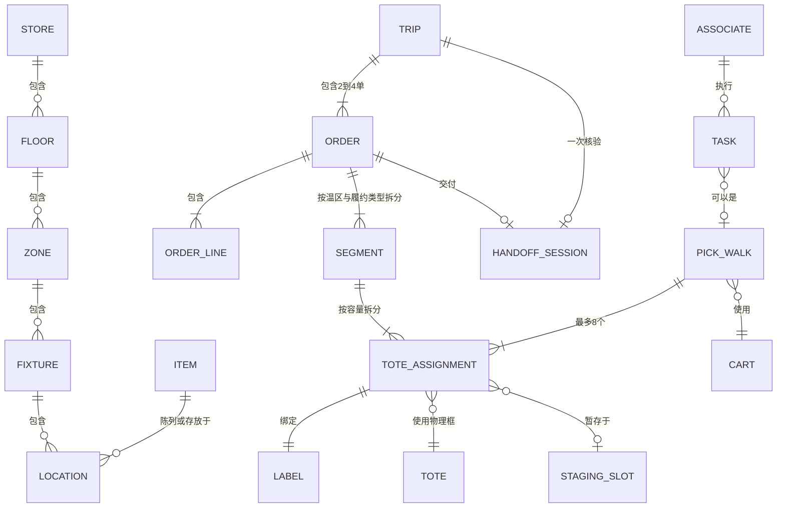

### 2.3 实体说明

| 实体 | 含义 | 关键属性 |
|---|---|---|
| Store | 门店 | 模板（小型 / 中型 / 大型）、模块开关、规则配置 |
| Floor | 楼层 | 支持多层门店（决策 V-02） |
| Zone | 区域 | 类型（销售区 / 后仓 / 暂存区 / 冷库 / 季节区）、温区 |
| Fixture | 设施 | 货架、冷柜、冷冻柜、暂存框架、保温柜、大件区、回收专区 |
| Location | 位置 | 层级编码，例如销售区 `A12-03-2-05`、暂存区 `AMB-03-02-16` |
| Item | 商品 | 四个独立属性（见 2.4）+ 尺寸、重量、计价方式（按件 / 按重量）、属性标签 |
| Order | 订单 | 顾客、类型（Pickup / Delivery）、时段、锁单时间、车辆描述 |
| Segment | 履约段 | 一个订单按「温区 × 履约类型」拆出的部分 |
| ToteAssignment | 框任务 | 履约段按容量拆分后的单位，**只属于一个订单** |
| Tote | 物理框 | 可重复使用，有固定的内部编号 |
| Label | 标签 | 绑定一个框任务；版本号只在作废重建时递增（决策 L-04） |
| PickWalk | 拣货批次 | 一辆推车的一次行程，最多 8 个框任务，**单一温区**（决策 P-02） |
| StagingSlot | 暂存格位 | 有编码，属于某个温区和区域；容量可配置 |
| Trip | 配送行程 | 2–4 个 Delivery 订单，一个验证码（决策 D-01） |
| HandoffSession | 交付会话 | 从到达开始，到交付完成结束 |
| Associate | 员工 | 角色、技能、永久授权（决策 X-01）、年龄段、固定 / 可调动标记 |
| Task | 任务 | 拣货、暂存、交付、Exception、补货、盘点、回架、大件 |

### 2.4 商品的四个独立属性（决策 P-01、C-01）

| 维度 | 取值 | 用途 |
|---|---|---|
| 温区 | Ambient / Chilled / Frozen / Hot | 决定推车、暂存区、交付顺序 |
| 处理方式 | Standard / Oversized / TeamLift / Fragile / Chemical / Hazmat / AgeRestricted / Secured | 决定装箱规则、是否先扫后打、是否需要授权 |
| 商品类别 | 杂货 / 清洁 / 保健 / 酒水 / 服饰 / 电子 / 家居 / 工具 / 户外 / **汽车用品** / 季节…… | 决定拣货区域、仓库分区、替代推荐范围；类别字典**完全可配置** |
| 履约类型 | Grocery / GM / MTO / Parcel | 决定走哪条业务流程 |

- 「节日类」是**动态标签 + 固定位置的季节区**：季节区规划在固定位置，节日轮替时直接更换商品（决策 P-09）；
- 汽车用品中，轮胎通常是 Oversized，铅酸电池和机油属于 Hazmat，按处理方式自动走对应流程。

---

## 3. 端到端主流程

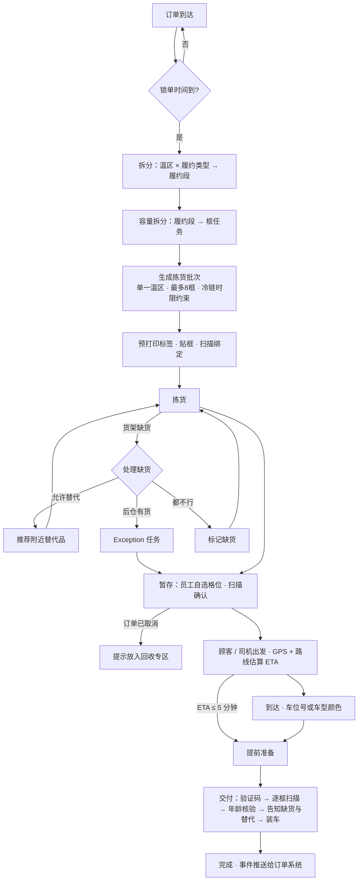

贯穿全程的载体是**标签上的二维码**：拣货时扫它加载任务，暂存时扫它记录位置，交付时扫它核对订单。

---

## 4. 分模块设计

### 4.1 订单接入与时段

- 时段长度可配置为 **60 或 120 分钟**；标签显示时段起点（决策 O-01）；
- 锁单时间（默认时段开始前 2 小时）之后才生成拣货任务；锁单后的修改作为异常处理（决策 O-03）；
- **交付方式锁定**：超过锁单时间后，顾客不能修改 Pickup / Delivery；司机取消或退回门店后，由门店重新选择交付方式（决策 S-08）；
- 系统按时段输出**产能上限建议**（以商品件数计），由订单平台决定是否限流（决策 O-02）；
- Express 订单可以插入正在生成的批次，或单独开一个小批次（决策 O-04）；
- 顾客下单时须明确告知：**替代商品按实际价格计费，且只能在收货后发起退货退款**（决策 D-02、AS-04）。

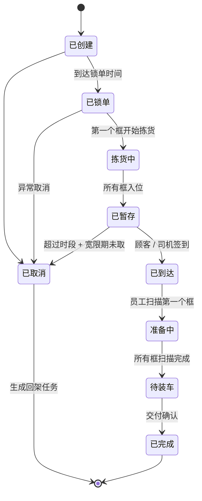

### 4.2 Pick（拣货）

**批次规则**（决策 P-02、P-03、P-04）

```
第一级：订单 → 框任务
  1. 订单按「温区 × 履约类型」拆成履约段
  2. 每个履约段所需框数 = max(⌈总体积 ÷ (框容积 × 装填系数 0.70)⌉, ⌈总重量 ÷ 重量上限 35 lb⌉)
  3. 商品按「压放等级」装入：重物在下，易碎品（鸡蛋、面包、薯片）在上
  4. 化学品单独装框，不与食品混装
  5. 一个框只属于一个订单；一个订单可以占多个框（标签显示 x/n）

第二级：框任务 → 拣货批次
  1. 常温同车、冷藏同车、冷冻同车
  2. 输入只有框任务本身（框号、温区、时段、所涉通道 / 区域），不再读取商品重量和体积
  3. 先按时段与件数确定本轮需要几辆推车，再以框任务为单位全局一次划分，每车最多 8 个（可配置）
  4. 划分依据是「通道 / 区域重叠度」：同一辆推车上的框任务尽量落在相同的通道和区域
  5. 冷藏 / 冷冻批次的预计用时（件数 × 每件标准时间 + 区域数 × 区域切换时间）必须小于冷链时限
  6. 批次确定之后，才在门店行走网络上规划路线；拣货顺序就是路线顺序，以有序清单显示
```

算法遵循 4.14 节的工程约束。

**冷链计时**（决策 P-12）
- 从批次中第一件冷藏或冷冻商品**被扫描并放入拣货框**时开始计时；
- 时限 = `clamp(基础时间 + 每件追加时间 × 待拣件数, 下限, 60 分钟)`，默认基础 20 分钟、每件 0.5 分钟、上限 **60 分钟**，全部可配置；
- 生成批次时就保证预计用时不超过时限；执行中超时则提醒立即回暂存区。

**称重商品**（决策 P-05）：拣货员在称重设备上称出实际重量，系统按「重量 × 单价」计算价格。

**位置数据**（决策 P-06）：每个商品支持多个位置；**补货上架时必须扫描货位确认摆放位置**，这是位置数据的主要来源；拣货扫描作为被动校准；位置置信度随时间衰减。

**多件同品**（决策 P-07）：扫描一次后输入数量；数量超过阈值时抽检扫描。

**订单中途取消**（决策 P-13）：
- 拣货开始前取消 → 撤回框任务，标签作废；
- 拣货中或拣货后取消 → 在**暂存扫描**时提示「该订单已取消」，并指引放入对应温区的**回收专区**，生成回架任务。

**推车满了**（决策 P-14）：提示返回暂存区并结束本次批次，剩余商品重新进入下一轮批次生成。

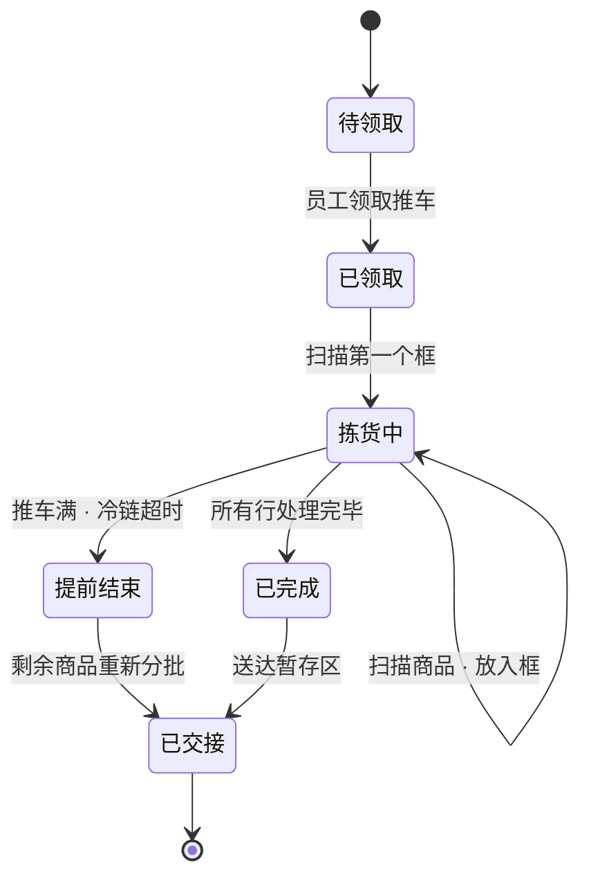

### 4.3 GM 与 Oversized

**规则引擎**（决策 GM-01，阈值参考普通成年人安全搬运能力，全部可配置）

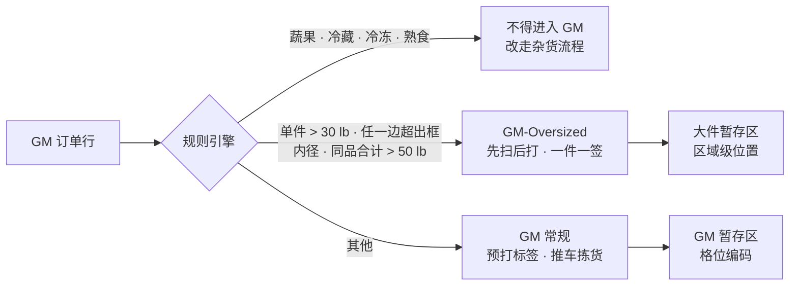

- 单件超过 50 lb 要求两人搬运或使用设备；
- **一件一签**，标签显示「1/3、2/3、3/3」（决策 GM-03）；
- **装载上限由员工确认**：员工扫描第一件后，输入自己这一趟能装载的最大件数，系统把剩余件数派发给其他员工（决策 P-07）；
- **GM 订单与其他订单分开配送，不允许混合**；当前时段 GM 单量过少时，可以与后续时段的 GM 订单合并成一个行程（决策 GM-02）；
- GM 的暂存、准备和交付独立于杂货流程运行。

### 4.4 Exception（后仓补取）

- 只有**永久授权**的员工可以执行（决策 X-01）；
- Exception 是**异步任务**：拣货员提交后继续拣下一件，不在原地等待；
- 取到的商品直接送到暂存区对应订单的位置「补框」；
- 确认信息全部用扫描代替输入，目标 3 次点击以内（决策 X-03）；
- 完成后自动生成一条**货架补货任务**（决策 X-04）。

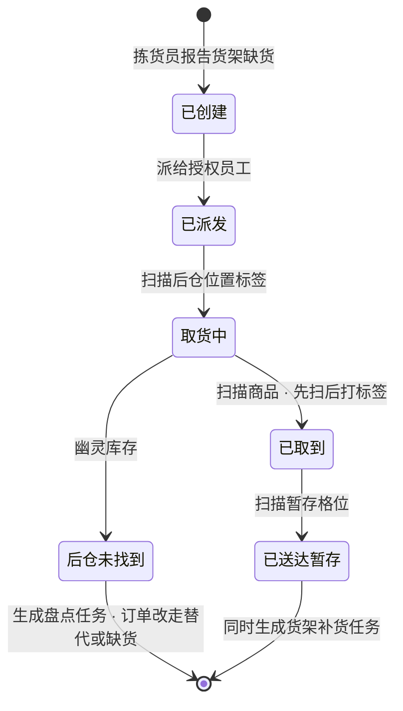

### 4.5 替代推荐

```
硬约束（不可违反）：
  顾客设置了「不允许替代」→ 不推荐
  温区必须相同（新鲜 ≠ 冷冻）
  过敏原、饮食属性不能降级（无麸质 / 有机 / 素食 / 清真 / 犹太洁食）
  年龄限制属性必须一致

软约束（加权排序）：
  同品牌 · 同口味 · 规格接近 · 价格接近（默认价格区间 ±50%）
  距离拣货员近：用「最近一次扫描的货架位置」作为近似位置
  历史接受率
```

- 价格：按替代品**实际价格**计费（决策 AS-04）；
- 交付时**不做当场拒收**，顾客收货后可通过退货流程退款（决策 D-02）；「允许当场拒收」作为门店可选配置，默认关闭；
- 在线推荐不依赖大语言模型；小型本地模型只用于离线补全商品属性（决策 AS-01）；
- **预防替代**：根据拣货员的「找到 / 没找到」扫描记录，实时更新商品的可售概率，通过接口提供给订单平台（决策 AS-06）。

### 4.6 Stage（暂存）

- **位置编码**：默认 `区域-架-层-格`，例如 `AMB-03-02-16`；编码规则由管理员自定义（决策 S-01）；大件只编到区域，例如 `OVS-Z1`，但必须扫描区域标签（决策 S-04）；
- **格位选择**：以**员工自选 + 扫描确认 + 允许覆盖**为主；当门店标记「布局稳定」时，系统同时显示推荐格位作为参考，员工自选始终保留（决策 S-02）；
- 同一订单的框在**各自温区内**相邻放置，系统生成「跨温区位置清单」（决策 S-03）；
- **占用率预警**：常温、冷藏、冷冻各自实时显示占用率，超过 85% 时预警并启用溢出区（决策 S-05）；
- **并框提示**：同订单、同温区的两个框，记录的装载量之和不超过单框容量时，系统按框编号提示可以合并（决策 S-07）；这是一条简单规则，不重新安排框内商品；
- **温度记录**：每个冷藏柜、冷冻柜、保温柜连续记录温度，超温告警；冷柜故障时自动列出受影响的订单（决策 S-09）；
- **回收专区**：按常温、冷藏、冷冻分区，存放已取消订单的商品。

```
┌──────────────────── 暂存区 ────────────────────┐
│  Pickup                  Delivery              │
│  ┌──────┐ ┌──────┐      ┌──────┐               │
│  │AMB-01│ │AMB-02│      │AMB-11│  ...          │  常温框架
│  └──────┘ └──────┘      └──────┘               │
│  ┌──────────┐ ┌──────────┐  ┌───────┐          │
│  │ CHL 冷藏柜│ │ FRZ 冷冻柜│  │HOT 保温│          │
│  └──────────┘ └──────────┘  └───────┘          │
│  ┌─────────────── OVS 大件区 ───────────────┐  │
│  │  Z1        Z2        Z3                  │  │
│  └──────────────────────────────────────────┘  │
│  ┌──── GM 独立暂存 ────┐ ┌── 回收专区 ──┐       │
│  └─────────────────────┘ │ AMB CHL FRZ │       │
│                          └─────────────┘ → 交付出口 │
└────────────────────────────────────────────────┘
```

### 4.7 Handoff（交付）

**到达时间估算**（决策 D-03）
- 顾客在下单或首次使用时自行开启位置共享；点击「我在路上」或司机接受行程后开始上报，**上报间隔固定**（默认 30 秒）；
- 路线服务（Google Routes API 或开源 OSRM，二选一可配置）估算行驶时间；
- 本地模型根据该门店的历史到达偏差修正行驶时间；
- 「即将到达」的阈值是**门店级固定常量**（默认 5 分钟）；ETA 只用于提醒员工**取出已暂存的框**做准备，不触发拣货——拣货始终按时段排程；
- 到达后立即停止位置共享。

**到达信息**（决策 D-08）：车位编号优先；没有编号、编号未知或输错时，填写车型和颜色。顾客端和司机端都提供这些字段。

**交付看板**（决策 D-04）

```
┌─────────────────────────────────────────────────────────────────────┐
│ ■ 红  Wei Zhang        Pickup     #A7K2   已到达 · 等待 9:12   准备中（员工 A）│
│ ■ 蓝  行程 T-208（3 单）Delivery  —       已到达 · 等待 2:40   待装车         │
│ ■ 黄  Li Chen          Pickup     #C1Q5   4 分钟后到达          未开始         │
│ ■ 灰  行程 T-211（2 单）Delivery  —       18 分钟后到达         未开始         │
└─────────────────────────────────────────────────────────────────────┘
```

- 四种状态：未到达（灰）、即将到达 ≤ 5 分钟（黄）、已到达（蓝）、等待 ≥ 8 分钟（红）；颜色同时配文字（无障碍要求）；
- 排序：已到达的按**到达先后**排列（先到先服务）；未到达的按时段排列；ETA 只显示，不作为排序依据；
- 员工扫描某订单的任意一个标签，该订单立即标记为「准备中（员工名）」，其他所有设备实时刷新；第二个员工只能「加入协助」，不能抢占（决策 D-05）；
- 准备界面按 **Ambient → Chilled → Frozen → GM → HOT** 分区显示，逐级查看框号和框内商品；每扫描一个框标记成功；标签丢失时按框号重打。

**顾客早到**（决策 D-09）：提示订单未就绪，把剩余拣货任务提升为最高优先级，并**告知顾客预计等待时间和原因**。

**行程机制**（决策 D-01、D-07）
- 一个行程包含 **2–4 个** Delivery 订单（Express 或无法合并时允许 1 单），由系统根据商品件数、重量、车辆容量、目的地远近组合；也可以直接导入外部配送平台生成的行程；
- 行程**在订单暂存之后**组合，不作为拣货批次的输入；
- 本系统的行程状态在「已交给司机」时结束；配送途中的拒收和退回由退货流程处理；
- 司机接收整个行程，**一个行程只需一次验证码**；
- 车内位置：**副驾、后排左、后排右、尾箱**，每趟最多 4 单（可配置）；装车员工逐单记录位置，并通过接口推送给司机端。

**验证码**（决策 D-01）：密码学安全的随机数；员工必须**先定位订单或行程**（姓名、车位、扫描），**再输入验证码核验**，不允许凭验证码查找订单；最多尝试 3 次，失败转人工核验。

**服务目标**（决策 D-11）：追踪平均等待和 80% 分位等待（目标 ≤ 3 分钟）；同时追踪员工负荷，节假日和购物节订单激增时，通过产能限流和人员调配平衡顾客体验与员工压力。

**交付会话状态机**（决策 D-06：只保留主状态，缺货和移除年龄限制商品作为完成时的标记）

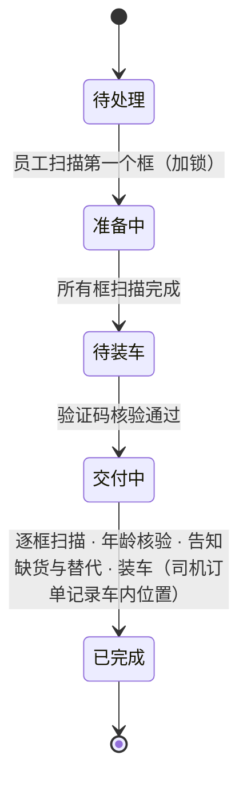

### 4.8 MTO（熟食现做）

- 制作开始时间 = 时段起点 − 该菜品的标准制作时长 − 缓冲（标准制作时长按菜品配置）；按时段排程，**不随顾客实时位置变化**，熟食区可以提前规划（调整自决策 M-02 的默认值，见决策记录 0001）；
- 完成后放入 HOT 区（≥ 135°F 保温）并计时，或采用时间控制方案打印丢弃时间；超过时限强制丢弃（决策 M-03、D-10）；
- 顾客「即将到达」时提醒员工从 HOT 区取出；准备时最后取 HOT。

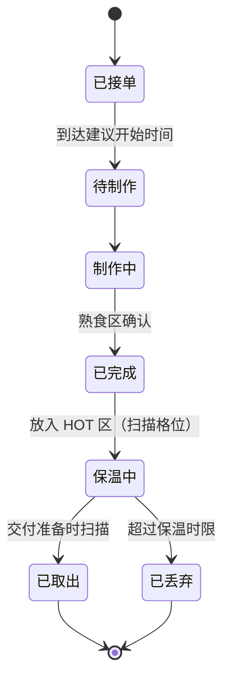

### 4.9 Parcel Hub（包裹中转）

外部包裹统一送到门店，由门店按配送行程暂存并交给司机（决策 IP-01 至 IP-04）。

- ASN 和行程来自外部系统（通过适配器接入）；本系统负责**入站核对 → 按行程暂存 → 司机交接**；
- 司机端使用**已有的司机应用**，本系统通过接口接收「已交接」事件。

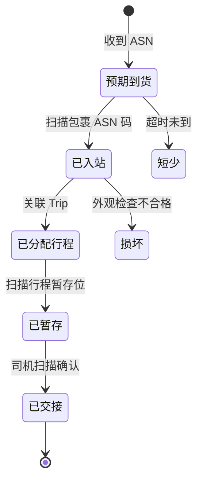

**三类异常的处理步骤**（决策 IP-03）

| 异常 | 处理步骤 |
|---|---|
| 短少（有 ASN、没到货） | ① 超过预计到货时间 + 宽限期后标记短少；② 通知发货方；③ 从对应行程中移除；④ 记录到异常报表 |
| 多出（到货、没有 ASN） | ① 扫描后系统提示「无匹配 ASN」；② 放入待核实区；③ 拍照登记包裹外部标签信息；④ 向发货方查询后关联或退回 |
| 损坏 | ① 入站外观检查时标记；② 拍照留证；③ 放入损坏区；④ 通知发货方，按指示改派或退回 |

### 4.10 退货

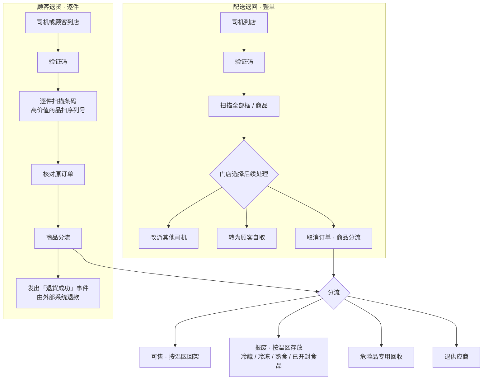

### 4.11 Backroom（后仓库存）

- **每一箱都打印由本地数据库主导的标签**并录入系统（决策 I-02）。为降低人工成本，标签在收货工位按托盘**批量打印**，扫描箱上原有条码后自动生成内部箱号；
- 内部标签的二维码采用 **GS1 Digital Link** 格式；
- 存储策略默认「大类分区 + 区内随机」；隔离规则始终强制（决策 I-03）；
- 库存状态：可售 / 待检 / 退供应商 / 报废；**可售区和报废区都按常温、冷藏、冷冻再分区**（决策 I-05）。

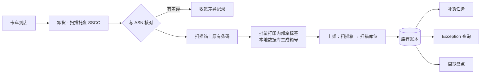

### 4.12 Replenish（货架补货）

- **混合感知**：默认用 POS 销售流水推算货架存量；只对高周转、高缺货、高价值的货位部署传感器；**交易量低的品类不部署传感器**（决策 R-01）；
- **补货上架时扫描货位**，同时校准存量和位置（决策 P-06）；
- 补货任务按**预计售罄时间**排序，同区域任务合并成批（决策 R-05）；
- 陈列重排只作为建议，需人工审批（决策 R-04）；
- 硬件原型不做实物，但提供完整的 [货架传感原型指南](hardware/shelf-sensing-prototype.md)（决策 R-06）。

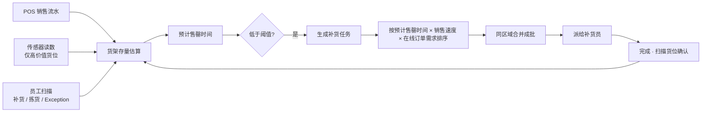

### 4.13 Staffing（人员调配）

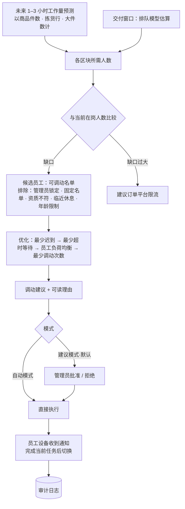

- 调动只在员工已排班的时间内切换任务；每人最短停留 30 分钟；
- **员工负荷均衡**（决策 D-11）：限制持续高强度作业时长和累计搬运负荷；人手缺口过大时，优先建议限流，而不是让员工长时间超负荷工作；
- 不做个人效率排名；个人数据仅本人和管理员可见。

### 4.14 工程约束

以下约束适用于所有算法与交互设计。理由都是工程上的：**简单、可解释、可测试**，并且让各模块之间的边界清晰。修改任何一条，都需要先经过设计评审。

| 编号 | 约束 | 工程理由 |
|---|---|---|
| EC-1 | 分箱在履约段内**一次性完成**（单遍：重物在下、易碎在上、化学品单独）；拣货批次模块的输入只有框任务，**不含重量和体积** | 两个模块各自可以独立测试；分箱结果一旦确定就不再变化，标签可以预先打印 |
| EC-2 | 拣货批次**以框任务为单位全局一次划分**：先确定推车数量，再聚类或切分；不采用逐单追加的构造方式 | 结果与订单到达顺序无关，可复现 |
| EC-3 | 批次划分依据**通道 / 区域重叠度**；真实步行距离只在批次确定后用于路线规划 | 重叠度易于向员工解释（「这一车都在 3–7 号通道」） |
| EC-4 | **不做框间交换式优化**：不在框之间搬动商品以减少框数，也不做迭代式局部搜索 | 分箱结果稳定，避免标签作废重打 |
| EC-5 | **拣货顺序就是路线顺序**；路线以有序清单显示 | 清单在小屏幕和戴手套操作时最清楚 |
| EC-6 | 拣货批次**只按取货时段组织**；配送行程不作为拣货输入 | 拣货与配送解耦，配送变化不影响已开始的拣货 |
| EC-7 | 「即将到达」阈值是**门店级固定常量**；ETA 只触发「取出已暂存的框」，不触发拣货；位置**固定间隔**上报；交付队列按**到达先后**排列 | 行为可预测；先到先服务对顾客和员工都公平 |
| EC-8 | 不使用摄像头或车牌识别检测到达；不做设备端地理围栏；不使用机器人或自动存储 | 降低硬件和隐私成本，适合中小门店 |
| EC-9 | 替代**没有实时确认环节**：按下单时的偏好和规则决定；缺货后的通知只告知，不等待回复 | 拣货不会因为等待顾客回复而停顿（与决策 D-02 一致） |
| EC-10 | 行程状态在「已交给司机」时结束；配送途中的拒收和退回走独立的退货流程 | 门店系统只管门店内的事，边界清晰 |

---

## 5. 标签规范

标签的视觉样本见 [标签样本](samples/labels.md)。所有标签统一使用**冷冻级标签纸**（决策 L-05）。

### 5.1 取货框标签

| 字段 | 说明 |
|---|---|
| 二维码 | 只含不透明标签 ID + 校验位，**不含任何个人信息**（决策 L-01） |
| 顾客姓名 | 名 + 姓；超过长度上限时显示「名 + 姓的首字母」（决策 L-02） |
| 类型 | PICKUP / DELIVERY |
| 订单短号 | 便于口头核对 |
| 框序号 | x / n |
| 时段 | 时段起点 |
| 温区 | 图标 + 文字 + 颜色（不能只靠颜色） |
| 特殊标记 | 21+（年龄限制）、HOT、化学品 |
| 版本号 | 只在作废重建时递增；因丢失而重打时版本号不变，重复扫描按同一标签处理（决策 L-04） |
| 框号 | 内部物理框编号 |

暂存位置不预印，只存在系统中。

### 5.2 GM-Oversized 一件一签

在取货框标签的基础上，增加「件序号 x / n」和商品名称，贴在商品本身。

### 5.3 后仓箱标签（每箱打印）

| 字段 | 说明 |
|---|---|
| 内部箱号 + 二维码 | GS1 Digital Link 格式，由本地数据库生成 |
| UPC 数字 + UPC 条码 | 商品标识 |
| 箱规 | 每箱单元数 |
| 收货日期 | 便于先进先出 |
| 分区标识 | **不显示在标签上**，只保存在数据库中【构想】 |

### 5.4 行程标签（Parcel Hub）

行程编号 + 二维码、包裹数、计划出发时间；暂存位置扫描后确定。

---

## 6. 事件清单

| 区块 | 事件 |
|---|---|
| 订单 | `OrderCreated` `OrderModified` `OrderLocked` `FulfillmentMethodLocked` `OrderCancelled` `OrderTypeReassigned` |
| 分配 | `SegmentsCreated` `ToteAssignmentsCreated` `PickWalkCreated` |
| 标签 | `LabelPrinted` `LabelBound` `LabelReprinted` `LabelVoided` |
| 拣货 | `PickWalkClaimed` `ItemScanned` `ItemWeighed` `ItemPicked` `ItemNotFound` `SubstitutionProposed` `SubstitutionPicked` `ToteClosed` `ColdChainTimerStarted` `ColdChainAlert` `PickWalkEndedEarly` `CancelledOrderDetected` |
| 大件 | `OversizedCapacityDeclared` `OversizedRemainderDispatched` |
| Exception | `ExceptionCreated` `ExceptionAssigned` `ExceptionItemFound` `ExceptionNotFound` `ExceptionDeliveredToStaging` |
| 暂存 | `StagingSlotSuggested` `ToteStaged` `ToteMoved` `ToteMergeSuggested` `TotesMerged` `ToteSentToRecovery` `StagingCapacityAlert` `CoolerTemperatureAlert` |
| 交付 | `EtaUpdated` `CustomerArrived` `VehicleDescribed` `PrepStarted` `PrepJoined` `ToteScannedForPrep` `ReadyToLoad` `CodeVerified` `CodeFailed` `AgeVerified` `VehiclePlacementRecorded` `OrderHandedOff` |
| 行程 | `TripProposed` `TripAccepted` `TripCodeVerified` `TripCompleted` |
| MTO | `MtoOrderReceived` `MtoStarted` `MtoCompleted` `MtoHeld` `MtoDiscarded` |
| Parcel Hub | `AsnReceived` `ParcelInducted` `ParcelAssignedToTrip` `ParcelStaged` `ParcelHandedOff` `ParcelShort` `ParcelOver` `ParcelDamaged` |
| 退货 | `ReturnRequested` `ReturnArrived` `ReturnItemScanned` `ReturnDispositioned` `ReturnCompleted` |
| 后仓 | `TruckArrived` `PalletReceived` `ReceivingDiscrepancy` `CaseLabelPrinted` `CasePutAway` `CycleCountCompleted` |
| 补货 | `ShelfLevelEstimated` `SensorReading` `ReplenishmentTaskCreated` `ShelfLocationConfirmed` `ReplenishmentCompleted` |
| 人员 | `StaffingForecastUpdated` `ReassignmentRecommended` `ReassignmentApproved` `ReassignmentRejected` `AssociateLocked` `AssociateReassigned` `ThrottleRecommended` |

---

## 参考资料（公开来源）

- Walmart Commerce Technologies · Store Assist 工作流：https://developer.walmart.com/walmart-commerce-technologies/docs/store-assist-workflows
- Grocery Dive · Store Assist 与 Asda：https://www.grocerydive.com/news/walmart-asda-fulfillment-tech-store-assist/633753
- Massmart 门店履约软件上线：https://www.massmart.co.za/news/2023/05/massmarts-latest-walmart-inspired-technology-launch-set-to-impro
- Walmart · AI 工具发布（2025-06-24）：https://corporate.walmart.com/news/2025/06/24/walmart-unveils-new-ai-powered-tools-to-empower-1-5-million-associates/
- Talk Business · 门店拣货实地报道（2024）：https://talkbusiness.net/2024/07/long-time-walmart-employee-now-picking-as-a-personal-shopper/
- Grocery Dive · 替代推荐深度学习：https://www.grocerydive.com/news/walmart-boosts-shopper-acceptance-of-substitutions-with-deep-learning-ai/602429/
- 司机端帮助 · 路边取货：https://sparkdriverapp-walmart.helpdocs.io/l/en/article/8rm6c03tzi-picking-up-a-curbside-order
- 司机端帮助 · 退货送回门店：https://sparkdriverapp-walmart.helpdocs.io/l/en/article/vlszvswn0n-delivering-a-return-to-store-offer
- Walmart Global Tech · 后仓增强现实：https://tech.walmart.com/content/walmart-global-tech/en_us/blog/post/our-new-augmented-reality-feature-for-associates.html
- The Next Web · 电子价签现状（2026-10-01）：https://thenextweb.com/news/walmart-light-up-digital-shelf-labels
- 货架机器人项目终止：https://www.ky3.com/2020/11/03/walmart-abandons-shelf-scanning-robots-lets-humans-do-work
- GS1 US · Digital Link：https://www.gs1us.org/industries-and-insights/standards/gs1-digital-link
