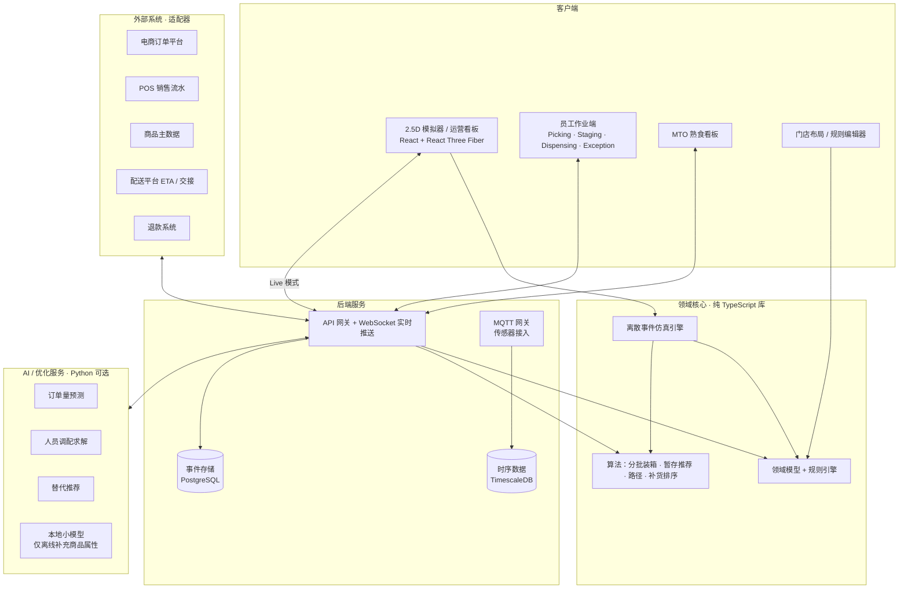
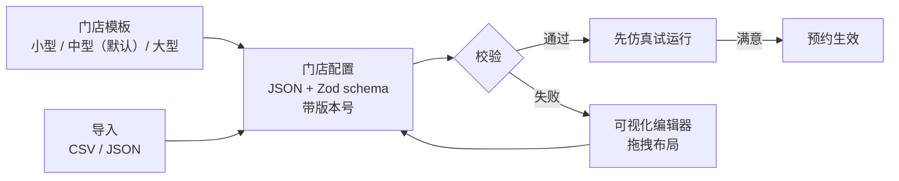

# 04 · 技术栈组合方案（待讨论）

> 状态：v0.2（2026-10-18，已按 [决策记录 0001](decisions/0001-phase0-decisions.md) 更新）
> 本文给出**推荐方案**和**备选方案**，并说明取舍理由。每一层都可以讨论替换。

---

## 1. 五条架构原则

这五条原则直接来自项目需求，后面的所有选型都由它们推导出来。

| # | 原则 | 来自哪条需求 |
|---|---|---|
| 1 | **全栈单一语言（TypeScript）**，只在生态明显更好的地方（优化求解、机器学习）使用 Python，并作为可选服务 | 单人开发 + AI 协助构建，语言越少越可控 |
| 2 | **领域核心是一个纯函数库**，同时被模拟器、后端、员工端复用 | 模拟器中的规则必须和真实系统**完全一致**，否则效益对比没有意义 |
| 3 | **事件溯源（Event Sourcing）**：每个动作都是一条不可变事件 | 回放模式、审计日志、实时同步、指标计算都来自同一条事件流 |
| 4 | **模拟器可以纯静态部署** | 个人网站展示；访客打开就能用，不依赖后端 |
| 5 | **员工端离线可用** | 后仓、冷库常有 Wi-Fi 死角 |

---

## 2. 总体架构



**关键点**：模拟器在 Simulation 模式下直接调用领域核心和仿真引擎，全部运行在浏览器里；切换到 Live 模式时，则通过 WebSocket 订阅后端的事件流。界面是同一套代码。

---

## 3. 分层选型

### 3.1 语言与工程

| 项 | 推荐 | 备选 | 理由 |
|---|---|---|---|
| 语言 | **TypeScript** | Go / Elixir / Python | 前端必须是 JS/TS；后端也用 TS 就可以共享领域核心 |
| 仓库 | **npm workspaces** 单仓多包；包数量变多后再引入 Turborepo | pnpm；Nx | Node 自带，克隆后无需额外安装工具 |
| 数据校验 | **Zod** | TypeBox | 一份 schema 同时生成类型、校验门店配置、校验 API |
| 测试 | **Vitest + Playwright + fast-check** | Jest | fast-check 做属性测试：用随机订单验证「永远不超载」「永远不混温区」「一个框永远只属于一个订单」等不变式 |

### 3.2 领域核心与仿真引擎

| 项 | 推荐 | 备选 | 理由 |
|---|---|---|---|
| 领域核心 | **纯 TS 库**，无 I/O，所有随机数来自可设定种子的随机数生成器 | — | 可复现：同一个种子 = 同一个结果，这是公共随机数实验的前提 |
| 仿真引擎 | **自研离散事件仿真**（优先队列 + 事件循环），运行在 **Web Worker** 中 | SimPy（Python） | 必须能在浏览器里跑；放在 Worker 里不阻塞渲染 |
| 大规模实验 | 同一引擎在 Node.js 中批量运行 | — | 30 次重复 × 多场景，在命令行中并行执行 |

### 3.3 后端

| 项 | 推荐 | 备选 | 理由 |
|---|---|---|---|
| 运行时 | **Node.js + Fastify** | NestJS；Elixir Phoenix | Fastify 轻量且快；Phoenix 实时能力最强，但需要学一门新语言 |
| API | **REST（OpenAPI）+ WebSocket** | tRPC；GraphQL | 外部系统集成需要标准 REST；内部实时推送用 WebSocket |
| 主数据库 | **PostgreSQL** | — | 事件存储、业务数据、全文搜索都可以覆盖 |
| 时序数据 | **TimescaleDB**（PostgreSQL 扩展） | InfluxDB | 传感器读数；不需要额外运维一个数据库 |
| 事件总线 | **事务性发件箱（outbox）表 + NATS JetStream** | Redis Streams；Kafka | 业务写入与事件写入在同一事务中完成，保证不丢事件；NATS 单个二进制、配置简单；Kafka 对门店规模过重。**不用** PostgreSQL LISTEN/NOTIFY 做实时广播：它在提交时持有全局锁，写入量大时会串行化提交（Recall.ai 2025 年 3 月因此发生故障），只适合作为低频「有变化」信号 |
| 向量检索 | **pgvector**（PostgreSQL 扩展） | 独立向量库 | 替代推荐的候选召回；不需要多运维一个数据库 |
| 传感器接入 | **MQTT**（Mosquitto / EMQX） | — | IoT 设备的事实标准，低功耗设备友好 |
| 锁与并发 | 数据库行级锁 + 乐观并发版本号 | Redis 锁 | 「两人同时扫描同一订单」（D-05）由服务端仲裁，不依赖客户端 |

**两套部署形态**（同一套领域核心，事件传输层抽象为接口）：

| 形态 | 用途 | 组成 |
|---|---|---|
| **云端演示** | 个人网站上的 Live 模式演示 | Vercel Functions（REST 命令）+ 托管 PostgreSQL + **托管实时广播**（Supabase Realtime Broadcast 或同类服务） |
| **自托管** | 商业化部署、门店本地部署 | Docker Compose：Fastify + PostgreSQL + NATS JetStream + WebSocket 网关 + MQTT |

为什么云端演示不直接用 Vercel Functions 承载 WebSocket：Vercel Functions 自 2026 年 6 月起以公开测试版支持 WebSocket，但**连接受函数执行时长限制**（默认约 5 分钟后断开），且多个函数实例之间的消息**扇出**需要额外的发布订阅层。托管实时广播服务直接解决这两个问题；客户端的「快照 + 流序号 + 断线重同步」机制（见 3.5 节）在两种形态下都适用。

### 3.4 员工作业端

这里有一个关键取舍：**演示便利性**和**真实设备适配**。

| 方案 | 优点 | 缺点 |
|---|---|---|
| **A. PWA（网页应用）** | 任何手机打开网址就能用；可以嵌入个人网站演示；用摄像头扫码 | **收不到** Zebra DataWedge 的 Intent（只能用「模拟键盘输入」方式接收扫码）；Web Bluetooth 只支持低功耗蓝牙（BLE），连接经典蓝牙的便携打印机能力弱；后台运行受限 |
| **B. Capacitor 包装 PWA** | 同一套网页代码打包成 Android 应用；通过原生插件接入 DataWedge Intent 和 Zebra Link-OS 打印 SDK | 需要自己写或维护两个原生插件 |
| **C. React Native（Expo）** | Zebra 官方有 React Native / Expo 的 DataWedge 接入指南；TypeScript 可共享领域核心；离线同步方案成熟 | 界面代码与网页端不共享，需要写两套界面 |
| **D. Kotlin 原生** | 硬件集成、后台和离线表现最好 | 与网页技术栈完全割裂 |

- **决定**（决策记录 0001）：
  - **演示**：**A**，嵌入个人网站，访客用手机摄像头就能体验扫码流程；
  - **真实设备**：**B（Capacitor）**。理由：与网页演示共用一套界面代码，单人维护成本最低；DataWedge 和 Link-OS 通过两个原生插件接入。如果插件维护成本过高，再切换到 C——领域核心与界面分离，切换不影响业务逻辑；
  - 扫码层抽象为接口：网页用摄像头实现，工业设备用硬件扫码头实现。
- **离线同步**：推荐 **PowerSync**（PostgreSQL → 设备端 SQLite，写操作经上传队列交给后端 API 校验）。库存类写操作建模为**命令**（「在位置 X 扣减 2 件」），由服务端校验，而不是「最后写入者获胜」的状态覆盖。锁单等冲突以服务端为准。
- **标签打印**：生成 **ZPL**（Zebra 打印机指令语言）+ 网页端预览；真实设备通过 Link-OS SDK 经蓝牙发送；二维码采用不透明 ID（见 L-01）。

### 3.5 2.5D 模拟器与运营看板

| 项 | 推荐 | 备选 | 理由 |
|---|---|---|---|
| UI 框架 | **React + Vite** | Svelte | 生态最大，与 React Three Fiber 配合 |
| 3D 渲染 | **Three.js + React Three Fiber + drei** | Babylon.js；PixiJS（纯 2D 等距） | 需求指定 Three.js；R3F 把三维场景写成 React 组件，开发效率高；多楼层与 3D 视角排除了纯 2D 方案 |
| 视角 | **三种相机可切换**：① 等距 2.5D（正交相机，默认）；② 自由 3D（透视相机，可环绕）；③ 俯视 2D（布局编辑） | — | 正交投影是「2.5D」的视觉本质；3D 视角用于多楼层和沉浸式观察（决策 V-02） |
| 性能 | **InstancedMesh**（几千个货架、框、小人只用少量绘制调用）；在渲染循环中直接写入类型化数组（typed array），**不经过 React 状态**逐个更新对象；仿真在 Worker 中运行，以可转移（transferable）的类型化数组传回快照 | BatchedMesh（几何体不同但材质相同时） | 达到 60 fps 的关键。已有公开案例用原生 three.js 实时显示约 3 万个托盘的仓库 |
| 渲染后端 | **WebGL2**，可选 WebGPU | — | WebGPU 已在 Chrome、Safari 26、Firefox 141（Windows）中提供，three.js 的 WebGPU 渲染器可回退到 WebGL2；但仍以 WebGL 路径为主，保证兼容 |
| 状态管理 | **Zustand** | Redux | 简单，适合高频更新 |
| 界面组件 | **Tailwind CSS + Radix UI** | MUI | 简约风格，可访问性好 |
| 图表 | **ECharts** 或 **uPlot** | Recharts | 实时指标需要高频刷新 |

**模拟经营式交互**（决策 V-01、V-03）：

| 能力 | 实现方式 |
|---|---|
| 多楼层 | 楼层堆叠显示，可单独显示 / 隐藏某层，或用剖切视图查看下层；楼梯和电梯作为行走网络的跨层边 |
| 直接操作 | 射线拾取（raycasting）：点击货架 → 查看存量 → 一键生成补货任务；拖动员工到另一区块 → 生成改派指令（走与管理员操作相同的审批与审计流程） |
| 时间控制 | 暂停、1×–60× 加速、跳转时间；事件注入（订单高峰、冷柜故障、员工请假） |
| 信息层 | 可切换的叠加层：温区、货架存量热力图、员工负荷、暂存占用率、交付等待 |
| 通知 | 模拟经营游戏式的事件提示（「冷冻暂存占用率 90%」「行程 T-208 等待 8 分钟」），点击即定位到场景中的对象 |

**视觉风格**：简约的卡通渲染（toon shading：分段明暗 + 轻描边）、低多边形、柔和配色；参考《原神》《城市：天际线》的**氛围**，但不使用其任何素材、角色或界面元素。温区颜色编码与界面保持一致，并始终配合图标和文字（无障碍要求）。

**「零延迟」的实现方式**：

1. Simulation 模式的全部计算都在本地完成，没有网络往返；
2. 渲染与仿真解耦：仿真按事件推进，渲染以 60 fps 插值显示员工和推车的位置；
3. Live 模式使用乐观更新：操作立即在本地生效，服务器确认后再对账；
4. 增量推送：客户端连接时先拿一份**快照**，之后只接收带**流序号**的增量事件；发现序号跳号就自动重新同步，保证所有设备看到的状态一致（交付看板「其他员工设备立刻刷新」就是这样实现的）。

### 3.6 AI 与优化

| 能力 | 推荐方法 | 是否需要大模型 | 运行位置 |
|---|---|---|---|
| 分箱 | 单遍首次适应递减（重物在下、易碎在上、化学品单独）；不做框间交换优化 | 否 | 领域核心（浏览器 / 服务器） |
| 分批 | 以框任务为单位全局一次划分，按通道 / 区域重叠度聚类 | 否 | 领域核心 |
| 拣货路径 | 批次确定后，在门店行走网络上做最短路径 + 旅行商启发式；以有序清单呈现 | 否 | 领域核心 |
| 暂存推荐 | 评分规则（同单相邻、靠近出口、按时段排序），仅作参考；员工自选为主 | 否 | 领域核心 |
| 订单量预测 | 时间序列模型（季节性 + 节假日）；数据足够后用 LightGBM | 否 | Python 服务；浏览器中使用简化版 |
| 人员调配 | 约束优化（OR-Tools CP-SAT）；浏览器中使用贪心启发式 | 否 | Python 服务；浏览器中使用简化版 |
| 替代推荐 | 规则过滤 + 属性相似度 + 学习排序 | 否（在线） | 领域核心 |
| 商品属性补充 | **本地小型语言模型**，离线批量处理 | **是** | 离线脚本 |
| 订单备注解析 | 把「香蕉要青一点」「有机商品不要替代」解析成结构化约束 | **是** | 离线或异步 |

结论：**在线决策全部不依赖大模型**（快、可解释、可审计）；大模型只用于离线补全商品属性、解析自由文本这类它真正擅长的任务。这一点本身就是值得写进作品集的工程判断。

**参考依据**：
- M5 预测竞赛（使用沃尔玛销售数据，42,840 条时间序列）中，前列方案以 LightGBM 为主；
- 2026 年可本地运行的小模型候选：Qwen3.5 小模型系列（0.8B–9B，Apache 2.0）、Gemma 4 边缘版本（E2B / E4B，Apache 2.0）、Phi-4-mini（3.8B，MIT），可通过 llama.cpp 或 Ollama 部署；
- 零样本时间序列模型（如 Chronos-Bolt）可在 CPU 上运行，适合冷启动阶段的预测基线。

**算法选型依据**（同时遵循 [工作流设计](01-workflow-design.md) 4.14 节的工程约束）：
- **分批**：以框任务为单位的全局划分（按通道 / 区域重叠度聚类），结果与订单到达顺序无关；文献表明，即使简单的分批方法也明显优于先到先拣（De Koster 等，1999）；
- **分箱**：体积 + 重量 + 装填系数（0.7–0.8）对杂货已经足够，单遍完成；只对边界情况和大件做三维极点（extreme-point）放置检查；
- **路径**：门店是不规则的多区块布局（端架、岛柜、收银通道），S 形路径不适用。批次确定后，在门店行走网络上预计算最短路径，再把每辆推车的路线当作旅行商问题求解（OR-Tools 或 LKH）；保留 S 形路径作为可解释的备选。文献中，把拣货路径当作旅行商问题求解，相比构造式启发算法平均可节省最多 47% 的距离（Theys 等，2010）；
- **交付人数**：Erlang C / Erlang A 排队模型估算，再用仿真校验（顾客到达受预约时段影响，不完全符合排队模型假设）。

### 3.7 到达时间估算（决策 D-03）

| 层 | 方案 |
|---|---|
| 位置来源 | 顾客在下单或首次使用时自行开启位置共享；点击「我在路上」或司机接受行程后**按固定间隔**上报（默认 30 秒）；到达后立即停止 |
| 触发规则 | 「即将到达」阈值为门店级固定常量（默认 5 分钟），只触发「取出已暂存的框」；交付队列按到达先后排列（工程约束 EC-7） |
| 路线服务 | 适配器接口，两种实现：**Google Routes API**（按调用计费；服务条款限制缓存和存储地图数据）或 **OSRM**（开源，基于 OpenStreetMap，可自托管，无调用费用） |
| 修正模型 | 根据该门店历史到达偏差修正路线服务给出的 ETA（轻量回归模型） |
| 演示 | 模拟器中仿真 ETA，不调用任何付费服务 |

### 3.8 部署与个人网站集成

个人网站 yecanyuan.com 使用原生 HTML / CSS / JavaScript + Vercel Functions + GitHub 仓库中的 JSON + Vercel Blob + Cloudflare DNS（决策 G-09）。

| 组件 | 方式 |
|---|---|
| 模拟器 | **独立仓库 + 独立 Vercel 项目**，静态构建；通过 Cloudflare DNS 绑定子域名（建议 `storewright.yecanyuan.com`）。个人网站**不需要改技术栈** |
| 网站中的项目页 | 在网站现有的 JSON 内容中新增一个项目条目；截图和演示视频放在 Vercel Blob；页面链接或用 iframe 嵌入模拟器 |
| Live 模式演示 | 云端演示形态（见 3.3 节） |
| 全套系统 | 自托管形态：Docker Compose 一键启动 |

---

## 4. 定制化架构（核心之一）



门店配置由五部分组成（决策 C-01：定制化范围需要扩大）：

1. **空间**：楼层、平面图网格、货架 → 层 → 货位层级、后仓分区、暂存框架和编号规则（管理员自定义）、冷柜和保温设备、季节区、回收专区；
2. **商品字典**：类别（含汽车用品等）、处理方式、属性模板、节日标签——**全部可增删**，不写死在代码中；
3. **规则**：所有阈值（装填系数、重量上限、GM / Oversized 规则、冷链时限公式、等待阈值、每趟最多单数、时段长度、锁单时间、替代价格策略、是否允许当场拒收……）；
4. **模块开关**：MTO / Parcel Hub / GM / 传感器 / AI 调配 / 行程机制；
5. **组织**：角色、权限、员工技能、永久授权、固定 / 可调动名单。

规则引擎先用**声明式 JSON 规则**（字段 + 比较符 + 阈值 → 结果），而不是自定义脚本语言：足够表达 GM / Oversized 等阈值规则，又便于在界面中编辑和校验。

**规模伸缩**（决策 G-03）：小型门店模板关闭大部分模块、使用单人多角色；大型门店模板开启全部模块和多楼层。同一套配置 schema 覆盖三种规模，用模板证明可伸缩性。

---

## 5. 仓库结构

公开与私有的划分见 [决策记录 0001](decisions/0001-phase0-decisions.md) 第 2 节。

```
storewright/
├── apps/
│   ├── simulator/              # 模拟器 + 运营看板 + 布局编辑器        【公开】
│   ├── associate/              # 员工作业端（PWA / Capacitor）        【私有】
│   ├── kds/                    # MTO 熟食看板                         【私有】
│   └── server/                 # 后端 API + 实时推送                  【私有】
├── packages/
│   ├── domain/                 # 领域模型 + 规则引擎（纯 TS）           【公开】
│   ├── algorithms/             # 分批装箱、路径、暂存推荐、补货排序     【公开】
│   ├── sim-engine/             # 离散事件仿真引擎                       【公开】
│   ├── store-config/           # 门店配置 schema + 模板                 【公开】
│   ├── labels/                 # 标签生成（二维码、ZPL、预览）          【公开】
│   ├── adapters/               # POS / OMS / 配送平台 / 地图适配器      【私有】
│   └── ui/                     # 共享界面组件                           【公开】
├── services/
│   └── ai/                     # Python：预测、人员调配求解、属性补全   【私有】
├── docs/                       # 公开文档（本目录）
│   ├── pseudocode/             # 伪代码
│   └── decisions/              # 架构决策记录
└── experiments/                # 效益对比实验脚本与报告
```

---

## 6. 已定技术决策

| 问题 | 决定 |
|---|---|
| 语言 | 全栈 TypeScript；Python 只用于优化求解和机器学习服务 |
| 员工端 | 演示用 PWA，真实设备用 Capacitor 打包 |
| 部署 | 模拟器独立部署到 Vercel 子域名；Live 演示用云端演示形态；商业部署用自托管形态 |
| 视觉 | 2.5D / 3D / 俯视三种视角，简约卡通渲染，支持多楼层与直接操作 |
| 地图 | 路线服务适配器：Google Routes API 或 OSRM |
| 许可证 | 开放核心 + 双许可（见决策记录 0001） |
