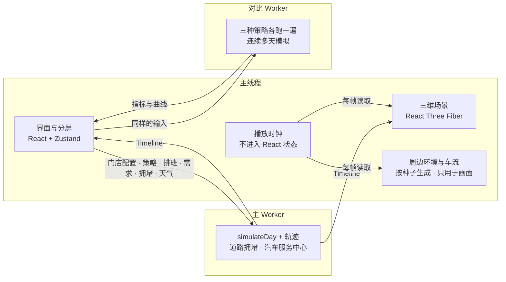

# 07 · 运营模拟器

> 状态：v4.3（2026-10-20）· Phase 2 交付物，已完成三轮升级和一轮展示打磨；Phase 3 新增「门店实况」标签；Phase 4 新增货架存量模型与补货闭环。第二轮：场景、交通、门店生成器、汽车服务中心、分屏数据；第三轮：建筑外观与剖切、镜头与交互、夜班与到货、突发状况、天气与季节、更多附属设施、自由摆放；第四轮：到货与仓储（卡车、叉车、托盘货架）、更自由的布局编辑、方案对比与报告、交通与人流、一天之内变化的天气、店内外细节；展示打磨：引导讲解、自动镜头巡游、英文界面、按需加载
> 代码：`apps/simulator`（React + Vite + Three.js / React Three Fiber）

---

## 1. 能做什么

### 1.1 场景

| 能力 | 说明 |
|---|---|
| **三种视角** | 等距 2.5D（默认，从门店右前方看，停车场和交付门口在近处）、自由 3D（透视，可环绕）、俯视 2D；右下角按钮缩放和复位，窗口或分屏比例变化时自动适配 |
| **多楼层** | 单独查看某一层，或在 3D 视角中同时显示所有楼层（上层楼板半透明）；顾客和员工乘电梯上下楼 |
| **周边道路** | 按随机种子生成三种风格：郊区社区（独栋住宅、行道树）、城市街区（高楼与窗带）、城郊干道（双向六车道、中央绿化带、加油站和大型商铺）；含支路、信号灯、人行横道、路灯、后勤通道和卸货区 |
| **背景车流** | 每条车道上的车按跟车模型行驶，红灯停车、黄灯来不及停的直接通过；车流随时段和拥堵强度变化，高峰时路口排起长队；多车道路上会变道（要转弯的车提前并线，前车慢时借道，空了回外侧车道）；主路有**左转保护箭头**，对向没有来车时也可以在绿灯下左转 |
| **路边行人** | 沿人行道走，在路口等行人绿灯、剩余时间够才过马路；有人在人行横道上时，转弯车辆在横道前停下让行；城市街区人多，夜里人少；部分行人带着孩子 |
| **停车场** | 门前消防车道、带编号立柱的**线上取货专用车位**、双排停车位与车道、端部绿化岛、两侧出入口、**购物车回收栏**；购物顾客和员工的私家车按时段进出，傍晚最满；行驶中的车离别的车或推购物车的人太近时向右让一点 |
| **购物车回收** | 推车购物的顾客把购物车放进最近的回收栏；穿反光背心的回收员大约每 25 分钟出去一趟，把车多的回收栏清空，套成一串推回门口（一串最多 20 辆） |
| **车辆** | 轿车、两厢车、SUV、皮卡、厢式车、厢式货车六种车型，带车窗、轮胎、车灯、保险杠；颜色按常见乘用车颜色分布抽取；从道路驶入、倒车出库、驶离 |
| **人物** | 员工按岗位着色，拣货员推拣货车；交付员从门口走到车尾交付再走回；到店购物的顾客从停好的车走进门店、逛几条通道、推着购物车回到车上；发型（短发、长发、帽子）、发色、肤色和身高各不相同，约六分之一的顾客带着孩子 |
| **汽车服务中心** | 门店一侧的换机油 / 换轮胎车间：车辆排队等候、开进工位、换轮胎时被举升；技师在工位旁作业；顾客休息室、轮胎货架 |
| **昼夜** | 太阳方向与颜色随时间变化，日出日落偏暖；夜里店内灯火通明、窗户亮灯、路灯照出光斑、车辆开大灯和尾灯 |
| **画质** | 高（实时阴影）/ 中（无阴影）/ 低（标准分辨率）；触屏设备默认「中」 |
| **建筑查看方式** | 内部（剖切掉屋顶和外墙，默认）/ 半剖（一个可拖动的竖直剖切面，一半看外观、一半看店内）/ 外观（完整外墙、女儿墙、屋顶空调机组和采光天窗、玻璃幕墙、卸货门）；选中某一层时只显示到这一层 |
| **两层门店** | 电梯 1–3 部（左前、左后、右前）与自动扶梯 0–2 组（前走廊，上下行各一条），上层楼板在扶梯处开洞；员工推车只能乘电梯，顾客优先乘扶梯 |
| **到货、仓储与夜班** | 开门前冷藏半挂车、白天供应商厢式货车、关门后长途半挂车按时到卸货门；**叉车和手动搬运车**把托盘从车厢卸到收货区，叉车再把托盘放进**库存仓库的托盘货架**（货叉升到对应层）；夜班取货前叉车把高层托盘取到地面，补货员装车、推上货架，托盘上的纸箱随之变少；线上订单暂存仓单独划出；时间轴延伸到次日开门 |
| **突发状况** | 小状况（标签丢失重打、商品破损重拣、找不到框、打印机卡纸）随机发生；大事件（火警、警情、停电、系统故障）可随机或手动触发：火警时全员疏散到停车场集合点、消防车到场，警情时警车停在取货区，停电时店内变暗只剩出口指示灯 |
| **天气与季节** | 晴、多云、雨、雪、雾（雨丝、雪花、积雪、湿路面、雾），以及**多变**：按季节和种子生成一天的天气（清晨起雾、午后阵雨、冬天下雪），雨慢慢下大、慢慢停，雨停后路面约一小时才干；数据面板显示全天天气条和下一次变化；季节改变日出日落时间和树木颜色 |
| **店内陈设** | 收银通道（传送带、收银机、通道号灯柱）与自助收银机，顾客结账后才离开；通道吊牌；冷冻柜玻璃门；药房柜台；通道两端的**促销端架**；靠墙的**熟食服务柜台**（玻璃柜和店员）；冷藏、冷冻柜的灯光；夜里天花板灯在地面上的光斑、招牌光晕和门口洒出的暖光 |
| **更多附属设施** | 园艺中心（门店一侧的露天围栏卖场）、店内药房（柜台排队）、汽车服务中心 |
| **周边地块** | 临主路、街角（侧面也临街）、商业街（旁边连着几家小店）；随机公园和水池；主路施工路段（锥桶、限速）；背景车流在路口右转，并给进出停车场的车让行 |
| **环境音** | 车流、雨声、扫码提示音、清晨鸟鸣、火警警报，全部实时合成；默认关闭 |

### 1.2 数据与操作

| 能力 | 说明 |
|---|---|
| **分屏** | 同一页面左侧场景、右侧数据（或互换）；拖动中间的分隔条调整比例，双击复位；切换数据标签不会中断播放 |
| **实时数据** | 当前时刻的指标卡片；全天曲线（交付进度、等待车辆、平均等待、暂存占用、岗位利用率、累计拣货、汽车服务中心排队与作业），播放到哪里实线画到哪里 |
| **策略对比** | 后台 Worker 用同一门店、同一订单流、同一排班跑三种策略，表格列出差值（好 / 坏着色），叠加曲线对比；一键切换播放的策略 |
| **方案与报告** | 把当前的全部设置（布局、策略、排班、订单量、环境、突发状况、夜班）连同全天结果和场景缩略图**保存为方案**（存在本机浏览器）；任选两个方案 A / B 并排对比指标和经营账；**连续模拟 7 / 14 / 30 天**（订单量按星期几浮动），看平均、P10、中位数、P90；**经营账**（线上订单业务、汽车服务、后仓收货与补货三部分，单价可调）；导出**单文件 HTML 报告**或 Markdown，截图 PNG |
| **事件** | 等待过久、未按时就绪、冷链超时、暂存占用过高、道路进入高峰、汽车服务排队过长等；可筛选，点击定位；警报还会在场景右上角弹出 |
| **点选查看** | 场景上的浮动卡片：员工、货架通道、车辆（含路上堵车耽误的时间）、暂存区、汽车服务中心（工位状态、营收）；◎ 按钮把镜头移到对象 |
| **现场调度** | 改派员工、调整各岗位从当前小时起的人数；情景注入（订单高峰、请假、道路拥堵关闭 / 一般 / 严重） |
| **货架存量**（Phase 4） | 「货架存量模型」默认开启：店内销售和线上拣货消耗每个商品的货架存量，拣货员遇到空货架时转后仓补取，后仓补取员（含营业时间内的白天补货员）去后仓取箱补货；叠加层「货架存量」按填充率给货架段着色，空商品占两成以上为红色；货架存量曲线（空货架商品数、累计补货）；事件提醒「货架空了 / 补货完成」可点击定位；点击通道显示空着的商品与补货任务，可以手动请求补货。关闭后恢复 Phase 1 的概率模型。详见 [后仓库存、Exception 与补货](09-backroom-replenishment.md) |
| **门店实况** | 连接 Storewright 后端（见 [实时作业](08-live-operations.md)）：今日订单、等待中的顾客、平均等待、正在拣货的批次与进度、暂存占用、交付看板、实时事件；可以让场景只显示实时数据——员工显示在最近一次扫描的位置，暂存格位里的框来自实时状态，到店顾客显示在签到的取货车位上 |
| **门店定制** | 见第 5 节：实时生效的布局编辑（画通道、旋转、多选、复制粘贴、按楼层编辑）、门店生成器、周边环境设置、拖拽摆放、后仓与暂存仓大小 |
| **镜头** | 默认正对门店右前方完整取景；滚轮朝光标缩放；键盘 WASD / 方向键平移、Q / E 旋转、R / F 俯仰；90° 旋转按钮；3D 预设机位（正面、侧面、鸟瞰、街景）；跟随选中的员工或车辆；小地图（点击移动镜头）；平移范围限制在场地内 |
| **右键菜单** | 员工：查看、跟随、定位、改派到其他岗位；车辆：查看订单、跟随；货架：查看、编辑这条通道；设施：查看、调整；地面：镜头移到这里 |
| **快捷键** | 1 / 2 / 3 切换视角，B 切换建筑查看方式，G 跟随，M 小地图，H 复位，[ / ] 倍速，空格播放 / 暂停，? 打开说明；编辑时 N 画通道、T 旋转、Delete 删除、方向键按屏幕方向微调、⌘C / ⌘V / ⌘D / ⌘A；导览中 ← / → / Enter 翻页、Esc 退出；巡游中 Esc 或点击画面退出 |

### 1.3 展示与语言

| 能力 | 说明 |
|---|---|
| **引导讲解** | 顶栏「导览」按钮，12 步：欢迎、拣货（镜头移到店内并跟随一名正在走动的拣货员）、暂存与交付、停车场取货、后仓与到货、时间轴、实时数据、策略对比、方案与报告、门店定制、视角与建筑、语言与巡游；每一步可以移动镜头、切换数据标签，用聚光框圈出界面上的对应区域；第一次打开时左上角弹出邀请卡片（只提示一次，存在本机浏览器） |
| **自动镜头巡游** | 顶栏「巡游」按钮：切到 3D 视角、30 倍速播放，镜头在七个机位之间循环——门店全景环绕、推近线上取货车位、跟拍拣货员、暂存区摇臂、后仓、周边路口、俯瞰；每个镜头约 10 秒，镜头之间 1.5 秒平滑过渡；上下黑边、字幕和镜头进度点，界面其他部分隐藏，适合录演示视频；Esc 或点击画面退出，恢复原来的视角、倍速和播放状态 |
| **英文界面** | 顶栏「中文 / EN」切换，即时生效、不刷新页面；默认按浏览器语言，地址栏 `?lang=en` 可以直接指定，选择保存在本机浏览器；界面、图表、事件、校验提示、Worker 生成的通知、导出的报告全部跟随语言；英文字典单独打包，中文界面不下载 |

## 2. 架构



1. **两个 Web Worker**：主 Worker 负责当前策略（用户操作触发，约 0.1–0.25 秒）；对比 Worker 在每次重新仿真后 0.4 秒开始跑三种策略，连续多天模拟也在这里逐天运行并回报进度，不拖慢主仿真，也不打断播放；
2. **画面里的东西分两类**：订单、员工、取货车辆、汽车服务中心的车辆、到货卡车、叉车与托盘全部来自仿真结果；周边道路、背景车流、路边行人、购物顾客的私家车和人、购物车回收只用于画面，由随机种子生成，不影响任何指标；「多变」天气的计划由同一个函数生成，画面和仿真用的是同一份；
3. **背景车流按画面时间运行**：最多按 8 倍速推进（再快就看不清），取货车辆的驶入 / 驶出动画按同样比例拉长，高倍速播放时不会「瞬移」；
4. **编辑时人和车仍按仿真时的布局移动**：编辑器预览的是草稿布局，时间轴始终与生成它的门店模型配对，新结果算出后再切换，避免员工走到不存在的节点；
5. **渲染**：货架、车辆、人物四肢、树木、建筑、标线都用 InstancedMesh；车辆由「车漆 + 细节」两个合并几何体组成；夜间效果用自发光和加法混合的光斑实现，不增加实时光源；
6. **按需加载**：首屏只加载界面、状态和仿真 Worker；三维场景（含 Three.js、React Three Fiber）、策略对比 / 方案与报告 / 门店定制三个数据标签、环境音、英文字典都在用到时才下载。场景和界面共用的小模块（卡通材质渐变、车型列表、对象位置表、镜头状态、截图）单独拆出，不引用 Three.js，保证首屏不把 Three.js 带进来；
7. **界面语言**：中文原文就是翻译的键，`t('已选中 {0} 条通道', n)`；仿真引擎和配置校验产生的中文在显示时再翻译——先查原文，再把数字换成占位符查一次，最后试正则模板（含名称的句子）。测试扫描模拟器和引擎的全部源码，保证每一段会显示的中文都有英文译文。

## 3. 仿真中的外部因素

### 3.1 道路拥堵

拥堵不只是画面：仿真引擎新增 `traffic` 参数（`packages/sim-engine/src/traffic.ts`）。

- 每小时有一个拥堵指数（假设的工作日曲线：早高峰 7–9 点，晚高峰 16–18 点最堵），乘以强度（0 关闭 / 1 一般 / 2 严重）；
- 顾客**按原计划出发**，点击「我在路上」的时刻不变；堵车让实际到店推后，延误 = 自由流行驶时间 × 0.6 × 拥堵程度 × 个体系数；
- 基于位置的 ETA 信号跟着实际到店时间走，「我在路上」信号不会；
- 强度为 0 时与接入拥堵模型之前逐位相同（有测试保证），Phase 1 的结果不受影响。

**一个直接的发现**（小型店和中型店各 3 个种子，结果一致）：严重拥堵时，按「我在路上」备货的基线策略，订单在门口的停留从约 10–13 分钟升到 20–24 分钟；按 ETA 备货的默认档位基本不变（约 2–3 分钟）。也就是说，路况越差，ETA 触发的冷链优势越大。

### 3.2 到货与仓储、夜班补货、突发状况、天气、经营账、药房与门店规模

- **到货、仓储与夜班补货**（`packages/sim-engine/src/inbound.ts`，后仓布局在 `packages/store-config/src/backroom.ts`）：后仓按配置推导出托盘货架（排数、段数、层数）、收货区和卸货门；开门前冷藏半挂车、白天供应商厢式货车、关门后长途半挂车按时到达，卸货要用叉车或手动搬运车（叉车优先），托盘先放在收货区，再由叉车放进货架（放得越高越慢）；开门时货架约五成满。夜班需补箱数 = 当天线上件数 ÷ 线上占比（假设 15%）÷ 每箱 12 件 × 当晚需补比例（65%），夜间半挂车按各通道的补货需要配货；取货时优先用当晚到的直送托盘，再用货架底层的托盘，高层托盘先由叉车取到地面。没有叉车时只能用搬运车卸货，货进不了高层货架。开门时没上架的箱数即开店缺货风险。
- **多变天气**（`apps/simulator/src/sim/weatherPlan.ts`）：按季节和种子逐小时生成天气；下雨 / 下雪的时段变成车边交付变慢的窗口，这些小时的路况系数提高，全天订单量按雨雪时长略增（下雨全天 +8%，下雪 +15% 的比例折算）。
- **经营账**（`packages/sim-engine/src/economics.ts`）：线上订单毛利 − 拣货 / 暂存 / 交付人工 − 迟到补偿 − 长等待流失 − 缺货毛利；汽车服务毛利；后仓的收货与夜班人工、叉车与搬运车、开门未上架损失。模拟器不计算店内销售收入，而后仓补货服务的是整个门店，所以合计通常为负；比较方案时看差值。
- **突发状况**（`incidents.ts`）：小状况按对象键控随机发生（不同策略面对同样的状况），只增加对应作业的时间；大事件在时间窗口内暂停或放慢相关岗位：暂停期间不开始新作业，进行中的作业顺延。没有突发状况时结果与之前逐位相同。
- **天气**（假设）：雨、雪、雾分别让路上更慢（拥堵程度 ×1.3 / ×1.8 / ×1.2）；雨、雪天车边装车更慢（×1.15 / ×1.3），线上订单增加（+8% / +15%），到店购物的人减少。
- **药房**（`pharmacy.ts`）：按小时到店，取药 3–8 分钟、咨询 8–15 分钟（约 25%），柜台数即同时服务人数。
- **门店规模**：自定义门店的日订单量和排班倍数按货架通道总数在三个模板之间连续插值；营业时间改变时，排班随之平移伸缩，线上订单的取货时段、到店客流、夜班开工时间都跟着变。

## 4. 性能

| 场景 | 结果 |
|---|---|
| 中型店 · 等距视角 · 高画质（阴影 + 车流 + 购物顾客） | 60.3 fps |
| 大型店（两层 + 汽车服务中心）· 3D 视角 · 17:00 高峰 · 严重拥堵 · 高画质 | 60.3 fps |
| 大型店 · 3D 视角 · 17:00 · 下雨（雨丝 + 雾）· 夜班与突发状况开启 | 60.3 fps |
| 随机生成的两层门店 · 郊区车流 | 60.3 fps |
| 大型店 · 城市街区（约 60 名路边行人、40 辆背景车）· 夜间下雨 · 3D 全部楼层（v4） | 60.0 fps |
| 一天的仿真（含轨迹、到货与仓储、夜班、汽车服务、药房）· Worker 内 | 中型约 0.1 s，大型约 0.25 s |
| 连续模拟 7 天（中型店）| 约 0.9 s |
| 自动镜头巡游 · 中型店 · 3D 视角 · 30 倍速 · 高画质 | 60.3 fps |
| 生产构建 · 首屏 | 约 130 KB（gzip，界面 + React + 状态）+ Worker 约 50 KB；三维场景约 270 KB 随后加载；英文字典 21 KB 只在英文界面加载；纯静态文件（v4.0 为单个 400 KB 的主包） |

测量环境：桌面浏览器，1440 × 900 视口。

## 5. 门店定制

### 5.1 实时生效的布局编辑

1. 点「编辑布局」或「门店定制」标签进入编辑，**仿真不暂停**；任何视角都可以编辑；在面板上选择要编辑的楼层（也可以修改楼层的宽和深）；
2. 点击通道附近选中通道，**Shift / ⌘ 点选多选**，按住选中的通道拖动一起移动（全是竖向通道时只左右移动，全是横向时只前后移动），拖动中按吸附后的位置预览；方向键按屏幕方向微调 0.1 米（Shift 1 米）；
3. **画通道**（N）：在地面上拖出一条通道，两端吸附到附近的走廊或通道上（绿点接上、红点没接上）；只点一下则在该处放一条竖向通道并延伸到前后走廊；新通道沿用当前选中通道的温区和层数；
4. **旋转 90°**（T）、**复制粘贴**（⌘C / ⌘V 粘贴到指针位置，切换楼层后粘贴即跨楼层复制）、复制到旁边（⌘D）、**等距排列**、全选本层（⌘A）、删除；多选时可批量修改温区和层数；
5. 修改温区、段数、层数、商品类别，修改暂存格位编码规则；
6. 每次修改先校验（结构、类别、可达性、货架重叠、**横竖货架交叉**、**超出楼层**、**暂存区压在货架上**、格位编码），**通过后约 0.4 秒自动应用**，仿真从当前时刻继续播放；有问题时保留最后一次通过校验的布局；
7. 撤销 / 重做（⌘Z / ⇧⌘Z，最多 50 步）；「完成编辑」保留当前布局，「撤销全部修改」回到进入编辑前；
8. 配置可以导出为 JSON 保存或导入（旧版配置没有附属设施、后仓设置时按默认值处理）。

几何操作都在 `packages/store-config/src/editing.ts`（纯函数，有测试），模拟器只负责交互。

### 5.2 门店生成器

- 预设：小型 / 中型 / 大型 / 大型店 + 汽车服务（三个模板就是三组预设参数，用模板参数生成与模板完全相同，有测试保证）；
- 逐项调整：常温 / 冷冻 / 一楼百货通道数、货架段数与层数、暂存区规模、周边墙柜、**二楼百货区**（电梯、扶梯数量）、**汽车服务中心**（左侧或右侧，机油 / 轮胎工位数；汽车用品通道自动放在一楼靠近它的一侧）、**园艺中心**、**药房**（柜台数）、**营业时间**、**停车场排数与取货车位数**、**人员倍数**；
- 🎲 随机门店：按种子生成一组相互协调的参数（规模、层数、附属设施），60 个种子全部通过校验；
- 生成会替换当前布局，作为一次可撤销的编辑实时应用；需求量和默认排班按门店规模自动匹配。

### 5.3 周边环境

道路风格、地块（临主路 / 街角 / 商业街 / 随机）、施工路段、随机种子和拥堵强度，可以一键全部随机。风格、地块、施工和种子只改变画面；拥堵强度和天气会推迟到店时间并重新仿真。

另外，「门店定制」里可以直接修改营业时间、停车场，增删附属设施，不必重新生成整个门店。

### 5.4 拖拽摆放

编辑时场景中会出现彩色把手：顾客入口、交付门口、电梯和扶梯可以沿前走廊左右拖动；汽车服务中心、园艺中心拖到门店另一侧即换边（另一侧已有设施时两者互换）；**线上订单暂存区**可以在一楼自由拖动，松开时吸附到最近的走廊或通道上（拣货车存放点一起移动）。拖动时只预览，松开后作为一次可撤销的修改实时应用。

### 5.6 后仓与暂存仓

「门店定制」和门店生成器里可以设置后仓加深（米）、托盘货架排数（0 表示按深度放满）和层数、卸货门数量、叉车和搬运车数量，以及线上订单暂存仓的规模（0.5–3 倍）；面板实时显示托盘位数量。后仓放不下时，到货托盘会留在收货区，数据面板和事件里会提醒。

### 5.5 汽车服务中心

独立的离散事件仿真（`packages/sim-engine/src/autoService.ts`）：按小时到店权重随机到达，换轮胎约占 40%；每个作业需要对应类型的工位和一名在岗技师，先到先服务；排队超过工位数的 2 倍时新到顾客离开；打烊后不再接车，技师把已排队的车做完。输出完成数、流失数、等待、工位利用率和营收。收入与工时是公开常识级的假设参数，界面上注明。

## 6. 运行与构建

需要 Node.js 20 或更高版本。

```bash
npm install
```

```bash
npm run dev
```

```bash
npm run build:sim
```

- `npm run dev`：启动开发服务器（默认 http://localhost:5173）；
- `npm run build:sim`：生成 `apps/simulator/dist/`，纯静态文件，`base: './'`，可以部署到任意子路径或子域名（例如 `storewright.yecanyuan.com`）。

> 开发提示：项目放在 macOS 的「桌面」文件夹时，系统偶尔会对未修改的文件发出文件事件，开发服务器会因此整页刷新。如果频繁刷新，用 `npm run build:sim` 后预览构建结果即可。

## 7. 测试

| 范围 | 内容 |
|---|---|
| 道路拥堵 | 强度 0 时逐位相同；插值与跨午夜；延误上下界；堵车时「我在路上」备货的门口停留显著增加而 ETA 备货基本不变 |
| 汽车服务中心 | 可复现；工位不重叠、类型匹配、当天做完；工位越多等待越短，需求超过能力时顾客流失 |
| 门店生成器 | 随机门店全部通过校验；模板等于预设参数；可去掉二楼、加汽车服务中心；附属设施校验与旧版配置兼容 |
| 停车场与周边 | 车位不重叠且在范围内；取货车位离门口最近；周边环境可复现；建筑不压道路、停车场和门店；信号灯不同时放行；车辆路径起止正确 |
| 背景车流 | 同车道车辆不重叠、红灯不越线（2400 步）；拥堵越严重车越多、排队越长、车速越低 |

| 楼层连接与营业时间 | 1–3 部电梯 × 0–2 组扶梯全部有效、员工网络不含扶梯；汽车用品与汽车服务中心同层；营业时间、停车场写入配置；模板仍与 Phase 1 相同 |
| 门店规模 | 规模插值经过三个模板的取值且单调；营业时间不变时排班不变，缩短后关门时段不排班 |
| 夜班补货 | 可复现；作业片段有序、不重叠、在班内；人越少开门时积压越多；卸货前只能上架后仓已有的货 |
| 突发状况 | 无突发时逐位相同；火警期间不开始新作业、等待变长、订单仍全部完成；系统故障期间不下发订单；小状况增加工时；顺延按窗口累加 |
| 药房 | 可复现；全部服务；柜台越多等待越短 |
| 转弯、地块与施工 | 转弯弧线首尾与车道衔接；街角与商业街地块生效；施工路段车速明显降低，部分车辆右转 |
| 变道与左转（v4） | 多车道路上发生变道；要左转的车在转弯点前都已并到内侧车道；按箭头或对向无车时左转；拥堵对比按 10 分钟取样平均 |
| 路边行人与购物车（v4） | 行人只在行人绿灯时走上人行横道；有人的横道登记为车道障碍；回收栏不占车位、车数不为负，回收员轨迹按时间排列 |
| 后仓与到货（v4） | 后仓加深后货架排数增加、货位互不重叠；所有到货车辆卸完；同一货位同一时间只有一个托盘；叉车放货 / 取货都有举升片段；取下的托盘落在后仓地面上；剩余箱数与取货记录一致；没有叉车时货不进高层货架 |
| 布局编辑（v4） | 画通道时近端吸附到走廊、两端都接不上时不创建；横竖交叉与超出楼层报错；旋转后接在竖向线段上；成组移动、粘贴、等距排列；暂存点吸附到走廊、压到货架时报错；400 个随机门店仍全部通过新增校验 |
| 方案报告与经营账（v4） | 收入、成本、净额与各部分小计一致；分位数有序；HTML 报告为单文件、方案名被转义、含声明；Markdown 表格列数一致 |
| 多变天气（v4） | 同一种子相同；时段首尾相接；夏天不下雪、冬天会下雪；状态在 0–1 之间且平滑；雨停后一小时内路面变干；仿真参数与天气时段一致 |
| 英文界面（v4.1） | 中文界面原样显示、占位按参数替换；精确匹配、数字模板、正则模板与标签表；扫描模拟器和引擎全部源码，每一段会显示的中文都有英文译文 |

全部测试：`npm run check`（整个项目 138 个）。Phase 1 的对比结果仍与提交时的引擎逐项相同（只多出始终为 0 的堵车延误字段）。地址栏加 `?debug` 时，状态会暴露在浏览器控制台的 `window.__sw` 上，便于检查和自动化测试。

## 8. 尚未完成（如实说明）

| 项 | 状态 |
|---|---|
| 把员工拖到另一个区域完成改派 | 目前用「点选员工 → 改派按钮」完成，效果相同 |
| 任意角度的通道 | 目前只支持横平竖直的通道，旋转按 90° |
| 停车场里的车给行人让行 | 停车场里的车只给其他车和购物车回收员横向让一点，不会停车等行人；进出停车场的车辆不看背景车流 |
| 店内销售收入 | 经营账不含店内销售，合计通常为负，只用于比较方案之间的差值 |
| 方案的跨设备同步 | 方案保存在本机浏览器；需要分享时导出 HTML 报告或配置 JSON |
| 园艺中心的销售 | 目前只用于画面和面积规划，没有仿真 |
| 夜班补货与白天货架存量联动 | 货架存量模型里夜班补货开关只影响开门时的平均填充率（关闭时 70%，开启时 85%）；夜班的逐箱结果还没有接到每个商品的开门存量 |
| 导览镜头在场景加载前触发 | 导览某一步的镜头移动如果发生在三维场景加载完成之前，这一步不移动镜头（说明卡片照常显示）；正常使用时场景早已加载 |
| 英文以外的语言 | 只有中文和英文；新增语言需要再写一份字典 |
| 门店实况的位置对应 | 按货位编码和格位编码对应，门店布局需与后端一致；后端的演示门店使用中型模板 |
| 熟食现做、包裹中转、退货 | Phase 6 |
