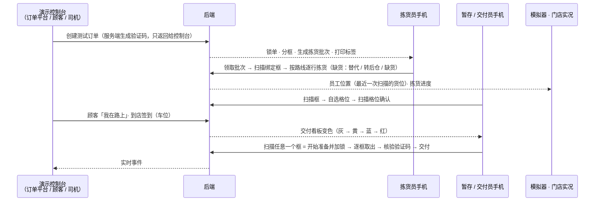
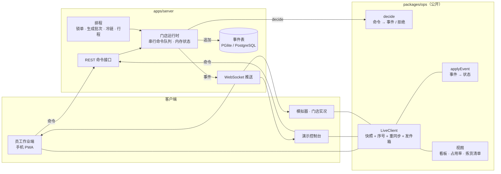

# 08 · 实时作业：员工作业端与实时后端

> 状态：v1.0（2026-10-20）· Phase 3 交付物
> 计划与决策：[决策记录 0008](decisions/0008-phase3-plan.md)
> 代码：`packages/ops`（作业核心，公开）· `packages/labels`（标签，公开）· `apps/server`（后端）· `apps/associate`（员工作业端）；2026-10-21 起按 [决策记录 0010](decisions/0010-roadmap-and-phase5-plan.md) 整个产品公开· 模拟器「门店实况」标签（公开）
> 2026-10-22 修订（Phase 7）：服务端的接口逻辑移到与传输方式无关的门店中枢 `apps/server/src/hub.ts`，`app.ts` 只是 Fastify 外壳；同一个中枢也在浏览器内演示模式里运行，见 [浏览器内演示、端到端测试与部署](13-demo-and-deployment.md)。下文的接口与同步协议不变。

---

## 1. 能做什么

一张测试订单可以在三类设备之间走完全链路：



| 部分 | 内容 |
|---|---|
| **拣货** | 可领取批次列表（温区、框数、货位数、件数、预计用时、截止时间、冷链时限）；领取后先给框贴标签并扫描绑定；拣货清单按路线顺序一行一行显示（通道 / 侧别货架段 / 层、商品、数量、放进哪个框）；扫描商品条码核对，多件同品扫一次后输入数量；找不到时按顾客偏好选择替代（推荐同温区、同类别、品名相近、价格接近的商品）、转后仓补取或标记缺货；冷链批次从第一件冷藏 / 冷冻商品开始倒计时，超时提醒；还没开始拣可以放弃批次 |
| **暂存** | 扫描框标签 → 系统建议格位（同订单已占用的格位优先，可以自选其他格位）→ 扫描格位标签确认；温区不符、格位已满会被拒绝；已暂存的框可以换格位；订单已取消时直接提示放进对应温区的回收专区；各温区占用率，超过阈值预警 |
| **交付** | 看板四种状态（未到达灰、即将到达黄、已到达蓝、等待过久红），颜色同时配文字；已到达的按到达先后排在前面；扫描任意一个框即开始准备并锁定给自己，其他人只能加入协助；准备界面按常温 → 冷藏 → 冷冻 → 热食列出每个框所在的格位，逐框扫描取出；顾客到场后核验验证码（错 3 次转人工核验）；含年龄限制商品时核验证件或移除这些商品；列出要告知顾客的缺货与替代 |
| **配送行程** | 配送订单暂存后自动组合成行程（2–4 单）：凑满一趟，或离必须出发不到 15 分钟时成行；同一时段还有订单在拣货、暂存时先等它们（剩 5 分钟以内不再等），避免先暂存好的一单单独成行。司机接单后得到一个验证码，一次核验交付整趟；记录每单在车内的位置（副驾、后排左、后排右、尾箱） |
| **标签** | 取货框标签：4" × 2" 单色，二维码只含不透明标签 ID，姓名超长时缩写，时段、框序号、温区条带（图标 + 名称 + 字母）、21+ / 化学品等标记；SVG 预览可直接打印，同时生成 ZPL；暂存格位标签（二维码 = 格位编码）；标签丢失时重打，版本号不变 |
| **演示控制台** | 创建测试订单（自取 / 配送、张数、商品行数、是否立即锁单并生成批次）；验证码只显示在这里；代替顾客上报「我在路上」、到店签到，代替司机接单、到店；手动生成批次、执行一次排程；实时事件流；打印暂存格位标签；清空门店 |
| **模拟器 · 门店实况** | 数据面板新增「门店实况」标签：连接后端后显示今日订单、等待中的顾客、平均等待、正在拣货的批次与进度、暂存占用、交付看板、实时事件；打开「场景只显示实时数据」后，场景里的员工显示在最近一次扫描的位置，暂存格位里的框来自实时状态，到店顾客显示在签到的取货车位上（颜色与看板一致，带等待计时） |

## 2. 架构



1. **规则只写一遍**：`decide` 和 `applyEvent` 是纯函数，放在公开的 `packages/ops`。服务端用 `decide` 校验命令、产生事件；员工端和模拟器用同一个 `applyEvent` 从事件流还原状态，看板、占用率、拣货清单等视图也是共用的纯函数。锁单分框、生成拣货批次、组合行程直接调用 Phase 1 的算法（`packages/algorithms`），与模拟器的规则一致。
2. **纯函数不碰时钟和随机数**：时间由服务端写入命令信封；验证码由服务端用 `crypto` 生成，命令里只带哈希（带盐的 SHA-256，盐保存在数据库），明文只返回给控制台（相当于顾客手机上的取货码）。事件里没有任何验证码明文。
3. **事件表 + 乐观并发**：`events(store_id, seq, …)` 主键为门店与序号。追加时按期望序号写入，主键冲突即说明另一个进程抢先写入，重新读取后重试。同一进程内按门店串行处理命令，避免无谓的冲突；「两人同时领取同一个批次」「两人同时开始准备同一个订单」都由服务端仲裁，只有一人成功。
4. **幂等**：每个命令带客户端生成的 ID，成功的结果和事件写在同一个事务里；离线重放或网络重试时重复提交同一个 ID，直接返回上次的结果。
5. **状态在内存中**：启动时重放全部事件得到当前状态；最近 5000 条事件保留在内存里，断线重连时直接补发。
6. **前端包很小**：员工端只引用 `@storewright/ops`（不含规划算法和配置校验），主包约 71 KB（gzip）；摄像头扫码用的 jsQR 只在浏览器不支持 BarcodeDetector 时才下载。

## 3. 同步协议

| 方向 | 消息 | 说明 |
|---|---|---|
| 客户端 → 服务端 | `GET /api/stores/:id/ws?after=序号&token=令牌` | 带上最后收到的序号 |
| 服务端 → 客户端 | `{t:'hello', seq, serverTime}` | 用服务端时间校准本机时钟 |
| 服务端 → 客户端 | `{t:'snapshot', state, statics}` | 第一次连接、差得太多、服务端被清空过 |
| 服务端 → 客户端 | `{t:'events', events}` | 补发错过的事件，之后推送新事件 |
| 客户端 → 服务端 | `{t:'resync', after}` | 发现序号不连续时请求补发 |
| 客户端 → 服务端 | `{t:'ping', id}` → `{t:'pong', id, serverTime}` | 往返延迟与时钟偏差 |

客户端规则（`LiveClient`）：

- 事件按序号应用，重复的丢弃，不连续时请求补发；
- 命令走 `POST /api/stores/:id/commands`，返回的事件立即应用，本机马上看到结果；推送里再收到同样的事件时丢弃；
- 离线或请求失败时命令进入本地发件箱（保存在本机存储），恢复连接后按顺序提交；被服务端拒绝的命令弹出提示（例如锁单冲突以服务端为准）；
- 令牌无效时不再重试，回到登录页。

## 4. 接口一览

| 接口 | 身份 | 说明 |
|---|---|---|
| `POST /api/stores/:id/session` | 任何人（演示） | `{associateId}` 员工；`{role:'console'}` 控制台；`{role:'viewer'}` 查看者。返回令牌 |
| `GET /api/stores/:id/snapshot` · `/events?after=` | 已登录 | 状态快照 / 事件 |
| `POST /api/stores/:id/commands` | 员工、控制台 | `{id, cmd}`；成功 200 返回事件，被拒绝 409 返回原因代码 |
| `GET /api/stores/:id/ws` | 已登录 | 实时推送 |
| `GET /api/stores/:id/substitutes?itemId=` | 已登录 | 替代品候选 |
| `GET /api/stores/:id/labels/tote/:toteId.svg` · `.zpl` | 已登录 | 取货框标签（含顾客姓名，需要令牌） |
| `GET /api/stores/:id/labels/walk/:walkId` | 已登录 | 一个批次的全部标签（打印页） |
| `GET /api/stores/:id/labels/slots` · `/slot/:code.svg` · `.zpl` | 任何人 | 暂存格位标签（不含个人信息） |
| `POST /api/stores/:id/demo/orders` · `/demo/trips/:id/accept` · `/demo/tick` · `/demo/reset` | 控制台 | 演示接口 |

员工可以提交的命令：领取 / 放弃批次、绑定标签、拣货、报告缺货、完成批次、重打标签、暂存、移到回收专区、开始准备、加入协助、扫描取出、核验验证码、人工核验、核验证件、记录车内位置、完成交付。控制台可以提交：取消订单、锁单、生成批次、上报到达时间、到店签到。创建订单和司机接单只能走演示接口（需要服务端生成验证码）；排程（Tick）只由服务端内部发出。

## 5. 运行

需要 Node.js 20 或更高版本，不需要安装数据库。

```bash
npm run build:associate
```

```bash
npm run server
```

- 打开 http://localhost:8787 ，选择身份登录（演示阶段不使用密码），或进入演示控制台；
- 手机和电脑在同一个 Wi-Fi 下时，手机打开 `http://电脑的局域网 IP:8787`（要用手机摄像头扫码时改用下面的 HTTPS 方式）；
- 模拟器里打开「门店实况」标签，后端地址填 `http://localhost:8787`（或局域网地址），点「连接」；
- 数据默认存在 `apps/server/.data`（嵌入式 PGlite，已在 `.gitignore` 中）；设置 `DATABASE_URL` 时改用 PostgreSQL；
- 环境变量：`PORT`（默认 8787）、`HOST`（默认 0.0.0.0）、`DEMO`（默认 1）、`CONSOLE_KEY`（非演示模式的控制台密钥）、`TICK_MS`（排程间隔，默认 15 秒）、`RELEASE_MS`（生成批次间隔，演示默认 1 分钟）、`HTTPS`（默认 0；设为 1 时用自签名证书提供 HTTPS，见下文）。

开发时可以用 `npm run associate` 启动员工端的开发服务器（http://localhost:5174 ，`/api` 自动转发到后端）。

> **摄像头扫码需要 HTTPS 或 localhost**。手机通过局域网 http 地址访问时浏览器不允许打开摄像头，这时用蓝牙 / USB 扫码枪（模拟键盘输入）或手动输入；扫码框默认不弹出软键盘，扫码枪照样能输入。要用手机摄像头扫码，用 HTTPS 方式启动。

**HTTPS 方式（本地演示用真机扫码）**：先照上面构建员工端，再用

```bash
HTTPS=1 npm run server
```

- 第一次启动时用系统的 `openssl`（macOS 自带）生成一张自签名证书，覆盖 localhost、127.0.0.1 和电脑当前的局域网 IP，保存在 `apps/server/.data/tls`（不上传；设置 `DATABASE_URL` 时放在系统临时目录）；之后启动沿用这张证书，局域网 IP 变了（换了 Wi-Fi）或证书快过期时自动重新生成；
- 启动时列出可以打开的地址：电脑上是 https://localhost:8787 ，手机是 `https://电脑的局域网 IP:8787`。注意是 **https**，这时 http 地址打不开；
- 证书不是公开机构签发的，每台手机（和电脑上的每个浏览器）第一次打开时会提示连接不是私密连接：iPhone Safari 点「显示详细信息」→「访问此网站」，Android Chrome 点「高级」→「继续前往」。接受一次之后，页面、实时连接（wss）和摄像头扫码都能用；证书重新生成后要再接受一次；
- 模拟器的「门店实况」这时填 `https://localhost:8787`，先在同一个浏览器里打开一次这个地址接受证书；`npm run associate` 的开发服务器只转发到 http 后端，所以 HTTPS 方式下由后端直接提供构建好的员工端；
- 只用于本地演示。正式部署使用云端的 HTTPS 域名证书，不需要手机接受证书。

## 6. 测试与测量

| 范围 | 内容 |
|---|---|
| 作业核心（Phase 3 时 12 个，之后随各阶段增加） | 一张自取订单的全链路（含错误验证码、加锁与协助、等待时间、重放一致）；一人只能领一个批次、批次只能一人领取、未绑定的框不能拣、没拣完不能结束；到锁单时间才锁单、冷链批次带时限、冷链从第一件冷货开始计时且只提醒一次；不允许替代的行不能替代、替代与缺货在交付时列出、转后仓生成待办；拣货前取消作废标签、拣货后取消在暂存时进回收专区；温区不符 / 格位已满 / 移动格位；看板排序与变红；顾客早到不能开始准备、取货码输错不锁定且错满次数后提供人工核验；年龄限制必须核验；配送行程一次核验交付整趟；扫码解析；逐条应用与整体重放一致、快照可 JSON 往返 |
| 标签（4） | 二维码可解码且只有不透明 ID；姓名缩写、时段、框序号、温区与标记；ZPL 结构与字段转义；暂存格位标签 |
| 后端集成（7） | 权限（员工不能下单、控制台不能拣货、无效令牌不能连接、命令字段校验）；三个客户端走完全链路且状态逐字节一致；两人同时领取同一批次只有一人成功；同一命令 ID 只生效一次；断线期间的事件重连后补齐、离线命令进入发件箱恢复后提交；重启后重放得到同样的状态；同步延迟 p95 < 200 ms |
| 员工端界面文字（2） | 每一段中文都有英文译文、占位符一致 |

Phase 3 结束时全部测试 119 个；现在 `npm run check` 共 218 个（2026-10-22，含后来各阶段的作业核心、后仓、AI、扩展模块、模拟器和中枢测试），端到端测试见 [13 浏览器内演示、端到端测试与部署](13-demo-and-deployment.md)。

**同步延迟**（`npm run bench -w @storewright/server`，三台设备、300 条命令、900 个样本，同一台电脑上的后端，嵌入式 PGlite 落盘）：p50 4.0 ms · p95 5.4 ms · p99 6.3 ms · 最大 9.0 ms。验收目标是 p95 < 200 ms。真机经过 Wi-Fi 时还要加上网络往返；在局域网内用另一台电脑运行 `BASE=http://电脑 IP:8787 npm run bench -w @storewright/server` 可以测到包含网络的数字。

浏览器中验证过的流程：拣货员领取冷藏批次 → 输入标签绑定框 → 扫描商品条码并输入数量 → 找不到时选择替代品 → 完成批次 → 暂存（输入格位编码、点建议格位）→ 控制台签到 → 交付员扫描框开始准备 → 错误验证码提示已错几次（不锁定，2026-10-22 起，见决策记录 0014） → 正确验证码 → 显示替代商品 → 完成交付；三单配送行程由控制台代替司机接单、到店，交付员一次核验、记录车内位置后交付；英文界面；模拟器连接后端后场景显示员工位置、暂存框和到店车辆。

## 6b. 取货码、司机取消与大型店容量（决策记录 0014）

- **取货码**：输错不限次数、不锁定；错到 `codeAttempts` 次后多一个「人工核验」入口，验证码仍可继续输入。
- **司机取消接单**：预计到店前 10 分钟以外可以取消；进入准备期后、以及到店不满 10 分钟时不能取消；到店等满 10 分钟后可以取消（记为等待过久）。司机没来时带班负责人或控制台可以改派。取消后：行程重新派单、交付准备结束、已取出的框放回暂存区（原格位或同温区空位）、顾客收到延后通知、可能超时的订单提醒带班负责人。规则在 `packages/ops/src/driverCancel.ts`。
- **容量**：推送只序列化一次、忙时合批；设备快照不带完成超过 1 小时的作业；静态数据带版本、设备已有时不再发送；登录页可以搜索几百人的名单。`npm run loadtest -w @storewright/server` 测一家 300 人的大型店：300 台设备 0.09 秒连上，每秒 50 条命令时提交到所有设备收到 p95 约 15 毫秒（数字和改前对比见决策记录 0014 §3.4）。

## 7. 简化与尚未完成（如实说明）

| 项 | 状态 |
|---|---|
| 两台真机 + 一台电脑的现场验收 | 同步延迟已在同一台电脑上用三个客户端测量；用真实手机在局域网中验收需要在现场进行 |
| 车边逐框扫描 | 工作流设计中交付时还要在车边逐框扫描一次；演示中把「从暂存区取出时扫描」作为唯一的扫描，核验验证码后直接交付 |
| 摄像头扫码在局域网 http 下不可用 | 浏览器限制；本地演示用 `HTTPS=1` 启动（自签名证书，手机接受一次即可），已在电脑上的 Chrome 中通过局域网 https 地址验证页面、wss 实时连接和摄像头画面，真机上的证书提示与扫码需要在现场验收；正式部署用云端 HTTPS 域名 |
| 登录与权限 | 演示阶段从名单选择身份，没有密码；正式的登录、角色权限和会话过期在商业化前接入 |
| 会话表 | 每次登录新增一条会话，没有过期清理 |
| Exception 执行、后仓库存、补货 | Phase 4 已完成，见 [后仓库存、Exception 与补货](09-backroom-replenishment.md) |
| GM-Oversized 先扫后打、MTO、Parcel Hub、退货 | Phase 6 已完成，见 [12 扩展业务模块](12-business-modules.md)；控制台可以给演示订单加熟食和大件 |
| 顾客端位置共享与路线 ETA | 由控制台模拟「我在路上」和到店 |
| 推车满 / 冷链超时提前结束批次、剩余商品重新分批 | 未实现；冷链超时只提醒 |
| 多进程部署时的推送 | 事件表能检测并发写入，但推送只在同一进程内广播；多实例需要 NATS JetStream 或托管实时广播（接口已预留） |
| 云端演示与自托管形态 | Phase 7 完成了浏览器内演示站点（纯静态，任意静态托管）、GitHub Pages 部署工作流（手动触发）和后端的 Dockerfile；正式的云端部署和 Docker Compose 编排还没做 |
| 离线同步 | 简单的本地发件箱；完整的离线同步（PowerSync）在真实设备阶段接入 |
| 真实设备扫码与蓝牙打印 | Capacitor + DataWedge / Link-OS 插件，真实设备阶段 |
