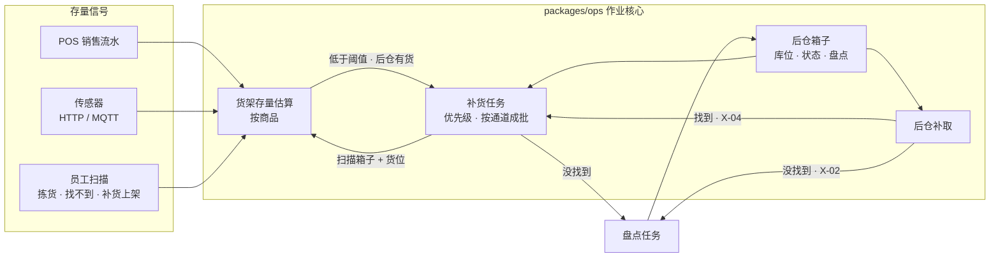

# 09 · 后仓库存、Exception 与补货

> 状态：v1.0（2026-10-20）· Phase 4 交付物
> 计划与决策：[决策记录 0009](decisions/0009-phase4-plan.md)
> 代码：`packages/algorithms`（补货规则、陈列表与库位，公开）· `packages/ops`（作业核心，公开）· `packages/labels`（箱标签与库位标签，公开）· `packages/sim-engine/src/shelfStock.ts`（模拟器的货架存量模块，公开）· `apps/server`（感知层与仿真）· `apps/associate`（库存页）

---

## 1. 验收：货架空 → Exception → 补货任务 → 货架恢复

| 在哪里 | 怎么看到 |
|---|---|
| **模拟器**（纯静态，不需要后端） | 「实时数据」里打开「货架存量模型」（默认开），叠加层选「货架存量」：货架段按填充率着色，空商品占两成以上为红色。播放时：拣货员遇到空货架 → 事件列表出现「货架空了：某商品（货位），已生成补货任务」→ 后仓补取员从后仓取箱、推车到货位上架 → 「补货完成：某商品上架 N 件」，货架段颜色恢复。点击通道可以看到这条通道空着的商品和补货任务，也可以手动「请求补货」 |
| **实时系统**（后端 + 员工端 + 模拟器的数字孪生） | 控制台「让货架变空」或顾客购物仿真卖空某个商品 → 系统估算为 0、生成补货任务；拣货员报告找不到时选择「转后仓补取」→ 授权员工扫描后仓箱子、送到订单的框所在格位 → 补货员领取任务，扫描箱子和货位、输入上架件数 → 估算恢复并被校准。模拟器的「数字孪生」开启「场景只显示实时数据」后，货架颜色来自后端的估算 |

## 2. 能做什么

| 部分 | 内容 |
|---|---|
| **收货**（I-01、I-02） | 供应商的到货通知（ASN）先到；卡车到店后扫描箱上原有条码，系统自动生成内部箱号 `C-YYMMDD-NNNNNN`，按托盘批量打印内部箱标签；有破损的箱子进入待检；关闭收货单时与 ASN 比较，列出短少 / 多出 / 损坏 |
| **箱标签** | 4" × 3"：二维码是 GS1 Digital Link（`/01/` GTIN-14 + `/21/` 内部箱号），UPC-A 条码、箱规、收货日期；仓库分区不打印。SVG 预览可直接打印，同时生成 ZPL。另有后仓库位标签、货架货位标签（二维码 = 编码） |
| **上架与库存状态**（I-03、I-05） | 扫描箱子 → 系统建议库位（大类分区内最空的库位）→ 扫描库位确认；温区不符、化学品与食品混放、库存状态不符、库位已满都会被拒绝。库存状态：可售 / 待检 / 退供应商 / 报废，可售和报废按常温、冷藏、冷冻分区；待检箱子可以处置为可售、退供应商或报废 |
| **盘点**（I-04） | ABC 分类：A 类每周、B 类每月、C 类每季度，排程自动生成到期的盘点任务；后仓补取或补货没找到、员工说「库位已空」但记录里还有箱子时立即生成。盲盘（不显示系统数量）；少了的箱子记为丢失，多了的补建箱子，并清除「可疑」标记 |
| **后仓补取 / Exception**（X-01～X-04） | 拣货员报告找不到时，只有库存记录显示后仓有货才能「转后仓补取」（P-08）；只有永久授权的员工可以领取；扫描后仓箱子 = 确认找到，点选库位「还有 / 已空」，送到订单的框所在暂存格位并扫描确认，订单行从缺货变为补回；后仓也找不到时记录标为可疑并生成盘点任务；订单取消时补取任务作废 |
| **货架存量估算**（R-01、R-02、P-06） | 每个商品在主货位的估算 = 最后一次确认值 − 之后的销售与拣货。确认来源：员工扫描（补货上架、拣货、报告找不到）> 传感器 > 销售推算；置信度随未确认的变动降低；销售速度按 1 小时时间常数平滑。拣货员报告找不到 = 确认为空 |
| **补货任务**（R-05、X-04） | 估算低于容量的 25%、或扣除在线订单占用后预计 2 小时内卖完、且后仓有可售库存时生成；货架空了、后仓补取找到后、手动请求时也会生成。优先级 = 扣除在线订单占用后的预计售罄时间（单价高的略提前）。同一通道的任务合并成一批（最多 8 个任务，且一辆推车装得下：按每箱的重量、体积累加，默认约 150 千克、600 升，决策记录 0026），补货员一次领取一批、按取箱清单一趟取齐；完成时必须扫描对的箱子和对的货位，上架件数作为新的确认值，箱里剩下的放回原库位 |
| **感知层**（R-01、R-03） | 传感器读数使用货架传感原型指南的 JSON（`storewright.shelf-sensing/0.1`），HTTP 入口 `POST /api/stores/:id/sensors`，设置 `MQTT_URL` 时同时订阅 `storewright/v1/{store}/sense/+/+/+/state`，两种入口进入同一个转换函数。只有件数变化、置信度明显变化、异常或超过 10 分钟心跳时才写成事件；超出容量、置信度过低、设备标记遮挡 / 故障的读数只标记为异常。只有约 2% 的高周转、高价值货位配传感器（推进器陈列用测距，散装重货用称重） |
| **POS 接入** | `POST /api/stores/:id/pos/sales`，一批销售行（商品 + 件数） |
| **门店客流与传感器仿真**（演示） | 按商品热度和时段生成店内销售流水，维护一份「真实存量」（销售、线上拣货扣减，补货上架增加，另有少量系统不知道的损耗）；配传感器的货位按真实存量加噪声上报。控制台显示已售、缺货少卖、损耗、传感器读数，以及真实存量与系统估算差距最大的商品 |
| **员工端「库存」页** | 补货（批次 → 后仓取箱 → 扫描货位 → 上架件数；后仓找不到；放回队列）、补取（领取 → 扫描箱子 → 库位还有 / 已空 → 送到暂存格位）、收货（ASN → 卡车到店 → 扫描条码 → 箱数与破损 → 打印箱标签 → 关闭收货单与差异）、上架（建议库位、待检处置）、盘点（盲盘）。新增后仓收货、补货两个演示身份 |
| **控制台** | 发送到货通知、开始 / 停止顾客购物仿真（30× / 120× / 600×）、**自动补货**（虚拟补货员按优先级处理补货任务，每个约 10 分钟门店时间，从后仓件数最少的可售箱子补；货架核对仍由员工去做，默认关闭）、让某个商品的货架变空（可选「系统不知道」）、真实与估算对照、打印后仓库位标签 |
| **模拟器** | 货架存量模型（默认开，可关闭恢复 Phase 1 的概率模型）、「货架存量」叠加层、货架存量曲线（空货架商品数、累计补货）、事件提醒、通道检视卡里的空商品与「请求补货」；「数字孪生」标签（原「门店实况」）里有货架与补货指标，叠加层可以显示后端的实时估算 |

## 3. 架构



1. **规则共用**：补货触发、优先级、按通道成批、ABC 分类、上架检查与库位建议、陈列表与库位的生成都在 `packages/algorithms`，实时系统和模拟器使用同一套。
2. **事件溯源**：收货、上架、状态变更、盘点、补取、补货、销售、传感器读数都是事件；存量估算由 `applyEvent` 计算（需要门店静态数据里的陈列表）。
3. **存量按商品记录**：一个货位通常并排陈列几个商品，估算、补货任务、去重都按商品；货位只用于找位置和确认摆放。
4. **静态数据**：后仓库位（常温托盘货架按大类分区，冷库、冷冻库、待检 / 退供应商 / 报废区）、陈列表（每个商品的主货位、容量、陈列方式、传感器、ABC 类、箱规、预期销售速度）随快照发给客户端。陈列表让快照变大（中型店约 1.2 MB），WebSocket 开启了压缩。
5. **期初库存**：建店时载入一次（约 1200 箱），清空门店后重新载入。

### 3.1 模拟器的货架存量模块

- `ShelfStock` 为每个商品记录「店内销售 / 线上拣货 / 补货」事件，查询某一时刻的存量时按时间顺序重放（空了不会变成负数，买不到的记为少卖）。店内销售是非齐次泊松过程，按营业时间内的客流曲线（中午、傍晚两个高峰）生成。
- `simulateDay` 只在传入货架存量对象时改用它：拣货时按存量判断找不到、后仓按真实箱数判断能否补取，后仓补取员在空闲时执行补货任务（去后仓取箱 → 推车到货位上架 → 回到待命位置），营业时间内每 15 分钟检查一次低库存。**不传时与 Phase 1 完全相同**：同一台电脑上用提交时的引擎和当前引擎各跑一遍中型店对比实验，输出逐字节一致（只有报告文件路径不同）。
- 模拟器开启时：货架容量按「店内销售 + 线上订单」的总需求配置（满架约 1.5 天），开门时平均填充率 85%（夜班补货关闭时 70%），约 4% 的商品开门就偏空；后仓补取岗位在营业时间内每小时多 1 名白天补货员。

## 4. 接口（新增）

| 接口 | 身份 | 说明 |
|---|---|---|
| `POST /api/stores/:id/sensors` | 设备（`x-sensor-key`，演示模式可省略） | 一条或一批原型格式的读数，返回接受与拒绝的条数 |
| `POST /api/stores/:id/pos/sales` | 设备 | `{lines: [{itemId, qty}]}` |
| `GET /api/stores/:id/labels/case/:caseId.svg` · `.zpl` | — | 后仓箱标签 |
| `GET /api/stores/:id/labels/receipt/:receiptId` | — | 一张收货单的全部箱标签（打印页） |
| `GET /api/stores/:id/labels/bins` · `/location/:code.svg` · `.zpl` | — | 后仓库位标签、货架货位标签 |
| `GET` · `POST /api/stores/:id/demo/sim` | 控制台 | 顾客购物仿真的状态 / 开始停止 / 自动补货开关（`action: 'autoRestock', on`） |
| `POST /api/stores/:id/demo/shelf-empty` | 控制台 | `{itemId, silent}` 让货架变空 |
| `POST /api/stores/:id/demo/asn` | 控制台 | 为后仓没货、卖得快的商品发送到货通知 |

员工新增可以提交的命令：领取 / 找到 / 没找到 / 送达后仓补取，卡车到店、收货、关闭收货单、上架、改变库存状态，创建 / 领取 / 完成盘点，请求 / 领取 / 放回 / 完成 / 取消补货。控制台新增：发送 ASN、卡车到店、录入销售、请求补货、创建盘点。期初库存、传感器读数只由服务端内部提交。

## 5. 演示步骤

```bash
npm run build:associate
```

```bash
npm run server
```

1. 打开 http://localhost:8787 进入演示控制台：「开始顾客购物仿真」（120×），选一个商品「让货架变空」；
2. 另一个标签页以「Robin（补货）」登录：「库存 → 补货」里出现这条任务，领取 → 扫描后仓箱子（或点箱子）→ 扫描货位（或手动确认）→ 完成上架；
3. 以「Avery（拣货）」拣货时遇到找不到的商品，选「后仓有 N 箱：转后仓补取」；以「Drew（后仓收货，有永久授权）」在「库存 → 补取」里完成补取并送到暂存格位；
4. 控制台「发送到货通知」，Drew 在「库存 → 收货」里收货、打印箱标签，在「上架」里放进建议库位；
5. 模拟器的「数字孪生」连接后端，打开「场景只显示实时数据」，叠加层选「货架存量」。

## 6. 测试与校准

| 范围 | 内容 |
|---|---|
| 作业核心 · 库存（9） | 陈列表与库位、期初库存遵守温区与隔离规则；ASN → 到店 → 内部箱号 → 差异 → 上架规则 → 待检处置；Digital Link 与库位、货位扫码；销售推算、传感器覆盖、重复读数不写事件、异常只标记；补货的触发、排序、成批、领取与完成、找不到时可疑 + 盘点；优先级与 ABC；**实时闭环**（货架空 → Exception → 补货任务 → 恢复，事件重放一致）；幽灵库存 → 盘点修正；排程生成低库存任务与到期盘点 |
| 标签（1 个新增） | Digital Link 二维码可解码、UPC-A 模块、ZPL 含二维码与条码 |
| 后端集成（6） | 建店载入期初库存、快照含陈列表；传感器 HTTP 入口（格式校验、遮挡按低置信度）；**MQTT 入口**（进程内 broker）；顾客购物仿真；实时闭环（让货架变空 → 补货任务 → 补货员扫描上架 → 估算恢复）；ASN → 收货 → 箱标签 → 上架 → 差异 |
| 模拟器引擎（3 个新增） | 存量重放不为负、补货不超过容量；**模拟器闭环**（同一种子可复现、存在货架空后补货恢复的商品、补货员轨迹，不传货架模块时结果不变）；手动请求补货 |

全部测试：`npm run check`（138 个）。

**模拟器校准**（中型店，默认设置，货架存量模型开）：线上拣货找不到 2.95%（Phase 1 的概率模型约 3%）、后仓补取 20 余次、补货约 300 次、货架空到补回平均约 25 分钟、店内少卖约 3%；关门时约 8% 的商品空着（由夜班补满）。

## 6b. 区域、卸货门与线上取货车位（Phase 8，决策记录 0013）

- 门店配置可以明确给出**区域**（`areas`：类型、楼层、矩形、温区、容量、预警线）、**卸货门**（`docks`：位置、高台或地面、是否冷藏）和**线上取货车位**（`parking.pickupBays`：编号、位置、朝向）；不给时按门店尺寸生成默认区域（`storeAreas()`），与原来的布局一致，只是超市的后仓左端分出了冷藏库和冷冻库、建材店分出了大件区，收货区细分成卸货区、收货暂放、待检、退供应商、退货处理、贵重商品笼、空托盘、纸箱回收。
- 托盘货架只排在「托盘货架区」里（可以有多块）；冷藏库、冷冻库、大件区、待检、退供应商、报废的库位都从区域生成并带上区域编号；暂存格位带所在暂存区的编号。熟食保温格位、包裹格位、大件暂存区在明确给出区域时也从区域生成。
- **区域管理**：作业核心的 `areaUsage()` 按区域统计占用（货架区按占用的托盘位，冷库和待检区按箱数，收货暂放按还没上架的箱数，暂存区按框数，包裹区按包裹数……），超过预警线的区域标红；控制台有「区域管理」卡片，员工手机的库存页有「区域」页。
- 配置了明确的取货车位时，顾客到店签到的车位必须是其中的编号（拒绝代码 `BAY_NOT_FOUND`）。
- 校验：区域重叠、压在货架上、超出建筑、太小、缺少托盘货架区或卸货区、暂存货架指向不存在的区域、卸货门不在后墙或相距不到 4 米、车位编号重复。

## 7. 简化与尚未完成（如实说明）

| 项 | 状态 |
|---|---|
| 箱子拆零 | 补货时整箱从后仓取出，剩下的件数直接算回原库位，不单独跟踪「拆开的箱子」去向 |
| 酒类上锁、高价值入笼 | 隔离规则只实现了化学品与食品分开；酒类和高价值商品的专区未单独建模 |
| 保质期、批次、先进先出强制 | 取箱建议按收货时间排序，但不强制，也不管理保质期 |
| 盘点按箱计数 | 只数箱数，不数拆零件数；货架上的盘点（审核传感器异常）未实现 |
| 传感器设备管理 | 只接收 state 读数；设备上下线、配置下发、命令回执、价签闪灯指引（原型指南里的其他主题）未实现 |
| 夜班补货与白天存量 | 模拟器里夜班补货开关只影响开门时的平均填充率；夜班补货的逐箱结果还没有接到每个商品的开门存量 |
| 模拟器的后仓库存 | 按商品的件数近似，不对应 inbound 模块里的托盘与库位；实时系统中的后仓是逐箱记录的 |
| 陈列重排建议（R-04） | 未实现 |
| 快照体积 | 中型店快照约 1.2 MB（陈列表），WebSocket 压缩后传输；手机首次同步稍慢 |
