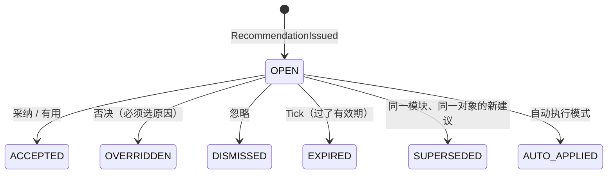
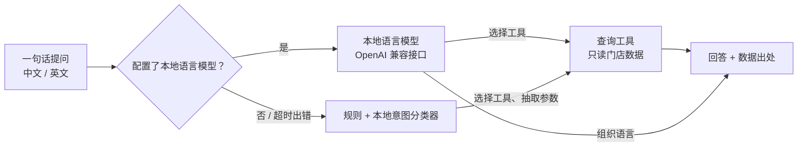

# 10 · 门店 AI：本地优先、每店定制

> 状态：v1.0（2026-10-22）· Phase 5 交付物；效益报告与模型卡片见 [11 · AI 效益报告](11-ai-results.md)
> 计划与决策：[决策记录 0010](decisions/0010-roadmap-and-phase5-plan.md)
> 下一步（提案）：[15 · 门店 AI 路线图](15-store-ai-roadmap.md)
> 代码：`packages/ai`（AI 框架与模型：`demand.ts` 订单量、`eta.ts` 到店时间、`availability.ts` 可售概率、`countRisk.ts` 按风险盘点、`substitution.ts` 替代推荐、`staffing.ts` 排班与实时调度、`glm.ts` 回归）· `packages/synth/src/{history,arrivals,shelfTruth,substitution}.ts`（合成需求历史、到店记录、货架真实存量、替代记录）· `packages/ops/src/{staff,notes}.ts`（岗位调动与固定名单、门店经验库）· `packages/sim-engine`（AI 开关）· `apps/server/src/assistant/`（本地助手：工具、规则与意图分类器、本地语言模型接口、知识检索、评测集）· `packages/ops/src/ai.ts`（建议与模式的命令、事件、状态）· `apps/server/src/ai.ts`（门店 AI 服务）· `apps/associate/src/screens/AiScreen.tsx`（员工端「AI」页）

---

## 1. 定位

本项目的 AI 关注**实体门店的日常决策**：几点会来多少单、货架上还有没有、缺货时换什么、人该放在哪里。设计上有三个取向：

- **本地运行、低成本**：模型在门店自己的电脑上训练和推理，数据不出店，断网也能用，没有按次计费；云端大模型只是可选项，默认关闭。
- **每家店各自定制**：每家店有自己的模型仓库，用本店的数据训练；新店先用本店配置生成的合成历史「仿真预训练」，第一天就有可用的模型。
- **可解释、可追溯**：每条建议都附带理由、置信度、区间和其他模型的看法，员工的每一次采纳或否决都写进事件流。

## 2. 分层

| 层 | 内容 | 状态 |
|---|---|---|
| 数据层 | 事件流 + 门店知识库 | 事件流；操作规范（中英文）+ 门店经验库（5d） |
| 特征层 | 从数据按小时 / 天汇总 | 按小时的序列、「平时」对照、事先可以知道的日特征（节假日、促销、天气预报）、真实营业日汇总 |
| 数值模型组 | 预测、概率、调度 | 5b：订单量、到店时间、可售概率、按风险盘点；5c：替代推荐、排班建议、实时调度 |
| 语言层 | 本地小语言模型 + 查询工具 | 5d：9 个查询工具；本地语言模型（OpenAI 兼容接口）或模板模式（规则 + 本地意图分类器） |
| 模型管理 | 版本、回测、上线门槛、回滚 | ✅ |
| 建议记录 | 建议、处理、统计、运行模式 | ✅ |

## 3. 建议记录

### 3.1 格式

一条建议（`Recommendation`）包含：

| 字段 | 含义 |
|---|---|
| `module` | 所属模块：订单量预测、到店时间、可售概率、替代推荐、人员调配、补货优先级、按风险盘点 |
| `target` | 针对的对象（门店、订单、商品、员工……） |
| `action` | 动作代码与参数；`INFO` 表示只是信息 |
| `prediction` | 预测值、80% 区间、单位、覆盖的时间段、对照值（「平时」的量） |
| `confidence` | 0–1；由区间相对宽度换算：1 / (1 + 相对半宽) |
| `reasons` | 理由：因素代码、数值、作用（倍数或增量）、相对重要性；界面按语言显示文字 |
| `alternatives` | 备选方案（预测类建议里是其他模型的预测） |
| `model` | 模型族、版本、算法 |
| `mode` | 发出时该模块的运行模式 |

理由只保存代码和数值，不保存文字：同一条建议在中文和英文界面里各自显示，以后接入语言模型时也可以据此生成更自然的说明。

### 3.2 事件与命令

- 建议由服务端的 AI 服务以 `ai` 身份发出，员工端和控制台不能伪造建议。
- 只有带班负责人和控制台可以处理建议、设置运行模式；锁定的模块只有控制台（门店管理员）可以修改。
- 否决原因：数据不对、我知道系统不知道的情况、人手不够、顾客要求、不同意、其他，可以附一句说明。这些原因会作为后续训练和评估的数据。
- 每个模块累计统计发出条数和各种处理结果（不随旧建议的清理而减少），采纳率 = (采纳 + 自动执行) / (采纳 + 自动执行 + 否决 + 忽略)。
- 状态里最多保留 300 条建议，超出时先清理最早的已处理建议；完整记录始终在事件流里。
- 可执行的动作在对应模块实现时加入，未知动作会被拒绝，避免「显示已自动执行、实际什么都没做」。已实现的动作：

| 动作 | 模块 | 执行后 |
|---|---|---|
| `INFO` | 订单量预测 | 只是信息，「有用 / 不准」作为反馈 |
| `USE_AI_ETA` | 到店时间 | 订单记下 AI 修正的预计到达，交付看板按它提醒「即将到达」，同时显示顾客自己报的时间 |
| `CHECK_SHELF` | 可售概率 | 生成「核对货架」任务：员工扫描货位、数出实际件数，作为新的确认值；少了自动补货 |
| `CREATE_COUNT` | 按风险盘点 | 生成原因为「AI 按风险建议」的周期盘点任务 |
| `MOVE_ASSOCIATE` | 人员调配 | 把员工临时调到另一个作业岗位（被锁定、手上有任务时视为过时；建议写了「约 N 小时」的，采纳后到时自动调回，决策记录 0025） |

替代推荐不单独发出建议记录：拣货员打开替代候选时看到 AI 排好的顺序，选中时把「选的是第几名、哪个模型版本」写进 `SubstitutionPicked` 事件，选第一名记为采纳、选其他候选记为否决，计入同样的采纳率统计。

- 执行时对象已经结束（顾客已到达、已有核对任务、库位已有盘点）时动作「过时」：发出时直接拒绝，采纳时提示可以忽略。

### 3.3 三种运行模式

| 模式 | 含义 | 默认 |
|---|---|---|
| 只显示 | AI 给出信息，不执行任何动作；「有用」只记下采纳，不执行动作，也不发提醒（紧急的除外） | 订单量预测、收银通道 |
| 需确认 | 员工采纳后才执行 | 调人、到货、产能、未取订单、临期等其他模块 |
| 自动执行 | AI 直接执行并记录，员工可以事后查看 | 到店时间修正（只改变看板提醒时间）、可售概率和按风险盘点（只给补货员、后仓派核对和盘点任务，决策记录 0026）、拣货、熟食 |

涉及人、钱、顾客的动作——调人、补班和提前下班的邀请、通知顾客晚到、降价、捐赠、停止接单——即使模块设成自动执行，也按「需确认」发（作业核心的 `CONFIRM_ALWAYS`，Phase 17 收尾时补上，见决策记录 0024 第 14 节），采纳时还要再点「确认执行」（决策记录 0026）。唯一的例外：补班邀请被拒后问下一个人——带班负责人第一次采纳时勾了「被拒后自动问下一个人」，后面的邀请直接发出。

建议页按紧急程度排（标了紧急的、要执行的、设备和运营预警在前）；动作已经做不了的建议（人已经调过去了、订单已经交付……）由门店的定时节拍自动记为过期（决策记录 0026）。

## 4. 仿真就是评测场

真实门店的数据里，没有人知道「如果没有那场暴雨会来多少单」。仿真可以：每一天的真实期望值和每个因素的真实作用都记录在案，所以模型的误差可以精确拆解。

合成需求历史（`generateDemandHistory`）按天生成线上订单的数量、按取货时段开始小时的分布、自取 / 配送、按类别的行数：

| 因素 | 模型能否看到 | 作用（假设参数） |
|---|---|---|
| 星期 | 能 | 星期六约为星期二的 1.34 倍 |
| 节假日 | 能（公开的节假日规则） | 节日当天下降（感恩节约 0.35 倍、圣诞节约 0.25 倍），前一天抢购（感恩节前一天约 1.7 倍），节后一天约 0.92 倍 |
| 每周促销 | 只知道是哪两个类别 | 促销类别的行数放大 1.25–1.7 倍（幅度看不到），订单量小幅增加 |
| 天气 | 只能看到带误差的预报 | 大雨、酷暑、严寒时线上订单增加；风暴当天减少；**明天有风暴预警（包括误报）时今天囤货 1.25 倍** |
| 增长趋势 | 不能 | 每年 +8% |
| 本地活动 | 不能 | 每天 4% 的概率发生，需求上升 12–35% 或下降 10–25% |
| 结构性变化 | 不能 | 门店服务使用的历史中，第 80% 天起需求降到 0.9 倍（例如附近新开了竞争门店） |
| 日间波动 | 不能 | 对数正态，变异系数 4% |
| 每小时的订单数 | — | 泊松分布 |

- 每类因素使用独立的随机数流，关闭某一类因素不会改变其他因素的抽样结果，便于做因素消融。
- 合成历史只用于 AI 的训练和评测，Phase 1 的仿真不使用，对比实验结果不变。

## 5. 回测、指标与上线门槛

- **滚动起点回测**：用第 0…k 天训练、预测之后 7 天，起点每次后移 7 天；每一折只用起点之前的数据，相当于「每天晚上用当时已有的数据重训一次」。全部折的预测点放在一起计算指标。
- **指标**：数量预测用 WAPE（Σ|误差| / Σ实际，对零值稳健）、MAE、RMSE、偏差、80% 区间覆盖率和 10% / 90% 分位损失；概率预测用 Brier 分数、对数损失、校准分箱和期望校准误差（5b 使用）。
- **区间**：由训练期内「只用当时已知数据」的滚动预测残差估计，残差按 √预测值 标准化（计数数据的方差大致与均值成正比）。
- **模型仓库**：每个版本记录算法、训练数据（来源、天数、日期、种子）、指标、参数（普通 JSON，可以原样恢复）和状态（候选 / 当前 / 已退役 / 未通过）。
- **上线门槛**：候选的 WAPE 必须比当前版本改善至少 1%，偏差的绝对值和覆盖率偏离 80% 的程度不能明显变差。训练数据变化后，当前版本在**同一份数据**上重新回测再比较，避免拿不同数据上的指标比高低。
- **回滚**：当前版本退役（标记为已回滚，之后不会再被自动恢复），最近一个正常退役的版本恢复为当前版本。

## 6. 基线模型与结果

三个基线是 5b 正式模型必须胜过的对照：

| 算法 | 做法 | 理由的形式 |
|---|---|---|
| 同时段上周值 | 预测 = 上周同一天同一小时的实际值 | 「上周同一时段 N 单」 |
| 近 4 周同时段平均 | 最近 4 周同一星期、同一小时的平均 | 「近几周同一时段平均 N 单」 |
| 季节性指数平滑 | 日总量用带阻尼趋势、按星期季节系数的指数平滑（参数网格搜索），再乘以各星期最近 8 次的小时占比 | 星期系数、这段时间占全天的比例、趋势、基础水平 |

中型店模板、8 个种子、112 天合成历史（含隐藏因素与第 90 天的结构性变化），最后 4 周滚动回测（证据等级 B，仿真实验）：

| 预测 | 按小时 WAPE | 80% 区间覆盖率 | 特殊日子的 WAPE ¹ |
|---|---|---|---|
| 同时段上周值 | 26.2% | 83.0% | 27.7% |
| 近 4 周同时段平均 | 21.6% | 81.2% | 24.5% |
| 季节性指数平滑 | **20.3%** | 77.1% | 23.8% |
| 已知真实期望值（理论下限）² | 17.6% | — | — |

¹ 节假日、节假日前一天、风暴预警前一天、本地活动发生的日子。
² 直接用合成历史记录的真实期望值作为预测，剩下的只有每小时订单数的泊松噪声。按天汇总时这个下限是 4.6%。

解读：

- 按小时的订单量本身噪声很大，任何模型都不可能低于约 17.6%；季节性指数平滑已经吃掉了「上周值」与理论下限之间约三分之二的差距（26.2% → 20.3%，下限 17.6%）。
- 剩下的空间主要在特殊日子：基线不知道节假日、促销和风暴预警，误差明显更高。5b 的订单量模型会用这些「事先可以知道」的特征，结果按特殊日子单独报告。
- 门店服务启动时做的就是这件事：回测三个基线，季节性指数平滑胜出，成为当前版本（在门店服务的一次运行中：v3 季节性指数平滑 WAPE 20%，v2 近 4 周平均 21%，v1 上周值 27%）。

## 6b. Phase 5b 正式模型与结果

全部为仿真实验（证据等级 B）。每个模型都和更简单的版本放在一起比较，最好的版本过上线门槛才上线。

### 6b.1 订单量：局部水平 × 已知因素

- 日订单量 ~ 泊松( L(前一天) × exp(星期 + 节假日 + 具体节日 + 节前 + 节后 + 促销 + 风暴预警 + 大雨 / 高温 / 严寒预报) )；每小时 = 日订单量 × 该星期最近 8 个普通日子的小时占比。
- L 是去掉已知因素后的需求水平，用指数平滑逐天更新（平滑系数网格搜索），趋势和结构性变化这类「看不到原因」的变化通过 L 反映；已知因素用 L2 正则的泊松回归（IRLS）估计，具体节日在通用节假日效应之外各有一项，只出现过一两次的节日被拉向通用效应。
- 每个因素的倍数就是理由，例如「感恩节前一天 +64%」「明天有风暴预警，顾客提前囤货 +24%」「近期需求水平比训练期平均 −9%」。
- 预测同时给出按温区的商品行数（每单平均行数 × 最近 4 周的温区占比）。
- 门店服务用两年合成历史训练、最后 12 周回测；促销日历和天气预报属于事先可以知道的信息，由同一个种子的合成计划延伸到训练日之后提供。

中型店、4 个种子、两年历史、最后一年按周滚动回测：

| 预测 | 按小时 WAPE | 80% 区间覆盖率 | 事先知道的特殊日子 ¹ |
|---|---|---|---|
| 近 4 周同时段平均 | 20.5% | 81.7% | 31.7% |
| 季节性指数平滑 | 19.3% | 81.0% | 32.8% |
| **已知因素回归** | **18.5%** | 79.3% | **19.1%** |
| 理论下限（已知真实期望值） | 16.7% | — | — |

¹ 节假日、节前一天、明天有风暴预警的日子。基线不知道这些因素，误差比平时高出一半以上；已知因素回归在这些日子的误差和平时差不多。

### 6b.2 到店时间修正：分层收缩

- 实际用时 = β0 + β1·导航用时 + β2·高峰×导航用时 + β3·预报大雨×导航用时 + β4·周末 + 顾客习惯。
- 顾客习惯是经验贝叶斯收缩：残差之和 / (次数 + k)，k = 噪声方差 / 习惯方差（矩估计）。第一次来的顾客习惯为 0，来得越多越相信他自己的记录。
- 区间用按时间顺序滚动预测（习惯只用之前的记录）的残差 10% / 90% 分位数。
- 合成到店记录：导航只反映约 60% 的高峰拥堵；大雨让路上更慢；每位顾客有自己的习惯（总是晚到或早到）；约 12% 的顾客顺路办事晚到 5–15 分钟（模型看不到）。
- 门店服务里，顾客点「我在路上」时立即修正并（默认）自动应用到交付看板；演示数据没有顾客编号，用姓名代替。

4 个种子、120 天、按时间先后前 70% 训练：

| 版本 | 平均绝对误差 | 偏差 | 80% 区间覆盖率 |
|---|---|---|---|
| 只信导航 | 5.5 分钟 | −2.6 分钟 | 80.6% |
| 导航 + 高峰与天气 | 5.1 分钟 | +0.1 分钟 | 79.9% |
| **再加顾客习惯** | **3.8 分钟（−31%）** | +0.1 分钟 | 82.2% |

### 6b.3 可售概率与幽灵库存

- 关键证据是「沉默」：一件平时每小时卖 1.5 件的商品 8 小时没有卖出，如果货真在架上，这件事的概率只有 e^(−12)。
- 朴素贝叶斯基线：P(幽灵) = π / (π + (1 − π)·e^(−λ))；正式模型是逻辑回归，特征为 λ（本应卖出件数，封顶 20）、估算件数（封顶 12）、是否只剩 1–2 件、距上次员工确认的时间、销量（封顶 6）。封顶避免超出训练范围时外推：件数多只能说明「不太可能被零星卖空」，不能抵消整批找不到时的沉默证据。
- 合成货架真实存量：顾客购买、收银扣减、补货、夜班补满、线上拣货员找货；系统看不到整批找不到（放错位置、整批丢失）和零星损耗，补货员到货架或拣货员报告找不到时才被发现。

3 个种子、200 个商品、60 天、按天切分前 70% 训练（测试集约 5.4 万个商品-小时）：

| 版本 | Brier 分数 | AUC | 校准误差 | 提醒的精确率 / 召回率 ² |
|---|---|---|---|---|
| 系统估算（大于 0 就当有货） | 0.015–0.016 | 0.50 | 1.5% | — |
| 只看沉默（朴素贝叶斯） | 0.012–0.014 | 0.87–0.88 | 1.5%–3.1% | 62%–68% / 35%–45% |
| **逻辑回归** | **0.0095–0.0115** | **0.93–0.95** | **0.1%–0.4%** | **83%–91% / 29%–39%** |

² P(幽灵) ≥ 0.5 时提醒。召回率不高是有意的：其余幽灵库存会在补货或拣货找不到时被发现，提醒只负责「更早」发现最有把握的那部分。

**线上使用时的两处校正**（演示中发现的问题）：

1. **本应卖出件数**按「这件商品卖得正常时占全店销量的比例 × 它上次卖出之后全店卖出的件数」估计，比例只用它最后一次卖出之前的流水，并向陈列表的计划比例收缩（相当于先验里看过 400 件全店销售）。这样与时段高峰、客流快慢无关（演示中客流仿真是加速的），也不会因为几件偶然集中的销售把比例抬高。
2. 销量本身是估计的：把 λ 按负二项分布折算成等价的泊松证据 λ′ = k·ln(1 + λ/k)（k = 4），提醒阈值为「找得到的概率」< 35%。在 600 倍速的客流仿真里静默清空一件畅销商品：校正前同一时间段有 2–4 件正常在售的商品被误报；校正后没有误报，目标商品在约 20 个门店小时后被发现。
3. 收银流水中断超过 30 分钟时不做判断，沉默只从这段连续流水开始算。
4. **（2026-10-22 全流程走查发现并修正）** 开始接收流水之后一件都还没卖出、也没有货架记录的商品，以前会被跳过（货架记录要等第一次卖出、补货或传感器读数才建立），或者按时钟估计本应卖出件数（加速仿真里时钟几乎不走）。现在没有记录的商品按期初估算（满货架）处理；沉默一律按全店销量计，从上次卖出、员工上次确认（货架核对）或开始接收流水三者中最晚的一个算起；理由里的沉默时长取时钟和「全店销量折算成小时」中较大的。在 600 倍速的客流仿真里，开门后还没卖出就被放错地方的畅销面包约 4 个门店小时后被发现，排在提醒第一位。

### 6b.4 按风险盘点

- 逻辑回归估计后仓记录「现在不准」的概率，特征为距上次盘点天数、之后的箱子进出次数、收货差异、后仓补取或补货没找到（可疑）、损坏箱数、周转。训练标签来自过去的盘点结果，正好是门店上线后自然积累的数据。
- 策略比较：同一套随机数（每条记录每天的进出与差错按键抽取）下，「ABC 周期 + 可疑优先」与「按模型风险排序」，每天盘点数量相同。模型用前一半时间按 ABC 盘点积累的结果训练。

3 个种子、400 条记录、每天 12 次盘点、后 120 天比较：

| 种子 | 平均不准的记录数（ABC → 按风险） | 发现错误的平均天数 |
|---|---|---|
| 1 | 45.5 → 42.3（−7%） | 5.7 → 5.4 |
| 2 | 48.4 → 35.9（−26%） | 6.0 → 4.5 |
| 3 | 44.9 → 36.0（−20%） | 5.2 → 4.1 |

可疑记录在两种策略里都优先盘点（现有系统在补取没找到时已经自动生成盘点），改进来自其余记录的排序。

## 6c. Phase 5c 决策模型

### 6c.1 替代推荐：学习排序

- 硬约束（候选生成时保证）：同类别、同温区、年龄限制一致、价格在门店规则的范围内。
- 打分是顾客接受的概率，逻辑回归的特征是「原商品 → 候选」的关系：同品名、同品牌、口味 / 规格一致或不同、有机降级、涨价、降价、受欢迎程度。理由直接显示在拣货界面上，例如「预计顾客接受 77% · 同一种商品 · 便宜 31%」。
- 合成替代记录：顾客有模型看不到的偏好类型（约 30% 忠于品牌、35% 对价格敏感、买有机商品的 60% 坚持有机）；记录方式与上线后一致（拣货员按现有规则选一件，顾客接受或拒绝），每条记录同时保存所有候选的真实接受概率，用来评估排序。

3 个种子、每个 4000 条记录、前 70% 训练：

| 排序方法 | 推荐第一名的期望接受率 | NDCG@3 |
|---|---|---|
| 现有规则（名称末尾词 + 价格接近） | 64.6%–66.2% | 0.90–0.91 |
| 属性相似度（手工权重） | 66.7%–67.9% | 0.93–0.94 |
| **学习排序** | **69.6%–71.3%** | **0.99** |
| 理论上限（知道每位顾客的真实偏好） | 70.5%–72.0% | 1 |

学习排序几乎追平上限：剩下的差距来自每位顾客自己的偏好，按顾客个人记录做个性化留待后续。

### 6c.2 排班建议：同样的总工时，放到对的小时

- 由每小时的订单预测算出拣货（在时段开始前 2 小时内完成）、暂存（前 1 小时）、交付（时段内，只算自取）的工作量；各岗位总工时与当前排班相同，按工作量重新分配到各小时，当前有人的小时至少保留 1 人，整数化用最大余数法。
- 门店服务每天发出一条信息类的「今天的排班建议」，显示每个岗位每小时的建议人数，比现在多的标绿色。
- 仿真里的 AI 排班：预测 = 需求场景的期望订单 × 按天的预测误差（取订单量模型的实测误差，标准差 9.6%）。

### 6c.3 实时调度：现在要不要调一个人

- 交付区的平均等待用短时排队估算（现在在等的顾客 + 接下来 15 分钟的预计到达，先到先服务，人数越多等待越短）；拣货按待拣工作量和最早截止时间估算迟到；暂存按待暂存框数估算延误。
- 依次试「从岗位 A 调 1 人到岗位 B」，总代价（交付等待 × 1.5 + 拣货迟到 × 1 + 暂存延误 × 0.5）下降至少 25% 且至少 3 分钟时才建议。理由例如「交付区 8 位顾客在等，15 分钟内还会到 2 位」「拣货岗位有 3 人手上没有任务」，预测值是调动前后的平均等待。
- **固定名单**：管理员可以锁定员工，AI 不会建议调动；只考虑手上没有任务的人；同岗位里调今天完成任务最少的人（负荷均衡）。只做调动建议，不对个人效率排名。
- 采纳后员工的岗位改变，员工端自动切到新岗位的页面并提示；带班负责人也可以在「模式与统计 → 人员」里手动调动或恢复。

### 6c.4 仿真引擎的 AI 开关

`Policy.ai = { staffing, eta, substitution }`，不设置时全部关闭，Phase 1 的对比实验输出与提交时的引擎逐字节一致（已在临时工作树中复核）。效果大小取自 5b / 5c 的离线评估（`AI_EFFECTS`）：

| 开关 | 仿真中的做法 |
|---|---|
| staffing | 按（带误差的）订单预测重新分配拣货、暂存、交付每小时的人数，总工时不变 |
| eta | 点了「我在路上」的顾客，按 AI 修正后的到达时间（误差标准差 4.8 分钟）提前开始准备，再多留 1 个误差标准差的余量 |
| substitution | 顾客接受替代的比例 × 1.078（学习排序 / 现有规则），挑选替代品的时间缩短 30% |

模拟器顶栏新增「AI」开关（默认打开），实时面板新增「AI 建议」列表。开 / 关对比、取舍曲线和敏感性分析见 [AI 效益报告](11-ai-results.md)。

## 6d. Phase 5d 本地语言层

### 6d.1 结构

- **9 个查询工具**：门店状态、找商品（位置、货架估算、后仓箱数、未完成任务、门店经验，同名商品一起列出）、订单预测、人员与岗位、解释 AI 建议、等待原因分析、「如果……会怎样」推演（3 天仿真、公共随机数，可以改某个岗位在某些小时的人数或订单量；能读「下午 3 点到 6 点」「3 to 6 pm」这类说法；结果几乎没变时，用仿真里的数据说明原因：这个时段排了几个人、每人每小时摊到几单、这个岗位全天的忙碌比例，并指出每人负担最重的时段）、操作规范与门店经验检索、交接班摘要。每个工具返回结构化结果和一段写好的中英文回答。
- **本地语言模型模式**：设置 `LLM_URL` 与 `LLM_MODEL`（例如本机 llama.cpp server 或 Ollama 的 OpenAI 兼容地址）后，由模型选择工具、组织语言，最多 4 轮工具调用；系统提示要求只用工具结果、不编数字。超时或出错时自动退回模板模式，并在回答下方注明。门店数据不发到外部服务。
- **模板模式**（默认）：参数明确的问题（推演的岗位与人数、建议编号、「怎么办 / what should I do」）用关键词规则；其余由本地意图分类器判断该用哪个工具（多项式朴素贝叶斯，特征为中文单字与二元组、英文单词和几个占位符，训练语料由模板组合生成，启动时几毫秒训练完），参数仍由规则抽取。
- **知识检索**：操作规范 15 条（中英文，按「遇到什么情况 → 怎么做」写）+ 门店经验库；本地的 TF-IDF 检索（英文按单词，中文按单字和二元组），不需要向量模型。
- **门店经验库**：任何员工都可以记下现场经验（可关联商品、货位、标签），作者、带班负责人或控制台可以删除；记录写进事件流。找商品和知识检索时会用到：「人会走，经验留在系统里」。

### 6d.2 评测

问答评测集从门店当前数据自动生成标准答案（等待人数、商品位置与件数、后仓箱数、预测值、岗位人员、推演参数、对应的操作规范），每类问题有中英文、不同说法的版本。判分看工具是否选对，以及回答里是否包含标准答案。

| 评测集 | 题数 | 只用规则 | 规则 + 本地意图分类器 |
|---|---|---|---|
| 评测集（与规则一起编写） | 54 | 100% | 100% |
| 留出集 A（换成口语说法） | 27 | 55.6% | 74.1% ¹ |
| **留出集 B（分类器写好后另写，只运行一次）** | 28 | 53.6% | **67.9%** |

¹ 留出集 A 第一次运行后，分类器的训练语料是在看过它的失败案例之后写的（训练语料里不含留出集的句子），这个数字偏乐观；留出集 B 是更可信的估计。所有问题都由同一个作者编写，即使是留出集也可能偏乐观。

结论：规则在评测集上满分，但换个说法只能答对一半左右；本地意图分类器把没见过的说法提高到约三分之二。剩下的差距正是本地语言模型要补的部分，同一套评测集可以直接比较（`POST /ai/assistant/eval`，`mode: AUTO`）。

**尚未完成：真正的本地语言模型对比**。需要先在本机安装推理服务（例如 Ollama 或 llama.cpp）并下载一个 15–30 亿参数的量化模型（约 1–2 GB）。这一步需要使用者同意下载后再做；代码、接口和评测都已就绪，单元测试用模拟的 OpenAI 兼容服务验证了工具调用流程和出错退回。

## 6e. Phase 6 扩展模块的 AI 接入点

每个扩展模块按同样的方式接入：建议记录（理由、置信度、模型版本）、三种模式、采纳统计、模型仓库与上线门槛。

| 模块 | 接入点 | 模型族 | 默认模式 |
|---|---|---|---|
| 熟食现做 | 按菜品系数和厨房负荷预测制作时长，调整建议开始时间 | `mto-prep`（标准时长 / 菜品系数 + 负荷） | 自动执行 |
| 退货 | 每件的去向建议、能再售的概率与理由 | `returns-disposition`（固定规则 / 再售概率 + 规则） | 只显示，员工的选择计入采纳统计 |
| 大件 | 按重量和两人搬运把一单的大件分成几趟 | 规则（首次适应递减） | 只显示 |
| 包裹中转 | 同一行程的格位优先、尺寸合适、离门口近 | 规则打分 | 只显示 |

第二个行业（家居建材店）用同一套 AI 框架和模型族，按本店的合成历史重新训练；结果见 [扩展业务模块与第二个行业](12-business-modules.md) 第 4.4 节。

## 6f. 门店 AI 第二轮（Phase 14–17）

按 [15 · 门店 AI 路线图](15-store-ai-roadmap.md) 的四批实现，从单点预测走向闭环运营：先预判、再试跑处置办法、变成少而准的提醒，事后对账。细节见各批的决策记录，模型结果见 [11 号文档](11-ai-results.md) 第 2.7–2.14 节和模型卡片 6.10–6.13。

| 批次 | 内容 | 决策记录 |
|---|---|---|
| 实时预判与少打扰 | 拣货时长模型；推演接上订单量展望和 AI 预计用时；运营预警（推演未来两小时、试跑调人 / 提前开始 / 冷冻晚拣 / 通知顾客等办法）；建议中枢（合并、路由、时机、每人每小时预算、升级）；缺货预判（先补货或标「可能缺货」）；补货按缺货风险排 | [0021](decisions/0021-store-ai-batch1.md) |
| 人与设备 | 排班生成（硬约束全部满足）与当日补位、提前下班；冷链设备的预测性维护；多源货架真相（拣货员的「找不到 / 拣到了」）与顺路核对；效果追踪（说到做到率、自动降级）；运行监控（误差变大、数据源中断时暂停）；开店简报；到货 / 开门前补货 / 收银通道的门店版 | [0022](decisions/0022-store-ai-batch2.md) |
| 线上订单深化 | 冷链批次自动拆分与拣货中转交；分框系数学习；按到店时间暂存、未取订单的风险；时段产能与接单取舍曲线；替代品的真实标签和商品属性补充；冷冻区、连续工作、大件的安全提醒 | [0023](decisions/0023-store-ai-batch3.md) |
| 语言、复盘与看图 | 本地语言模型的接口与对比评测；问数 2.0 与问答反馈；打烊复盘（复刻 + Shapley 归因）和周报；召回处理；突发状况清单；食品安全记录；现场操作提示；送货单和 GS1 码收货（批号、保质期）；语音命令；统一的「下一步」；临期降价和捐赠建议 | [0024](decisions/0024-store-ai-batch4.md) |

几条共同的做法：

- **数字都由模型和工具算，语言只负责说清楚**：理由只存因素代码和数值，界面按语言拼句子；门店助手接上本地语言模型后也一样（15 号文档 2.4）；
- **人、钱、顾客相关的动作始终要人确认**：调人、请人来、降价、捐赠、通知顾客、召回都是「需确认」；只有拣货模块里顺手的小动作（拆冷链批次、顺路核对）可以自动执行；
- **每个建议都能事后对账**：效果追踪把建议和事件记录里的实际值对上，连续不准的模块自动降级为只显示；
- **不对个人建模、不做排名**：熟练度只到组；「下一步」只推荐不排名；未取订单的风险只用以前的下单和爽约记录，顾客要求时删除。

## 7. 门店 AI 服务（后端）

- **仿真预训练**：启动时如果任何一个模型族还没有当前版本，就用本店配置生成合成数据训练全部四个模型族（订单量用两年历史、到店时间用最近半年的到店记录、可售概率用 50 天货架真实存量、按风险盘点用 200 天后仓记录），最好的过上线门槛成为当前版本；模型仓库和预测所需的上下文保存在数据库的 `ai_state` 表，重启后直接恢复。
- **真实数据接管**：事件流里完整的营业日（订单量达到平时一半以上，明显不完整的日子不用）替换同一天的合成数据；合成数据的权重随真实天数降低：w = 28 / (28 + 真实天数)，回归模型按权重拟合。
- **排程**：每小时发订单量预测；每 5 分钟检查一次调度；每 10 分钟检查一次货架（收银流水正常时）；每天检查一次盘点风险并发出排班建议。
- **替代候选**：`GET /substitutes` 在当前版本是学习排序时按预计接受概率排序，返回概率、理由和模型版本。
- **每小时的预测建议**：营业时间内每到新的小时，发出「接下来 3 个营业小时的订单量」（今天已结束时为明天开头的 3 小时），附 80% 区间、与近 4 周同时段的对比、主要理由，以及同一批训练中没有被选中的模型的预测。新建议取代上一条。
- **接口**：

| 方法与路径 | 身份 | 作用 |
|---|---|---|
| `GET /api/stores/:id/ai/models` | 任何会话 | 模型版本、状态、回测指标、上线检查记录 |
| `POST /api/stores/:id/ai/retrain` | 控制台 / 带班负责人 | 重新生成合成历史并训练；可以指定算法（例如只用较弱的模型，演示上线门槛） |
| `POST /api/stores/:id/ai/rollback` | 控制台 / 带班负责人 | 回滚到上一个版本 |
| `POST /api/stores/:id/ai/forecast` | 控制台 / 带班负责人 | 立即发出一条预测建议 |
| `POST /api/stores/:id/ai/scan` | 控制台 / 带班负责人 | 立即检查货架、盘点风险、调度，并发出排班建议 |
| 命令 `ChangeRole` / `LockAssociate` | 带班负责人 / 控制台 | 调动员工岗位（五个作业岗位之间；可带 `minutes`，到时间由节拍自动调回原岗位，决策记录 0025）；锁定员工（固定名单） |
| `GET /api/stores/:id/ai/assistant` | 任何会话 | 助手状态：是否连接了本地语言模型 |
| `POST /api/stores/:id/ai/ask` | 任何会话 | 提问（中文 / 英文），返回回答、调用的工具、数据出处、耗时、是否退回模板 |
| `POST /api/stores/:id/ai/assistant/eval` | 控制台 / 带班负责人 | 运行问答评测集（模板模式或自动模式） |
| 命令 `AddNote` / `RemoveNote` | 员工 | 门店经验库 |
| 命令 `ConfirmShelf` | 员工 | 核对货架：提交货架上实际数到的件数 |
| 命令 `AcceptRecommendation` / `OverrideRecommendation` / `DismissRecommendation` / `SetAiMode` | 带班负责人 / 控制台 | 处理建议、设置模式（作业核心检查身份） |
| `POST /api/stores/:id/ai/foresight` | 控制台 / 带班负责人 | 立即推演一次运营预警（Phase 14） |
| `GET /api/stores/:id/ai/nudges` | 控制台 / 带班负责人 | 提醒统计：最近一小时发出、延后、合并 |
| `GET /api/stores/:id/ai/availability` | 任何会话 | 每件商品此刻找得到的概率（订单平台标「可能缺货」） |
| `POST /api/stores/:id/ai/schedule/draft` | 控制台 / 带班负责人 | 生成下周排班草稿（Phase 15） |
| `GET /api/stores/:id/ai/health` | 任何会话 | AI 运行状态：各模型最近的误差、是否暂停 |
| `GET /api/stores/:id/ai/brief` | 任何会话 | 开店简报（早 / 中 / 晚） |
| `GET /api/stores/:id/ai/docks` | 任何会话 | 卸货门排队和收货顺序 |
| `GET /api/stores/:id/ai/capacity` | 任何会话 | 接下来每个取货时段还能接多少单（Phase 16） |
| `POST /api/stores/:id/ai/capacity/curve` | 控制台 / 带班负责人 | 接单上限和迟到的取舍曲线（仿真） |
| `POST /api/stores/:id/ai/customers/forget` | 控制台 / 带班负责人 | 顾客要求删除个人记录 |
| `GET /api/stores/:id/ai/review`、`GET /api/stores/:id/ai/weekly` | 任何会话 | 打烊复盘、周报（Phase 17） |
| `POST /api/stores/:id/ai/recall/parse`、`GET /api/stores/:id/recalls/blocked` | 任何会话 | 读召回通知并匹配目录；收银要拦截的条码 |
| `GET /api/stores/:id/incidents/:incidentId/report` | 任何会话 | 突发状况的时间线 |
| `GET /api/stores/:id/ai/foodsafety` | 任何会话 | 某一天的食品安全记录 |
| `GET /api/stores/:id/sop/:sopId` | 任何会话 | 现场操作提示和小测验 |
| `POST /api/stores/:id/ai/vision/read` | 任何会话 | 拍照读文字（没有配置视觉模型时返回 501） |

## 8. 员工端「AI」页

带班负责人在底部标签栏多一个「AI」，控制台在顶部切换「演示控制台 / AI」：

- **建议**：每条建议显示预测值与区间、与平时的对比、置信度条、主要理由（带重要性条）、其他模型的预测、模型版本和运行模式；按钮是「有用 / 不准 / 忽略」（信息类）或「采纳 / 否决 / 忽略」（可执行类），否决时必须选原因。下方列出最近处理过的建议。
- **模式与统计**：每个模块的运行模式、锁定状态、发出条数、采纳率和否决原因分布。
- **模型**：当前版本的算法、训练数据和回测指标，最近一次上线检查的逐项结果，全部版本；立即预测、重新训练、用较弱的模型测试上线检查、回滚。

- **交付看板**（5b）：使用 AI 修正时，显示修正后的到达时间，并在下方标出「AI 修正 · 顾客报 N 分钟」。
- **库存 → 补货**（5b）：最上面是「核对货架」任务：扫描货位标签 → 数一数货架上实际有几件 → 提交；为 0 时系统自动安排补货。
- **库存 → 盘点**（5b）：AI 建议的盘点标为「AI 按风险建议」。
- **拣货 → 找不到 → 替代商品**（5c）：第一名标「AI 推荐」，每个候选显示预计顾客接受的概率和理由。
- **AI → 建议**（5c）：调动建议（调动前后的平均等待）、今天的排班建议（每个岗位每小时的建议人数表）。
- **AI → 问答**（5d）：推荐问题、提问框、回答（附数据出处、模式和耗时）；下方是门店经验库（记下经验、查看、删除）。其他员工在「更多 → 问助手」里使用同样的功能。
- **AI → 模式与统计 → 人员**（5c）：每位员工的当前岗位（临时调动会标出）、手动调动、固定名单。
- **第二轮（Phase 14–17）**：顶栏的铃铛（提醒面板）；「建议」最上面的开店简报、打烊复盘、周报，运营预警卡片带采纳前后的预计效果，订单量展望；新的「排班」（生成草稿、发布、报告缺勤）和「现场」（突发状况、召回、食品安全记录）标签；「模型」里的 AI 运行状态、时段产能（停止接单、取舍曲线）、替代品的真实标签；「问答」的常用问题和「有用 / 没用」；所有员工：突发状况时顶部的岗位清单、手上没活时的「下一步」、「更多」里的班次和补班邀请、现场操作提示开关；拣货页的 AI 预计用时、可能缺货、冷链风险和转交、加一个框、顺路核对、语音命令、召回和临期提醒；交付页的替代品反馈；收货的送货单比对和批号 / 保质期。

中英文界面都已覆盖。

## 9. 员工数据与伦理边界

（设计原则，人员调配模块在 5c 实现时遵守）

- 按「岗位 + 任务」建模，不按个人建模；新员工用全店的「入职时长 → 熟练度」学习曲线起步。
- 技能与授权是明确录入的数据，排班时作为硬约束。
- 离职后个人数据按保留期删除或匿名化；店铺数据不训练进语言模型的参数，删除只需要删数据库记录。
- 不预测个人离职风险；个人效率只给本人看，管理者看团队汇总；排班考虑负荷均衡和劳动法约束。

## 10. 简化与尚未完成的部分

- 订单量的温区拆分是按最近 4 周的占比分摊，没有单独建模；促销对温区占比的影响没有计入。
- 演示数据没有顾客编号，到店时间的顾客习惯按姓名归并（同名顾客会被当成同一人）。
- 训练在后端主线程里进行，启动和重新训练时会占用约 1 秒；门店上线时应放到后台线程或夜间任务。
- 按风险盘点的「进出次数」由收货、补货、补取记录近似，没有逐箱的移动日志。
- 拣货时长模型已在 Phase 14 完成（决策记录 0021）；排班生成的工作量按订单量预测和标准作业时间换算。
- 演示门店默认没有发布排班，「在岗」按名单（名单上的人整天在岗）；在排班页生成并发布后按排班判断。
- 本地语言模型还没有下载（需要作者同意，见决策记录 0024 第 16 节）；接口和对比评测已经准备好。问答已经写进事件流，可以标「有用 / 没用」。
- 替代推荐的个性化评估过（决策记录 0023 第 5 节），收益在噪声以内，暂不做；交付时顾客对替代品的反应已经作为真实标签记录。
- 门店服务按服务器的本地时区判断营业小时和星期。
- 第二轮各批没有完成的验收项见各决策记录的最后一节（主要是运营 A/B 还没有做）。

## 11. 测试

- `packages/ai`：指标、理由排序与置信度、三个基线在合成历史上的回测（平滑胜过上周值、区间覆盖率在 65%–95% 之间、隐藏因素日子误差更大）、参数 JSON 往返、时间段合并、模型仓库的上线 / 拒绝 / 护栏 / 回滚。
- `packages/synth`：合成历史可复现、节假日规则、星期 / 节假日 / 风暴预警效应、隐藏因素记录与随机数流独立、促销类别行数放大。
- `packages/ops`：建议的发出 / 取代 / 采纳 / 否决原因 / 过期 / 统计、事件重放一致、草稿校验与未知动作、模式与锁定、建议条数上限。
- `apps/server`：启动时仿真预训练、预测建议与理由、权限、否决、较弱候选被上线门槛拒绝且当前版本在同一份数据上重新评估、重启后恢复模型仓库；真实营业日的筛选；顾客上报预计到达 → 自动修正并应用到看板、重新上报后换成新的修正；收银流水中的沉默 → 核对货架建议 → 采纳 → 员工数出 0 件 → 估算清零；按风险盘点的数量上限与采纳后生成盘点。
- 5d：模板模式回答门店状态 / 商品 / 操作规范（中英文、带出处），一句话触发推演，门店经验的记录、检索与删除权限，评测集与留出集的准确率（规则 + 分类器胜过只用规则），本地语言模型的工具调用流程（模拟 OpenAI 兼容服务）与不可用时退回模板。
- 5c：替代学习排序胜过名称规则和相似度并接近上限，非有机候选带「不是有机」理由；排班总工时不变且跟随工作量；短时排队与调动建议（交付排队时从空闲的拣货调人，没人可调或已经很顺时不建议）；岗位调动、固定名单、调动建议的采纳与重放；仿真引擎 AI 开关不打开时逐项相同、排班总工时不变、全开时平均等待更短；后端按预计接受概率返回替代候选，锁定拣货员时不建议调动，解锁后建议从拣货调到交付、采纳后岗位改变，排班建议的总工时不变。
- 第二轮（Phase 14–17）：`packages/ai/src/store-ai.test.ts`（拣货时长、排班、货架融合、未取风险、产能取舍、个性化、属性、临期、召回、语音）、`packages/domain/src/domain.test.ts`（GS1 码和送货单）、`packages/ops/src/storeai.test.ts`、`coldchain.test.ts`、`fieldops.test.ts`、`apps/server/src/storeAi2.server.test.ts`、`storeAi3.server.test.ts`、`storeAi4.server.test.ts`；全流程走查第 19–22 节。
- 5b 新增的模型测试：GLM 恢复已知系数、正则收缩；已知因素回归在特殊日子上胜过平滑模型并给出节日理由；到店时间分层收缩胜过只信导航，总是晚到的老顾客修正值更晚；可售概率胜过朴素规则且校准良好，长时间沉默时理由排第一的是沉默；按风险盘点在同样的盘点数量下留下更少的不准记录。
