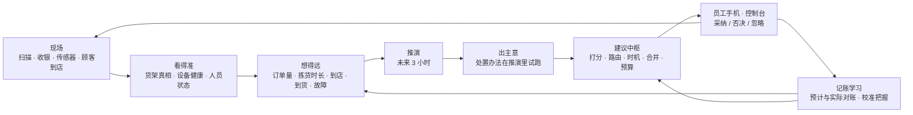

# 15 · 门店 AI 路线图：方案与思考

> 状态：四批都已完成（2026-10-24），见决策记录 [0021](decisions/0021-store-ai-batch1.md)（实时预判与少打扰）、[0022](decisions/0022-store-ai-batch2.md)（人与设备）、[0023](decisions/0023-store-ai-batch3.md)（线上订单深化）、[0024](decisions/0024-store-ai-batch4.md)（语言、复盘与看图，以及收尾）。第 6.1 节标为「可选」的五项和第 9 节「不建议做的事」没有做。需要下载的模型（本地语言模型、语音、视觉）都还没有下载，功能先用规则和模板模式做通，见 0024 第 16 节。下面保留提案时的原文。
> 范围：门店端，也就是运营孪生（门店中枢、员工手机、控制台）。规划孪生（模拟器）里的 AI 建议见 [决策记录 0020](decisions/0020-students-boats-ai-advice.md)。
> 已经做了什么：[10 · 门店 AI](10-store-ai.md)、[11 · AI 效益报告](11-ai-results.md)、[14 · 数字孪生](14-digital-twin.md)。

---

## 1. 一页结论

- **现状**：门店 AI 已有 8 个数值模型（订单量、到店时间、可售概率、按风险盘点、替代推荐、排班与实时调度，扩展模块的熟食制作时长和退货去向）和本地助手（9 个查询工具）；孪生里有设备告警、回放和 3 小时推演。它们各自回答一个**单点问题**，彼此还没连起来：
  - 推演不用 AI 的订单量预测，拣货按计划用时估算；
  - 各模块各发各的建议，没有统一的先后和打扰控制；
  - 采纳以后到底有没有用，没有对账。
- **方向**：从单点预测走向**闭环运营**：
  1. 看得准：多个来源合起来判断现场的真实状态；
  2. 想得远：用 AI 预测驱动推演，提前 30–120 分钟发现问题；
  3. 出主意：每个问题配上在推演里试过的处置办法；
  4. 少打扰：统一排优先级，发给对的人，挑对的时候；
  5. 记账学习：预计效果和实际结果对账，校准把握。
- **推荐分四批**（第 6 节）：
  1. **实时预判与少打扰**：拣货时长预测、推演接上 AI、预警与处置建议、建议中枢、缺货预判与补货优先级；
  2. **人与设备**：排班生成与当日补位、冷链设备预测性维护、多源货架真相、效果追踪、开店简报；
  3. **线上订单深化**：冷链分批、按到店时间安排暂存与冷冻拣货、时段产能、替代推荐 2.0、分框学习；
  4. **语言、复盘与看图**：接上真实的本地语言模型（需要下载）、问数 2.0、打烊复盘与反事实归因、召回处理、读送货单与保质期、语音、统一任务编排。
- **为什么第一批先做**：
  - 直接接着 Phase 13，需要的积木都在（预测、到店时间、可售概率、推演、建议记录）；
  - 演示里一眼能看到「AI 提前 40 分钟提醒，并给出试过的办法」；
  - 对线上订单作业的价值最大。
- 需要作者决定的事见第 8 节。

语言层横跨整个闭环：听懂提问、讲清理由、读懂单据、写好简报和复盘（第 2.4 节）。

## 2. 思考：实体店里 AI 到底帮什么

### 2.1 难在「看不见」和「来不及」，不在「算不出」

- **看不见**：系统里的数不等于架上的数。系统说有 12 件，架上一件没有；拣货员走过去才发现，花几分钟找，最后替代或缺货。
- **来不及**：问题被看见的时候往往已经晚了。冷冻柜是慢慢坏的，等温度越线时商品已经要转移；17:00 交付区排长队，其实 16:00 就能从单量、到店时间和人手看出来，只是那时没人有空算。

所以先后是：先**看得准**（判断现场状态），再**想得远**（预判），最后才是**算得优**（优化）。在实体店里，一个准确的状态加上提前 30–60 分钟的提醒，常常比更复杂的优化算法值钱。

### 2.2 AI 通过人起作用，注意力最稀缺

- 门店里几乎没有机器人。AI 的每个想法，最后都要变成某个人手机上的一条提醒或一个任务。
- 现在每个模块各自发建议：订单量、调动、核对货架、盘点、设备告警……合起来，带班负责人一天可能收到几十条。提醒太多，就等于没有提醒。
- 所以要有「注意力预算」：
  - 每人每小时最多被打扰几次；
  - 按「价值 ÷ 打扰」排序，同类合并；
  - 发给对的人，挑对的时候：正在给顾客交付时不打断。
- 门店 AI 的产出应该是**任务**（谁、在哪、做什么、做到几点），不是报表。

### 2.3 孪生让 AI 能「先试再说、事后对账」

- **先试**：建议发出之前，在推演里把处置办法跑一遍，算出「预计效果」。规划孪生在 Phase 13 已经这样做，门店端还没有。
- **对账**：采纳以后，用事件流算出实际结果，和预计效果比较。某类建议在本店总是不准，就少发，或者降成「只显示」。
- **复盘**：回放加重新仿真，可以回答「如果那辆车准时，今天会少几单迟到」。普通报表只能说「迟到了 9 单」，孪生能说「为什么、各占几单」。

### 2.4 语言模型做「听懂、讲清、读懂、写好」，数字交给工具

| 用途 | 例子 |
|---|---|
| 听懂 | 任意说法、中英文、语音 → 选对工具、填对参数 |
| 讲清 | 把建议的理由、开店简报、复盘写成人话 |
| 读懂 | 纸质送货单、召回通知、员工拍的保质期标签 → 结构化数据 |
| 写好 | 顾客消息、交接班记录、食品安全记录的草稿 |

- **不让它做**：计算数字，做不可逆的决定，评价人。每个数字都来自工具；工具答不了就直说（10 号文档 6d 的原则，继续保持）。
- **本地优先**（决策记录 0010）：小模型在门店电脑上做理解和组织语言。看图、写长报告时可以选用云端模型，默认关闭，发送前去掉个人信息。

### 2.5 把「做工作」设计成「打标签」

门店每天的作业本身就会产生训练数据，关键是让员工顺手留下：

| 日常动作 | 顺手留下的标签 | 训练什么 |
|---|---|---|
| 拣货员点「找不到」时选原因：空架 / 不在原位 / 损坏 / 价签不对 | 货架的真实状态 | 多源货架真相（C1） |
| 带班负责人否决建议时选原因（已有） | 建议好不好 | 校准各模块 |
| 交付时记下顾客接受或拒绝哪件替代品 | 顾客的真实偏好 | 替代推荐 2.0（B4） |
| 维修人员关单时选故障类型 | 设备什么时候、为什么坏 | 预测性维护（E1） |
| 扫描每一行、每个框的时间（已有） | 真实用时 | 拣货时长预测（B1） |

原则：每个新 AI 功能先问「它的标签从哪个日常动作里来」。答不上来的功能往后放。

### 2.6 成熟度阶梯

| 级别 | 含义 | 本项目现在 |
|---|---|---|
| L0 规则 | 固定阈值和流程 | 补货触发、格位建议、组行程 |
| L1 预测 | 告诉你会发生什么 | 订单量、到店时间、可售概率、盘点风险 ✅ |
| L2 处方 | 告诉你该做什么、预计效果多少 | 规划孪生 ✅（0020）；门店端只有调动和核对货架，第一批补齐 |
| L3 编排 | 统一安排所有人和所有任务 | 第四批：统一任务编排 |
| L4 自主 | 不经人确认直接执行 | 只用于低风险、高频、可撤销的动作（看板提醒时间、格位建议）。涉及人、钱、顾客的动作始终要人确认 |

## 3. 现状：门店端的 AI 覆盖图

✅ 门店端已有 · ◐ 只在规划孪生里，或只有规则 · ○ 没有

| 流程 | 看见（状态） | 预判 | 决策 | 讲清 |
|---|---|---|---|---|
| 到货与收货 | ✅ 收货单、卸货门门磁 | ◐ 到货晚点（规划孪生） | ◐ 挪预约、收货员人数（规划孪生） | ○ |
| 后仓 | ✅ 箱记录；✅ 记录不准的概率 | ◐ 今晚溢流（规划孪生） | ✅ 按风险盘点；◐ 上架库位（规则） | ○ |
| 货架与补货 | ✅ 可售概率（收银沉默）；✅ 货架传感器 | ◐ 售罄时间（规则） | ◐ 补货优先级（规则）；✅ 核对货架 | ○ |
| 拣货 | ✅ 扫描进度 | ○ 拣货时长（用标准工时） | ◐ 分批与路线（规则）；✅ 替代推荐 | ✅ 替代理由 |
| 暂存 | ✅ 各温区占用 | ✅ 3 小时推演（没接 AI 预测） | ◐ 格位建议（规则） | ○ |
| 交付 | ✅ 看板 | ✅ 到店时间修正 | ✅ 调动建议 | ○ |
| 配送 | ✅ 行程 | ○ 司机几点到 | ◐ 组行程（规则） | ○ |
| 前场收银 | ✅ 入口客流 | ○ | ◐ 开几条通道（规划孪生） | ○ |
| 人员 | ✅ 名单、岗位、学生班次 | ✅ 各小时工作量 | ✅ 排班重分配、调动；○ 生成排班 | ○ |
| 设备 | ✅ 温度、门磁、离线 | ○ 故障预测（只有越线规则） | ✅ 影响分析 | ✅ 告警条 |
| 店长 | ✅ 健康度、回放 | — | — | ✅ 问答（9 个工具，模板模式）；✅ 交接班摘要 |

空白合起来有八处：

1. 规划孪生里的六个方向（0020）还没进门店端；
2. 推演没接 AI 的订单量预测，也没有拣货时长模型；
3. 建议各发各的，没有统一的优先级、路由和免打扰；
4. 只有排班重分配，不能生成排班，也不能当天补位；
5. 设备只有越线规则，不能提前预测；
6. 语言层还没接真实模型；不能读图、读文档；没有复盘；
7. 采纳后有没有用，没有对账；
8. 「货」的另一半没有覆盖：临期、损耗、召回、订货。

## 4. 门店的一天：AI 在哪里出现

下面是全部做完后的一天，括号里是第 5 节的编号。

| 时间 | 现场 | AI 做什么 |
|---|---|---|
| 05:30 | 夜班收尾 | 估计还剩 46 箱没上架，按通道排好最后一小时的顺序，提醒「乳品通道 7 点前补不完，先补前排」（A3） |
| 06:45 | 班前会 | 手机上一页开店简报：预计 412 单（周五，下午有雨，+6%）；3 辆到货车，饮用水直送可能晚 20 分钟；16:00–18:00 交付缺 1 人；冷冻柜 2 号除霜后恢复变慢，建议今天报修（F1、E1） |
| 08:10 | 开始拣货 | 燕麦奶找得到的概率只有 18%（昨晚卖空没补）。拣货单下发前先排好后仓补取，拣货员走到时货已经上架（B2） |
| 10:20 | 直送收货 | 拍下纸质送货单，读出 14 行，和订货单对比，2 行数量不符，一键记差异（G3） |
| 11:30 | 召回通知 | 读出商品和批次，找出货架约 9 件、后仓 2 箱、3 张未取订单 → 下架任务、订单替换、顾客通知草稿（C5） |
| 13:00 | 设备变慢 | 冷冻柜 2 号恢复用时是平时的 2.5 倍，预计 6–10 小时内可能越线 → 新框先放 1 号，报修（E1） |
| 15:40 | 推演预警 | 按单量预测和今天实测的拣货速度，17:10 会有 7 单赶不上取货时段 → 建议现在把一名补货员调去拣货 1 小时，预计降到 1 单。带班负责人一键采纳（A1、A2） |
| 16:00 | 学生到岗 | 只派下班前做得完的批次（B1、D3） |
| 17:00 | 高峰 | 交付员正在核验取货码，非紧急提醒等这一单交付完再推（G1） |
| 18:30 | 有人请假 | 明天早班缺 1 人：列出 3 位能补班的人（可上班时间、本周剩余工时、学生上限），起草消息，店长确认后发出（D2） |
| 21:30 | 打烊复盘 | 「今天迟到 9 单：饮用水晚到约 4 单，16:00 少一名拣货员约 3 单，单量比预测多约 1 单，其他 1 单。」「采纳的 6 条建议，5 条达到预计效果。」明天要注意的 3 件事写进交接班（F3、F4） |

## 5. 方向与具体方案

每一项写清场景、AI 做什么、数据、方法、员工看到什么、怎么验证、边界。工作量沿用路线图的 S / M / L。第一批的几项写得更细。

### 5.A 预判与处置：把规划孪生的 AI 建议搬进门店

#### A1 推演接上 AI 预测 · M · 第一批

- **现在**：推演（`packages/twin/src/forecast.ts`）按最近一小时的下单速度估计新订单；拣货按计划用时乘以今天实测的比例。
- **改成**：
  - 新订单 = 订单量模型的逐小时预测 × 今天的修正系数 r。r =（今天到现在的实际单量 + k）÷（同期预测 + k）：早上数据少时 r 接近 1，下午越来越相信今天的实际；
  - 拣货用时来自拣货时长模型（B1）；到店来自到店时间模型；到货来自到货预测；
  - 用订单量预测的 10% 和 90% 分位各再跑一次，得到乐观、预计、悲观三条线。推演几毫秒一次，多跑两次没有负担。
- **验证**：客流仿真里每 15 分钟做一次推演，记下 30、60、120 分钟后的实际状态（赶不上时段的订单、等候的顾客、冷区暂存占用），比较「最近一小时速度」和「AI 预测」两种推演的误差。AI 版误差更小才替换。

#### A2 预警与处置建议 · M · 第一批

**场景**：问题被看见时已经晚了。带班负责人需要的是「还有 40 分钟，现在做这件事就来得及」。

**发现问题**：每 5 分钟（或状态有变化时）跑一次推演，找未来 30–120 分钟里的问题。默认阈值如下，都可以配置：

- 赶不上时段的订单 ≥ 3 单或 ≥ 5%；
- 顾客平均等待 > 5 分钟，或最长 > 10 分钟；
- 冷区暂存 > 90%；
- 拣货积压 > 60 分钟。

**处置办法**：

| 办法 | 适用的问题 | 执行 |
|---|---|---|
| 调一个人（已有的 `MOVE_ASSOCIATE`） | 迟到、等待 | 需确认 |
| 提前开始一批订单的拣货 | 迟到 | 需确认 |
| 冷冻商品推到更接近到店时间再拣 | 冷区暂存快满 | 需确认 |
| 启用溢出区或备用冷柜 | 暂存快满 | 需确认 |
| 请人提前上班或延长 | 人手缺口大 | 店长确认 |
| 给可能晚备好的顾客发延迟通知（草稿） | 迟到已经避免不了 | 员工确认后发出 |

**怎么选**：

- **试跑**：每个办法在推演里跑一遍，按「问题改善 − 代价（工时、打扰、对其他岗位的影响）」打分，取最好的一到两个。
- **发建议**：沿用现有的建议记录（新模块「运营预警」），带三样东西：
  - 预计效果：处置前后的推演结果；
  - 把握：乐观和悲观两种情景下都改善为高，只在预计情景下改善为中；
  - 理由：单量比预测多、今天拣货偏慢、某辆车晚到……
- **去重**：同一个问题（类型 + 时段）只保留一条，推演更新时改写那一条；问题消失就自动过期；被否决后同一问题冷却 30 分钟。现有的实时调度并进来，成为处置办法之一，不再单独发。

**员工看到**：「预计 17:10 有 7 单赶不上取货时段（把握高）。建议：现在把补货岗的一人调去拣货 1 小时 → 预计 1 单。理由：16:00–17:00 单量比平时多 18%；今天拣货比计划慢 12%。」

**验证**：仿真 A/B，同一批随机数，自动运营里的虚拟带班负责人按设定的概率采纳。

- 运营指标：迟到订单、平均和 90 分位等待、冷区超过 90% 的分钟数、额外工时；
- 预警本身：提前量的中位数、精确率（不处置时，预警的问题真的发生的比例）、召回率。

**边界**：只建议，不自动执行；预计改善低于门槛不发。

#### A3 到货、后仓、前场建议的门店版 · M · 第二批

复用 0020 的三个建议器，把「全天仿真」换成门店的实时输入：

- **到货**：供应商预计到达、车已到场排队 → 更新卸货门计划，建议收货顺序、临时加人；
- **后仓**：下午拿到今晚的到货清单 → 估计夜班工时，提前提醒「今晚 3 人补不完，需要 4 人」；
- **前场**：入口客流传感器 + 收银流水 → 每 15 分钟更新开几条通道，提前 10 分钟叫人。

### 5.B 线上订单：少找货、少替代、少超时

#### B1 拣货时长预测 · M · 第一批

10 号文档第 10 节把它列为尚未完成（P1）。它是推演、调度、分批、时段产能的共同基础。

- **预测什么**：一个批次从领取到最后一框暂存的用时，拆成每一行的用时之和，加上批次开销（贴标签绑定框、走到起点、回暂存区）。
- **每一行** = 走动（上一个货位到这个货位的路线距离 ÷ 步速）+ 找货和取货（按商品类型：常温、冷藏门、冷冻门、称重生鲜、大件、高层）+ 扫描和数数量。
- **方法**：
  - 对数用时的线性回归（`glm.ts` 已有）。特征：距离、商品类型、件数、时段拥挤（入口客流）、温区、熟练度组（按入职时长分组，不按个人）；
  - 每个货位单独有一项「难度」，用经验贝叶斯收缩，和到店时间模型的「顾客习惯」同一个写法：样本少的货位接近平均，样本多的越来越相信自己的记录；
  - 拣货中途被叫去帮忙会留下异常长的一行：用稳健的损失函数，或者去掉超过 95 分位的行。
- **输出**：批次的预计用时和 80% 区间；拣货进行中，按已完成行的「实际 ÷ 预计」实时更新剩余用时（向 1 收缩）。
- **数据**：每一行的扫描时间、批次开始和结束，事件流里都有。
- **合成数据**（沿用「仿真就是评测场」）：每个货位有模型看不到的难度，高峰时段更挤，新人更慢，偶尔被打断。
- **验证**：批次用时的 WAPE 和区间覆盖率，对照「标准工时」和「标准工时 × 今天实测比例」（推演现在的做法）。
- **边界**：熟练度只到组；个人效率只给本人看（10 号文档第 9 节）。

#### B2 缺货预判：拣货前先处理 · M · 第一批

- **场景**：拣货员最浪费时间的是找一件架上根本没有的东西。可售概率模型已经能提前知道「多半不在架上」，但现在只发「核对货架」，拣货单并不知道。
- **怎么做**：批次生成时，对每一行查找得到的概率 P：
  1. P < 0.4 且后仓有箱 → 立即生成后仓补取任务，截止时间是拣货员预计走到这个货位的时刻（B1 的路线时间）；
  2. P < 0.4 且后仓也没有 → 提前算好替代候选（已有学习排序），拣货清单这一行标「多半缺货」，首选替代放在最上面；
  3. 0.4 ≤ P < 0.7 → 只做顺路核对（C3，第二批）；
  4. 把每件商品找得到的概率通过接口提供给订单平台（03 号文档 AS-06 已采纳，接口还没做）：低于阈值时，前端可以标「可能缺货」。
- **员工看到**：拣货清单上这一行标「可能缺货 · 后仓补取已安排 · 预计 08:25 上架」。
- **验证**：仿真里比较每行平均找货用时、「找不到」次数、替代率、补取任务的及时率和额外工时。
- **边界**：不自动标缺货，拣货员到货位确认后才算。

#### B3 冷链与分批：按时限重排、提前收尾 · M · 第三批

- **现在**（08 号文档第 7 节）：冷链批次从第一件冷藏 / 冷冻商品开始倒计时，超时只提醒。
- **AI**：
  - 分批时用 B1 估计每个批次的冷链暴露时间，超过时限的批次拆开或调整顺序（冷冻最后拣）；
  - 拣货中实时预测「按现在的速度，冷冻商品会超时 6 分钟」，建议「先把冷冻框送回暂存冷柜」或「剩下 3 行转给另一位拣货员」。
- **验证**：冷链超时比例、额外走动。

#### B4 替代推荐 2.0 · M · 第三批

- **先接上真实的标签**：交付时记下顾客接受或拒绝每一件替代品（交付页已经列出替代）。现在只能用「拣货员选了第几名」近似。
- **商品属性补充**：用本地小语言模型离线给商品补上口味、用途、饮食标签（03 号文档 AS-01 已采纳，还没做）。
- **个性化要不要做，看数据**：顾客自己的偏好（忠于品牌、在意价格、坚持有机）可以用经验贝叶斯收缩，新顾客等于大家的平均。但在仿真里，学习排序已经接近上限（第一名接受率 69.6%–71.3%，知道每位顾客真实偏好时是 70.5%–72.0%），剩下约 1 个百分点。真实门店里顾客之间的差异可能更大，所以先接上真实标签，再用数据判断值不值得做。
- **边界**：个人偏好只用于本店的替代，不用于营销，顾客可以要求删除。

#### B5 按到店时间安排暂存和冷冻拣货 · S–M · 第三批

- 快到的顾客，框放离交付门近的格位；
- 冷区暂存快满时，晚到顾客的冷冻商品晚点拣；
- 预测「未取订单」（顾客最后没来）的风险：风险高的订单冷冻商品不提前拣，营业结束前提醒联系顾客。
- 验证：冷区峰值占用、冷冻商品在暂存区的时间、交付等待。

#### B6 时段产能：别接接不住的单 · M · 第三批

- 03 号文档 O-02 已采纳「系统对外输出每个时段的建议产能上限」，还没做。
- 按排班、拣货时长和单量预测，估计每个取货时段还能接多少单，通过接口告诉订单平台；快到上限时建议「17:00 时段停止接新单」或「开放更晚的时段」。
- 验证：仿真里画迟到订单和接单量的取舍曲线。

#### B7 分框与推车容量学习 · S · 第三批

- 系统按体积估计「这单 3 框」，实际用了 4 框 → 多绑一个框、补打标签、推车放不下。
- 用实际的绑框记录学习每类商品的真实占用（商品体积数据常常不准），修正分框和推车装载。

#### B8 配送：司机几点到 · S–M · 可选

- 司机预计到达，用和顾客到店时间一样的分层收缩；结合司机取消规则（决策记录 0014）决定冷冻商品几点出柜、行程几点成行。

### 5.C 货架与库存：让系统的数等于架上的数

#### C1 多源货架真相 · M · 第二批

- **现在**：可售概率主要看收银沉默；拣货员的「找不到」会触发补取，但不是模型的输入，也没有原因。
- **改成**：每个「商品 × 货位」有一个状态的概率：在架上 / 在后仓 / 不在原位 / 真的没了。每个信号按自己的可靠度更新它：

| 信号 | 来源 | 可靠度从哪里学 |
|---|---|---|
| 收银沉默 | 收银流水 | 已有模型 |
| 「找不到」及原因 | 拣货员（新增原因码） | 之后的核对结果 |
| 拣到了但数量不够 | 拣货员 | 之后的核对结果 |
| 上架、补货 | 补货员 | 之后的核对结果 |
| 测距 / 称重 | 货架传感器 | 之后的核对结果 |

- **动作**：不在原位 → 「附近货架段找一找」任务；在后仓 → 补取；真的没了 → 估算清零、提醒订货。
- **员工看到**：「燕麦奶 1L：系统 12 件；拣货员两次找不到（08:12、09:40）；4 小时没有卖出 → 多半不在架上（找得到的概率 9%）。后仓有 1 箱，已安排补取。」
- **验证**：合成货架真实存量（`packages/synth/src/shelfTruth.ts`）里已经有「整批找不到」，要把「放错位置」和「整批丢失」分开；指标是 Brier 分数和发现幽灵库存的平均时间。

#### C2 补货优先级：用已知的线上需求 · S–M · 第一批

- **现在**（`packages/algorithms/src/replenish.ts`）：预计售罄时间越短越靠前，扣除已被线上订单占用的件数，按单价轻度加权。
- **改成**：优先级 = 接下来 H 小时断货的概率 × 断货的代价。
  - 断货概率：货架估算（乘以找得到的概率）对比 H 小时内的需求，需求 = 店内销量预测 + 已下单未拣的线上需求 + 线上预测，按负二项分布算尾概率。已下单的线上订单是**已经知道的未来需求**，这是做线上订单的门店独有的信息；
  - 代价：线上订单行的损失（按替代接受率折算替代或缺货）+ 店内销售损失。
- **员工看到**：「先补：燕麦奶 1L（接下来 2 小时线上有 14 单要它，货架估计 3 件，断货概率 92%）」
- **验证**：补货工时相同时，比较缺货行、替代行、店内断货的分钟数。

#### C3 顺路核对 · S · 第二批

- 某个货位有点可疑、但不值得专门跑一趟时，如果有拣货员的路线经过附近，就在他的清单里插一行「顺手数一下 X（约 10 秒）」，每个批次最多一次。
- 代价很小，换来的是货架真相模型最需要的标签。

#### C4 临期与损耗 · L · 第四批（需要新增数据）

- **新增数据**：收货时记下批次和保质期（后仓箱本来就每箱打印标签，加一个字段）；货架上按先进先出估算。
- **AI**：预测每批在到期前卖不完的概率 → 建议提前降价（阶梯幅度，店长确认）、移到显眼位置、到期前捐赠；线上拣货避开剩余保质期太短的批次。
- **验证**：仿真加入保质期后，比较损耗金额、降价损失、缺货。

#### C5 召回处理 · M · 第四批

- **输入**：公开的召回通知（文字、PDF 或网页），店长粘贴，或者从订阅源取得；演示用合成通知。
- **AI**：
  1. 语言模型抽出商品名、条码或批次、日期范围、原因；
  2. 和商品目录模糊匹配，由人确认；
  3. 找出货架估算、后仓箱、暂存中的框、未取订单、已交付的线上订单；
  4. 生成下架任务、收银拦截、订单替换、顾客通知草稿。
- **员工看到**：「召回：花生酱 340 g，批次 L2310 开头。货架约 9 件（12 号通道 B 侧），后仓 2 箱，3 张订单含此商品（1 张已暂存）。［生成下架任务］［顾客通知草稿］」
- **验证**：合成召回通知集（不同写法、批次格式）上的抽取准确率和匹配召回率。召回率必须 100%，宁可多下架。
- **边界**：匹配结果由人确认后才通知顾客。

#### C6 订货建议 · L · 可选

- 按商品按天的需求（店内 + 线上）、到货周期、箱规、货架和后仓容量、保质期给出订货量；先只显示，和实际订货比较。
- 需要商品级的合成销售历史。很多零售企业的订货在总部完成，所以放在可选。

#### C7 库存差异的原因 · M · 可选

- 盘点或核对发现差异时，按事件的模式估计原因：
  - 收货差错：同一供应商同一天多处差异；
  - 没记的损坏；
  - 放错位置：相邻货位多出来；
  - 收银扫错：同价位商品一多一少；
  - 不明损耗。
- 汇总到流程和供应商层面，例如「某直送供应商的收货差异率 6%（平均 1%）→ 建议收货时逐箱核对」。不指向个人。

### 5.D 人员：排得准、补得上、做得顺

#### D1 排班生成 · L · 第二批

- **现在**：只有「同样的总工时放到对的小时」；演示门店没有班表（10 号文档第 10 节）。
- **输入**：
  - 各岗位每小时的工作量预测（已有）；
  - 员工可上班时间、技能和授权；
  - 劳动规则：每天最长、两班之间最短休息、每周上限；
  - 学生规则（Phase 13 的 `STUDENT_RULES`）；
  - 工时预算；
  - 公平：周末轮换、早晚班平衡。
- **方法**：几十人 × 7 天 × 每 15 分钟的规模，用 TypeScript 写贪心加局部搜索就够快（浏览器里几秒内）。目标是覆盖缺口的加权和 + 加班 + 不公平的罚分。
- **输出**：
  - 周排班表和每小时的覆盖曲线；
  - 解释，例如「周六 16:00–18:00 缺 0.6 人：能上的人都到了每周上限」；
  - 在规划孪生里用这份排班跑一遍全天仿真。
- **验证**：约束 100% 满足（单元测试）；仿真里比较迟到订单、等待、总工时、加班。
- **边界**：店长确认后才发布；只按技能和可上班时间排，不按个人效率。

#### D2 当日补位与提前下班 · M · 第二批

- 有人请假 → 先用推演算出缺口的影响 → 列出能补班的人（可上班时间、本周剩余工时、学生上限、加班成本、技能），起草消息，店长确认后发出；
- 单量明显低于预测时，提示「可以让 1 人提前 1 小时下班，自愿优先」；明显高于预测时，提示加班或叫人。

#### D3 统一任务编排：每个人的「下一步」 · L · 第四批

- **现在**：拣货员在可领取的批次里挑；补货、核对、盘点、告警各有各的列表；AI 只建议换岗位。
- **目标**：一个任务池（批次、暂存、交付、补货、补取、核对、盘点、告警处理……），每个任务有截止时间、价值、预计用时、地点、需要的技能。AI 给每个人排「下一步」：就近、紧急、技能匹配、负荷均衡。带班负责人看到全局看板和建议的调整。
- **方法**：滚动时域的指派（贪心或匈牙利算法），用推演评估；只推荐，员工可以选别的，选别的记为反馈。
- **员工看到**：首页「下一步：拣货批次（冷藏，12 行，预计 14 分钟，16:30 前）· 顺路：核对 07-B-3」。
- **渐进**：先在一个岗位内（后仓：补取、补货、盘点、收货），再跨岗位。依赖 G1 和 B1。
- **边界**：保留员工自选；最短停留时间（03 号文档 W 组已采纳 30 分钟）；不显示个人排名。

#### D4 现场 SOP 助手与新人带教 · S–M · 第四批

- 第一次遇到某种情况（年龄限制商品、冷链超时、顾客拒收替代、取货码错 3 次）时，手机自动弹出对应操作规范的步骤（已有 15 条操作规范和门店经验库）；新员工前两周默认打开；
- 语言模型把操作规范改写成员工的语言或更简单的说法，配简单的小测验；
- 技能覆盖：每个班次有几个人能做年龄核验、开叉车、熟食 → 缺口提醒和交叉培训建议（只看团队）。

#### D5 负荷与安全 · S · 第三批

- 冷冻库累计停留时间提醒和轮换、大件两人搬运、休息提醒；派活时避免同一个人连续做重活。

### 5.E 设备与安全

#### E1 冷链设备的预测性维护 · M · 第二批

- **现在**：越线才告警；演示里的压缩机故障约 1 分钟到严重线，是突然的。
- **现实**：多数是慢慢变坏：除霜后恢复变慢、开门后回温变快、夜里不开门也在慢慢升温、温度波动变大、传感器读数卡住不动。
- **AI**：
  - 每台设备学自己的「平时」（按时段、除霜周期、开门次数）；
  - 每天算几个特征：除霜后的恢复用时、开门后的回温斜率、夜间漂移、波动幅度；
  - 和自己的平时比，用稳健 z 分数加累积和（CUSUM）判断是不是在变坏，再按趋势外推「多久可能越线」（带区间）。
- **动作**：报修建议（需确认）；高价值商品提前转移（影响分析已有）；暂存冷柜不再放新框。
- **演示**：设备仿真加三种慢性故障：制冷效率每小时下降、门封漏气（开门后回温更快）、传感器卡死。
- **员工看到**：「冷冻柜 2 号：除霜后恢复用 18 分钟（平时 7 分钟），夜间每小时升温 0.4 °C。预计 6–10 小时内可能越线。建议今天报修，新框先放 1 号。」
- **验证**：注入慢性故障，比较「越线告警」和「预测告警」的提前量；看正常设备每周的误报次数。

#### E2 告警合并与升级 · S · 第一批（并入 G1）

- 同一原因的多条告警合成一条（停电时所有冷柜一起）；收货期间卸货门开着不报；严重告警 5 分钟没人确认就升级给店长；夜里只推严重的。

#### E3 能耗 · L · 可选（需要电表数据）

- 按客流预测和天气调空调和照明，冷柜夜帘提醒，用电高峰削峰。需要新接电表和空调。

#### E4 突发状况的现场清单 · S–M · 第四批

- 停电、火警、系统故障、暴雨时，手机上有按岗位分好的清单（谁去关冷柜门、谁去照顾顾客、冷链计时从现在开始），附实时影响（多少订单的冷冻商品受影响）和顾客通知草稿；
- 事后按事件流自动生成事件报告的时间线。

#### E5 食品安全记录 · S · 第四批

- 每天的温度记录、告警和处理、维修，自动整理成记录表和一段说明，店长确认。

### 5.F 店长副驾驶：简报、问数、复盘

#### F1 开店简报 · S–M · 第二批

- 每天开店前一页：今日预测（订单、到货、天气）、人手和工作量的缺口、昨天的指标和主要原因、今天要注意的 3 件事（来自预警和建议）、需要店长决定的事；
- 模板模式就能生成（数字和句子来自工具）；接上语言模型后说法更自然，长短可以按店长习惯调；
- 已有的交接班摘要扩展成早、中、晚三次。

#### F2 问数 2.0 · M · 第四批

- 在 9 个查询工具之外增加分析类工具：按小时查指标（订单、等待、迟到、替代、冷链）、两天或两段时间比较、某张订单的完整时间线（只说流程，不评价人）、某件商品的库存轨迹；
- 回答附迷你曲线和数据出处；问答写进事件流，加「有用 / 没用」反馈（10 号文档列为未完成）；
- 扩展评测集；真实本地模型和模板模式对比（H1）。

#### F3 打烊复盘与反事实归因 · L · 第四批

- **做法**：
  1. 用当天的实际输入（订单、到货时间、班次、设备故障、天气）在规划孪生里「复刻今天」；
  2. 逐个去掉扰动（车准时、没人请假、单量等于预测、没有故障），重新仿真；
  3. 比较结果，用少量组合近似 Shapley 值，分出每个原因各占多少迟到订单和等待。
- **输出**：「今天迟到 9 单：饮用水晚到 52 分钟约 4 单，16:00 少一名拣货员约 3 单，单量比预测多 9% 约 1 单，其他约 1 单。」
- **难点**：把门店的事件流转换成仿真输入；复刻出来的结果和实际差多少，本身就是孪生精度的度量，要写进报告。
- **为什么值得做**：这是「孪生 + AI」最独特的能力。

#### F4 效果追踪与门店自学习 · M · 第二批

- 每条采纳的建议已经记着「预计效果」；事后从事件流算出同一个指标的实际值；
- 每个模块、每类建议的「说到做到率」用来校准把握；连续不准时自动降成「只显示」，并告诉店长；
- 没采纳的同类情况也记下来作对照。要注意选择偏差（带班负责人更愿意采纳有把握的建议），报告里写明这是观察数据；
- **店长看到**：「本周采纳调动建议 12 次，预计共少等 21 分钟，实际约 17 分钟（81%）。」
- **验证**：仿真里可以重跑反事实，有真值。

#### F5 周报 · S · 第四批

- 一周的指标趋势、主要原因、建议采纳和效果、下周预测和准备事项；语言模型写，数字来自工具。

### 5.G AI 怎样到达现场的人

#### G1 建议中枢：优先级、路由、免打扰、合并 · M · 第一批

所有模块的输出（预测、预警、调动、核对、盘点、告警、召回……）进同一个中枢：

| 环节 | 做法 |
|---|---|
| 打分 | 预计价值（分钟或单数）× 把握 ÷ 打扰（几个人、几分钟），再加紧急度（离问题发生还有多久） |
| 路由 | 按岗位和权限；任务类（核对、补取）派给就近、空闲、对应岗位的人 |
| 时机 | 从事件流知道员工在做什么：交付中、核验取货码中、冷链计时快到时，非紧急的等这一步结束再推 |
| 合并 | 同一货架段、同一台设备、同一个原因的合成一条 |
| 预算 | 每人每小时最多 3 条非紧急（可配）；被挤掉的计入「未推送」统计 |
| 升级 | 紧急且没人处理：员工 → 带班负责人 → 店长 |

- **指标**：每人每小时的提醒数、从发出到处理的时间、过期没处理的比例、采纳率。
- **验证**：仿真里比较打扰次数和处理及时率，确认打扰少了、重要的没有漏。
- 这一层比 D3 小得多，做完马上就能少打扰，所以放在第一批。

#### G2 语音 · M · 第四批（需要下载语音模型）

- 拣货时不用腾手：「下一个」「找不到」「数量 3」；记经验：「记一下：冷冻 3 号门把手松了」；问答也可以说；
- 本地语音识别：浏览器里跑的小型语音识别模型（约 40–150 MB）；命令词用规则，自由提问交给助手；
- 说中文、西班牙语也能用。

#### G3 拍照 · L · 第四批（需要视觉模型）

| 用途 | 难度 | 先后 |
|---|---|---|
| 送货单识别：纸质送货单 → 行项目 → 和订货单比对 | 以文字为主，准确率高 | 先做 |
| 保质期识别：拍日期标签 → 读出日期（配合 C4） | 以文字为主 | 先做 |
| 条码坏了：拍商品 → 给出候选让人选 | 中 | 后做 |
| 价签核对：拍一段货架 → 价签、商品和系统价格、陈列图比较 | 难 | 最后 |

- 需要视觉语言模型：本地几 GB 的模型，或者可选的云端模型（H2）；
- 隐私：只拍商品和单据；画面里有人时不上传，或者先打码。

#### G4 店内顾客自助 · S–M · 可选

- 货架二维码或自助屏：「X 在哪？有没有无乳糖的？」——复用找商品工具和实时的找得到概率，不需要登录；
- 顾客消息草稿：缺货、替代、延迟，按顾客的语言。

### 5.H 平台：让上面这些可靠

#### H1 接上真实的本地语言模型 · S · 第四批开头（需要下载）

- 下载一个 15–40 亿参数的量化模型（约 1–3 GB，候选见 04 号文档），用已有评测集和模板模式对比，选出默认模型；
- 需要作者同意下载。

#### H2 可选的云端模型 · M · 跟 G3 一起

- 只在看图、写长报告时用；默认关闭，每个功能单独开关；发送前把姓名、电话、订单号换成占位符；记录用量和费用。

#### H3 AI 运行监控 · S–M · 第二批

- 预测误差漂移：最近 7 天的误差比回测时高 30% → 提醒重新训练或回滚；
- 数据质量：收银流水中断、传感器离线时，相关模型自动暂停；
- 每个模型的健康度并入孪生健康度。

## 6. 优先级与分批

### 6.1 评估

价值和就绪程度按 1–5 打分；就绪看数据和积木是否已经有。

| 编号 | 名称 | 价值 | 就绪 | 工作量 | 依赖 | 批次 |
|---|---|---|---|---|---|---|
| B1 | 拣货时长预测 | 4 | 5 | M | — | 1 |
| A1 | 推演接上 AI | 4 | 5 | M | B1（可以先用标准工时） | 1 |
| A2 | 预警与处置建议 | 5 | 4 | M | A1 | 1 |
| G1 | 建议中枢（含 E2） | 5 | 4 | M | — | 1 |
| B2 | 缺货预判 | 5 | 4 | M | 可售概率（已有） | 1 |
| C2 | 补货优先级 | 4 | 5 | S–M | — | 1 |
| D1 | 排班生成 | 5 | 3 | L | 工作量预测（已有） | 2 |
| D2 | 当日补位 | 4 | 4 | M | D1 | 2 |
| E1 | 预测性维护 | 4 | 4 | M | 设备仿真加慢性故障 | 2 |
| C1 | 多源货架真相 | 4 | 4 | M | 「找不到」原因码 | 2 |
| C3 | 顺路核对 | 3 | 5 | S | C1 | 2 |
| F4 | 效果追踪 | 4 | 4 | M | A2 | 2 |
| H3 | 运行监控 | 3 | 4 | S–M | — | 2 |
| F1 | 开店简报 | 4 | 5 | S–M | A2 | 2 |
| A3 | 到货、后仓、前场的门店版 | 4 | 3 | M | A1 | 2 |
| B3 | 冷链分批 | 4 | 4 | M | B1 | 3 |
| B5 | 按到店时间暂存和拣冷冻 | 3 | 4 | S–M | — | 3 |
| B6 | 时段产能 | 4 | 4 | M | B1 | 3 |
| B4 | 替代推荐 2.0 | 3 | 4 | M | 交付时记接受 / 拒绝 | 3 |
| B7 | 分框学习 | 3 | 5 | S | — | 3 |
| D5 | 负荷与安全 | 3 | 4 | S | — | 3 |
| H1 | 接上本地语言模型 | 4 | 3 | S | 下载 | 4 |
| F2 | 问数 2.0 | 3 | 4 | M | H1 更好 | 4 |
| F3 | 打烊复盘 | 5 | 3 | L | 事件流 → 仿真输入 | 4 |
| C5 | 召回处理 | 4 | 3 | M | H1 | 4 |
| G3 | 拍照（送货单、保质期） | 4 | 2 | L | 视觉模型 | 4 |
| G2 | 语音 | 3 | 2 | M | 语音模型 | 4 |
| D3 | 统一任务编排 | 5 | 3 | L | G1、B1 | 4 |
| D4 | SOP 助手 | 3 | 5 | S–M | — | 4 |
| E4 | 突发状况清单 | 3 | 4 | S–M | — | 4 |
| E5 | 食品安全记录 | 3 | 5 | S | — | 4 |
| F5 | 周报 | 3 | 4 | S | F2 | 4 |
| C4 | 临期与损耗 | 4 | 2 | L | 批次与保质期数据 | 4 |
| B8、C6、C7、E3、G4 | 司机到店、订货、差异原因、能耗、顾客自助 | 2–3 | 1–4 | — | — | 可选 |

### 6.2 四批

**第一批 · 实时预判与少打扰（M–L）**

- 内容：B1 → A1 → A2 → G1（含 E2）→ B2 → C2。
- 验收（仿真，同一批随机数，总工时不变）：
  - 拣货时长：批次 WAPE 低于「标准工时 × 今天实测比例」；
  - 推演：60 分钟后「赶不上时段的订单」的误差低于现在的推演；
  - 预警：提前量中位数 ≥ 30 分钟，精确率 ≥ 70%；采纳后迟到订单和 90 分位等待下降；
  - 少打扰：每人每小时的非紧急提醒下降，紧急事项的处理时间不变长；
  - 缺货预判：每行平均找货用时和「找不到」次数下降；
  - 演示里看得到：员工手机上的预警和处置建议、拣货清单上的「可能缺货」、控制台的提醒统计；
  - 测试和走查照常：单元测试、端到端测试，全流程走查新增一节。

**第二批 · 人与设备（L）**

- 内容：D1、D2、E1、C1、C3、F4、H3、F1、A3。
- 验收：
  - 排班约束 100% 满足，覆盖缺口低于手工排班；
  - 慢性故障的预测告警比越线告警提前 ≥ 2 小时，正常设备每周误报 ≤ 1 次；
  - 幽灵库存的平均发现时间缩短；
  - 建议的「说到做到率」在界面上可见。

**第三批 · 线上订单深化（M–L）**

- 内容：B3、B5、B6、B4、B7、D5。
- 验收：冷链超时比例和冷区峰值占用下降；有迟到订单与接单量的取舍曲线；替代推荐接上交付时的真实标签。

**第四批 · 语言、复盘与看图（XL，需要下载模型）**

- 内容：H1 → F2、F3、C5、D4、E4、E5、F5 → G3、G2 → D3 → C4。
- 前提：作者同意下载本地语言模型（约 1–3 GB）；看图需要视觉模型（本地几 GB，或可选的云端）。
- 验收：问答留出集的准确率高于模板模式；仿真里复盘归因和真实贡献的误差；召回匹配的召回率 100%。

## 7. 怎么证明有用

沿用 05、10 号文档的方法：

1. **离线评估**：每个新模型有带隐藏因素的合成数据，用仿真真值评估，和更简单的版本比，过上线门槛才上线（模型仓库已有）；
2. **运营 A/B**：同一批随机数，开 / 关这一项 AI，总工时不变，比较运营指标（证据等级 B，仿真实验）；
3. **门店里对账**：F4 的「说到做到率」。真实门店的数据只用于对账，不当作已经证明的效益。

| 方向 | 主要指标 |
|---|---|
| 预判与处置 | 预警提前量、精确率、召回率；迟到订单；平均和 90 分位等待 |
| 线上订单 | 每行找货用时、「找不到」次数、替代率与接受率、冷链超时比例 |
| 货架与库存 | 账实一致率、幽灵库存发现时间、缺货分钟数、损耗金额 |
| 人员 | 覆盖缺口、加班工时、约束满足、公平指标 |
| 设备 | 预测提前量、误报次数、受影响的商品数 |
| 店长副驾驶 | 问答准确率、复盘归因误差、简报的反馈 |
| 少打扰 | 每人每小时提醒数、处理时间、过期没处理的比例 |

## 8. 需要作者决定的事

1. **先做哪一批**：推荐第一批，按 B1 → A1 → A2 → G1 → B2 → C2 的顺序。
2. **下载本地语言模型**（约 1–3 GB）：第四批需要。不同意的话，语言类功能继续用模板模式。
3. **云端模型**：是否允许作为可选项（默认关闭，发送前去掉个人信息）。只影响拍照类功能。
4. **拍照和语音**：做不做（G2、G3），以及是否同意第 9 节写的隐私边界。
5. **保质期数据**：是否在收货和后仓箱标签里加批次与保质期。这是 C4 的前提，会改收货流程。

## 9. 不建议做的事

| 不做 | 理由 |
|---|---|
| 人脸识别、跟踪顾客、员工实时定位 | 法规和信任风险，收益不成比例；员工位置继续只到最近一次扫描的货位（AS-03） |
| 个人效率排名、离职预测 | 10 号文档第 9 节已经排除 |
| 让语言模型直接算排班、补货量、降价幅度 | 不稳定、难审计；数字交给数值模型和优化算法，语言模型负责解释 |
| 涉及人、钱、顾客的动作自动执行 | 调人、降价、发顾客消息始终需要人确认 |
| 一天多次的动态改价 | 顾客信任和法规问题；只做临期降价建议 |
| 为了「识别货架」先大量装摄像头 | 硬件和维护成本高；先用不花钱的信号（拣货员、收银沉默、顺路核对），拍照作补充 |
| 替代推荐的在线排序用大模型 | AS-01 已定：在线用学习排序（< 50 毫秒），大模型只做离线的属性补充 |

## 10. 风险与对策

| 风险 | 对策 |
|---|---|
| 误报多，大家不再看提醒 | 预警门槛、去重和冷却（A2）；注意力预算（G1）；效果追踪后自动降级（F4） |
| 数据不准导致建议错 | 孪生健康度低（收银流水中断、传感器离线、账实一致率低）时暂停相关建议（H3） |
| 员工抵触「被 AI 管」 | 不排名；员工可以选别的任务；每条建议都有理由；否决原因进入训练 |
| 模型漂移 | 运行监控、上线门槛、回滚（模型仓库已有） |
| 过度依赖 AI | AI 关闭或断网时作业照常：所有建议都是在原有流程上加的 |
| 隐私 | 本地优先；云端默认关闭，发送前去掉个人信息；顾客偏好可以删除 |

## 11. 数据：已有与需要新增

| 数据 | 状态 | 用于 |
|---|---|---|
| 作业事件（扫描、批次、暂存、交付、补货、补取、核对、盘点、收货） | ✅ 已有 | 几乎所有方向 |
| 收银流水 | ✅ 已有 | 可售概率、补货、前场 |
| 传感器（温度、门磁、入口客流、货架测距 / 称重） | ✅ 已有 | 设备、前场、货架真相 |
| 顾客预计到达与签到 | ✅ 已有 | 推演、暂存、交付 |
| 建议、处理与否决原因 | ✅ 已有 | 效果追踪、校准 |
| 操作规范、门店经验库 | ✅ 已有 | 助手、SOP |
| 「找不到」的原因码 | 新增（拣货界面多一步选择） | C1 |
| 交付时顾客接受 / 拒绝替代 | 新增（交付界面） | B4 |
| 员工可上班时间、技能与授权 | 新增（名单） | D1、D2 |
| 维修记录 | 新增 | E1 |
| 供应商预计到达 | 新增（接口） | A3 |
| 批次与保质期 | 新增（收货、箱标签） | C4 |
| 召回通知、送货单图片 | 新增（输入） | C5、G3 |
| 电表 | 新增（设备） | E3 |
