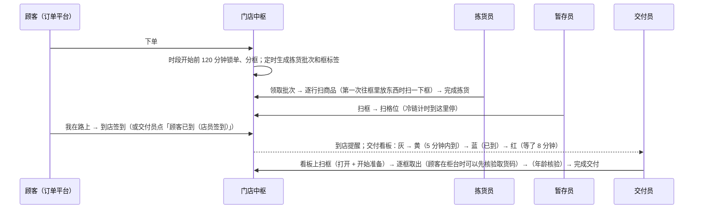
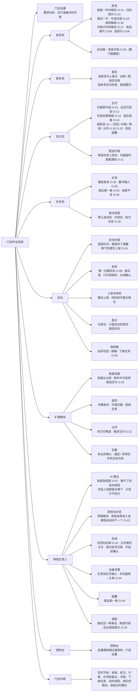

# 16 · 操作流程梳理与优化方案

> 状态：梳理完成（2026-10-25，决策记录 0025）；**卡点和优化方案已经实施**（2026-10-26，[决策记录 0026](decisions/0026-flow-fixes.md)），之后的讨论又加了 D5–D7（第 14 节）。本文按**实施后的流程**写，每节的「卡点」写成「以前 → 现在」。没做的只有 O-26（语音识别，作者决定先不下载语音模型）。
> 作者要求（原话）：「能否帮助我重新梳理一下所有流程的操作步骤和流程，我想优化操作流程。」之后：「修复所有问题，而后重新生成新的作业流程树状图，再探讨是否需要进一步修改。」
> 依据：现在的代码，不是设计稿——员工手机（`apps/associate/src/screens/`）、作业核心（`packages/ops/src/`）、门店中枢（`apps/server/src/`）。按钮和提示用界面上的原文。最初的设计见 [01 · 工作流设计](01-workflow-design.md)，实时作业的实现见 [08 · 实时作业](08-live-operations.md)。

---

## 0. 怎么读

- 每条流程写清：**谁、在哪台设备的哪一页、什么时候开始**；一步一步**按什么、扫什么、系统做什么、别的设备上看到什么**；每单位工作要**扫几次、点几下**；会遇到哪些**拒绝**；以及**卡点**（以前的问题和现在的做法）。
- 「扫」指用扫码枪扫标签。**门店设置「要求扫码」**（决策记录 0026）：关着时（演示、培训）每个扫码步骤都可以点列表里的那一行代替；打开后点选的操作都被拒绝（`SCAN_REQUIRED`），服务端核对商品条码、货位、格位、库位，点选的按钮变灰。
- 次数按正常流程（没有异常）算；异常多出来的单独列。

## 1. 总览

### 1.1 角色、设备和页面

| 角色 | 设备 | 默认打开 | 主要流程 |
|---|---|---|---|
| 拣货员 | 员工手机 | 拣货 | 第 2 节 拣货 |
| 暂存员 | 员工手机 | 暂存 | 第 3 节 暂存 |
| 交付员 | 员工手机 | 交付 | 第 4 节 交付、第 5 节 配送交接 |
| 补货员 | 员工手机 | 库存 → 补货 | 第 6 节 补货、核对货架 |
| 后仓 | 员工手机 | 库存 → 收货 | 第 7 节 补取、收货、上架、盘点 |
| 熟食 | 员工手机 | 扩展 → 熟食现做 | 第 8 节 扩展模块 |
| 带班负责人 | 员工手机，多一个「AI」页 | 交付 | 第 9 节 |
| 门店管理员 | 控制台 | — | 第 10 节 |
| 顾客、司机 | 订单平台（演示里由控制台代替） | — | 第 4、5 节 |
| 系统 | 门店中枢的定时节拍（每 15 秒） | — | 锁单、生成拣货批次、组配送行程、补货和盘点任务、冷链超时、过期批次的下架任务、到时间调回临时调动的人、排队的调动、收起做不了的 AI 建议 |

每台手机都有：
- 底部标签栏：拣货、暂存、交付、库存、扩展（门店开了扩展模块才有）、AI（只有带班负责人）、更多；
- 顶栏：「在岗」（👥，决策记录 0025）、提醒（🔔）；
- 页面顶部的横幅：设备告警、突发状况清单、「下一步」（手上没活时）。

默认页按**此刻的岗位**：临时调动 > 当天排班的岗位 > 名单上的岗位。被调到别的岗位时自动切页并提示；手上有任务时先不切页（第 12 节 F-16）。库存、扩展的子页记住上次打开的那个（决策记录 0026）。

**门店设置**（控制台和带班负责人：更多 → 门店设置，所有设备马上生效）：要求扫码（默认关）；交付准备什么时候能开始：顾客到店前也可以（默认，冷藏冷冻最后取）/ 顾客到了才能开始。

### 1.2 一张自取订单的一生

默认规则（`packages/store-config/src/templates.ts`）：时段 60 分钟；锁单提前 120 分钟；即将到达 5 分钟内；等待过久 8 分钟；取货码错 3 次后多一个人工核验入口（不锁定）；一趟最多 4 单；配送订单在时段前 30 分钟要准备好；暂存占用 85% 预警。中枢每 15 秒一拍，演示里每分钟生成一轮拣货批次（正式运行 10 分钟）。

### 1.3 操作次数总表（正常流程）

| 流程 | 单位 | 以前 | 现在 | 怎么省的 |
|---|---|---|---|---|
| 拣货 | 一个批次（T 个框、L 行，其中 M 行一行多件） | T + L 扫、2 + M 点；或不扫码点 2 + T + L 下 | 不要求扫码：L 扫、2 + M 点（框自动绑定）；要求扫码：T + L 扫（框在第一次放东西时扫） | O-15 |
| 暂存 | 一个框 | 2 扫（或扫 + 点） | 同左；要求扫码时必须 2 扫 | — |
| 交付 | 一张订单（T 个框） | 1 + T 扫、2 点、取货码 4 位 | T 扫、2 点、取货码 4 位 | O-01：看板上扫框直接开始准备 |
| 配送交接 | 一趟（所有框） | 1 + 所有框扫、2 点、司机的码 4 位 | 所有框扫、2 点、司机的码 4 位 | O-01 |
| 补货 | 一批 8 个任务（推车装得下） | 8 趟：每个 2 扫 + 1 点 + 步进器 | 1 趟取箱：8 扫箱 + 8 扫货位 + 8 点；件数可以直接输入 | O-02、O-03、D5 |
| 核对货架 | 一个任务 | 1 扫、2 点 + 件数（数 24 件点 24 下） | 1 扫、2 点 + 键入件数 | O-03 |
| 后仓补取 | 一个任务 | 2 扫、2 点；箱里剩下的另外生成补货任务 | 2 扫、2 点；剩下的顺手上架（不用别人再跑一趟） | O-16 |
| 收货 | 一种商品 | 1 扫、1 点；每车另外「卡车已到」+「关闭收货单」 | 1 扫、1 点；每车「关闭收货单」+ 确认（第一次扫箱就算到了） | O-09 |
| 上架 | N 箱 | 2N 扫 | 整托：N + 1 扫 | 共性问题 X2 |
| 盘点 | 一个库位 | 0 扫、2 点 + 每箱件数 | 1 扫库位、2 点 + 键入件数 | O-03、X2 |
| 退货 | 一件 | 1 扫、1 点 | 同左（扫错可以删） | — |
| 大件 | 一件 | 1 扫、2 点 | 1 扫、2 点（打印才记下；要求扫码时放好再扫大件区） | O-22 |
| 包裹 | 一件 | 1 扫、1 点 | 2 扫（包裹、格位）或 1 扫 1 点 | X2 |
| 熟食现做 | 一张单 | 3 点 | 3 点；要求扫码时 2 点 + 扫保温位 | X2 |
| 调配 | 一个人 | 2–3 点 | 2–3 点；手上有任务的默认做完再去 | O-20 |
| AI 建议（涉及人、钱、顾客） | 一条 | 1 点 | **2 点**（采纳 → 确认执行，故意多一下） | 9.1 卡点 1 |

### 1.4 树状图：岗位 → 流程 → 现在的做法

每个流程下面写实施后的主要变化和对应的方案编号（第 13 节）。可以展开、看每个卡点以前和现在的交互式树状图在作者的 Artifact 里。

---

## 2. 拣货

**谁、何时**：拣货员，拣货页。系统定时生成拣货批次时，每个框的标签已经对应好。

### 2.1 步骤

1. **选批次**：「可以领取的批次（N）」，每张卡片写温区、`优先`、截止时间、框数 / 货位数 / 件数 / 预计分钟 / 路程、AI 的缺货提示、冷链时限。点「领取这个批次」→ 其他人的列表里消失，拣货标签上出现 `●`；拣货前补货按领取的时刻重算拣货员走到每个货位的时间。
2. **贴标签**：「贴标签：已扫 x / n 个框」（开拣后可以收起）。「打印本批标签」在新标签页打开标签（拣货卡片下面也一直有）。可以先在「扫描框上的标签」里逐个扫框，**也可以直接开拣**：第一次往某个框里放东西时扫一下那个框就算绑定；门店不要求扫码时自动绑定。
3. **逐行拣货**（按路线顺序）：卡片写货位、`×N`、「放进框 i/n · 订单 XXXX」、`21+` / `不允许替代`。
   - 在「扫描商品条码」里扫商品：**服务端核对条码**（统一成 14 位比较），扫错拒绝「扫到的不是这件商品」；一件的直接记下，多件的弹出「还需要 N 件，这次放进框里几件？」（可以直接输入数字）；
   - 「已拣到 N 件」（不扫码，记下剩下的全部数量）：门店要求扫码时不显示；
   - 「跳过」：这一行排到最后再拣（只记在这台手机上）；
   - 「语音命令」：输入（或用手机键盘的听写）「下一个」「数量 3」「找不到」「记一下：……」，问题交给门店助手。
   第一件拣下后批次进入拣货中；第一件冷藏 / 冷冻商品开始冷链计时，**计时到框放进暂存为止**。
4. **完成**：「这一车拣完了」→「完成拣货，去暂存」→ 框变成待暂存，手机跳到暂存页，所有手机的暂存角标加上这几个框。

### 2.2 异常

| 情况 | 操作 | 多出来的步骤 |
|---|---|---|
| 找不到 → 缺货 | 「找不到」→ 选原因（空架 / 不在原位 / 损坏 / 价签不对 / 其他）→「标记缺货」 | +2（改原因 +1）；可能自动生成补货任务 |
| 找不到 → 替代 | AI 排好的首选替代一下选定；或「查看替代商品」→ 点一个（列表写货位） | +1（首选）/ +3 |
| 找不到 → 后仓补取 | 「后仓有 N 箱：转后仓补取」（有能用的库存才能点） | 拣货员 +2；后仓见第 7.1 节 |
| 一行只拣到一部分 | 多件弹窗里改数量 →「确认」，剩下的再处理 | +2 起 |
| 框装满了 | 「框 i/n 装满了？加一个框」：这个框里没拣的行移到新框；在「打印本批标签」里给新框打标签 | +1 |
| 顺路核对 | 「顺手数一下」：输入件数 →「提交 N 件」或「跳过」 | +2 |
| 休息、下班 | 「剩下的转给别人（休息、下班）」：没拣的行进一个优先的新批次，提示把拣好的框送去暂存 | +1 |
| 冷链有风险 / 已超时 | 「剩下的转给别人，先送回暂存」：同上，一件没拣的框作废，提示取下哪几个 | +1 |
| 召回商品 | 红色横幅「召回商品：不要拣，按「找不到」处理（替代或缺货）」，「已拣到」不能点；**只召回部分批号的，货架下架打勾后可以照常拣**（货架上剩下的是别的批号） | 按找不到处理 |
| 批次里的订单被取消 | 马上提示；已经拣的商品跟着框走，暂存时放进回收专区 | — |
| 放弃 | 「放弃这个批次」（拣第一件之前）：框解除绑定，下一个人重新扫 | +1 |

**拒绝**：领取——批次不存在、已完成、被人领了、你手上已经有一个批次（一次一个）；绑定——不是你的批次、标签不存在 / 已作废 / 不在这个批次；拣货——框没绑定（要求扫码时）、扫到的不是这件商品、点选代替扫码（要求扫码时）、行不在这个框、订单已取消、数量不对、召回中、不允许替代 / 必须选替代品、后仓没货；完成——还有行没处理；放弃——已经开始拣了。

### 2.3 卡点：以前 → 现在

1. **扫码可有可无**，服务端不核对条码 → 服务端核对商品条码（14 位）；门店可以打开「要求扫码」，点选的都被拒绝（O-21）。
2. **绑定只是确认**，开拣前要逐个扫一遍 → 第一次往框里放东西时扫框顺便绑定，或者自动绑定（O-15）。
3. **不能跳过一行**、没有通用的中途交接 → 「跳过」排到最后；「剩下的转给别人（休息、下班）」随时可以用（O-18）。
4. **替代品**列表不写货位、首选要再点开 → 列表写货位，首选一下选定（O-08）。数量仍是剩下的全部。
5. **放弃后框还绑着** → 放弃时解除绑定（O-19）。
6. **冷链计时到「完成拣货」就停了** → 计时到框放进暂存为止，暂存页显示还剩多少时间（O-17）。
7. **订单取消时拣货行默默消失** → 马上提示，已拣的商品跟着框走、暂存时进回收专区。
8. **语音命令要打字** → 面板写明可以用手机键盘的听写；接上语音识别（O-26）要下载语音模型（约 40–150 MB），**还没做**。

---

## 3. 暂存

**谁、何时**：暂存员（或完成拣货后自动跳过来的拣货员），暂存页，看暂存角标。

### 3.1 步骤

1. 页面上方是各温区占用率；「待暂存（N）」列出拣完的框（按截止时间，冷链框写还剩几分钟要放进暂存），以及交付准备取出后要放回暂存区的框（标「放回」）。
2. 在「扫描框标签」里扫框（或点一行）。还没拣完、或正在交付准备的框**马上提示**；订单已取消的框提示「订单已取消：把这个框放进{温区}回收专区」。
3. 卡片写顾客、短号、「框 i/n · 自取 / 配送」、已经在哪个格位；「建议格位」最多 4 个：同订单已占用的格位优先，其次最空的；顾客半小时内就到的放离交付点近的格位，一个半小时以后才到的放远一点；换格位时不推荐它现在所在的格位。
4. 扫格位（门店不要求扫码时也可以点建议格位）→ 「已放进 {格位}」。**自取订单只能放自取区的格位，配送订单只能放配送区的格位**（自己选格位时也检查）。已经在格位里的框就是换格位。整单的框都放好时订单变成已暂存，交付看板显示「未开始」，配送订单可以组行程了。
5. **回收专区**：「需要移到回收专区（N）」列出订单已取消的框（格位里的，以及交付准备时已经取出的）；移过去后扫回收专区的标签（每个温区一个：`RECOVERY-AMB / CHL / FRZ / HOT`，在「打印暂存格位标签」里），门店不要求扫码时也可以点一下。

**次数**：每框 2 扫（不要求扫码时可以扫 + 点）；取消的框 1 扫 + 扫回收专区。

**拒绝**：标签不存在 / 已作废、框还没拣完、格位不存在、温区不符、自取 / 配送区不符、同一个格位、格位所在的冷柜在报修、格位满了、订单没取消（回收）、回收专区温区不对、点选代替扫码（要求扫码时）。

### 3.2 卡点：以前 → 现在

1. **两个扫码都可以用点选代替** → 门店要求扫码时格位只能扫（X1）。
2. **没拣完的框也能选中**，第二步才提示 → 扫到就提示。
3. **自取区和配送区只用在推荐上** → 自己选格位时也检查（`SLOT_AREA_MISMATCH`）。
4. **移到回收专区只是点一下** → 扫回收专区的标签，记下放到哪个温区（X2）。

---

## 4. 交付（含顾客到店）

**谁、何时**：顾客通过订单平台上报（演示里由控制台代替）；顾客没在手机上签到、直接走到柜台时，交付员可以代签到。交付员在交付页。

### 4.1 顾客一侧

1. **我在路上**：预计 4 分钟后到（演示）。看板 5 分钟内变黄「即将到达」，写「N 分钟后到」；AI 修正过的写「AI 修正 · 顾客报 N 分钟」。
2. **到店签到**（带车位）：看板变蓝「已到达」，写「等待 mm:ss」和车位，8 分钟后变红「等待过久」；已到达的排在最前面（先到先服务）；交付角标 +1；**在岗、手上没在交付的交付员收到到店提醒**（几位同时到合成一条，等太久的标紧急）。
3. **店员代签到**：打开订单后点「顾客已到（店员签到）」（行程是「司机已到（店员签到）」），等待时间从这时算起，记下是谁签的。

### 4.2 交付员的步骤

1. **打开订单 = 开始准备**：在「扫描任意一个框，或输入订单短号」里扫任意一个框。订单都暂存好了、门店允许现在开始时，**这一扫就打开订单、开始准备、记下这一框**；否则只打开（订单没全部暂存时提示「订单还没有全部暂存，请告诉顾客预计等待时间和原因」；门店设成「顾客到了才能开始」时写「门店设置：顾客到了才能开始准备。」）。也可以输入 4 位短号或点看板上的一行，再点「开始准备」。订单锁定给你，别人打开时看到「{谁} 正在准备这个订单」和「加入协助」。看板太长时已到、快到的在上面，还没到的收起来。
2. **开始准备时就提前说**：有 21+ 商品（含替代品，写出会核验年龄的人）、召回商品、后仓补取中、熟食（在哪个保温位）、大件（几件、在哪个区）。
3. **逐框取出**：「从暂存区取出（k / n）」按常温 → 冷藏 → 冷冻 → 热食列出每个框和格位，在「逐框扫描」里扫（门店不要求扫码时也可以点一行）；框离开格位。标签丢了可以「标签丢失？重打」。熟食在「熟食现做」一栏点「取出」；大件交给顾客后打勾。
4. **核验取货码**：顾客在柜台时**可以先核验、再去取框**（「顾客在柜台时可以先核验，再去取框。」→「已核验，把剩下的框取出来就可以交了。」）；顾客没到时提示先核对姓名或车位。输入 4–8 位，「核验」。错了提示「验证码不正确（已错 N 次），请顾客再核对一遍」，不限次数；错 3 次后多一个「已人工核验」。
5. **交出去**：含已拣到的 21+ 商品时「含年龄限制商品（21+）：请核验证件」→「已核验证件」，或勾选「无法核验：移除年龄限制商品」（列出是哪几件、在哪个框）；**有召回商品时**列出要从哪个框取出，取出后勾选「召回商品已经从框里取出」；列出缺货和替代，可以记顾客满不满意；**后仓补取还没送到的按缺货算**；配送行程选车内位置。「完成交付」→「交付完成」，回到看板，控制台记下等待时间。
6. **退出准备**：扫错了、顾客一直不来时「放回暂存，结束准备」→「结束准备？」确认：取出的框回原格位（门店要求扫码时不自动记成已放回，到暂存页扫框、扫格位放回）。
7. **取消**：只有控制台能取消。没拣的框标签作废、没完成的后仓补取作废；暂存里的框进回收专区列表。准备中取消时这一单的准备结束，交付员的页面列出已经取出的框，放进回收专区（第 12 节 F-01）。

**次数**（T 个框）：T 扫（第一扫同时打开、开始准备）+ 4 位码 +「核验」+「完成交付」= T 扫、2 点、4 次键入；年龄核验 +1；每次输错码 +4 键入 +1 点。

**拒绝**：开始——订单在行程里、别人在准备、没全部暂存、门店设成顾客到了才能开始而顾客还没到、已取消 / 已完成、配送订单还没成行（第 12 节 F-11）；取出——不在准备里、框不属于这单、已经扫过、没在暂存；核验——顾客没到、已经核验过、没有取货码；完成——框没取完、没核验、没做年龄核验、召回商品没取出（`RECALL_ITEMS_PRESENT`）、熟食没取出（`MTO_NOT_PULLED`）或还在做（`MTO_NOT_READY`）。

### 4.3 卡点：以前 → 现在

1. **走到柜台的顾客没法核验** → 店员代签到（O-12）。
2. **第一个框扫两次** → 看板上扫框直接开始准备（O-01）。
3. **先取完所有框才能核验**、冷链框可能提前离开暂存 → 先核验再取框；门店可以设成「顾客到了才能开始」（O-13）。
4. **开始了就退不出来** → 「放回暂存，结束准备」（O-14）。
5. **年龄核验太晚、不完整** → 开始准备时就提示，写出会核验年龄的人；移除时列出哪几件、在哪个框。
6. **后仓补取中的商品**显示成缺货、交付不提示 → 交付准备里写「后仓补取中」，交付员决定等还是按缺货交（O-16）。
7. **没有到店提醒** → 到店提醒发给在岗、手上没在交付的交付员。
8. **看板很长** → 已到、快到的在上面，还没到的收起来。

---

## 5. 配送行程与司机

**行程怎么组**：每拍自动组。候选是已暂存、还没进行程的配送订单；不满 4 单时，离必须出发（时段开始前 30 分钟）还有 15 分钟以上就再等等，同一时段还有订单在拣货、并且还有 5 分钟以上余量也等；然后按车的容量（默认 12 框 / 300 kg）组成行程，建议每单在车内的位置。看板上写「行程 TR001（n 单）」。

**司机**（演示里在控制台）：「司机接单」→ 生成司机的验证码；「预计 15 分钟后到店」；「司机到店」→ 行程里每单都算到店。司机没在 App 上报到店时，交付员可以点「司机已到（店员签到）」。

**交接**：和第 4.2 节相同，在行程那一行操作：要整趟都暂存了才能开始；看板上扫框直接开始准备；一个码交整趟；记车内位置；「完成交付」完成每单和行程。

**司机取消 / 门店改派**：
- 「司机取消接单」：预计到店前 10 分钟以外可以取消；到店后等满 10 分钟也可以；其余时间拒绝；
- 「司机没来，改派」：**控制台和带班负责人的手机上都有**；预计到店后 10 分钟，或接单 60 分钟后；
- 结果：行程回到待接单，司机、码、预计到达和到店信息清空，交付准备结束；已取出的框放回原格位或同温区的空格位（都满了时留在「待暂存」里标「放回」，第 12 节 F-02；门店要求扫码时都要扫格位放回）；订单回到已暂存，顾客收到延后通知；时段快结束（不到 20 分钟）时**直接提醒带班负责人和开始准备的人**「可能赶不上送达时段」。

### 卡点：以前 → 现在

1. **带班负责人有权限改派，手机上没有按钮** → 交付页的行程上有「司机没来，改派」（O-11）。
2. **框放回不扫码** → 门店要求扫码时到暂存页扫框、扫格位放回。
3. **请人转告而不是直接通知** → 可能超时的提醒直接发给带班负责人和开始准备的人（O-11）。

---

## 6. 补货、核对货架、盘点

### 6.1 补货

**谁、何时**：补货员，库存 → 补货（命令不限岗位，谁都能做）。任务来自：定时节拍（低于阈值，或「可能断货」概率 ≥ 50%，每拍最多 20 个）、销售 / 传感器 / 盘点让货架低于阈值、拣货员选替代或缺货（马上生成「货架空了」）、AI 的拣货前补货。同一商品已有任务、后仓没有能用的箱子时不生成。按通道合批，每批最多 8 个，**而且一辆推车装得下**：一批的箱子加起来不超过推车的重量和体积（默认约 150 千克、600 升，门店可以改；每箱的重量、体积按商品和每箱件数算），装不下的另起一批。

1. 每批一张卡片「{n} 通道」，写「约 X 千克 · Y 升（推车上限 …）」，列出所有商品，每个有原因（货架空了 / 库存偏低 / 拣货前补上 / 可能断货）。「领取这一批」→ 其他设备上这一批消失；「下一步」领取的也是推车装得下的这一批。
2. **取箱清单**（「取箱清单：已取 x / n 箱」）：按库位排好整批要取的箱子。在「扫描箱子或货位标签」里扫箱子，扫到哪个商品的箱子就记到这个商品的任务上（门店不要求扫码时也可以点一行取建议的那一箱）；扫到不是这一批的商品提示「不是这一批要补的商品」。某个库位没有箱子：「{库位} 找不到」；不想做的：「放回队列」（一个或「整批放回队列」）。
3. **按货位上架**：取齐后到货位扫货位标签（门店不要求扫码时可以「手动确认已到货位（演示）」）→ 「上架件数（货架约 x / y 件，还能放 z 件；箱里 n 件）」，可以直接输入 →「完成上架」→ 箱子件数减少、货架估算增加；箱里还剩的提示「放回 {库位}」，放好点「已放回」。
4. 已扫的箱子、「已到货位」切页不丢（跟着任务记在这台手机上）。

**拣货前补货**：批次生成时、以及**拣货员领取批次时**，AI 估算拣货员什么时候走到每个货位，可售概率低于 40% 且后仓有货就发起补货（优先、带截止时间）；补货员看到「{时间} 前」「拣货员约 {时间} 走到，之前补上」，10 分钟内到的标紧急；拣货员看到「可能缺货……已安排补货」，补完后写「已补上」。

### 6.2 核对货架

AI 的「核对货架」或「附近找找」建议默认**自动执行**（可售概率模块默认「自动执行」），直接给补货员派任务；带班负责人可以改成需确认。「去核对」→ 扫货位（门店要求扫码时必须扫，服务端核对货位）→ 只在「可能放错地方」时问「在哪里找到的？」→ 输入件数 →「提交数量」：数量成为货架估算，可能生成补货任务。拣货员的「顺手数一下」也会顺带关掉这个商品的核对任务。

同一个列表里还有**批次任务**：贴折扣签（哪一批、打几折、大约几件）、拿下来捐赠、过期下架、退货放回货架；「做好了，提交 N 件」按实际做了几件记。

### 6.3 盘点

来自定时节拍（A 类每周、B 类每月、C 类每季度，每拍最多 3 个）、补取或补货的「找不到」（只盘找过的那个库位）、AI 的盘点建议（默认自动执行）。「领取」→ **先扫库位标签** → 每箱输入件数（不显示系统数量），数的时候发现的、记录里没有的商品也能记 →「提交盘点」：少了的箱子记丢失，多出来的建新箱，清除可疑标记。不想做的「放回队列」。

### 6.4 卡点：以前 → 现在

1. **按通道合批，却一个一个做**，8 个任务 8 趟 → 整批取箱清单，一趟取齐再按货位上架（O-02）；一批按推车的重量和体积分，重的、大的箱子不会一车装不下（讨论后加的 D5）。
2. **货位只在手机上核对** → 提交扫到的货位，服务端核对；要求扫码时不能手动确认（X1）。
3. **箱里剩下的放回只是提示**、放回队列一次一个 → 「已放回」要点；可以一个或整批放回队列（X3）。
4. **步进器从 0 开始**，数 24 件点 24 下 → 数字输入（O-03）。
5. **核对和盘点要等带班负责人采纳** → 默认自动执行，只给补货员和后仓派任务。
6. **一次「后仓找不到」全店封住这个商品** → 说了找过哪个库位时只盘这个库位，别的库位的箱子照样能补货、补取。
7. **盘点不扫库位**、只能数记录里有的、不能放回队列 → 先扫库位；能记新发现的商品；能放回队列（X2、X3）。
8. **拣货前补货的时间在批次生成时定下**，补完后仍写「补货中」 → 领取时重算；补完写「已补上」。
9. **切页就丢进度** → 跟着任务记在这台手机上（O-05）。
10. **「下一步」不一致** → 补货批次、盘点、后仓补取都能「领取并开始」，核对直接打开那一个；提醒的「去处理」直达那一条（O-04）。

---

## 7. 后仓：补取、收货、上架、保质期

### 7.1 后仓补取

**谁、何时**：只有永久授权的人（演示里是后仓 Drew 和带班负责人 Taylor）。拣货员在「找不到」里点「后仓有 N 箱：转后仓补取」后生成；在岗的授权人员（带班负责人除外）收到「有后仓补取任务」。

1. 库存 → 补取 →「领取」（不做了可以「放回队列」）。
2. 在「扫描箱子标签（= 确认找到）」里扫箱子（门店不要求扫码时也可以点一箱）。
3. 「取出 N 件后，这个库位里这个商品：」→「还有」/「已空」：从箱子里扣件数；**箱里剩下的我顺手上架**（默认打开），不用另外生成补货任务。箱子里不够时按实际取出的件数记（第 12 节 F-04）。
4. 「送到暂存格位 X，放进框 i/n」：扫格位 → 这一行从缺货变成已拣到。框还没放进暂存区时提示「稍后再送」，**框放进暂存时会提醒你现在可以送了**；订单已交付或已取消时提示把取出的件数放回货架，点「已放回货架」（第 12 节 F-03）。
5. 异常：「后仓也找不到」→ 说找过哪个库位，只盘这个库位。

**次数**：2 扫 + 2 点。

**卡点：以前 → 现在**
1. **要自己回来看框暂存了没有** → 框暂存时提醒补取的人（O-16）。
2. **领取后不能放回队列** → 可以（X3）。
3. **同一箱处理两次** → 剩下的顺手上架（O-16）。
4. **交付不等补取** → 交付准备里写「后仓补取中」，交付员决定等还是按缺货交（O-16）。

### 7.2 收货

1. 控制台发到货通知（ASN）后，列表写「在途 · N 箱 · 预计 t」、是否晚到、「卸货门：t 开始卸，要等 N 分钟」。
2. 打开收货单，**直接扫箱**：第一次扫箱就算卡车到了（「卡车已到，开始收货」可以不点）。
3. 在「扫描箱上原有条码，或送货单上的二维码」里扫箱上的条码：卡片有箱数（可以直接输入）、「有破损（进入待检区）」「批号（可选）」、保质期（写错时说明正确写法）；GS1 条码会自动填好。点「收货 N 箱」，再点「打印刚收的 N 张箱标签」，只打刚收的这几箱，**箱标签上印批号和保质期**。
4. 扫送货单二维码：出现「应到 / 送货单」比对表（**到货通知里没有的商品也列出来**），默认是送货单上的数，**按实际点到的改**，破损的单独记、进待检区 →「按送货单收货」。送货单上的商品已经收过时不能再按送货单收（第 12 节 F-17）。
5. 「关闭收货单」→ **确认**（关了就不能再收这张单）→ 记下短少 / 多出 / 损坏。

**卡点：以前 → 现在**
1. **「卡车已到」多一下** → 第一次扫箱就算到了（O-09）。
2. **「收货并打印」并不打印**、箱标签没有批号保质期 → 只打刚收的几箱，标签上印批号、保质期。
3. **按送货单收的是单上的数量** → 按实际点到的收，破损单独记。
4. **「关闭收货单」没有确认** → 要确认（O-09）。
5. **到货通知里没有的商品不出现** → 也列出来。

### 7.3 上架与待检

扫箱子 → 最多 3 个「建议库位」→ 扫库位（门店不要求扫码时也可以点建议）。**整托上架**：先扫几箱，再扫一个库位，一起放进去。待检的箱子：「检验合格：可售」**选一个库位、扫库位标签**放进去 /「退供应商」/「报废」。召回中的商品不能放回可售（第 12 节 F-09）。

**卡点：以前 → 现在**：每箱 2 扫、没有整托上架 → 整托 N 箱 N + 1 扫；待检转可售不扫库位、自动选库位 → 选库位并扫标签（X2）。

### 7.4 保质期、降价与捐赠

批号和保质期在收货时记下（印在箱标签上）；补货上架时这一批进入货架，先到期的先出。AI 每次检查 96 小时内到期的批次（最多 3 条建议）：降价、捐赠或只提示。带班负责人「采纳」（降价、捐赠都要点两下确认）：降价记下折扣，**并给补货员一个「贴折扣签」任务**；捐赠给补货员一个「拿下来捐赠」任务，按实际拿下来的件数从货架估算里减掉。**已经过期的批次生成「下架」任务**，做完记为已下架，不再反复提醒。

**卡点：以前 → 现在**：采纳后不生成任何人的任务 → 贴折扣签、捐赠、下架都是补货员的批次任务（O-25）；过期批次每 12 小时提醒一次 → 下架后不再提醒。

---

## 8. 扩展模块（门店开了才有）

| 模块 | 步骤（现在） | 次数 | 以前的卡点 → 现在 |
|---|---|---|---|
| 熟食现做 | 单子由订单平台建（演示里控制台「每单加一份熟食现做」），建议开工时间 = 时段开始 − 制作时间 − 10 分钟。「开始制作」→ 选保温位（门店要求扫码时扫保温位标签）→「完成，放入 X」→ 交付准备里「取出」或「丢弃」；保温超时自动丢弃 | 3 点（要求扫码时 2 点 1 扫） | 和交付没连上 → 交付准备里列出，完成交付前要取出（O-22）；保温位不扫也不检查占用 → 一个位一份（`SLOT_FULL`），可以扫；制作中不能丢弃 → 可以 |
| 退货 | 选「顾客退货 / 配送退回」、原订单或没有订单 →「开始退货」；每件选状态和数量，再「扫描退回的商品」（扫完状态回到「未开封」）；点去向（规则不允许的不能点，AI 建议高亮）；「完成退货」 | 每件 1 扫 1 点 | 状态会带到下一件 → 扫完回到默认；扫错的不能删 → 「扫错了，删掉这一行」；数量不和订单核对 → 不能比交出去的多（`RETURN_QTY_EXCEEDED`）；「可售回架」马上加货架估算 → 生成「退货放回货架」任务，放回后才加 |
| 大件 | 锁单时生成每一件；「领取第 1 趟（N 件）」→ 扫商品 →「打印标签 i/n」（打印时记下）→「放到 X」，或放好后扫大件区标签；需要两人搬的会通知一位空闲的同事 | 每件 1 扫 2 点 | 打没打标签不记录 → 打印了才能放（`LABEL_NOT_PRINTED`）；放的位置不扫 → 可以扫，要求扫码时必须扫；和交付没连上 → 交付准备里列出（O-22） |
| 包裹 | 「扫描包裹编码入站」→ 扫格位标签放进去（或点建议格位），或「登记损坏」；到货通知里没有的编码先问「扫错了 / 登记为多出」；多出、损坏的「退回快递」或「放异常区等认领」；司机来取时在行程卡片上「交给司机（N 件）」 | 每件 2 扫或 1 扫 1 点 | 扫错的编码变成「多出」 → 先确认；多出和损坏没有下一步 → 退回快递 / 异常区；格位不扫 → 可以扫；交给司机只能在控制台 → 员工手机也能 |

退货的硬性规则：冷藏、冷冻、热食退回后一律不能回架；食品要未开封才能回架；损坏的不能回架；化学品不能进垃圾，开封或损坏的只能走危险品回收。

---

## 9. 带班负责人

AI 页只有名单上是带班负责人的人有。

### 9.1 AI 建议（AI → 建议）

**按紧急程度排**：标了紧急的、要执行的、设备和运营预警在前，同样急的先到期的在前。每张卡片写预测、把握、理由、其他方案、模型和模式。
- 「采纳」执行动作；**涉及人、钱、顾客的动作**（调人、补班和提前下班的邀请、通知顾客晚到、降价、捐赠、停止接单）要再点「确认执行：……」（执行后撤不回）；
- 「只显示」的建议：按钮叫「有用」「不准」，**「有用」不执行动作**（要执行请把模块改成需确认），也不发提醒（紧急的除外）；
- 「否决」（「不准」）必须选原因，可以补充说明，再「提交」；「忽略」；
- **动作已经做不了的建议**（人已经调过去了、订单已经交付……）在节拍里自动收起；还没收起时卡片上写「已过时」，只有「收起」；
- 建议页下面是精简的「**时段产能**」：接下来几个取货时段还能接多少单，「停止接单」→「确认停止 {时间} 接新单」。

**模式与统计**：每个模块可以设成只显示 / 需确认 / 自动执行，控制台可以锁定。涉及人、钱、顾客的动作即使设成自动执行也要人确认；连续不准的模块自动降成只显示。核对货架、盘点默认自动执行。

**次数**：采纳 1 下（涉及人、钱、顾客 2 下）；忽略 1 下；否决 3 下；过时的 1 下（或不用管）。

**卡点：以前 → 现在**
1. **涉及人、钱、顾客的动作一下就执行** → 点两下，确认时写清要做什么。
2. **按时间排**、过时的要采纳失败再忽略 → 按紧急程度排；做不了的自动收起（O-07）。
3. **停止接单藏在「模型」页里** → 建议页上有精简的时段产能，停止要确认。
4. **「只显示」的建议也发提醒、采纳时照样执行** → 不提醒（紧急的除外），「有用」不执行。

### 9.2 排班、缺勤和补班（AI → 排班）

- 排班：选本周 / 下周 →「AI 生成这一周的排班草稿」→ **点格子改**这个人这一天的班（时间、岗位，删掉；没有班的格子可以加一个）→ 缺口、多排、工时和规则检查**按改后的班表重新算**（和生成草稿同一套；改出来的问题写成人话，例如「Sam：周二的班太短」；改出来的缺口标「改草稿后空出来的」）→「发布这份排班」；
- 缺勤：「报告缺勤」选员工和今天 / 明天；AI 发出「X 缺勤：找人补……」。采纳（点两下）后发补班邀请，**默认勾着「被拒后自动问下一个人」**：被拒后 AI 的下一条邀请直接发出，不用再采纳；也可以点「改发给 {其他人选}」直接发给别人（这条建议算采纳）。被邀请的人在「更多 → 我的班次」点「接受」或「不方便」。

**卡点：以前 → 现在**：草稿不能改 → 点格子改；「其他人选」只写名字 → 可以直接改发；每次被拒都要再采纳 → 同意过一次就自动问下一个人（O-23）。

### 9.3 现场（AI → 现场）

- **突发状况**：「开启：停电 / 火警 / 系统故障 / 暴雨」→「确认开启」；每台设备顶部出现自己岗位的清单，打勾后不能取消；顾客通知草稿可以「复制」；「结束，生成时间线」。
- **召回**：粘贴通知 →「识别」→ 勾选匹配到的商品 →「确认 N 件商品，开始召回」：后仓的箱子转待检，拣这些商品会被拒绝。五个步骤（货架下架 / 后仓的箱子转待检 / 暂存和推车上的框拿出来 / 未完成的订单换替代或标缺货 / 通知已经取走的顾客，后两步只有带班负责人能勾）：**开启时已经做了的、没有要做的直接打勾**（后仓的箱子；没有框、订单、顾客的那一步）；卡片**列出要拿出来的框**（订单、在哪个格位或推车上、哪些商品）；**五步都做完才能关闭**。只召回部分批号时，货架下架打勾后别的批号可以照常拣，交付时只拦货架下架之前拣的；货架上没有批次记录时不知道拿走了几件：货架下架打勾的同时给补货员派一个「召回下架后数一下」的任务，数完货架估算按数到的算（讨论后加的 D6）。
- **问答**：问门店的情况、商品、操作规范；回答带出处，可以标「有用 / 没用」，「记下这条经验」。

**卡点：以前 → 现在**：「后仓的箱子转待检」开启时已经做了却要再勾 → 自动打勾；只给数量 → 列出框、格位、订单（O-10）；已经拣进框里的召回商品在交付时不拦 → 完成交付前要取出；只召回部分批号却按整个商品拦拣货 → 货架下架后可以拣；关闭召回不检查步骤 → 五步做完才能关；突发状况一下就开启 → 先确认。

### 9.4 设备告警

手机顶部的横幅：带班负责人看到全部；后仓、补货看到冷库、冷冻库和卸货门；熟食看到热食保温；暂存、交付看到暂存冷柜里有框的告警。展开后「确认，我来处理」：**带班负责人和负责这台设备的岗位都能确认**（后仓员工确认冷库告警），其他人看到「等待负责的同事确认」；5 分钟没人确认就通知控制台。带班负责人在告警上点「**报修**」（这台设备管着的暂存格位暂停放新框），在告警条里的「报修单」选实际故障、「修好了，关单」。提醒里的告警点「去处理」展开告警条。

**卡点：以前 → 现在**：真正去处理的后仓员工不能确认 → 负责的岗位能确认；告警提醒没有「去处理」 → 有，展开告警条（O-04）；报修单只能在控制台关、没有手动报修 → 带班负责人在手机上报修、关单（O-24）；告警解除以后手机顶部显示「报修单（N）」，照样能关。

### 9.5 提醒

🔔 显示未读数，新提醒弹出一次。「去处理」标为已读并**直达那一条**：建议滚到那张卡片，任务打开那个子页、那个任务，交付打开那个订单或行程，告警展开告警条，邀请去「我的班次」；「知道了」只标已读。每人每小时最多 3 条非紧急提醒（到店提醒不算），交付中和夜里先不打扰，事情处理完自动关掉。

**卡点：以前 → 现在**：「去处理」只跳到标签页 → 直达那一条（O-04）。

### 9.6 调配在岗员工

顶栏「在岗」：按此刻的岗位分组，每组写人数和排着的活（有活没人的岗位标红），每个人写在做什么、临时调动几点回去、排着的调动（「做完后去……」）、是否固定。带班负责人和控制台点「调配」→ 选「调多久」→ 手上有任务的人选「**做完这一单再去**」（默认）或「马上调（手上的仍由本人做完）」→「调到……」（会做的岗位标 ✓；可调的岗位里有熟食）或「回到……」；没有后仓补取授权的人写「调到后仓：只做收货、上架和盘点」；排着的可以「取消排队」；「固定」放进固定名单。排着的调动在这个人做完手上的任务后由节拍调过去（他下一个操作之前也会先调过去）；被调的人的手机提示「带班负责人安排你做完手上的就去……」。AI 的调人建议采纳时这个人手上有任务也是排队。

**卡点：以前 → 现在**：忙着的人也能调（只提示） → 默认做完这一单再去；调到后仓不提示授权 → 提示；熟食不在可调的岗位里 → 可以调（O-20）。

---

## 10. 控制台与「更多」

**控制台**（演示里代替订单平台、顾客和司机）：
- 「创建测试订单」：类型、张数、每单最多商品行、「立即锁单并生成拣货批次」（默认打开）、「每单加一份熟食现做」「每单加一件大件（2 件）」→「创建」（时段 = 现在 + 40 分钟）；**被拒的单跳过、接着建**，提示「已创建 N 张订单，M 张被拒：原因」；取货码只存在这台浏览器里；
- 订单表：「锁单」、自取订单的「我在路上」（4 分钟后到）和「到店」、「取消」（没有确认）；「生成拣货批次」「排程一次」；
- 配送行程：「司机接单」「预计 15 分钟后到店」「司机到店」「司机取消接单」「司机没来，改派」；
- 其他：门店设置、设备与告警（确认、报修、模拟故障、关报修单）、后仓与补货（发到货通知、供应商晚到、顾客购物仿真、自动补货、「让货架变空」、打印库位标签）、包裹到货通知和「司机交接」、实时事件、「清空门店（演示）」（有确认）。

**卡点：以前 → 现在**：有几件事只能在控制台做 → 包裹交给司机、关报修单、改派在员工手机上也能做（熟食单仍由订单平台建，演示里在控制台）；批量建订单遇到第一个拒绝就停下 → 跳过被拒的接着建。

**更多**：我（退出登录）、门店设置（控制台和带班负责人）、我的班次（邀请的接受 / 不方便、这周的班）、现场操作提示（入职两周内默认打开）、问助手（非带班负责人）、语言、连接、打印暂存格位标签（含回收专区标签）。

---

## 11. 跨流程的共性问题

| 编号 | 以前的问题 | 现在 |
|---|---|---|
| X1 | **扫码都可以跳过**，服务端相信手机发来的货位、格位，不核对条码 | 门店设置「要求扫码」：点选的都被拒绝；服务端核对商品条码、货位、格位、库位（O-21） |
| X2 | **哪些步骤要扫码不统一** | 盘点扫库位、包裹和大件的位置、熟食保温位、回收专区、待检转可售都可以扫，要求扫码时必须扫 |
| X3 | **放回队列不统一** | 补货（一个或整批）、大件、后仓补取、盘点都能放回队列 |
| X4 | **子页和做到一半的步骤**切页就丢 | 子页记住；进度跟着任务记在这台手机上（O-05） |
| X5 | **要靠人记住的事** | 框暂存了提醒补取的人；交付准备列出熟食、大件、召回商品；箱里剩下的「已放回」要点；召回卡片列出要拿出来的框；收货后只打刚收的几箱标签 |
| X6 | **提醒只跳到标签页**，「下一步」只有拣货批次能一键领取 | 直达那一条；补货、盘点、补取都能领取并开始（O-04） |
| X7 | **只在控制台能做的事** | 包裹交给司机、关报修单、手动报修、改派，员工手机上都能做（熟食单由订单平台建） |

---

## 12. 梳理中发现并已修好的问题

这些是「走不下去」或违反规则的缺陷，不是流程设计的取舍，梳理时直接修了（单元测试、端到端测试见决策记录 0025）。

| 编号 | 问题 | 以前的后果 | 怎么修的 |
|---|---|---|---|
| F-01 | 准备中取消订单 | 交付准备永远结束不了，「完成交付」什么都不做；交付员一直算「忙」，收不到「下一步」，非紧急提醒被压着；取出的框不在回收列表里 | 取消时结束这一单的交付准备（行程里的单全取消时行程的准备也结束）；已取出的框进回收专区列表，交付员页面列出要放进回收专区的框 |
| F-02 | 改派时原格位和同温区都满了 | 框留在「已取出」，既不能再取也不能再暂存 | 不在交付准备里的「已取出」框可以重新暂存，出现在「待暂存」里标「放回」 |
| F-03 | 后仓补取找到后订单被交付或取消 | 补取任务永远完成不了；取出的件数已经扣掉；交付时还没找到的补取也挂着 | 交付时没找到的补取作废；已经找到的，补取的人点「已放回货架」（货架估算加回这些件数） |
| F-04 | 箱子里不够还按要的数量记 | 只找到 1 件，送到暂存后按 2 件算已拣到 | 按实际取出的件数记，页面写明其余按缺货 |
| F-05 | 冷链已经超时 | 「剩下的转给别人」按钮消失，拣货员被告知立即送回，却要逐行标缺货才能完成批次 | 超时后也能转；提示取下哪几个一件没拣的框 |
| F-06 | 加一个框 | 提示「已补一个框并打印标签」，其实没有打印入口，新框没标签 | 拣货卡片下面一直有「打印本批标签」，提示改成去那里打印 |
| F-07 | 21+ 商品换成替代品 | 交付时不要求核验证件 | 替代的件数也算 |
| F-08 | 召回商品 | 「已拣到」仍能点（点了才被拒），横幅和拒绝提示说法不一样 | 「已拣到」不能点；说法统一成按「找不到」处理（替代或缺货） |
| F-09 | 召回中的箱子在待检 | 「检验合格：可售」能把召回商品放回可售 | 召回中不能放回可售，按钮点了也会被拒 |
| F-10 | 换格位 | 第一推荐常常是它现在所在的格位，点了被拒 | 换格位时不推荐它现在所在的格位 |
| F-11 | 配送订单还没成行 | 控制台给配送订单也有「我在路上」「到店」；单独开始准备后这单就不再进行程 | 控制台只有自取订单有这两个按钮；配送订单要等行程成行后一起准备 |
| F-12 | 手上有补货任务 | 核对货架的任务不显示，点提醒过来看不到 | 列在补货任务下面 |
| F-13 | 「下一步」 | 把后仓补取推给没有授权的人，点进去提示「需要永久授权」 | 只推给有授权的人；按此刻的岗位排 |
| F-14 | 设备告警 | 补货员、熟食收到告警提醒，手机上却没有告警条 | 告警条的对象和提醒一致 |
| F-15 | 拒绝提示 | 没权限时一律说「需要永久授权」；保质期写错时提示「数量不对，还需要 0 件」 | 没权限说明需要谁；保质期写错说明正确写法 |
| F-16 | 被调动的人手上有任务 | 手机自动切页，做到一半的步骤丢了 | 手上有任务时只提示、不切页 |
| F-17 | 按送货单收货 | 同一张送货单可以收两次，库存翻倍 | 送货单上的商品已经收过时不能再按送货单收，提示逐箱补收 |
| F-18 | 暂存列表和角标 | 包含自动运营的框（拣货、交付页都不显示），角标虚高 | 不含自动运营的订单 |

---

## 13. 优化方案：实施情况

2026-10-26 按作者「修复所有问题」的要求全部实施（O-26 除外），细节和默认规则见 [决策记录 0026](decisions/0026-flow-fixes.md)。

| 编号 | 方案 | 状态 | 怎么做的 |
|---|---|---|---|
| O-01 | 扫框即开始准备 | ✅ | 订单都暂存好、门店允许现在开始时，看板上扫框 = 打开 + 开始准备 + 记下这一框 |
| O-02 | 补货整批取货 | ✅ | 取箱清单按库位排好，扫到哪个商品的箱子记到哪个任务，取齐后按货位上架；一批按推车的重量和体积分（D5） |
| O-03 | 数量直接输入 | ✅ | 加减按钮旁边是数字框（核对、盘点、上架件数、收货箱数、多件拣货） |
| O-04 | 提醒和「下一步」直达那一条 | ✅ | 打开子页、任务、建议、订单；补货、盘点、补取领取并开始 |
| O-05 | 子页和进度保留 | ✅ | 子页记住；已扫的箱子、已到货位跟着任务记在这台手机上 |
| O-06 | 摄像头连续扫 | ✅ | 读到一个码不关，2 秒内同一个码只算一次，点「完成」再关 |
| O-07 | AI 建议按紧急程度排，过时的自动收起 | ✅ | 见第 9.1 节 |
| O-08 | 「找不到」直接给首选替代，列表写货位 | ✅ | 首选一下选定 |
| O-09 | 收货少两下 | ✅ | 第一扫算到车；关闭要确认 |
| O-10 | 召回列出位置 | ✅ | 列出框、格位、订单；交付时要取出；只召回部分批号、货架没有批次记录时派「数一下」任务（D6） |
| O-11 | 带班负责人手机上的「改派」，直接通知 | ✅ | 交付页的行程上有改派；可能超时直接提醒带班负责人和准备的人 |
| O-12 | 店员代签到 | ✅ | 「顾客已到 / 司机已到（店员签到）」 |
| O-13 | 先核验再取框 / 到了才开始 | ✅ | 门店设置二选一（默认到店前也可以），两种都能先核验 |
| O-14 | 退出交付准备 | ✅ | 「放回暂存，结束准备」 |
| O-15 | 省掉开拣前的绑定 | ✅ | 第一次往框里放东西时扫框绑定；不要求扫码时自动绑定 |
| O-16 | 后仓补取闭环 | ✅ | 放回队列、框暂存时提醒、交付准备写「补取中」、剩下的顺手上架 |
| O-17 | 冷链计时到放进暂存为止 | ✅ | 暂存页显示还剩多少时间 |
| O-18 | 通用的中途交接 | ✅ | 「剩下的转给别人（休息、下班）」 |
| O-19 | 放弃批次时解除绑定 | ✅ | 下一个人重新扫框 |
| O-20 | 调配规则 | ✅ | 做完这一单再去（排队）、熟食可调、后仓授权提示 |
| O-21 | 「必须扫码」开关 | ✅ | 门店设置「要求扫码」，服务端核对 |
| O-22 | 熟食、大件接进交付 | ✅ | 交付准备列出，完成前检查熟食 |
| O-23 | 排班草稿能改；被拒后自动问下一个人 | ✅ | 点格子改，改后重新算缺口、多排、工时和规则检查（D7）；同意过一次自动发下一条邀请；可以改发给其他人选 |
| O-24 | 设备报修在手机上做完 | ✅ | 带班负责人报修、关单；负责的岗位能确认告警 |
| O-25 | 降价、下架变成任务 | ✅ | 贴折扣签、捐赠、过期下架、退货回架都是批次任务 |
| O-26 | 语音命令接上语音识别 | ⏸ | 作者决定先不下载语音模型（约 40–150 MB）；现在可以用手机键盘的听写 |

## 14. 讨论的结果（2026-10-26）

作者选定（原话）：「做 D5、D6、D7；D2–D4 保持默认；O-26 语音模型先不下载。」

| 编号 | 事项 | 结果 |
|---|---|---|
| D1 | O-26 语音识别（要下载约 40–150 MB 的语音模型） | 先不下载；语音面板写明可以用手机键盘的听写 |
| D2 | 交付准备什么时候能开始 | 保持默认：顾客到店前也可以开始（门店设置里可以改） |
| D3 | 要求扫码 | 保持默认关（演示、培训） |
| D4 | 调忙着的人 | 保持默认「做完这一单再去」 |
| D5 | 补货推车的容量 | ✅ 一批按推车的重量和体积分（默认约 150 千克、600 升），批次卡片写出这一批多重、多大 |
| D6 | 货架上没有批次记录时的召回 | ✅ 货架下架打勾时给补货员派「召回下架后数一下」任务，数完按数到的算 |
| D7 | 排班草稿改过之后的指标 | ✅ 缺口、多排、工时和规则检查按改后的班表重新算，改出来的问题写成人话 |
