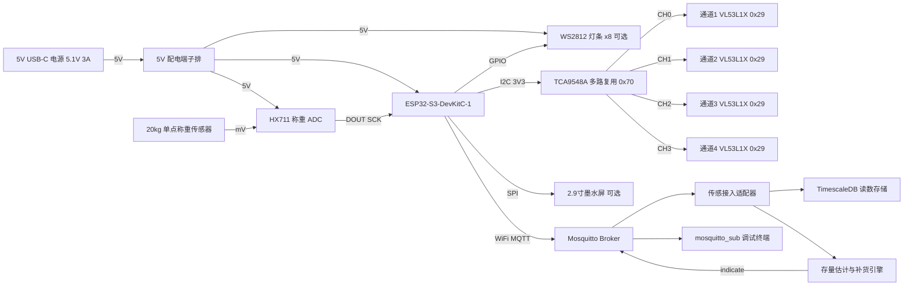

# 货架存量感知 · 桌面硬件原型构建指南

> 状态：v0.1 草案（2026-10-18）。**只写文档，目前不做实物**（见决策 R-06）。
> 相关文档：[02 可行性论证 §4](../02-feasibility.md)、[03 尖锐问题清单 R-01 / R-02 / R-03 / R-06](../03-open-questions.md)、[04 技术栈](../04-tech-stack.md)、[01 工作流设计 · 实体模型](../01-workflow-design.md)
> **价格说明**：「参考单价」是 2026-10-18 在所列渠道页面查到的单件零售价（美元，不含税和运费）。标「估算」的是没有逐项核价的经验区间。下单前请重新核价，缺货和涨价都很常见。

---

## 0. 一页摘要

| 问题 | 结论 |
|---|---|
| 做什么 | 做一段桌面货架：4 条带推进器的商品通道 + 1 个称重料箱 → ESP32-S3 → Wi‑Fi → MQTT（Mosquitto）。目的是证明「可插拔存量感知层」从硬件到数据接口都能跑通 |
| 测距传感器装在哪 | **装在通道后部、朝前，测推进器推板背面的距离**。装在前部朝后的方案在有推进器时测不出件数（理由见 §4.1） |
| 称重传感器选哪种 | **单只 20 kg 单点式称重传感器**（例如 Phidgets 3134_0）+ HX711。不推荐用 4 只 50 kg 半桥：它们的误差大约是单只 20 kg 的 10 倍（见 §4.7） |
| 多个测距传感器怎么接 | 推荐用 **TCA9548A I2C 多路复用器**（每个传感器保持默认地址 0x29），备选是 XSHUT 顺序上电改地址 |
| 供电 | 5 V USB-C 电源，接市电。一颗 CR2450 纽扣电池只能让本原型运行约 3–9 小时（推算见 §11） |
| 预算 | 核心物料约 **$215–305**；加上全部可选项约 **$280–445**（不含工具、税和运费） |
| MQTT 主题 | `storewright/v1/{store_id}/sense/{fixture_id}/{position_id}/{sensor_type}/state`（还有同一路径下的 `/event`） |
| 诚实的局限 | 测距只知道「通道还剩多深」，**分辨不出放错的商品**。测试计划里专门有一项「错放测试」，用来如实记录这个失败 |

---

## 1. 目的与边界

### 1.1 为什么只做桌面原型

[02 可行性论证 §4](../02-feasibility.md) 已经得出这些结论：

- **逐货位感知整店不划算**：大型超市约 15–24 万个货位，逐货位装测距仪的单店资本投入推算为 50–225 万美元，而货架传感最多只能直接解决约 25% 的缺货；
- **纽扣电池撑不住**：价签常用的 CR2450 只有 620 mAh。测距仪频繁测量会很快耗尽电量，称重则完全不可能用纽扣电池（本文 §11 用数据手册重新推算了一遍）；
- **价签协议是封闭的**：主流电子价签厂商的协议无法让第三方加装传感器，所以传感数据必须走独立通道（Wi‑Fi → MQTT）；
- **行业在转向摄像头**：主要价签厂商都在做「价签 + 摄像头」，没有一家在做逐货位测距。

所以硬件只需要证明三件事：**接口是通的、标定流程可以执行、失效模式是已知的**。一段桌面货架就足够了，整店规模全部用模拟器仿真。

### 1.2 与整店方案的关系

整店方案的核心是一个**可插拔的「存量感知」数据源接口**：补货引擎只关心「估计存量 + 置信度」，不关心数据来自哪里。

| 数据源 | 整店方案中的角色 | 本原型验证什么 |
|---|---|---|
| POS 销售推算 | 默认数据源，零硬件成本 | 不涉及（软件侧实现） |
| 员工扫描 | 被动校准（补货、拣货、Exception 时顺带确认） | 用 MQTT 命令模拟「员工确认件数」，以此重置称重基线（§8.5） |
| ToF 测距 | 只用于少数高周转、带推进器的规则商品 | **4 条通道的测距、换算、去抖和置信度** |
| 称重 | 大米、面粉、生鲜箱等重货 | **1 个称重料箱的计件和计重** |
| 摄像头 | 目前自动检测的最佳选择 | 不涉及（只在 §12 对比） |

原型产生的真实数据（噪声、漂移、遮挡误报率等）会**反哺模拟器的误差模型**，让模拟器里「传感器」模块的参数有实测依据。

### 1.3 原型要回答的问题

| # | 假设 | 对应测试 |
|---|---|---|
| H1 | 规则商品配推进器时，单区 ToF 能把件数测准（≥ 95% 的样本完全正确） | T1、T3 |
| H2 | 单只 20 kg 称重传感器 + HX711 能把 2–5 lb 米袋的件数测准到 ±1 件以内 | T5、T6 |
| H3 | 顾客伸手、碰撞料箱等动作可以被去抖逻辑过滤掉 | T4 |
| H4 | 从商品被拿走到 MQTT 事件发出，延迟可以控制在 10 秒以内 | T9 |
| H5 | 设备掉线、断电、重启后，数据能恢复，并且不会重复计数 | T11 |
| H6 | 每次调整陈列后，重新标定一条通道能在 5 分钟内完成 | T12 |

### 1.4 不做的事情

- **不进任何真实门店**，不接任何零售商的系统、价签网络或 Wi‑Fi；
- **不用电池**，不做低功耗优化（只在 §11 推算功耗）；
- **不做摄像头和视觉识别**；
- **不做量产电路板、外壳模具和认证**（FCC 等）。原型使用已经通过认证的 ESP32 模组开发板，只在桌面使用；
- **不采集任何顾客数据**，原型上也没有摄像头和麦克风；
- **不解决错放识别**。这是 ToF 的物理局限，只做如实记录。

### 1.5 合规提醒

本项目坚持 clean-room 原则：使用个人时间和个人资金；只参考公开资料；文档和代码中不出现任何零售商的名称、商标或内部信息。如果将来要在任何门店试点，必须先取得门店和公司的**书面许可**，并完成合规检查（见 §12）。

---

## 2. 系统框图



**数据流**：

1. ESP32 依次读取 4 个 ToF 传感器（每 2–5 秒一轮），连续读取 HX711（每秒 10 个样本）；
2. 在设备端完成滤波、件数换算、去抖和置信度计算，再以 JSON 格式发布到 MQTT（§7.8–7.9）；
3. 服务器上的**传感接入适配器**订阅这些主题，做格式校验、按 `(device_id, seq)` 去重，把 `position_id` 映射到系统中的 Location（货位）实体。读数写入 TimescaleDB（[04 技术栈](../04-tech-stack.md)已选定），同时生成领域事件「观测到估计存量」，交给补货引擎；
4. 补货引擎生成补货任务后，向 `indicate` 主题下发闪灯指令，用 LED 模拟电子价签的「补货指引 / 拣货指引」闪灯（§7.11）。

---

## 3. 物料清单（BOM）

### 3.1 核心物料（必需）

| # | 项目 | 型号 | 数量 | 参考单价（USD，2026-10-18） | 购买渠道示例 | 备注 |
|---|---|---|---|---|---|---|
| 1 | 主控板 | Espressif **ESP32-S3-DevKitC-1-N8R8** | 1 | $15.00（Amazon 上的 Espressif 店铺，来自第三方价格页，日期不明）至 $19.95（Adafruit #5336，查询时缺货） | Amazon、Adafruit、DigiKey、Mouser | 8 MB Flash + 8 MB 八线 PSRAM，**GPIO35–37 不可用**。官方板是两个 Micro-USB 口，部分第三方版本是 USB-C。本方案从 5V 引脚供电，所以接口类型不影响使用 |
| 2 | ToF 测距模块 | **Adafruit VL53L1X #3967**（STEMMA QT / Qwiic） | 4 | $14.95 | Adafruit | 3–5 V 供电；SDA/SCL 板载 10 kΩ 上拉；XSHUT 已做电平转换；约 30–4000 mm，视场角 27°。**推荐** |
| 2b | （备选）ToF 模块 | Pololu #3415 VL53L1X 载板 | (4) | $22.95（5 件起每件 $21.11，100 件起 $17.87） | Pololu | 板载 2.8 V 稳压；I2C 电平转换到 VIN；**XSHUT 没有电平转换，也不耐 5 V**；尺寸 13×18 mm，最小 |
| 2c | （备选）ToF 模块 | SparkFun SEN-14722 VL53L1X（Qwiic） | (4) | $29.95 | SparkFun | VCC 2.6–3.5 V；地址固定为 0x29，多个传感器必须配多路复用器 |
| 3 | I2C 多路复用器 | **SparkFun Qwiic Mux BOB-16784**（TCA9548A，8 通道） | 1 | $6.95 | SparkFun | 10 个 Qwiic 口（主总线 2 个 + 8 个通道），默认地址 0x70，可通过跳线改到 0x77；1.65–5.5 V。备选：Adafruit TCA9548A #2717，$6.95，排针接口 |
| 4 | Qwiic 线 | Adafruit #4401 STEMMA QT / Qwiic JST-SH 4 针，200 mm | 6 | $1.25 | Adafruit、SparkFun | 4 根接传感器，2 根备用。多路复用器到 ESP32 用杜邦线（见第 15 项） |
| 5 | 称重 ADC | **SparkFun SEN-13879 HX711** | 1 | $4.95 | SparkFun | 模拟电源 VCC 和数字电源 VDD 分开：VCC 接 5 V（激励更高），VDD 接 3.3 V（逻辑电平匹配 ESP32）。备选：Adafruit #5974，$9.95，带接线端子和 10/80 SPS 拨动开关 |
| 6 | 称重传感器 | **Phidgets 3134_0**（20 kg 单点式） | 1 | $7.00 | Phidgets | 1 mV/V；蠕变 20 g/小时；非线性 ≤ 10 g；零点温漂 2 g/°C；M5×0.8 螺纹；最大供电 5 V。选型理由见 §4.7 |
| 6b | （备选）称重传感器 | Adafruit #4543（20 kg 条形，4 线） | (1) | $3.95 | Adafruit | 便宜，但**没有公开规格**（蠕变、温漂都未知） |
| 6c | （不推荐）称重传感器 | SparkFun SEN-10245（50 kg 半桥）×4 + Load Sensor Combinator BOB-13878 | (4+1) | $6.25 / 只，Combinator $2.75 | SparkFun | 合计约 $27.75。这是体重秤用的 3 线半桥，需要 Combinator 组成全桥。误差分析见 §4.7 |
| 7 | 秤台板 | 两块 250×250 mm 板（5 mm 铝板或 12 mm 胶合板），M5 螺栓，**金属**垫片 | 1 套 | $15–35（估算） | 本地五金店、Amazon | **承力件必须用金属**，3D 打印的塑料会蠕变（见 §6） |
| 8 | 称重料箱 | 10–15 L 塑料周转箱或生鲜箱 | 1 | $8–15（估算） | 五金店、超市 | 底部平整；四边不能碰到任何其他物体 |
| 9 | 推进器 + 隔板 | **Store Fixtures Direct Auto Feed Shelf Product Pusher Kit，12" L 款**（4 个推进器 + 5 片隔板 + 粘贴式前挡和后轨，12" 深） | 1 | $49.95（页面显示的起价） | storefixturesdirect.com、Amazon | 隔板高 2.375"（约 60 mm），前挡约 1.5"。页面**没有写推板宽度和弹簧力**，收货后要实测 |
| 10 | 底板 | 胶合板或 MDF，约 700×420×18 mm，加一根后挡条 | 1 | $10–20（估算） | 本地建材店 | 尺寸推导见 §6 第 1 步 |
| 11 | 传感器支架 | 3D 打印（PLA 或 PETG，约 50–100 g 材料） | 4 + 1 | 自己打印 $2–5；外包打印 $15–30（估算） | 自己打印、打印服务 | **不承受载荷**，只用来定位传感器 |
| 12 | 电源 | Raspberry Pi 官方 15 W USB-C 电源（5.1 V 3 A，Adafruit #4298） | 1 | $8.74 | Adafruit | 1.5 m 线，18 AWG |
| 13 | USB-C 取电板 | Adafruit #4090 USB Type-C 分线板（下游端） | 1 | $2.95 | Adafruit | 板载两个 5.1 kΩ CC 电阻，向电源请求 5 V。页面称最多 1.5 A，本原型峰值远低于这个值 |
| 14 | 配电与线材 | 端子排或 WAGO 接线端子、22 AWG 线、杜邦线、热缩管、1 A 自恢复保险丝 | 1 套 | $10–20（估算） | Amazon、本地电子市场 | |
| 15 | 电子盒 | 小号 ABS 盒（装 ESP32、多路复用器、HX711） | 1 | $6–12（估算） | Amazon | |

**核心小计：约 $215–305**（低端：Amazon 价主控板 + SparkFun HX711 + 物料估算下限；高端：Adafruit 价主控板 + Adafruit HX711 + 物料估算上限）。

### 3.2 可选物料

| # | 项目 | 型号 | 数量 | 参考单价（USD，2026-10-18） | 购买渠道示例 | 备注 |
|---|---|---|---|---|---|---|
| 16 | 墨水屏 | Waveshare 2.9inch e-Paper Module（SKU 12956） | 1 | $21.99 | Waveshare | 296×128；SPI 接口；3.3/5 V；全刷新 3 s，局部刷新 0.6 s；待机 < 0.01 µA；刷新功耗约 26.4 mW。用来模拟价签显示 |
| 17 | LED 灯条 | Adafruit NeoPixel Stick #1426（8 颗 WS2812B 或 SK6812） | 1 | $5.95 | Adafruit | 5 V 供电；每条通道配 2 颗，正好 8 颗 |
| 18 | 电平转换芯片 | 74AHCT125 | 1 | 约 $1.50（估算） | Adafruit、DigiKey | 把 3.3 V 数据信号转成 5 V，驱动 WS2812（§5.9） |
| 19 | 温度传感器 | I2C 接口，例如 SHT4x 或 MCP9808 类 | 1 | $5–7（估算） | Adafruit、SparkFun | 用于温漂建模（§8.4） |
| 20 | 标定砝码 | 1 / 2 / 5 kg 砝码；或用可靠厨房秤称过的密封水瓶代替 | 1 套 | $0–40（估算） | Amazon | |
| 21 | 测试商品 | 尺寸统一的罐头或盒装商品约 30 件；5 lb 米袋 4 袋（或 2 lb 米袋 10 袋） | — | $30–60（估算） | 超市 | 测完可以吃掉 |
| 22 | （对比用）ToF 模块 | VL53L4CD 载板（Pololu 或 SparkFun SEN-18993） | 1 | 价格未核实 | Pololu、SparkFun | 量程 1–1200 mm，视场角 18°，**没有 4 cm 最小距离限制**，适合和 VL53L1X 做对比（§12） |

**含全部可选项：约 $280–445**（第 22 项未核价，没有计入）。如果改用 Pololu 的 ToF 模块，再加约 $32；改用 SparkFun 的，再加约 $60。

### 3.3 工具（不计入小计）

电烙铁和焊锡、万用表（必需，用来查短路和测上拉电阻）、数显卡尺（量商品深度）、内六角扳手、电钻、热熔胶枪、剥线钳。如果手头一件都没有，大约要 $60–150（估算）。

---

## 4. 传感方案选择与理由

### 4.1 ToF 安装位置：三种方案对比

| 方案 | 测的是什么 | 有推进器时 | 没有推进器时 | 主要问题 | 结论 |
|---|---|---|---|---|---|
| **A. 后装朝前**（传感器在通道后部，朝向通道前方） | 推进器**推板背面**到传感器的距离 | **商品数量和距离呈线性关系**：每少一件，推板就向前移动一件商品的深度 | 不适用（没有推板，测到的是最后一件商品，顾客从前面拿货时读数不变） | 推板满载时离传感器很近，要预留 ≥ 50 mm 的空间（最小测距 4 cm）；走线在货架后方 | **推荐** |
| B. 前装朝后（传感器在前挡处，朝向通道后部） | **第一件商品正面**到传感器的距离 | **测不出件数**：推进器总是把商品推到最前面，读数始终不变，直到通道空了；空了以后推板又贴在传感器前面，距离不到 4 cm | 只有顾客严格从前往后拿时才有效；员工整理货架（把商品往前拉齐）后读数会被重置为「满」 | 暴露在顾客手边，容易被挡住、碰歪；唯一的优点是离货架前沿的供电导轨近 | 不推荐 |
| C. 上方俯视（装在上一层隔板底部，朝下） | 堆叠商品的**高度** | — | 适合竖直堆叠的商品（托盘、蛋盒） | 需要上层隔板；会被手和商品遮挡 | 本原型不做 |

**结论**：本原型采用**方案 A（后装朝前，测推板）**。它的读数直接对应件数，传感器藏在货架后部不容易被顾客碰到，推板也给了一个大而平整、位置稳定的反射目标。

### 4.2 几何关系与件数换算

```
 后 ◄─────────────────────────────────────────────────────────────► 前
 ┃ToF┃ · · · 光束 · · · ┃推板┃ 商品 ┃ 商品 ┃ 商品 ┃ 商品 ┃┃前挡
 ┃   ┃◄────── d ───────►┃    ┃◄─────────── N × p ──────────►┃
 ┃   ┃◄──────────────────── d_empty ───────────────────►┃
        （通道为空时，推板贴住前挡，此时推板背面到传感器的距离）
```

- `d`：实测距离（传感器到推板背面，已做 offset 标定）
- `d_empty`：通道为空时的读数（现场标定，§8.2）。用几何计算的话：`d_empty = L_front − t_paddle`，其中 `L_front` 是传感器窗口到前挡内侧的距离，`t_paddle` 是推板厚度。**直接实测 `d_empty`，推板厚度和安装误差会自动抵消**
- `p`：每件商品的有效深度（含包装间隙），用满载标定求出：`p = (d_empty − d_full) / N_full`
- **件数**：`N ≈ (d_empty − d) / p`
- **安装约束**：`d_full = d_empty − N_max × p ≥ 50 mm`（数据手册规定最小测距 4 cm，再加 1 cm 余量）

**能测准的条件**：总测距误差必须明显小于半件商品的深度。VL53L1X 数据手册在长距离模式、100 ms 测距时长下标称的测距误差是 ±20 mm（精度加重复性）。重复性随测距时长和环境光变化，在 ±1% 到 ±0.15% 之间。经过 offset 标定和现场 `d_empty`、`p` 标定后，系统误差大部分会被消除，但仍然建议：

- 商品深度 `p ≥ 25 mm`：目标是件数完全正确；
- 商品深度 `p < 25 mm`（扁平小件）：只承诺 ±1 件，或者改用称重、POS 推算。

这两个门槛都要由 T1 测试实际验证。

### 4.3 视场角（FoV）与感兴趣区域（ROI）设置

VL53L1X 的接收端是 16×16 的 SPAD 阵列（单光子雪崩二极管），可以只启用其中一块区域作为 ROI，最小 4×4。ROI 越小，视场角越窄。数据手册 Table 9 给出：16×16 对应 27°，8×8 对应 20°，4×4 对应 15°（均为对角线视场角）。

光斑对角线直径 `D = 2 × d × tan(FoV / 2)`；方形 ROI 的水平宽度约为 `D / 1.41`：

| 距离 d | 16×16（27°） | 8×8（20°） | 4×4（15°） |
|---|---|---|---|
| 100 mm | 48 mm（水平约 34） | 35 mm（约 25） | 26 mm（约 19） |
| 200 mm | 96 mm（约 68） | 71 mm（约 50） | 53 mm（约 37） |
| 300 mm | 144 mm（约 102） | 106 mm（约 75） | 79 mm（约 56） |
| 350 mm | 168 mm（约 119） | 123 mm（约 87） | 92 mm（约 65） |

通道宽度通常是 70–100 mm。本原型通道深 305 mm，`d` 最大约 335–350 mm，因此：

- **默认用 4×4 ROI**：350 mm 处水平宽度约 65 mm，不会扫到隔板；
- **代价是信号变弱**：4×4 ROI 在长距离模式、黑暗环境下，对 17% 灰色目标的最大量程只有 45 cm，对 88% 白色目标是 170 cm。所以**要在推板背面贴一块白色哑光靶标**（≥ 40×40 mm 的白卡纸或白色标签）；
- **ROI 中心可以偏移**：如果支架有轻微俯仰误差，用 `SetROICenter` 把 ROI 往上偏几个 SPAD，避开通道底板的掠射反射；
- 在通道底板和隔板内侧靠近传感器的一段（约 100 mm）贴**黑色哑光胶带**，减少掠射反射。

### 4.4 距离模式与测距时长

| 参数 | 设置 | 理由（来自数据手册） |
|---|---|---|
| 距离模式 | **Short（短距离）** | 最大量程约 1.3 m，强环境光下几乎不衰减（Table 8：200 kcps/SPAD 下白色目标仍为 130 cm）。长距离模式在强光下会跌到 73 cm |
| 测距时长 | **50 ms**（可配置 33–100 ms） | 最短 20 ms（仅限短距离模式）；时长越长重复性越好，但功耗越高 |
| 测量间隔 | ≥ 测距时长 | 数据手册要求 |
| 每轮样本数 | 5 次，取中位数 | 剔除偶发异常值 |
| 轮询周期 | 每条通道 **2–5 秒一轮**（默认 3 秒） | 补货决策是分钟级的，不需要更快 |
| 测量方式 | **4 个传感器依次测量，不同时测量** | 避免相邻传感器的激光互相干扰，同时降低峰值电流 |
| I2C 速率 | 100 kHz（最高 400 kHz） | 数据手册规定最高 400 kHz。数据量很小，用 100 kHz 换取更长的线缆容限（§5.7） |

### 4.5 推进器为什么必要

1. **把「距离」变成「件数」**：没有推进器时，顾客从前面拿走一件，后面会留下空隙，传感器（无论装在前面还是后面）都看不出变化；有了推进器，每少一件，推板就向前移动一个商品深度，读数线性变化；
2. **给传感器一个稳定的目标**：推板大、平、垂直于光束，可以贴白色靶标。如果直接测商品，包装颜色、反光、形状千差万别；
3. **顺带的陈列收益**：推进器让商品始终排在最前面（自动整理货架），这本来就是零售常用的陈列方式；
4. **代价**：每条通道多一个推进器（本套件约 $12.5 / 通道）；推进器卡住时传感器会给出错误的「没有变化」（§10）。

### 4.6 称重与 ToF：哪些品类适合哪种感知

| 品类 / 陈列方式 | 示例 | 推荐感知方式 | 理由 |
|---|---|---|---|
| 刚性、形状规则、单列纵深 + 推进器 | 罐头、瓶装饮料、盒装茶、洗护瓶 | **ToF** | 每件深度一致，满足 §4.2 的条件 |
| 扁平小件（深度 < 25 mm） | 香皂、口香糖盒 | 称重托盘，或 POS 推算 | ToF 误差接近半件 |
| 软包装、可压缩、形状不规则 | 袋装零食、薯片 | 称重托盘、POS 推算或视觉 | 每件深度不稳定 |
| 大袋重货 | 大米、面粉、宠物粮 | **称重** | 单件重量大且一致，称重误差远小于单件重量 |
| 散装生鲜堆头 | 土豆、洋葱、苹果 | **称重（按千克）**，件数只作估计 | 单个重量差异大，只能估算个数 |
| 挂钩陈列 | 电池、小五金 | POS 推算或视觉 | 不在本原型范围内 |
| 冷柜（玻璃门） | 乳制品、冷饮 | 称重或摄像头 | 玻璃反光、凝露、低温都会影响 ToF |
| 竖直堆叠 | 蛋盒、托盘装 | 俯视 ToF（方案 C）或称重 | 不在本原型范围内 |
| 低周转长尾商品 | — | POS 推算 + 员工扫描 | 不值得装硬件（决策 R-01） |

### 4.7 称重传感器选型：4 只 50 kg 半桥 vs 单只 20 kg

**负载估算**：10 kg 米（例如 4 袋 5 lb，或 1 袋 20 lb）+ 料箱约 1 kg + 上台板约 0.5–0.9 kg ≈ **12 kg**。按「量程至少是最大负载的 2 倍」的常用选型原则（Adafruit 产品页也这样建议），**20 kg 量程**最合适：12 kg 约占满量程的 60%。

**误差预算**（按 TAL220 系列数据手册的 ±0.05% FS 等级计算；FS = 满量程）：

| 误差项（±0.05% FS） | 单只 20 kg（FS = 20 kg） | 4 只 50 kg（FS = 200 kg） |
|---|---|---|
| 非线性 | ±10 g | ±100 g |
| 滞后 | ±10 g | ±100 g |
| 蠕变（3 分钟） | ±10 g | ±100 g |
| 零点温漂（每 10 °C） | ±10 g | ±100 g |
| 合成误差（平方和开根号） | **约 ±20 g** | **约 ±200 g** |
| 占一袋 2 lb 米（907 g）的比例 | 约 2% | 约 22% |
| 占一袋 5 lb 米（2268 g）的比例 | 约 0.9% | 约 9% |
| HX711 噪声折合（50 nV rms @ 10 SPS，激励按约 4 V、1 mV/V 估算） | 约 0.2 g | 约 2 g |

说明：通用的 50 kg 半桥传感器**没有公开数据手册**。上表假设它和 TAL220 同一等级，实际可能更差。

| 对比项 | 单只 20 kg 单点式（推荐） | 4 只 50 kg 半桥 |
|---|---|---|
| 接线 | 4 线全桥，直接接 HX711 | 3 线半桥 ×4，需要 Combinator 组成全桥；颜色定义不统一，要用万用表找中心抽头 |
| 精度 | 合成误差约 ±20 g | 合成误差约 ±200 g |
| 机械结构 | 一根梁 + 两块板（Z 形），简单 | 四角各一只，要求四点等高，台面刚性要好 |
| 偏载 | 单点式本身针对偏载设计，但台面要控制在合理尺寸（建议 ≤ 250×250 mm，以四角测试为准） | 四角支撑，天然抗偏载，适合大台面 |
| 适用场景 | **10 kg 级料箱、桌面原型** | 50–150 kg 的落地堆头、托盘陈列 |
| 价格 | $7.00 | $25 + $2.75 = $27.75 |

**推荐**：本原型用**单只 20 kg 单点式称重传感器（Phidgets 3134_0）**。门店试点如果要做落地大堆头（≥ 50 kg），再用 4 只**全桥**称重传感器加接线盒，而不是体重秤用的半桥。

---

## 5. 接线与 I2C 地址规划

### 5.1 供电拓扑

```
USB-C 电源 5.1V 3A ──► USB-C 取电板(#4090) ──► 1A 自恢复保险丝 ──► 5V 端子排
                                                                ├─► [跳线 J1] ─► ESP32 5V 引脚
                                                                ├─► HX711 VCC（模拟/激励）
                                                                └─► 74AHCT125 VCC、WS2812 5V（并联 1000 µF 电容）
ESP32 3V3 引脚 ──► 多路复用器 VCC、4 个 VL53L1X 的 VIN、HX711 VDD（逻辑）、墨水屏 VCC
所有 GND 共地
```

- **ToF 模块必须由 3.3 V 供电**：Adafruit 和 Pololu 的模块都会把 I2C 电平转换到 VIN 电压。如果 VIN 接 5 V，SDA/SCL 就会被上拉到 5 V，而 **ESP32-S3 的 GPIO 不耐 5 V**；
- **ESP32 的供电方式只能选一种**：Espressif 用户指南写明 USB 口、5V 引脚、3V3 引脚三种供电方式互斥。开发时**拔掉跳线 J1**，用电脑 USB 给 ESP32 供电和烧录；部署时插上 J1，由 5 V 端子排供电，固件更新改走 OTA；
- **3V3 上不要接 LED**。板载 LDO 的额定电流以板卡原理图为准；本原型 3V3 的峰值主要是 Wi‑Fi 发射（约 340 mA）加单个 ToF（峰值 40 mA）。

### 5.2 ESP32-S3-DevKitC-1 引脚分配

| 功能 | GPIO | 连接到 | 备注 |
|---|---|---|---|
| I2C SDA | GPIO8 | 多路复用器 SDA | ESP32-S3 的 I2C 可以映射到任意 GPIO，本文固定用 8 和 9 |
| I2C SCL | GPIO9 | 多路复用器 SCL | |
| XSHUT_1 至 XSHUT_4 | GPIO4、5、6、7 | 4 个 ToF 的 XSHUT | 方案 B 必须接；方案 A 建议也接，传感器卡死时可以硬复位 |
| HX711 DOUT | GPIO13 | HX711 DAT | 数据就绪时为低电平 |
| HX711 PD_SCK | GPIO14 | HX711 CLK | **高电平保持超过 60 µs，HX711 就会进入掉电模式**（§7.4） |
| 墨水屏 SCK | GPIO12 | EPD CLK | SPI2 的 IO_MUX 默认引脚 |
| 墨水屏 MOSI | GPIO11 | EPD DIN | |
| 墨水屏 CS | GPIO10 | EPD CS | |
| 墨水屏 DC | GPIO17 | EPD DC | |
| 墨水屏 RST | GPIO16 | EPD RST | |
| 墨水屏 BUSY | GPIO15 | EPD BUSY | 输入 |
| WS2812 数据 | GPIO18 | 74AHCT125 输入 → 470 Ω 电阻 → 灯条 DIN | |
| 5 V 电压监测 | GPIO1（ADC1_CH0） | 5V 经 100 kΩ / 100 kΩ 分压 | 可选，用于 JSON 的 `power.vbus_mv` 字段 |
| 状态灯 | GPIO38 | 板载 RGB LED | v1.1 板是 GPIO38，v1.0 板是 GPIO48 |
| 服务键 | GPIO0 | 板载 BOOT 键 | 启动后可以当普通按键用；**不要外接下拉**（GPIO0 是启动配置引脚） |

**避开的引脚**：GPIO0、3、45、46（启动配置引脚）；GPIO19、20（USB）；GPIO43、44（串口 UART0）；GPIO26–32（Flash 和 PSRAM 总线）；GPIO35–37（八线 PSRAM 版本内部占用）。

### 5.3 I2C 地址规划

| 设备 | 7 位地址 | 所在位置 | 说明 |
|---|---|---|---|
| TCA9548A 多路复用器 | 0x70 | 主总线 | 可以通过跳线改到 0x71–0x77（最多级联 8 个，共 64 个通道） |
| VL53L1X ×4 | 0x29（各自默认地址） | 多路复用器通道 0–3 | 数据手册写的「0x52」是 8 位写地址，对应 7 位地址 0x29 |
| 温度传感器（可选） | 例如 SHT4x 为 0x44 | 主总线或通道 4 | 不能和 0x29、0x70–0x77 冲突 |
| （方案 B）VL53L1X ×4 | 0x30、0x31、0x32、0x33 | 同一条总线 | 每次上电后由固件重新分配 |

### 5.4 方案 A：TCA9548A 多路复用（推荐）

- 接线：ESP32（GPIO8/9、3V3、GND）→ 杜邦线 → 多路复用器主总线；多路复用器的通道 0–3 各用一根 Qwiic 线接一个 ToF 模块；
- 选通道：向 0x70 写入一个字节 `1 << ch`；写入 `0x00` 关闭所有通道；
- 地址跳线保持默认（0x70）。

### 5.5 方案 B：XSHUT 顺序上电改地址

VL53L1X 的 I2C 地址可以用软件修改，但**断电或复位后就会丢失**，恢复成 0x29（Pololu 产品页说明）。所以每次上电都要重新分配一次：

```
1. 把 4 个 XSHUT 全部拉低（所有传感器进入硬件待机）
2. 等待 ≥ 2 ms
3. 对第 i 个传感器（i = 0..3）：
   a. 释放 XSHUT_i（把 GPIO 设为输入、高阻态，由模块上拉到高电平）
      ※ Pololu 模块的 XSHUT 没有电平转换，也不耐 5 V，不要用推挽输出直接输出高电平
      ※ Adafruit 模块的 XSHUT 已做电平转换，但统一用「拉低 / 释放」的方式最安全
   b. 等待 ≥ 2 ms（数据手册：启动时间最长 1.2 ms），再轮询直到传感器启动完成
   c. 把地址从 0x29 改为 0x30 + i
   d. 用新地址读一次型号寄存器，确认修改成功
4. 运行中定期扫描 0x29：如果出现，说明有传感器复位了（比如电压跌落），需要重新执行第 3 步
```

| 对比项 | 方案 A：多路复用器 | 方案 B：XSHUT |
|---|---|---|
| 额外硬件 | +$6.95 | 无 |
| 占用 GPIO | 2 个（I2C） | 2 + N 个（每个传感器 1 个） |
| 接线 | 全部用 Qwiic 线，免焊接 | 每个传感器还要多拉一根 XSHUT 线（Qwiic 线只有 4 芯） |
| 地址管理 | 固定为 0x29，固件简单 | 每次上电都要重新分配；传感器复位后会回到 0x29 |
| 故障隔离 | 一个通道短路或线缆坏了，不影响其他通道 | 共享一条总线，一根线坏了可能拖垮整条总线 |
| 线缆电容 | 每个通道单独计算 | 所有线缆的电容叠加 |
| 扩展性 | 每个多路复用器 8 个通道，最多 8 个，共 64 个 | 受 GPIO 数量限制 |
| 单点故障 | 多路复用器本身 | 无 |

**推荐方案 A**：免焊接、故障隔离、固件简单，而且更接近门店里一块货架挂几十个传感器的场景。方案 B 适合买了 Pololu 模块、想省一个多路复用器的情况。

### 5.6 上拉电阻

- I2C 是开漏总线，SDA 和 SCL 都需要上拉电阻。ESP32 内部上拉约 45 kΩ，太弱，**不能依赖**；
- Adafruit VL53L1X 模块板载 10 kΩ 上拉。方案 B 中 4 块模块并联，等效约 2.5 kΩ；方案 A 中多路复用器把各通道隔开，每个通道只有自己那块模块的上拉；
- **上限（上升时间）**：按 NXP I2C 规范 UM10204，`Rp(max) = tr / (0.8473 × Cb)`。在 Fast mode（400 kHz，tr = 300 ns）下：2.2 kΩ 上拉允许约 161 pF，3.6 kΩ 允许约 98 pF。这和 VL53L1X 数据手册 Table 3 的建议一致（CL ≤ 90 pF 用 3.6 kΩ，90–140 pF 用 2.4 kΩ，140–270 pF 用 1.2 kΩ）。在 Standard mode（100 kHz，tr = 1000 ns）下，2.2 kΩ 允许约 536 pF；
- **下限（灌电流）**：3.3 V 系统中，按 3 mA 灌电流、0.4 V 低电平计算，`Rp(min) ≈ (3.3 − 0.4) / 3 mA ≈ 1 kΩ`。上拉不要并联到低于 1 kΩ；
- **实测**：断电后，用万用表测 SDA 对 3V3、SCL 对 3V3 的电阻，目标是 **2–5 kΩ**。

### 5.7 I2C 线长限制

- 规范上限：Standard mode 和 Fast mode 每条总线的负载电容不超过 **400 pF**（UM10204）；
- 经验值：普通排线或杜邦线约 40–100 pF/m，每个器件输入端再加约 10 pF（估算，以实测为准）；
- **本原型的规则**：每个多路复用器通道的线长 ≤ 0.5 m；主总线（ESP32 到多路复用器）≤ 0.3 m；全程用 100 kHz；
- **门店场景**：一段 1.2 m 的货架挂十几条通道时，不要硬拉长 I2C。可以每层货架放一个小 MCU，或者使用差分 I2C（PCA9615，例如 SparkFun QwiicBus），也可以改用 RS-485 或 CAN 总线（§12）。

### 5.8 称重传感器与 HX711 接线

| 称重传感器线色 | Phidgets 3134_0 | TAL220 系列（HTC 数据手册） | 接 HX711 |
|---|---|---|---|
| 红 | +5V（激励+） | exc.+ | **E+**（SparkFun 板标 RED） |
| 黑 | 地（激励−） | exc.− | **E−**（BLK） |
| 绿 | 信号+ | sig.+ | **A+**（GRN） |
| 白 | 信号− | sig.− | **A−**（WHT） |
| 屏蔽线（如果有） | — | shielding | YLW（只接屏蔽，可以不接） |

- **线色并不统一**，以手头传感器的数据手册为准。如果加重物后读数反而变小，交换 A+ 和 A−，或者在软件里取负；
- 4 只 50 kg 半桥（如果坚持用）：每只 3 根线，先用万用表找出**中心抽头**（它到两端的电阻约为两端之间电阻的一半），再按 SparkFun Combinator 的标注接线；
- **SparkFun SEN-13879 引脚**：`VCC` 接 5 V（模拟电源，给称重传感器供电），`VDD` 接 3.3 V（数字电源，决定逻辑电平），`DAT` 接 GPIO13，`CLK` 接 GPIO14，`GND` 接地。这正是 SparkFun 教程推荐的「VCC 5 V、VDD 3.3 V」接法；
- **Adafruit #5974 引脚**：`VIN` 接 3.3 V（等于逻辑电平），`DATA` 和 `SCK` 同上；板上 RATE 拨动开关拨到 L 是 10 SPS，拨到 H 是 80 SPS；
- **采样率**：HX711 的 RATE 引脚接低电平是 10 SPS，接高电平是 80 SPS（数据手册）。SparkFun 产品页没有说明怎么切换 RATE，以原理图为准。**本原型用 10 SPS**：噪声更低（50 nV rms，80 SPS 时为 90 nV rms），而且同时抑制 50 Hz 和 60 Hz 工频干扰；
- **不要剪短称重传感器的原厂线**（Phidgets 是 550 mm）。HX711 尽量靠近称重传感器，模拟信号线 ≤ 0.5 m，远离 Wi‑Fi 天线和 LED 线。

### 5.9 指示灯与墨水屏接线

- **WS2812**：5 V 供电，数据线高电平门限约为 0.7 × VDD ≈ 3.5 V，ESP32 的 3.3 V 输出处于临界值，所以要经过 74AHCT125（5 V 供电）转换电平；数据线串联 470 Ω 电阻，灯条电源端并联 1000 µF 电容。按 Adafruit 产品页约 18 mA 恒流驱动计算，8 颗全白最坏约 400 mA 以上，**固件把亮度限制在 25% 以内**；
- **墨水屏**：3.3 V 供电，接线见 §5.2。只在数值变化时局部刷新，每次约 0.6 s；每小时做一次全刷新，防止残影。

---

## 6. 机械装配步骤

1. **准备底板**：700×420×18 mm 胶合板。左侧约 420 mm 宽作为通道区（4 条通道，每条约 80–100 mm），右侧约 280 mm 宽作为称重区。纵深方向从前往后依次是：前挡约 20 mm、通道 305 mm（12"）、后部传感器区约 70–80 mm。
2. **画线**：用铅笔画出前挡线、后轨线和每条通道的中心线，量好对角线，保证四边成直角。
3. **贴前挡和后轨**：先用酒精擦净粘贴面，再贴上套件里的粘贴式前挡和后轨，压紧后静置固化（按产品说明）。原型可以额外加 2–3 颗木螺丝。
4. **装隔板**：把 5 片隔板卡在前挡和后轨上，分成 4 条通道。通道宽度 = 商品宽度 + 5–10 mm 余量。
5. **装推进器并检查**：推板来回推几十次，确认全程顺滑、不卡、不歪。**在推板背面中心贴白色哑光靶标**（≥ 40×40 mm），靶标中心高度记为 `H_t`。
6. **打印传感器支架**：
   - 传感器中心高度 = `H_t`；传感器光轴平行于通道中心线，垂直度误差 ≤ 1°；
   - 支架开窗**不能遮挡**发射和接收窗口。窗口做成喇叭口（单边外扩 ≥ 15°），不加任何盖板（盖板会引入串扰，见 §8.1）；
   - 传感器窗口到推板最靠后位置的距离 ≥ 50 mm（§4.2 的安装约束）；
   - 传感器中心要比后轨顶面高出 ≥ 10 mm：4×4 ROI 的竖直半角约 5.3°，光束走 60 mm 会下沉约 6 mm，需要留出这段余量。
7. **撕掉传感器保护膜**：VL53L1X 出厂时光学窗口上贴有保护膜，不撕掉读数会出错（SparkFun 产品页的提醒）。
8. **固定支架**：用木螺丝把 4 个支架固定在后部传感器区。Qwiic 线沿后挡条走线，用扎带固定，汇到电子盒里的多路复用器。
9. **贴黑色胶带**：在通道底板和隔板内侧、靠近传感器的约 100 mm 范围内，贴黑色哑光胶带，减少掠射反射（§4.3）。
10. **装秤台（Z 形结构）**：底板 → 金属垫片 → 称重传感器**固定端**（2 颗 M5）→ 称重传感器 → 另一端**加载端**的金属垫片 → 上台板（2 颗 M5）。
    - 两端只能各固定一侧，梁的中间段要悬空，上下各留 2–3 mm 间隙；
    - 如果传感器上有箭头，让箭头指向受力方向（向下）；
    - 螺栓不能拧到底，顶住传感器的应变区；
    - **垫片和所有承力件都用金属**，不用 3D 打印件（塑料蠕变会被误认为称重传感器蠕变）；
    - 在加载端下方装一颗**限位螺丝**，间隙调到约 0.5–1 mm，并确认 20 kg 时不会碰到。Phidgets 3134_0 的最大过载是 24 kg（120%），有人倚靠时可能超过。
11. **放料箱**：料箱放在上台板中心，底部垫防滑垫。**料箱四边不能碰到任何其他物体**（隔板、墙、线缆），否则会分走一部分重量（力分流）。
12. **装电子盒**：ESP32、多路复用器、HX711 和端子排装进 ABS 盒。HX711 靠近称重传感器；Wi‑Fi 天线（模组 PCB 天线那一端）朝外，不要被金属挡住。
13. **装指示灯和墨水屏**：NeoPixel 灯条贴在前挡外侧，每条通道对齐 2 颗灯；墨水屏装在称重料箱前方的小立牌上。
14. **接电源**：按 §5.1 的拓扑接线。电源线经过 1 A 自恢复保险丝；ESP32 的 5 V 跳线 J1 先**不插**。
15. **贴标签**：每条通道和料箱贴上 `position_id` 标签，再贴一个二维码（二维码内容就是 `position_id`），方便以后用手机扫码绑定商品。
16. **上电前检查**：断电状态下，用万用表测 5V–GND、3V3–GND 之间没有短路；测 SDA 对 3V3、SCL 对 3V3 的电阻在 2–5 kΩ 之间。
17. **首次上电（只接电脑 USB）**：运行 I2C 扫描，应该看到 0x70；逐个选通多路复用器的通道 0–3，每个通道都应该看到 0x29；用手按压秤台，HX711 的原始读数应该随之变化。全部正常后再插上 J1，切换到 5 V 端子排供电。

---

## 7. 固件设计（只给伪代码，不给完整源码）

### 7.1 软件栈建议

| 层 | 推荐 | 备选 | 说明 |
|---|---|---|---|
| 框架 | Arduino-ESP32 core + PlatformIO | 原生 ESP-IDF | Arduino 上手快；需要更精细的 OTA 回滚和 NVS 控制时，可以直接调用 ESP-IDF 接口（Arduino 底层就是 ESP-IDF） |
| ToF 驱动 | SparkFun VL53L1X Arduino 库（封装了 ST ULD 驱动，带 offset、串扰标定和温度更新接口，以库文档为准） | Pololu VL53L1X 库；ST 官方 ULD 驱动 | Pololu 论坛指出，简化版 Arduino 库不一定支持串扰标定 |
| HX711 驱动 | 任意成熟库，但必须保证读数时 PD_SCK 高电平脉冲 < 60 µs | NAU7802（I2C 接口的 24 位 ADC，例如 SparkFun Qwiic Scale） | Wi‑Fi 中断可能拉长时钟脉冲，导致 HX711 误入掉电模式或读出错误数据 |
| MQTT | ESP-IDF 自带的 esp-mqtt 客户端 | PubSubClient | 需要支持遗嘱消息、QoS 1、TLS |
| 存储 | NVS（ESP32 的键值存储区） | — | 存放设备 ID、Wi‑Fi 凭据、配置、标定参数 |
| OTA | `esp_https_ota` + 回滚 | ArduinoOTA（只适合局域网开发） | 见 §7.10 |

### 7.2 启动流程

```
on_boot():
    log_init(); read_reset_reason()
    nvs = load_nvs()        # device_id、Wi-Fi 凭据、broker 地址、cfg_ver、通道配置、标定参数
    status_led(BOOTING)
    i2c_begin(SDA=8, SCL=9, freq=100kHz)
    scan_bus()              # 期望看到 0x70；没有就进入 FAULT 状态，状态灯闪红
    init_tof_all()          # 见 §7.3
    init_scale()            # HX711：增益 128，10 SPS；等待 ≥ 400 ms 建立时间
    init_epd(); init_leds(brightness_max=25%)
    wifi_connect(backoff = 1, 2, 4, ... 最长 60 s)
    sntp_sync()             # 同步之前 ts 字段填 null，并附上 uptime_ms
    mqtt_connect(
        client_id = device_id,
        will = { topic: ".../device/{device_id}/status", payload: {"state":"offline"}, qos: 1, retain: true },
        keepalive = 30 s,
        clean_session = false)
    publish_retained(".../device/{device_id}/status", {"state":"online", fw, ip, rssi, reset_reason, ...})
    subscribe(".../device/{device_id}/config")    # retained，连上后立刻收到最新配置
    subscribe(".../device/{device_id}/cmd")
    subscribe(".../device/{device_id}/ota")       # retained
    subscribe(".../indicate/{fixture_id}/+")
    if self_test_ok():      # 传感器都能响应，MQTT 已连接
        ota_mark_app_valid()                      # 取消回滚（§7.10）
    start_tasks(tof_task, scale_task, publish_task, health_task)
    task_watchdog_enable(timeout=30 s)
```

### 7.3 传感器初始化

```
init_tof_all():
    for lane in cfg.lanes:                   # 方案 A：通过多路复用器选通
        mux_select(lane.mux_ch)
        wait_until(tof_booted(0x29), timeout=100 ms)
        tof_init(0x29)
        tof_set_distance_mode(SHORT)
        tof_set_timing_budget(cfg.tof.timing_budget_ms)       # 默认 50
        tof_set_inter_measurement(cfg.tof.timing_budget_ms + 10)
        tof_set_roi(cfg.tof.roi.w, cfg.tof.roi.h)             # 默认 4x4
        tof_set_roi_center(lane.roi_center or DEFAULT_CENTER)
        tof_set_offset(nvs.cal[lane].offset_mm)
        if nvs.cal[lane].xtalk_cps exists: tof_set_xtalk(nvs.cal[lane].xtalk_cps)
        lane.state = STABLE_UNKNOWN
    mux_select(NONE)
    # 方案 B 则按 §5.5 的 XSHUT 顺序改地址后执行同样的配置

init_scale():
    hx711_begin(DOUT=13, SCK=14, gain=128)
    wait(450 ms)                             # 10 SPS 时建立时间为 400 ms
    scale.offset_counts = nvs.cal.scale.offset_counts
    scale.g_per_count   = nvs.cal.scale.g_per_count
```

### 7.4 采样调度

```
tof_task():                                  # 每 cfg.tof.period_s 秒执行一轮（默认 3 秒，范围 2–5 秒）
    loop every period:
        for lane in lanes:                   # 依次测量：避免激光互相干扰，也降低峰值电流
            mux_select(lane.mux_ch)
            tof_start_ranging()
            samples = []
            repeat until len(samples) == cfg.tof.samples (默认 5) or timeout:
                wait_data_ready(); r = tof_read()
                tof_clear_interrupt()        # 数据手册：必须清中断，才会更新下一次数据
                if r.range_status == 0:      # 0 = 有效
                    samples.append(r)
            tof_stop_ranging()
            if len(samples) < 3: report(lane, flag="insufficient_valid_samples"); continue
            d_med   = median(s.distance_mm for s in samples)
            mad     = median(|s.distance_mm − d_med|)
            sig     = median(s.signal_kcps); amb = median(s.ambient_kcps)
            process_tof(lane, d_med, mad, sig, amb, samples)       # §7.5 + §7.7
        mux_select(NONE)

scale_task():                                # HX711 以 10 SPS 自由运行
    on DOUT low (数据就绪):
        enter_critical_section()             # 关中断，保证 PD_SCK 脉冲 < 60 µs
        raw = hx711_read_24bit_plus_gain_pulses(gain=128)   # 25 个时钟脉冲 = A 通道、增益 128
        exit_critical_section()
        ring.push(raw)                       # 保留最近 20 个样本（2 秒）
        w_avg = mean(last 10 samples) → 换算成克     # 1 秒滑动平均
        w_std = stdev(last 20 samples, 单位克)
        stable = (w_std < cfg.scale.stable_std_g, 默认 5 g) 并持续 ≥ 2 s
        process_weight(w_avg, w_std, stable)               # §7.6 + §7.7
```

### 7.5 距离 → 件数

```
tof_to_units(d, lane):
    # lane.d_empty_mm、lane.pitch_mm、lane.capacity 都来自现场标定（§8.2）
    if d < lane.d_full_mm − cfg.occlusion_margin_mm (默认 15):
        return OCCLUDED                      # 手伸进通道、或有东西挡在推板前
    if d > lane.d_empty_mm + cfg.empty_margin_mm (默认 15):
        return FAULT                         # 推板脱落、传感器偏了，或者看到了通道外面
    n_float = (lane.d_empty_mm − d) / lane.pitch_mm
    n       = clamp(round(n_float), 0, lane.capacity)
    frac    = |n_float − round(n_float)|     # 0 表示正好在整数件上，0.5 表示最模糊
    conf = w_status × w_signal × w_spread × w_frac
        w_status = 1.0（所有样本 range_status = 0），否则 0.6
        w_signal = clamp((sig − S_MIN) / (S_GOOD − S_MIN), 0.3, 1.0)   # S_MIN、S_GOOD 在标定时记录
        w_spread = clamp(1 − mad / (0.25 × lane.pitch_mm), 0, 1)
        w_frac   = max(0.2, 1 − 2 × frac)
    return (n, n_float, conf)
```

### 7.6 重量 → 件数

```
weight_to_units(w_g, bin):                   # w_g = (counts − offset_counts) × g_per_count（料箱已去皮）
    if bin.mode == "count":                  # 例如 5 lb 米袋，unit_g 由实测平均得出
        n_float = w_g / bin.unit_g
        n       = max(0, round(n_float))
        resid   = |w_g − n × bin.unit_g|
        tol     = max(bin.tol_abs_g, 3 × sqrt(max(n,1)) × bin.unit_sigma_g + SENSOR_ERR_G)
                  # SENSOR_ERR_G 约 20 g（§4.7）；unit_sigma_g 表示包装重量的离散程度
        conf    = clamp(1 − resid / (0.5 × bin.unit_g), 0, 1) × stability_factor × drift_factor
        flags   = ["unexpected_weight"] if resid > tol else []    # 可能放了别的东西，或混进了其他商品
        return (n, n_float, conf, resid, flags)
    if bin.mode == "bulk":                   # 散装生鲜：以千克为主，件数只作估计
        est = w_g / bin.avg_item_g
        return (round(est), est, min(0.5, conf_from_stability), w_g, ["estimated_by_avg_item_weight"])

drift_factor = 1.0，并且距离上次置零的时间越长、温差越大，就越低（§8.4）
```

### 7.7 变化检测与去抖

每个货位维护一个状态机：

```
状态：STABLE(n) / CANDIDATE(n', k) / OCCLUDED / SERVICE / FAULT

on_new_estimate(pos, n, conf, frac):
    if pos.state == SERVICE: return                         # 补货或标定中，不发事件
    if result == OCCLUDED:
        pos.state = OCCLUDED; pos.occluded_since = now; return   # 不发事件，等遮挡消失
    if pos.state == OCCLUDED and 遮挡已消失: pos.state = STABLE(pos.last_n)
    if n == pos.stable_n: pos.state = STABLE(n); return
    if frac > 0.35: return                                  # 滞回：读数处于两个整数之间时不接受
    if pos.state is CANDIDATE(n) : k += 1 else pos.state = CANDIDATE(n, 1)
    if k >= K_CONFIRM:                                      # ToF 默认 2 轮（约 6 s），称重默认稳定 2 s 后再确认 1 s
        emit_event(pos, from=pos.stable_n, to=n)
        pos.stable_n = n; pos.state = STABLE(n)
        publish_state(pos)                                  # retained

心跳：每 60 秒发布一次 state（retained），无论有没有变化
遮挡超时：OCCLUDED 超过 120 秒 → 发 flag "occluded_long"（有东西放在通道里了）
大批量变化：一次变化 ≥ 3 件，且 1 分钟内有多次变化 → 判定为「补货中」，自动进入 SERVICE，5 分钟没有变化后退出
服务键：长按 BOOT 3 秒，进入或退出 SERVICE 模式（状态灯变蓝）
```

### 7.8 MQTT 主题设计

主题根：`storewright/v1/{store_id}/`（所有 ID 都**不能包含** `/`、`+`、`#`）。

| 主题 | 方向 | QoS | retain | 内容 |
|---|---|---|---|---|
| `storewright/v1/{store_id}/sense/{fixture_id}/{position_id}/{sensor_type}/state` | 设备 → 服务 | 1 | 是 | 最新稳定估计（变化时发布，并且每 60 s 发一次心跳） |
| `storewright/v1/{store_id}/sense/{fixture_id}/{position_id}/{sensor_type}/event` | 设备 → 服务 | 1 | 否 | 件数变化事件（包含变化前后的值） |
| `storewright/v1/{store_id}/sense/{fixture_id}/{position_id}/{sensor_type}/raw` | 设备 → 服务 | 0 | 否 | 调试用的原始样本，默认关闭 |
| `storewright/v1/{store_id}/device/{device_id}/status` | 设备 → 服务 | 1 | 是 | online / offline（offline 由遗嘱消息发出）+ 健康信息 |
| `storewright/v1/{store_id}/device/{device_id}/config` | 服务 → 设备 | 1 | 是 | 期望配置（带 `cfg_ver` 版本号） |
| `storewright/v1/{store_id}/device/{device_id}/config/reported` | 设备 → 服务 | 1 | 是 | 设备实际生效的配置版本 |
| `storewright/v1/{store_id}/device/{device_id}/cmd` | 服务 → 设备 | 1 | 否 | 去皮、标定、进入服务模式、重启、闪灯定位设备 |
| `storewright/v1/{store_id}/device/{device_id}/cmd/ack` | 设备 → 服务 | 1 | 否 | 命令回执 |
| `storewright/v1/{store_id}/device/{device_id}/ota` | 服务 → 设备 | 1 | 是 | 期望固件 `{version, url, sha256}` |
| `storewright/v1/{store_id}/indicate/{fixture_id}/{position_id}` | 服务 → 设备 | 1 | 否 | 闪灯和屏显指令（模拟价签的补货指引 / 拣货指引） |

- `sensor_type` 取值：`tof`、`weight`。预留：`camera`、`scan`、`pos`（后三种不由本设备发布，但走同一套数据结构）；
- `position_id` 对应 [01 工作流设计](../01-workflow-design.md)中的 Location（货位）编码，例如桌面原型用 `DESK-01-1-02`，门店里是 `A12-03-2-05` 这样的格式；
- 订阅示例：服务端订阅 `storewright/v1/LAB-001/sense/+/+/+/state` 和 `storewright/v1/LAB-001/sense/+/+/+/event`；调试时订阅 `storewright/v1/LAB-001/#`；
- **retained 的作用**：broker 会保存每个主题的「最后一条消息」，新订阅者一连上就能收到；设备重启后也能立即收到最新配置（Mosquitto mqtt(7) 文档）。要清除某个主题的 retained 消息，发布一条空载荷的 retained 消息即可（MQTT 3.1.1 规范）；
- **遗嘱消息（LWT）**：设备连接 broker 时预先登记一条「遗嘱」。如果设备异常断线，broker 会在 1.5 倍 keepalive（本例约 45 s）内代它发出 `offline`。

### 7.9 JSON 载荷示例

**ToF 状态**（`.../sense/DESK-01/DESK-01-1-02/tof/state`）：

```json
{
  "schema": "storewright.shelf-sensing/0.1",
  "store_id": "LAB-001",
  "fixture_id": "DESK-01",
  "position_id": "DESK-01-1-02",
  "device_id": "ss-esp32s3-7c9ebd2a",
  "sensor_type": "tof",
  "seq": 18234,
  "ts": "2026-10-18T14:03:22.418Z",
  "raw": {
    "distance_mm": 173,
    "samples_mm": [172, 173, 173, 174, 176],
    "mad_mm": 1,
    "range_status": 0,
    "signal_kcps": 2450,
    "ambient_kcps": 12,
    "roi": "4x4",
    "timing_budget_ms": 50
  },
  "model": { "d_empty_mm": 335, "pitch_mm": 40.5, "capacity_units": 6 },
  "estimated_units": 4,
  "units_float": 4.0,
  "confidence": 0.94,
  "flags": [],
  "power": { "source": "mains_5v", "vbus_mv": 5080, "battery_mv": null, "battery_pct": null },
  "fw": "0.1.0",
  "cfg_ver": 7
}
```

验算：(335 − 173) / 40.5 = 4.0 件；满载时 `d_full = 335 − 6 × 40.5 = 92 mm`，大于 50 mm，满足安装约束。

**称重状态**（`.../sense/DESK-01/DESK-01-W-01/weight/state`）：

```json
{
  "schema": "storewright.shelf-sensing/0.1",
  "store_id": "LAB-001",
  "fixture_id": "DESK-01",
  "position_id": "DESK-01-W-01",
  "device_id": "ss-esp32s3-7c9ebd2a",
  "sensor_type": "weight",
  "seq": 18240,
  "ts": "2026-10-18T14:03:24.002Z",
  "raw": {
    "counts_avg": 1843921,
    "net_g": 6871.4,
    "std_g": 1.8,
    "stable": true,
    "window_samples": 10,
    "rate_sps": 10,
    "temp_c": 22.6,
    "since_zero_s": 5400
  },
  "model": { "mode": "count", "unit_g": 2290.0, "unit_sigma_g": 12.0, "tol_g": 120.0 },
  "estimated_units": 3,
  "units_float": 3.0,
  "residual_g": 1.4,
  "confidence": 0.97,
  "flags": [],
  "power": { "source": "mains_5v", "vbus_mv": 5080, "battery_mv": null, "battery_pct": null },
  "fw": "0.1.0",
  "cfg_ver": 7
}
```

验算：6871.4 / 2290 ≈ 3.0006 → 3 件，残差 1.4 g。5 lb 米袋的标称重量是 2268 g，`unit_g` 用实测平均值（含包装和超装），所以是 2290 g。

**变化事件**（`.../tof/event`，不 retained）：

```json
{
  "schema": "storewright.shelf-sensing/0.1",
  "store_id": "LAB-001", "fixture_id": "DESK-01", "position_id": "DESK-01-1-02",
  "device_id": "ss-esp32s3-7c9ebd2a", "sensor_type": "tof",
  "seq": 18233, "ts": "2026-10-18T14:03:22.410Z",
  "event": "units_changed", "from_units": 5, "to_units": 4,
  "confirm_cycles": 2, "first_seen_ts": "2026-10-18T14:03:16.380Z",
  "confidence": 0.94
}
```

**设备状态**（`.../device/ss-esp32s3-7c9ebd2a/status`，retained；遗嘱消息只有 `{"state":"offline"}`）：

```json
{ "state": "online", "fw": "0.1.0", "cfg_ver": 7, "ip": "192.168.50.23", "rssi_dbm": -58,
  "uptime_s": 86400, "reset_reason": "power_on", "heap_free": 182340,
  "i2c_errors": 0, "tof_ok": [true, true, true, true], "scale_ok": true, "ts": "2026-10-18T14:00:00Z" }
```

服务端收到消息后：先做格式校验，再按 `(device_id, seq)` 去重（QoS 1 可能重复投递），最后写入数据库并生成领域事件。设备断线期间，事件先缓存在 PSRAM 环形缓冲区里（最多 200 条），重连后按原始 `ts` 补发。

### 7.10 配置下发（retained）与 OTA

**配置**（`.../device/{device_id}/config`，retained，QoS 1）：

```json
{
  "cfg_ver": 7,
  "fixture_id": "DESK-01",
  "tof": { "period_s": 3, "samples": 5, "timing_budget_ms": 50, "distance_mode": "short",
           "roi": { "w": 4, "h": 4 }, "occlusion_margin_mm": 15, "empty_margin_mm": 15, "k_confirm": 2 },
  "lanes": [
    { "position_id": "DESK-01-1-01", "mux_ch": 0, "item_ref": "SKU-CAN-400G",   "d_empty_mm": 336, "pitch_mm": 67.0, "capacity": 3 },
    { "position_id": "DESK-01-1-02", "mux_ch": 1, "item_ref": "SKU-TEA-BOX",    "d_empty_mm": 335, "pitch_mm": 40.5, "capacity": 6 },
    { "position_id": "DESK-01-1-03", "mux_ch": 2, "item_ref": "SKU-SPICE-JAR",  "d_empty_mm": 334, "pitch_mm": 48.0, "capacity": 5 },
    { "position_id": "DESK-01-1-04", "mux_ch": 3, "item_ref": "SKU-SOAP-BAR",   "d_empty_mm": 337, "pitch_mm": 32.0, "capacity": 8 }
  ],
  "scale": { "position_id": "DESK-01-W-01", "mode": "count", "unit_g": 2290.0, "unit_sigma_g": 12.0,
             "tol_abs_g": 120.0, "stable_std_g": 5.0, "zero_track_band_g": 30.0 },
  "publish": { "heartbeat_s": 60, "raw_debug": false },
  "indicate": { "max_brightness_pct": 25 }
}
```

- 设备收到配置后：校验格式 → 如果 `cfg_ver` 比当前版本新，就应用并写入 NVS → 发布到 `config/reported`。校验失败时保持旧配置，并在 `cmd/ack` 中报错；
- **标定参数**（offset、串扰、`d_empty`、`pitch`、去皮值、比例系数）由设备通过标定命令产生，保存在 NVS，同时上报给服务端备份。服务端可以在配置中覆盖这些参数（例如更换主控板后恢复）；
- **标定命令示例**（`cmd`）：`{"cmd":"cal_empty","position_id":"DESK-01-1-02"}`、`{"cmd":"cal_full","position_id":"DESK-01-1-02","units":6}`、`{"cmd":"tare","position_id":"DESK-01-W-01"}`、`{"cmd":"cal_span","position_id":"DESK-01-W-01","ref_g":5000.0}`、`{"cmd":"service","on":true}`。

**OTA**（`.../device/{device_id}/ota`，retained）：

```json
{ "version": "0.1.1", "url": "https://ota.lab.local/shelf-sensing/0.1.1.bin",
  "sha256": "<64 位十六进制>", "not_before": "2026-10-20T02:00:00Z" }
```

```
on_ota_message(m):
    if semver(m.version) <= current_fw: return
    if now < m.not_before: schedule_later(m.not_before); return
    enter SERVICE mode; publish status "updating"
    esp_https_ota(url=m.url, 校验服务器证书)              # 写入另一个 OTA 分区（ota_0 / ota_1 交替）
    verify sha256; set_boot_partition(new); reboot
新固件启动：
    状态为 PENDING_VERIFY（需开启 CONFIG_BOOTLOADER_APP_ROLLBACK_ENABLE）
    self_test(): I2C 上能看到 0x70 和 4 个 ToF、HX711 有数据、MQTT 已连接
    通过 → esp_ota_mark_app_valid_cancel_rollback()
    失败 → esp_ota_mark_app_invalid_rollback_and_reboot()   # 自动回到旧版本
```

### 7.11 指示灯（模拟电子价签闪灯）

```
on_indicate(position_id, m):      # m = {"pattern":"blink","color":"#00FF00","period_ms":500,"duration_s":30,"reason":"stock_task","task_id":"T-0042"}
    leds = led_map[position_id]   # 每条通道 2 颗；称重料箱用墨水屏显示
    run_pattern(leds, m.pattern, m.color, m.period_ms, until=now + m.duration_s)
    publish cmd/ack {"task_id": m.task_id, "shown": true}
颜色约定（可配置）：绿色 = 补货指引，蓝色 = 拣货指引，红色 = 传感器故障或需要核查
墨水屏：显示 position_id、商品名、估计件数或千克数、置信度；只在数值变化时局部刷新
```

### 7.12 安全基线（即使在实验室也要做）

- Mosquitto 2.x 默认**不允许匿名连接**；没有配置 listener 时只监听本机。要让局域网里的设备连上，需要配置 `listener`、`password_file` 和 `acl_file`（Mosquitto 2.0 迁移说明）；
- 每台设备单独一套用户名和密码；ACL 限定设备只能发布自己的 `sense/...` 和 `device/{device_id}/...` 主题，只能订阅自己的 `config`、`cmd`、`ota` 主题和对应的 `indicate` 主题；
- 原型可以先在隔离的家庭局域网用 1883 端口；任何门店环境都必须用 TLS（8883 端口），OTA 必须用 HTTPS 并校验 sha256；
- 不在载荷里放任何个人信息。

---

## 8. 校准流程

### 8.1 ToF 器件级标定（按 ST 指南）

VL53L1X 数据手册（§2.3）规定了三步标定：**RefSPAD、offset、串扰（crosstalk）**。

- **offset 标定在任何情况下都要做**，用来补偿焊接和盖板带来的偏差；
- **RefSPAD 和串扰标定只在加装保护盖板时才需要**；
- 标定结果保存在主机上，**每次启动时重新写入传感器**。

本原型**不加盖板**，所以只做 offset 标定。如果以后为了防尘加盖板，再按 ST 的 AN5231 盖板指南补做串扰标定。

**offset 标定**（ULD 驱动的 `CalibrateOffset`，详细步骤见 ST UM2510 / UM2356）：

1. 传感器装在**最终的支架**上，撕掉保护膜，避开阳光直射（环境红外越少越好）；
2. 在传感器正前方 **140 mm** 处放一块**哑光灰卡**（ST 社区的说法是用 17% 灰；关键是每次用同一块，保证可重复）。灰卡要垂直于光轴，并且完全盖住视场；
3. 用标定时的距离模式和测距时长调用 `CalibrateOffset(140 mm)`，得到 `offset_mm`，写入 NVS；
4. 验证：在 100、200、300 mm 处各读 50 次，中位数误差应 ≤ ±5 mm（目标值，以 T2 实测为准）。

**串扰标定**（只在加盖板后做；先做 offset，再做串扰）：

1. 换一块较暗的目标，从近往远移动，找到读数**比实际距离短 10–20%** 的位置（ST 社区建议）；
2. 在这个距离调用 `CalibrateXtalk(真实距离)`，把结果写入 NVS；
3. 回头重新验证 offset（offset 和串扰会相互影响）。如果找不到短 10% 以上的位置，说明没有明显串扰，可以不做。

### 8.2 通道级标定（每次调整陈列都要重做）

1. 下发 `{"cmd":"service","on":true}`，或长按服务键，进入 SERVICE 模式；
2. **空载标定**：清空通道，让推板贴住前挡 → 下发 `cal_empty` → 设备读 50 次取中位数，作为 `d_empty_mm`；同时记录信号强度，作为 `S_GOOD` 的参考值；
3. **满载标定**：把通道摆满 `N_full` 件 → 下发 `cal_full` 并带上 `units = N_full` → 设备计算 `pitch_mm = (d_empty − d_full) / N_full`；
4. **抽查**：摆 1 件、一半件数各一次，换算结果必须完全正确，否则检查商品有没有倾斜，推板有没有卡住；
5. **检查 ROI**：空载时，读数应该和卷尺量出的推板背面距离（减去 offset 后）相差不超过 ±5 mm。如果读数**偏短**，说明光束扫到了隔板或底板：缩小 ROI、把 ROI 中心往上偏，或者补贴黑色胶带；
6. 设备上报新的标定参数，服务端记录对应的商品（扫描通道标签上的二维码和商品条码完成绑定）；
7. 退出 SERVICE 模式。

### 8.3 称重标定

1. **预热**：通电 15–30 分钟，等称重传感器和 HX711 达到热平衡（经验值，以 T7 实测为准）；
2. **去皮**：放上空料箱，稳定后下发 `tare`。设备读 50 个样本取平均，作为 `offset_counts`；
3. **量程标定**：在料箱中心放一个**已知质量**的参考物，建议 ≥ 50% 的最大使用负载，例如 5 kg → 下发 `cal_span` 并带上 `ref_g = 5000` → 设备计算 `g_per_count = ref_g / (counts − offset_counts)`；
   - 如果没有砝码：用可靠的厨房秤（分度 1 g）称几瓶密封的水作为参考物（1 L 水在 20 °C 时约 998 g，但要以称出的实际值为准）；
4. **线性检查**：分别加载 0、2.5、5、7.5、10 kg，每档读稳定值。误差应 ≤ ±20 g（对应单只 20 kg 传感器的误差预算）；
5. **偏载检查**：把约 4 kg 的参考物分别放在台面中心和四个角，最大差值应 ≤ ±20 g。超出时缩小台面，或检查上台板的刚性；
6. **重复性和滞后**：同一个参考物加载、卸载 10 次，标准差应 ≤ 5 g；从 0 逐级加到 10 kg 再逐级卸下，比较同一档的升程和回程读数；
7. **计件参数**：拿 4 袋米逐袋称重，取平均值作为 `unit_g`，标准差作为 `unit_sigma_g`，写入配置。

### 8.4 温漂与重新置零策略

| 来源 | 量级 | 处理 |
|---|---|---|
| 称重零点温漂 | Phidgets 3134_0：2 g/°C；TAL220 系列：±0.05% FS / 10 °C（20 kg 量程即 ±10 g / 10 °C） | 记录温度；用 T8 的数据拟合一个线性系数做补偿 |
| 称重量程温漂 | Phidgets：1 g/°C | 对计件影响很小，只记录 |
| ToF 温度 | SparkFun 库文档建议：温度变化超过 8 °C 时调用 `startTemperatureUpdate()` 重新标定；ST 社区里也有用户反映，大温差时改用固定的 offset 修正公式 | 记录温度；温差超过 8 °C 时触发温度更新；另外每小时触发一次，作为兜底 |

**重新置零（只针对称重）**：

- **只在空载时置零**：料箱为空（估计件数为 0）、稳定 ≥ 10 s、读数偏离零点不超过 `zero_track_band_g`（默认 30 g）时，才允许慢速向零点收敛，每分钟最多修正 1 g；
- **有负载时绝不自动置零**，否则「慢慢被拿走的散装商品」会被误当成漂移，直接抹掉；
- **补货时人工置零**：员工把料箱清空后按服务键或下发 `tare`，顺便重新去皮；
- 置零时间越久、温差越大，`drift_factor` 越低，置信度跟着降低（§7.6）。

### 8.5 蠕变处理

- **量级**：TAL220 系列是 ±0.05% FS / 3 分钟（20 kg 量程约 ±10 g）；Phidgets 3134_0 是 20 g/小时；
- **为什么计件基本不受影响**：一袋 5 lb 米约 2290 g，即使蠕变累积 20–30 g，也只有约 0.01 件；一袋 2 lb 米（约 907 g）约 0.03 件；
- **检测逻辑用「阶跃」而不是「绝对值」**：5 秒内变化超过半件，才算真实取放；缓慢漂移只影响置信度，不产生事件；
- **散装模式**（按千克）：如实上报 ±容差；当员工扫描或确认件数时，用确认值作为新的基线（「员工扫描作为被动校准」）；
- **3D 打印件不承力**（§6 第 10 步），避免机械蠕变叠加在传感器蠕变上。

### 8.6 标定数据管理

- 每条标定记录包含：`position_id`、标定类型、数值、时间、操作人（用员工编号的哈希，或者「lab」）、固件版本、当时的温度；
- 设备 NVS 保存一份，服务端保存一份历史记录，方便回溯「哪次陈列调整之后误差变大了」；
- 更换主控板时，从服务端把标定参数下发到新板。更换 ToF 模块时，必须重新做 offset 标定。

---

## 9. 测试计划与验收指标

| ID | 测试内容 | 方法 | 验收指标 |
|---|---|---|---|
| T1 | ToF 静态计数 | 每条通道 N = 0…N_max，每档读 50 次（约 2.5 分钟） | 规则商品（`p ≥ 25 mm`）：**件数完全正确的样本 ≥ 95%**（目标 ≥ 99%），并且误差从不超过 ±1 件。扁平小件只要求 ±1 件 |
| T2 | 测距线性 | 用灰卡在 60–350 mm 范围内每 20 mm 测一次 | 中位数误差 ≤ ±5 mm（目标值）；记录 ±20 mm 数据手册上限和实测值的差距 |
| T3 | 环境光 | 室内顶灯、台灯直射（约 1 klux）、窗边日光，三种情况重复 T1 | 指标同 T1；记录 `ambient_kcps` |
| T4 | 遮挡与手部动作 | 模拟拿取 100 次：伸手 → 停留 1–3 s → 拿走或放回；另做 20 次「拿起看看又放回」 | 误报事件 ≤ 1 次 / 100 次；真实变化**零漏报** |
| T5 | 称重计件 | 0–4 袋 5 lb 米（或 0–10 袋 2 lb 米），每档加载、卸载 20 次 | 稳定读数 **100% 在 ±1 件以内**；完全正确 ≥ 99%；平均残差 ≤ 0.1 件 |
| T6 | 称重绝对精度与偏载 | 参考物 0 / 2.5 / 5 / 7.5 / 10 kg；中心和四个角 | 线性误差 ≤ ±20 g；偏载差值 ≤ ±20 g |
| T7 | 蠕变与零点回归 | 加载约 9 kg，保持 8 小时，每分钟记录一次；卸载后再观察 30 分钟 | 漂移 ≤ 30 g；零点回归在 ±10 g 以内 |
| T8 | 温度 | 记录 ≥ 24 小时的昼夜温差，或者人为制造 18 → 28 °C 的变化 | 估计件数保持不变；拟合出零点温漂系数并记录 |
| T9 | 端到端延迟 | 用手机录像（画面里放一个显示网络时间的屏幕），对比实际拿取时刻和 MQTT 事件的 `ts`，重复 30 次 | ToF：p95 ≤ 10 s（3 s 一轮，确认 2 轮）；称重：p95 ≤ 5 s |
| T10 | **错放测试（诚实测试）** | ① 在通道里放入**深度相同**的其他商品；② 放入深度不同的其他商品；③ 在料箱里放入与米袋**重量接近**的其他物品 | **预期失败**：①中 ToF 无法识别，照常计数，记录为已知局限；②会算错件数；③只有当重量残差超出容差时才会标记 `unexpected_weight`。如实报告检测率 |
| T11 | 网络和电源故障 | 断开 Wi‑Fi 5 分钟、重启 broker、拔掉电源 | 遗嘱消息在约 45 s 内发出 offline；恢复后 60 s 内补发缓存的事件；**没有重复计数**（服务端按 seq 去重）；重启后 30 s 内恢复发布 state |
| T12 | 调整陈列 | 换掉一条通道的商品，执行扫码绑定 + §8.2 标定 | 单条通道 ≤ 5 分钟完成；完成后 T1 指标依然成立 |
| T13 | OTA 与回滚 | 正常升级一次；再故意推送一个自检会失败的固件 | 正常升级成功；失败固件**自动回滚**到旧版本；配置和标定参数都不丢 |
| T14 | 72 小时连续运行 | 连续运行，每 5 分钟由脚本随机拿放一次（或者人工操作） | 不死机、不意外重启；消息丢失 < 0.1%；可用内存没有持续下降 |
| T15 | 整机功耗 | 用 USB 功率计记录 24 小时 | 用实测值修正 §11 的估算 |

**原型通过的标准**：T1、T5、T9、T11 全部达标，T10 如实记录，其他各项的数据完整。测试数据保存为 CSV 和 MQTT 抓包文件，作为模拟器误差模型的输入。

---

## 10. 已知局限与失效模式

| 失效模式 | 表现 | 根本原因 | 怎么发现 | 缓解办法 |
|---|---|---|---|---|
| **错放、混放** | 别的商品被当成库存 | ToF 只测深度；称重只测总重 | 很难自动发现；POS 交叉核对（传感器显示有货，但销量突然归零 → 疑似「幽灵库存」） | 推送核查任务；周期性的员工扫描；高价值场景改用摄像头 |
| 不规则或可压缩商品 | 件数时多时少 | 每件深度不一致 | 标定时 `pitch` 离散度大，`frac` 经常接近 0.5 | 改用称重或 POS 推算（§4.6） |
| 商品倒放、侧放、前倾 | 少算或多算 1 件 | 有效深度变了 | 残差变大 | 置信度下降；整理货架时顺带纠正 |
| 推进器卡住 | 读数一直不变 | 推板被商品或异物卡住 | 传感器说没变化，但 POS 有销售 | 交叉核对后推送核查任务；选用质量好的推进器 |
| 强光、阳光直射 | 量程下降、噪声增大 | 940 nm 环境红外 | `ambient_kcps` 升高、`signal_kcps` 降低 | 用短距离模式；加遮光；在上报中带上 ambient 字段 |
| 盖板、污渍 | 读数偏短 | 盖板产生串扰；污渍和雾化会降低信号与串扰的比值 | 读数整体偏短 | 不加盖板，或按 AN5231 设计并做串扰标定；定期清洁 |
| 温度 | ToF 偏移；称重零点漂移 | 器件温漂 | 温度传感器读数 | 温度更新 + 空载置零 + 温漂补偿系数（§8.4） |
| 冷柜 | 凝露、低温 | 冷凝水和玻璃反射 | — | 不在本原型范围内；冷柜改用称重或摄像头 |
| 顾客交互 | 遮挡误报；倚靠或碰撞料箱；把别的东西放进料箱 | 人的行为不可控 | OCCLUDED 状态；重量不稳定；残差变大 | 去抖、稳定性判断、遮挡超时提醒（§7.7） |
| 补货期间 | 短时间内大量事件 | 员工正在操作 | 大批量变化 | 自动或手动进入 SERVICE 模式，不发事件 |
| **调整陈列** | 通道和商品对不上，件数全错 | 陈列改了，配置没改 | 扫码绑定之前置信度下降 | 配置版本化；陈列调整流程中加入「扫码绑定 + 通道标定」这一步（T12） |
| 传感器复位（方案 B） | 地址回到 0x29，与其他设备冲突 | 电压跌落 | 定期扫描到 0x29 | 重新分配地址；或者改用多路复用器（方案 A） |
| I2C 卡死 | 整条总线没有响应 | 线缆过长、上拉不当、热插拔 | `i2c_errors` 计数 | 总线恢复（SCL 打 9 个时钟脉冲）、XSHUT 硬复位、看门狗重启 |
| HX711 时序被打断 | 偶发跳变或读数为 0 | Wi‑Fi 中断拉长了时钟脉冲 | 读数超出合理范围 | 读数时关中断；中位数滤波 |
| 网络中断 | 数据缺失 | Wi‑Fi 拥塞或掉线 | 遗嘱消息 offline | 本地缓存后补发；QoS 1 + seq 去重 |
| 过载 | 称重传感器永久损坏 | 有人坐上去或倚靠 | 读数超过量程 | 机械限位螺丝（§6 第 10 步） |
| 激光安全 | — | VL53L1X 是 Class 1 级 940 nm 激光 | — | Class 1 在正常使用下对人眼安全，不需要额外防护 |
| 隐私 | — | 原型上没有摄像头和麦克风 | — | 这是 ToF 和称重相对摄像头的优势 |

---

## 11. 能耗与供电估算

### 11.1 纽扣电池的预算

Energizer CR2450 数据手册：**620 mAh**（截止电压 2.0 V，按 7.5 kΩ 负载、约 0.39 mA 放电测得）；脉冲测试条件只有 300 Ω（约 9 mA）、2 秒、每天 12 次。

```
10 年平均电流上限 = 620 mAh ÷ (10 × 8760 h) ≈ 7.1 µA
 5 年平均电流上限 = 620 mAh ÷ ( 5 × 8760 h) ≈ 14.2 µA
电池总能量       ≈ 0.62 Ah × 3.0 V ≈ 1.86 Wh
```

这些预算还没有扣除价签自身显示和通信的耗电。

### 11.2 VL53L1X（数据手册 Table 16）

- 测距时平均电流 16 mA（最大 18 mA），峰值可达 40 mA；硬件待机 5 µA；
- 1 Hz、测距时长 20 ms、有目标时平均功耗 1.4 mW → 按 2.8 V 计算 ≈ **0.50 mA**，相当于每次测量约 **0.50 mA·s**；
- 10 Hz、测距时长 33 ms 时平均功耗 20 mW → 按 2.8 V 计算 ≈ 7.1 mA，相当于每次测量约 **0.71 mA·s**。

```
场景 A（仿价签：每分钟测 1 次，20 ms）：
  0.50 mA·s ÷ 60 s ≈ 8.3 µA，加上待机 5 µA ≈ 13 µA
  → 单这一项就超过 10 年预算（7.1 µA），接近 5 年预算（14.2 µA）
    （与 02 文档对 VL53L0X 的推算「每分钟一次约 10.5 µA」一致）

场景 B（本原型：4 条通道，每 3 秒一轮，每轮 5 次 × 33 ms）：
  每条通道 = 5 × 0.71 mA·s ÷ 3 s ≈ 1.18 mA
  4 条通道 ≈ 4.7 mA，约为 10 年预算的 660 倍
  单靠 CR2450 ≈ 620 ÷ 4.7 ≈ 132 小时 ≈ 5.5 天
  而且 16–40 mA 的脉冲远超 CR2450 的 9 mA 脉冲测试条件，实际电压会跌得更早
```

### 11.3 HX711 + 称重传感器

- HX711 正常工作 < 1.5 mA（模拟部分 1.4 mA + 数字部分 0.1 mA），掉电 < 1 µA；每次上电后的建立时间是 400 ms（10 SPS 时）；
- 称重传感器的激励电流 = 激励电压 ÷ 桥路电阻 ≈ 4 V ÷ 1000 Ω（TAL220 输入电阻）≈ **4 mA**。

```
连续运行（本原型，10 SPS）：≈ 1.5 + 4 = 5.5 mA → CR2450 撑 ≈ 113 小时 ≈ 4.7 天
仿价签，每分钟称一次：上电 + 建立 0.4 s + 采 10 个样本 1.0 s = 1.4 s
  1.4 s × 5.5 mA ÷ 60 s ≈ 128 µA，约为 10 年预算的 18 倍
每 10 分钟称一次：≈ 12.8 µA，仍然超过 10 年预算
另外：称重传感器反复通断电会带来预热漂移，精度也会变差
```

### 11.4 ESP32-S3 与整机

- ESP32-S3 数据手册：Wi‑Fi 发射峰值 340 mA（802.11b，21 dBm），接收约 88 mA；Modem-sleep 下 CPU 空闲时约 13–33 mA（40–240 MHz）；Light-sleep 240 µA；Deep-sleep 7–8 µA；
- 保持 MQTT 长连接时，平均电流估计为 **20–60 mA**（取决于 DTIM 间隔和数据量；估算值，以 T15 实测为准）。

```
整机平均：ESP32 30–80 mA + ToF 4.7 mA + 称重 5.5 mA + LED/墨水屏平均 0–20 mA
        ≈ 40–110 mA → 约 0.2–0.55 W（按 5 V 输入）
每天能耗 ≈ 4.8–13 Wh
CR2450 的 1.86 Wh 只够本原型运行 ≈ 3.4–9.3 小时
整机峰值 < 1 A（Wi-Fi 发射 + 单个 ToF + LED 限亮度）→ 15 W 电源的利用率很低，余量充足
每年用电 ≈ 1.8–4.8 kWh；按 $0.17/kWh（假设的电价）计算，约 $0.3–0.8 / 年
```

**结论**：原型必须接市电或导轨供电。门店里如果要电池供电，只能做到「每 5 分钟以上测一次」的单个 ToF（测量间隙还要用负载开关彻底断电，连 5 µA 的待机电流都要省掉），称重则完全不可能。这和 02 文档的结论一致。

### 11.5 换算到导轨供电（门店场景）

每条通道的测距功耗约为 `1.18 mA × 3.3 V ≈ 4 mW`（每 3 秒 5 次）；如果降低到每 30 秒 1 次，约 0.1 mW。一块 1.2 m 的货架有 12 条通道，测距功耗也只在几十 mW 量级，真正的大头是主控的无线通信。所以门店方案应该让**一个主控带一整层或一整段货架**，或者直接复用导轨上的 BLE，而不是每条通道配一个 Wi‑Fi 模块。

---

## 12. 从原型到门店试点的路径

### 12.1 阶段划分

| 阶段 | 内容 | 规模 | 退出条件 |
|---|---|---|---|
| 0（当前） | 只写文档；模拟器用数据手册参数仿真误差 | — | 本文档评审完成 |
| 1 | 本桌面原型 | 4 条通道 + 1 个料箱，$215–305 | §9 的通过标准全部满足 |
| 2 | 模拟一段货架（家里或实验室） | 一段 1.2 m 货架 × 2 层，16–24 条通道 + 2 个料箱；每层一个主控（或用差分 I2C、RS-485）；12/24 V 直流配电，每层就近降压到 5 V | 2 周连续运行；每条通道每天的维护时间 ≤ 1 分钟 |
| 3 | 门店试点（**必须先取得门店和公司的书面许可，并完成合规检查**） | 10–20 个高周转、带推进器的单品，共 30–60 条通道；外加 2–4 个称重位（大米、土豆或洋葱） | 4–8 周，与对照货架比较 |

### 12.2 门店里的供电和数据通道选项

| 方案 | 说明 | 优点 | 缺点 |
|---|---|---|---|
| **供电导轨**（例如 VusionGroup EdgeSense） | 一根导轨给价签、传感器、摄像头统一供电，内置 BLE；单根导轨最多 25 个设备。Carrefour 在法国一家大卖场试点了约 7 万个价签、500 个摄像头、7000 根导轨 | 不用电池；和价签共用一套基础设施 | **厂商封闭**，必须和厂商合作；第三方传感器能不能接入由厂商决定 |
| **开放的 BLE-ESL** | 蓝牙技术联盟的 ESL Profile / Service 1.0.1 定义了传感器信息相关的特性；Espressif 的 `ble_esl` 组件已经有标签角色的 Read Sensor 事件 | 标准开放，可以自己做标签和接入点 | 需要支持 PAwR（BLE 5.4 的带响应周期广播）的芯片和接入点；生态还早，厂商产品不一定开放 |
| **每段货架用 Wi‑Fi 或 PoE** | 每段货架一个主控，接门店网络 | 最简单，原型代码可以直接复用 | 要过门店 IT 安全审查；Wi‑Fi 容量；布线 |
| **货架摄像头** | 一个摄像头覆盖 3–5 m 货架、约 250 个商品（02 文档 §4.5） | 能发现错放、空位和陈列问题；可以规模化 | 有隐私审查；视觉准确率要实测（厂商声称约 95%）；单价要找厂商询价 |
| **更换 ToF 型号** | VL53L4CD：1–1200 mm，视场角 18°，没有 4 cm 最小距离限制 | 安装更紧凑，原生视场就较窄，适合通道 | 需要实测对比（BOM 第 22 项） |

### 12.3 每通道成本估算

| 方案 | 每通道硬件 | 依据 |
|---|---|---|
| 本原型（零售模块） | ToF $14.95 + 线 $1.25 + 多路复用器分摊 $1.74 + 主控分摊 $3.75–5.00 + 支架约 $1 ≈ **$23–24**；再加推进器分摊约 $12.5 → **约 $35–37** | 已核价，部分为估算 |
| 小批量定制电路板、导轨供电 | **$8–25 / 通道（含安装）** | 02 文档 §4.5 的假设，有待阶段 2 验证 |
| 称重位 | 称重传感器 $7 + HX711 $5 + 台板和料箱 $25–50 + 主控分摊 → **约 $40–65 / 个** | 估算 |
| 摄像头 | 约 250 个商品共用一个摄像头 | 每个商品的成本取决于厂商报价，目前未知 |

### 12.4 试点要测什么

| 指标 | 定义 | 建议门槛 |
|---|---|---|
| 计数准确率 | 与人工盘点对比：完全正确的比例、平均绝对误差 | 完全正确 ≥ 95% |
| 缺货检测召回率和精确率 | 「货架空了」能不能被及时发现；报警中有多少是真的 | 召回率 ≥ 90%，精确率 ≥ 90% |
| 检测延迟 | 从真正空架到报警的时间 | p95 ≤ 5 分钟（含服务端处理） |
| 误报率 | 每条通道每天的误报次数 | ≤ 0.1 次 |
| 报警到处理的时间 | 从任务派发到补货完成 | 与对照货架比较 |
| 缺货时长的变化 | 试点货架和对照货架的缺货时长对比 | 有统计显著的下降 |
| 维护时间 | 每条通道每周花在标定和陈列调整上的分钟数 | ≤ 2 分钟 |
| 在线率 | 设备在线时间占比 | ≥ 99% |
| 每通道成本 | 硬件 + 安装 + 维护，按 3 年摊销 | 与 POS 推算、摄像头方案对比 |
| 与 POS 推算的增量 | 传感器比「POS 推算 + 幽灵库存检测」多发现了多少缺货 | **这是决定要不要继续的关键指标** |
| 员工反馈 | 闪灯指引是否有用、有没有被误报烦到 | 定性访谈 |

**继续推进的条件**：在「POS 推算 + 员工扫描」的基线之上有显著增量，并且每通道的全生命周期成本能在合理期限内回本。否则就把传感器限定在少数高价值场景，或者转向摄像头方案。

---

## 13. 参考资料

**传感器与芯片（数据手册和应用笔记）**
- ST VL53L1X 数据手册（DocID031281 Rev 3）：https://www.st.com/resource/en/datasheet/vl53l1x.pdf （Pololu 镜像：https://www.pololu.com/file/0J1506/vl53l1x.pdf）
- ST UM2510 · VL53L1X 超轻量驱动（ULD）使用指南：https://www.st.com/resource/en/user_manual/um2510-a-guide-to-using-the-vl53l1x-ultra-lite-driver-stmicroelectronics.pdf （编写本文时在线抓取超时，以 ST 官网为准）
- ST UM2356 · VL53L1X API 用户手册（数据手册中引用的完整标定流程）：https://www.st.com/resource/en/user_manual/um2356-vl53l1x-api-user-manual-stmicroelectronics.pdf
- ST AN5231 · 单区 ToF 传感器盖板设计指南：https://www.st.com/resource/en/application_note/an5231-cover-glass-guidelines-for-the-singlezone-timeofflight-sensor-stmicroelectronics.pdf （Rev 1 镜像：https://cdn.sparkfun.com/assets/learn_tutorials/7/8/4/an5231-cover-window-guidelines-for-the-vl53l1x-longdistance-ranging-timeofflight-sensor-stmicroelectronics.pdf）
- ST 社区 · 140 mm offset 标定条件：https://community.st.com/imaging-sensors-49/vl53l1x-recommended-conditions-for-offset-calibration-about-140mm-118308
- ST 社区 · 标定问题（串扰标定的距离选择）：https://community.st.com/imaging-sensors-49/vl53l1x-calibration-issues-143448
- ST 社区 · VL53L1X 温度影响：https://community.st.com/imaging-sensors-49/vl53l1x-temperature-effects-143935
- ST VL53L4CD 产品页：https://www.st.com/en/imaging-and-photonics-solutions/vl53l4cd.html
- HX711 数据手册（Avia Semiconductor）：https://cdn.sparkfun.com/datasheets/Sensors/ForceFlex/hx711_english.pdf
- TAL220 系列称重传感器数据手册（HTC）：https://cdn.sparkfun.com/datasheets/Sensors/ForceFlex/TAL220M4M5Update.pdf
- Espressif ESP32-S3 数据手册 v2.2：https://documentation.espressif.com/esp32-s3_datasheet_en.pdf
- Espressif ESP32-S3-DevKitC-1 v1.1 用户指南：https://docs.espressif.com/projects/esp-dev-kits/en/latest/esp32s3/esp32-s3-devkitc-1/user_guide_v1.1.html
- Energizer CR2450 数据手册：https://data.energizer.com/pdfs/cr2450.pdf
- NXP UM10204 · I2C 总线规范：https://www.nxp.com/docs/en/user-guide/UM10204.pdf

**物料与价格（2026-10-18 查询）**
- Adafruit VL53L1X #3967：https://www.adafruit.com/product/3967 ；引脚说明：https://learn.adafruit.com/adafruit-vl53l1x/pinouts
- Pololu VL53L1X 载板 #3415：https://www.pololu.com/product/3415
- SparkFun VL53L1X SEN-14722：https://www.sparkfun.com/sparkfun-distance-sensor-breakout-4-meter-vl53l1x-qwiic.html
- SparkFun Qwiic Mux BOB-16784：https://www.sparkfun.com/sparkfun-qwiic-mux-breakout-8-channel-tca9548a.html
- Adafruit TCA9548A #2717：https://www.adafruit.com/product/2717
- Adafruit STEMMA QT / Qwiic 线 200 mm #4401：https://www.adafruit.com/product/4401
- Adafruit ESP32-S3-DevKitC-1-N8R8 #5336：https://www.adafruit.com/product/5336
- ESP32-S3-DevKitC-1-N8R8 的 Amazon 价格（第三方价格页，日期不明）：https://hackster.io/products/buy/112480
- SparkFun HX711 SEN-13879：https://www.sparkfun.com/sparkfun-load-cell-amplifier-hx711.html ；接线教程：https://learn.sparkfun.com/tutorials/load-cell-amplifier-hx711-breakout-hookup-guide/all
- Adafruit HX711 #5974：https://www.adafruit.com/product/5974 ；引脚说明：https://learn.adafruit.com/adafruit-hx711-24-bit-adc/pinouts
- SparkFun Qwiic Scale（NAU7802）：https://www.sparkfun.com/sparkfun-qwiic-scale-nau7802.html
- Phidgets 3134_0 · 20 kg 单点式称重传感器：https://www.phidgets.com/?prodid=225
- Adafruit 20 kg 条形称重传感器 #4543：https://www.adafruit.com/product/4543
- SparkFun TAL220 10 kg：https://www.sparkfun.com/load-cell-10kg-straight-bar-tal220.html
- SparkFun 50 kg 半桥 SEN-10245：https://www.sparkfun.com/load-sensor-50kg-generic.html ；Load Sensor Combinator：https://www.sparkfun.com/sparkfun-load-sensor-combinator.html
- Store Fixtures Direct 推进器套件：https://storefixturesdirect.com/auto-feed-shelf-product-pusher-kit/ ；Amazon 款：https://www.amazon.com/STORE-FIXTURES-DIRECT-Product-Adjustable/dp/B0DSLZCYG9
- Raspberry Pi 官方 15 W USB-C 电源（Adafruit #4298）：https://www.adafruit.com/product/4298
- Adafruit USB-C 分线板 #4090：https://www.adafruit.com/product/4090
- Waveshare 2.9 寸墨水屏模块：https://www.waveshare.com/2.9inch-e-paper-module.htm
- Adafruit NeoPixel Stick #1426：https://www.adafruit.com/product/1426

**软件、协议与标准**
- SparkFun VL53L1X Arduino 库说明（含 `startTemperatureUpdate`）：https://learn.sparkfun.com/tutorials/qwiic-distance-sensor-vl53l1x-hookup-guide/arduino-library-overview
- Pololu 论坛 · VL53Lxx 防尘与串扰标定（简化版 Arduino 库不支持串扰标定）：https://forum.pololu.com/t/vl53lxx-dust-protection/21815
- ESP-IDF OTA（ESP32-S3）：https://docs.espressif.com/projects/esp-idf/en/stable/esp32s3/api-reference/system/ota.html
- Mosquitto · MQTT 概念（retained、遗嘱消息、QoS、通配符）：https://mosquitto.org/man/mqtt-7.html
- Mosquitto · 2.0 迁移说明（默认监听地址与匿名访问）：https://mosquitto.org/documentation/migrating-to-2-0/
- MQTT 3.1.1 规范（OASIS）：http://docs.oasis-open.org/mqtt/mqtt/v3.1.1/os/mqtt-v3.1.1-os.html
- 蓝牙技术联盟 · Electronic Shelf Label Profile：https://www.bluetooth.com/specifications/specs/electronic-shelf-label-profile/
- Espressif `ble_esl` 组件：https://components.espressif.com/components/espressif/ble_esl
- VusionGroup EdgeSense · Carrefour 试点：https://www.vusion.com/newsroom/carrefour-vusiongroup-test-new-generation-connected-stores-edgesense/

**项目内部文档**
- [02 可行性论证 §4 · 货架感知与电子价签](../02-feasibility.md)
- [03 尖锐问题清单 · R-01 / R-02 / R-03 / R-06](../03-open-questions.md)
- [04 技术栈方案](../04-tech-stack.md)
- [01 工作流设计 · 实体模型（Fixture / Location）](../01-workflow-design.md)
