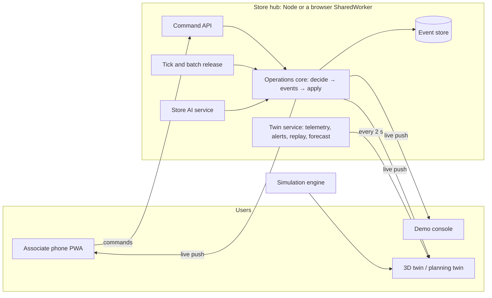

# Storewright project report

**A store digital twin and operations system for grocery stores** · Personal open-source project · October 2026

[中文](project-report.zh-CN.md) · [Purpose, results and outlook](purpose-and-outlook.en.md) · [Operation guide](../guide/operation-guide.en.md) · [Technical overview](../en/overview.md)

> This project is based on public information, common industry practice and the author's own design. **It is not affiliated with any retailer or company.** All data is synthetic, and every result is evidence level B (simulation under stated assumptions).
>
> Repository and live demo: *to be added after publishing*

---

## Summary

- **What it is**: a store digital twin for mid-size regional chains and independent grocers. Associates pick, stage and hand off online orders on their phones and handle backroom, replenishment and staffing work; the 3D store stays in sync with live operations, replays any moment of the day and forecasts the next three hours; when equipment crosses a limit, an alert with its impact reaches the shift lead's phone; every store has its own AI trained on its own machine; changes are tried first in a planning twin (a 2.5D / 3D full-day simulation). The whole system can run in the browser.
- **Size**: 4 apps and 9 shared packages, about 82,000 lines of TypeScript source; 381 unit and property tests, 83 end-to-end runs across browsers including accessibility checks, and a 221-step walkthrough; 16 design documents and 27 decision records.
- **Results** (simulation, mid-size store, 30 replications): overweight, crush-risk and chemical-mix totes 11–19% → 0; average wait −15%; time orders sit at the door −81%; labor +4.9%. With all AI on and the same labor: average wait −13%, 90th-percentile wait −23%, late orders 2.41% → 0.69%. Tested as a 300-person store: 300 devices connect in 0.09 s, and at 50 commands a second every device sees each change within about 15 ms.
- **My role**: product owner and domain designer. I defined the problem, business rules and acceptance criteria, made the design trade-offs and accepted each step on the phones and in the simulator. Code, tests and documents were written together with an AI coding assistant (section 3).

## 1. Background and problem

Most online grocery orders are fulfilled inside stores: associates push carts through the aisles, stage the orders, and wait for customers or drivers. Public sources show the hard parts: manual store picking runs at about 60–70 units per labor hour (consultancy estimate); average curbside waits were 3.5–5.4 minutes in 2019–2020 mystery shops; store inventory records are often wrong (65% in one study), which causes out-of-stocks and substitutions. Large chains have mature systems; mid-size and independent grocers often do not. Sources are in [Purpose, results and outlook](purpose-and-outlook.en.md) §1.

The question: **can a mid-size store use one customizable system, verified in simulation first, to make this work safer and faster, and state the costs clearly?**

## 2. Goals and constraints

| Goal or constraint | How it was met |
|---|---|
| For mid-size and independent grocers, customizable per store | A store configuration schema with templates (small, medium, large); layout, rules, modules and AI configured per store; the same core runs a home-improvement store |
| Results that hold up to questions | Evidence levels; common-random-number paired experiments, 95% confidence intervals, ablations, sensitivity analysis; a deliberately strong baseline |
| Easy to show | The planning twin runs in the browser; the whole store hub can run in the browser too, with no backend |
| Compliance | Public information and general workflow knowledge only; original UI and icons; neutral product and module names; a non-affiliation statement ([compliance statement](../../COMPLIANCE.md)) |
| One person can drive it | Phased work, each phase ending in a complete, presentable state |

## 3. My role and way of working

- **I was responsible for**: the problem and scope (target store, workflows, business rules and exceptions); the product and interaction direction (what is tapped and scanned at each step, and what happens when something goes wrong); design trade-offs (for example a default profile that puts service and safety first, with an efficiency profile as an option); acceptance of each phase (walking through it on the associate phones and in the simulator and asking for changes); the compliance boundary.
- **How it was built**: code, tests and documents were written together with an AI coding assistant (Claude Code by Anthropic), and every commit carries a `Co-Authored-By` line. Each phase started with a plan and ended with a decision record and a results document, and was accepted through unit tests, end-to-end tests and a walkthrough report with screenshots.
- **Why this works**: one person can cover product, algorithms, front end, back end, 3D and testing in a short time. The cost is that requirements must be written as checkable criteria, and every result needs an independent check (reproducing reports, reading walkthrough screenshots, operating the simulator by hand).

## 4. Solution overview



- **Operations layer**: online-order fulfilment (pick → stage → hand off, delivery trips), backroom inventory (receiving, put-away, counts, backroom retrieval), shelf replenishment (stock estimates, batches sized to a cart), staffing (schedules, on-duty team, temporary reassignment).
- **Twin layer**: store layout + event-sourced operations state + telemetry time series + AI predictions, in three tenses: live, replay and forecast.
- **AI layer**: demand, arrival time, shelf availability, counts, substitutions and staffing models trained locally; early warnings, a nudge hub, a closing review.
- **Planning twin**: a discrete-event simulation of a full day, policy comparison and a store editor; in Your Store, build your own store from an empty lot, then run the pre-opening check, a full-day simulation or a live sandbox.

## 5. Key design decisions

| Decision | Why | Cost |
|---|---|---|
| **An event-sourced, pure operations core**: `decide` returns events or a rejection code; `applyEvent` only applies events | Exact replay of any moment and a full audit trail; one core shared by the server, the phones and the 3D twin; tests check that replayed state equals live state | Every feature starts with its events; replay uses a checkpoint every 3,000 events to stay fast |
| **A transport-agnostic store hub**: the same code runs on Node (Fastify is only a shell) and in a browser SharedWorker | The demo needs only static hosting, and the store behaves the same in the browser and on the server | No Node-only APIs (for example a pure TypeScript SHA-256); a fallback for browsers without SharedWorker |
| **Simulation as the test bench** | With no real store data, results must stand up to questioning: common random numbers give every policy the same orders, differences are paired, and reports include confidence intervals, ablations and sensitivity | Results are evidence level B only |
| **Local-first AI with promotion gates** | Store data stays in the store; each model must beat a simpler method before going live; every recommendation states its reasons and runs in display, confirm or auto mode, and is downgraded automatically when it keeps missing; unknown actions are rejected | Models are simple (for example generalized linear models), but their effect is measured |
| **Telemetry kept out of the event log** | High-frequency readings would slow pushes to 300 devices; readings go every 2 s to twin viewers only, and phones do not subscribe | Replay reads readings and events from two sources |
| **Floor rules for quality and safety** | Stores can require scanning (taps are rejected, and the server checks barcodes, locations and slots); actions that affect people, money or customers need two steps; a reassignment can wait until the current order is done | One more confirmation, offset by sensible defaults and notifications that open the exact item |
| **Configuration-driven** | A store configuration schema, templates and an editor; a home-improvement store needs only configuration and modules | Every default needs a stated source |
| **Compliance as a design constraint** | Public information only, original UI and neutral names, written as rules from day one | Some details are simplified by reasonable assumption |

More in the [decision records](../decisions/) (27 of them).

## 6. Results and evidence

| Question | Result | Evidence |
|---|---|---|
| Better than a store with no dedicated system? | Overweight, crush-risk and chemical-mix totes 11–19% → 0; fill rate +1.0 point; average wait −15%; time at the door −81%; labor +4.9% (+0.4% in the efficiency profile) | [Phase 1 results](../06-phase1-results.md) |
| Does AI help with the same labor? | Average wait −13%, 90th-percentile wait −23%, late orders 2.41% → 0.69% | [AI results](../11-ai-results.md) |
| Does it transfer to another industry? | Yes, to a home-improvement store; the payoff shifts from batching to safety and AI staffing | [Modules and second industry](../12-business-modules.md) |
| Does it scale to a large store? | 300 devices connect in 0.09 s; at 50 commands a second every device sees each change within about 15 ms | [Live operations](../08-live-operations.md) |
| Is the 3D view smooth? | The mid-size store runs at 60 fps in all six quality and view combinations at 1440 × 900 on a high-DPI screen, about 4 ms of main-thread time per frame | [Simulator](../07-simulator.md) |
| Are the workflows easy to use? | Every role's steps were reviewed, 18 states where work could get stuck were fixed, and 25 simplifications were implemented; taps and scans per unit of work are compared before and after | [Operation flows (Chinese)](../16-operation-flows.md) |

No profile wins on every measure: the default profile spends a little more labor for safety and shorter waits, and the efficiency profile adds almost no labor. Each store chooses by its own priorities and sees the trade-off in simulation before going live.

## 7. Quality

- **Unit and property tests** (Vitest + fast-check): 381, covering every rule of the operations core, replay equality, algorithms, simulation, AI and the API.
- **End-to-end tests** (Playwright): the real backend, the in-browser demo (including real taps on the two phones in the showcase) and accessibility checks; 83 runs across Chromium, WebKit (Safari), Firefox, iPhone, Android and browsers without SharedWorker.
- **Accessibility**: every control has an accessible name, text contrast meets WCAG 2.1 AA in light and dark themes, and sign-in works with the keyboard alone.
- **Walkthrough**: 22 sections and 221 steps, each with a screenshot, assembled into an illustrated report and rerun after every major change.
- **Reproducibility**: the Phase 1, AI and industry reports reproduce line by line; a capacity test simulates a 300-person store.
- **Continuous integration**: GitHub Actions runs type checks, unit tests and the multi-browser tests.

## 8. Challenges and how they were solved

1. **Live sync for 300 devices**: telemetry is separate from operations events, phones receive only operations changes, and pushes are batched at peaks; result: 0.09 s to connect and about 15 ms to sync.
2. **The whole backend in a browser**: a transport-agnostic hub inside a SharedWorker, so all tabs share one store; data is written to IndexedDB and operations events are cleared after 12 hours without use; browsers without SharedWorker get a dedicated worker per page, with a notice.
3. **3D performance**: shelves, vehicles, people and trees use instanced meshes, static parts are merged, and the simulation runs in a Web Worker; everything is generated in code, with no downloaded assets.
4. **Credible results**: a deliberately strong baseline (preparation starts when the customer taps "on my way"); a written list of what may and may not be claimed; every number comes with assumptions and a confidence interval.
5. **Hidden friction in the workflows**: each role was reviewed step by step (what is tapped and scanned, what the system does, what other devices see); 18 states where work could get stuck were fixed, all 25 simplifications were implemented and checked with the walkthrough.

## 9. Limits and next steps

- No real store data and no field pilot; no real sign-in in the demo; no local language model downloaded; no real device integration; no operational A/B test yet.
- Next: a public repository and live demo; calibration on public datasets; real device integration; the sign-in, roles and security review a production deployment needs. Checking results against reality would also need anonymized data from a real store, a small pilot of one workflow and A/B tests. See [Purpose, results and outlook](purpose-and-outlook.en.md) §4–5.

## 10. What I learned

- **Design from the floor**: every extra tap or scan is a cost, and rules must cover the exceptions (cancellations, no-shows, out-of-stocks, broken equipment) or work gets stuck.
- **Evidence over claims**: decide how to compare before building the feature, and write down what may and may not be claimed.
- **Working with an AI assistant**: write requirements as checkable criteria, keep every phase presentable, accept results through tests, walkthroughs and hands-on use, and record every decision with its reasons.
- **Compliance is part of the design**: information boundaries, naming and licenses are easier to manage from day one than to fix later.

## 11. Tech stack

TypeScript (strict, npm-workspaces monorepo) · React 18 · three.js, React Three Fiber, drei · zustand · Fastify 5, WebSocket · PGlite / PostgreSQL · MQTT · zod · Vite · Vitest, fast-check · Playwright · GitHub Actions · Docker

## 12. A five-minute demo

1. Open the showcase: the console, two associate phones and the 3D digital twin on one page (30 s).
2. Place an order in the console and watch it being picked, staged and handed off on the phones while it moves in the 3D twin (90 s).
3. In the console's "Equipment and alerts", make a staging cooler fail: the alert reaches the shift lead's phone with the orders affected, and the area flashes red in the twin (45 s).
4. Drag the twin's timeline: back is replay, forward is forecast (45 s).
5. Open the full-day simulation and policy comparison to see the trade-offs between the baseline, the default profile and the efficiency profile (60 s).
6. Close with the caveat: these are simulation results on synthetic data, evidence level B (30 s).

## 13. Reproduce

Requires Node.js 20 or later.

```bash
npm install
```

```bash
npm run check
```

```bash
npm run build:site
```

```bash
npm run demo:site
```

```bash
npm run compare
```

```bash
npm run ai-report
```

`npm run compare` writes the first comparison report and `npm run ai-report` the AI benefit report, both into `experiments/results/`.
