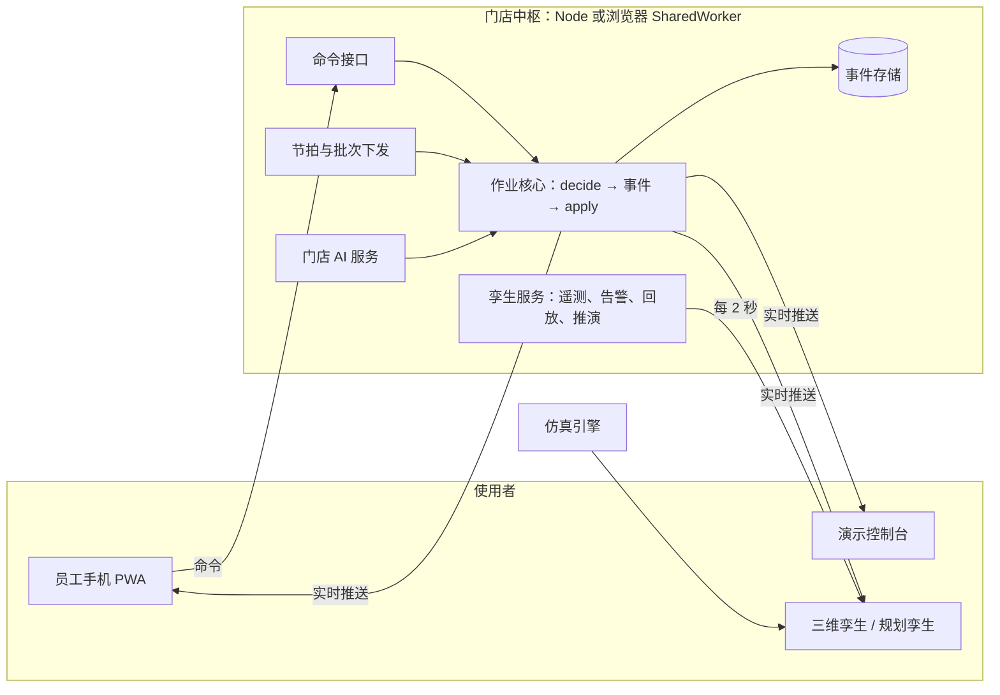

# Storewright 项目报告

**面向超市的门店数字孪生与作业系统** · 个人开源项目 · 2026 年 10 月

[English](project-report.en.md) · [项目目的与展望](purpose-and-outlook.zh-CN.md) · [操作指南](../guide/operation-guide.zh-CN.md) · [英文技术概览](../en/overview.md)

> 本项目基于公开资料、行业通用做法和作者的独立构想设计。**本项目与任何零售商、企业无隶属关系。** 所有数据都是合成的；结果都是证据等级 B（在列明的假设下仿真得到）。
>
> 仓库地址：[github.com/Glacieerr/storewright](https://github.com/Glacieerr/storewright) · 在线演示：[展示页](https://glacieerr.github.io/storewright/) · [门店模拟器](https://glacieerr.github.io/storewright/sim/)

---

## 摘要

- **做了什么**：一套面向中型区域连锁和独立超市的门店数字孪生。员工手机上完成线上订单的拣货、暂存、交付，以及后仓、补货和人员调配；三维门店和现场作业实时同步，可以回放当天任意时刻、推演未来 3 小时；设备越线时，带着影响分析的告警推到带班负责人的手机上；每家店有自己在本机训练的 AI；改动之前先在规划孪生（2.5D / 3D 全天仿真）里试。整个系统可以直接在浏览器里运行。
- **规模**：4 个应用、9 个共享包，约 8.2 万行 TypeScript 源代码；383 个单元与属性测试，83 个多浏览器端到端测试（含无障碍检查），221 步的全流程走查；16 份设计文档、27 条决策记录。
- **结果**（仿真，中型店，30 次重复）：超重、压坏风险、化学品混装的框从 11–19% 降到 0；平均到店等待 −15%；订单在门口停留 −81%；工时 +4.9%。工时不变时打开全部 AI：平均等待 −13%，90 分位等待 −23%，迟到订单 2.41% → 0.69%。按 300 人大型店测试：300 台设备 0.09 秒连上，每秒 50 条操作时约 15 毫秒内同步到所有设备。
- **我的角色**：产品负责人和领域设计者。我定义问题、业务规则和验收标准，做设计取舍，在手机和模拟器上逐步验收；代码、测试和文档是我和 AI 编程助手协作完成的（见第 3 节）。

## 1. 背景与问题

超市的线上订单大部分在门店里完成：员工推车在货架间拣货，放进暂存区，等顾客到店或司机来取。公开资料里能看到几个难处：人工拣货大约每工时 60–70 件（咨询公司估算）；路边取货的平均等待在 3.5–5.4 分钟（2019–2020 年的神秘顾客调查）；门店库存记录常常不准（一项研究里 65% 不准），带来缺货和替代。大型连锁有成熟的系统，中型区域连锁和独立超市往往没有。来源见 [项目目的与展望](purpose-and-outlook.zh-CN.md) 第 1 节。

要回答的问题：**一个中型门店能不能用一套可以定制、可以先在仿真里验证的系统，把这些作业做得更安全、更快，并且说得清楚代价？**

## 2. 目标与约束

| 目标与约束 | 怎么落实 |
|---|---|
| 面向中型和独立超市，每家店可以定制 | 门店配置有 schema 和模板（小、中、大型店），布局、规则、模块、AI 都按店配置；同一套核心迁移到家居建材店 |
| 结论经得起追问 | 证据分级；公共随机数配对实验、95% 置信区间、消融、敏感性分析；基线刻意设得偏强 |
| 能直接展示 | 规划孪生纯前端运行；整个门店中枢也能跑在浏览器里，不需要后端 |
| 合规 | 只用公开信息和对通用工作流的理解；界面、图标原创；产品和模块中性命名；写明无隶属关系（[合规声明](../../COMPLIANCE.md)） |
| 一个人能推进 | 分阶段推进，每个阶段结束都有能展示的完整成果 |

## 3. 我的角色与工作方式

- **我负责**：确定问题和范围（目标门店、作业流程、业务规则和异常情况）；产品和交互的方向（每一步按什么、扫什么、出错时怎么办）；设计取舍（例如默认档位「服务与安全优先」，效率优先作为可选档位）；每个阶段的验收（在员工手机和模拟器上走查，提出修改）；合规边界。
- **实现方式**：代码、测试和文档是我和 AI 编程助手（Anthropic 的 Claude Code）协作完成的，所有提交都带 `Co-Authored-By` 标注。每个阶段开始前定计划，结束时写决策记录和成果文档，用单元测试、端到端测试和带截图的走查报告验收。
- **这样做的好处**：一个人可以在短时间内覆盖产品、算法、前后端、三维和测试；代价是要把需求写成能验收的标准，并且对每个结果做独立检查（例如复现报告、看走查截图、在模拟器里亲自操作）。

## 4. 方案概览



- **作业层**：线上订单履约（拣货 → 暂存 → 交付、配送行程）、后仓库存（收货、上架、盘点、后仓补取）、货架补货（存量估算、按推车装载量分批）、人员调配（排班、在岗人员、临时调人）。
- **孪生层**：门店布局 + 事件溯源的作业状态 + 遥测时间序列 + AI 预测；实时、回放、推演三种时间。
- **AI 层**：订单量、到店时间、可售概率、盘点、替代、排班等模型在本机训练；运营预警、建议中枢、打烊复盘。
- **规划孪生**：离散事件仿真跑一整天，对比策略，编辑门店；在「你的商店」里从一块空地搭建自己的门店，开业检查之后跑全天仿真或开实时沙盒。

## 5. 关键设计决策

| 决定 | 为什么 | 代价 |
|---|---|---|
| **事件溯源的纯函数作业核心**：`decide` 只返回事件或拒绝代码，`applyEvent` 只应用事件 | 可以精确回放任意时刻、留下完整审计记录；服务端、手机和三维孪生共用一个核心；测试可以检查「重放结果和实时状态逐项相同」 | 每个功能都要先想清楚事件；回放用每 3,000 个事件一个检查点保证速度 |
| **与传输无关的门店中枢**：同一份代码跑在 Node（Fastify 只是外壳）和浏览器的 SharedWorker 里 | 演示只要静态托管；浏览器里的门店和服务端行为一致 | 不能用 Node 专有接口（例如改用纯 TypeScript 的 SHA-256）；不支持 SharedWorker 的浏览器要有退路 |
| **仿真当评测场** | 没有真实门店数据，结论必须能被追问：公共随机数让各策略面对同一批订单，差值配对计算，报告置信区间、消融和敏感性 | 结论只能是证据等级 B |
| **AI 本地优先、有上线门槛** | 门店数据留在门店；每个模型和更简单的方法比，好才上线；每条建议写理由，分只显示、需确认、自动执行三种模式，连续不准自动降级；系统不认识的动作直接拒绝 | 模型偏简单（例如广义线性模型），但效果可以度量 |
| **遥测不进事件流** | 设备读数频率高，进事件流会拖慢 300 台设备的推送；读数每 2 秒推给看孪生的画面，手机不订阅 | 回放时读数和事件分两路取 |
| **现场的质量与安全规则** | 门店可以「要求扫码」（点选被拒绝，服务端核对条码、货位、格位）；涉及人、钱、顾客的动作两步确认；调人可以「做完这一单再去」 | 多一步确认，用默认值和直达提醒把多出来的点按降下去 |
| **配置驱动** | 门店配置有 schema、模板和编辑器；换成家居建材店只改配置和模块 | 默认参数要逐个说明来源 |
| **合规当设计约束** | 只用公开信息、原创界面、中性命名，从第一天写进规则 | 有些细节只能按合理推测做简化 |

更多决定见 [决策记录](../decisions/)（27 条）。

## 6. 成果与证据

| 问题 | 结果 | 依据 |
|---|---|---|
| 比没有专门系统的门店好吗？ | 超重、压坏风险、化学品混装框 11–19% → 0；订单满足率 +1.0 个百分点；平均等待 −15%；门口停留 −81%；工时 +4.9%（效率优先档位 +0.4%） | [06 Phase 1 成果](../06-phase1-results.md) |
| 工时不变，AI 有用吗？ | 平均等待 −13%，90 分位等待 −23%，迟到订单 2.41% → 0.69% | [11 AI 效益报告](../11-ai-results.md) |
| 能迁移到别的行业吗？ | 能，迁到家居建材店；收益从分批转向安全和 AI 排班 | [12 扩展模块](../12-business-modules.md) |
| 撑得住大店吗？ | 300 台设备 0.09 秒连上；每秒 50 条操作时所有设备约 15 毫秒内看到变化 | [08 实时作业](../08-live-operations.md) |
| 三维画面流畅吗？ | 中型店在 1440 × 900 高分屏上 6 种画质和视角组合都是 60 fps，每帧主线程约 4 毫秒 | [07 运营模拟器](../07-simulator.md) |
| 流程好不好用？ | 逐个岗位梳理所有操作步骤，修好 18 个会卡住的状态，实施 25 条简化；每单位工作的点按和扫码次数都有对照 | [16 操作流程](../16-operation-flows.md) |

没有一个档位在所有指标上都赢：默认档位用多一点工时换安全和等待时间，效率优先档位几乎不加工时。门店按自己的优先级选，并在上线前先在仿真里看到取舍。

## 7. 质量保障

- **单元与属性测试**（Vitest + fast-check）：383 个，覆盖作业核心的每条规则、重放一致性、算法、仿真、AI 和接口。
- **端到端测试**（Playwright）：真实后端、浏览器内演示（包括展示页里两部手机的真实点击）和无障碍检查；在 Chromium、WebKit（Safari）、Firefox、iPhone、安卓和不支持 SharedWorker 的浏览器上共 83 个。
- **无障碍**：每个控件都有可访问的名称，浅色和深色主题的文字对比度达到 WCAG 2.1 AA，只用键盘也能登录。
- **全流程走查**：22 个部分、221 步，每步截图，生成图文报告；每次大改后重跑。
- **可复现**：Phase 1、AI 和行业报告能逐行复现；容量测试模拟 300 人的门店。
- **持续集成**：GitHub Actions 跑类型检查、单元测试和多浏览器测试。

## 8. 难点与解决

1. **300 台设备的实时同步**：遥测和作业事件分开，手机只收作业变化，高峰时合批推送；结果是 0.09 秒连上、约 15 毫秒同步。
2. **整个后端跑在浏览器里**：中枢与传输无关，放进 SharedWorker，所有标签页共用一家店；数据写进 IndexedDB，超过 12 小时不用自动清空作业事件；不支持 SharedWorker 的浏览器每个页面用专用 Worker，并在页面上说明。
3. **三维性能**：货架、车辆、人物、树木都用实例化网格，静态构件合并，仿真放在 Web Worker；所有画面都是程序生成的，不下载素材。
4. **结论可信**：基线刻意设得偏强（顾客点「我在路上」就开始准备）；写清「可以说」和「不能说」的结论；每个数字都带假设和置信区间。
5. **流程里看不见的卡点**：按「每一步按什么、扫什么、系统做什么、别的设备看到什么」逐个岗位梳理，找出 18 个会让作业卡住的状态并修好，然后把 25 条简化全部实施，再用走查验证。

## 9. 局限与下一步

- 没有真实门店数据和现场试点；演示没有真正的登录；本地语言模型没有下载；真实设备没有联调；运营上的 A/B 还没做。
- 下一步：用公开数据集校准；真机联调；正式部署需要的登录、权限和安全审计。要用真实结果检验，还需要真实门店的匿名数据、一条流程的小范围试点和 A/B。详见 [项目目的与展望](purpose-and-outlook.zh-CN.md) 第 4、5 节。

## 10. 收获

- **从现场作业出发做设计**：每多点一下、多扫一下都要算进成本；规则要覆盖异常情况（取消、没来、缺货、设备坏了），否则作业会卡住。
- **证据比说法重要**：先定好怎么比，再做功能；能说什么、不能说什么，提前写下来。
- **和 AI 协作的方法**：把需求写成能验收的标准；每个阶段都要能展示；用测试、走查和亲自操作验收；把每个决定和理由写成记录。
- **合规是设计的一部分**：信息边界、命名和许可证从第一天开始管，比事后补救省事。

## 11. 技术栈

TypeScript（严格模式，npm workspaces 单仓）· React 18 · three.js、React Three Fiber、drei · zustand · Fastify 5、WebSocket · PGlite / PostgreSQL · MQTT · zod · Vite · Vitest、fast-check · Playwright · GitHub Actions · Docker

## 12. 五分钟演示路线

1. 打开展示页：控制台、两部员工手机、三维数字孪生同时在一个页面里（30 秒）。
2. 在控制台下一张单，看它在手机上被拣货、暂存、交付，同时出现在三维孪生里（90 秒）。
3. 在控制台的「设备与告警」里让一台暂存冷柜出故障：告警带着受影响的订单推到带班负责人的手机上，三维孪生里对应区域闪红（45 秒）。
4. 拖动孪生底部的时间轴：往回是回放，往前是推演（45 秒）。
5. 打开全天仿真和策略对比，看基线、默认档位、效率优先三种做法的取舍（60 秒）。
6. 最后说明：这些是合成数据上的仿真结果，证据等级 B（30 秒）。

## 13. 复现

需要 Node.js 20 或更高版本。

```bash
npm install
```

```bash
npm run check
```

```bash
npm run build:site
```

```bash
npm run demo:site
```

```bash
npm run compare
```

```bash
npm run ai-report
```

`npm run compare` 生成第一轮对比实验报告，`npm run ai-report` 生成 AI 效益报告，报告写入 `experiments/results/`。
