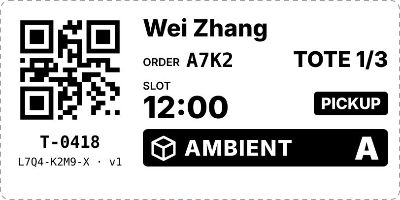
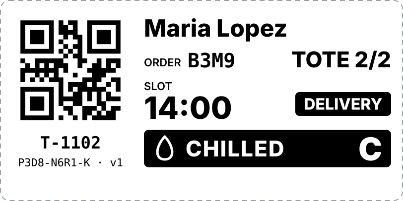
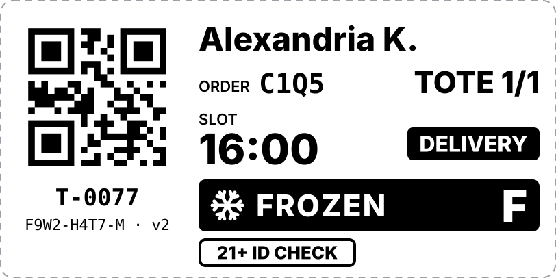
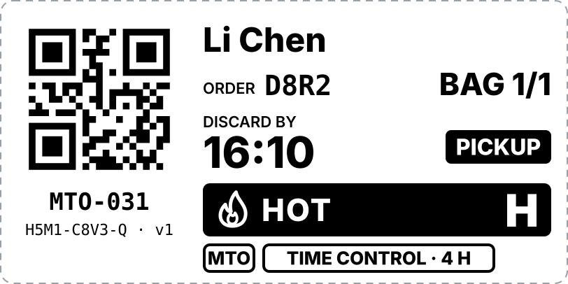
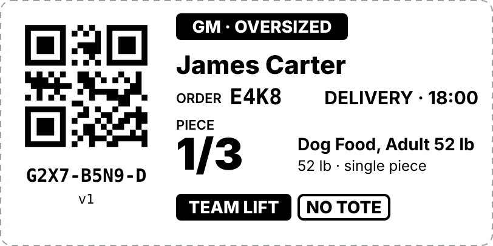
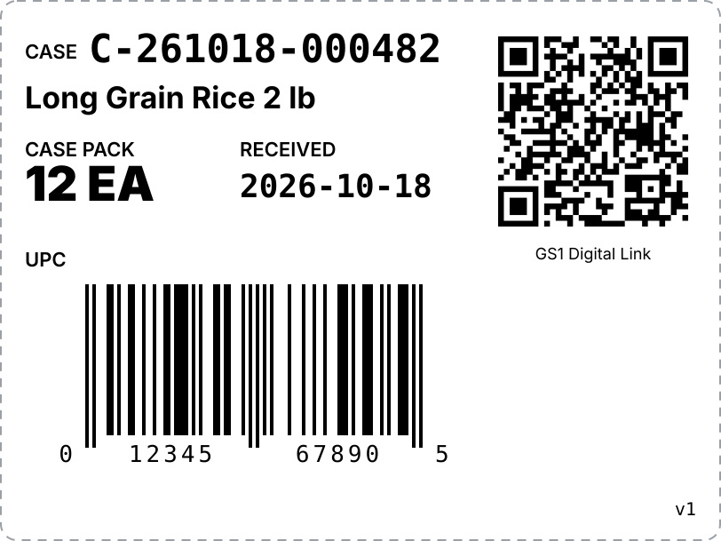
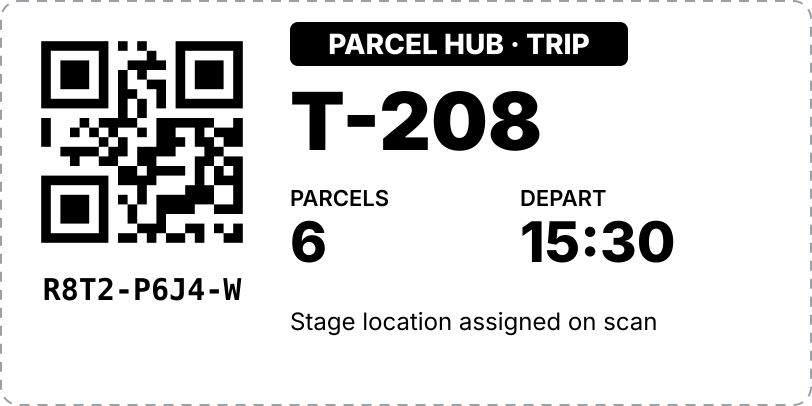

# 标签样本 v0.1

> 对应决策 L-01 至 L-05、GM-03、I-02。所有样本中的姓名、订单号、商品均为虚构。
> 规格：4" × 2"（后仓箱标签 4" × 3"），203 dpi 热敏打印，**单色**，统一使用冷冻级标签纸。
> 所有二维码均已用解码器验证可读；后仓箱标签上的 UPC-A 条码校验位正确。

## 设计原则

| 原则 | 说明 |
|---|---|
| **单色打印** | 热敏标签打印机只能打印黑色。温区不靠颜色区分，而是用**黑底反白条带 + 图标 + 温区名称 + 大字母代码**（A / C / F / H），两三米外也能分辨 |
| **二维码不含个人信息** | 二维码只编码不透明的标签 ID（例如 `SW1:L7Q4K2M9X`），所有订单信息由系统后台查询（决策 L-01） |
| **姓名格式** | 名 + 姓；超过长度上限时显示「名 + 姓的首字母」，例如 `Alexandria K.`（决策 L-02） |
| **版本号** | 只在作废重建时递增；因丢失而重打时版本号不变（决策 L-04） |
| **暂存位置不预印** | 打印时还不知道放在哪个格位，位置只存在系统中 |
| **视觉层级** | 最大的字是交付时最常用的信息：时段、框序号、温区；其次是姓名和订单号 |

## 1. 取货框标签

### 常温 · 自取

### 冷藏 · 配送

### 冷冻 · 配送 · 年龄限制 · 长姓名缩写

- `21+ ID CHECK`：交付时必须核验身份证件；
- `v2`：这张标签曾因作废重建而递增版本号，`v1` 已失效。

### 熟食（MTO）· 时间控制

- 熟食采用「以时间作为公共卫生控制」方案时，必须打印**丢弃时间**（最长 4 小时）；
- 如果改用热保温（≥ 135°F）方案，则不打印丢弃时间，改为标注保温要求。两种方案只能二选一；
- 熟食容器用 `BAG` 代替 `TOTE`。

| 字段 | 位置 | 说明 |
|---|---|---|
| 二维码 | 左上 | 不透明标签 ID |
| 框号 | 二维码下方 | 内部物理框编号，例如 `T-0418` |
| 标签 ID · 版本号 | 框号下方 | 二维码无法扫描时可手动输入 |
| 顾客姓名 | 右上 | 名 + 姓 |
| 订单短号 | 第二行左 | 便于口头核对 |
| 框序号 | 第二行右 | x / n |
| 时段 | 第三行左 | 时段起点；熟食显示丢弃时间 |
| 交付类型 | 第三行右 | PICKUP / DELIVERY，黑底反白 |
| 温区条带 | 第四行 | 图标 + 名称 + 字母代码 |
| 特殊标记 | 底部 | 21+、MTO、时间控制、化学品等 |

## 2. GM-Oversized 一件一签

- 员工扫描商品 UPC 后，用便携打印机现场打印（先扫后打）；
- `PIECE 1/3`：同一订单同一商品的第几件；
- `TEAM LIFT`：单件超过 50 lb，需要两人搬运或使用设备；
- `NO TOTE`：不装框，直接放推车底层或大件区。

## 3. 后仓箱标签

- 每箱都打印，箱号由本地数据库生成（决策 I-02），在收货工位按托盘批量打印；
- 二维码采用 **GS1 Digital Link** 格式：`/01/` 后是 14 位商品编码（GTIN），`/21/` 后是内部箱号；
- **仓库分区标识不打印在标签上**，只保存在数据库中；
- 样本中的 UPC `012345678905` 是标准示例编码。

## 4. 行程标签（Parcel Hub）

- 一个行程一张标签，贴在行程暂存位；
- 暂存位置扫描后确定，不预印。

## 待确认的调整点

1. 字体大小：时段和框序号是否需要更大？
2. 姓名长度上限：样本按约 14 个字符截断，是否合适？
3. 是否需要在标签上增加门店编号（多店部署时）？
4. 熟食默认采用「时间控制」还是「热保温」方案？
